# 大模型推理系统工程：性能、诊断与优化

## v0.12

2026-10。全文 18 章。

每一处数值都带来源：第三方公开数据、官方规格或推导。

## 目录

- [第1章](#ch-01)
- [第2章](#ch-02)
- [第3章](#ch-03)
- [第4章](#ch-04)
- [第5章](#ch-05)
- [第6章](#ch-06)
- [第7章](#ch-07)
- [第8章](#ch-08)
- [第9章](#ch-09)
- [第10章](#ch-10)
- [第11章](#ch-11)
- [第12章](#ch-12)
- [第13章](#ch-13)
- [第14章](#ch-14)
- [第15章](#ch-15)
- [第16章](#ch-16)
- [第17章](#ch-17)
- [第18章](#ch-18)

---

<a id="ch-01"></a>
## 第1章 一次推理请求的完整路径

**核心论点：**先确定研究对象和测量边界，再讨论模型快慢；一次业务任务、一次接口请求和一次模型执行不是同一个单位。

### 本章导航

读完本章，你应该能够：

1. 给一次业务完成过程分层命名——任务、请求、模型调用、尝试、会话——并把客户端状态、服务端状态、任务结果与资源释放分成四张互不混淆的账；
2. 在**同一个可比时间域内**定义端到端时间，并按依赖图而不是按日志列表重建关键路径；
3. 说出"同一个模型名称"之外还必须固定哪些制品身份，以及可复现性有哪四个层次；
4. 把流式响应中的协议事件、观测层间隔与 Token 数分开识别，知道块边界不等于分词边界；
5. 把引擎拆成前端、调度器、Model Runner、执行后端等职责层，并知道"声明支持"与"实际启用"需要用不同强度的证据；
6. 对账发出、接收、完成、取消、超时和未终结的请求，识别幽灵负载与重试放大，并知道重试放大的假设边界。

---

<a id="sec-01-01"></a>
### 1.1 系统边界：任务、请求、会话与模型调用

**本节要回答的问题：**我们究竟在优化哪一种完成单位？

一个团队报告"我们的大模型服务很慢，端到端要 6.7 秒"。这句话没有错，但它几乎不包含可执行的优化信息：这 6.7 秒里有检索、有工具查询、有模型调用、有客户端渲染，而团队准备购买的新型加速卡只能影响其中的一段。工程判断的第一步永远是拆分与命名——把"慢"这个形容词，换成一张谁都能核对的账本。

#### 1.1.1 业务任务与接口请求

设想一个合同审查助手。用户上传一份 30 页的 PDF，点击"分析风险点"，约 6.7 秒后看到结果。用户感知到的是一次**业务任务**（task）：从点击到答案可读。系统内部的动作序列必须写清楚，尤其是**依赖关系**——哪些步骤必须等别人先完成。

本例采用的结构是：主模型生成与条款查询工具之间是**独立预取关系**，即工具在任务早期被触发（触发点 = 文档解析完成后），其结果只供最后的结果组装消费（消费者 = S8），且必须在 S8 开始前完成（汇合点 = S8 起点，早于 S6 结束）。只有在这三个条件被实际记录证实之后，才能把工具耗时视为可被覆盖的区间；若工具结果要被答案本身消费（"工具提出调用 → 执行 → 结果回填 → 后续生成"），它就是串行的一段，不能自动隐藏。

| 段 | 内容 | 墙钟耗时 (s) | 依赖 | 谁负责 |
|---|---|---:|---|---|
| S1 | 网关鉴权与配额 | 0.08 | 串行前置 | 平台 |
| S2 | 文档解析与切块 | 0.35 | S1 之后 | 应用 |
| S3 | 向量检索召回 12 段 | 0.90 | S2 之后 | 检索服务 |
| S4 | 重排模型对 12 段打分 | 0.60 | S3 之后 | 推理服务（评分调用） |
| S5 | 主模型 Prefill（8k 输入） | 1.20 | S4 之后 | 推理服务 |
| S6 | 主模型 Decode（900 输出） | 3.10 | S5 之后 | 推理服务 |
| S7 | 条款查询工具（**S2 完成后立即触发**，独立预取） | 0.45 | 不阻塞 S5/S6，**汇合点固定为 S8 起点** | 外部工具 |
| S8 | 组装、校验、返回 | 0.12 | S6 与 S7 均完成后 | 应用 |
| S9 | 客户端解析与渲染 | 0.35 | 收到全部内容后 | 客户端 |

以上数值为构造数据。其中列入配套E0清单的算术关系已执行自动检查，其余项不据此宣称程序验证：

| 计算口径 | 结果 (s) | 说明 |
|---|---:|---|
| S1—S6 加 S8（不含 S9、不含工具） | 6.35 | 服务端到"最后一字节写出"的关键路径 |
| 上项加 S9 | 6.70 | 用户视角端到端（工具与解码重叠的情形） |
| 九段全部串行相加 | 7.15 | 工具结果被答案消费时的端到端 |
| 重叠情形下盲目相加的高估量 | 0.45 | 等于 S7 的耗时 |
| 若把 Decode 缩短 30% 后 S7 是否仍被覆盖 | **仍被覆盖** | 本例 S7 在 0.88 s 完成，S5 在 3.13 s 完成；即使 Decode 归零，S7 也不成为关键路径 |
| 重试是否计入 6.70 s | **否** | 6.70 s 是"首次尝试即成功"的单次时间线；重试另开一条 attempt 记录，其耗时进入 attempt 层统计与成本分子 |
| 仅 Decode 缩短 30% | 5.77 | 其余段与关键路径结构不变 |
| 仅 Decode 理想化为零 | 3.60 | **条件化乐观下界**，不是实机可达值 |

由此得到的结论必须写成条件句：**在本案例中，假设 S7 与解码的重叠关系已被事件记录确认，且调整后其他阶段与关键路径不变，端到端时间为 6.70 秒。将 3.10 秒的解码耗时缩短 30%，可减少 0.93 秒，使端到端降至 5.77 秒。仅优化解码，即使将其耗时理想化为零，剩余串行阶段仍为 3.60 秒，因此单靠这一段无法达到 3 秒目标。这并不证明同时优化 Prefill、检索、重排或任务结构也无法达标。** 另外，3.60 秒是把一个阶段理想化到零得到的乐观下界，用于判断"单段优化能否达成目标"，不可用作任何可达性能的承诺。

**这段推导的价值在于：它能在花钱之前识别出哪些路径不可能达成目标。** 在上面的假设下，"只优化 Decode"这条路径被排除；至于同时优化 Prefill、检索、重排，或改变任务结构（流式呈现、先要点后全文、进一步并行化检索与工具）能否达到 3 秒，本账本**没有给出结论**——它需要各自的账与各自的实验。不要把"单段优化不可行"扩大成"只有改任务结构才可行"。

要把这类账本写对，先要把对象分层。下表给出五类常被混用的对象；**注意它们不全是"完成单位"——会话是上下文容器，不是一种完成**：

| 对象 | 定义 | 典型标识 | 失败/异常意味着什么 |
|---|---|---|---|
| 业务任务 task | 用户视角的一次交付，由**预先写好的任务契约**判定成功 | `task_id` | 未按契约交付（可能部分成功） |
| 接口请求 request | 一次对服务的逻辑调用 | `request_id` | 这次调用未按契约返回 |
| 物理尝试 attempt | 一次实际发出的网络尝试（含重试） | `attempt_id` | 这次尝试超时或被拒 |
| 模型调用 model call | 一次对模型的调用：生成、评分、嵌入等不同类型 | `model_call_id` | 这次调用未完成 |
| 会话 session | 多次请求共享的上下文容器 | `session_id` | 上下文丢失或被错误复用 |

两个常被忽略的细节：

- **一次生成不等于一次前向。** 通常所说的"生成 900 个 Token"在实现上意味着数百次迭代执行；把 model call 写成"一次前向 + 生成"是不准确的。评分类调用（如上面的 S4 重排）与生成类调用的资源特征也不同，不应共用一套口径。
- **会话不必是任务或请求的严格父级。** 多个任务可以共享一个会话，一个任务也可以横跨多个会话；用 session 作为统计层级的根节点会算错。

另设一个“主请求发生一次重试”的映射变体（不属于前述首次尝试即成功的 6.70 s 时间线），避免"一次任务等于几次调用"停留在口头：

| 层 | 本例计数 | 说明 |
|---|---:|---|
| task | 1 | 一次合同风险分析 |
| request | 2 | R1 重排服务调用；R2 主模型调用 |
| attempt | 3 | R2 曾超时一次，客户端重试后成功 |
| model call | 2 个逻辑调用；实际执行数待核对 | 若 R2 两个 attempt 都进入执行且未去重，则有 3 次模型执行；若命中幂等去重才可能只有 2 次 |

之所以不写"7 次请求"，是因为那需要另一份调用图；**没有映射的数量不要出现在案例里**。

#### 1.1.2 会话状态与多次调用

多轮对话让完成单位进一步复杂化。第二轮请求必须携带第一轮的上下文，而上下文的存放位置至少有三种：客户端拼接后重发、服务端按会话标识保存、以及模型服务内部复用 KV 状态。三者的性能含义完全不同，但对外表现可能一模一样。

按结构划分，负载至少有四类，它们在本书后续章节中会反复出现：

| 结构 | 特征 | 上下文传递方式 | 关键测量差异 |
|---|---|---|---|
| 独立请求 | 请求之间无关联 | 不需要 | 可把每次请求视为独立样本 |
| 线性会话 | 第 $n$ 轮依赖前 $n-1$ 轮 | 重发或服务端保存 | 需区分历史长度、**实际未复用的 Token 数**、算法工作量与墙钟时间 |
| 共享历史分支 | 同一历史派生多个后续 | 共享前缀 + 分叉 | 前缀复用命中率成为主要变量（见 v0.3 设计稿第4章） |
| 独立子任务 | 一个任务拆成多个并行子调用 | 各自独立上下文 | 需按任务统计完成时间与成本 |

线性会话的增长要小心表述。历史长度逐轮变大，但**实际需要处理的 Token 数取决于有多少被复用**：若引擎命中了前缀缓存，需要处理的是未复用的那部分；若没有命中，才是全部历史。算法工作量（与未复用 Token 数相关）与墙钟时间之间还隔着排队、批组成与设备占用，因此不能把"输入变长 8 倍"直接写成"耗时增加 8 倍"。**正确做法是分开记录四个量：历史 Token 数、未复用 Token 数、算法工作量、墙钟时间**，缺哪一个都无法复核。

多分支的成败判定必须预先写进任务契约，而不是事后解释。举例：

> 任务契约规定"三个并行分支须在 8 秒内全部返回，否则降级为部分结果"。实测三个子调用的服务端终态都是 `completed`，但最慢的那个在 8.3 秒才返回，超过截止时间，于是 `task_outcome` 记为 `partial_success`（按契约降级）。
>
> 这不是矛盾：三个子调用成功描述的是**调用层**，部分成功描述的是**任务层**。两者分属不同层次，靠 `task_id` 聚合。

反过来也成立：**"任一子调用失败即任务失败"不是通则**，它只适用于全部分支必需、且没有回退、重试、冗余或降级策略的流程。有降级路径的任务，子调用失败可能只导致质量下降。任务是否成功，永远由契约判定，不由某一个子调用的状态判定。

#### 1.1.3 系统内外责任边界

确定了完成单位之后，还要划定**被测系统**（System Under Test，SUT）的边界。同一次合同审查，若 SUT 只定义为"主模型推理服务"，那么 S2 的解析与 S3 的检索都是外部依赖；若 SUT 定义为"合同审查应用整体"，它们就是内部段。两种定义都合理，但不能混用：在 A 定义下优化检索取得的收益，不能记到 B 定义的账上。

判断一段耗时归属，可以反复问三个问题：

1. **引入者是谁？** 这段代码/服务由谁部署、谁配置、谁升级？
2. **能否单独测量？** 有没有一个接口或事件，可以在不触发其他段的情况下测到它？不能单独测量的段，只能整体观测，也就无法单独归因。
3. **优化后谁负责维护？** 若一段耗时优化后无人承接回归测试，这个收益会在下一个版本悄悄消失。

外部依赖必须单独记账，而不是笼统归入"其他"。至少保留三条记录：调用次数、墙钟耗时分布（不只是均值）、失败与超时次数。很多"推理服务变慢"的事故，根因其实是下游检索服务的 P99 从 80 ms 涨到 900 ms——而如果压测时把检索 mock 掉了，这个变量永远不会出现在你的实验里。

一个实用的做法是维护"责任边界表"，随每次实验档案一起保存：

```text
责任边界表
--------------------------------------------------
SUT 定义          : 主模型推理服务（HTTP 接口 /v1/chat）
包含              : 网关鉴权、排队、prefill、decode、流式返回
外部依赖          : 向量检索、条款查询工具、重排模型
外部依赖记账方式  : 单独计时 + 记录失败；不并入主服务延迟
工具依赖假设      : 条款查询为独立预取，汇合于结果组装前（待事件记录确认）
排除              : 客户端渲染、公网链路（用同机房压测客户端规避）
--------------------------------------------------
```

**本节要点**

- 任务、请求、模型调用、尝试是完成相关对象，会话是上下文容器；四者的失败语义互不相同，且会话不是它们的严格父级。
- 端到端时间不是各段之和；只有按依赖建立的关键路径可以直接相加，并须说明重叠已被什么证据确认。
- 单段优化的收益上限由该段在关键路径中的占比决定；"某段归零"只是条件化乐观下界。
- 任务成功由预先定义的契约判定；子调用状态与任务结果分属不同层次。

**常见误区**

- **误：**"服务吞吐 120 QPS"描述了业务能力。
  **正：**先说明分母是任务、请求还是 attempt，是否含重试与外部依赖耗时。
- **误：**把日志中所有耗时相加得到端到端时间。
  **正：**先在同一可比时间域定义 $T_{\text{end}}-T_{\text{start}}$，再按依赖图重建路径；盲目相加可能高估，也可能低估。
- **误：**任一子调用失败，任务必然失败。
  **正：**取决于契约是否允许降级、重试、冗余或部分结果；不能作为通则。
- **误：**接口全部返回 200，所以任务都成功了。
  **正：**多调用任务需按 `task_id` 与截止时间聚合判定。

**本节验收**

1. 你能为自己的系统写出"任务—请求—模型调用—attempt"映射表，并标出每层各自的失败语义。
2. 你能按依赖图算出某一优化手段对端到端的改善上限，而不是只看局部加速比。
3. 你能写出 SUT 边界与外部依赖记账方式，并说明工具/依赖的触发点、消费者与汇合点。
4. 你能指出 linear session 中"历史长度、未复用 Token、算法工作量、墙钟时间"四个量各自的取值来源。

**依据与核验入口：**[R18] [R24]；工具调用的接口分工待按所选引擎文档核验，见章末 CH01-G07。

---

<a id="sec-01-02"></a>
### 1.2 从客户端发出到最后一段响应

**本节要回答的问题：**时间消耗在哪里，哪些阶段可以重叠，以及用什么时间域才能合法地相减？

#### 1.2.1 请求进入与排队

一次请求从发出到进入模型计算，要经过若干道"门"：

1. **连接建立**：DNS、TCP、TLS 握手。连接复用（HTTP keep-alive / HTTP/2 多路复用）可以把这部分摊薄到接近零，但压测工具若每次新建连接，就会把握手成本算进每一次请求。
2. **网关与鉴权**：限流、鉴权、配额检查、请求体校验。反向代理可能缓冲请求体，也可能缓冲响应体，缓冲策略直接改变用户看到的首字节时间。
3. **准入与排队**：队列可能有多级——网关一级、引擎前端一级、调度器内还有一级。请求可能在任意一级被拒绝（429 或 503），而**被拒绝的请求若不计数，成功率就是被过滤过的**。
4. **批组装**：调度器决定本轮把哪些请求放进同一个批次（第5章）。一个请求从入队到真正开始计算的等待，常常比计算本身更长，且分布是重尾的。

排队之所以关键，是因为它对负载敏感：在到达率接近服务能力的区域，排队延迟随负载非线性增长。**但不要因此否定轻载测量**——轻载的价值是建立基础开销与诊断对照：同配置下的连接开销、鉴权耗时、单请求纯计算时间，都是后续排队的基线。它的不足在于**不足以单独预测高负载下的容量与尾延迟**，这才是要在受控过载实验中补齐的部分。

#### 1.2.2 模型运行与输出返回

请求被选中后进入两段性质不同的工作，这里的表述需要带上适用条件：

- **Prefill**：**逻辑上**处理输入序列并构建每层的键值状态。实现上不一定"一次性算完整段"：引擎可以把长输入切成块（chunked prefill）与推理请求组批，命中前缀缓存时只需处理未复用的那部分。
- **Decode**：每次生成一个 Token 并访问已缓存的状态。

常见的概括是"Prefill 计算密集、Decode 带宽密集"。这个概括在**典型 Transformer 模型、典型批量与上下文长度、给定设备**的条件下很有用，但它不是定义，也不能替代测量。真实瓶颈由算术强度、所选执行路径（注意力后端、是否有 CUDA Graph、量化内核）、是否需要跨卡通信以及实测共同决定；某些形状与批大小下 Decode 也可能回到计算受限。**因此本书把这句话当作待验证的起点假设，而不是结论。**（第3章给出 Roofline 与该判断的量化方法；第11、12章给出不同侧的证据。）

由此得到一条可直接使用的规则：**长输入短输出**与**短输入长输出**是两类不同的负载，用其中一类测出的结论不能外推到另一类。

生成开始后输出以流式返回。路径上至少有三个独立缓冲点：服务进程写缓冲、网关响应缓冲、客户端读缓冲与渲染节流。任何一个都可能把"早就生成好了"变成"用户还在等"。

还有一个容易被忽略的真相：**多个请求的工作可以在同一次调度迭代中被组织到一起**，但这不等于它们在设备上"同时执行"，更不能推出"某个请求自己的 Prefill 与它后续的 Decode 没有先后依赖"。例如 vLLM 的优化文档说明，其核心调度把待处理的 decode 请求排在前面，在 `max_num_batched_tokens` 预算允许的范围内再调度 prefill，放不下的 prefill 会被自动切块 [SOURCE_REGISTERED] [DOC-W03]。这说明的是**批的组织方式**，把它读成"Prefill 与 Decode 的时间可以任意重叠"就越界了。更严格地说，某些引擎在请求被抢占后会重新执行 prefill 阶段——任何"prefill 只发生一次"的假设都需要按实现核验。

#### 1.2.3 关键路径、时间域与不发生重复计入

**第一层：端到端的定义。** 端到端时间首先是**在同一个可比时间域内**的两个事件之差：

$$
T_{\text{e2e}} \;=\; t_{\text{end}} - t_{\text{start}} , \quad t_{\text{end}}, t_{\text{start}} \in \text{同一个已确认可比的 clock\_domain}
$$

在此之前谈论"关键路径"是没有意义的，因为跨时间域的差值是伪精确量。

**第二层：用依赖图重建路径。** 只有当事件依赖图覆盖了等待、计算、传输等相关区间，并按实际依赖建立偏序之后，才能用路径上的区间之和重建端到端。这是一套**重建方法**，不是对任意日志都成立的恒等式。两个方向的反例都必须记住：

- 只记录了 100 ms 的内核耗时、遗漏了 900 ms 的排队等待时，日志之和（100 ms）**小于**真实的端到端（1000 ms）；
- 若同一区间被嵌套 span 或多处记录重复登记，日志之和又可能**大于**端到端。

因此不能写"所有已记录组件耗时之和 ≥ 端到端"这样的无条件结论。（上述反例是逻辑构造，用于说明定义边界，不是任何系统的测量值。）

**第三层：分流水去重。** 最常见的重复计入来自把服务端区间与客户端区间混在同一列。正确做法是**每条流水各自重建**，每行写明 `start_event`、`end_event`、`clock_domain` 与是否落在当前观测路径上。

服务端流水（时钟域：`server_monotonic`；下表时间戳通过带误差上界的跨机关联与 `client.send` 对齐，误差上界记为 $\varepsilon$）：

| start_event | end_event | 区间 (ms) | 在关键路径 | 说明 |
|---|---|---:|:--:|---|
| `engine.enqueued` (21.0) | `engine.scheduled` (140.0) | 119.0 | 是 | 引擎排队与批组装 |
| `engine.scheduled` (140.0) | `prefill.end` (620.0) | 480.0 | 是 | 输入 4096 Token，本例假设无前缀复用 |
| `prefill.end` (620.0) | `first_token_generated` (634.0) | 14.0 | 是 | 首 Token 首 Token 采样完成 |
| `first_token_generated` (634.0) | `first_chunk_sent` (641.0) | 7.0 | 是 | 采样、序列化并写出首个响应块 |
| `first_chunk_sent` (641.0) | `last_chunk_sent` (4210.0) | 3569.0 | 是 | 后续 Token 生成与写出 |
| `last_chunk_sent` (4210.0) | `done_event` (4213.0) | 3.0 | 是 | 终端事件与用量统计 |

服务端自 `engine.enqueued` 起的总计：$119+480+14+7+3569+3 = 4192$ ms，等于 $4213-21$，无重复计入。

客户端流水（时钟域：`client_monotonic`）：

| start_event | end_event | 区间 (ms) | 在关键路径 | 说明 |
|---|---|---:|:--:|---|
| `client.send` (0.0) | `tcp.connected` (12.0) | 12.0 | 是 | 连接建立（本例未复用） |
| `tcp.connected` (12.0) | `gateway.auth.ok` (19.5) | 7.5 | 是 | 鉴权 |
| `gateway.auth.ok` (19.5) | `engine.enqueued` (21.0) | 1.5 | 是 | 交接进入引擎队列 |
| `engine.enqueued` (21.0) | `client.first_chunk` (668.0) | 647.0 | 是 | **跨第一段**，无 $\varepsilon$ 上界时不得再拆分 |
| `client.first_chunk` (668.0) | `client.rendered` (4250.0) | 3582.0 | 是 | 继续接收直至渲染完成 |

客户端总计：$12+7.5+1.5+647+3582 = 4250$ ms，等于 $4250-0$，同样无重复计入。注意这里**不再**把 $641 \rightarrow 668$ 的 27 ms 单列——它已包含在 647 ms 区间内，若再单列一次，总和会变成 4277 ms，凭空多出 27 ms。**这是重复计入的典型形态**：同一区间被登记两次。凡是"求和"的表格，都应给出这样一条交叉验证。

由此可以报告三个合法的"端到端/首字"数字，以及它们的口径：

- **服务端视角端到端**：4192 ms（`engine.enqueued` → `done_event`，服务端时钟域）；
- **客户端视角端到端**：4250 ms（`client.send` → `client.rendered`，客户端时钟域）；
- **服务端视角 TTFT**：$634-21 = 613$ ms（**必须从入队时刻起算**，不是 634 ms）；
- **客户端视角 TTFT**：$668-0 = 668$ ms；
- **两者之差 55 ms**：由进入引擎前的 21 ms（客户端时钟域）与 634→668 的 34 ms 组成；34 ms 在带误差上界 $\varepsilon$ 的关联下可以报告为一段传播/网关缓冲时间，但它**不是**两个 TTFT 口径之差本身。若两个时间域无法校准，则只报告本地间隔与因果顺序，不输出伪精确的单向延迟。

**本节要点**

- 端到端的定义是同一可比时间域内的两事件之差；依赖图上的路径重建是方法，不是无条件恒等式。
- 日志之和相对真实端到端既可偏小也可偏大，取决于遗漏还是重复登记。
- 服务端流水与客户端流水必须分别重建，每行标注起止事件、时钟域与是否在路径上。
- 轻载测量用于建立基线开销与诊断对照；不能单独推出高负载容量与尾延迟。

**常见误区**

- **误：**组件耗时之和一定大于等于端到端。
  **正：**遗漏等待会偏小，嵌套/重叠记录会偏大；两种都要防。
- **误：**服务端日志显示 200 ms，客户端测到 800 ms，所以有一方测错了。
  **正：**两者都对，差额来自网络、网关缓冲与客户端处理，需逐段定位而不是否定一方。
- **误：**连续批处理意味着 Prefill 与 Decode 的时间可以随意重叠。
  **正：**它描述的是批的组织策略；同一请求自身的阶段先后依赖仍然存在，"是否重叠"要按实现和 trace 判断。
- **误：**轻载下测出的延迟没有什么参考价值。
  **正：**它给出基础开销基线；不足的是不能据此预测高负载行为。

**本节验收**

1. 你能为自己的服务写出至少两条流水的区间表，标注 start/end 事件、时钟域与是否在关键路径上。
2. 你能自证流水区间之和没有重复计入，并给出交叉验证算式。
3. 你能指出哪些区间因缺乏跨时间域映射而无法进一步拆分，并把它们保留为不可拆分，而不是猜测补齐。
4. 你能给出自己系统中 Prefill/Decode 瓶颈假设的验证计划，而不是把它当作既定事实。

**依据与核验入口：**[R16] [R17] [R18] [DOC-W03]

---
<a id="sec-01-03"></a>
### 1.3 模型制品、Tokenizer 与聊天模板

**本节要回答的问题：**同一个模型名称为什么还不足以定义测试对象？

两份实验报告都写"使用某 8B 模型，输入 2000 字中文"，结果相差 40%，而两者都没有撒谎。差异可能来自权重提交号、聊天模板、分词器版本或停止条件。**模型名称是一个品牌标签，不是实验对象的完整身份。**本节给出必须固定的最小制品集合，并纠正两个常被写错的推论。

#### 1.3.1 权重与配置身份

一个可复现的模型对象至少包含：

- **仓库与修订号**：组织名/模型名 + `revision`（commit sha）。浮动分支会随上游更新而改变内容，实验记录里必须写 sha，不能写分支名。
- **权重文件与格式**：分片数量、文件名与哈希、参数格式。权重损坏或分片缺失往往表现为"能加载但输出异常"，比直接报错更危险。
- **配置文件**：层数 $L$、隐藏维度 $d_{\text{model}}$、注意力头数 $h$、键值头数 $h_{kv}$、词表大小 $V$、最大位置长度、位置编码类型、量化配置字段。
- **精度与量化方案**：存储精度、是否带缩放因子、量化粒度、哪些层被排除在量化之外。

其中 $h_{kv}$ 直接决定每个 Token 的 KV 状态规模。同一个家族里，MHA（$h_{kv}=h$）、GQA（$h_{kv}<h$）、MQA（$h_{kv}=1$）的显存占用可能相差数倍。**实验报告不写 $h_{kv}$，任何关于显存与容量的结论都无法复核。**

量化配置尤其不能被压缩成一个词。名义上的"4 bit 模型"可能是：权重 4 bit、激活 16 bit、累加 FP32、KV 保持 BF16；也可能是权重与激活都 4 bit、KV 也 4 bit；还可能是分块缩放格式，若干元素共享一个缩放因子，实际每位存储开销高于标称值。三种方案的速度、显存与质量完全不同，把它们统称为"4 bit"会让所有比较失去意义（第11章给出完整的存储字节账本）。

#### 1.3.2 分词和模板展开

模型看到的是 Token 序列，不是字符串。映射由**分词器**与**聊天模板**共同决定，二者必须分开理解，因为归因时需要隔离变量。

分词器负责把文本切成 Token 并映射为 id，需要记录文件哈希、词表大小、特殊 Token 集合、归一化与预分词规则。聊天模板则把多轮对话渲染成模型实际看到的字符串，决定角色标记格式、系统提示位置、分隔方式、工具定义如何展开。

下面的算例刻意把两个因素分开。**算例 1：消息与工具定义完全相同，只有模板不同**：

```text
算例 1（仅模板不同，用于隔离模板变量）
输入：system="你是严谨的法务助理"  user="列出三个风险点"   两份样例均不带工具定义

模板 A（简洁标记）
  <|system|>你是严谨的法务助理<|end|><|user|>列出三个风险点<|end|><|assistant|>
  → 展开后 Token 数：34

模板 B（完整角色描述）
  <|im_start|>system
  你是严谨的法务助理
  <|im_end|>
  <|im_start|>user
  列出三个风险点
  <|im_end|>
  <|im_start|>assistant
  → 展开后 Token 数：41
```

**算例 2：在模板 A 的基础上增加工具 Schema**：

```text
算例 2（仅增加工具定义，用于说明另一类输入膨胀）
模板 A + 工具定义（约 180 Token 的 JSON Schema）
  → 展开后 Token 数：约 226
```

两个算例支持的结论不同，不能混着用：算例 1 说明**模板差异**可以带来约 20% 的输入长度差异；算例 2 说明**工具定义**可以让输入膨胀近 7 倍。若在对比实验中同时改了模板和工具定义，就只能说"完整模型输入不同"，不能把差异归因到模板本身。

由此得到硬性记录要求：**必须同时记录用户原文的受控标识、模板版本、展开后的完整输入文本（或其哈希）与实际输入 Token 数**。禁止用字符数估算 Token 数——中英混排、代码、数字、标点的 Token 密度差异极大。正确做法是用所选分词器实际编码后计数，并把计数脚本与分词器版本一并存档。

#### 1.3.3 生成配置与停止条件

输出长度不是模型的自由意志，它由生成配置决定：

| 参数 | 作用 | 对测量的影响 |
|---|---|---|
| `max_tokens` | 输出上限 | 只有当实际生成触到上限时才改变输出长度；上限不同不必然改变输出 |
| `stop` / `stop_token_ids` | 停止串或停止 Token | 决定实际停止位置，改变长度分布 |
| `temperature` / `top_p` / `top_k` | 采样策略 | 影响长度、内容多样性，也影响推测解码接受率 |
| `seed` | 随机种子 | 控制随机状态，但默认不等于可复现（见下） |
| `logprobs` | 返回对数概率 | 增加序列化与传输开销 |
| 结构化约束 | JSON Schema / 语法约束 | 改变每步候选集合与单步开销 |

**不要把 `max_tokens` 不同直接判成"结果不可比"。**正确做法是先记录差异，再判断它在本次实验中是**受控自变量**（例如专门研究长度上限的影响），还是需要在相同档位下比较，或是可作分层对比（按是否触到上限分组）。只有当实际输出触到上限时，它才是真实的混淆因素。

#### 1.3.4 可复现性的四个层次

固定 `seed` 不等于结果可复现，这是常识；但不能因此把"可复现"降格为"分布稳定"了事。**可复现性至少有四个层次，声明哪一层就提供哪一层的证据：**

| 层次 | 问题 | 典型证据 |
|---|---|---|
| L1 可重建 | 制品、配置、环境能否复原 | 制品清单 + 运行身份（见 1.5.4） |
| L2 数值一致 | 选定条件下是否要求逐 Token / 逐数值相同 | 确定性配置 + 跨批次数值对比 |
| L3 统计稳定 | 随机生成下任务质量与输出分布是否稳定 | 重复实验的质量分布 |
| L4 指标稳定 | 性能指标在重复实验中是否稳定 | 多次运行的分布与置信区间 |

为什么 L2 不能轻易放弃：某些框架已经提供了**条件化的确定性路径**。以 vLLM 官方文档为例（来源记录见本书来源编号）：

> "vLLM does not guarantee the reproducibility of the results by default, for the sake of performance." [SOURCE_REGISTERED] [DOC-W01]

要获得可复现结果，离线模式可关闭多进程以获得确定性调度（文档同时警告这会改变用户代码的随机状态），或启用 batch invariance；在线模式的官方途径只有 batch invariance。并且文档明确限定：

> "Even with the above settings, vLLM only provides reproducibility when it runs on the same hardware and the same vLLM version." [SOURCE_REGISTERED] [DOC-W01]

batch invariance 自身的状态也必须写清：官方文档标注 **beta**，有独立的功能跟踪 issue，仅在满足硬件条件（NVIDIA 计算能力 8.0 及以上，或支持 Triton 的 Intel XPU）时可用，通过环境变量启用；实现上会使用确定性内核并**关闭部分非确定性优化**（如张量并行下的某些自定义 all-reduce），因此官方提示可能带来性能损失，并给出已验证模型清单 [SOURCE_REGISTERED] [DOC-W02]。这些已核验信息共同说明一个边界：**存在明确的、有代价的、带适用范围的确定性路径，不能因为默认不可复现就只谈统计稳定。**

反过来，统计稳定也不能替代语义正确，更不能作为确定性回归失败的免责条件。**某项声明要验收哪一层，就提供那一层的证据。**

制品清单可以固化成下面这张表，随每次实验保存：

| 项 | 记录内容 | 示例写法 |
|---|---|---|
| 模型仓库与修订 | 组织/名称 + commit sha | `org/model@a1b2c3d` |
| 权重格式与哈希 | 分片清单 + sha256 | `model-00001-of-00004.safetensors` |
| 结构关键字段 | $L$、$d_{\text{model}}$、$h$、$h_{kv}$、$V$、最大位置 | 见第2章账本（设计稿） |
| 精度方案 | 存储 / 激活 / 累加 / KV 分列 | 权重 FP8、激活 BF16、累加 FP32、KV FP8 |
| 分词器 | 文件哈希 + 词表大小 | `tokenizer.json@sha256:…` |
| 模板 | 模板来源与版本 + 展开哈希 | `chat_template@v3` |
| 生成配置 | max_tokens / stop / 采样 / 约束 | 全量记录，不写"默认" |
| 输入 Token 数 | 实际编码结果（均值与分布） | 均值 2130，P95 3980 |
| 可复现层次 | 本次验收 L1—L4 中的哪几层 | L1 + L3 |

**本节要点**

- 模型名称不是实验身份；$h_{kv}$ 与精度方案缺一项，容量与性能结论就无法复核。
- 模板差异与工具定义膨胀是两类不同变量，归因时必须隔离；禁止用字符数估算 Token 数。
- `max_tokens` 差异要先记录、再判定是否构成混淆因素，不要直接判为不可比。
- 可复现有四个层次；框架已提供条件化确定性路径，但带 beta 状态、硬件要求与性能代价。

**常见误区**

- **误：**"我们用的是同一个 8B 模型"，可以直接比较。
  **正：**核对 commit sha、量化方案、模板与停止条件；缺项即说明不可比的具体理由。
- **误：**设了 seed，结果就应该每次一样。
  **正：**默认不保证可复现；需要 L2 时要走条件化确定性路径并说明适用范围。
- **误：**只要质量分布稳定，就说明可复现性没问题。
  **正：**那是 L3；若声称 L2（数值一致），必须用同版本同硬件下的数值对比来验证。

**本节验收**

1. 你能列出完整制品清单，让另一人复原同一套输入 Token 序列。
2. 你能区分模板变量与工具定义变量，并说明各算例支持哪个结论。
3. 你能说明权重、激活、累加、KV 四项精度分别是什么。
4. 你能指出本次实验验收可复现的哪一层，并给出对应证据类型。

**依据与核验入口：**[R29] [DOC-W01] [DOC-W02]

---

<a id="sec-01-04"></a>
### 1.4 API、网关、流式事件与会话状态

**本节要回答的问题：**首字节、首个内容事件和首个可见答案为什么不同，以及"块"能证明什么、不能证明什么？

#### 1.4.1 协议事件不必互斥，内容分类用于定义指标

一次流式响应由一系列事件组成。按内容性质可以分为五类，用于决定"什么算第一个内容"：

| 类别 | 典型内容 | 计为"首个内容" | 说明 |
|---|---|:--:|---|
| 控制事件 | keep-alive 注释、ping | 否 | 维持连接，不含内容 |
| 元数据事件 | 仅含 `role`/`id`/`model` 的块 | 否 | 无可呈现文本 |
| 工具调用事件 | 模型返回的调用信息（待调用方执行） | 否（不是答案正文） | 需与后续生成内容分开理解 |
| 内容事件 | 推理内容或正式答案文本 | 视指标定义 | 推理内容可能不对用户可见 |
| 终端事件 | 结束标记、`finish_reason`、用量统计 | 否 | 常携带 `usage` |

**这五类不是互斥的**：同一个事件可以同时携带内容、工具调用信息结束标志与用量统计。分类的目的是确定指标口径，不是把每个事件强行归到一格。

本书统一使用四个时间戳（工具字段映射见《指标字典与最小测量样例》§4）：

- $t_{\text{first-byte}}$：客户端收到第一个响应字节；
- $t_{\text{first-content-event}}$：客户端收到第一个非空内容事件（注意：不是第一个协议事件）；
- $t_{\text{first-visible}}$：客户端收到第一个可见答案 Token；
- $t_{\text{done}}$：收到终端事件。

对于先输出推理内容再输出正式答案的模型，$t_{\text{first-content-event}}$ 与 $t_{\text{first-visible}}$ 之间可能相隔数秒。若压测工具统计前者、业务方关心后者，就会出现"监控显示首 Token 800 ms，用户却说等了 5 秒"的经典矛盾。**这不是某一方错了，是两个指标名字相近而定义不同。**

#### 1.4.2 Token 数、间隔与"块"不能互相替代

这里有一组必须分开的量，混用会让性能结论失效：

| 量 | 来源 | 能证明什么 | 不能证明什么 |
|---|---|---|---|
| 生成 Token ID | 服务端/模型侧计数 | 实际生成了多少 Token | 不能从客户端块数反推 |
| 服务端 `usage` 字段 | 服务端统计 | 官方口径的用量 | 不一定等于客户端重新分词的结果 |
| 拼接后重新分词 | 客户端侧处理 | 文本层面的长度 | **不等于**生成 Token 数，分词边界可被拼接改变 |
| 网络块数 | 传输层观测 | 写出节奏 | **块边界 ≠ 分词器边界**；一块可含多个 Token，一个 Token 也可能被拆在协议层面 分片传输 |

由此得到一条操作规则：**按 `delta` 字段累加可以重建内容，但不能据此宣称拿到了准确的 Token 数或逐 Token 生成时刻。**如果只能取得分块到达时刻，就只能报告"该观测层的 intervals"，并在报告中写明观测层。

指标定义上也有同样的坑。以 vLLM 官方指标文档为例（参见所列来源正文与版本记录）：`vllm:inter_token_latency_seconds` 按**流式输出事件**采样，记录相邻输出之间的墙钟间隔；`vllm:request_time_per_output_token_seconds` 则按**已完成请求**记录一次，定义为 $(端到端延迟 - TTFT) / (输出 Token 数 - 1)$；文档明确指出，当一个输出包含多个 Token 时（文档举例为推测解码），或聚合权重不同时，两者会不一致，并且对输出不超过一个 Token 的请求，TPOT 记为 0 而基准统计会排除它们，因此 Prometheus 直方图与基准统计的 TPOT 可能不同 [SOURCE_REGISTERED] [DOC-W07]。**所以"ITL 的均值等于 TPOT"只在每个输出恰好一个 Token 的近似下成立。**

工具调用还带来一个额外区分：**模型返回调用信息**与**调用方实际执行函数**是两个环节。官方工具调用文档明确区分这两者 [SOURCE_ENTRY_ONLY] [DOC-W06]（尚未独立取到该页正文，故此处只作机制说明，具体字段名按所选引擎版本核验）。编排层等待外部函数的时间，不应记入模型生成时间，也不应把它算进"模型很慢"的结论里。

最后，工具迁移要按版本解释。AIPerf 与 GenAI-Perf 的字段映射必须结合工具版本与 parser 版本读取，同名字段不代表同口径 [SOURCE_REGISTERED] [DOC-W09]（与本书既有登记 [S17] 指向同一入口）；完整算例见《指标字典与最小测量样例》§5 的 Sample-B0，本书正式编排时并入第7—9章。

#### 1.4.3 网关、分块与客户端呈现

中间环节会改变用户观测到的时刻：

- **网关响应缓冲**：反向代理若开启响应缓冲，攒够字节或时间才下发，流式会退化成"批量下发"，首字节显著变长而服务端日志毫无变化。
- **压缩**：引入额外缓冲窗口，小分块可能被压在一起下发。
- **分块粒度**：服务端可能每生成若干个 Token 或每若干毫秒写一次，**一个 SSE 块不等于一个 Token**。
- **协议转换**：HTTP/1.1 与 HTTP/2、SSE 与 WebSocket 的转换层可能合并或拆分帧。
- **客户端处理**：JSON 解析、UI 更新、渲染节流都会让"收到"与"看到"分离。

诊断办法是**两端同时采集**：客户端按事件打时间戳，服务端在同一进程内记录写出时刻。服务端写出均匀而客户端呈台阶状 → 问题在传输或客户端；服务端写出本身就有长间隔 → 问题在上游生成或调度。把两端对齐到同一时间域的方法见第9章，并须遵守 1.2.3 的时间域规则；各项指标的定义、分母与剔除规则见《指标字典与最小测量样例》§2—3。

#### 1.4.4 有状态 API 与模型缓存是三个不同的层

现代推理服务提供不同层次的"记忆"，语义完全不同：

1. **协议层会话**：服务端按会话标识保存消息历史，客户端只发增量。节省的是**网络传输与客户端拼接**，模型仍可能重算全部上下文。
2. **引擎内前缀缓存**：复用已计算的 KV 状态，节省的是 **Prefill 计算**，与协议层是否保存历史无关。
3. **外部缓存服务**：独立进程或存储池，跨实例共享，涉及传输成本与一致性问题。

把"API 有状态"与"复用了 KV 状态"混为一谈，会导致错误的容量判断。还有一个陷阱：**保存下来的状态不等于仍然有效**。模型 revision、模板或配置变化后，旧缓存可能与当前模型不对应，复用会带来难以察觉的质量退化；状态失效策略的键应包含模型 revision、模板版本与配置哈希。

【版本化实现】有状态接口的存储与重试行为会随版本变化，必须按所选版本核验。已登记快照：SGLang 发布记录涉及 Responses 相关存储行为变更（v0.5.20，发布日 2026-09-18，查阅日 2026-09-29，`body_verified=true`，`runtime_verified=false`）[SOURCE_REGISTERED] [S03]。选择此类接口时至少核验四项：会话身份如何生成、重新请求的行为、服务重启后可恢复的范围、客户端取消能否传播到服务端。**API 名称相似不代表状态语义相同。**

**本节要点**

- 事件分类用于确定指标口径，类别之间不必互斥；工具调用事件要与答案正文分开。
- 四个时间戳中，$t_{\text{first-content-event}}$ 与 $t_{\text{first-visible}}$ 必须区分，否则会与用户体感脱节。
- 生成 Token ID、服务端 usage、重新分词与网络块数是四件不同的事；块边界不是分词边界。
- ITL 与按请求计算的 TPOT 在多 Token 输出下会不一致；工具迁移按版本与 parser 解释。

**常见误区**

- **误：**按 `delta` 累加，就得到了准确的 Token 数与逐 Token 时刻。
  **正：**只能得到该观测层的内容与到达时刻；Token 数应以服务端计数为准。
- **误：**首个流式事件就是用户开始看到答案的时刻。
  **正：**可能是推理内容或工具调用信息；可见答案要按 $t_{\text{first-visible}}$ 统计。
- **误：**服务端用了有状态 API，上下文重算的开销就省掉了。
  **正：**协议层保存与引擎/外部缓存复用是不同机制，需分别取证。
- **误：**缓存命中就代表结果正确。
  **正：**revision、模板或配置变化后旧状态可能失效，必须有失效键。

**本节验收**

1. 你能把一次真实流式响应按五类标注，并给出四个时间戳。
2. 你能说明 Token ID / usage / 重新分词 / 块数四者在本系统的取值差异。
3. 你能解释 ITL 与 TPOT 在何种条件下相等、何种条件下不一致。
4. 你能为有状态接口列出需按版本核验的四项行为。

**依据与核验入口：**[R01] [R11] [R12] [S03] [S17] [DOC-W06] [DOC-W07] [DOC-W09]

---
<a id="sec-01-05"></a>
### 1.5 引擎、调度器、Model Runner 与执行后端

**本节要回答的问题：**前端、调度器、执行器分别掌握什么信息，以及如何取证"实际走了哪条路径"？

把推理引擎看成一组职责，而不是背诵某个版本的类名。具体实现可以合并或拆分这些职责，但诊断时必须找到等待、决策和执行各发生在哪里。

#### 1.5.1 职责分解

| 职责 | 掌握的信息 | 常见故障表现 | 诊断时关心的问题 |
|---|---|---|---|
| 协议前端 | 请求体、采样参数、会话标识 | 参数解析失败、模板展开异常 | 实际收到的输入 Token 数 |
| 准入与排队 | 队列长度、限流配额 | 429/503、排队时间重尾 | 被拒绝的请求是否计入分母 |
| 调度器 | 每轮批组成、抢占决策 | 延迟抖动、长请求饥饿 | 本轮批大小与组成 |
| 缓存/状态管理 | 块分配、命中、回收 | 显存不足、命中率骤降 | 命中来自哪一层、传输了多少 |
| Model Runner | 权重驻留、一次前向的组织 | 加载慢、形状回退 | 实际走哪条执行路径 |
| 采样与停止判定 | 分布、停止条件 | 输出长度异常、重复 | 停止条件是否按预期生效 |
| 输出与序列化 | 写出节奏、分块策略 | 首字节延迟、客户端台阶 | 写出时刻与生成时刻的差 |

这张表的价值在于按职责逐格排除：排队时间长 → 看准入与调度；首字节慢但生成快 → 看输出与序列化；生成慢但队列空 → 看 Runner 与后端。调度展开在第5章，观测展开在第9章。

#### 1.5.2 Model Runner、图执行与采样

**Model Runner（模型执行器）**不是"模型本身"，而是**持有权重、组织一次前向过程、管理输入输出张量与状态块映射**的执行层。它决定：张量形状（批大小 × 序列长度 × 隐藏维度）、逻辑请求到物理状态块的映射（第4章）、是否走图执行、采样在哪个设备完成。

**图捕获不是"匹配就重放、不匹配就 eager"这样一个二选一结局。** 以某个引擎的 CUDA Graph 设计为例，形状差异的处理至少包含以下机制（设计正文见本书 N27）[SOURCE_REGISTERED] [DOC-W05]：

- **padding + 描述符匹配**：批次用 padded 后的 `num_tokens`、`num_reqs`、`uniform`、`has_lora` 组成 `BatchDescriptor` 作为分派键，`num_tokens` 可以是补齐后的长度；
- **形状桶（bucket）**：可用分派键由 `cudagraph_capture_sizes` 等配置初始化，命中则复用或按需要捕获并缓存；
- **已捕获图的复用**：uniform-decode 批次可以复用相同 batch_size 的 non-uniform 图；
- **多种模式**：`NONE`（全部 eager，调试与暖身用）、`PIECEWISE`（仅部分算子入图，attention 保持 eager）、`FULL`、`FULL_DECODE_ONLY`、`FULL_AND_PIECEWISE`；
- **运行时分派与自动降级**：分派器按 `FULL` → `PIECEWISE` → `NONE` 的优先级查找，找不到键则返回 `NONE` 走 eager；后端能力不足时按 `AttentionCGSupport`（`ALWAYS` / `UNIFORM_BATCH` / `UNIFORM_SINGLE_TOKEN_DECODE` / `NEVER`）自动降级到最接近的受支持模式；特定路径（如 cascade attention）被固定分派到 `PIECEWISE` 或 `NONE`；
- **捕获时机**：图在 runner 首次以非 `NONE` 模式调用前向（dummy run）时捕获，暖身过程由 GPU model runner 用 `NONE` 模式执行。

这段机制说明的重点不是让读者记住模式名，而是：**同一份形状变化，在不同引擎、不同模式、不同后端下可能落到不同的分支，结局可能多于两种。**各模式的具体取值、优先级与适用后端属于**版本化实例**，完整枚举与固定版本的取值放在第11章，本章只保留"形状 → 描述符/桶 → 分派 → 可能的降级"这条关系链。因此正文只写机制与分支结构，具体默认值与优先级一律按固定版本另行登记。**该文档是浮动页面，上述内容未固化 commit，不能被当作任意版本的出厂默认值。**

编译与图优化同样有代价：编译耗时、缓存失效条件、产物与形状/硬件的绑定关系。第11章讨论"如何证明实际用了编译产物"。

采样也不是免费的：构建候选集合、排序、温度与惩罚、停止串判定、结构化约束下的合法 Token 掩码，都可能占用可观的每步时间。

把"第一次请求特别慢"拆开，通常会命中下表中的一个或多个来源，它们共同构成**冷启动成本**（第16章纳入容量模型）：

| 来源 | 层 | 典型特征 | 记账要求 |
|---|---|---|---|
| 权重加载与分片读取 | Runner / 存储 | 与模型体积成正比，受存储或网络带宽限制 | 单独计时，不混入首次请求延迟 |
| 权重格式转换或量化预处理 | Runner | 只在特定精度方案出现 | 记录是否发生与耗时 |
| 图捕获或形状桶生成 | Runner / 后端 | 首次以非 eager 模式前向时触发 | 记录桶集合与命中率 |
| 缓存池初始化与热身 | 状态管理 | 可用容量从零爬升 | 记录达到稳态容量的时间 |
| 内核自动调优 | 后端 | 同一形状第二次明显更快 | 记录开关与结果缓存位置 |

#### 1.5.3 内核 dispatch 与四种状态

真正完成计算的是注意力内核、GEMM、MoE 路由与通信内核。引擎通常准备多条候选路径，按硬件型号、数据类型、张量形状与功能开关选择，选择失败则按 1.5.2 的分派规则落到其它分支。记录时统一用四个状态：

| 状态 | 含义 | 记录要求 |
|---|---|---|
| 默认启用 | 该版本无需额外配置即生效 | 版本与生效条件 |
| 显式开启 | 需配置项或环境变量 | 开关名与生效证据 |
| 回退/降级 | 声明支持但运行时未走该路径 | 触发条件、日志特征、降级后的目标模式 |
| 不支持 | 该版本/硬件/形状组合不可用 | 不支持的边界与依据 |

**"声明支持"不等于"实际启用"。**形状不在支持范围、数据类型组合不被接受、后端能力等级不足、编译依赖缺失，都会让运行时走到另一条路径。**但反过来说，也不是"只要不满足就静默回退"**——某些实现会显式报错，某些会降级到相邻模式，某些通过 padding 命中已有桶。写成哪一种，都必须有该版本的证据。

证据强度分三档，不可混用：**源码阅读**证明"可能走这条路径"；**启动日志与配置回显**证明"声明了什么"；**trace 中的内核名与调用次数**才能证明"这一次实际走了哪条路径"。第9章给出把三者分开记录的方法。

#### 1.5.4 固定版本调用图和运行身份

```text
             ┌──────────────────────────────────────────────┐
客户端 ──────▶│ 协议前端  (协议解析 / 模板展开 / 参数校验)      │
             └───────────────┬──────────────────────────────┘
                             ▼
             ┌──────────────────────────────────────────────┐
             │ 准入与队列  (限流 / 排队 / 抢占)                │
             └───────────────┬──────────────────────────────┘
                             ▼
             ┌──────────────────────────────────────────────┐
             │ 调度器  (连续批处理 / 批组成 / 状态块分配)        │
             └───────┬───────────────────────┬──────────────┘
                     ▼                       ▼
        ┌────────────────────┐   ┌──────────────────────────┐
        │ 缓存/状态管理       │   │ Model Runner              │
        │ (块表 / 命中 / 回收) │◀──│ (权重驻留 / 前向组织 / 图) │
        └────────────────────┘   └────────────┬─────────────┘
                                              ▼
                     ┌──────────────────────────────────────┐
                     │ 执行后端 (attention / GEMM / MoE / 通信)│
                     │   命中 → 执行；未命中 → 降级/显式报错/eager│
                     └────────────────────┬─────────────────┘
                                          ▼
                     ┌──────────────────────────────────────┐
                     │ 采样与停止判定 → 输出写出                │
                     └──────────────────────────────────────┘
```

让这张图对应到具体系统，必须记录**运行身份**：

| 取证项 | 内容 | 获取方式 |
|---|---|---|
| 引擎版本 | 产品名 + release/tag + commit sha | 启动日志、包版本、镜像摘要 |
| 生效配置 | 实际生效的关键参数（非命令行原文） | 配置回显、启动日志 |
| Runner 身份 | 哪一代执行器、是否落到非默认分支 | 日志、源码路径、环境变量 |
| 图/编译模式 | 实际模式、桶集合、是否新捕获 | 日志、trace |
| 后端选择 | attention / GEMM / 量化内核各走哪条 | 日志、trace 中的内核名 |
| 模型与 revision | 仓库 + sha + 精度方案 | 制品清单（见 1.3） |
| 硬件与驱动 | 型号、驱动、运行时版本 | 设备查询输出 |
| 证据强度 | 源码/日志/trace 分别支持哪些结论 | 由采集方式决定 |

【版本化实现】以下快照只说明这些版本"写了什么"，`runtime_verified=false`：

- **vLLM v0.29.0**（发布日 2026-09-09，查阅日 2026-09-29，`body_verified=true`）：Model Runner V2 默认化、保留特定回退、旧入口弃用 [SOURCE_REGISTERED] [S01]。**此处的 V2 指模型执行器，不是整个产品的新代际名称**，不应简写为"vLLM V2"。
- **SGLang v0.5.20**（发布日 2026-09-18，查阅日 2026-09-29）：CPU-only Simulator、Responses 存储变更、Prefill CP v1 路径移除 [SOURCE_REGISTERED] [S03]。"路径移除"是**兼容性变化**，旧教程里的开关在新版本可能已不存在。
- **TensorRT-LLM v1.3.0rc28**（发布日 2026-09-23，查阅日 2026-09-29）：**预发布**状态，具体遗留入口清理条目仍需逐项核验，不能据此直接生成迁移步骤 [SOURCE_REGISTERED] [S04]。RC 不能写成 GA，也不一定是主实验环境的合适选择。

三条记录共同说明：**旧教程的命令与开关不能默认等价于当前入口。**实验前先读所选版本的发布说明，把"移除/弃用/改名"记进实验档案（第18章版本治理）。

【前沿与验证缺口】1.5.2 引用的设计文档是浮动页面，未固化 commit，其模式名称与默认值不得当作任意发布版的事实。要确认某个版本的实际路径，需要固定版本的启动日志与 trace；在此之前只能写"该版本说明……"。

**本节要点**

- 按七项职责排除问题，而不是按组件名猜测。
- Model Runner 是组织一次前向的执行层；图执行通过 padding、形状桶、复用与自动降级处理形状差异，结局多于两种。
- 内核路径要按默认启用、显式开启、回退/降级、不支持四态记录，并由该版本证据支撑。
- 运行身份八项必填，且必须标注每项的证据强度。

**常见误区**

- **误：**形状不匹配就一定会重捕获，否则一定 eager。
  **正：**可能 padding 命中已有桶、复用相邻模式的图、自动降级或显式报错；取决于版本与后端能力等级。
- **误：**配置里开了某个内核，运行时就用了它。
  **正：**形状、dtype、硬件能力与编译依赖任一不满足都会改变落点；必须用 trace 取证。
- **误：**读源码确认了分支，就等于验证了执行路径。
  **正：**源码证明可能性，trace 证明事实；两者分开记录。
- **误：**浮动文档（stable/latest）里写的默认值就是当前发布行为。
  **正：**浮动页面需固定 commit 或存档后才能作为版本行为证据。

**本节验收**

1. 你能按七项职责把一次变慢归因到责任单元。
2. 你能说明自己系统处理形状差异的分支结构，并指出默认模式的取值依据来自哪个版本。
3. 你能给出至少一条"声明支持但实际落到其它分支"的场景及其取证方式。
4. 你能填出运行身份表并标注每行证据强度。

**依据与核验入口：**[R01] [R02] [R23] [S01] [S02] [S03] [S04] [S05] [DOC-W05]

---
<a id="sec-01-06"></a>
### 1.6 超时、取消、重试与资源回收

**本节要回答的问题：**客户端不再等待后，服务端是否还在工作，以及这段工作该记在哪本账上？

#### 1.6.1 四本账，而不是一张状态表

之前版本把所有层次塞进一张状态表，导致"超时到底是终态还是中间状态"说不清。正确的做法是维护四本互相独立、靠标识关联的账：

| 账 | 归属 | 典型取值 | 由谁判定 |
|---|---|---|---|
| `client_status` | 客户端 | sent / received / timeout / abandoned / parse_error | 客户端时钟 |
| `server_status` | 服务端 | accepted / queued / running / streaming / completed / cancelled / failed | 服务端记录 |
| `task_outcome` | 业务 | success / partial_success / failed / unknown | **任务契约** |
| `resource_release_status` | 资源层 | held / request_released / block_reusable / prefix_retained / process_released / unknown | 服务端或更底层的观测 |

要点：

- **`created` 不等于 `sent`。**前者是构造完成，后者是实际发出；混用会让"请求丢在哪"无法判断。
- **`client_timeout` 不是服务端的互斥终态。**客户端超时那一刻，服务端的 `server_status` 可能是 running、completed，甚至因为还在等下游而处于 queued。
- **`task_outcome` 由契约判定**，不由任一层的状态机械推导（见 1.1.2 的例子）。
- 关联靠 `task_id / session_id / request_id / attempt_id`，且**会话不必是其余三者的严格父级**。

#### 1.6.2 超时语义不止一种

本段讨论的是**客户端等待超时**。但它不是唯一的截止时间语义，至少还有三类需要区分：网关或反向代理的超时、服务端处理自身的截止时间、以及服务端作为客户端调用下游 RPC 时的 deadline。

这一点在 gRPC 官方指南里写得很清楚（参见所列来源正文与版本记录）：deadline 是客户端不愿再等待的时间点；服务端超过该时间点后，客户端会以 `DEADLINE_EXCEEDED` 失败，**同时 gRPC 服务端会在客户端 deadline 过后自动以 `CANCELLED` 取消该调用**；但服务端应用自身有责任停止它为这个 RPC 启动的活动——官方建议长时间运行的流程周期性检查 RPC 是否已被取消 [SOURCE_REGISTERED] [DOC-W08]。该文档还说明了 deadline 传播的实现方式：**由于 deadline 是绝对时间点，跨机传播会受时钟偏差影响，gRPC 将其转换为已扣除消耗时间的 timeout** [SOURCE_REGISTERED] [DOC-W08]。

这段引述给出三个工程含义：（1）"超时"在不同层有不同动作，不能只当作客户端概念；（2）即便框架自动取消，**应用层的清理仍是应用自己的责任**；（3）跨服务传播 deadline 时必须处理时钟偏差，这与 1.2.3 的时间域规则是一致的。

#### 1.6.3 取消的验收：不要要求"立刻打断前向"

平台层打断一个正在与同批其它请求共享的前向，在很多实现里既不安全也不经济。因此取消的验收应写成如下检查清单，**按所选实现逐项核验**：

1. **取消何时被接收**：哪一层的哪个事件标志着服务端知道客户端不要了（连接关闭、收到取消语义、代理转发了 FIN）？
2. **是否停止调度新的工作**：该请求是否立刻不再被排入后续批次？这是最先应满足的一条。
3. **已提交工作如何安全结束**：是等到当前迭代结束、还是允许中途终止？共享批如何处理？
4. **输出如何被抑制**：后续 Token 是否仍会被写出？客户端是否会收到本应丢弃的内容？
5. **资源何时可安全回收**，以及释放到了哪个层级。

第 5 条要特别注意分级：

| 释放层级 | 含义 | 观测方式 |
|---|---|---|
| 请求不再持有块 | 该请求的逻辑所有权已释放 | 服务端请求终态记录 |
| 块可重新分配 | 块回到池中，可被其它请求使用 | 引擎内部指标 |
| 保留可复用前缀 | 块未回收但可以被同前缀请求复用 | 缓存层指标 |
| 进程向驱动释放显存 | 显存真正回到驱动/设备层面 | 进程与设备层面的观测 |

**显存读数的短期变化不能作为是否泄漏的判断依据。**很多运行时出于性能考虑会缓存分配而不立即归还；判断"取消后资源没被回收"需要上述分层的证据，而不是一次 `nvidia-smi` 快照。此项需要按所选实现的源码或内部观测验证 [SOURCE_ENTRY_ONLY]。

#### 1.6.4 重试放大与其假设边界

重试把一次逻辑请求变成多次物理尝试。设**每一轮的条件失败概率恒为 $p$、且只有前一次失败后才发起下一次重试**，最多重试 $r$ 次，则每个逻辑请求的期望物理尝试次数为：

$$
\mathbb{E}[N_{\text{attempt}}] \;=\; 1 + p + p^{2} + \cdots + p^{r} \;=\; \frac{1 - p^{\,r+1}}{1 - p}, \quad 0 \le p < 1
$$

$p$ 为无量纲概率。例如 $p = 0.2$、$r = 2$ 时 $\mathbb{E}[N_{\text{attempt}}] = 1.24$，即到达率被放大 $24\%$ [DERIVED]。

这两条假设必须写在结论前面，否则公式会被误用：真实系统中各轮失败概率通常**不同**（重试往往发生在已经变慢的长尾请求上，其条件失败概率高于平均值），而且重试本身会进一步提高 $p$，形成正反馈——这也是为什么可靠性工程强调退避、抖动与放弃条件 [SOURCE_REGISTERED] [R25]。

另一个常见错误是**把请求数放大直接当成资源放大**。请求数放大 $24\%$ 不等于显存或算力放大 $24\%$：被重试的请求确实偏向长尾（输入长、输出长），资源放大系数因此通常高于请求数放大，但具体倍数取决于长度分布与到达过程，**必须由你自己的数据算出来，不能引用通用倍数**。本书不给这个倍数，也不声称任何 40% 一类的通用值。

还有一类重复工作不来自重试，而来自幂等性缺失：任务内部子调用被重复触发、缓存键设计不当导致同样的工作每次重算、上游超时后整单重排队。识别办法是把 `attempt` 与 `model_call` 分别计数，观察"每任务的模型调用次数"这一比值——它在稳定系统中应基本恒定，突然升高通常意味着重复工作。

**本节要点**

- 客户端状态、服务端状态、任务结果、资源释放是四本账，靠四级标识关联，不能合并成一张单列状态表。
- 超时语义至少有客户端等待超时、网关超时、服务端截止时间、下游 RPC deadline 四类。
- 取消的验收是五项行为清单，其中"不再调度新工作"是首要项；不要要求无条件立刻打断共享前向。
- 资源释放有四个层级；显存读数不能单独证明或否证泄漏。
- 重试放大公式的前提是"各轮条件失败概率相同且仅在前次失败后重试"；请求数放大不等于资源放大。

**常见误区**

- **误：**超时后重试，成功率高就说明系统健康。
  **正：**重试掩盖长尾失败并放大最贵请求的负载；应按 attempt 统计，并按契约判定任务结果。
- **误：**取消了就等于资源释放了。
  **正：**要区分"请求不再持有块""块可再分配""进程归还显存"三个层级。
- **误：**请求数放大 24%，资源也放大 24%。
  **正：**长尾请求的资源强度不同，倍数须由自身数据测得。
- **误：**客户端超时后服务端肯定停止了。
  **正：**取决于取消是否被接收并传播；必须查服务端终态。

**本节验收**

1. 你能为自己的系统建立四本账，并用一个请求走完它们。
2. 你能列出所选协议/框架的超时与取消传播机制。
3. 你能给出取消的五项行为检查结果，并注明哪些未能取证。
4. 你能写出重试策略的边界（次数、退避、抖动、放弃条件）与所用假设。

**依据与核验入口：**[R25] [S03] [S18] [DOC-W08]

---

<a id="sec-01-07"></a>
### 1.7 实验：为一条请求建立可解释档案

**本节要回答的问题：**最少需要哪些记录，才能重建一次请求？

#### 1.7.1 系统档案与事件采集

系统档案回答"被测对象是什么"，包含五项：SUT 边界与依赖假设（1.1.3）、制品清单与可复现层次（1.3）、运行身份（1.5.4）、观测点清单、**时钟约定**（含主机、时间命名空间、时钟种类、校准状态与误差上界）。

采集顺序是"先两端、后内部"。但要修正一个权限假设：**拥有接口调用权限（E1）不等于拥有服务端日志、调度日志或显存观测权限。**因此观测能力必须按资源层级分层评估。

#### 1.7.2 时间线重建与时间域规则

四种情形覆盖基本形态：短请求、长输入、长输出、主动取消。

关于时钟，规则要写成以**时间域**为边界，而不是以进程为边界：

- **在同一个已确认可比的 clock_domain 内可以相减。**Python 官方文档说明 `monotonic()` 自 3.5 起、macOS 自 3.10 起、Windows 的 `perf_counter()` 自 3.10 起，时钟在所有进程间共享；同时强调返回值的参考点未定义，只有两次调用之差有效 [SOURCE_REGISTERED] [DOC-W10]。**所以"只有同一进程才能相减"过强，但"参考点未定义，只能做差"是硬要求。**
- **跨主机需要同步墙钟、时钟映射或带误差上界的关联方法**，并把 $\varepsilon$ 记入事件记录。
- **无法校准时，只报告本地间隔与因果顺序**，不输出伪精确的单向延迟。

（顺带一处机制旁证：vLLM 指标设计要求由 engine core 统一记录 `QUEUED`、`SCHEDULED`、`PREEMPTED`、`NEW_TOKENS` 等事件时间戳，理由正是前端看不到某些事件的时刻，且区间必须基于**同一进程的单调时间戳**计算 [SOURCE_REGISTERED] [DOC-W07]。这说明"同域相减"是真实工程约束，而不仅仅是学院式洁癖。）

重建完成后把每个区间标注为四类之一：**实测**（有可关联的起止事件）、**推导**（由其它量算出，写清算式与假设）、**仿真**（写明模型与输入）、**未知**（保持空白）。**允许标注清楚的估计进入时间图，禁止的是把估计伪装成实测。**有假设的推导是有效信息，伪装才是问题。

#### 1.7.3 观测缺口说明

缺口要写成结构化条目（谁影响、补齐需要什么、当前状态），随结论一起保存。它有两个作用：提醒读者结论边界；作为下一次补齐证据的待办清单。

#### 1.7.4 最小事件档案：两条请求走完四本账

前面分散在各节的案例，这里用**同一组原始事件**串起来。档案含两条请求，全部为构造数据：

**R1（正常完成）**——即 Sample-B0：

| 事件 | 时刻 (ms) | 时钟域 |
|---|---:|---|
| `client.send` | 0 | client |
| `engine.queued` | 21 | server（与 client 域已校准，$\varepsilon$ 有上界） |
| `engine.first_token_generated` | 634 | server |
| `server.last_content` | 4210 | server |
| `client.terminal` | 4243 | client |

**R2（客户端超时、服务端稍后完成，随后重试成功）**：

| 事件 | 时刻 (ms) | 说明 |
|---|---:|---|
| `client.send`（attempt A1） | 0 | 首次尝试 |
| `client.abandon`（reason=timeout） | 2000 | 客户端超时 |
| `server.completed`（A1） | 5100 | **服务端仍在算并最终完成**——幽灵负载 |
| `client.send`（attempt A2） | 2000 | 重试 |
| `server.completed`（A2） | 6300 | 服务端完成 |
| `client.terminal`（A2） | 6350 | 客户端收到 |

从同一档案导出四本账：

| 请求 | `client_status` | `server_status` | `task_outcome` | `resource_release_status` |
|---|---|---|---|---|
| R1 | received（4243 ms） | completed（4213 ms） | success（契约：≤5 s 且质量通过） | 请求已结束；**块是否可再分配：未知** |
| R2-A1 | **timeout**（2000 ms） | **completed**（5100 ms） | — | **未知**（未取证；不得推断为已释放） |
| R2-A2 | received（6350 ms） | completed（6300 ms） | success（契约：≤8 s）——**但资源成本必须包含 A1；5100 ms 是墙钟停留时间，不是已测设备计算时间** | 未知 |

三处必须由档案直接读出的东西：

1. **同一时刻的两本账可以不同**：2000 ms 时客户端记 timeout，服务端仍在 running——这不是矛盾，是两个观测层。
2. **幽灵负载有成本**：A1 在服务端停留至 5100 ms，其中计算、排队和状态占用须分项取证；它没有向客户端交付结果；它必须进成本分子。
3. **任务成功不等于浪费为零**：R2 的任务结果是 success，但它的资源账包含两次尝试。

剩余未知（写入缺口，不猜测补齐）：内部排队与批组成的细分时刻、实际执行路径、释放层级。

**E0 可运行样例（输入 → 期望输出）。**本档案同时充当事件解析器的单元测试输入——不需要 GPU：

| 断言 | 期望 |
|---|---|
| `client_status`（R2-A1） | `timeout`，不是 `failed` |
| `server_status`（R2-A1） | `completed`，且完成晚于客户端放弃时刻 |
| 任务层聚合（R2） | 1 个任务、2 个 attempt，完成计数只增加 1 |
| 成本分子（R2） | 覆盖 A1 与 A2 的实际资源消耗；不能直接把两段墙钟时长当成计算时间 |
| 未取证的释放状态 | 记为 `unknown`，不填 `released` |
| 跨时间域相减 | 若 $\varepsilon$ 缺失，拒绝输出单向延迟 |

内部采集（排队细分、执行路径、释放层级）继续属于 E2，不因为有了这份档案就变成"已验证"。

**本节要点**

- 系统档案五要素，其中时钟约定要含误差上界。
- 时钟规则以时间域为界：同域可相减、跨主机需映射、无法校准只报本地间隔。
- 四类标注：实测 / 推导 / 仿真 / 未知；禁止的是伪装，不是估计。
- E1 权限不等于服务端观察权限，实验需分层设计。

**本节验收**

1. 你能提交五要素齐全的系统档案。
2. 你能为四种情形各给出一条带 start/end 事件与时钟域的时间线。
3. 你能把每个区间归入四类标注之一，未知区间保持空白。
4. 你能说明本章哪些结论因资源层级限制只能停在 client 侧。

**依据与核验入口：**[R16] [R18] [S01] [S03] [DOC-W07] [DOC-W10]

---

### 1.8 深化：关键路径的敏感性，以及取消后还剩多少工作

#### 1.8.1 不是给活动排序，而是给依赖求最长路

把阶段表示为有向无环图。节点 $v$ 的持续时间为 $d_v$，前驱集合为 $pred(v)$，则最早完成时间满足

$$E_v=d_v+\max_{u\in pred(v)}E_u,$$

没有前驱时取最大值为零。多个终点再接一个零耗时汇合节点，即可得到整个任务的完成时间。这一递推同时处理串行与并行，不需要先猜“哪些时间应该相加”。图中的边应表达实际依赖，而不是日志打印顺序；并行工具只有被后续消费者等待时，才可能影响汇合点。

第1.1节的工具在 S2 结束即启动：S2 完成于0.43 s，工具完成于0.88 s；主模型 Prefill 完成于3.13 s。在这组固定参数下，工具比主路径至少早2.25 s，即使 Decode 耗时归零也不会接管关键路径。原来的泛化提醒“解码变快后工具可能成为瓶颈”，对另一些图成立，却不适用于这个数值实例。

更一般地说，局部阶段缩短 $\delta$ 不一定使端到端也缩短 $\delta$。假设两条并行分支分别耗时2 s和5 s，汇合耗时为5 s。把短分支从2 s优化为1 s，端到端不变；把长分支从5 s优化到1 s，端到端只能降到2 s。优化过程中最长路会切换，所以局部占比仅在一段参数区间内有解释力，不能无限外推。

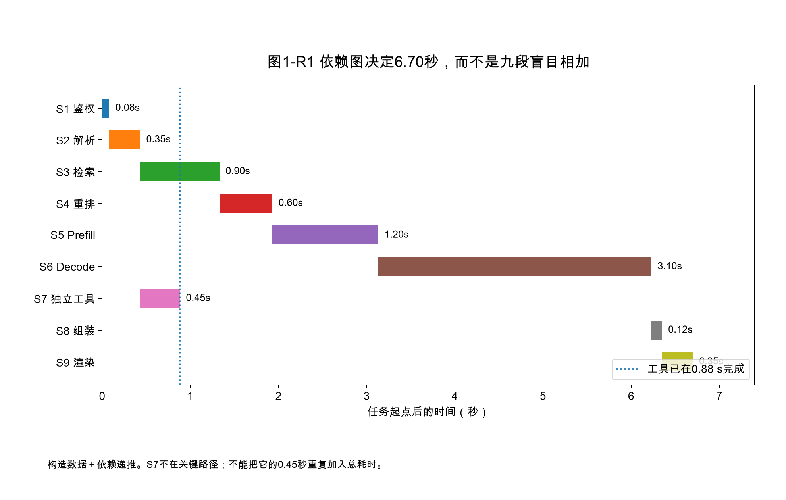

图中数据来自本章参数及依赖递推，不是某个实际应用的观测。配套程序对6.70 s、5.77 s、3.60 s以及工具完成时刻执行断言；图只回答算术和依赖是否一致。

#### 1.8.2 单向延迟需要误差预算

设主机A的时间戳误差不超过 $\varepsilon_A$，主机B不超过 $\varepsilon_B$。即使两台机器都使用墙钟，$t_B-t_A$ 仍应解释为一个误差不超过 $\varepsilon_A+\varepsilon_B$ 的区间，而不是一个无误差的点。若估计传输仅20 μs、同步误差却达100 μs，报告20 μs没有诊断意义；此时应改用同端往返时间、发送与确认事件，或明确只保留因果先后。

同样，两个本地持续时间之间可以比较长短，但这不会自动产生网络的单向分解。例如客户端668 ms与引擎613 ms之差可作为**边界残差**讨论，前提是同一次调用、可比时钟速率与端点语义已经固定；要再把残差拆成进入引擎前与离开引擎后，必须增加跨域映射证据。边界残差还可能包含未入账的串行化、代理和异步处理，不能全命名为网络耗时。

#### 1.8.3 资源账是积分，不是把请求停留时间相加

请求超时后还占用多少显存，应记录随时间变化的持有量 $M_i(t)$，其占用成本可表示为 $\int M_i(t)dt$，单位为 GiB·s。设备计算成本则可按归属明确的执行活动或共享批分摊策略记录；排队一秒不等于计算一秒。对共享块应先按物理身份去重，再讨论按请求如何分摊，避免四个分支持有同一块就收费四份物理显存。

因此，取消闭环至少有两个独立终点：业务不再等待的时刻，以及资源重新可用的时刻。二者之差并非都能消除：当前共享前向可能需要安全完成。但是这个窗口若随取消量持续累积，就会降低后续准入能力。第4章检查物理块，第9章检查观测证据，第12章进一步处理跨进程的所有权与租约。这里建立的是这些后续分析共同使用的时间和资源单位。

---

<!-- V06-START -->
<a id="sec-01-09"></a>
### 1.9 实验图表补充：把请求时间线变成可检验的优化上限

本章先补一张能直接指导实验优先级的图，而不是为已有流程图配一张没有来源的GPU trace。沿用1.1节首次尝试成功的任务：端到端6.70秒、Decode占3.10秒，独立预取工具不在关键路径上。把Decode缩短30%，减少的是0.93秒，任务变成5.77秒；并不是整任务也缩短30%。

更重要的是第三根柱。把Decode理想化为零，仍有3.60秒串行工作。因此在“其余阶段与依赖不变”的条件下，仅优化Decode无法达到3秒。这是一项排除性结论，不是要求模型达到零时延，也不排除同时优化检索、Prefill或任务结构的可能。

**怎样接入实际实验：**为每个span记录开始、结束、父依赖、时间域、attempt_id和资源释放状态；先重建DAG，再用最长路径复算。实验改变了重叠关系时，须重新求关键路径，而不是机械扣掉某个局部耗时。对没有校准的跨主机时钟，只分别报告本域区间，不直接相减。

#### 图1-V1 单段优化能把任务缩短多少？

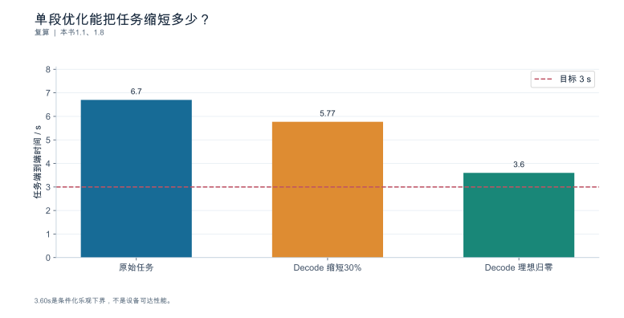

**数据身份：**`TEACHING_CALCULATION`。**条件：**S7独立预取被覆盖；其余阶段与依赖不变；原始6.70s、Decode3.10s。

| 方案 | 端到端/s | 相对原值减少/% |
|---|---|---|
| 原始任务 | 6.7 | 0.0 |
| Decode 缩短30% | 5.77 | 13.88 |
| Decode 理想归零 | 3.6 | 46.27 |

复算公式：`T=6.70-3.10*r`。

**出处与边界：**本书1.1、1.8；3.60s是条件化乐观下界，不是设备可达性能。

[数据与绘图点](book_support_v06/data/ch01_task_limit.json) · [PNG](book_support_v06/figures/ch01_task_limit.png) · [重绘代码](book_support_v06/code/replot.py)

<!-- V06-END -->
<!-- V08-START -->
<a id="sec-01-10"></a>
### 1.10 第三方数据补充：把"一次请求有多慢"拆成阶段与尾部

本章前面用的是任务上限与配置推导。这一节补两条真正的第三方端到端实测：**阶段拆分**与**尾延迟放大**。

**阶段拆分（Splitwise，HPCA 2024，Table IV；DGX-A100 与 DGX-H100，batch=1，P50，Llama2-70B）。**Coding 负载的 E2E 为 856 ms（A100）/493 ms（H100），而 TTFT 只有 185/95 ms；Conversation 负载的 E2E 高达 4957/3387 ms，TTFT 仅 155/84 ms。**E2E 与 TTFT 之间那一大段，就是 decode 逐个 token 累积出来的。**从 A100 换到 H100，TTFT 约减半，但 E2E 只降到原来的 0.58–0.68 倍——硬件把首字等的时间砍了一半，却砍不动解码段的总时长，因为解码段由输出 token 数决定。

**尾延迟放大（Kolluru，arXiv:2511.17593v1，Table 1；4×A100-80GB，25 并发，ShareGPT，vLLM v0.6.1 / TGI v2.3.0）。**一个反直觉的结果：vLLM 的 TTFT p50 是 0.87 s，比 TGI 的 0.64 s **更差**；但 vLLM 的总时延与 TPOT 全面更低。更要紧的是放大倍数——总时延的 p99/p50，vLLM 为 2.80 倍、TGI 为 3.20 倍。**只报平均值会同时掩盖两件事：框架之间的取舍，以及尾部被放大后的真实体验。**选框架时，"谁的 p50 更好看"和"谁的尾巴更稳"是两个独立问题。

**边界：**Splitwise 是 batch=1 的 P50，不代表高并发；Kolluru 为单作者预印本、无误差棒。

#### 图1-T1 一次请求的阶段拆分：Decode 主导端到端（第三方实测）

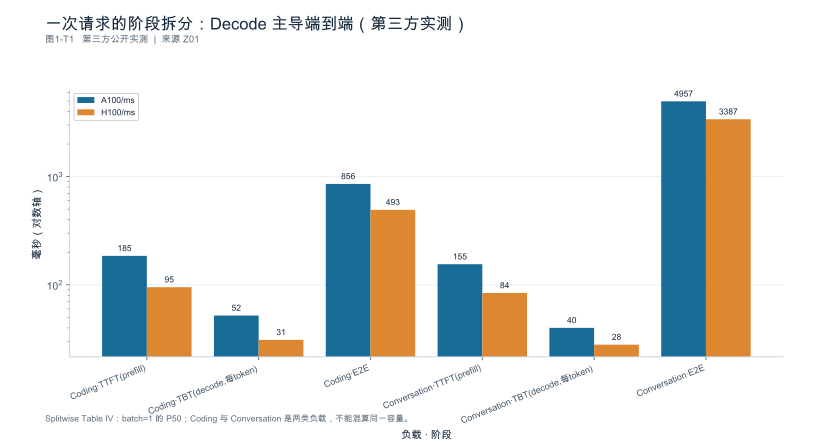

**数据身份：**`THIRD_PARTY_MEASURED`（第三方公开数据）。**条件：**Splitwise（微软研究院，HPCA 2024）Table IV；DGX-A100 与 DGX-H100，batch size 1，P50；Llama2-70B；生产 trace（coding 中位输入 1500/输出 13；conversation 中位输入 1020/输出 129）。

| 负载 | 阶段 | A100/ms | H100/ms |
|---|---|---|---|
| Coding | TTFT(prefill) | 185 | 95 |
| Coding | TBT(decode,每token) | 52 | 31 |
| Coding | E2E | 856 | 493 |
| Conversation | TTFT(prefill) | 155 | 84 |
| Conversation | TBT(decode,每token) | 40 | 28 |
| Conversation | E2E | 4957 | 3387 |

**出处与边界：**[Z01](book_support_v08/来源与核验_v08.md#z01)；batch size 1 的 P50，非高并发；仅一个模型与两类 trace；2023 年 H100 SXM 数据。论文为自研方案方，非中立基准组织。

[数据与绘图点](book_support_v08/data/ch01_tp_phases.json) · [PNG](book_support_v08/figures/ch01_tp_phases.png) · [重绘代码](book_support_v08/code/replot_v08.py)

#### 图1-T2 尾延迟放大：p50 到 p99 不是同一个世界（第三方实测）

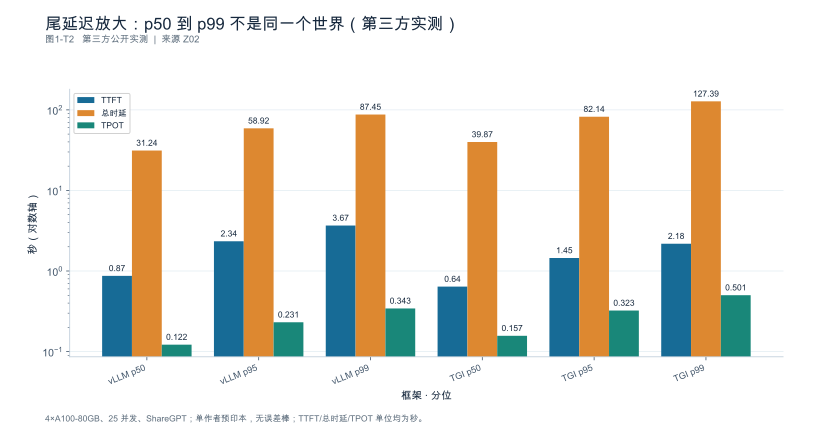

**数据身份：**`THIRD_PARTY_MEASURED`（第三方公开数据）。**条件：**Kolluru（arXiv:2511.17593v1）Table 1；4×A100-80GB，25 并发，ShareGPT，prompt 均值 512 / 生成均值 256 tokens，每配置 1000 请求取中位数；vLLM v0.6.1 与 TGI v2.3.0。

| 模型 | 框架 | 分位 | TTFT/s | 总时延/s | TPOT/s |
|---|---|---|---|---|---|
| LLaMA-2-70B | vLLM | p50 | 0.87 | 31.24 | 0.122 |
| LLaMA-2-70B | vLLM | p95 | 2.34 | 58.92 | 0.231 |
| LLaMA-2-70B | vLLM | p99 | 3.67 | 87.45 | 0.343 |
| LLaMA-2-70B | TGI | p50 | 0.64 | 39.87 | 0.157 |
| LLaMA-2-70B | TGI | p95 | 1.45 | 82.14 | 0.323 |
| LLaMA-2-70B | TGI | p99 | 2.18 | 127.39 | 0.501 |

**出处与边界：**[Z02](book_support_v08/来源与核验_v08.md#z02)；单作者预印本，未经同行评审；无误差棒；框架版本为 2024 年。

[数据与绘图点](book_support_v08/data/ch01_tp_tail.json) · [PNG](book_support_v08/figures/ch01_tp_tail.png) · [重绘代码](book_support_v08/code/replot_v08.py)

<!-- V08-END -->
### 章末检查问题

**1. 如何证明"慢在模型外"，而不是仅凭端到端时延猜测？**

答案方向：先按 1.1 定义 SUT 边界与完成单位并写清依赖关系；再按 1.2 在同一时间域内定义端到端，用依赖图重建关键路径，把每个区间标为实测/推导/仿真/未知；最后用**干预 + 复测**验证——例如把检索替换为固定返回的桩服务，观察端到端是否按预期下降。若下降量与检索段耗时不符，说明存在重叠或口径问题。**关键在于干预，而不是看比例推断**（第10章展开）。注意：轻载下的这条结论不能外推到高负载。

**2. 网关重试两次后成功，任务是否成功？各自怎么记账？**

答案方向：四本账分开写。`client_status`：两次 timeout、第三次收到完整响应。注意**客户端超时不是服务端终态**——不能顺手把前两次直接记为服务端失败。`server_status`：三次 attempt 必须逐一对账，取值可能是 completed、cancelled、failed 或仍未确定（服务端可能在客户端放弃后仍完成/仍在运行），每一项都要有服务端记录支撑，不能用客户端的超时推断。`task_outcome`：按预先定义的任务契约判定——契约若规定"最终收到可用答案且总耗时在契约内即成功"，则为 success；若规定了总截止时间或不允许重试，则需按契约条款判定。`resource_release_status`：前两次尝试占用的资源是否释放，必须按 1.6.3 的层级取证，未取得证据时记 `unknown`。成本侧还要把两次失败尝试消耗的资源计入，而不是被"最终成功"掩盖。

**3. 如何证明实际使用了配置要求的 runner 与内核，而不是落到其它分支？**

答案方向：按 1.5.4 填运行身份表并标证据强度——源码只证明可能性；启动日志的配置回显证明声明；运行期trace或等价插桩，结合调用关联、形状和编译身份，才能支撑这一次的实际路径；内核名称本身不总是唯一身份。同时按 1.5.2 记录形状差异的处理分支（padding / 桶命中 / 降级 / eager / 报错），并记录形状、dtype、后端能力等级等触发条件；输出长度或形状变化后必须重新取证。

---

### 本章验收清单

| 节 | 验收标准 |
|---|---|
| 1.1 | 能给出五类对象与四级标识的映射；能按依赖图说明某优化的端到端改善上限；能用契约而不是单点状态判定任务结果 |
| 1.2 | 时间线按两条流水分别重建，含 start/end 事件与时钟域；区间之和经交叉验证无重复计入；能说明哪些区间因缺乏跨域映射而不可拆分 |
| 1.3 | 另一名读者能复原相同输入 Token 序列；能隔离模板变量与工具定义变量；能说明本次验收可复现的层次（L1—L4） |
| 1.4 | 能标注五类事件与四个时间戳；能区分 Token ID、usage、重新分词与块数；能说明 ITL 与 TPOT 在何种条件下不一致 |
| 1.5 | 能按职责归因；能说明本系统处理形状差异的分支结构及版本依据；能填出运行身份表并标证据强度 |
| 1.6 | 能建立四本账并对账；能按五项清单核验取消；能写出重试放大的假设边界 |
| 1.7 | 每条解释都有对应事件；带假设的估计已标注为推导/仿真；未知区间保持空白；结论不超出资源层级允许的范围 |

---

### 配套资料

[新增图表与数据](book_support_v05/figures.md) · [来源登记](book_support_v05/references.md) · [E0测试清单](book_support_v05/data/e0_test_results.md) · [修订记录](book_support_v05/review/changes.md)

[DOC-W01]: book_support_v05/references.md#doc-w01
[DOC-W02]: book_support_v05/references.md#doc-w02
[DOC-W03]: book_support_v05/references.md#doc-w03
[DOC-W05]: book_support_v05/references.md#doc-w05
[DOC-W06]: book_support_v05/references.md#doc-w06
[DOC-W07]: book_support_v05/references.md#doc-w07
[DOC-W08]: book_support_v05/references.md#doc-w08
[DOC-W09]: book_support_v05/references.md#doc-w09
[DOC-W10]: book_support_v05/references.md#doc-w10
[R01]: book_support_v05/references.md#r01
[R02]: book_support_v05/references.md#r02
[R11]: book_support_v05/references.md#r11
[R12]: book_support_v05/references.md#r12
[R16]: book_support_v05/references.md#r16
[R17]: book_support_v05/references.md#r17
[R18]: book_support_v05/references.md#r18
[R23]: book_support_v05/references.md#r23
[R24]: book_support_v05/references.md#r24
[R25]: book_support_v05/references.md#r25
[R29]: book_support_v05/references.md#r29
[S01]: book_support_v05/references.md#s01
[S02]: book_support_v05/references.md#s02
[S03]: book_support_v05/references.md#s03
[S04]: book_support_v05/references.md#s04
[S05]: book_support_v05/references.md#s05
[S17]: book_support_v05/references.md#s17
[S18]: book_support_v05/references.md#s18

<!-- V10-START -->
<a id="sec-01-90"></a>

### 本章口径核对（公开来源）

#### 工具调用的接口分工与字段名

OpenAI 兼容接口上的工具调用由"服务端解析器 + 请求字段 + 响应字段"三段构成，三者的分工需要在固定版本上对齐。

**服务端开关（vLLM 官方文档）**

| 开关 | 作用 |
|---|---|
| `--enable-auto-tool-choice` | 必选。开启后由模型自行决定是否发起工具调用 |
| `--tool-call-parser <name>` | 选择工具调用解析器 |
| `--tool-parser-plugin <path>` | 可选，注册自定义解析器后再由 `--tool-call-parser` 引用 |
| `--chat-template <path>` | 指定能处理 `tool` 角色与含历史工具调用的 `assistant` 角色的模板 |
| `--exclude-tools-when-tool-choice-none` | `tool_choice='none'` 时不把工具定义发给模型 |
| `--tool-strict-level {auto,function,parameter}` | 服务端严格度下限，默认 `auto` |
| `--reasoning-parser <name>` | 部分模型（如 `hunyuan_a13b`、`cohere_command4`）需与工具解析器并用 |

环境变量 `VLLM_ENFORCE_STRICT_TOOL_CALLING` 默认为 `true`，且优先级高于 `--tool-strict-level`。

**请求与响应字段**

请求侧：`tools[].type` 固定为 `"function"`，`tools[].function` 内含 `name` / `description` / `parameters`（JSON Schema）与可选的 `strict`；`tool_choice` 取 `"auto"` / `"required"` / `"none"`，或形如 `{"type":"function","function":{"name":"get_weather"}}` 的具名调用；`messages[].role` 除 `user` / `assistant` 外还有 `tool`。

响应侧：`choices[0].message.tool_calls[0].function.name` 与 `.arguments`；`tool_call_id` 用于把结果回填给 `tool` 角色。官方说明 `strict` 字段在 Chat Completions、Responses 与 Anthropic Messages 三个接口面上均受支持。

**边界**

- `tool_choice='auto'` 且未启用结构约束时，vLLM 从原始文本中抽取调用，参数"偶尔可能格式错误或违反参数 Schema"。结构约束需要 `VLLM_ENFORCE_STRICT_TOOL_CALLING=true` 且请求中至少有一个 `strict: true` 的工具，或由 `--tool-strict-level` 设定服务端下限。
- 某个工具若未声明 `strict`，即使同一请求中其它工具声明了，它的参数仍不受约束。
- 具名函数调用只保证"可解析"，不保证"高质量"；首次使用会因有限状态机编译产生数秒级额外时延（编译结果随后缓存）。
- Mistral 模板要求 `tool_call_id` 恰为 9 位数字，而 vLLM 生成的 ID 更长，模板会截断到末 9 位；Mistral 对并行工具调用支持较弱。
- Llama 3 系列不支持并行工具调用（Llama 4 支持）。
- 该文档未枚举 `finish_reason` 的取值集合，因此不能据此断言工具调用场景下 `finish_reason` 一定为某个值。
<!-- V10-END -->


---

<a id="ch-02"></a>
## 第2章 Prefill、Decode 与模型执行

**核心论点：**模型结构决定需要做哪些工作，负载与实现决定这些工作怎样消耗资源；**不能把阶段名称直接当成瓶颈结论**。

### 本章导航

读完本章，你应该能够：说清"生成一个 Token"需要经过哪些步骤，以及推测解码如何改变"每轮一个 Token"的基线；分别估算 Prefill 与 Decode 的工作量与访存量；用模型配置算出每个 Token 的状态字节数，并知道常规公式何时失效；区分 MoE 的总参数、激活参数与驻留权重；把推理内容、可见答案、媒体输入、结构化约束与外部工具等待分别计量。

**单位约定：**状态容量用二进制单位（KiB/MiB/GiB），带宽与算力用十进制（GB/s、TFLOP/s）。两者混写是本书明文禁止的做法（写作规范 §6）。

---

<a id="sec-02-01"></a>
### 2.1 自回归生成与一次解码迭代

**本节要回答的问题：**生成一个新 Token 需要哪些已有信息？

#### 2.1.1 条件概率与前向计算

自回归模型在每一步做的是同一件事：给定已有上下文 $x_{1:t}$，计算下一个 Token 的条件分布 $P(x_{t+1}\mid x_{1:t})$，再从中取出一个。计算过程是一次**前向**：

1. 输入 Token 经嵌入层得到形状为 $[B,\,S,\,d_{\text{model}}]$ 的张量（$B$ 批大小、$S$ 序列长度、$d_{\text{model}}$ 隐藏维度）；
2. 依次通过 $L$ 层，每层做注意力与前馈计算，输出同形张量；
3. 最后一层经输出投影得到 logits，形状为 $[B,\,S,\,V]$（$V$ 为词表大小）；
4. 取最后一个位置的 logits 做采样。

在未命中前缀、未分块的普通 Prefill 示意中，$S$ 等于输入长度；分块时 $S$ 是本轮实际处理的位置数。普通 Decode 每个序列通常输入一个待消费 Token；推测验证可以一次处理多个位置，不能再说每次前向只推进一个位置。这就是两阶段工作量差异的根源：**同样的权重，处理的 Token 数量差了几个数量级。**

#### 2.1.2 采样与停止

logits 经温度、top-p/top-k 等处理得到采样分布，抽出一个 Token id，再判定是否停止（EOS、停止串、`max_tokens`、结构化约束完成）。采样与停止判定不是免费的：构建候选集合、排序、掩码计算都要时间，批很大或词表很大时它们是可观的每步开销。

#### 2.1.3 计算图与生成循环

生成循环与模型层内部计算要分开描述。伪代码如下（不冒充任何框架源码）：

```text
# 伪代码；不是具体引擎 API。
# 不变量：cache 只包含已经经过目标模型前向的位置。
cache, logits = prefill(prompt_tokens)
pending = sample(logits_at_last_prompt_position(logits))
outputs = [pending]                 # 刚采样的 Token 尚未写入目标 KV
while not should_stop(outputs):
    cache, logits = forward_and_commit(cache, pending)
    # 上一步把 pending 的 K/V 写入 cache；不是把下一个 Token 的状态提前写入。
    pending = sample(logits)
    outputs.append(pending)

# 推测解码的接口层示意：实现还要处理验证失败与截断。
# target_cache 保留已消费的位置，pending 是最近采样但尚未消费的位置。
drafts = propose_drafts(pending, k)
provisional_cache, distributions = verify_target(target_cache, [pending] + drafts)
accepted_prefix, correction_or_bonus = exact_accept_reject(distributions, drafts)
target_cache = keep_consumed_prefix(provisional_cache, pending, accepted_prefix)
outputs.extend(accepted_prefix)
outputs.append(correction_or_bonus)  # correction/bonus 暂为新的 pending
pending = correction_or_bonus
# 若停止符落在 accepted_prefix 内，应先截断并同步裁剪状态与输出。
```

首个采样结果就触发停止时，不再无条件执行一步 Decode。推测分支里，“提交了哪些 KV 位置”和“对外接受了哪些 Token”仍是两笔账：校正 Token 通常尚未经过目标模型前向。

**"每轮只产生一个 Token"只适用于普通自回归基线。**开启推测解码后，一次前向可能验证多个候选，因此必须区分三个量：**前向次数**、**解码迭代次数**、**最终接受的 Token 数**。把"迭代次数"当成"输出 Token 数"会让所有吞吐指标失真（第7章 7.3.2 已规定：被拒的候选不进产出分子）。

推测解码必须区分**两个不同的计数**：

$$
\mathbb{E}[\text{接受的草稿数}] = \sum_{i=1}^{k}\alpha^{i}
\qquad
\mathbb{E}[\text{本轮推进量}] = \sum_{i=0}^{k}\alpha^{i}
$$

后者包含被拒后的**校正 Token**（或全部接受时的额外 Token），因此比前者多 1 个量级为 1 的项。可算例：$k=4$、$\alpha=0.7$ 时两者分别为 **1.7731** 与 **2.7731**——**不能把它们都叫"接受草稿数"。**

若**整轮**相对成本（含提出草稿、目标验证、校正与相关开销）为普通一步的 $c=1.3$ 倍，则每 Token 相对成本为 $1.3/2.7731 = 0.469$，理论加速约 **2.13 倍**。注意这里的 $c$ 必须是整轮成本：**只给目标验证的成本不足以推出整个系统的加速比**；接受率随负载、批大小与模型而变，不是常数；被拒的 Token 消耗资源但不产出内容。

**本节要点**

- 前向次数 ≠ 解码迭代次数 ≠ 接受的 Token 数，三者必须分开计数。
- Prefill 逻辑上处理输入中未复用的位置，可分成多次前向；普通 Decode 与推测验证的输入长度和推进量分别计数。
- 采样与停止判定有成本，批大或词表大时不可忽略。
- 推测解码的理想加速 = 期望总推进量 ÷ 整轮相对成本，且依赖接受率这一实测变量。

**常见误区**

- **误：**迭代 300 次就是生成了 300 个 Token。
  **正：**开启候选验证后两者不同；分别计数。
- **误：**推测解码开启就等于快 $k$ 倍。
  **正：**实际倍数由接受率与验证成本决定，可能小于 1（反而变慢）。
- **误：**采样只是选个数字，不花时间。
  **正：**排序、掩码与停止判定在每步都有成本。

**本节验收**

1. 你能区分前向次数、解码迭代次数与最终接受 Token 数。
2. 你能用接受率与相对成本估算推测解码的收益区间。
3. 你能说明被拒绝的候选在吞吐与成本两处分别如何记账。

**依据与核验入口：**[R04] [R27]

---

<a id="sec-02-02"></a>
### 2.2 Prefill：从输入序列构建状态

**本节要回答的问题：**输入长度增加，会增加哪些工作？

#### 2.2.1 批量处理已知输入

Prefill 处理的是**已经给定的上下文**：整段输入可见，因此可以在序列维度与批维度上充分并行。它的实际工作量取决于两件事：**实际需要计算的 Token 数**（若命中前缀缓存，未复用的部分才是真正要算的）与**批内有效 Token 的编排方式**（引擎可能把长输入切成块与解码请求组批，第1章 1.2.2、第5章）。

#### 2.2.2 注意力与线性层工作量

Prefill 的计算量大致分两块：

- **线性层**：$\text{FLOPs}_{\text{lin}} \approx 2\,P\,T$，其中 $P$ 为参与计算的参数量，$T$ 为实际计算的 Token 数；
- **注意力**：$\text{FLOPs}_{\text{attn}} \approx 4\,L\,S^{2}\,d_{\text{model}}$（含 $QK^{\top}$ 与 $AV$ 两次矩阵乘）。

可算例：取 $L=32$、$d_{\text{model}}=4096$、稠密 $P=7\times10^{9}$、$S=T=4096$：

$$
\text{FLOPs}_{\text{attn}} = 4\times32\times4096^{2}\times4096 \approx 8.8\ \text{TFLOP}
\qquad
\text{FLOPs}_{\text{lin}} = 2\times7\times10^{9}\times4096 \approx 57.3\ \text{TFLOP}
$$

**先说清口径**：15.3% 是"注意力 ÷ 线性项"；若按"注意力 ÷ 两项总和"计，则为 **13.30%**。两个口径都合法，但必须声明。

| 输入 $S$ | 线性项 TFLOP | 注意力项 TFLOP | 注意力 / 两项总和 |
|---:|---:|---:|---:|
| 4096 | 57.34 | 8.80 | **13.30%** |
| 16384 | 229.38 | 140.74 | **38.03%** |

长度翻 4 倍后注意力占比从 13.30% 升到 38.03%，**但它仍未超过线性项**——所以不能不加定义地写"注意力成为主要项"。按这个简化公式，两项相等的长度为

$$S^{\ast} = \frac{2P}{4Ld_{\text{model}}} = \frac{2\times7\times10^{9}}{4\times32\times4096} \approx \mathbf{26703} \ \text{Token}$$

这是**代数阈值**，来自简化公式，不是硬件上瓶颈真正切换的实测点。

还要说明 $4LS^{2}d$ 的形式：它按**完整方阵**计数。因果语言模型只需下三角（约为一半），实现是否真正跳过被掩码的部分取决于内核与布局；因此"理论有效计算量"与"实际执行计算量"要分开记账。上表是内部一致性复算，不构成对该公式全部适用范围的认证。

**补充推导：命中前缀之后究竟省掉什么。** 设已有 $H$ 个前缀 Token 的状态可完全复用，本次新增 $U$ 个 Token，采用标准全因果注意力，暂不考虑稀疏、滑窗、共享层与重算。新增的第 $i$ 个 query 仍需关联它之前的 $H+i$ 个位置，因此新增的有效 query-key 对数为

$$N_{\text{pairs}} = \sum_{i=1}^{U}(H+i) = UH + \frac{U(U+1)}{2}$$

在每个 query-key 对的 $QK^{\top}$ 与 $AV$ 合计约 $4d_{\text{model}}$ 次运算、共 $L$ 层的模型下，注意力部分的有用计算量约为 $4Ld_{\text{model}}\,[\,UH + U(U+1)/2\,]$。

算例：$H=4096$、$U=128$：

| 情形 | 有效 query-key 对数 | 相对 |
|---|---:|---:|
| 独立 128 Token 请求（$H=0$） | $128\times129/2 = 8{,}256$ | 1.0× |
| 复用 4096 前缀 + 新增 128 | $128\times4096 + 8{,}256 = 532{,}544$ | **64.5×** |
| 不复用，4224 全部重算 | $4224\times4225/2 = 8{,}923{,}200$ | 1080.9× |

两个结论：**复用长前缀后新增128个Token，与独立128个Token请求的注意力工作量不同**（本例有效query-key对数相差约64.5倍，不代表全请求耗时同倍）；命中前缀相对全部重算省下约 94% 的注意力对数，但**这是注意力部分**，投影/前馈的线性项仍随实际处理的 Token 数走，所以不能把"命中率"直接换算成端到端提速。实际内核的块形状、数据读取、padding 与调度另需取证。

#### 2.2.3 首输出与状态建立

Prefill 的产出是两样东西：第一个输出 Token 的 logits，以及后续生成所需的每层状态。因此它的结束位置与"首 Token 时间"高度相关，但**不能把端到端 TTFT 全部算成 Prefill 计算**——其中还包含排队、网络与网关缓冲（第1章 1.2.3、第7章 7.2.2）。

状态规模是第4章的主角，这里只给出后续会反复引用的基本式。对常规注意力（MHA/GQA/MQA），每个 Token、每层需要存 K 与 V 两份：

$$
b_{\text{token}} = 2 \cdot h_{kv} \cdot d_{\text{head}} \cdot L \cdot b_{\text{dtype}} \quad [\text{byte/token}]
$$

取 $h_{kv}=8$、$d_{\text{head}}=128$、$L=32$、$b_{\text{dtype}}=2$（BF16）：

$$
b_{\text{token}} = 2\times8\times128\times32\times2 = 131072\ \text{B} = \mathbf{128\ KiB/token}
$$

一条 4096 Token 的序列即 $128\ \text{KiB}\times4096 = \mathbf{512\ MiB}$。这个数字后面会一直用到。

**本节要点**

- Prefill 处理已给定上下文，可充分并行；实际工作量取决于未复用 Token 数与批内编排。
- 在本节全注意力简化模型中，线性项随 $S$ 增长、注意力项随 $S^2$ 增长；是否占主导还取决于结构、长度区间和执行内核。
- 首 Token 时间与 Prefill 强相关，但 TTFT 不等于 Prefill 计算时间。
- 常规 KV 公式给出 128 KiB/token、4096 序列 512 MiB 的量级参照。

**常见误区**

- **误：**输入 4096 Token，Prefill 时间就是"每 Token 耗时 × 4096"。
  **正：**注意力项是平方增长，且排队与网络不属于 Prefill。
- **误：**命中了前缀缓存，输入长度还是按全部计入。
  **正：**实际计算的是未复用部分；两者都要记录。
- **误：**KV 公式对所有模型都成立。
  **正：**压缩/共享/递归结构必须换公式（见 2.4）。

**本节验收**

1. 你能解释"输入更长"与"实际需要重算的输入更多"的区别。
2. 你能算出本例在 4096 与 16384 两种长度下注意力项的占比变化。
3. 你能给出本模型每个 Token 的状态字节数，并说明公式成立的前提。

**依据与核验入口：**[R03] [R04] [R07]

---

<a id="sec-02-03"></a>
### 2.3 Decode：逐步生成与状态访问

**本节要回答的问题：**为什么并发、上下文和输出长度都影响生成表现？

#### 2.3.1 单步权重与状态访问

Decode 每一步要读三样东西：**权重**、**已有状态**、以及上一步的输出 Token。以 7B 稠密 BF16 模型为例，单步访存为

$$
M_{\text{weights}} = P \cdot b_{\text{dtype}} = 7\times10^{9}\times2 = 14\ \text{GB}
$$
$$
M_{\text{state,seq}} = b_{\text{token}} \cdot S = 128\ \text{KiB}\times4096 = 512\ \text{MiB} \approx 0.5369\ \text{GB}
$$

注意第二项随**上下文长度**增长，第一项与上下文无关但与模型大小成正比。批大小为 $B$ 时，**在"权重一次读入后在同一批内被复用"的理想近似下**，权重访存被摊薄，状态按序列累加：

$$
M_{\text{step}} \approx M_{\text{weights}} + B \cdot M_{\text{state,seq}}
$$

取 $B=8$：$M_{\text{step}} \approx 14 + 8\times0.5369 = \mathbf{18.29\ GB}$ [DERIVED]。若设备带宽为 $2.0\ \text{TB/s}=2000\ \text{GB/s}$，则单步下界

$$
t_{\text{step}} \approx \frac{18.29}{2000} = 9.15\ \text{ms}
$$

对应单序列约 $109\ \text{token/s}$、整批 $8/0.00915 \approx 874\ \text{token/s}$。**这是理想流量下界**：它假设权重与状态各读一次、无额外拷贝，并假设计入的权重与状态必须从该层存储读入。实际 DRAM 流量可因临时缓冲、重复加载而增加，也可因片上缓存命中而低于“全部从 HBM 读取”的估算，因此"理想流量 / 带宽"只在该流量假设成立时给出时间下界，不能当作预测值；两者的差额本身就是诊断对象（第9章）。**这是带宽下界的粗略估算，不是实测值**：它忽略了内核效率、缓存命中、通信与调度开销（第3章给出完整模型）。

#### 2.3.2 活跃序列与批次复用

上式已经说明了批处理的价值：权重访存被 $B$ 个序列摊薄。算术强度（FLOP/byte）随 $B$ 上升——$B=1$ 时约 $14\ \text{GFLOP}/14.54\ \text{GB}\approx0.96$，$B=8$ 时约 $112\ \text{GFLOP}/18.29\ \text{GB}\approx6.12$ [DERIVED]。这就是为什么**批大小是 Decode 阶段最关键的变量之一**（调度策略见第5章）。

但批大小受制于显存：每个活跃序列都要驻留自己的状态，$B$ 与 $S$ 的乘积决定容量上限（第4章）。

#### 2.3.3 长输出的累计成本

Decode 的成本是**逐步累加**的，且随输出变长而恶化：状态随已生成 Token 增长，每步都要读更多数据。因此长输出的边际成本递增，这与 Prefill 一次性付清的形态完全不同。

所以"Decode 永远是显存带宽瓶颈"这句话只能当作**起点假设**：随并发、上下文、并行策略与模型结构变化，瓶颈可能迁移——大批长上下文时可能是容量不足导致抢占与重算（第4、5章），多卡时可能变成通信（第6章），小批短上下文时可能是内核启动与调度开销占主导。**正确的做法是给出工作量分解，并写成至少两种可区分的假设**，再用第9章的观测去判别。

**本节要点**

- 单步访存 = 权重（与模型大小成正比）+ 状态（随上下文与并发增长）。
- 批处理摊薄权重访存、提高算术强度，但受显存容量约束。
- 全注意力下，随上下文增长的状态访问项会累积；总耗时是否明显超线性仍取决于权重项、缓存、调度以及是否为滑窗或递归结构。
- "Decode 一定是带宽瓶颈"是待验证假设，不是结论。

**常见误区**

- **误：**Decode 慢就一定是显存带宽不够。
  **正：**还可能是容量不足、通信、调度开销或内核效率；要写竞争假设并测量。
- **误：**批大小越大越好。
  **正：**受显存容量与尾延迟约束；过大可能引发抢占与重算。
- **误：**输出长度翻倍，耗时也翻倍。
  **正：**不能无条件按倍数推断；全注意力状态访问含增长项，权重主导或有界窗口时可以接近线性。

**本节验收**

1. 你能为同一模型写出至少两种不同的 Decode 瓶颈假设。
2. 你能说明区分这两种假设需要哪些测量（并指向第9章的哪一类证据）。
3. 你能估算本模型在给定批大小与上下文下的单步访存量。

**依据与核验入口：**[R04] [R22] [R30]

---
<a id="sec-02-04"></a>
### 2.4 注意力与状态结构：全量、压缩、稀疏与混合

**本节要回答的问题：**模型结构如何改变状态的种类、增长方式和实际缓存布局？

#### 2.4.1 MHA、GQA、MQA 与常规 K/V 账本

查询头数 $h$ 与键值头数 $h_{kv}$ 的关系决定状态的份数：

| 结构 | 关系 | 每 Token 字节（同参数下） | 相对倍率 |
|---|---|---|---|
| MHA | $h_{kv}=h$ | $2\cdot h\cdot d_{\text{head}}\cdot L\cdot b$ | 最大 |
| GQA | $h_{kv}<h$ | $2\cdot h_{kv}\cdot d_{\text{head}}\cdot L\cdot b$ | 按 $h_{kv}$ 缩放 |
| MQA | $h_{kv}=1$ | $2\cdot d_{\text{head}}\cdot L\cdot b$ | 最小 |

沿用 2.2.3 的参数（$d_{\text{head}}=128$、$L=32$、$b=2$）：GQA（$h_{kv}=8$）为 **128 KiB/token**，MQA（$h_{kv}=1$）为 **16 KiB/token**——相差 **8 倍**，正好是 $h_{kv}$ 之比。这就是为什么 $h_{kv}$ 必须写进实验记录：只看"模型 7B"推不出状态规模。

#### 2.4.2 MLA 与压缩表示：常规公式在这里失效

压缩潜在表示（如 MLA）不存两份 K/V，而是存一个低维潜在向量（外加少量用于位置编码的解耦部分）。**此时不能套用 $2\,h_{kv}\,d_{\text{head}}$ 公式**，必须按其真实维度计算：

$$
b_{\text{token}}^{\text{MLA}} = \left(d_{c} + d_{r}\right)\cdot L \cdot b_{\text{dtype}}
$$

取 $d_c=512$（潜在维度）、$d_r=64$（解耦位置部分）、$L=32$、$b=2$：

$$
b_{\text{token}}^{\text{MLA}} = (512+64)\times32\times2 = 36864\ \text{B} = \mathbf{36\ KiB/token}
$$

与同规模 GQA 的 128 KiB 相比为 $131072/36864 \approx \mathbf{3.56}$ 倍。

但"压缩存储"不等于"执行时也是压缩的"：**后端可能展开、复制或另行缓存**。因此状态预算要分三栏记：**逻辑字节**（按模型设计算）、**后端实际布局**、**实测分配**。三者不一致时，容量规划引用实际执行层，而差异本身要登记为证据缺口。

#### 2.4.3 稀疏索引、压缩主缓存与重算

稀疏注意力减少的是**参与计算的位置**，**不自动等比例减少被保存的状态**。三类机制要分开：

| 机制 | 减少什么 | 不减少什么 | 额外代价 |
|---|---|---|---|
| 稀疏选择 | 参与 Attention 的位置数 | 被保存的主缓存 | 索引器本身也是状态 |
| 压缩主缓存 | 每位置的存储字节 | 计算时可能需要解压 | 解压/重算的计算量 |
| 重算（recompute） | 存储占用 | 计算量 | 用计算换存储 |

判断这类结构对容量的影响，只能靠**逐项账本**，不能靠"它用了稀疏所以显存一定更小"的直觉。

#### 2.4.4 跨层共享、递归状态与混合层

还有一种容易算错的情形：**跨层共享的状态按物理身份只计一次**，不能按层数重复相加。若 $m$ 层共享同一份状态，它在容量账本里是一份，而不是 $m$ 份。

递归类结构（线性注意力、门控增量规则等）的状态大小**与上下文长度无关**（常数级 per layer per sequence），但每层都有一份。混合层布局（部分层用注意力、部分层用递归）必须**逐层记账**：

| 状态类型 | 是否随上下文增长 | 每层份数 | 是否跨层共享 | 何时重算 |
|---|---|---|---|---|
| 注意力主缓存 | 是（每个新 Token 追加） | 1（按 $h_{kv}$ 计） | 可能 | 被抢占或失效时 |
| 稀疏索引状态 | 视实现 | 1 | 可能 | 重算或增量更新 |
| 递归状态 | **否（常数）** | 1 | 可能 | 每步原地更新 |
| 跨层共享对象 | 视实现 | 共享层共用一份 | **是** | 失效时 |
| 临时展开张量 | 否 | 按需 | 否 | 每次前向 |

#### 2.4.5 模型卡、配置与实际后端布局的三重对照

最后要回答一个高频问题：**模型卡写 FP4，而后端记录的是另一种存储格式，该引用哪一层？**

答案是：**容量与带宽预算引用实际执行层**（后端实际分配与访问的格式），因为它是真正占用显存与带宽的量；但**模型卡的设计意图也要登记**，因为它是判断"这个数字为什么是这样"的依据，也是版本变化时复核的抓手。两者不一致时，把差异写进证据缺口，而不是挑一个好看的数字。

作为版本化资料案例：某模型卡描述了压缩/跨层共享结构与模型侧低精度主缓存，某引擎发布说明记录了特定硬件路径上的分块低精度存储 [SOURCE_REGISTERED] [S11] [S02]。**这两项记载用于说明"模型设计"与"后端落实"必须分开看，不能用于推算未经运行的显存或吞吐**（均为页面快照，`runtime_verified=false`）。

**本节要点**

- 常规 KV 公式只在 MHA/GQA/MQA 且无压缩共享时成立；$h_{kv}$ 是必须记录的配置字段。
- 压缩表示按真实潜在维度计算；同规模下与 GQA 可差 3.5 倍以上。
- 稀疏减计算不自动减存储；跨层共享只计一次；递归状态不随上下文增长。
- 三重对照：逻辑字节 / 后端实际布局 / 实测分配；容量引用实际执行层。

**常见误区**

- **误：**用了 MLA，就把 $h_{kv}$ 填进常规公式。
  **正：**公式不适用；按潜在维度算，并核对后端是否展开。
- **误：**稀疏注意力省显存。
  **正：**省的是计算；存储要按账本算，索引器还可能新增占用。
- **误：**跨层共享的状态乘以层数。
  **正：**按物理身份计一次。
- **误：**模型卡写了 FP4，就按 FP4 算显存。
  **正：**以后端实际分配为准，并登记两者差异。

**本节验收**

1. 你能指出常规 KV 公式在何种结构下必须替换。
2. 你能为一份模型配置写出分项状态账本（类型/增长/共享/重算/分配位置）。
3. 你能说明模型设计与后端布局不一致时，容量预算引用哪一层及理由。

**依据与核验入口：**[R04] [R05] [R28] [S11] [S12] [S02]

---

<a id="sec-02-05"></a>
### 2.5 Dense、MoE 与混合状态模型

**本节要回答的问题：**参数总量为什么不能直接代表每步计算与驻留内存？

#### 2.5.1 三张清单：参与计算、占用存储、发生传输

MoE 与 Dense 的根本区别在于：**计算只走被选中的专家，但所有专家都要在内存里。**因此必须用三张清单分别记账，而不是用一个参数量预测全部性能：

| 清单 | Dense | MoE |
|---|---|---|
| **参与计算** | 全部参数 | 每 Token 只有被激活的专家参数 |
| **占用存储** | 全部参数 | **全部专家**（除非显式卸载到主机/存储） |
| **发生传输** | 多卡时为激活、部分和等前向中间量（不含训练梯度） | 被路由 Token 的表示（dispatch/combine）、可能的专家权重搬运 |

可算例：设某 MoE 总参数 $80\times10^{9}$（BF16 下 **160 GB** 驻留），每 Token 从 64 个专家中选 2 个、激活参数 $8\times10^{9}$。则：

- 单步计算量 $=2\times8\times10^{9} = 16\ \text{GFLOP/token}$（按激活参数）；
- 驻留显存 $= 80\times10^{9}\times2 = \mathbf{160\ GB}$（按总参数）；
- 计算量与驻留的差异达到 **10 倍**。

因此"MoE 的激活参数等于 8B，所以可以当 8B 稠密模型用"是错的：**其参数参与的线性计算项按约 8B 计、未卸载权重驻留按约 80B 计；这不等于与 8B Dense 同速。**

#### 2.5.2 专家路由与通信工作量

路由把每个 Token 送到被选中的专家；跨卡部署时，这需要在设备间搬运 Token 表示。通信量的量级为

$$
M_{\text{route}} \approx 2 \cdot B \cdot d_{\text{model}} \cdot b_{\text{dtype}} \cdot k
$$

其中 $k$ 为每 Token 选择的专家数，系数 2 表示去程（dispatch）与回程（combine）。取 $B=8$、$d_{\text{model}}=4096$、$b=2$、$k=2$：

$$
M_{\text{route}} \approx 2\times8\times4096\times2\times2 = 262144\ \text{B} = \mathbf{256\ KiB/步}
$$

**这个数字必须带边界说明**：它是**一层**上的逻辑 payload（$B$ 个 Token、top-2、去回程合计），不是"整模型每步网络量"。要写成后者，还需说明：是否所有专家都跨设备（同设备命中不产生网络流量）、同一 Token 是否被重复发送到多个 rank、是否计元数据与填充、以及是全局批还是单个 rank 的批。单看字节数不大，但这是**每一步**都要发生的同步等待：它的耗时取决于延迟与同步频率，而不是带宽（第6章展开）。此外还有两个工程问题：

- **专家偏斜（skew）**：某些专家被过度选择，导致持有它们的设备成为尾延迟来源；
- **容量因子与丢弃**：超过专家容量的 Token 可能被丢弃或改路由，影响质量。

#### 2.5.3 注意力状态与递归状态并存

混合状态模型可能同时维护注意力缓存与递归状态。两者增长规则不同（前者随上下文线性增长，后者常数），**不能合并成一个"KV 大小"**，也不能用其中一个的经验去推另一个。分层记账见 2.4.4 的表。

#### 2.5.4 混合结构的模型与后端证据

作为资料案例：某模型卡描述了门控增量规则与稀疏注意力的混合结构，且在该快照中明确标注为**实验预览** [SOURCE_REGISTERED] [S12]。使用这类结构时有两条纪律：

1. **预览/实验状态不等于可复现的主实验环境**——主案例应选择版本可冻结、行为可验证的对象（第1章"三层写作结构"）；
2. **激活参数量不等于同参数稠密模型的等价性能**——计算、存储、传输三条账要分别算，路由与通信的实测留到第6章。

**本节要点**

- MoE 要分三张清单：计算按激活参数、存储按总参数、传输按路由量。
- 线性计算项按激活参数、未卸载驻留按总参数——激活参数不能代表驻留内存。
- 路由通信是每步同步，关注延迟与偏斜，不只是字节数。
- 混合状态模型要分层记账；预览模型不作主实验环境。

**常见误区**

- **误：**MoE 激活 8B，显存就按 8B 算。
  **正：**未选中的专家仍需驻留；按总参数算存储。
- **误：**路由传输才 256 KiB，通信可以忽略。
  **正：**它是每步同步，瓶颈常在延迟与偏斜而非带宽。
- **误：**混合结构只需一个"状态大小"数字。
  **正：**注意力与递归状态增长规则不同，分层记账。

**本节验收**

1. 你能分别估计 MoE 的计算量、权重驻留与会话状态。
2. 你能说明路由通信的瓶颈形态（带宽 vs 延迟/同步）。
3. 你能说明预览状态模型在本书中的使用边界。

**依据与核验入口：**[R05] [R28] [R30] [S11] [S12] [S16]

---
<a id="sec-02-06"></a>
### 2.6 推理模型、多模态与结构化生成负载

**本节要回答的问题：**文本之外的输入与输出约束如何进入性能分析？

#### 2.6.1 内部生成与可见答案

推理（思考）型模型会先产生一段内部生成，再输出可见答案。这带来三条计量规则：

1. **三者分开计数**：内部生成 Token、可见答案 Token、以及计费/用量字段可能互不相等；
2. **两个"首次"分开记录**：首内部 Token 与首可见 Token 对应不同体验（第7章 7.2.1 的 TTFT/TTFO）；
3. **观测不到的内部生成记未知**，不得用可见长度反推，也不得填 0。

结构化输出还要额外记录：格式约束类型（JSON Schema / 语法）、**解析成功率**、以及因约束失败而重生成的次数——后者消耗资源但不产出内容，与推测解码被拒的候选属同一类（不进产出分子，进成本分子）。

#### 2.6.2 编码器与媒体输入

多模态负载在文本之外多了三段：媒体读取与解码、预处理（缩放/分块/采样）、编码器执行。这三段通常发生在主机或独立编码器上，应**单独计时**，不要并入文本 Prefill 的时间。

记录字段建议：媒体类型与尺寸、分辨率或时长、分块与采样策略、**编码后产生的 Token 数**、以及编码器耗时。**不要把"图像数量"强行换算成通用文本 Token**——不同模型的投影方式与 Token 数差异很大，换算只能来自该模型的实际编码结果。

#### 2.6.3 结构约束与工具调用

工具调用负载要区分三段时间：模型生成调用信息、编排层等待外部函数、以及结果回填后的续生成。其中**编排层等待属于外部依赖**，不计入模型生成时间（第1章 1.1.3、第8章 8.3.3）。实验里建议用注入的固定延迟代替真实外部调用，以便复现与解释。

多轮分支任务还要同时报告两件事：**模型工作量**（Token 与状态）与**任务完成条件**（必需分支、容错策略、截止时间），后者按 `task_id` 判定（第7章 7.5）。

**本节要点**

- 内部生成、可见答案、用量字段分开计数；不可观测的内部生成记未知。
- 多模态的读取/预处理/编码三段单独计时；媒体 Token 数来自实际编码。
- 工具调用的编排等待不进模型生成时间；实验用注入延迟替代真实外部调用。
- 分支任务同时报告模型工作量与任务完成条件。

**常见误区**

- **误：**可见答案 300 Token，所以生成了 300 Token。
  **正：**内部生成可能数倍于此；分开记录或标记为未知。
- **误：**一张图约等于 N 个文本 Token。
  **正：**取决于模型与预处理；只能实测编码结果。
- **误：**工具调用慢就是模型慢。
  **正：**编排等待是外部依赖，单独计时。

**本节验收**

1. 你能把模型服务时间与外部工具时间分开，并各给一个测量点。
2. 你能为媒体输入列出记录字段与实际编码 Token 数。
3. 你能同时报告格式/任务质量，而不只报速度。

**依据与核验入口：**[R06] [R12] [R18] [R29] [S17] [S18]

---

<a id="sec-02-07"></a>
### 2.7 实验：把请求映射为工作量

**本节要回答的问题：**怎样从配置和 trace 校验工作量估计？

#### 2.7.1 张量尺寸提取

从模型配置文件提取决定工作量的字段：$L$、$d_{\text{model}}$、$h$、$h_{kv}$、$d_{\text{head}}$、$V$、最大位置、精度方案；若为 MoE 则加专家数、每 Token 激活专家数、专家容量因子；若为混合结构则加递归状态维度与层布局。提取结果随实验存档，并**绑定模型 revision**（第1章 1.3.1）。

#### 2.7.2 输入输出分离扫描

两个方向分开扫描，一次只动一个变量：

- **固定输出、扫输入**：固定 `max_tokens` 与实际输出长度，输入按 512 / 2048 / 8192 / 32768 变化，观察首 Token 时间与状态占用；
- **固定输入、扫输出**：固定输入，让输出自然停止，记录实际输出长度分布（**不是设置上限**），观察单步时间与端到端时间。

再叠加并发档位，观察单步时间随批大小的变化，验证 2.3.2 的"权重访存被摊薄"预期。

#### 2.7.3 模型估计与实际执行对照

把估计值（逻辑字节、理论 FLOPs、带宽下界）与实测放同一张表，分栏比较：

| 项 | 逻辑/理论 | 实际执行 | 差异 | 可能的解释 |
|---|---|---|---|---|
| 每 Token 状态字节 | 128 KiB | 待填 | — | 后端展开/压缩/共享 |
| Prefill 计算量 | 57.3 + 8.8 TFLOP | 待填 | — | 内核效率、未复用 Token |
| Decode 单步访存 | 18.29 GB（$B=8$） | 待填 | — | 缓存命中、额外拷贝 |
| 输出长度 | 设置上限 1024 | 实际分布 | — | 提前停止 |

**无法解释的残差本身就是诊断材料**——它指向第9章的观测与第10章的假设检验。实验的目标不是证明"某阶段一定更慢"，而是检验工作量模型能解释哪些变化。

无 GPU 时的支线：只做**模型配置解析**（E0），产出逻辑字节账本与理论工作量，不填写实际分配与实测栏。

**本节要点**

- 配置字段绑定 revision；MoE 与混合结构要额外提取对应字段。
- 输入输出分开扫描，输出长度取实际分布而非设置上限。
- 估计与实际分栏对照；残差是后续诊断的输入。
- 无资源时只做配置解析，不填实测栏。

**常见误区**

- **误：**`max_tokens=1024`，所以输出是 1024 Token。
  **正：**那是上限；必须记录实际停止原因与长度分布。
- **误：**理论 FLOPs 与实测对不上，说明公式错了。
  **正：**残差通常来自内核效率、缓存命中与调度，是诊断线索。

**本节验收**

1. 所有曲线的自变量来自真实 Token 计数，而非设置上限。
2. 你至少交付一份经典结构与一份当代结构的分项状态账本。
3. 未测量的实际分配栏保持空白，不填推算值冒充实测。

**依据与核验入口：**[R04] [R11] [S11] [S12] [S02]

---

### 2.8 深化：从真实模型配置到状态字节，再到注意力执行

#### 2.8.1 模型不能冒充任意同规模模型

参数规模相近的模型可以有不同层数、KV头数和状态结构。官方 Qwen2.5-7B-Instruct 配置给出28层、隐藏维度3584、28个查询头和4个KV头 [N11]。在标准GQA、头维128、BF16、全部28层均保存K/V的假设下，本书由配置推得

$$b_{token}=2\times28\times4\times128\times2=57344\text{ B}=56\text{ KiB}.$$

一条4096 Token序列为224 MiB，而不是贯穿模型的512 MiB。前者来自真实结构字段加上明确的存储假设，后者来自32层、8个KV头的独立设定。它们都可以用于，但不应在不同章节不加说明地替换。这个例子选择较早的模型，是为了提供可核查的结构基线，不是推荐它代表最新性能。

对MLA，直接读取 `num_key_value_heads` 后套常规双份K/V公式可能高估。DeepSeek-V3 配置中的潜在维度512、独立RoPE维度64、61层提供了另一种计算入口 [N12]。若执行后端每层仅缓存一份512维潜在向量和一份64维位置键，二者都用BF16，主体状态为

$$61(512+64)\times2=70272\text{ B}=68.625\text{ KiB/token}.$$

这是**指定压缩缓存布局**下的推导，未计MTP、暂存、索引、对齐和复制；若后端展开成逐头K/V，实际容量和流量就不是这个数。由此得到的工程顺序应当是：配置识别结构，源码或运行元数据识别布局，分配记录确认实际字节。

#### 2.8.2 为什么MLA的存储公式和执行公式可以不同

设第 $j$ 个注意力头的键由潜在状态 $c_t$ 投影而来，$k_{t,j}=W^K_jc_t$。对暂不含位置编码的内积分数，

$$q_j^T k_{t,j}=q_j^TW^K_jc_t=(W_j^{K\,T}q_j)^Tc_t.$$

这说明可以把键投影吸收到查询侧，然后直接与潜在状态做内积，而不必把全部历史键显式展开。若值也为 $v_{t,j}=W^V_jc_t$，则加权和满足 $\sum_t a_tW^V_jc_t=W^V_j\sum_t a_tc_t$，同样允许改变计算次序。

这些等式解释了压缩缓存为什么有实现空间，却不能证明任意位置编码与精度路径都能如此交换。RoPE的作用位置、缩放、混合精度以及分组布局可能要求保留额外状态或选择不同内核。性能判断还要比较“避免的历史展开”与“新增的查询投影、潜在空间计算和布局转换”，不能只把潜在维度除以头数当成加速比。

#### 2.8.3 FlashAttention减少什么，并不减少什么

FlashAttention论文将注意力优化放在分层存储和IO感知计算上 [N13]。用数学推导可以理解它为什么不必把整个 $S\times S$ 分数矩阵长期放到HBM：对一行分数，把当前处理区间的最大值记为 $m$，指数和记为 $\ell$，未归一化的加权值和记为 $o$。新块分数为 $s$、对应值为 $V$，则可以更新

$$m'=\max(m,\max s),$$
$$\ell'=e^{m-m'}\ell+\sum e^{s-m'},$$
$$o'=e^{m-m'}o+\sum e^{s-m'}V.$$

最后输出 $o'/\ell'$。旧块只需保留三个归约状态，不必保存所有历史分数。这是分块后维持同一softmax数学结果的关键；它并不把全注意力的有效query-key对数从平方级改成线性级。有限精度下计算次序改变，仍需按相应数值契约验收。

性能收益因此要分成三个问题：分数矩阵的中间读写减少多少；分块、流水和硬件指令是否适合该形状；引擎本次是否调用该实现。只在第二层展示一个漂亮的微基准，不能省掉第三层的路径取证，也不能证明整个业务请求按相同比例变快。

#### 2.8.4 2026结构变化应写成状态分类，而不是产品名堆砌

本次核对的DeepSeek-V4.1-Flash模型卡描述了CED和跨层共享的CSA2；Qwen3.8-Flash-Next模型卡将Gated DeltaNet与稀疏注意力组合，并标明实验预览属性 [N20][N21]。这些结构说明，经典“每层两份KV、每一步同等工作量”的假设不能无限延用。

更稳健的表达是为每类状态登记三个函数：驻留字节 $M(S)$、每步读取 $Q(S)$、更新计算 $F(S)$。递归状态可能使 $M$ 对长度有界，但中间检查点仍需空间；稀疏访问可能降低 $Q$，却未必等比例降低必须保留的 $M$；共享层可以减少物理份数，却不保证每层都不再访问同一数据。新模型出现时更新这三个函数，比再加一行“某模型支持”更能帮助读者做工程决策。

---

<!-- V06-START -->
<a id="sec-02-09"></a>
### 2.9 实验图表补充：用官方模型配置补齐状态量数据

模型名称只能指向候选制品，状态账本必须落实到结构参数。X01/X02给出了两个可公开复算的配置：Qwen2.5-7B-Instruct采用28层、4个KV头、头维128；DeepSeek-V3压缩MLA按61层、512维潜在KV与64维RoPE状态计算。以下均额外假定缓存以BF16的2字节保存。

Qwen每Token逻辑KV为 $2\times28\times4\times128\times2=57344$ 字节，即56 KiB；DeepSeek-V3为 $61\times(512+64)\times2=70272$ 字节，即68.625 KiB。图中把上下文长度从4096增加到32768，展示相同存储假设下的线性状态增长。

**读图时不要做模型排名。**两者参数规模、注意力结构和执行路径都不同。本章前文128 KiB/Token仍是独立配置；不能把它与56 KiB视为同一模型优化前后。MLA也不能用“KV头数×头维”的普通GQA公式替代。

**实验补录：**同一长度分别记录逻辑字节数、分块后分配字节、每rank分片/复制数、allocated/reserved及设备总占用。图中只预测第一项；MTP状态、写时复制峰值、通信工作区不在此曲线中。

#### 图2-V1 真实模型配置：随上下文增长的逻辑KV状态


**数据身份：**`CONFIG_DERIVED`。**条件：**Qwen:28层/4KV头/头维128；DSV3:61层/(512+64)；全部按2字节存储、单序列、未分片。

| 配置 | Token | KiB/Token | MiB |
|---|---|---|---|
| Qwen2.5-7B GQA | 4096 | 56.0 | 224.0 |
| Qwen2.5-7B GQA | 8192 | 56.0 | 448.0 |
| Qwen2.5-7B GQA | 16384 | 56.0 | 896.0 |
| Qwen2.5-7B GQA | 32768 | 56.0 | 1792.0 |
| DeepSeek-V3 压缩MLA | 4096 | 68.625 | 274.5 |
| DeepSeek-V3 压缩MLA | 8192 | 68.625 | 549.0 |
| DeepSeek-V3 压缩MLA | 16384 | 68.625 | 1098.0 |
| DeepSeek-V3 压缩MLA | 32768 | 68.625 | 2196.0 |

复算公式：`GQA=2*L*h_kv*d_head*b; MLA=L*(d_c+d_r)*b`。

**出处与边界：**[X01](book_support_v06/来源与核验.md#x01)、[X02](book_support_v06/来源与核验.md#x02)；不是模型优劣比较；不含块对齐、复制、MTP、分配器、工作区或物理显存。

[数据与绘图点](book_support_v06/data/ch02_config_kv.json) · [PNG](book_support_v06/figures/ch02_config_kv.png) · [重绘代码](book_support_v06/code/replot.py)

<!-- V06-END -->
<!-- V08-START -->
<a id="sec-02-10"></a>
### 2.10 第三方数据补充：KV 池占多大，长上下文又把内存推到哪

本章前面用配置推导说明"KV 随并发线性涨"。这一节补两组第三方数据：**公开部署里 KV 池的真实占比**，以及**长上下文把内存推到什么量级**。

**KV 池占多大（PagedAttention/vLLM，SOSP 2023，Table 1；OPT-13B/66B/175B，GCP A2）。**三个部署配置里，KV 池分别为 12 GB、21 GB、264 GB，占总显存的 30%–41%；参数量占 65%–54%。**"KV Cache 是瓶颈"这句话只在特定规模与长度下成立**：13B 单卡部署时，权重仍是最大那一项。这也是为什么"把池内利用率提上去"（分页管理）比"单纯加显存"更先被采用。

**一处必须同时标注的原文矛盾。**该论文正文写 OPT-13B 每 token KV 为 800 KB，但它自己的算式 2×5120×40×2 B ≈ 1.6 MB，相差 2 倍。本书引用该表时**两个数都不单独采信**，只把它当作"每 token KV 在百 KB 到 MB 量级"的佐证。

**长上下文推到哪（KVQuant，arXiv:2401.18079v3，Table 7/8；FP16 KV，batch=1，闭式估算）。**LLaMA-7B 在 32K/128K/1M 上下文下的 KV 估算为 16 GB/64 GB/512 GB。1M 上下文的 512 GB 远超单卡 80 GB——**这张图的价值不在精确值，而在量级：长上下文不是"开个参数"，而是把内存需求推到必须量化或多卡分片的地步。**同文给出 int4 量化后 128K 可降至 16 GB。

**边界：**Table 1 的 KV 池是部署配置推算，非 `nvidia-smi` 隔离实测；KVQuant 原表标题明确是 estimates（闭式公式），且只有 BS=1 与 BS=4 两点，没有随并发的连续曲线。

#### 图2-T1 KV 池不是整卡显存：三个规模的公开部署配置（第三方实测部署）


**数据身份：**`THIRD_PARTY_MEASURED`（第三方公开数据）。**条件：**PagedAttention/vLLM（SOSP 2023）Table 1；OPT-13B/66B/175B；GCP A2 实例；KV 池为部署配置推算（总显存−权重−开销）。

| 模型规模 | 参数量/GB | KV池/GB | 总显存/GB | 最大KV槽位 |
|---|---|---|---|---|
| 13B（1×A100 40GB） | 26 | 12 | 40 | 15.7K |
| 66B（4×A100） | 132 | 21 | 160 | 9.7K |
| 175B（8×A100-80GB） | 346 | 264 | 640 | 60.1K |

**出处与边界：**[Z03](book_support_v08/来源与核验_v08.md#z03)；【原文数值自相矛盾】正文称 OPT-13B 每 token KV 为 800 KB，但其自身算式 2×5120×40×2 B ≈ 1.6 MB，相差 2 倍，引用时须同时标注。KV 池为部署配置推算，非 nvidia-smi 隔离实测。

[数据与绘图点](book_support_v08/data/ch02_tp_kvpool.json) · [PNG](book_support_v08/figures/ch02_tp_kvpool.png) · [重绘代码](book_support_v08/code/replot_v08.py)

#### 图2-T2 KV 随序列长度线性增长：估算表而非实测（第三方估算）


**数据身份：**`THIRD_PARTY_ESTIMATE`（第三方公开数据）。**条件：**KVQuant（arXiv:2401.18079v3，NeurIPS 2024）Table 7/8；FP16 KV，batch size 1；闭式公式估算。

| 模型 | 32K/GB | 128K/GB | 1M/GB |
|---|---|---|---|
| LLaMA-7B | 16 | 64 | 512 |
| LLaMA-13B | 25 | 100 | 800 |
| LLaMA-30B | 49 | 195 | 1560 |
| LLaMA-65B | 80 | 320 | 2560 |

**出处与边界：**[Z04](book_support_v08/来源与核验_v08.md#z04)；【非实测】原表标题明确为 estimates；仅 BS=1 与 BS=4 两点，无随并发的连续曲线；未评测精度。

[数据与绘图点](book_support_v08/data/ch02_tp_kvlen.json) · [PNG](book_support_v08/figures/ch02_tp_kvlen.png) · [重绘代码](book_support_v08/code/replot_v08.py)

<!-- V08-END -->
### 章末检查问题

**1. 相同激活参数的 Dense 与 MoE 为什么不能直接等价比较？**

因为三条账不同：Dense 的计算、存储、传输都由同一组参数决定；MoE 的**计算按激活参数、存储按总参数、传输按路由量**。2.5.1 的算例里，激活 8B 而驻留 160 GB（80B 总参数的 BF16），线性计算项按激活参数、未卸载驻留按总参数，相差 10 倍。此外 MoE 还有每步同步的路由通信与专家偏斜，这些在稠密模型里不存在。因此只能用"参与计算 / 占用存储 / 发生传输"三张清单分别比较，不能用一个参数量换算。

**2. 推测解码中"每轮延迟"和"每 Token 时间"如何区分？**

"每轮延迟"是一次验证迭代的墙钟时间（含提出候选、一次前向、接受判定），"每 Token 时间"是**最终被接受的输出 Token** 分摊到的时间。若每轮最终推进 $m$ 个 Token（含校正或额外 Token）、每轮耗时为普通一步的 $c$ 倍，则每 Token 相对成本为 $c/m$。$m$ 由接受率决定（$k=4,\alpha=0.7$ 时 $m\approx2.77$），而 $c$ 是完整验证轮相对普通一步的实测成本，不预设其固定值。**只看每轮延迟会漏掉接受率，只看接受率会漏掉验证成本**，两者都要报；被拒绝的 Token 不进产出分子但要进成本分子。

**3. 模型卡用 FP4 而后端记录不同存储格式时，状态预算应该引用哪一层？**

引用**实际执行层**——即后端真正分配与访问的格式，因为它决定显存占用与带宽消耗；同时登记模型卡的设计意图与两者差异，作为版本变化时的复核抓手（2.4.5）。资料记载中存在这种不一致：模型卡描述模型侧的低精度主缓存，而引擎发布说明记录特定硬件路径上的另一种分块低精度存储 [SOURCE_REGISTERED] [S11] [S02]。这些是页面快照（`runtime_verified=false`），**可以用来说明"模型设计与后端落实必须分开看"，但不能用来推算未经运行的显存或吞吐**。

---

### 本章验收清单

| 节 | 验收标准 |
|---|---|
| 2.1 | 能区分前向次数、解码迭代次数与最终接受 Token 数；能用接受率与相对成本估算推测解码收益区间 |
| 2.2 | 能分别解释"输入更长"与"实际需要重算的输入更多"；能把线性项与 $S^{2}$ 项分开 |
| 2.3 | 能为同一模型写出至少两种 Decode 瓶颈假设并说明区分它们的测量 |
| 2.4 | 能指出常规 KV 公式何时适用、何时必须替换；模型配置可追溯；共享对象只按物理身份计一次；未知后端布局不靠模型名猜测 |
| 2.5 | 能分别估计计算量、权重驻留与会话状态；不把 MoE 简化为同激活参数 Dense 模型 |
| 2.6 | 能把模型服务时间与外部工具时间分开，并同时报告格式或任务质量 |
| 2.7 | 所有曲线的自变量来自真实 Token 计数；未把设置上限当成实际生成长度；未测量的实际分配栏保持空白 |

---

### 配套资料

[新增图表与数据](book_support_v05/figures.md) · [来源登记](book_support_v05/references.md) · [E0测试清单](book_support_v05/data/e0_test_results.md) · [修订记录](book_support_v05/review/changes.md)

[N11]: book_support_v05/references.md#n11
[N12]: book_support_v05/references.md#n12
[N13]: book_support_v05/references.md#n13
[N20]: book_support_v05/references.md#n20
[N21]: book_support_v05/references.md#n21
[R03]: book_support_v05/references.md#r03
[R04]: book_support_v05/references.md#r04
[R05]: book_support_v05/references.md#r05
[R06]: book_support_v05/references.md#r06
[R07]: book_support_v05/references.md#r07
[R11]: book_support_v05/references.md#r11
[R12]: book_support_v05/references.md#r12
[R18]: book_support_v05/references.md#r18
[R22]: book_support_v05/references.md#r22
[R27]: book_support_v05/references.md#r27
[R28]: book_support_v05/references.md#r28
[R29]: book_support_v05/references.md#r29
[R30]: book_support_v05/references.md#r30
[S02]: book_support_v05/references.md#s02
[S11]: book_support_v05/references.md#s11
[S12]: book_support_v05/references.md#s12
[S16]: book_support_v05/references.md#s16
[S17]: book_support_v05/references.md#s17
[S18]: book_support_v05/references.md#s18

<!-- V10-START -->
<a id="sec-02-90"></a>

### 本章口径核对（公开来源）

#### Prefill / Decode 在实现层的对应物

阶段划分是概念层的事，落到实现层则对应到具体的内核族与执行路径。以下条目说明"该版本提供了哪条路径"。

**内核族（FlashInfer 官方 README）**

FlashInfer 把 attention 内核按阶段与缓存形态拆分：**Paged and Ragged KV-Cache**（面向动态批的显存管理）、
**Decode / Prefill / Append** 三种阶段内核、**MLA Attention**（DeepSeek 的多潜在注意力原生支持）、
**Cascade Attention**（面向共享前缀的分层 KV 缓存）、**Sparse Attention**（块稀疏与变长块稀疏）、
以及 **POD-Attention**（融合 prefill 与 decode，用于混合批场景）。后端可在 FlashAttention-2/3、cuDNN、
CUTLASS 与 TensorRT-LLM 之间按硬件与负载自动选择。

**执行路径（vLLM 发布说明）**

vLLM v0.29.0 起 Model Runner V2 成为所有模型的默认执行器，其与阶段执行相关的条目包括：
CUDA graph 显存剖析用于 KV cache 自动定容；批次分片采样把每步 logits 显存降为 `1/TP`；
为推测解码下统一 decode 批引入 padded FULL cudagraph 分发。v0.30.0 进一步给出
**eager 模式下的双批次重叠**，以及微批次步骤的 FULL CUDA graph；并说明冻结 gc 后
图捕获由 12 s 降至 2 s、引擎初始化由 28.9 s 降至 8.2 s（H200 上）。

SGLang 侧的对应条目包括：按预热测量结果确定 CUDA graph 池大小、在完整 prefill CUDA graph 之间
复用输出存储、以及启用 prefill 阶段的 cuda-graph 捕获。

**边界**

- 上述均为各版本发布说明中的特性条目，说明"该版本已提供该路径"，**不构成** prefill / decode
  阶段划分本身定义的改变——阶段划分仍由自回归生成的依赖关系决定，不由执行器的实现方式决定。
- 同一份发布说明中的数字（如 12 s→2 s）对应特定模型与特定硬件，不能外推到其它配置。
- 内核族的存在不等于引擎已启用：引擎是否走某条内核路径，取决于其版本、后端选择与配置。
<!-- V10-END -->


---

<a id="ch-03"></a>
## 第3章 计算、显存、带宽与通信模型

**核心论点：**性能模型用于给出**有条件的边界与可检验预测**，不是把理论峰值包装成业务吞吐。

### 本章使用的设备参数

为避免"峰值算术"脱离单位，全章统一使用一组**显式声明的参数**（非任何具体产品）：

| 参数 | 取值 | 说明 |
|---|---:|---|
| 稠密 BF16 峰值算力 $F_{\text{peak}}$ | $1.0\times10^{15}$ FLOP/s（1000 TFLOP/s） | 仅用于单位换算演示 |
| 设备带宽 $B_{\text{peak}}$ | $2.0\times10^{12}$ B/s（2000 GB/s） | 十进制单位 |
| 由此得到的 ridge point | $F_{\text{peak}}/B_{\text{peak}} = \mathbf{500}$ FLOP/byte | 计算受限与访存受限的分界 |

ridge point 是两条理想吞吐上界的交点。强度低于 500 FLOP/byte 时，**带宽屋顶更低**；高于它时，计算屋顶更低。这只是在给定计量层级和流量假设下判断哪个上界更紧，不能排除启动、依赖、通信或低占用率把实际性能压在两条屋顶之下。真实设备须按有效精度与实际资源重新建模。

---

<a id="sec-03-01"></a>
### 3.1 资源清单：单卡、服务器、互联域与资源池

**本节要回答的问题：**哪些资源数字真正属于这次部署？

规格书给的是**边界条件**，实际分配到这个实例的手才是当前的账。要记录的不只是加速器：

| 资源 | 必须记录 | 常见遗漏 |
|---|---|---|
| 加速器 | 型号、数量、可见性（是否独占、是否 MIG/虚拟化切分）、驱动与运行时版本 | 共享租户 |
| 主机内存与 CPU | 配额、NUMA 绑定、容器限制、是否超售 | CPU 配额被限但不报错 |
| 存储 | 权重所在介质、读取带宽、是否有本地缓存层 | 冷启动被网络盘拖慢 |
| 网络 | 网卡、到服务端的路径、是否跨机房 | 流式返回被代理缓冲 |
| 互联 | 卡间拓扑（是否同一 scale-up 域）、跨节点链路 | 把机柜带宽当成节点内带宽 |

一个易被忽略的事实：**容器里看到的"可用资源"可能与实际独占性不一致**。显存可能被其它实例共享、CPU 配额可能被限流而不产生错误、网络路径可能经过额外的代理层。因此资源账至少分三列：**额定规格 / 运行观测 / 人工假设**，任何未实测的项都要标为假设。

产品形态与成熟度也要分开登记：公开发布（GA）、维护版、预览（Preview/RC）、路线图与"已可获取"是五种不同状态，**预览与路线图不能作为容量承诺的依据**。以整系统级平台为例，机柜级产品资料会给出卡数、机柜内互联域与跨节点网络的边界，可用来练习"整系统资源账本"，但产品页规格不构成某个时间点的完整产品排行榜。成熟的上一代环境（如 H100 一类）仍可继续作为可重复基线 [SOURCE_REGISTERED] [S21] [S22]。

**依据与核验入口：**[R17] [R21] [R30] [S21] [S22]

---

<a id="sec-03-02"></a>
### 3.2 计算量、数值精度与有效算力

**本节要回答的问题：**FLOPs、FLOP/s 与实际执行工作量如何对应？

#### 3.2.1 计数约定

先统一计数，否则所有比较都无效：**一次乘加（MAC）记为 2 FLOPs**。于是形状为 $[M,K]\times[K,N]$ 的 GEMM：

$$
W = 2MKN \quad [\text{FLOP}]
$$

**稠密与稀疏的峰值不能混用。**某些硬件提供结构化稀疏（如每四个元素保留两个非零的 2:4）的加速路径，其标称峰值可达稠密的 2 倍，但这只在权重满足相应稀疏布局、且内核真正走该路径时成立。**用稀疏峰值解释稠密执行，是最常见的一类"理论对不上实测"**。

#### 3.2.2 四项精度要分开写

"这个模型是 FP8"或"4 bit"这类说法承载不了工程判断，必须分四项：

| 项 | 含义 | 为什么重要 |
|---|---|---|
| 存储精度 | 权重在磁盘/显存中的表示 | 决定驻留与加载量 |
| 激活精度 | 参与矩阵乘的输入表示 | 决定 GEMM 走哪条内核 |
| 累加精度 | 中间累加的数值类型 | 决定长上下文的误差累积 |
| KV/状态精度 | 缓存状态的表示 | 决定状态容量（第2章 2.4） |

**不能从权重文件的扩展名推断全部执行精度**：量化制品可能带缩放因子、可能排除某些层、也可能在加载时被反量化成另一精度参与计算。判断依据是实际内核与配置回显（第1章 1.5.3）。

#### 3.2.3 分块缩放、填充与额外字节

低精度格式大多带**缩放元数据**，因此"标称位宽"不等于"实际位宽"。以分块缩放格式为例（需按所选版本核验块大小）：若每 16 个元素共享一个 8 bit 缩放因子，则

$$
b_{\text{eff}} = 4 + \frac{8}{16} = \mathbf{4.5\ \text{bit/元素}}
$$

元数据占 $0.5/4.5 \approx \mathbf{11.1\%}$。相应地，块越大元数据占比越低，但量化误差通常上升——这是**精度与开销的交换**，不是一个可以只看标称位宽决定的问题 [SOURCE_REGISTERED] [S10]。

还有两类"额外字节"要计入：**填充**（形状对齐带来的浪费）与**临时展开**（某些结构在执行时把压缩表示展开成更大的张量）。第2章 2.4.2 已说明压缩存储与执行布局可能不同，本节只需记住：容量与带宽账要按**执行时的实际张量**算，而不是按磁盘上的字节数算。

#### 3.2.4 有效算力：一步 GEMM 的完整演算

取第2章 Decode 中的一个隐藏层 GEMM：权重 $[K=4096]\times[N=4096]$，本步 $M=8$ 个 Token，BF16（$b=2$）：

$$
W = 2\times8\times4096\times4096 = \mathbf{268{,}435{,}456}\ \text{FLOP} \approx 0.268\ \text{GFLOP}
$$

理想访存（权重 + 输入激活 + 输出，各按 $b=2$ 字节）：

$$
Q \approx 4096\times4096\times2 \;+\; 8\times4096\times2 \;+\; 8\times4096\times2
= 33{,}554{,}432 + 65{,}536 + 65{,}536 = \mathbf{33{,}685{,}504\ \text{B}}
$$

运算强度：

$$
I = \frac{W}{Q} = \frac{268{,}435{,}456}{33{,}685{,}504} \approx \mathbf{7.97\ \text{FLOP/byte}}
$$

（这与"权重主导时 $I\approx 2M/b = M$"的直觉一致：$M=8$ 时约 8。）

对照本章设备的 ridge point $500$ FLOP/byte：$7.97 \ll 500$，**这一步明显在访存受限区**。它的时间下界取两者之大：

$$
T \ge \max\left(\frac{W}{F_{\text{peak}}},\ \frac{Q}{B_{\text{peak}}}\right)
= \max\left(\frac{2.684\times10^{8}}{1.0\times10^{15}},\ \frac{3.369\times10^{7}}{2.0\times10^{12}}\right)
= \max(0.268\ \mu\text{s},\ \mathbf{16.84\ \mu\text{s}})
$$

于是这一步在上述理想流量假设下的**吞吐上界**为

$$
F_{\text{roof}} = \frac{W}{T_{\min}} = \frac{2.684\times10^{8}}{16.84\times10^{-6}} \approx \mathbf{15.9\ \text{TFLOP/s}}
$$

该带宽屋顶对应约 15.9 TFLOP/s，即所设计算峰值的 1.6%，并非已经测得的有效算力。对方阵 $K=N=d$、BF16、计入权重与输入输出激活的模型，有

$$I(M)=\frac{2Md^2}{2d^2+4Md}=\frac{Md}{d+2M}.$$

当 $d=4096$、目标 $I=500$ 时，$M=500\times4096/(4096-1000)\approx661.50$，所以最小整数是 **662**。忽略激活时得到的 $M\approx500$ 只是权重主导近似；接近交点时必须恢复被忽略项。真实计算受限的切换点还受实际带宽、算力、布局与效率约束。

三个必须一并说明的限制：**这是理想下界**（忽略 L2/片上复用、内核效率、排队与同步）；**实际 DRAM 流量必须测量，缓存命中与重复加载可能使其低于或高于本近似**（第2章 2.3.1）；**有效算力必须用与估算相同的计数约定**才能与估算值比较。

**依据与核验入口：**[R21] [R22] [S10] [S09] [S22]

---

<a id="sec-03-03"></a>
### 3.3 Roofline：计算与数据移动的约束

**本节要回答的问题：**什么时候值得优化算术，什么时候应该减少搬运？

#### 3.3.1 运算强度

运算强度定义为**针对某个存储层级**统计的比值：

$$
I = \frac{W\ [\text{FLOP}]}{Q\ [\text{byte}]}
$$

关键在于 $Q$ 统计在哪一层：是设备显存（HBM）、还是片上缓存、还是跨节点网络。**同一个算子在不同层级上强度不同**，从而可能在不同层级分别受限。写作时必须写明层级，否则 Roofline 图无法解释。

#### 3.3.2 两个时间下界取大，两个吞吐上界取小

$$
T \;\ge\; \max\left(\frac{W}{F_{\text{peak}}},\ \frac{Q}{B_{\text{peak}}}\right)
$$

它给出的是**不可逾越的下界**，不是预测值。3.2.4 已演示：访存项（16.84 µs）比计算项（0.268 µs）大两个数量级，因此优化方向是"减少搬运或提高复用"，而不是"让 GEMM 算得更快"。

同理，第2章 Prefill 的注意力项与线性项也可以用同一张图思考：大 $M$（长输入、大批）时强度高、趋近计算受限；Decode 的 $M$ 小、强度低、趋近访存受限。**两阶段落在 Roofline 的不同区域，这是它们优化手段不同的根本原因。**

#### 3.3.3 模型遗漏了什么

Roofline 只覆盖计算与某一层的数据移动，它**不解释**以下开销，报告时必须显式列出：

| 遗漏项 | 表现 |
|---|---|
| 排队与批组成 | 设备忙但单个请求的进展慢 |
| 同步与通信 | 时间线上出现非计算的等待 |
| 内核启动与小形状开销 | 短内核的执行时间远高于字节/带宽估算 |
| 片上复用与缓存命中 | 实际 HBM 流量小于原估算，应重算下界，而不是声称突破正确下界 |
| padding 与对齐 | 实际搬运字节多于理论 |

还有一个常被颠倒的推论：**库的 IO 复杂度更低，不自动保证端到端更快。**算法的数据移动模型、内核库实现、以及引擎实际 dispatch 到哪条路径是三层不同的事；必须先在 trace 中确认调用了哪个实现，再把实际形状与精度放回强度模型 [SOURCE_REGISTERED] [S08] [S09]。同理，一个高利用率百分比不能证明"贴近上界"——3.2.4 的例子里设备很忙，有效算力却只有峰值的 1.6%。

**依据与核验入口：**[R22] [R21] [S08] [S09]

---

<a id="sec-03-04"></a>
### 3.4 显存预算：权重以外还有什么

**本节要回答的问题：**为什么权重能装下不等于服务能稳定运行？

#### 3.4.1 逐项预算

沿用第2章的 7B BF16 模型、4096 上下文、批 8，把账本补齐（需按环境替换）：

| 项 | 计算 | 容量 |
|---|---|---:|
| 权重 | $7\times10^{9}\times2$ | 14.00 GB |
| KV 状态 | $128\ \text{KiB}\times4096\times8 = 4\ \text{GiB}$ | 4.29 GB |
| 工作区与激活缓冲 | 假设 | 1.50 GB |
| 通信缓冲 | 假设 | 0.50 GB |
| 图捕获副本 | 假设 | 0.80 GB |
| **小计** | | **21.09 GB** |
| 分配器碎片与安全余量 10% | | **23.20 GB** |

（$14+4.29+1.5+0.5+0.8 = 21.09$；$\times1.1 = 23.20$ GB。）

在一张 24 GB 设备上余量只剩 **0.80 GB**，运行时很容易触到上限；在 40 GB 设备上则宽松得多。**这张预算表只说明 24 GB 设备余量偏薄，不能推出组合一定装不下**——容量是负载的函数，不是模型尺寸的函数。

#### 3.4.2 初始化峰值与稳态不同

加载期、预热期与稳态期的峰值并不相同：加载时可能同时存在磁盘缓冲、权重暂存与转换中间量；预热时图捕获与形状桶会额外占用；稳态才收敛到可复用水平。因此预算要**分阶段采样**，而不是只报一个数。

某些内存被预留但并非全部活跃使用——因此必须区分三种口径：**allocated**（进程向运行时申请）、**reserved**（运行时缓存未归还设备）、**设备占用**（驱动视角）。用其中一个解释另一个，是容量争议的常见来源。

#### 3.4.3 共享对象与常驻代价

跨层共享或多请求共享的状态按**物理存储身份去重**（第2章 2.4.4），不能按引用次数重复计入。反过来，权重常驻（快速启动一类机制）带来启动收益的同时，也带来**常驻资源代价与失效恢复路径**，收益与代价必须分列登记 [SOURCE_REGISTERED] [S02]。

**依据与核验入口：**[R04] [R28] [R31] [S11] [S02] [S13]

---
<a id="sec-03-05"></a>
### 3.5 主机、互联与通信下界

**本节要回答的问题：**哪些等待不在加速器计算里？

#### 3.5.1 主机供给与 NUMA

主机侧的三类成本常被算进"模型时间"：预处理（分词、模板展开、媒体解码）、批组装与调度、以及输出序列化。此外还有 NUMA 与跨 socket 访存、容器 CPU 配额被限流、以及页错误/换页。判断方法见第9章 9.3：**时间关联 + 干预**，而不是资源占用率。

#### 3.5.2 传输与集合通信

通信的最简模型是"启动开销 + 字节/带宽"：

$$
T_{\text{comm}} \approx \alpha + \frac{M}{B_{\text{link}}}
$$

其中 $\alpha$ 为每次同步的固定开销（µs 级），$M$ 为消息字节，$B_{\text{link}}$ 为该链路的**有效**带宽。取参数 $\alpha=6\ \mu$s、$M=256$ KiB、$B_{\text{link}}=200$ GB/s：

$$
T_{\text{comm}} \approx 6 + \frac{262144}{2.0\times10^{11}}\times10^6 = 6 + 1.31 = \mathbf{7.31\ \mu s}
$$

字节传输只占 1.31 µs，而固定开销占 6 µs——**这说明小消息的通信由延迟主导，不是带宽主导。**于是：

| 单步时间 | 每步 8 次同步的固定启动项占比 | 说明 |
|---:|---:|---|
| 500 µs（小模型/小批） | $48/500 = \mathbf{9.6\%}$ | 同步开销显著 |
| 2000 µs（大批或长输出） | $48/2000 = \mathbf{2.4\%}$ | 被摊薄 |

**这就是"低字节量的频繁同步也可能拖慢单请求"的机制**：频率比字节数更重要。批量增大后占比下降，也解释了为什么同一套并行配置在轻载与满载下的表现不同。

#### 3.5.3 域内、跨域与远程状态

必须区分三类路径，它们的数量级差异很大：

| 路径 | 典型形态 | 记账方式 |
|---|---|---|
| 主机 ↔ 设备 | PCIe/一致性互联上的拷贝 | 记入冷启动与每步输入 |
| 设备 ↔ 设备（域内） | 同一 scale-up 域内的集合通信 | 记入每步同步 |
| 跨节点网络 | 以太网/RDMA | 记入跨节点执行与远程状态访问 |

机柜级产品会给出"机柜内汇总显存"一类的指标，便于理解 scale-up 域的容量边界，但**汇总容量不等于无代价的统一内存**：跨域访问仍然要穿过网络，带宽与延迟相差数量级，并且可能有副本与一致性开销 [SOURCE_REGISTERED] [S21]。通信字节应按上述三条边界分别记账，不能合并成一个"网络流量"。

**依据与核验入口：**[R08] [R17] [R30] [S21] [S14] [S15]

---

<a id="sec-03-06"></a>
### 3.6 端到端组合与局部优化上限

**本节要回答的问题：**一个算子加速后，整体最多能改善多少？

#### 3.6.1 Amdahl 式估算

若某段在基线中占时间比例 $p$，该段被加速 $s$ 倍，且**其余阶段耗时不变、各阶段互斥**，则

$$
T_{\text{new}} = T_{\text{base}}\left[(1-p) + \frac{p}{s}\right]
\qquad
S_{\text{overall}} = \frac{1}{(1-p) + p/s}
$$

算例：

| 占比 $p$ | 局部加速 $s$ | 整体加速比 | 总延迟下降 |
|---:|---:|---:|---:|
| 10% | 2× | 1.0526× | **5%** |
| 40% | 2× | 1.25× | **20%** |
| 5%（另设的实际暴露占比） | 2× | 1.0256× | **2.5%** |

“速度提高 5.26%”与“延迟降低 5%”不是同一个百分比。第三行只演示暴露占比已经由依赖图确定为 5% 的情况，不能把任何“重叠一半”的活动都机械折半。若一个占关键路径 8% 的阶段提速三倍，总延迟下降 $0.08(1-1/3)=5.33\%$，整体加速约 1.0563×。

#### 3.6.2 两个假设必须写在结论里

1. **各阶段互斥**：若存在重叠，被优化的那部分可能根本不在关键路径上（第三行演示了占比减半的后果）。引用第1章的结论时尤其要注意：连续批处理让不同请求的工作在同一调度迭代中被组织，不等于它们的执行时间可以相互覆盖。
2. **其余阶段不变**：这在真实服务里往往不成立。局部变快会改变批组成、显存压力与排队行为；第9章 9.5.4 已说明，开环负载下服务时间下降通常带来端到端改善，而在闭环或自适应到达下收益可能被吸收。

因此这类估算的正确用法是**给出上限与采用门槛**，而不是给出承诺值。最终判断仍然回到端到端对照（第8章）。

**依据与核验入口：**[R17] [R22]

---

<a id="sec-03-07"></a>
### 3.7 实验：从估算到校准

**本节要回答的问题：**偏差是参数错误、模型遗漏，还是测量问题？

#### 3.7.1 先登记预测，再看结果

测试前写下三类预测：**工作量**（FLOPs、访存字节）、**容量**（逐项预算）、**时间区间**（下界与期望区间）。预测必须带上参数来源标签：规格 / 微基准 / 拟合 / 假设。**先登记后跑**是为了避免"看到结果再倒推参数"的拟合幻觉。

#### 3.7.2 残差按来源分类

示例：3.2.4 那一步 GEMM 的理想下界为 16.84 µs，观测为 21.3 µs，残差 **+4.46 µs（+26.5%）**。残差只能归为三类并逐条取证：

| 类别 | 候选原因 | 下一步取证 |
|---|---|---|
| 参数错误 | 实际带宽低于标称、时钟/功耗限制 | 微基准实测带宽与频率 |
| 模型遗漏 | 额外拷贝、L2 未命中、padding、同步 | 计数器与 trace（第9章） |
| 测量问题 | 计时点选错、异步未同步、跨域时钟 | 复测并核对时间域 |

**残差不能通过"调参数"消化掉**：只有能独立验证的参数才允许调整，否则就是把拟合当成校准。

#### 3.7.3 只在覆盖区间内校准

校准点与验证点必须分开：用一部分负载点拟合，用**留出的**负载点检验预测能力。对高负载、不同拓扑、不同并行度外推时必须重新核验——**几个贴合点不能证明模型普适**。

无设备时的可行工作：校验单位与配置、用公开资料登记整系统资源账本、完成显存与工作量预算表；**资料规格不作为校准点**，也不把峰值规格当作容量结论。

**依据与核验入口：**[R22] [R11] [S21] [S22]

---

### 3.8 深化：分层Roofline、逐算子下界与模型失配

#### 3.8.1 先按依赖分段，再合成屋顶

对一个计算阶段，$\max(F/P,Q/B)$ 表示理想情况下计算和搬运可重叠时的下界。对两个严格串行且性质不同的阶段，应先分别求界，再求和：

$$T_{serial}\ge\sum_j\max(F_j/P_j,Q_j/B_j).$$

把全部FLOPs和全部字节先相加，再求一次最大值，得到的仍可能是一个更松的乐观界，却丢掉了瓶颈交替。反例：阶段A的计算下界10 ms、访存下界1 ms，阶段B为1 ms和10 ms。逐段下界合计20 ms，聚合后却只有11 ms。差出的9 ms不是实现低效，而是聚合模型错误地允许两个串行阶段互相覆盖。

同理，HBM、L2、共享内存和跨设备链路不是同一份带宽预算。一个算子可以在HBM层复用良好，却受片上访存或指令发射限制；系统也可能在计算屋顶之下先遇到主机供给限制。只画一张HBM Roofline并不能完成诊断，但它能帮助排除一些不可能的解释。


图中采用本章的设备参数，不对应具体产品。曲线由算术强度公式生成，**不是采样点**。配套CSV同时保存 $M$、FLOPs、字节和屋顶值，便于读者更换参数后重画。

#### 3.8.2 峰值、可持续带宽与工作量效率必须分开

若使用厂商峰值带宽 $B_{peak}$，$Q/B_{peak}$ 是更乐观的界；若使用同种访问模式微基准的持续带宽 $B_{sustained}$，则是校准模型的输入。两者不能混名。对不同访问粒度、读写比例或并发规模，持续带宽也可能不同；拿大块连续拷贝校准不规则分页读取，仍可能留下系统性误差。

计算端同样如此。$2P$ 每Token是一种工作量近似，不是实际发射指令数。稀疏跳过、填充、重算、路由、归一化与输出投影会使真实工作量不同。为了发现差异，应同时记录“有用工作量”和“执行工作量”：前者衡量任务所需，后者解释资源实际消耗。低精度或稀疏硬件峰值只能与其适用的数据路径匹配，不能将稠密工作量除以稀疏峰值来制造更短时间。

#### 3.8.3 用残差定位模型遗漏，不用一个效率系数掩盖一切

可以从 $T=\alpha+F/P_{eff}+Q/B_{eff}$ 这样的校准式开始，但它并不自动描述计算搬运重叠。拟合前需声明这是串行近似、分阶段模型还是经验预测模型，避免把拟合参数再解释成物理峰值。

设预测误差 $e_i=T_i^{obs}-T_i^{pred}$。若残差随小批量增大，可能遗漏了固定启动开销；随上下文增长而增大，可能遗漏了状态读取或稀疏索引；只在特定形状突然跳变，优先检查内核选择、padding或图回退。若用一个“统一效率0.6”把所有误差压平，就失去了这种判别力。

校准还应保留训练形状与留出形状，分别报告误差分布。对留出的大上下文或不同并行布局，模型参数未必可迁移。真正有用的性能模型不是处处给出一个精确数字，而是能说明哪些区间已校准、哪些属于外推，以及一个新观测能推翻哪个假设。

---

<!-- V06-START -->
<a id="sec-03-09"></a>
### 3.9 实验图表补充：用官方规格校准Roofline的量纲

前面用的 1000 TFLOP/s、2000 GB/s 是便于推导的设备，不是某张卡的事实。本节补入NVIDIA官方SXM规格作为量纲锚点：A100 80GB SXM稠密BF16为312 TFLOP/s，HBM带宽2039 GB/s；H100 SXM官网1979 TFLOP/s带有“含稀疏”脚注，按两倍稀疏倍率换算的稠密近似值为989.5 TFLOP/s，HBM带宽3.35 TB/s。

统一十进制单位后，理想Roofline为 $P(I)=\min(F_{peak},B_{peak}I)$。两者交点约153.02与295.37 FLOP/byte。交点是标称资源屋顶的相交位置，不是Prefill/Decode的固定分界，更不是模型到这个长度就会自动切换瓶颈。

**为什么不在图上补“实测点”：**没有同精度、同形状的算子运行记录，就不知道实际访存量、有效带宽、launch开销和同步成本；凭利用率百分比构造点位会把假设伪装成证据。下一次实验应先选3—5个矩阵形状，固定累加精度、布局和预热，记录运行时间及字节口径，再把点叠在屋顶下方。

#### 图3-V1 规格给出的只是屋顶：稠密BF16 Roofline


**数据身份：**`SPEC_DERIVED`。**条件：**A100 312TFLOP/s与2.039TB/s；H100约989.5TFLOP/s与3.35TB/s；十进制单位。

| 设备 | BF16稠密 TFLOP/s | TB/s | 交点 FLOP/byte |
|---|---|---|---|
| A100 80GB SXM | 312 | 2.039 | 153.02 |
| H100 SXM | 989.5 | 3.35 | 295.37 |

复算公式：`roof=min(F_peak,B_peak*I)`。

**出处与边界：**[X03](book_support_v06/来源与核验.md#x03)、[X04](book_support_v06/来源与核验.md#x04)；H100官网1979为含稀疏峰值；此图不能解释实机利用率或服务吞吐。

[数据与绘图点](book_support_v06/data/ch03_spec_roofline.json) · [PNG](book_support_v06/figures/ch03_spec_roofline.png) · [重绘代码](book_support_v06/code/replot.py)

<!-- V06-END -->
<!-- V08-START -->
<a id="sec-03-10"></a>
### 3.10 第三方数据补充：标称峰值的两个折扣：指令路径与访存层级

本章前面用官方规格算 roofline。这一节补第三方指令级微基准，把"标称峰值"再打两个折扣。

**折扣一：用哪条指令（Hopper 架构剖析，arXiv:2402.13499，Table V/VII/VIII）。**显存带宽普遍能到标称的 90%–92%（RTX 4090 92%、A100 90%、H800 91%），属于"标称可信"的量级。但 Tensor Core 的 `mma` 指令在 Hopper 上平均只到 62.9%，而同卡的 `wgmma` 指令超过 95%。**同一个"峰值算力"数字，换一条指令路径就能差约 1.5 倍。**用标称值画出的 roofline 屋顶，必须再乘一个"用哪条指令"的折扣。

**折扣二：访存层级的代价（同文 Table IV，cycles）。**Shared Memory 约 29–30、L1 约 38–43、L2 约 261–273、Global 约 466–541。从片上到显存，延迟差约 18 倍，其中 Global 比 L2 又高约 2 倍。**这解释了 FlashAttention 这类 IO-aware 算法为什么收益巨大：它没有减少计算，而是把访存从 Global 挪到了片上。**也说明"带宽够不够"和"延迟忍不忍得住"是两个独立问题。

**一处必须披露的硬件身份。**被测的 Hopper 卡是 **H800 PCIe**（NVLink 被削减、350 W 功耗墙），不是 H100 SXM；因此 62.9% 这个数**不能**读作"H100 的 Tensor Core 达成率"。A100 的 95% 原文是"超过 95%"的表述。

**边界：**单 SM/warp 级微基准；两篇论文测量方法不同，跨论文的 cycles 值不完全可比；cycles 与 ns 不可直接换算。

#### 图3-T1 标称不等于可达：第三方微基准的达成率（第三方实测）


**数据身份：**`THIRD_PARTY_MEASURED`（第三方公开数据）。**条件：**Hopper 架构剖析（arXiv:2402.13499v1）Table V/III/VII/VIII；CUDA 12.1/12.2；指令级微基准。

| 项目 | RTX 4090 | A100 | H800 |
|---|---|---|---|
| 显存带宽达成率/% | 92 | 90 | 91 |
| Tensor Core mma 达成率/% | — | 95 | 62.9 |

**出处与边界：**[Z05](book_support_v08/来源与核验_v08.md#z05)；【重要】被测 Hopper 卡是 H800 PCIe（NVLink 削减、350W 功耗墙），不是 H100 SXM；未测 H100 SXM 的 HBM3 3352 GB/s 达成率；A100 的 95% 为"超过 95%"的表述。

[数据与绘图点](book_support_v08/data/ch03_tp_achieved.json) · [PNG](book_support_v08/figures/ch03_tp_achieved.png) · [重绘代码](book_support_v08/code/replot_v08.py)

#### 图3-T2 存储层级的代价：四个数量级的延迟差（第三方实测）


**数据身份：**`THIRD_PARTY_MEASURED`（第三方公开数据）。**条件：**Hopper 架构剖析（arXiv:2402.13499v1）Table IV；另与 Ampere 剖析（arXiv:2208.11174，A100 Global 290 / L2 200 / L1 33 / Shared 23-19）互为交叉参考。

| 层级 | RTX 4090/cycles | A100/cycles | H800/cycles |
|---|---|---|---|
| Shared Memory | 30.1 | 29.0 | 29.0 |
| L1 Cache | 43.4 | 37.9 | 40.7 |
| L2 Cache | 273.0 | 261.5 | 263.0 |
| Global Memory | 541.5 | 466.3 | 478.8 |

**出处与边界：**[Z05](book_support_v08/来源与核验_v08.md#z05)；单 SM/warp 级微基准；两篇论文的测量方法不同（Hopper 用 P-chase 变体），跨论文数值不完全可比。

[数据与绘图点](book_support_v08/data/ch03_tp_latency.json) · [PNG](book_support_v08/figures/ch03_tp_latency.png) · [重绘代码](book_support_v08/code/replot_v08.py)

<!-- V08-END -->
### 章末检查问题

**1. 一个占总时间 10% 的算子提速两倍，串行假设下整体如何变化？**

按 $S=1/[(1-p)+p/s]$：$p=0.10$、$s=2$ 时 $S = 1/0.95 = \mathbf{1.0526}$，即端到端改善约 **5.26%**，而不是 10%。若这 10% 中有一半并不在关键路径上（与其它段重叠），有效占比降到 5%，改善只剩 **2.56%**。所以拿到"内核快 2 倍"这类结论时，第一件事是问它占端到端的多少、且是否互斥。

**2. 权重除以 HBM 带宽何时只能当粗下界？**

$W/B$ 只对"权重必须整体读一遍、且完全无复用"的情形成立。它在以下情况会失真：批量较大时权重被多个 Token 摊薄（按 3.2.4，达到 ridge point 需要约 500 个 Token）；存在片上缓存命中或预取；实际 DRAM 流量高于理想流量（额外拷贝、临时缓冲、未命中）；以及并发排队与同步占据的时间未被计入。**它是下界，不是预测值**，用于判断"这个配置至少不可能快于多少"。

**3. 机柜汇总显存为何不能直接当作无代价统一内存？**

因为"汇总容量"描述的是**可寻址的容量上界**，而不是访问代价。跨出 scale-up 域的访问要穿过网络，带宽与延迟与域内相差数量级，还可能引入副本、一致性与传输开销 [SOURCE_REGISTERED] [S21]。所以正确做法是：把域内带宽/延迟与跨域带宽/延迟分别登记，把远程状态访问单独计时，容量账与传输账分开写。

---

### 本章验收清单

| 节 | 验收标准 |
|---|---|
| 3.1 | 资源账分额定/观测/假设三列；能指出是否独占、拓扑是否确认、哪些参数未验证 |
| 3.2 | 能用同一计数约定复算 FLOPs 与访存字节；四项精度分开登记；能审出稀疏峰值误用与精度不匹配 |
| 3.3 | 能说明数据移动统计在哪一层；能列出模型未包含的开销；不把高利用率当成贴近上界 |
| 3.4 | 容量预测含工作区与余量；分阶段（加载/预热/稳态）采样；区分 allocated/reserved/设备占用 |
| 3.5 | 能按主机—设备、域内、跨节点三条边界分别记账；能解释低字节量高频同步的影响 |
| 3.6 | 局部倍数不直接等同整体倍数；写明互斥与"其余不变"两个假设 |
| 3.7 | 预测先登记；残差按三类归因且只用可验证参数调整；留出验证点，外推区重新核验 |

---

### 配套资料

[新增图表与数据](book_support_v05/figures.md) · [来源登记](book_support_v05/references.md) · [E0测试清单](book_support_v05/data/e0_test_results.md) · [修订记录](book_support_v05/review/changes.md)

[R04]: book_support_v05/references.md#r04
[R08]: book_support_v05/references.md#r08
[R11]: book_support_v05/references.md#r11
[R17]: book_support_v05/references.md#r17
[R21]: book_support_v05/references.md#r21
[R22]: book_support_v05/references.md#r22
[R28]: book_support_v05/references.md#r28
[R30]: book_support_v05/references.md#r30
[R31]: book_support_v05/references.md#r31
[S02]: book_support_v05/references.md#s02
[S08]: book_support_v05/references.md#s08
[S09]: book_support_v05/references.md#s09
[S10]: book_support_v05/references.md#s10
[S11]: book_support_v05/references.md#s11
[S13]: book_support_v05/references.md#s13
[S14]: book_support_v05/references.md#s14
[S15]: book_support_v05/references.md#s15
[S21]: book_support_v05/references.md#s21
[S22]: book_support_v05/references.md#s22

<!-- V10-START -->
<a id="sec-03-90"></a>

### 本章口径核对（公开来源）

#### 分块缩放格式的块大小与缩放位宽

低精度格式的"块大小"与"缩放位宽"决定了量化误差的量级，二者必须以厂商原始定义为准。

**NVFP4（NVIDIA 技术博客，2025-06-24）**

| 项 | 取值 |
|---|---|
| 元素格式 | E2M1 —— 1 符号位 + 2 指数位 + 1 尾数位 |
| 可表示值域 | 约 −6 ~ +6（0.0、0.5、1.0、1.5、2、3、4、6 及其负值） |
| 微块大小 | 16 个值 |
| 一级缩放 | 每 16 值微块共享 1 个 FP8（E4M3）缩放因子 |
| 二级缩放 | 每张量 1 个 FP32 标量 |
| 等效位宽 | 约 4.5 bit/值（4 bit 元素 + 每 16 值 1 个 FP8 缩放），另加每张量 1 个 FP32 |

**与 MXFP4 的差异**

| 维度 | MXFP4 | NVFP4 |
|---|---|---|
| 块大小 | 32 值共享 1 个缩放 | 16 值共享 1 个缩放 |
| 缩放类型 | 2 的幂（E8M0 语义） | E4M3（非 2 的幂） |
| 精度风险 | 相对 FP8 存在明显精度下降风险 | 尤其对较大模型，精度下降风险更低 |

E8M0 会把缩放吸附到最近的 2ⁿ，对 amax 可能产生较大量化误差；E4M3 则是求解使整块误差最小的缩放，文中给出的平均 MSE 为 0.08。

**精度与支持面**

以 DeepSeek-R1-0528 为例，从原始 FP8 经后训练量化（PTQ）转到 NVFP4，在七项评测上精度损失不超过 1%；AIME 2024 上反而高 2%。硬件侧由 Blackwell 第五代 Tensor Core 直接处理微缩放分组、动态缩放与 4 bit 矩阵运算。软件侧量化使用 TensorRT Model Optimizer 与 LLM Compressor，部署侧 TensorRT-LLM 与 vLLM 提供早期支持，SGLang 为待支持。

**边界**

- 上述精度数字是厂商在指定模型、指定评测集上的结果，不构成对其它模型或其它任务的保证。
- 该文未使用 `SM100` 这一架构代号，架构对应关系需另据硬件文档确认。
- 文中未给出 FlashInfer 的支持情况。
<!-- V10-END -->


---

<a id="ch-04"></a>
## 第4章 KV Cache 与容量管理

**核心论点：**KV Cache 是**计算复用、内存分配和请求调度的交汇点**；容量、命中和收益必须分开衡量。

### 本章贯穿的模型参数

| 参数 | 取值 | 来源 |
|---|---|---|
| 层数 $L$ / 隐藏维度 $d_{\text{model}}$ | 32 / 4096 | 第2章 |
| 键值头数 $h_{kv}$ / 头维度 $d_{\text{head}}$ | 8 / 128 | 第2章 |
| 常规 KV 每 Token | **128 KiB** | 第2章 2.2.3 |
| 4096 Token 序列 | **512 MiB** | 同上 |

---

<a id="sec-04-01"></a>
### 4.1 从模型结构计算状态规模

**本节要回答的问题：**一个请求究竟保留了多少状态？

#### 4.1.1 建立状态字段，而不是套一个公式

第2章给出的 $b_{\text{token}} = 2\,h_{kv}\,d_{\text{head}}\,L\,b$ 只适用于常规注意力。真实系统要按**状态条目**记账，每条记录八个字段：

| 字段 | 含义 |
|---|---|
| `state_id` | 物理存储身份（用于去重） |
| `state_kind` | 主 KV / 压缩潜在 / 稀疏索引 / 递归状态 / 暂存张量 |
| `owner` | 属于哪个请求、会话或分支 |
| `growth_rule` | 随上下文增长 / 常数 / 按需 |
| `dtype` 与 `layout` | 精度与实际布局 |
| `shared_by` | 被哪些层或哪些请求共享 |
| `shard_rule` | 按什么维度分片、是否复制 |

按这八个字段逐项求值、**按物理身份去重**之后再加总，才能得到可核对的容量账。合并成一句"KV 多大"会丢掉共享、复制与压缩三件事。

#### 4.1.2 分支生成改变状态数量

多分支（树搜索、并行采样、共享历史分支）是容量账最容易算错的地方。算例：共享前缀 $H=2048$ Token，分出 4 个分支，每分支新增 $U=512$ Token：

| 方案 | 状态总量 | 说明 |
|---|---:|---|
| 共享前缀 + 4 份分支增量 | $128\,\text{KiB}\times(2048 + 4\times512) = 128\,\text{KiB}\times4096 = \mathbf{512\ MiB}$ | 前缀只存一份 |
| 四个分支各自独立存储 | $4\times128\,\text{KiB}\times2560 = \mathbf{1280\ MiB}$ | 前缀被存 4 次 |

共享节省 $1280-512 = \mathbf{768}$ MiB，即 **60%**。注意前提：共享要求分支在分叉点之前的状态**完全一致**（同一模型、同一模板、同一位置处理），否则不能共享——这正是 4.3 的主题。

#### 4.1.3 每 rank 实际分配不等于总量除以设备数

这是章末问题 1 的答案。KV 的分片通常按**键值头**维度进行，因此能否整除取决于 $h_{kv}$ 与并行度 $TP$ 的关系：

| 配置 | KV 总量 | 每 rank 占用 | 是否为"总量 ÷ TP" |
|---|---:|---:|---|
| $h_{kv}=8,\ TP=8$ | 4 GiB | **0.5 GiB** | 是（每 rank 1 个 KV 头） |
| $h_{kv}=4,\ TP=8$ | 4 GiB | **1.0 GiB（1024 MiB）** | **否**（头数不足，需复制 2 份） |

第二种配置下每 rank 是"总量 ÷ 4"而不是"总量 ÷ 8"，**比按设备数均分多一倍**。此外并行实现可能采用不同的切分维度（序列维、头维、或混合），具体行为必须按所选版本核验。

**依据与核验入口：**[R02] [R04] [R05] [R28] [S11] [S12] [S02]

---

<a id="sec-04-02"></a>
### 4.2 分页、块分配与碎片

**本节要回答的问题：**逻辑连续的上下文为什么不必物理连续？

#### 4.2.1 逻辑块与物理块

分页管理把"逻辑 Token 序列"映射到"物理块序列"：一个请求的上下文由若干块组成，块之间不必连续。这带来三个直接后果：**按需分配**（不为最长长度预留）、**块级共享**（相同前缀可指向同一物理块）、以及**块级回收**。

分页改善的是**管理方式**，**不会消除状态本身所需的空间**——这是最常见的误解：开了分页不等于显存够用。

#### 4.2.2 块大小的权衡

块大小 $B$（每块的 Token 数）决定内部碎片与元数据规模。以 128 KiB/token 为例：

| 块大小 $B$ | 单块容量 | 每序列最大内部碎片 | 相对 4096 Token 有效量的最坏浪费上界 |
|---:|---:|---:|---:|
| 16 | 2 MiB | $(B-1)\times128\,\text{KiB} = \mathbf{1.88\ MiB}$ | $15/4096 = \mathbf{0.37\%}$ |
| 64 | 8 MiB | $63\times128\,\text{KiB} = \mathbf{7.88\ MiB}$ | $63/4096 = \mathbf{1.54\%}$ |

上表最后一列是量级比较的**最坏上界**，不是长度恰为 4096 的实际碎片；4096 同时被 16 和 64 整除，实际尾块浪费均为零。一般式为 $F(S,B)=[B\lceil S/B\rceil-S]b_{token}$。例如 $S=4097$ 时，两个块大小分别浪费 15 与 63 个 Token 槽。块越小，尾部浪费上界越低，但块数与管理开销越大。64 GiB 池、2 MiB/块对应 32768 块；每块 64 B 元数据时约 2 MiB。这些是逻辑管理量，不代表内核访问成本已经确定。

#### 4.2.3 共享、引用计数与写时分离

共享块需要引用计数；当某个持有者要写入时，可能需要**写时复制**（copy-on-write）分离出私有块。因此"共享"并不总是净收益：在写入频繁的场景，复制开销可能抵消共享节省。评估时应分别报告：**共享节省的字节**、**复制次数与开销**、以及**回收延迟**。

论文中的收益是**条件化**的（取决于负载的共享结构与块大小），不能当作固定提升引用 [SOURCE_REGISTERED] [R02]。

**依据与核验入口：**[R02]

---

<a id="sec-04-03"></a>
### 4.3 状态复用条件：精确前缀、非前缀与隔离

**本节要回答的问题：**看起来相同的提示词，为什么可能不能复用？

#### 4.3.1 复用的前提是计算语义一致，不是字符串相同

前缀复用要求：从第一个 Token 起，**模型、权重 revision、分词器、模板、位置编码处理、适配器、精度与布局**全部一致，并且被复用的部分确实是逐 Token 相同的**前缀**。人类可读的"看起来一样"不构成依据——模板渲染后是否逐 Token 相同，要按实际 Token 序列判断（第1章 1.3.2）。

#### 4.3.2 精确前缀复用与非前缀重用是两回事

精确前缀复用有明确的等价性：被复用部分具有相同的数学计算语义；具体数值是否逐位一致还依赖浮点顺序、批不变性与实现。**非前缀重用**（复用中间某段、或复用语义相近但 Token 不同的内容）不具备这个等价性，通常涉及选择性重算与质量恢复问题，**不能继承精确前缀复用的等价性假设** [SOURCE_REGISTERED] [S13] [S14]。

#### 4.3.3 缓存键、命名空间与失效

工程上的最小要求是把缓存键设计为**身份的组合**，而不是提示词文本：

```
cache_key = hash(model_revision, tokenizer_version, template_version,
                 adapter_ids, precision_and_layout, rope/position_config,
                 tenant_namespace, token_ids_of_prefix)
```

任何影响状态解释或访问授权的身份变化，都必须使原缓存键失效或进入显式兼容转换；仅不影响 Token 与数值语义的展示元数据不应无端降低命中。跨租户复用需要单独审查——**不能为了提高命中率绕过隔离要求**，敏感输入也不应进入公共缓存实验。

#### 4.3.4 重启、版本切换与"存储还在"的陷阱

进程重启后外部存储里仍有数据，**不代表这些状态仍然有效**：权重、模板、适配器或布局可能已经变化。重新提供服务前必须验证身份与格式，并把验证失败按"未命中"处理而不是按"命中"处理。

**依据与核验入口：**[R07] [R29] [S13] [S14]

---

<a id="sec-04-04"></a>
### 4.4 命中率、复用量与节省时间

**本节要回答的问题：**命中很高，为什么不一定有相同比例的速度收益？

#### 4.4.1 三个不同的"命中"

| 指标 | 定义 | 量纲 |
|---|---|---|
| 请求级命中率 | 发生命中的请求数 / 请求总数 | 比例 |
| Token 复用率 | 被复用的逻辑输入 Token 数 / 全部逻辑输入 Token 数（同一观察集合） | 比例 |
| 避免的计算量 | 因复用而省下的 FLOPs 或 Prefill 工作时间 | FLOP 或 s |

**三者之间没有固定换算关系。**下表另假设各请求输入等长、每个未复用 Token 的 Prefill 成本相同、查找开销忽略，仅演示线性近似，不是全注意力下的严格收益上界。算例：

| 情形 | 请求级命中率 | 平均复用长度占输入 | Token 复用率 | Prefill 占端到端 | 线性成本假设下的端到端粗估 |
|---|---:|---:|---:|---:|---:|
| A | 50% | 20% | $0.5\times0.2=\mathbf{10\%}$ | 30% | $\approx\mathbf{3\%}$ |
| B | 30% | 80% | $0.3\times0.8=\mathbf{24\%}$ | 30% | $\approx\mathbf{7.2\%}$ |

A 的命中率更高但收益更小——**"命中多"不等于"避免的工作多"**。

#### 4.4.2 查找开销与净收益

命中本身有成本：查找、可能的传输、以及排队等待。净收益 $=$ 复用的重算成本 $-$ 查找与传输成本。仍以上例：查找 0.5 ms、复用节省 2.0 ms 时净省 **1.5 ms**；若复用长度很短只省 0.2 ms，则净**亏 0.3 ms**。所以短前缀命中可能不值得——这也是为什么必须报告**复用长度分布**而不只是命中率。

#### 4.4.3 分账与负面结果

按设备内、主机内存、远程内存、存储层**分别**报告：查找次数、命中位置、复用长度、传输字节、排队时间、重算时间、释放时间。两种必须作为正式负面结果保留的情形：

- **命中后转移比本地重算更慢**（等待从 Prefill 移到了网络或 I/O）；
- **命中率提高但 Goodput 下降**（传输占用带宽、排队变长或质量退化）。

**依据与核验入口：**[R01] [R07] [R06] [S13] [S14]

---
<a id="sec-04-05"></a>
### 4.5 分层与共享缓存：进程内、独立服务与存储池

**本节要回答的问题：**把状态移到主机或其他层级，何时值得？

#### 4.5.1 两类卸载，别混为一谈

| 类型 | 访问频率 | 时延要求 | 典型目的 |
|---|---|---|---|
| **活跃 Decode 状态卸载** | 每步都要访问 | 极高 | 腾出显存放更多并发 |
| **可复用前缀的外部存储** | 命中时才访问 | 中等 | 跨实例/跨重启复用前缀 |

前者若放到慢层，每一步都会付出代价；后者只在命中路径上付出一次。**用同一套分层策略同时服务这两类需求，往往是分层变慢的原因。**

#### 4.5.2 重算—传输—等待的决策账本

决定是否把状态放到外部层，比较三笔账。算例：复用 $H=8192$ Token 的状态（每 Token 128 KiB）。

| 方案 | 计算 | 成本 |
|---|---|---:|
| 重新计算 | 线性项 $2\times7\times10^{9}\times8192 \approx 114.7$ TFLOP，加注意力项约 $35.2$ TFLOP；按有效算力 300 TFLOP/s | $\approx\mathbf{0.50\ s}$ |
| 从外部层传输（20 GB/s 链路） | 状态 $1\ \text{GiB}=1.074\ \text{GB}$ | $1.074/20 = \mathbf{53.7\ ms}$ |
| 同上，但链路仅 2 GB/s | 同字节数 | $\mathbf{537\ ms}$ |

结论是条件化的：在 20 GB/s 链路上传输比值（53.7 ms ≪ 0.50 s）明显更划算；在 2 GB/s 链路上（537 ms）与重算相当，若还要排队等待则可能更差。**因此决策必须连同链路有效带宽、排队时间与状态有效性一起记录**，不能只报"显存占用降低了多少"。

#### 4.5.3 组件角色：名称相近不等于可互换

实现分层时，把系统图上的四类角色分开：

| 实现层 | 资料案例 | 必须核验的边界 |
|---|---|---|
| 引擎及分层缓存 | SGLang HiCache | 具体后端、介质、缓存状态与引擎版本 |
| 独立缓存管理 | LMCache | 进程边界、存储身份、质量与生命周期 |
| 共享存储与传输组件 | Mooncake Store / Transfer Engine | 两类组件各自职责、拓扑与故障范围 |
| 点到点传输库 | NIXL | 支持后端、传输身份与完成语义；**不替代调度器** |

以上为资料中的角色划分，不表示各版本与任意后端已互相兼容 [SOURCE_REGISTERED] [R32] [S13] [S14] [S15]。**一个组件能保存状态，不代表它同时负责全局路由、租户授权与整个请求生命周期**——这些职责仍由调度与服务层承担（第12章）。

#### 4.5.4 重启、取消、回收与质量验收

分层带来的新问题：进程重启后外部状态是否有效（4.3.4）、取消请求后各层的状态是否回收、以及**非前缀复用的质量验收**。验收要性能与质量分开：命中率与延迟属于性能账，复用后答案是否仍满足契约属于质量账，后者不能由前者推定。

**依据与核验入口：**[R04] [R32] [S13] [S14] [S15]

---

<a id="sec-04-06"></a>
### 4.6 低精度、压缩表示与混合状态布局

**本节要回答的问题：**减少状态大小会带来哪些新约束？

#### 4.6.1 三件事不能合并成一种"缓存压缩"

| 做法 | 机制 | 谁决定 |
|---|---|---|
| 对常规状态做量化 | 降低 KV 的存储精度 | 引擎配置 |
| 模型结构采用压缩表示 | 存潜在向量而非双份 K/V | 模型设计（第2章 2.4.2） |
| 混合模型的多类状态 | 注意力状态 + 递归状态并存 | 模型设计（第2章 2.4.4） |

它们的质量风险、内核依赖与容量收益都不同，**必须分别验收**。

#### 4.6.2 精度变化对容量的定量影响

沿用 128 KiB/token（BF16）的基准：

| 状态精度 | 每 Token | 4096 序列 | 相对 BF16 |
|---|---:|---:|---:|
| BF16（2 B） | 128 KiB | **512 MiB** | 100% |
| FP8（1 B） | 64 KiB | **256 MiB** | 50% |
| 分块缩放 4 bit（$4+8/16=4.5$ bit） | $128\times4.5/16 = \mathbf{36\ KiB}$ | **144 MiB** | 28.1% |

注意最后一行的换算：标称 4 bit 之外还有缩放元数据（第3章 3.2.3），实际每位元素是 **4.5 bit**；若块大小不同，这个数字也会变，**必须按所选版本核验块大小**，不能用"4 bit"直接推出容量。

#### 4.6.3 生产方与消费方必须一致

缓存布局要记录"谁生产、谁消费"。模型卡给出的设计，只有在引擎、精度与内核路径都对应时才能用于容量估算；跨引擎或跨实例传输可能需要**布局转换与暂存**，这部分字节与质量风险不得遗漏 [SOURCE_REGISTERED] [S11] [S02] [S15]。

#### 4.6.4 长上下文质量的独立验收

减少状态字节后，还要核验：算子是否真正走低精度路径、**转换成本**（量化/反量化的耗时）、以及**长上下文质量**。用短输入的质量测试代替长上下文验收，是本类变更最典型的漏检。

**依据与核验入口：**[R04] [R05] [R26] [R28] [S11] [S12] [S02] [S10] [S15]

---

<a id="sec-04-07"></a>
### 4.7 实验：缓存压力与容量边界

**本节要回答的问题：**如何找到缓存约束，而不是只测试是否 OOM？

#### 4.7.1 冷暖与复用对照

三组基线必须分开跑：**冷缓存**（每次重置）、**本地命中**、**有资源时的远程命中**。只跑其中一组得出的结论无法迁移——例如"容量充足"可能只是因为命中率高。

#### 4.7.2 活跃状态扫描与停止条件

同时扫描活跃请求数、输入输出长度与复用程度，记录块占用率、抢占次数、阶段延迟与终态。**停止条件必须提前定义**（例如"连续两个负载档位出现抢占"或"P95 超过契约"就停止加压），否则压测会一直跑到崩溃，只得到"OOM 阈值"这一个没有工程意义的数。

#### 4.7.3 抢占、回落与恢复

系统可能在 OOM 之前就已经**服务目标失守**（延迟或达标率不达标）——容量结论应以预先定义的**可用边界**为准，而不是以"不崩溃"为准。测试结束还要降载观察**状态是否回落**，避免把累积未回收的状态当成稳态容量（第9章 9.4 的 allocated/reserved 口径在这里直接相关）。

**依据与核验入口：**[R01] [R02] [R04] [S13] [S14]

---

### 4.8 深化：缓存容量是物理状态的时间分布

#### 4.8.1 从尾块浪费到准入预算

对每个请求 $i$，设实际驻留长度为 $S_i$、块大小为 $B$、每Token状态为 $b_i$。不共享时，静态占用为 $\sum_i B\lceil S_i/B\rceil b_i$；存在共享时，应改为对物理块集合求和，而不是先算每请求再直接相加。共享尾块产生写时分离时，短时间内还可能同时存在旧块与新块，容量压力的峰值高于稳态账。

准入因此不能只检查“本轮还能生成一个Token吗”。一个长输出请求刚进入时状态很小，之后会持续增长。可以使用最大输出长度做保守预留，也可以基于条件输出分布做风险预算；前者可能浪费容量，后者必须有抢占、拒绝或降级的清晰代价。所谓“容量利用更高”，往往只是把确定预留换成了可控风险，不是凭空增加显存。

对不同优先级，可以将状态预算和截止时间结合：给高优先级保留增长余量，低优先级只能使用可回收份额；但共享块被保留后未必能立即回收，不能把全部缓存占用都计作可抢占空间。决策表应区分已被活跃请求引用、可逐出但可复用、正在传输和等待设备完成四类字节。

#### 4.8.2 平均请求长度不足以预测平均驻留

考虑稳定系统中每秒到达 $\lambda$ 个请求，第 $i$ 类请求从准入至离开的状态曲线为 $M_i(t)$。长期平均驻留量可以按“每个请求带来的面积”计算：

$$\overline M=\lambda\,\mathbb E\!\left[\int_0^{T_i}M_i(t)dt\right].$$

这比“平均在途数×平均最终KV”更准确，因为状态是逐步增长的，且长请求在系统里停留更久。输入长度、输出长度和服务时长之间的相关性会进入同一个期望，不能一般地拆成多个均值的乘积。

在一个普通Decode模型中，输入长 $H$、输出共 $O$，第一输出由Prefill采样，此后需 $O-1$ 步，每步间隔为 $\tau$。若忽略分页且仅看这些步骤的驻留，面积近似为

$$b\tau\sum_{j=0}^{O-2}(H+j)=b\tau\left[(O-1)H+\frac{(O-1)(O-2)}2\right].$$

这里出现二次项。因此，两批请求即使平均输出相同，输出方差不同，也可能有不同的平均状态驻留。这个推导不适用于把状态主动丢弃的滑窗、压缩变化或被抢占重算的情况；那些情况应直接积分实际块占用曲线。

#### 4.8.3 公开分页案例应怎样引用

PagedAttention论文报告了其系统相对当时基线的条件化吞吐收益，并把核心问题定位为KV内存管理 [N02]。本书将它作为**机制与实验设计案例**，不把论文倍数作为2026年引擎之间的排序。当前引擎可能都已有分页管理，比较时需要控制缓存策略、负载共享、采样方式和版本。

这也解释了为何需要负面实验：若负载几乎没有共享前缀、容量本就充足、瓶颈在主机调度，进一步提高缓存命中可能几乎不改变Goodput。缓存的价值不是“命中率越高越好”，而是在其查找、复制、传输和保留成本之后，减少了多少关键路径工作与有效资源消耗。

#### 4.8.4 缓存隔离是一种明确的共享策略

vLLM官方设计文档说明可用 `cache_salt` 将前缀复用限定在相同盐值的信任组内 [N14]。工程上仍须决定这个信任组由谁授权、如何轮换，以及模型、适配器和位置配置变化时如何失效。一个公开系统提示词可以被授权共享；包含租户私密内容的前缀则不能因为文本相同就跨越授权边界。哈希键只实现身份匹配，并不替代访问控制和安全审查。

---

<!-- V06-START -->
<a id="sec-04-09"></a>
### 4.9 实验图表补充：补入FP8 KV的真实公开负载结果

缓存字节减半与服务吞吐翻倍是两个不同命题。vLLM官方2026-04-22技术博客给出Llama-3.1-8B的对照：150个请求、并发8、约20k输入与2k输出，长度波动±15%。硬件H100、FA3及优化后v0.19.1来自文章上下文，原表没有逐行重复完整环境。

Table 4中，BF16到FP8的输出吞吐为450.3→517.5 Token/s，按原值复算增加14.92%；ITL中位数15.18→12.93ms，下降14.82%。TTFT中位数仅由763.6降至742.8ms，下降约2.72%。因此数据支持“该负载下Decode与总产出改善”，不支持所有阶段同比提速。

图中使用两个独立纵轴面板，避免把毫秒与Token/s混在同一量表。总时长672.6→585.2秒可复核吞吐方向，但不得再和吞吐增幅相加成总收益。两者不是两笔独立节省。

**转成本地实验时：**使用相同提示词、输出规则、质量集和到达方式，记录KV占用、抢占、吞吐、TTFT/ITL分布。仅有表中中位数无法填入P99或联合SLO达标率。

#### 图4-V1 FP8 KV并不意味着吞吐翻倍：公开负载对照

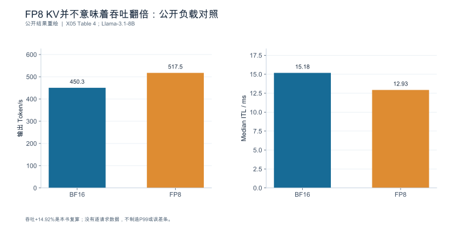

**数据身份：**`PUBLISHED_RESULT`。**条件：**150请求、并发8、约20k输入/2k输出、±15%；H100/FA3与v0.19.1由文章上下文给出。

| KV格式 | TTFT中位数/ms | ITL中位数/ms | 总时长/s | 输出Token/s |
|---|---|---|---|---|
| BF16 | 763.6 | 15.18 | 672.6 | 450.3 |
| FP8 | 742.8 | 12.93 | 585.2 | 517.5 |

**出处与边界：**[X05](book_support_v06/来源与核验.md#x05)；吞吐+14.92%是本书复算；没有逐请求数据，不制造P99或误差条。

[数据与绘图点](book_support_v06/data/ch04_fp8_workload.json) · [PNG](book_support_v06/figures/ch04_fp8_workload.png) · [重绘代码](book_support_v06/code/replot.py)

<!-- V06-END -->
<!-- V07-START -->
<a id="sec-04-10"></a>
### 4.10 实验深化补充：把缓存收益拆成“结构决定共享”和“层级决定搬运”

本章前面已用 FP8 KV 说明“字节减半不等于吞吐翻倍”。这一节再补两条更靠前的问题：共享到底省多少，以及把KV搬到CPU再搬回来要多久。

**共享收益由生成结构决定。**PagedAttention原始论文Figure 15给出OPT-13B、Alpaca trace、1×A100 40GB下的KV块平均内存节省：并行采样在输出数2/4/6时分别节省6.09%、8.53%、9.79%；Beam Search在Beam宽度2/4/6时分别节省37.56%、53.13%、55.16%。同为“共享”，宽度6时两者相差约5.6倍（55.16/9.79）。原因是Beam Search的分叉结构让大量Token前缀被同批请求复用，而独立并行采样只在公共提示词段共享。**读法：**这里衡量的是共享KV块的平均内存节省，不是整卡显存节省，也不代表两种算法的输出质量等价。

**层级搬运别把Gbps读成GB/s。**LMCache论文Table 5的CPU加载消融给出：原生vLLM CPU offload报告88 Gbps，LMCache报告400 Gbps。按1 Gbps=0.125 GB/s换算，分别为11 GB/s与50 GB/s；400/88≈4.55。**这个4.55只是加载阶段之比，不是服务吞吐之比。**逐page搬运与按chunk搬运的固定开销不同，实际采用还要计入等待、计算重叠、缓存命中率和被抢占的代价。原表未独立给出参与GPU数与模型，因此不补造端到端结论。**单位提醒：**该论文Table 1用“GBps”、Table 5用“Gbps”，两处标注不同；本书一律按字面单位换算，不假定二者等价。

#### 图4-E1 共享收益取决于生成结构：并行采样与Beam Search

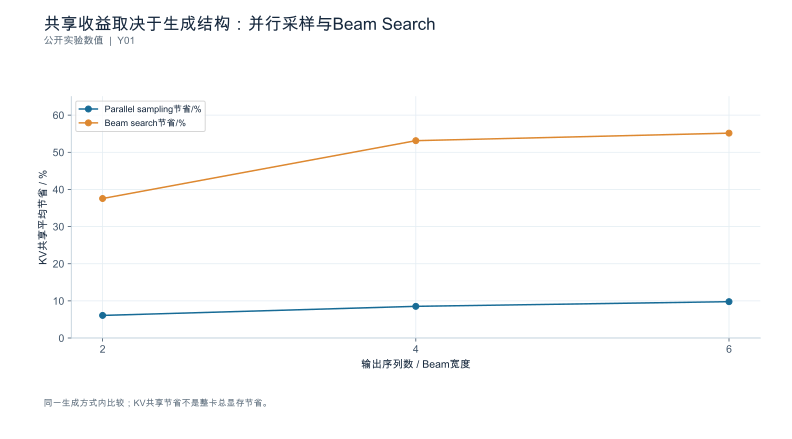

**数据身份：**`PUBLISHED_EXPERIMENT`。**条件：**OPT-13B；Alpaca trace；论文1×A100 40GB配置；Figure15，分别按并行采样输出数/Beam宽度扫描。

| 输出序列数或Beam宽度 | Parallel sampling节省/% | Beam search节省/% |
|---|---|---|
| 2 | 6.09 | 37.56 |
| 4 | 8.53 | 53.13 |
| 6 | 9.79 | 55.16 |

**出处与边界：**[Y01](book_support_v07/来源与核验_v07.md#y01)；指标为共享KV块的平均内存节省，不是所有显存；两种生成算法不同，不作质量等价声明。

[数据与绘图点](book_support_v07/data/ch04_pa_sharing.json) · [PNG](book_support_v07/figures/ch04_pa_sharing.png) · [重绘代码](book_support_v07/code/replot_v07.py)

#### 图4-E2 CPU KV加载：别把Gbps误读成GB/s

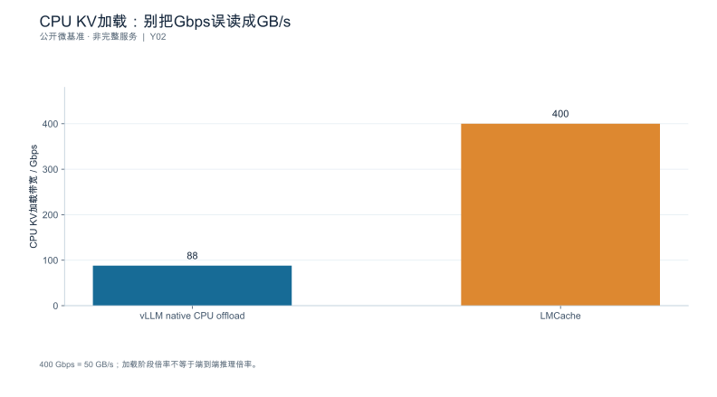

**数据身份：**`PUBLISHED_MICROBENCHMARK`。**条件：**LMCache v0.3.6；CPU加载消融基线vLLM v0.11.0；整体实验台单节点8×H100，Table5未独立给参与GPU数和模型。

| 方法 | 报告加载带宽/Gbps | 换算GB/s |
|---|---|---|
| vLLM native CPU offload | 88 | 11 |
| LMCache | 400 | 50 |

**出处与边界：**[Y02](book_support_v07/来源与核验_v07.md#y02)；第三列为本书单位换算；加载约4.55倍不等于服务吞吐约4.55倍；表级完整配置缺失。

[数据与绘图点](book_support_v07/data/ch04_lmcache_load.json) · [PNG](book_support_v07/figures/ch04_lmcache_load.png) · [重绘代码](book_support_v07/code/replot_v07.py)

<!-- V07-END -->
### 章末检查问题

**1. 为什么总 KV 除以 TP 度不一定等于每 rank 占用？**

因为分片通常按**键值头**维度进行，能否均分取决于 $h_{kv}$ 与 $TP$ 的关系（4.1.3 的算例）：$h_{kv}=8,TP=8$ 时每 rank 是总量 ÷ 8；而 $h_{kv}=4,TP=8$ 时头数不够分，需要复制，每 rank 是总量 ÷ 4，**比按设备数均分多一倍**。此外不同并行实现可能按序列维或混合维度切分，具体行为必须按所选版本核验，不能默认"总量 ÷ 设备数"。

**2. 缓存命中 50% 能否推出 TTFT 减少 50%？**

不能，中间至少隔了三层换算（4.4.1）：请求级命中率 → Token 复用率（还要乘平均复用长度占比）→ 避免的 Prefill 工作量 → 端到端改善（还要乘 Prefill 在端到端中的占比）。算例中 50% 命中率、平均复用 20%、Prefill 占 30% 时，线性成本假设下的端到端粗估只有约 **3%**。此外命中本身有查找与传输成本，短前缀命中甚至可能净亏。

**3. 远程缓存命中率提高但 Goodput 下降时，需要补哪些账本？**

至少五本：①**传输字节与链路有效带宽**（等待是否被搬到了网络）；②**排队时间**（传输是否加重排队）；③**重算时间对照**（命中路径是否真比本地重算快）；④**状态有效性与质量**（是否因复用而退化，尤其是非前缀复用）；⑤**释放与回落**（取消/失败后各层状态是否回收）。命中率只是第一本账里的一个比例，用它解释 Goodput 变化本身就跳过了中间所有环节。

---

### 本章验收清单

| 节 | 验收标准 |
|---|---|
| 4.1 | 估算涵盖输入与已生成状态；按物理身份去重；能解释分片、复制与分支共享；不把总量 ÷ 设备数当每 rank 占用 |
| 4.2 | 能区分状态本体、内部碎片、元数据与共享节省；块大小权衡有量化对照 |
| 4.3 | 缓存键含身份组合；能列出必须失效的变更项；跨租户与敏感输入不进公共缓存 |
| 4.4 | 报告明确分子分母；区分命中率、Token 复用率与避免的计算量；保留负面结果 |
| 4.5 | 活跃状态卸载与前缀存储分开；重算/传输/等待三笔账齐全；组件职责与不兼容边界已登记 |
| 4.6 | 三种"压缩"分别验收；低精度换算含元数据并注明块大小待核验；长上下文质量独立验收 |
| 4.7 | 容量以可用边界定义而非不崩溃；停止条件提前定义；降载后观察状态回落 |

---

### 配套资料

[新增图表与数据](book_support_v05/figures.md) · [来源登记](book_support_v05/references.md) · [E0测试清单](book_support_v05/data/e0_test_results.md) · [修订记录](book_support_v05/review/changes.md)

[N02]: book_support_v05/references.md#n02
[N14]: book_support_v05/references.md#n14
[R01]: book_support_v05/references.md#r01
[R02]: book_support_v05/references.md#r02
[R04]: book_support_v05/references.md#r04
[R05]: book_support_v05/references.md#r05
[R06]: book_support_v05/references.md#r06
[R07]: book_support_v05/references.md#r07
[R26]: book_support_v05/references.md#r26
[R28]: book_support_v05/references.md#r28
[R29]: book_support_v05/references.md#r29
[R32]: book_support_v05/references.md#r32
[S02]: book_support_v05/references.md#s02
[S10]: book_support_v05/references.md#s10
[S11]: book_support_v05/references.md#s11
[S12]: book_support_v05/references.md#s12
[S13]: book_support_v05/references.md#s13
[S14]: book_support_v05/references.md#s14
[S15]: book_support_v05/references.md#s15

<!-- V10-START -->
<a id="sec-04-90"></a>

### 本章口径核对（公开来源）

#### 前缀复用的命中口径与分层组件的边界

**命中口径（vLLM 指标文档）**

vLLM 不提供"命中率"仪表，而是暴露两个计数器：`vllm:prefix_cache_queries` 与 `vllm:prefix_cache_hits`。旧版的命中率仪表已被明确废弃，官方措辞是"我们现在暴露 queries 和 hits 两个计数器，而不是一个 hit rate 仪表"。

因此**分母由使用者自行定义**：官方 PromQL 示例为 `rate(cache_query_hit[5m]) / rate(cache_query_total[5m])`；而日志发布器把窗口**固定**为"最近 1000 个 KV 缓存块查询"。两者口径不同，跨来源比较命中率时必须先对齐分母。

块哈希的构成（vLLM 前缀缓存设计文档）为 `hash(parent_hash, block_tokens, extra_hashes)`：父块哈希值、本块 token 元组，以及使该块唯一的其它值——包括 LoRA ID、多模态输入哈希与 `cache_salt`。驱逐策略为 LRU，从空闲队列头部弹出。

`cache_salt` 的用途是安全隔离：它被注入首块哈希，只有携带相同 salt 的请求才能复用缓存块，从而阻断通过观测时延差异推断缓存内容的计时攻击。

**非前缀复用（LMCache 文档）**

LMCache 把"非前缀 KV 复用"定义为在 prompt 的**任意位置**复用已缓存块，并借助 CacheBlend 对部分 token 选择性重算以恢复质量。这与"只能复用从位置 0 开始的公共前缀"是两种不同的复用语义。

**分层组件（SGLang HiCache 设计文档）**

| 层 | 介质 | 共享范围 |
|---|---|---|
| L1 | GPU 显存 | 实例私有 |
| L2 | 主机 DRAM | 实例私有，**节点内** |
| L3 | 存储后端 | 仅当后端配置为共享时跨实例可见 |

关键开关：`--enable-hierarchical-cache`、`--hicache-ratio`（>1）、`--hicache-size`（GB，**每 rank**，覆盖 ratio）、`--page-size`、`--hicache-write-policy {write_back, write_through, write_through_selective}`、`--hicache-storage-prefetch-policy {best_effort, wait_complete, timeout}`、`--hicache-io-backend {direct, kernel}`、`--hicache-mem-layout {layer_first, page_first, page_first_direct}`、`--hicache-storage-backend {file, mooncake, hf3fs, nixl, aibrix, dynamic}`。所有 L3 读写查询统一封装在抽象基类 `HiCacheStorage(ABC)` 之后。

`timeout` 预取策略的判据为 `min(prefetch_timeout_max, prefetch_timeout_base + prefetch_timeout_per_ki_token × num_token_to_fetch / 1024)`，三个参数默认值分别为 30 s、2 s 与 0.1 s/1024 token。

**分层组件的故障与一致性边界**

- L2 是节点内私有：同节点上的两个实例也不会互读对方的 L2，**无法把多机主机内存聚合成一个更大的 L2**；调大 `--hicache-ratio` / `--hicache-size` 只是放大各自私有的 L2。跨实例复用必须走 L3。
- L3 是否真正共享取决于后端配置：`file` 后端默认落在 `/tmp/hicache`，除非挂载为共享目录，否则仍是节点内。
- 实例 0 的 KV 缓存**只有进入 L3 之后**才对实例 1 可见。
- HiRadixTree **不存储也不持续同步 L3 元数据**，而是实时向后台查询存在性、服务器与位置；精确地址元数据只保留在本地层。
- 预取时用 `all_reduce(op=min)` 在各 rank 间对 L3 命中长度取最小值，以保证跨 rank 的前缀长度一致。
- MLA 模型各 rank 持有相同 KV，故只由单个 rank 发起回写；MHA 在多 TP 下每 token 只有 `1/tp_size`。
- `--page-size` 越大元数据开销越小、I/O 效率越高，但部分页匹配的命中率会下降。

**传输与存储侧（Mooncake / NIXL）**

Mooncake 的 Transfer Engine 支持 TCP、RDMA(RoCE)、AWS EFA、NVMe-oF、NVLink、HIP、Barex、CXL 与昇腾系列传输；40 GB 数据（约合 LLaMA3-70B 的 128k token KV）在 4×200 Gbps RoCE 下达 87 GB/s，在 8×400 Gbps RoCE 下达 190 GB/s，分别约为 TCP 的 2.4 倍与 4.6 倍。传输失败时会自动尝试替代路径；`active_ranks` 机制允许 MoE 侧绕开失效 rank。

NIXL 通过插件抽象异构内存与存储，插件清单包括 UCX、GDS/GDS_MT、POSIX、OBJ、AZURE_BLOB、HF3FS、MOONCAKE、GUSLI、UCCL、LIBFABRIC 与 GPUNETIO。其限制是**仅支持 Linux**（官方声明 "supported on a Linux environment only"，测试于 Ubuntu 22.04/24.04 与 Fedora），macOS 与 Windows 不受支持；ROCm 上 LIBFABRIC 因头文件重构而禁用（列在 Known gaps），且尚无 NVSHMEM 等价后端。NIXL 的 README 页未在正文中写死版本号，也未提及与 vLLM / SGLang / TensorRT-LLM / LMCache 的集成关系——集成关系需另据各引擎文档确认，不能从 NIXL 侧单方面断言。

> **核对补充（2026-10-09）**：① NIXL 版本可由 **GitHub release** 定位，截至检索日最新为 **v1.5.0**（2026-09-30）；README 仅以徽章动态引用版本，故引用应写 tag。② v1.5.0 的 Known Issues 补充了一条平台限制：`pip install nixl` **不会自动安装 ROCm wheel**，新增的 dispatcher 支持需要另行安装 `nixl_rocm` 后端——即 ROCm 支持存在但不完整。③ **集成关系的证据等级**：NIXL 仓库未声明与上述引擎的集成；该说法出自 **NVIDIA 官方技术博客**（"NIXL is already a key component of many AI inference frameworks such as NVIDIA Dynamo, NVIDIA TensorRT LLM, vLLM, SGLang, Anyscale Ray, LMCache"）。书中引用时必须标明是"NVIDIA 博客声明"而非"NIXL 官方仓库声明"。④ Mooncake 的 87 / 190 GB/s 与 2.4× / 4.6× 是 **README 自述数据**，未随文披露可复现脚本与拓扑，只能写"官方 README 称"。
<!-- V10-END -->


---

<a id="ch-05"></a>
## 第5章 批处理、排队与调度

**核心论点：**调度优化改变的是**请求之间如何分享资源**；吞吐提升必须同时检查尾延迟、公平性与拒绝成本。

---

<a id="sec-05-01"></a>
### 5.1 静态批处理、动态批处理与连续批处理

**本节要回答的问题：**批次什么时候形成，又在什么时候改变？

三种策略的区别在于**批次边界的更新时机**。设四个请求 R1（短输出）、R2（长输出）、R3、R4，到达时刻略有先后（时间轴为构造数据）：

```text
静态批处理（整批完成才换批）
  t0 ────── batch#1: [R1][R2] ────── t5 ────── batch#2: [R3][R4] ────── t10
            R1 在 t1 就结束，但槽位空转到 t5

动态批处理（等待窗口内组批）
  t0 ── 窗口 ── batch#1: [R1][R2] ── t5 ── 窗口 ── batch#2: [R3][R4] ── t10
            窗口内到达的请求一起进批，窗口外的等下一批

连续批处理（逐迭代更新活跃集合）
  t0 ── [R1][R2] ── t1: R1 结束 → [R2][R3] ── t3: R4 加入 → [R2][R3][R4] ── ...
            每个迭代重新决定本轮批组成，结束即退出、就绪后可在资源与预算允许的下一轮加入
```

连续批处理提高的是**资源共享的灵活性**，但每次决策仍受三重限制：**Token 预算**（本轮最多处理多少 Token）、**状态容量**（活跃序列的状态放不放得下）、**执行形状**（能否命中已捕获的图或高效内核）。

由此可以直接回答本节验收的那个问题：**批大小不总等于同时在线的请求数**，因为

- 容量不足时，部分在线请求本轮不参与（排队或等待块）；
- Token 预算用尽时，后来的请求即使已就绪也要等下一轮；
- 长输入被分块后，一个请求可能在多个迭代里只贡献一部分 Token（5.4）；
- 抢占会让活跃请求暂时退出（5.6）。

抽象策略要对应到具体对象：用固定版本的引擎时间线解释调度器与 runner 的对应关系，并把每个开关的**默认行为 / 显式开启 / 回退 / 不支持**分成四类记录，避免沿用旧教程里的默认值 [SOURCE_REGISTERED] [S01] [S03]。

**依据与核验入口：**[R02] [R23] [S01] [S03]

---

<a id="sec-05-02"></a>
### 5.2 到达率、并发与排队

**本节要回答的问题：**固定并发和固定到达率为什么不是同一个实验？

#### 5.2.1 开环与闭环

| 模式 | 机制 | 系统变慢时会发生什么 |
|---|---|---|
| **闭环** | 客户端维持固定并发，完成一个才补一个 | 到达率自动下降，**过载被客户端吸收**，延迟曲线看起来平稳 |
| **开环** | 按外部计划的到达时刻发出，不等返回 | 队列增长，暴露真实的排队与拒绝行为 |

第8章 8.4.1 已给出判别方法（计划 vs 实际发出、调度迟滞）。这里补充结论：**闭环回答固定在途约束下的服务表现**，不能直接回答外部到达不受反馈限制时的过载问题。它可能掩盖排队风险，但并非任何闭环实验都必然高估容量。

#### 5.2.2 稳态关系要用对边界

Little 定律 $L=\lambda W$ 描述的是**同一边界内、长期稳定条件下的均值关系**。它的适用前提必须逐条确认：

1. 进入与离开的边界一致（$L$ 数的是哪一段？队列内还是系统内？）；
2. 长期平均稳定（不是瞬时，也不是队列持续增长的阶段）；
3. **它只给均值，不能预测尾延迟**。

用"设定并发 × 目标 RPS"直接推出 P99，是这条定律最常见的误用。

#### 5.2.3 排队随负载的非线性增长

为建立直觉，用一个**明确标注为模型**的 M/M/1 算例（泊松到达、指数服务时间、单服务台、无限队列——真实系统不满足这些假设，此处只用于展示趋势）。设服务率 $\mu = 50$ req/s（平均服务时间 $1/\mu = 20$ ms）：

| 到达率 $\lambda$ | 利用率 $\rho$ | 平均在途 $L=\rho/(1-\rho)$ | 平均停留 $W=L/\lambda$ | 其中等待时间 |
|---:|---:|---:|---:|---:|
| 40 req/s | 0.80 | **4** | 100 ms | **80 ms** |
| 45 req/s | 0.90 | **9** | 200 ms | **180 ms** |
| 48 req/s | 0.96 | **24** | 500 ms | **480 ms** |

到达率提高 12.5%（40→45）让等待时间变成 **2.25 倍**；提高 20%（40→48）让等待时间变成 **6 倍**。这说明轻载延迟可作基础开销对照，却不能单独预测高负载的排队放大，也是为什么容量结论必须在**目标负载区间**内测量（第8章 8.6）。

报告必须分别记 offered、admitted、completed，并单列拒绝、取消、失败与窗口内在途增量。对同一边界，有 $N_{end}=N_{start}+A-C-F-X$，其中 $A$ 为准入，$C/F/X$ 为完成、失败、取消等互斥离开事件。因而 admitted 与 completed 的差可能只是队列还在增长，不能全部解释为拒绝或放弃；拒绝通常属于 offered 与 admitted 之间的账。

**依据与核验入口：**[R11] [R12] [R25]

---

<a id="sec-05-03"></a>
### 5.3 Token 预算与执行形状

**本节要回答的问题：**限制序列数和限制批内 Token 数分别控制什么？

#### 5.3.1 两个旋钮管两件事

| 限制 | 控制什么 | 典型副作用 |
|---|---|---|
| 最大序列数（`max_num_seqs` 一类） | 本轮/引擎允许的活跃序列数及相关状态规模（不等于会话数） | 设太小：并发上不去、排队变长 |
| 批内 Token 预算（`max_num_batched_tokens` 一类） | 单轮前向的工作量上限 | 设太大：单轮延迟上升、ITL 变差；设太小：长 prefill 被切得更碎 |

**两者不能互相替代**：同样 32 个序列，输入从 512 改成 8192，本轮 Token 需求相差 16 倍，执行形状与算术强度完全不同（第3章 3.2.4：权重主导近似给出约 500；计入该方阵激活流量后理想交点约为 662 个 Token）。

#### 5.3.2 与 runner、图模式的联动

改变预算不仅改变工作量，还会改变**执行形状**，从而影响：图捕获是否命中（第1章 1.5.2 的 padding/桶/降级链）、工作区大小、以及缓存压力。因此"调了预算、吞吐变了"不能直接归因到工作量——可能是换了执行路径。

#### 5.3.3 必须记录实际形状

每次扫描都要同时保存：**实际批内 Token 数、序列数、padding 量、图命中与否、回退原因**。**不能只靠启动参数推断形成了相同的计算负载**——这正是"配置改了但没生效"或"生效方式与预期不同"的发现途径 [SOURCE_REGISTERED] [S01] [S02] [S03]。

**依据与核验入口：**[R02] [R31] [S01] [S02] [S03]

---

<a id="sec-05-04"></a>
### 5.4 Chunked Prefill 与阶段干扰

**本节要回答的问题：**分块怎样改变首 Token 等待与生成间隔？

#### 5.4.1 把长输入切成调度片段

长输入 8192、块 2048 → 被切成 **4 个调度片段**（$8192/2048=4$）。分块的目的不是"让 prefill 更快"，而是**避免一个长请求独占一整轮**，从而减少对同时进行的 decode 请求的干扰。

#### 5.4.2 优先级与混合执行

调度策略上，待处理的 decode 请求通常被优先编排，预算内再安排 prefill 片段。官方优化文档给出的权衡方向是：**块越小，decode 被 prefill 拖慢的程度越低（ITL 更好）；块越大，单批能处理的 prefill Token 越多（TTFT 更好）** [SOURCE_REGISTERED] [DOC-W03]。

算例（趋势示例，非实测）：在长短请求混合流中开启分块（块 2048）后：

| 指标 | 关闭分块 | 开启分块 | 变化 |
|---|---:|---:|---|
| 长请求 TTFT | 40 ms | **70 ms** | +75%（被切成多轮、需等待预算） |
| 短请求 ITL P99 | 120 ms | **60 ms** | −50%（不再被长 prefill 连续阻塞） |

**这不是"更好"或"更差"，而是把延迟在不同请求之间重新分配。**因此结论必须覆盖两类请求：只在总体均值上看，很容易把"长请求被牺牲"掩盖掉。

#### 5.4.3 概念边界

**Chunked Prefill 与 Prefill Context Parallel 是不同概念**：前者是把一个 prefill 切成多个调度片段；后者是让多个设备并行处理同一次 prefill。某一版本移除了旧的 Prefill CP 路径，**不能据此推断分块 Prefill 的原理失效**——功能可用性要按固定版本的支持矩阵界定，并确认 trace 中实际调用的是哪条路径 [SOURCE_REGISTERED] [S03]。

**依据与核验入口：**[R09] [R23] [S03] [DOC-W03]

---
<a id="sec-05-05"></a>
### 5.5 多租户、公平性与优先级

**本节要回答的问题：**怎样防止吞吐目标挤压某一类请求？

#### 5.5.1 分层报告是公平性的前提

总体吞吐提高完全可以伴随某一类请求的长期等待。因此调度结果必须**按业务类或租户类别分层**，每类单独报告：达标率、拒绝率、等待时间分布、以及是否被抢占。**"平均延迟下降"不能作为公平性证据。**

#### 5.5.2 饥饿的检测与处理

饥饿的可操作定义：在总负载上升时，某一类的等待时间**单调增长且远超其它类**，或其达标率跌破契约而总体仍达标。检测方式是分层时间序列，而不是看总体指标。

处理手段有三类，各有代价：

| 手段 | 机制 | 代价 |
|---|---|---|
| 资源配额 | 为每类保留容量或 Token 预算 | 资源利用率下降 |
| 优先级 | 高优先类先调度 | 低优先类可能长期饥饿 |
| 准入控制 | 超载时按比例拒绝 | 拒绝率上升（但要进分母） |

**公平性是需要明确选择的服务契约，不是一个"默认正确"的指标**：先写清各类的权重与最低保障，再验证调度是否满足。

#### 5.5.3 路由与本地调度会互相干扰

多副本场景下，若再叠加"缓存亲和路由"（把请求路由到持有其前缀副本的实例），**队列均衡与状态局部性可能冲突**：亲和提高了命中率，却可能让某个实例排队更长。因此要**分别观察全局路由与单引擎调度**，避免把租户饥饿全部归因到某一个批处理参数 [SOURCE_REGISTERED] [S06] [S07]。

**依据与核验入口：**[R25] [R24] [S06] [S07]

---

<a id="sec-05-06"></a>
### 5.6 抢占、准入、取消与背压

**本节要回答的问题：**资源不足时该排队、拒绝还是回收？

#### 5.6.1 三种应对与各自的分母后果

| 手段 | 直接后果 | 统计后果 |
|---|---|---|
| 排队（准入后等待） | 延迟上升 | 仍属于准入观察集合，未完成时记为在途而不是完成样本 |
| 抢占 | 已做工作可能作废，需重算 | 额外计算进成本；尾延迟恶化 |
| 拒绝（限流/丢弃） | 请求未完成 | 进拒绝率，不得从分母删除 |

**不能通过无限排队隐藏过载**，也**不能通过丢弃"困难请求"把成功请求的延迟曲线做得更漂亮**——后者是最危险的一类"优化"，因为它同时改善了吞吐与延迟，只牺牲了分母。

#### 5.6.2 抢占的真实成本

抢占不只是"暂停"。按引擎指标文档的事件定义，被抢占的请求会被放回等待队列并在将来**重新调度、重新执行其 prefill 阶段** [SOURCE_REGISTERED] [DOC-W07]。于是额外成本 = 已生成部分的状态重建工作量。

算例（构造数据，粗估）：请求上下文 4096、已生成 2000 Token 后被抢占：

- 已占用状态 $128\ \text{KiB}\times(4096+2000) = 780{,}288\ \text{KiB} = \mathbf{762\ MiB}$，需要全部保留或重建；
- 重放该 prefill 的额外工作按第4章 4.5.2 的量级线性缩放（8192 Token ≈ 0.50 s）作仅保留线性项的粗估：

$$
0.50\ \text{s}\times\frac{6096}{8192} \approx \mathbf{0.37\ s}
$$

（这是**粗估**：忽略了注意力项的平方增长与内核差异，实际值应实测。它的作用是说明量级——**一次抢占的代价与一次完整 prefill 同量级**，不是可以忽略的小事。）

#### 5.6.3 重试预算与背压传播

背压要在三处分别记录：**服务控制层的流控**、**引擎准入**、**客户端最大在途数**。三者叠加时，拒绝可能发生在任意一层，而客户端看到的结果是相同的超时——因此必须逐层留痕才能定位。

重试还要记账：第1章 1.6.4 给出 $\mathbb{E}[N_{\text{attempt}}]=(1-p^{r+1})/(1-p)$，实际运行中应保留**重试放大系数**作为运行数据，而不是只在报告里写"最终成功率" [SOURCE_REGISTERED] [S07] [S18]。

**依据与核验入口：**[R25] [R01] [S07] [S18]

---

<a id="sec-05-07"></a>
### 5.7 实验：建立调度的帕累托边界

**本节要回答的问题：**怎样找到适合业务的配置，而非唯一"最优参数"？

#### 5.7.1 先定可行性，再谈优劣

先冻结一组约束（每类的 SLO、拒绝率上限、公平性下限），再用同一组混合负载比较少量**有机制依据**的配置。结果不是一条曲线，而是**可行域**：满足全部约束的配置集合。

#### 5.7.2 一份四配置对照


| 配置 | 吞吐 | P99 延迟 | 某租户达标率 | 结论 |
|---|---:|---:|---:|---|
| A（预算最大） | 最高 | 超契约 | 达标 | **淘汰**：尾延迟不达标 |
| B（预算最小） | 最低 | 达标 | 达标 | 保留但非最优 |
| C（预算中等 + 分块） | 中高 | 达标 | 达标 | **推荐**（留出负载复核后） |
| D（预算最大 + 亲和路由） | 高 | 达标 | **跌破契约** | **淘汰**：某类饥饿，虽总量好看 |

这里最容易犯的错误是**只展示 A 或 D 的那一点**。推荐配置必须来自"满足全部门槛"的集合，并在**留出负载**上复核（不在用于调参的同一批负载上复核）。

#### 5.7.3 保留淘汰原因

被淘汰的方案要连同原因一起归档：是尾延迟不达标、是某类饥饿、还是执行路径未生效。这些记录在下一次版本升级时会变成最便宜的回归基线——**知道"为什么当初不选它"比"当初选了什么"更有价值**。

**依据与核验入口：**[R11] [R12] [R24]

---

### 5.8 深化：工作量方差、剩余服务时间与分块预算

#### 5.8.1 为什么相同均值也会形成不同的排队

为解释方差，另设一个M/G/1模型：泊松到达、单服务台、先来先服务、服务时间独立同分布且二阶矩有限、$\rho=\lambda E[S]<1$。它**不是连续批处理引擎的精确模型**，只用于建立长短请求混合造成排队的直觉。

随机到达看到服务器正在执行某任务时，看到的往往是长任务。对时长为 $s$ 的一次服务，它贡献的剩余时间面积为 $s^2/2$；把面积按长期时间平均后，剩余服务时间的无条件均值为 $\lambda E[S^2]/2$。到达者还要等待队列中请求，平均等待满足

$$E[W_q]=\lambda E[W_q]E[S]+\lambda E[S^2]/2,$$

因而得到

$$E[W_q]=\frac{\lambda E[S^2]}{2(1-\rho)}=\frac{\rho}{1-\rho}\frac{1+c_s^2}{2}E[S].$$

$c_s$ 为服务时间变异系数。固定平均服务时间20 ms、利用率0.8时，确定性服务（$c_s^2=0$）平均等待40 ms，指数服务（$c_s^2=1$）为80 ms；若 $c_s^2=4$，则为200 ms。**这不是引擎预测值，而是说明均值相同不足以保证排队相同。**实际批处理会让服务时间与队列状态耦合，需要批组成和阶段事件进一步解释。

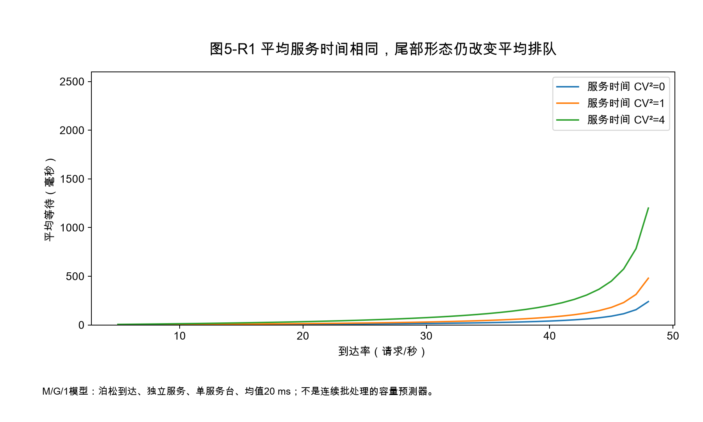

#### 5.8.2 Token预算不是固定的Prefill块大小

设单轮总预算为 $T$，本轮普通Decode占用 $D$ 个有效位置，其它验证或保留预算为 $V$，则新Prefill可用预算至多是 $\max(0,T-D-V)$。当 $D$ 随活跃请求变化时，同一个8192启动参数会产生不同实际Prefill块。若开启推测验证，$V$还随候选长度与接受行为变化。解释性能时应该画实际形状分布，而不是只写一个最大值。

官方vLLM优化文档描述了优先安排Decode、再用剩余预算调度Prefill的策略 [N15]。这里应把它理解为特定实现的调度规则，而非所有引擎的通则；预算大小对TTFT/ITL的影响，也需要结合实际负载和图执行路径核验。

#### 5.8.3 分块是在让出服务机会，不是取消注意力依赖

一个长请求分成多个块后，每块新增查询仍需读取前序上下文，所以切块并没有删除query-key依赖。它能减少一次长计算对其它请求的连续阻塞，却也增加了调度次数、重复读取前序状态以及小形状低效率的可能。过小与过大都可能恶化某一层目标，最佳点随到达率、输出长度和状态压力变化。

因此可将候选调度问题写成一个约束优化：在每类请求的截止时间、拒绝上限和最低服务份额约束下，最大化合格完成量。这里拒绝不是“绝对不能用”的策略；在明确的准入契约下，及时拒绝可能优于无限排队。不能接受的是拒绝后从统计分母中删除这些请求，再宣称全部成功。

公平性检查也应考虑工作量归一化。一个拥有大量长请求的租户占用更多设备时间，不一定意味着调度偏袒；反之，各租户获得相同请求数也不意味着公平。应先选择按请求、Token预算、设备时间还是业务权重分配，再观测每类的实际兑现与尾部饥饿。

---

<!-- V06-START -->
<a id="sec-05-09"></a>
### 5.9 实验图表补充：用官方调度对照观察均值与尾部的分歧

SGLang v0.5.20发布说明在PR #32911相关条目中报告：基于GLM-5.2生产trace，HRRN相对FCFS使Mean TTFT下降69%，P99 TTFT下降8%。条目未披露绝对毫秒值、硬件和重复运行记录。因此本节只能把FCFS设为100，重绘相对延迟指数31与92。

这组结果适合回答“平均改善会不会自动带来尾部改善”：不会。均值和P99都朝好的方向变化，但幅度很不相同。也不能由Mean下降69%反推合格完成速率增加69%，因为失败分母、到达率和其他门槛未给出。

**最小复现实验：**以同一真实内容回放FCFS/HRRN，固定资源、Token预算、缓存预热与负载顺序，交错运行并做回退复测。除总体TTFT外，按长度类和租户分别记录等待、拒绝、抢占与达标率；避免总体平均值掩盖某类长请求饥饿。相对图提供的是值得测试的假设，不替你决定生产调度策略。

#### 图5-V1 调度策略：均值改善与尾部改善不是一回事

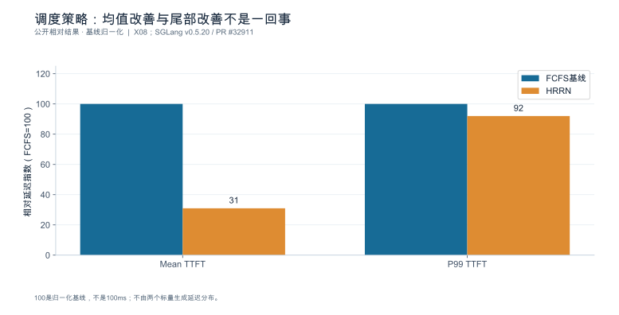

**数据身份：**`PUBLIC_RELATIVE_RESULT`。**条件：**GLM-5.2 production trace；同发布说明的HRRN vs FCFS条目；未披露硬件及绝对时间。

| 指标 | FCFS指数 | HRRN指数 | 公开降幅 |
|---|---|---|---|
| Mean TTFT | 100 | 31 | 下降69% |
| P99 TTFT | 100 | 92 | 下降8% |

复算公式：`normalized=100*(1-reduction)`。

**出处与边界：**[X08](book_support_v06/来源与核验.md#x08)；100是归一化基线，不是100ms；不由两个标量生成延迟分布。

[数据与绘图点](book_support_v06/data/ch05_hrrn_relative.json) · [PNG](book_support_v06/figures/ch05_hrrn_relative.png) · [重绘代码](book_support_v06/code/replot.py)

<!-- V06-END -->
<!-- V07-START -->
<a id="sec-05-10"></a>
### 5.10 实验深化补充：分页把“能同时装下多少请求”抬了一个量级

前面用 SGLang HRRN 说明了“怎么排”；这一节补上“能装多少”。PagedAttention论文Figure 13在OPT-13B、A100 40GB下比较了四种策略的平均组批请求数。

ShareGPT按2 req/s到达时，Orca Max/Pow2/Oracle与vLLM分别为7、9.81、13.62、30.42；Alpaca按30 req/s到达时为7、43.24、72.75、132.44。相对Orca Oracle，vLLM约2.23倍与1.82倍。**这说明分页改善的是状态容纳与调度机会**——更少碎片、更高并发，从而在同一个batch里塞进更多请求。它不等于端到端吞吐同倍提升，因为组批数受显存、计算与调度共同约束。

**两种负载不要并排当同一场景。**ShareGPT是2 req/s、Alpaca是30 req/s，到达率差一个量级，柱子高度不能直接横向比较，只能各自与同列的Orca基线比。平均组批请求数是占用/组批统计，不是req/s，也不是满足SLO的容量。把它与 5.9 节的相对延迟图配合看：一张回答“装多少”，一张回答“怎么排”，两者都不单独决定交付容量。

#### 图5-E1 分页之后实际组入了多少请求？

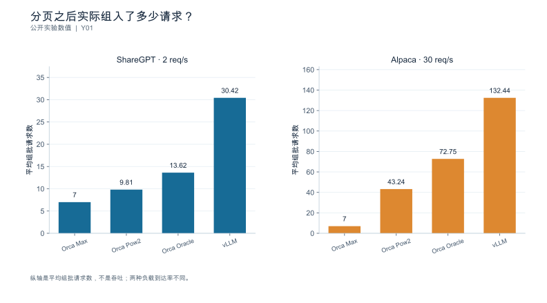

**数据身份：**`PUBLISHED_EXPERIMENT`。**条件：**OPT-13B，A100 40GB；ShareGPT 2req/s、Alpaca 30req/s；Figure13；两种负载分面显示。

| 策略 | ShareGPT平均组批请求数 | Alpaca平均组批请求数 |
|---|---|---|
| Orca Max | 7 | 7 |
| Orca Pow2 | 9.81 | 43.24 |
| Orca Oracle | 13.62 | 72.75 |
| vLLM | 30.42 | 132.44 |

**出处与边界：**[Y01](book_support_v07/来源与核验_v07.md#y01)；平均batched requests是占用/组批统计，不是req/s或SLO容量；不可把两种到达率的柱子当同一场景。

[数据与绘图点](book_support_v07/data/ch05_pa_batching.json) · [PNG](book_support_v07/figures/ch05_pa_batching.png) · [重绘代码](book_support_v07/code/replot_v07.py)

<!-- V07-END -->
### 章末检查问题

**1. 固定并发压测为何可能低估过载排队？**

因为闭环客户端在服务端变慢时会**自动减少发出**（5.2.1）：并发 128、单请求停留变长时，到达率被动降到 $\lambda\approx128/W$。于是队列不增长、延迟曲线平稳，看起来"容量还行"，而真相是客户端替服务端做了限流。要研究过载，必须用开环或轨迹回放，并同时报告 offered / admitted / completed 三种速率。

**2. 相同 RPS 的长短请求组合为什么不同？**

因为 RPS 只描述到达数量，不描述**每请求的工作量**。第2章已说明 Prefill 随输入线性与平方项增长、Decode 随输出逐步累加；第3章说明算术强度随批内 Token 数变化。因此"100 req/s 的长文档"与"100 req/s 的短问答"在 Token 预算、状态占用与执行形状上是三种不同的负载（第8章 8.3 的四档基线）。比较时必须给出长度分布，而不只是 RPS。

**3. 旧版本 Prefill CP 路径撤回，为什么不能据此否定 Chunked Prefill 原理？**

因为它们是不同机制：**Chunked Prefill** 把一个 prefill 切成多个调度片段以缓解对 decode 的连续占用；**Prefill Context Parallel** 是让多个设备并行处理同一次 prefill。某版本移除的是后者的旧实现路径，**与前者是否成立无关**。功能可用性要按固定版本的支持矩阵界定，并在 trace 中确认实际调用路径（5.4.3）。

---

### 本章验收清单

| 节 | 验收标准 |
|---|---|
| 5.1 | 能解释批大小为何不总等于在线请求数；抽象策略对应到具体对象，开关四类状态已记录 |
| 5.2 | 区分 offered/admitted/completed；Little 定律只用于均值与稳定边界；不将不稳定队列套入稳态公式 |
| 5.3 | 序列数限制与 Token 预算分别说明；保存实际批形状（Token/序列/padding/图命中/回退原因） |
| 5.4 | 结论覆盖长请求与短请求两类；能区分 Chunked Prefill 与 Prefill CP；可用性与实际调用路径按版本确认 |
| 5.5 | 每类请求都有达标率与拒绝率；说明饥饿检测方式与公平性契约；路由与本地调度分别观察 |
| 5.6 | 排队/拒绝/抢占三者的分母后果明确；抢占成本有量级估算；背压三层分别记录 |
| 5.7 | 推荐配置来自满足全部门槛的集合并在留出负载复核；保留淘汰原因 |

---

### 配套资料

[新增图表与数据](book_support_v05/figures.md) · [来源登记](book_support_v05/references.md) · [E0测试清单](book_support_v05/data/e0_test_results.md) · [修订记录](book_support_v05/review/changes.md)

[DOC-W03]: book_support_v05/references.md#doc-w03
[DOC-W07]: book_support_v05/references.md#doc-w07
[N15]: book_support_v05/references.md#n15
[R01]: book_support_v05/references.md#r01
[R02]: book_support_v05/references.md#r02
[R09]: book_support_v05/references.md#r09
[R11]: book_support_v05/references.md#r11
[R12]: book_support_v05/references.md#r12
[R23]: book_support_v05/references.md#r23
[R24]: book_support_v05/references.md#r24
[R25]: book_support_v05/references.md#r25
[R31]: book_support_v05/references.md#r31
[S01]: book_support_v05/references.md#s01
[S02]: book_support_v05/references.md#s02
[S03]: book_support_v05/references.md#s03
[S06]: book_support_v05/references.md#s06
[S07]: book_support_v05/references.md#s07
[S18]: book_support_v05/references.md#s18

<!-- V10-START -->
<a id="sec-05-90"></a>

### 本章口径核对（公开来源）

#### 调度参数的版本状态与流控的作用位置

**vLLM v0.29.0（2026-09-09，commit `98dff2a8`）**

> **时效提示（2026-10-09）**：本节两份发布说明锚定在 v0.29.0 / v0.30.0；截至检索日 vLLM 最新稳定版为 **v0.31.0**（2026-10-05，commit `db9527a`），另有 RC v0.31.1rc0（2026-10-07）。两条引用纪律不变且更重要：① **发布说明不等于能力证明**——不能用"该版本发布说明未提及某参数"推出该参数不存在或行为未变；② **参数状态必须查对应版本的参数文档 + 启动日志确认**，不能用旧版本的结论外推到新版本。本节的结论只对所引版本成立，升级后须重核。

- 新增准入控制开关 `--max-num-queued-reqs` 与 `--max-num-queued-tokens`。
- `prefix_cache_retention_interval` 由环境变量改为 CLI 参数，默认值 0；使用 EAGLE/MTP 的混合模型会自动恢复 dense retention。
- 前缀缓存的 `NONE_HASH` 改为确定性默认，分布式 KV 缓存用户不再需要固定 `PYTHONHASHSEED`。
- FlashInfer all-reduce 成为 TP CUDA 组的默认，可用 `VLLM_ALLREDUCE_USE_FLASHINFER=0` 关闭。
- KV 缓存布局统一到 `KVCacheLayout` 枚举。

**vLLM v0.30.0（2026-09-22，commit `ced6857`）**

- `max_num_queued_reqs` 在 API server 的多个进程间共享。
- 新增 `vllm:request_num_preemptions` 直方图，可用于观察抢占强度。
- 移除 `VLLM_PREFIX_CACHE_RETENTION_INTERVAL` 与 `VLLM_MM_HASHER_ALGORITHM` 两个环境变量（改用配置字段）。
- `all` Mamba 缓存模式废弃，并回退到 Model Runner V1。
- scale-out 端点改为需要显式 `--enable-scale-out`，`VLLM_ENABLE_SCALE_OUT_ENDPOINTS` 环境变量移除。

**必须说明的口径边界**

上述两版发布说明中**均未出现** chunked prefill、`max_num_batched_tokens`、调度策略或优先级参数。因此这些参数在所选版本中的默认值、显式配置、回退行为与不支持状态，**不能**由发布说明推出，只能查对应版本的参数文档并结合启动日志确认。把"发布说明没提"当作"参数不存在或行为未变"是不成立的推断。

**流控的作用位置**

控制面与引擎侧的流控是两层独立机制，不能混为一谈：

| 组件 | 版本 | 流控口径 |
|---|---|---|
| llm-d | v0.9（2026-08-28） | 请求 TTL 默认 60 s（`defaultRequestTTL`）；每 band 最大请求数 5000（`maxRequests`）；503 = 端点池为空，429 = 可重试背压；`--drain-timeout` 控制优雅退出 |
| Dynamo | v1.5.0 | `WorkerFilter` 先做资格过滤，再由 `WorkerScorer` / `WorkerPicker` 打分与选择；所有候选 worker 均被过滤时返回 HTTP 503 |

Dynamo 的过滤器示例键为 `min_effective_overlap_blocks`，即"最小有效前缀重叠块数"，属于缓存亲和类过滤。要在观测上把"路由层限流"与"引擎本地调度"分离，需要双侧各自的观测面，单看一侧会把两者的效应混在一起。
<!-- V10-END -->


---

<a id="ch-06"></a>
## 第6章 多卡并行、拓扑与 MoE

**核心论点：**多卡策略同时改变**驻留方式、通信位置、执行粒度与副本数**；四种影响必须在同一服务目标下一起比较，任何只看其中一项的结论都可能反向。

---

<a id="sec-06-01"></a>
### 6.1 先区分容量并行与吞吐复制

**本节要回答的问题：**增加设备究竟是在装下模型，还是服务更多请求？

增加卡数只有三个目的，且它们**互相竞争**：

| 目的 | 机制 | 代价 |
|---|---|---|
| **装下模型** | 把权重与状态分片到多卡 | 每 rank 仍要留工作区与状态池；分片引入同步 |
| **缩短单请求** | 把一次前向的计算摊到更多设备 | 同步次数增加；单步工作量变小，固定开销占比上升 |
| **服务更多请求** | 增加副本数 | 每副本都要重复驻留权重，容量被权重吃掉 |

因此**总设备数固定时，扩大并行度必然减少副本数**。这是本节最关键的一句话：不存在"并行度越大越好"这回事，只存在"在当前负载与服务目标下哪一种划分更划算"。

#### 6.1.1 布局候选表：先统一全模型量与每 rank 量

为单独检验分片算术，这里使用**构造数据**：权重总量 140 GB、每卡可用 80 GB、每 rank 固定开销 4 GB、全模型每 Token 的 KV 为 128 KiB，$h_{kv}=8$，总设备数为 8。它把权重量与状态量作为独立输入，**不是某个真实 70B 模型的配置**。真实模型应按第2、4章重新提取层数与头数。

无复制且按头均分时，一条 4096 Token 序列的全模型 KV 为 $K=0.536870912$ GB，每 rank 为 $K/TP$。所以

$$C_{replica}=\left\lfloor\frac{80-140/TP-4}{K/TP}\right\rfloor,\qquad C_{cluster}=\frac{8}{TP}C_{replica}.$$

| 布局 | TP | 副本数 | 权重/rank（GB） | KV 池/rank（GB） | 每序列 KV/rank（GB） | 每副本路数 | 集群路数 |
|---|---:|---:|---:|---:|---:|---:|---:|
| A | 8 | 1 | 17.5 | 58.5 | 0.067108864 | **871** | **871** |
| B | 4 | 2 | 35 | 41 | 0.134217728 | **305** | **610** |
| C | 2 | 4 | 70 | 6 | 0.268435456 | **22** | **88** |

先对每副本取整，再乘副本数，不能让不同副本共享小数路数。上述只是**静态显存上限**，未包含分块浪费、额外图工作区、状态增长及服务目标。

这次修正会改变原表结论：在这些假设下 A 的静态集群状态容量高于 B；B 是否有更高服务吞吐，要由两个副本各自的服务曲线判断，不能由容量表推出。C 可以运行较小并发，不是“模型不可运行”；若项目要求每副本至少 64 路，它仅因不满足该准入门槛而被排除。三种布局的单请求延迟均未知。

头数不足时，某些实现会复制 KV 头。对只采用均匀头切分或均匀复制的简化实现，$h_{local}=\max(h_{kv}/TP,1)$ 只适用于整除关系成立的组合；任意不整除布局应读取实际分配，不能向上取整后假装已经确认实现支持。

**依据与核验入口：**[R30] [R08]

---

<a id="sec-06-02"></a>
### 6.2 Tensor Parallel：分片与同步

**本节要回答的问题：**算子被拆开以后，增加了哪些通信，它们是否落在关键路径上？

#### 6.2.1 切分位置决定通信类型

以线性层 $Y = XW$ 为例，两种切法对应两种集合通信：

| 切法 | 数学形式 | 每 rank 持有 | 需要的通信 |
|---|---|---|---|
| **列切**（按输出维） | $W = [W_1 \; W_2]$，$Y = [XW_1 \; XW_2]$ | 部分输出列 | 下游需要完整输入时需 **all-gather** |
| **行切**（按输入维） | $W = \begin{bmatrix}W_1 \\ W_2\end{bmatrix}$，$Y = X_1W_1 + X_2W_2$ | 部分和 | 需要求和 → **all-reduce** |

经典 Megatron 式布局把两者配对使用：注意力与 MLP 内部先列切、输出投影再行切，于是**每层产生 2 次 all-reduce**；启用序列并行后，原本的 all-reduce 会被拆成 reduce-scatter 与 all-gather，每层变成 **4 次集合通信**。

**这个"2 次还是 4 次"必须按实现取证，不能照抄。**判据是 trace 中的集合通信内核名与调用次数（第9章 9.5），而不是文档里的示意图。

#### 6.2.2 通信账本：Prefill 与 Decode 的主导项完全不同

设 $d_{\text{model}}=4096$、BF16（$2$ B）、TP $=8$、$L=32$ 层、每层 2 次 all-reduce（合计 64 次/步），互联有效带宽取 $200$ GB/s、每次集合通信固定开销取 $6$ µs（均为参数）。按 ring 算法，单次 all-reduce 每 rank 传输量约 $2(N-1)/N \cdot M = 1.75M$：

| 阶段 | 张量形状 | 单次 $M$ | 每 rank 每次 | 64 次合计 | 带宽项 | 延迟项 | **延迟占比** |
|---|---|---:|---:|---:|---:|---:|---:|
| Prefill（$B{=}1,S{=}4096$） | $[1,4096,4096]$ | 32 MiB | 56 MiB | 3584 MiB | 18.79 ms | 0.38 ms | **2.0%** |
| Decode（$B{=}8,S{=}1$） | $[8,1,4096]$ | 64 KiB | 0.109 MiB | 7 MiB | 0.04 ms | 0.38 ms | **91.3%** |

**这是本章最该记住的一张表。**同样的层数、同样的并行度，只因为张量形状不同：

- **Prefill 由带宽主导**（延迟只占 2%）：优化方向是减少通信字节（序列并行、融合、降低精度传输）。
- **Decode 由延迟主导**（延迟占 91%）：每 step 要发起 64 次同步而每次只搬 64 KiB，优化方向包括减少必要的同步轮次、降低主机发起开销和改善拓扑；图捕获主要减少发起开销，并不会自动消除数学上必需的集合通信。

所以"TP 度提高有没有收益"这个问题**在 Prefill 与 Decode 上答案可以相反**，必须分开回答。也正因如此，不能把"all-reduce 微基准的带宽"当作 TP 收益的依据——Decode 侧压根不受带宽限制。

通信是否在关键路径上，要依据实际算子依赖。经典列切与行切配对可以让中间分片直接被下一算子消费，从而**避免某次 all-gather**；避免通信与把仍存在的通信隐藏在计算后面是两种机制。Reduce-scatter 也不是能任意替换 all-gather 的操作，必须满足下游对张量分片和求和结果的语义要求。

#### 6.2.3 小批次与拓扑敏感性

TP 度提高会减小本地 GEMM 的工作量，但**并不保证每次 all-reduce 的逻辑张量变小**；经典行切输出的部分和常仍为完整输出形状，于是固定开销占比上升；同时增加 rank 数会让 ring 的跳数增加、跨域时每跳代价更高。因此存在明显的负载区间与互联条件依赖：

- 批内 Token 数很小时（在线低并发 Decode），提高 TP 度可能**净变差**；
- 长输入 Prefill 时，提高 TP 度通常划算，前提是分片后的状态与通信不跨域；
- 一旦 TP 组跨越节点边界（而非高速互联域内），每次同步都要走慢链路，上面的 200 GB/s 假设直接失效。

**可行结论的形式是区间而不是方向**："在本环境的 X 负载、Y 批形状、Z 互联下，TP 从 4 到 8 的收益是多少"——而不是"TP 越大越好"或"TP 超过 4 就劣化"。

**依据与核验入口：**[R08] [R30] [S02]

---

<a id="sec-06-03"></a>
### 6.3 Pipeline Parallel：阶段与气泡

**本节要回答的问题：**把层分到不同设备上，哪些时间会空转？

#### 6.3.1 阶段切分与传递

流水并行沿**层**切分：把 $L$ 层分成 $p$ 个连续阶段，每阶段驻留在一组设备上，阶段间只传递隐藏状态张量。与 TP 的关键区别：**通信频率低（每微批每阶段边界一次）但消息大**，且通信是点对点而非集合。

它解决的是 TP 解决不了的问题——当模型大到 TP 组也装不下，或 TP 组内同步成本过高时，PP 提供了第二个切分维度。

#### 6.3.2 气泡：为什么在线场景尤其吃亏

流水启动需要填充、结束需要排空，中间形成**气泡**。在经典 GPipe 式稳态模型下，若每阶段耗时相同为 $t$、微批数为 $m$、阶段数为 $p$，则总时长 $(m+p-1)t$，理想时长 $mt$，气泡占比为

$$
\text{bubble} = \frac{p-1}{m+p-1}
$$


| 阶段数 $p$ | 微批数 $m$ | 气泡占比 | 场景 |
|---:|---:|---:|---|
| 4 | 8 | **27.3%** | 中等批量 |
| 4 | 32 | **8.6%** | 离线大批量 |
| 2 | 8 | **11.1%** | 少阶段 |
| 4 | 4 | **42.9%** | **在线低并发** |

**关键推论：同样 $p=4$ 的布局，离线大批量（$m=32$）气泡只有 8.6%，在线低并发（$m=4$）却高达 42.9%。**因此在训练里得到的流水效率结论**不能搬到在线推理**：

1. 训练的微批数由全局批大小决定，可以堆到很大；推理的微批数上限由**在途请求数**决定（第5章），在线低并发时它天然很小；
2. 推理还要处理 Prefill 与 Decode 混合、请求长度参差、随时到达与结束——这些都会破坏"每个微批等长"的假设；
3. 训练可以重跑，推理的一次气泡直接付给用户。

因此 $(m+p-1)t$ 仅用于独立、等长、均衡阶段的理想微批流水；自回归反馈依赖、混合阶段与在线到达需另建模型，并用在线推理实验验证。

#### 6.3.3 阶段平衡与可用性

气泡之外还有**阶段不平衡**：总时长由最慢阶段决定。设 32 层分 4 阶段、每阶段 8 层，但首尾阶段额外承担嵌入与输出投影，假设各阶段耗时 $[10.0,\,9.5,\,9.5,\,11.5]$ ms，则节拍为 $11.5$ ms，阶段利用率

$$
\frac{10.0+9.5+9.5+11.5}{4\times11.5} = \frac{40.5}{46} = \mathbf{88.0\%}
$$

也就是说，即便完全消除气泡，仍有 12% 因不平衡损失。改善办法是**按实测耗时而非按层数切分**。

可用性也必须写明：某阶段异常时，整条流水上的在途微批如何处理、是否需要整流水重启、恢复时间多长，这些属于运维契约，与效率分开记录（第12章展开）。

**依据与核验入口：**[R30]

---

<a id="sec-06-04"></a>
### 6.4 Data Parallel：副本、路由与局部性

**本节要回答的问题：**请求平均分配，是否就能负载均衡？

#### 6.4.1 副本容量与健康

数据并行复制整个模型实例，副本间不需要同步计算。它的代价是**每副本都要完整驻留权重**，因此并行度受 6.1 那张表的约束；它的收益是容量随副本数近似线性增长（前提是路由真的均衡）。

副本级必须分别记录：到达率、在途数、状态占用、达标率与拒绝率。**聚合曲线会掩盖热点**——把空闲副本与拥塞副本平均在一起，得到的是一条看起来健康的曲线和一批实际超时的用户。

#### 6.4.2 请求成本估计：数量均衡 ≠ 工作量均衡

第5章已说明不同请求的成本差异极大。这里给出定量对照：4 个副本各收到 100 个请求（**数量完全均衡**），但生成的输出 Token 分别为

| 副本 | 请求数 | 输出 Token | 相对集群均值 |
|---|---:|---:|---:|
| A | 100 | 300 000 | **2.45×** |
| B | 100 | 80 000 | 0.65× |
| C | 100 | 60 000 | 0.49× |
| D | 100 | 50 000 | 0.41× |
| **合计/均值** | 400 | 490 000 | 122 500 |

按请求数看完全均衡，按 Token 工作量看最忙副本是均值的 **2.45 倍**。结论：**路由决策的输入应当是成本估计（输入长度、预期输出长度、是否命中前缀、状态占用），不是请求计数。**轮询均衡的是计数，有限窗口内可能出现工作量偏斜；不能保证均衡实际成本。

#### 6.4.3 缓存局部性与热点的取舍

缓存亲和路由（把共享前缀的请求送到同一副本）能提高命中率，但会制造热点。这是一次**权衡而非优化**，必须两边都测：

| 指标 | 无亲和 | 有亲和 | 变化 |
|---|---:|---:|---|
| Token 复用率 | 20% | 45% | +25 个百分点 |
| 最热副本在途数 | 3 | 17 | **+14** |
| 该副本 P99 排队等待 | 40 ms | 310 ms | **+270 ms** |
| 单请求省下的 Prefill | — | ≈120 ms | −120 ms |

**省下的 120 ms 小于新增的 270 ms 排队等待，净效应为负。**这个算例的价值在于它说明：命中率上升是局部收益，排队上升是全局代价，两者量纲相同（都是时间）却常常被分别汇报、从不放在一起比。

路由还必须在**队列长度、缓存复用、故障规避**三者间取舍，且要注意一个常见陷阱：**缓存亲和会与副本故障规避冲突**——把某前缀固定到某副本，该副本下线时命中率会骤降。因此要记录失效后的重建时间与命中率恢复曲线。

路由层的能力边界须按固定版本核验，不能假定控制面支持哪些策略 [SOURCE_REGISTERED] [S06] [S07]。

**依据与核验入口：**[R07] [R30] [R25] [S06] [S07]

---

<a id="sec-06-05"></a>
### 6.5 Expert Parallel：dispatch、combine 与专家偏斜

**本节要回答的问题：**专家选择如何转化为跨设备通信与等待？

MoE 的三张清单已在第2章给出（计算按激活参数、存储按总参数、传输按路由量）。本节处理它落到多卡上的后果。

#### 6.5.1 路由分布、专家容量与驻留

设 $E=64$ 专家、分布在 $W=8$ 个 rank（每 rank 8 专家）、全局批 $4096$ Token、top-2 路由 → 共 $8192$ 次"Token—专家"指派。均匀时每 rank $1024$ 次。

#### 6.5.2 dispatch、专家计算与 combine

一次 MoE 迭代拆成四段：

1. **路由**（Router）：计算每个 Token 的专家选择，产生指派表；
2. **dispatch**：按指派把 Token 发到持有目标专家的 rank（all-to-all）；
3. **专家计算**：各 rank 在本地专家上做前馈；
4. **combine**：把结果按原顺序聚合回 Token 所在 rank（第二次 all-to-all），并应用权重。

消息量按第2章的口径（$d=4096$、BF16、top-2）：

| 阶段 | 全局 Token | 一层单向总 payload | 每 rank 发送 | 32 层累计（每 rank） |
|---|---:|---:|---:|---:|
| Prefill | 4096 | 64 MiB | 8.00 MiB | **256 MiB** |
| Decode | 64 | 1 MiB | 0.12 MiB | **4 MiB** |

与 6.2 的表呈现**同一个规律**：Prefill 侧通信量以百 MiB 计（带宽主导），Decode 侧只有几 MiB 却每步都要发生（延迟主导）。所以 MoE 的多卡优化在两阶段上同样是两套思路。

#### 6.5.3 通信—计算依赖与缓冲生命周期

dispatch 与 combine 之间夹着专家计算，形成严格的**依赖链**：combine 必须等所有目标 rank 算完，因此**一次 all-to-all 的等待时间取决于最慢的接收方**，而不是平均值。

缓冲生命周期也是一个常被忽略的成本项：dispatch 的接收缓冲要一直保留到 combine 完成，其大小由**最坏情况**（某 rank 收到的 Token 数）决定，而不是平均情况。因此容量规划必须按上界分配，否则会触发动态扩容或阻塞。

在可用实现上，应以所选提交的接口与依赖说明来解释通信与计算的耦合 [SOURCE_REGISTERED] [S16]；**不要用 all-reduce 微基准代替专家通信的证据**——两者的消息模式、同步结构与缓冲生命周期都不同。

#### 6.5.4 偏斜：容量由最忙 rank 决定

一组用于偏斜分析的指派分布（8 个 rank）：

$$[1536,\;1408,\;1152,\;1024,\;960,\;896,\;704,\;512]$$

和为 $8192$，均值 $1024$，**最忙 rank 为均值的 1.50 倍**。由此：

- 该 rank 成为**节拍**，整步时间由它决定；
- 若按均匀分配估算容量，会高估约 **50%**（$1/1.5 = 66.7\%$ 的实际容量）；
- 平均值（1024）完全看不出这件事——**平均专家负载不能反映最忙设备**。

因此本章的硬要求：**必须有逐 rank（或逐专家）的分布记录，而不是一份全局平均。**没有分布就没有偏斜结论。

偏斜的来源要分开：路由本身的偏斜（某些专家天然更常被选中）、负载内容偏斜（某批请求都集中在同一领域）、以及拓扑偏斜（某些专家刚好跨了慢链路）。三者对策不同，混为一谈会导致"加专家/加设备"无效。

#### 6.5.5 版本化说明与证据边界

关于专家并行的通信实现，公开仓库提供了弹性缓冲等机制以支持通信与计算的重叠 [SOURCE_REGISTERED] [S16]。**这是"某仓库写了什么"层面的证据，不是本项目的实测**；该仓库是浮动来源，正式引用前必须固定 commit 或存档快照。能写的是"该机制意图解决什么依赖"，不能写的是"本环境启用后加速多少"。

**依据与核验入口：**[R05] [R08] [R30] [S16] [S02]

---

<a id="sec-06-06"></a>
### 6.6 Context Parallel、混合并行与互联域

**本节要回答的问题：**长上下文为何需要新的切分维度，以及各维度组合有哪些硬约束？

#### 6.6.1 长上下文切分

上下文并行沿**序列**切分：把长序列分到多个 rank，各自持有自己分片的状态。TP 可以通过头分片降低每 rank KV 容量，但收益会受 KV 头数、复制与内核布局限制；上下文并行提供沿序列切分的另一条容量和工作量扩展路径。代价是注意力需要跨分片访问，产生额外通信；且分片间存在依赖，实现上通常以环形或分块方式传递键值。

它可能带来状态容量扩展和注意力工作量分摊；是否缩短单请求还取决于新增通信——这一点必须与 6.1 的目的分类对应清楚。

#### 6.6.2 五种维度的组合约束

| 维度 | 切的是什么 | 主要通信 | 主要代价 |
|---|---|---|---|
| TP | 张量（头/隐层维） | all-reduce / all-gather | 同步次数多，Decode 延迟主导 |
| PP | 层 | 点对点传递 | 气泡与阶段不平衡 |
| DP | 模型副本 | 无（计算内） | 权重重复驻留 |
| EP | 专家 | all-to-all | 偏斜与缓冲上界 |
| CP | 序列 | 跨分片键值传递 | 依赖链与通信量 |

组合时必须逐维回答"**这一维实际切了什么、产生了什么通信、复制了什么**"。两个典型陷阱：

- TP 与 CP 同时启用时，状态可能被**复制**（第4章的每 rank 占用不等于总量除以设备数）；
- PP 与 EP 组合时，专家组是否跨越阶段边界决定了 all-to-all 是否跨节点。

#### 6.6.3 互联域边界

通信代价高度依赖它发生在**域内**还是**跨域**。机柜级高速互联域（如公开产品页所述的整机柜 NVLink 域 [SOURCE_REGISTERED] [S21]）与跨节点网络的带宽通常差一个数量级，因此：

- **TP 组必须在高速互联域内**（同步次数最多）；
- **PP 的相邻阶段尽量域内**（消息大）；
- **EP 组是否跨域是本布局最重要的单一决策**（all-to-all 消息量大且对延迟敏感）。

产品页的带宽与倍数是**厂商标称**，不是本项目实测，不得作为性能结论的依据 [SOURCE_REGISTERED] [S21]。本环境必须自己测。

#### 6.6.4 交叉支持矩阵

并行维度与**推测解码、图模式、缓存布局**之间存在组合约束，必须为每个模型与后端建立交叉矩阵，并按固定版本的能力表填写 [SOURCE_REGISTERED] [S02]：

| 组合 | 需确认的问题 | 记录方式 |
|---|---|---|
| 并行 × 推测解码 | 草稿验证是否跨越并行边界；接受率是否随并行度变化 | 支持 / 不支持 / 未验证 |
| 并行 × 图模式 | 图捕获是否覆盖集合通信；形状变化后是否重捕获 | 支持 / 回退 / 不支持 |
| 并行 × 缓存布局 | 状态分片后前缀复用是否仍成立；命中是否跨域 | 支持 / 受限 / 不支持 |
| 并行 × 量化 | 通信是否以低精度传输；缩放元数据是否随消息走 | 支持 / 精度受限 |

**发布页记载某组合可用，只证明该版本声明了这条路径，不保证任意组合可用。**未验证的格子必须写"未验证"，不能留空（留空会被读成"应该没问题"），也不能写成"性能差"（那是另一类判断）。混合层结构的状态管理另有专门机制，不适用单一全注意力缓存公式 [SOURCE_REGISTERED] [R28]。不同后端的适配栈与版本依赖需按各自入口核验 [SOURCE_ENTRY_ONLY] [R19]。

**依据与核验入口：**[R28] [R30] [R19] [S02] [S16] [S21]

---

<a id="sec-06-07"></a>
### 6.7 实验：并行扩展不只看加速比

**本节要回答的问题：**怎样在公平边界下比较不同设备数量和布局？

#### 6.7.1 两种公平性，不能混用

| 公平性标准 | 固定什么 | 比较什么 | 回答的问题 |
|---|---|---|---|
| **固定任务**（强扩展） | 同一份负载计划 | 完成时间 / 单请求延迟 | "加卡能让这一个请求快多少" |
| **固定资源总量**（弱扩展） | 设备总数 | 同 SLO 下的合格完成速率 | "这批卡怎么切分能服务最多请求" |

**两种标准不可混用，一次实验只能声明一种。**用固定任务的加速比去论证"应该这样部署"，是最常见的越界。

#### 6.7.2 扩展效率的两个口径


- **强扩展**：同一单请求，4 卡 TP=4 时单步 $18$ ms，8 卡 TP=8 时 $11$ ms → 加速 $18/11 = \mathbf{1.64}$，效率 $1.64/2 = \mathbf{81.8\%}$。
- **弱扩展**：设备与副本等比增加，吞吐 $240 \to 470$ token/s → 加速 $\mathbf{1.96}$，效率 $\mathbf{97.9\%}$。

两者相差 16 个百分点，这正好说明：**弱扩展效率高是因为它没有要求单请求变快**，只是复制了容量。报告扩展效率必须标明是哪一种。

同时必须给出**同 SLO 下的合格完成速率**（第7章三个量纲中的第二个）。只报"吞吐提升 96%"而不报"在 P99 TTFT ≤ 1 s 且质量达标下提升多少"，无法支持部署决策。

#### 6.7.3 没有单卡基线时怎么办

单卡装不下模型时，**不能虚构单卡基线**。正确做法是选**最小可运行布局**作为参照，并明确写出：参照布局是什么、为什么它是最小可行、加速比是相对它而非相对单卡。

证据身份与全书一致：来源快照、配置设计、合成/仿真与公开实测**分别标识**；没有证据支持的地方保持空白，不给倍数。

扩展报告还要附带：每 rank 内存、每 rank 执行与通信时间、副本分布、失败记录与资源数量；MoE 场景另需 per-rank 状态、路由分布、消息尺寸、最慢 rank 与互联域说明。

**依据与核验入口：**[R08] [R30] [S16] [S02]

---

### 6.8 深化：并行度的转折点来自容量、通信和副本收益的竞争

#### 6.8.1 通信模型中的“启动一次”需要定义

对一个 $p$ rank 的ring all-reduce，若 $\alpha$ 表示**每个通信步**的固定延迟、$\beta$ 表示每字节时间，理想串行ring近似可写为

$$T_{AR}\approx2(p-1)\alpha+2\frac{p-1}{p}M\beta.$$

若微基准直接给出一次完整collective的启动截距，则应把它记作 $\alpha_{coll}(p)$，不能又乘 $2(p-1)$。本章前面的6 μs是整次集合通信的截距，已包含在该配置下的固定项；它不是任意规模每跳延迟。

增加TP时，权重矩阵的本地工作量降低，但用于求和的逻辑输出张量可能不变，启动次数也可能基本不变。于是计算收益逐渐被通信下限吞没。在某些布局里消息算法会由ring改为tree或专用互联内核，斜率与截距同时变化，因此不能把一个两卡微基准的拟合参数直接外推到八卡。

#### 6.8.2 先算静态可行，再测服务曲线

第6.1节修正后的871／610／88是独立模型的**显存路数上限**。它不能替代三种布局在同一SLO下的吞吐。设TP度为 $p$ 时每副本合格完成能力为 $g_p(\mathcal W)$，固定总卡数 $G$ 的集群能力才近似为

$$G_p(\mathcal W)=\lfloor G/p\rfloor\,g_p(\mathcal W),$$

而这个乘法还要求路由均衡、公共链路和控制面不先饱和。$g_p$ 是负载画像的函数，不是仅由权重大小决定的常数。并行度提高即使让某条请求更快，也可能因副本数减少而降低总能力；反过来，扩大TP释放足够KV、减少抢占后，单副本吞吐增幅也可能补回副本损失。必须测服务曲线才能判断方向。


#### 6.8.3 MoE要区分本地路由、远程路由与最慢专家

若全局有 $T$ 个Token、每Token选 $k$ 个专家、隐藏维 $d$、每元素 $b$ 字节，则单向逻辑载荷为 $Tkdb$。它包括发给同rank专家的部分，不一定全部经过网络。假设专家在 $p$ 个rank均匀分布且选择均匀独立，远程份额的期望约为 $(p-1)/p$；真实路由有亲和或复制时，这个比例需要实测。Dispatch和combine还应分别记录，不能只算一次就称为整层通信。

总字节也不是完整预测器。每个rank需要等相关输入和专家结果，最忙专家决定一部分节拍；小批时，单专家的Token数量不足以形成高效GEMM；大批时，热点专家又可能占满接收缓冲。优化可以改变专家复制、路由局部性或负载均衡，却会增加权重驻留和一致性管理成本。用“总参数大但激活参数小”概括这些取舍，不足以解释多卡效率。

#### 6.8.4 长上下文并行要同时对账状态和位置

沿序列分片后，每rank持有的是不同位置的状态。注意力必须取得正确的全局位置、掩码及可访问分片，否则即使通信字节正确，也可能算出错误结果。推测验证的多个新位置、滑窗、稀疏索引和跨层共享会进一步改变访问集合。每个CP候选至少应验证数值或任务质量、每rank实际驻留、跨rank载荷、以及缺失或超时分片的失败路径。

训练中的序列并行、Prefill CP、Decode CP和KV分片未必是同一维度。读者在给布局命名时应写清“切谁、在哪个阶段切、谁复制、需要什么归约”，而不只是写一个TP×PP×CP乘法。这种布局描述才能在第14章的跨平台比较中保持可解释。

---

<!-- V06-START -->
<a id="sec-06-09"></a>
### 6.9 实验图表补充：把MoE偏斜从一句话变成rank负载图

本章6.5节设置4096个Token、top-2路由、8个rank，总共8192次Token—专家指派。用 6.5 节的负载向量作图后，可直接看到最忙rank为1536，平均1024，偏斜系数1.5。这里只核验指派次数与算术，不声称拿到了真实路由trace。

若每次指派的计算成本一致、同步步骤必须等最慢rank完成，那么用平均1024代替最忙1536，会把可服务能力高估约50%；等价地，最忙约束下的能力为均匀理想值的2/3。这不等于服务时延必然变成1.5倍，因为真实系统还有共享专家、不同内核效率、通信与计算重叠，以及不相等的专家Token分布。

**从示意图升级为实测图：**同一迭代保存每rank指派数、接收字节、dispatch/专家计算/combine时间与开始结束事件。对比均值、最大值和max/mean，并沿依赖链判断最忙rank是否真的位于关键路径。通信微基准正常与模型路由均衡是两种独立证据。

#### 图6-V1 MoE的瓶颈是最忙rank，不是平均rank


**数据身份：**`TEACHING_CALCULATION`。**条件：**4096Token、top-2、8rank；相同单位指派计算成本、无重叠的简化假设。

| rank | 指派数 | 相对均值 |
|---|---|---|
| 0 | 1536 | 1.5 |
| 1 | 1408 | 1.375 |
| 2 | 1152 | 1.125 |
| 3 | 1024 | 1.0 |
| 4 | 960 | 0.938 |
| 5 | 896 | 0.875 |
| 6 | 704 | 0.688 |
| 7 | 512 | 0.5 |

复算公式：`skew=max(load)/mean(load)`。

**出处与边界：**本书6.5；1.5倍偏斜不等于实际端到端慢1.5倍；通信、专家异构及重叠需另测。

[数据与绘图点](book_support_v06/data/ch06_rank_skew.json) · [PNG](book_support_v06/figures/ch06_rank_skew.png) · [重绘代码](book_support_v06/code/replot.py)

<!-- V06-END -->
<!-- V07-START -->
<a id="sec-06-10"></a>
### 6.10 实验深化补充：通信成本既随批大小变，也随通信域变

本章前面只有 rank 偏斜与官方规格 roofline。这一节补三组可核验的通信微基准，把“多卡通信很贵”拆成可测的两条轴：**批大小**与**通信域**。

**轴一，批大小（TensorRT-LLM NVLink One-Sided AlltoAll，GB200 NVL72，EP8，BF16，DeepSeek-V3结构profile）。**每rank batch从1增到2048时，dispatch从18.9μs升到311.8μs，combine从31.0μs升到322.6μs。batch1—32阶段时延近乎常数（dispatch 17.6—18.9μs），说明这是启动/固定开销主导；到batch128以后明显进入带宽项（逻辑GB/s由6.07升到753.28）。**这解释了为什么Decode小批和Prefill大批走的是不同的瓶颈路径。**

**轴二，通信域（DeepEP历史低延迟RDMA内核，H800+每GPU CX7 400Gb/s，每rank 128Token、hidden 7168、top8）。**EP由8扩大到256时，dispatch从163μs升到194μs，combine从318μs升到360μs。**该表dispatch为FP8、combine为BF16，两列dtype不同，不能只看高低判断内核优劣。**每rank负载固定，但EP扩大后全局数据量也随之增大，因此这是“固定局部负载下的通信扩展”，不是固定任务强扩展。

**第三组（同NVLink配置，固定每rank batch=2048）。**EP8→64时dispatch由311.8μs升到399.2μs、combine由322.6μs升到372.1μs。通信域扩大并非免费。

**边界：**以上都是通信微基准。“逻辑GB/s”包含本rank流量，不是NIC或NVLink的物理计数，不能当带宽上限；也**不能据此推出同模型2/4/8卡的端到端吞吐扩展效率**——那需要端到端扫描，尚未找到严格同条件的公开表，如实留缺。

#### 图6-E1 DeepEP历史低延迟内核：EP扩大后的通信代价


**数据身份：**`PUBLISHED_MICROBENCHMARK`。**条件：**固定3b1045db43ed；H800，每GPU配CX7 400Gb/s；每rank128Token，hidden7168、top8、FP8 dispatch/BF16 combine。

| EP ranks | Dispatch/us | Combine/us | Dispatch报告GB/s | Combine报告GB/s |
|---|---|---|---|---|
| 8 | 163 | 318 | 46 | 46 |
| 16 | 173 | 329 | 43 | 44 |
| 32 | 182 | 350 | 41 | 41 |
| 64 | 186 | 353 | 40 | 41 |
| 128 | 192 | 369 | 39 | 39 |
| 256 | 194 | 360 | 39 | 40 |

**出处与边界：**[Y03](book_support_v07/来源与核验_v07.md#y03)；每rank负载固定，EP增大全局量也变；不是固定任务强扩展。各EP专家总数未公开；图不外推当前DeepEP版本。

[数据与绘图点](book_support_v07/data/ch06_deepep_latency.json) · [PNG](book_support_v07/figures/ch06_deepep_latency.png) · [重绘代码](book_support_v07/code/replot_v07.py)

#### 图6-E2 同一EP8配置：小批启动项与大批带宽项


**数据身份：**`PUBLISHED_MICROBENCHMARK`。**条件：**GB200 NVL72；DeepSeek-V3结构profile：hidden7168/top8/256专家；BF16、EP8；每rank batch1—2048；理想路由。

| 每rank batch | Dispatch/us | Combine/us | Dispatch逻辑GB/s | Combine逻辑GB/s |
|---|---|---|---|---|
| 1 | 18.9 | 31.0 | 6.07 | 3.7 |
| 2 | 18.4 | 31.1 | 12.47 | 7.36 |
| 4 | 18.1 | 31.4 | 25.34 | 14.59 |
| 8 | 17.6 | 31.4 | 52.22 | 29.23 |
| 16 | 18.5 | 32.6 | 99.34 | 56.31 |
| 32 | 18.2 | 32.7 | 201.72 | 112.25 |
| 64 | 22.3 | 34.1 | 328.68 | 215.18 |
| 128 | 31.7 | 38.1 | 462.4 | 384.96 |
| 256 | 50.8 | 53.0 | 578.18 | 554.44 |
| 512 | 89.5 | 91.7 | 656.24 | 640.56 |
| 1024 | 166.3 | 175.6 | 706.34 | 668.62 |
| 2048 | 311.8 | 322.6 | 753.28 | 728.2 |

**出处与边界：**[Y04](book_support_v07/来源与核验_v07.md#y04)；每个标记为原表值；连线仅辅助阅读。逻辑带宽包括本rank流量，不能当NIC或NVLink物理计数。

[数据与绘图点](book_support_v07/data/ch06_nvlink_batch.json) · [PNG](book_support_v07/figures/ch06_nvlink_batch.png) · [重绘代码](book_support_v07/code/replot_v07.py)

#### 图6-E3 固定每rank batch，扩大EP通信域并非免费


**数据身份：**`PUBLISHED_MICROBENCHMARK`。**条件：**同Y04 BF16扫描，每rank batch=2048，EP8/16/32/64，256总专家，GB200 NVL72域内。

| EP ranks | Dispatch/us | Combine/us | Dispatch逻辑GB/s | Combine逻辑GB/s |
|---|---|---|---|---|
| 8 | 311.8 | 322.6 | 753.28 | 728.2 |
| 16 | 343.3 | 348.4 | 684.1 | 674.15 |
| 32 | 373.7 | 369.5 | 628.54 | 635.66 |
| 64 | 399.2 | 372.1 | 588.34 | 631.18 |

**出处与边界：**[Y04](book_support_v07/来源与核验_v07.md#y04)；全局Token数随EP增加；这是固定局部负载的通信扩展，不是同模型2/4/8卡吞吐强扩展。

[数据与绘图点](book_support_v07/data/ch06_nvlink_ep.json) · [PNG](book_support_v07/figures/ch06_nvlink_ep.png) · [重绘代码](book_support_v07/code/replot_v07.py)

<!-- V07-END -->
### 章末检查问题

**1. 单卡不能运行时，扩展效率应该如何定义？**

答案方向：**不虚构单卡基线**，选最小可运行布局作参照并写明它是最小可行。加速比相对该布局而非相对单卡；效率 = 加速比 ÷ 设备倍数，但必须同时说明采用的公平性标准（固定任务还是固定资源）。若参照布局本身也是多卡，效率数字的含义是"相对于最小可行布局再投入设备的边际收益"，要在结论里写清，不能简写成"扩展效率 81.8%"。

**2. 多两个副本和扩大 TP 度如何公平比较？**

答案方向：**总设备数固定时两者互斥**（6.1）。公平比较必须在同一总资源下，比**同 SLO 的集群级合格完成速率**，而不是单实例峰值吞吐。且要分三项分别给出：单请求延迟（倾向大 TP）、集群总容量（倾向多副本）、尾延迟与拒绝率（受路由与偏斜影响，见 6.4）。只报其中一项必然偏向某一种布局。另需重算每 rank 状态占用——分片可能引入复制（第4章），这会改变容量结论本身。

**3. MoE 平均通信量不变而最慢 rank 变慢，扩展结论如何变化？**

答案方向：**容量由最忙 rank 决定，不由平均决定**。6.5.4 的例子里均值 1024 而最忙 1536（偏斜 1.50），按均值估算会高估约 50%。因此：① 平均通信量不变**不能**推出扩展结论不变，要看分布与缓冲上界；② 增加设备未必改善——若偏斜来自路由分布本身（某些专家天然更热）而非容量不足，加设备只会把同样的偏斜复制到更多 rank 上；③ 报告必须给出 per-rank 分布与最慢 rank，而不是全局平均。判别方法是分别记录路由偏斜、负载内容偏斜与拓扑偏斜，看加设备后偏斜系数是否变化。

---

### 本章验收清单

| 节 | 验收标准 |
|---|---|
| 6.1 | 每个候选布局都注明实例卡数、副本数与比较目标；排除理由区分"装不下"与"性能差"；每 rank 占用按分片规则重算而非均分 |
| 6.2 | 能说明切分位置对应的通信类型；通信结论区分带宽主导与延迟主导，并说明在 Prefill 还是 Decode；通信次数按 trace 取证而非照抄文档 |
| 6.3 | 气泡比例按在线实际微批数计算，不套用训练批量；给出阶段平衡利用率；写明单阶段异常的恢复边界 |
| 6.4 | 副本级到达、在途、状态占用、达标率分别记录；能识别请求数均衡而 Token 工作量不均衡；缓存亲和同时报告命中收益与排队代价 |
| 6.5 | 有逐 rank／逐专家分布；dispatch/combine 与依赖链分开描述；缓冲按上界而非均值规划；不把 all-reduce 微基准当专家通信证据 |
| 6.6 | 能画出 rank 映射并指出域内与跨域路径；五种维度各自说明切了什么、通信是什么、复制了什么；交叉矩阵未验证项写"未验证" |
| 6.7 | 每个加速或效率数字都说明基准、公平性标准与 SLO 条件；无单卡基线时选最小可行布局并说明 |

---

### 配套资料

[新增图表与数据](book_support_v05/figures.md) · [来源登记](book_support_v05/references.md) · [E0测试清单](book_support_v05/data/e0_test_results.md) · [修订记录](book_support_v05/review/changes.md)

[R05]: book_support_v05/references.md#r05
[R07]: book_support_v05/references.md#r07
[R08]: book_support_v05/references.md#r08
[R19]: book_support_v05/references.md#r19
[R25]: book_support_v05/references.md#r25
[R28]: book_support_v05/references.md#r28
[R30]: book_support_v05/references.md#r30
[S02]: book_support_v05/references.md#s02
[S06]: book_support_v05/references.md#s06
[S07]: book_support_v05/references.md#s07
[S16]: book_support_v05/references.md#s16
[S21]: book_support_v05/references.md#s21

<!-- V10-START -->
<a id="sec-06-90"></a>

### 本章口径核对（公开来源）

#### 路由策略、专家通信重叠与并行支持矩阵

**路由策略的实际范围**

| 平台 | 版本 | 策略名（官方原文） |
|---|---|---|
| Dynamo | v1.5.0 | `dynamo-two-tier-cost-fn`：先按活动请求负载、再按设备端 KV 前缀重叠排序；`WorkerScorer` / `WorkerPicker` / `WorkerFilter`；`DYN_ROUTER_MODE=kv` 开启 KV 感知路由；`--router-session-affinity-mode hard\|soft`（`hard` 为默认） |
| llm-d | v0.9 | sticky-until-saturated（默认）、token-aware、prefix-cache affinity、GPU utilization-aware、session affinity（`session_id` 策略）、utilization filter（取代原 active-request-filter）、predicted latency、SLO 驱动扩缩容 |

需要特别指出：Dynamo 中**没有**名为"版本感知路由"的策略。版本兼容性是以 `runtimeVersionOverride` 这类运行时兼容参数表达的，而不是一种路由打分。把"版本感知路由"当成既有能力来引用会失真。

**专家通信的通信—计算重叠机制（DeepEP V2.5，2026-09-29，commit `def8651`）**

DeepEP 把高吞吐与低时延两套 API 统一到单一 `EPBuffer` 接口，重叠机制由以下原语构成：

| 原语 | 作用 |
|---|---|
| `EventHandle` / `EventOverlap` | 事件句柄与重叠控制 |
| `async_with_compute_stream=True` | 在计算流上异步等待 |
| `defer_epilogue=True` | 延迟收尾，`.wait()` 时才在当前流上执行 |
| `previous_event` / `_buffer.capture()` | 捕获输入就绪事件，供后续流依赖 |
| `allocate_on_comm_stream=True` | 在通信流上分配缓冲 |
| `do_cpu_sync` | `True` 取精确输出尺寸与 CPU 侧专家计数；`False` 走 GPU 侧接收计数，适合解码 |
| `handle.psum_num_recv_tokens_per_expert` | 每专家接收 token 数 |
| `lb_prefetch_weights` / `lb_reduce_grads` / `redundancy_mapping` | 冗余专家侧的权重预取、梯度规约与副本映射 |

官方给出的使用原则是："先发起通信，在专家计算需要其结果的位置再等待。" V2.5 已**彻底移除 V1**（含 API、NVSHMEM 后端与旧文档），并明确"NVSHMEM 不再是依赖"，改用轻量 NCCL Gin 后端。内核经 DeepJIT 运行时编译。

环境要求：Hopper 及以上 GPU、CUDA 13.1 及以上、PyTorch 2.10 及以上、NCCL 2.32.3 及以上、节点内 NVLink 与节点间 RDMA、Linux、Python 3.10 及以上。明确不支持的是"零 SM 的 RDMA EP"——EP 的 dispatch 与 combine 必须占用 GPU SM。Bucket、Engram 与 PP 属实验特性。昇腾 950 侧由 DeepEP-Ascend 提供同 API 与同等性能。

**并行支持矩阵（vLLM-Ascend 官方支持矩阵）**

| 能力 | 状态 |
|---|---|
| Chunked Prefill / Automatic Prefix Caching | 🟢 Functional |
| Tensor Parallel / Pipeline Parallel | 🟢 Functional（TP>4 需配合图模式） |
| Expert Parallel | 🟢 Functional（MRv1 legacy EPLB 与 MRv2 异步 EPLB） |
| Data Parallel | 🟢 Functional（Qwen3 MoE） |
| Context Parallel / Sleep Mode / Graph Mode | 🟢 Functional |
| Prefill-Decode Disaggregation | 🟢 Functional（支持 xPyD） |
| 量化 | 🟢 Functional（W8A8 可用，W4A8 等在推进） |
| 推测解码 / Guided Decoding / 多模态 | 🟢 Functional |
| LoRA / Pooling / Beam search | 🔵 Experimental |
| KVPP | 🔵 Experimental（仅非混合 MLA/SFA 模型、eager 模式） |
| Enc-Dec | 🟡 Planned（依赖上游 vLLM 先行支持） |

图例：🟢 Functional 表示功能完整且持续优化；🔵 Experimental 表示接口与功能可能变化；🟡 Planned 表示已排期。

**机柜级互联的标称带宽**

GB300 NVL72 的 NVLink 域标称带宽为 130 TB/s，每 GPU 通过 ConnectX-8 SuperNIC 提供 800 Gb/s 网络连接。这是**标称值**：实际可达带宽取决于拓扑、交换机配置与并发访问模式，二者不可等同。
<!-- V10-END -->


---

<a id="ch-07"></a>
## 第7章 服务目标与性能指标

**核心论点：**性能指标首先是一份统计契约：事件、边界、单位、样本、分母和聚合方式缺一不可。

### 本章与指标字典的关系

`book_support_v05/metrics_dict_v05.md` 提供六部分基座：事件字典（§1）、指标定义（§2）、分母规则（§3）、工具字段映射（§4）、Sample-B0 样例（§5）、E0 单元测试断言表（§6）。本章在此之上做三件事：

1. 把指标接回**业务目标**（7.1 的 SLO 契约）——指标不是目的，达成契约才是；
2. 把 Sample-B0 的复算过程**完整展开**，并补齐异常样本的处理规则（7.2、7.7）；
3. 补足字典里只给了定义、没给统计方法的部分：吞吐（7.3）、分位数聚合（7.4）、Goodput（7.5）、质量验收（7.6）。

文中所有数值均为构造数据，程序复算范围见E0清单。

### 本章导航

读完本章，你应该能够：写出一份六要素齐全的 SLO 契约；在同一条事件流上复算 TTFT/TTFO/ITL/TPOT 并解释两个工具为何给出不同数字；说清一个"tokens/s"究竟算了哪些 Token；解释为什么两个实例的 P99 不能取平均；把联合达标率、合格完成速率与 SLO 约束容量分开定义，而不是拿两个分位数互相比较；以及给指标计算器写一组不需要 GPU 的单元测试。

---

<a id="sec-07-01"></a>
### 7.1 从业务体验定义 SLI 与 SLO

**本节要回答的问题：**什么表现才算对目标用户可用？

指标是回答契约的工具，反过来就本末倒置。先定义"对谁、完成什么、在什么窗口内、算不算达标"，再挑可观测的指标去度量它。

#### 7.1.1 完成单位与服务边界

SLI（Service Level Indicator）是**被度量的量**，SLO（Service Level Objective）是**对它的目标**。二者都要先确定完成单位——沿用第1章的五类对象：任务、请求、模型调用、尝试、会话。**同一个数字在不同完成单位下含义完全不同**：一次任务可能包含三次请求，一次请求可能留下两个 attempt。

服务边界还必须写明链路范围：从哪个事件起、到哪个事件止、包含哪些外部依赖（第1章 1.1.3 的责任边界表）。接口延迟是否包含检索，取决于接口完成是否依赖检索；不能仅因它是下游服务就排除。用户任务时延则按完整任务边界计量。**边界不写清，达标率就会变成一场各说各话的争论。**

#### 7.1.2 延迟、可用性与质量三类门槛

一份完整的契约至少覆盖三类门槛，缺任何一类都可能"达标但不可用"：

| 类别 | 典型指标 | 失败表现 |
|---|---|---|
| 延迟 | TTFT_client、TTFO_client、E2E、P99 分位 | 用户等待过久 |
| 可用性 | 成功率、取消率、超时率、拒绝率（按 attempt 计） | 请求没结果 |
| 质量 | 任务通过率、格式合规率、关键字段正确率 | 有结果但不可用 |

质量门槛最常被省略，也最致命：**一个把输出长度截断到 10 个 Token 的系统，延迟和可用性都会非常漂亮。**因此任何性能优化的结论都必须带上质量门槛（7.6 展开）。

#### 7.1.3 分层目标、观察窗口与异常处理

不同负载形态不该套用同一阈值。建议至少分三层，各自单独设阈值与窗口：

| 层 | 场景 | 主指标 | 窗口建议 |
|---|---|---|---|
| 交互 | 短输入短输出问答 | TTFO_client P95、E2E P99 | 滚动 5—30 分钟 |
| 长文档/长输出 | 摘要、生成、代码 | E2E P90、中断率 | 滚动 1—24 小时 |
| 异步/离线任务 | 批量处理、报告 | 单位时间完成任务数、任务成功率 | 批次窗口 |

契约六要素，缺一不可：

| 要素 | 内容 | 常见缺失 |
|---|---|---|
| 对象 | 哪一类请求/任务/租户 | 只写"服务" |
| 指标 | 名称 + 起点/终点/时间域 | 只写 "P99 延迟" |
| 阈值 | 数值与单位 | 无来源的"行业标准" |
| 窗口 | 滚动窗口长度与更新频率 | 未写，导致用 5 分钟峰值对 24 小时承诺 |
| 分母 | 哪些 attempt 进分母 | 静默剔除超时与取消 |
| 异常处理 | 超时、取消、部分成功、数据缺失如何记 | 缺失值默认记 0 |

最后一条尤其要写死：**缺失不等于零。**未观测到首个可见 Token 时，`TTFO` 应记为缺失（null），不能填 0——填 0 会把"完全没输出"伪装成"极快"。同理，单 Token 请求的 TPOT 应记为不适用，而不是 0（7.2.3、7.7）。

还有一条组织层面的约定：**内部工程目标与对外承诺必须分开登记。**内部目标可以激进，用于驱动优化；对外承诺要留余量，并写明违约处理。本书出现的所有阈值都是演示值，**不构成任何生产建议**。

**本节要点**

- 先定义完成单位与服务边界，再挑指标；边界不清则达标率无意义。
- 契约需同时覆盖延迟、可用性、质量三类门槛，质量最易被省略也最致命。
- 分层设阈值：交互、长文档/长输出、异步任务各有主指标与窗口。
- 六要素齐全，且缺失值一律记为缺失而非零。

**常见误区**

- **误：**SLO 写"P99 延迟 < 2 秒"就够明确了。
  **正：**缺对象、起点终点、时间域、窗口与分母，无法判断是否达标。
- **误：**超时和取消的请求不算失败，所以从分母里去掉。
  **正：**去掉后成功率是被过滤过的；应单列一层报告。
- **误：**行业里都要求 2 秒，所以我们的阈值也是 2 秒。
  **正：**阈值应来自业务体验与该系统的负载结构，引用外部值须给出来源。

**本节验收**

1. 你能写出一份六要素齐全的 SLO 契约，并指出其中每个指标的起点、终点、时间域。
2. 你能为交互、长文档、异步三类场景各设一套阈值与窗口。
3. 你能说明本系统对"缺失值"的处理规则，并证明没有把缺失填成 0。

**依据与核验入口：**[R24] [R14] [S18]

---

<a id="sec-07-02"></a>
### 7.2 时间指标与工具迁移：TTFT、TTFO、ITL、TPOT

**本节要回答的问题：**名称相同的指标，怎样确认含义也相同？

四个缩写背后至少有十几种合法定义。本节不追求统一全世界，只要求一件事：**任何一次报告，都要能把它用到的定义写在表格里。**

#### 7.2.1 首字节、首事件、首推理与首答案

一次流式响应里，"第一次出现某样东西"至少有四个候选时刻，它们可以相差数秒：

| 时刻 | 定义 | 是否用户可感知 |
|---|---|---|
| $t_{\text{first-byte}}$ | 客户端收到第一个响应字节（可能只是响应头） | 否 |
| $t_{\text{first-content-event}}$ | 客户端收到第一个含内容的事件 | 取决于内容类型 |
| $t_{\text{first-reasoning}}$ | 收到第一个推理/思考内容 | 通常否 |
| $t_{\text{first-visible}}$ | 收到第一个可见答案 Token | **是** |

第1章 1.4.1 已给出五类协议事件（控制、元数据、工具调用、内容、终端），这里的关键是：**内容事件里还要再分"推理内容"与"可见答案"。**当模型先输出推理内容时，$t_{\text{first-content-event}}$ 与 $t_{\text{first-visible}}$ 的差值就是用户"看到进度条动但看不到答案"的那段时间。

本书口径（与字典 §2 一致）：

$$
T_{\text{TTFT}} = t(\text{engine.first\_token\_generated}) - t(\text{engine.queued})
\qquad
T_{\text{TTFO}} = t(\text{首个可见内容写出}) - t(\text{engine.queued})
$$

**两个都要报。**只报 TTFT 会让推理先行模型的用户体验被系统性高估；只报 TTFO 又会丢掉"系统确实开始工作了"的信息。

#### 7.2.2 客户端时间域与引擎时间域

同一个指标在两个时间域里是不同的量，不能混用：

| 口径 | 起点 | 含什么 | 不含什么 |
|---|---|---|---|
| `TTFT_server` | `engine.queued` | 排队、prefill、首 Token 生成 | 连接、鉴权、网络、客户端解析 |
| `TTFT_client` | `client.send` | 上述全部 + 网络与网关缓冲 | 客户端渲染（若终点取收到事件） |

差值不是误差，是信息。以 Sample-B0 为例（字典 §5）：`TTFT_server = 634 - 21 = 613` ms，`TTFT_client = 668` ms，差 55 ms 由"进入引擎前的 21 ms"与"服务端首 Token 生成后到客户端收到的 34 ms"构成；后者在带误差上界的关联下可进一步拆为**生成完成到写出 7 ms**（634→641）与**传输/网关缓冲/客户端接收 27 ms**（641→668）。**若两个时间域未校准，则不能报告由跨域端点相减得到的 21 ms、34 ms 或 27 ms 分段；只能在各自域中报告时长，并将跨域分解标为不可识别。**这 55 ms 若在跨地域部署下变成 300 ms，那么只优化引擎内部的人永远看不到它，而用户全部感受到它。

#### 7.2.3 请求级 TPOT 与间隔级 ITL

这是本章最容易出错的一对指标，也是开篇场景的根源。

- **`TPOT_req`**：按 **Token** 分摊，$(T_{\text{e2e}} - T_{\text{TTFT}})/(N_{\text{out}} - 1)$；
- **`ITL_event`**：在本例观测能力下按 **内容事件** 采样，样本数 $M - 1$，报告的是相邻输出事件间隔的分布。

Sample-B0 的复算（20 个输出事件、301 个输出 Token）：

| 指标 | 算式 | 结果 |
|---|---|---:|
| `TTFT_server` | $634-21$ | 613 ms |
| `TTFO_server` | $1180-21$ | 1159 ms |
| `TTFO_client` | $1180+27-0$ | 1207 ms |
| `E2E_server` | $4210-21$ | 4189 ms |
| `TPOT_req` | $3576/300$ | 11.92 ms |
| $\overline{\text{ITL}}$ | $3569/19$ | 187.84 ms |
| 推理→可见答案间隔 | $1207-668$ | 539 ms |

三个必须一起检查的恒等式：

$$
613 + 11.92 \times 300 = 4189 \quad\checkmark\qquad
n_{\text{ITL}} = 19 \quad\checkmark\qquad
\frac{\overline{\text{ITL}}}{\text{TPOT}} = \frac{3569}{19}\Big/\frac{3576}{300} = \frac{3569}{3576}\cdot\frac{300}{19} \approx 15.7586
$$

最后一项说明比值由两个因子组成：**时间窗因子 $3569/3576\approx0.998$** 与**分母因子 $(N-1)/(M-1)=300/19\approx15.79$**。因此**不能把比值无条件写成 $(N-1)/(M-1)$**：只有当两者时间窗相同时（此处相差 7 ms，源于"首 Token 生成"与"首个事件写出"不是同一刻），分母因子才是唯一解释。跨请求聚合时还要写明**请求权重与间隔权重**——按请求平均的 ITL 与把全部间隔混合后的 ITL 也不是同一个量。把两者直接比较，或拿 A 工具（按事件计）的数字去比 B 工具（按 Token 计）的历史基线，会得出"性能退化 15 倍"的荒谬结论——这正是开篇场景的第二种成因。

官方也明确了这一点：当一个输出包含多个 Token 或聚合权重不同时，按事件采样的 ITL 与按请求计算的 TPOT 不相等 `[SOURCE_REGISTERED]` [DOC-W07]。

还有两类样本必须单独处理：

| 样本 | 正确做法 | 错误做法 |
|---|---|---|
| 输出 Token 数 $N_{\text{out}} \le 1$ | `TPOT` 记为**不适用**，从统计中排除；`ITL` 同样无样本 | 记 0，把"没输出"混入均值 |
| 未观测到首可见 Token | `TTFO` 记为**缺失** | 记 0，伪装成极快 |

某实现对 $N_{\text{out}} \le 1$ 的请求把 TPOT 记为 0 且基准统计将其排除——**"记为 0"是它的存储约定，"被排除"才是统计口径**；照抄前者会得到被污染的分母 `[SOURCE_REGISTERED]` [DOC-W07]。

#### 7.2.4 推理输出与可见输出的计数契约

"生成了多少 Token"至少要能回答四个不同的问题，四个数可以同时存在且互不相等：

1. **生成总数**：模型实际产生的 Token（含推理内容），来自服务端计数；
2. **可见答案 Token**：用户看到的正文，用于体验类指标；
3. **推理 Token**：可观测时单独统计，用于成本与"思考时长"分析；
4. **拼接后重新分词**：客户端对完整文本重新分词的结果，**不等于**生成总数。

计数契约必须写明：`token_scope`（全部/可见/推理/重算）、来源（服务端 `usage` / 事件 `delta` 累加 / 客户端重算）、以及块边界是否与分词边界对齐（通常不对齐）。第1章 1.4.2 已说明：按 `delta` 累加可以重建内容，但不能反推准确 Token 数或逐 Token 时刻。

**规则：只能取得分块到达时刻时，就只报告"该观测层的事件间隔"，不得称之为 Token 间隔。**

#### 7.2.5 工具原值、规范化值与迁移回归

同一条事件流，两个工具给出不同的 TTFT，往往不是谁错了，而是"首"的定义不同。

在复核资料描述的推理模型场景中，AIPerf 的 TTFT 指首个 Token（**含推理内容**），TTFO 指首个**非推理**输出；因此要对齐该迁移说明中的 GenAI-Perf 的 TTFT，应取 AIPerf 的 TTFO，而不是按字段名匹配 TTFT `[SOURCE_REGISTERED, 继承]` [S17]（与 [DOC-W09] 同址，尚未重新取正文，也未本地执行）。

用一个算例说明后果（延续 Sample-B0）：

| 报告口径 | 数值 | 谁的体验 |
|---|---:|---|
| 首 Token（含推理） | 668 ms | 系统开始产出 |
| 首可见答案 | 1207 ms | 用户开始读到答案 |
| 差值 | 539 ms | 用户"看着进度条等"的时间 |

**换工具后 TTFT 从 1207 ms 变成 668 ms，不构成系统提速 539 ms**——它只是换了"首"的定义。这类变化必须被识别为口径迁移，而不是性能收益。

为了让它可审计，每条指标的迁移都要登记七列：

| 字段 | 含义 |
|---|---|
| `raw_field` | 工具原始字段名与所在输出 |
| `normalized_field` | 本书口径名（如 `TTFO_client`） |
| `event_scope` | 起点/终点事件 |
| `token_scope` | 计入哪一类 Token |
| `unit` | 单位与量级 |
| `mapping_version` | 映射依据：工具版本 + parser 版本 + 查阅日 |
| `missing_reason` | 缺失原因（未观测/不适用/被排除） |

**最终报告保留三列：工具原值、规范化值、差异原因。**不要把原值抹掉只留规范化值——下次工具升级时，原值是唯一能定位口径漂移的证据。

**本节要点**

- 四个"首"时刻要分开；推理先行模型必须同时报 TTFT 与 TTFO。
- 服务端域与客户端域是两个不同的量，差值是信息不是误差。
- 本例 TPOT 按 Token 分摊，ITL_event 按事件取间隔；其比值还包含时间窗因子，只有窗口完全一致时才能简化为 $(N-1)/(M-1)$。
- $N_{\text{out}}\le1$ 记不适用、未观测记缺失，**都不记 0**。
- 工具迁移保留原值、规范化值与差异原因三列，并登记 `mapping_version`。

**常见误区**

- **误：**两个工具都叫 TTFT，可以直接比。
  **正：**先看 `event_scope` 与 `token_scope`；推理先行时 TTFT 与 TTFO 可能差数百毫秒。
- **误：**单 Token 请求的 TPOT 是 0，所以系统极快。
  **正：**应记为不适用并排除；记 0 会污染分母。
- **误：**块到达间隔就是 Token 生成间隔。
  **正：**块 ≠ Token；只能报告观测层的事件间隔。
- **误：**换工具后 TTFT 变好了，说明优化生效。
  **正：**先确认是不是口径迁移；用 Sample-B0 复算两边。

**本节验收**

1. 你能在同一条事件流上复算 TTFT/TTFO/ITL/TPOT，并写出每个的起点、终点、时间域。
2. 你能解释本系统中 ITL 与 TPOT 相差多少倍，以及倍数来自哪里。
3. 你能说明 $N_{\text{out}}\le1$ 与"未观测到首可见 Token"两类样本的处理规则。
4. 你能为自己的工具链填出七列迁移登记表。

**依据与核验入口：**[R01] [R11] [R12] [S17] [DOC-W07] [DOC-W09]

---
<a id="sec-07-03"></a>
### 7.3 吞吐：请求、输入、输出与有效完成

**本节要回答的问题：**一个 tokens/s 数字究竟算了哪些 Token？

吞吐是唯一一个"单位不写就等于没写"的指标：它可以是请求/秒、输入 Token/秒、输出 Token/秒、生成候选/秒，或有效完成任务/秒。五个数可以同时存在且互相矛盾。

#### 7.3.1 完成请求与生成 Token

$$
R = \frac{N_{\text{completed}}}{T_{\text{window}}}\quad[\text{req/s}],\qquad
X_{\text{out}} = \frac{\sum N_{\text{out}}}{T_{\text{window}}}\quad[\text{Token/s}],\qquad
X_{\text{in}} = \frac{\sum N_{\text{in}}}{T_{\text{window}}}\quad[\text{Token/s}]
$$

$R$ 为请求完成速率，$X$ 为 Token 速率，$T_{\text{window}}$ 为观察窗口长度（s）。三者必须**同时报告**，否则无法判断一次变化的性质：输出长度分布变长时，$X_{\text{out}}$ 可能上升而 $R$ 下降——这时"吞吐提升了 20%"和"吞吐下降了 15%"说的是同一件事。

#### 7.3.2 输入、输出、缓存与候选 Token 各归各账

至少四类 Token 不能混在一个总数里：

| 类别 | 是否计入吞吐分子 | 说明 |
|---|:--:|---|
| 输入 Token | 逻辑输入速率与实际执行输入速率分列 | 前缀命中减少执行量，但被服务的逻辑输入仍可计入业务输入速率 |
| 输出 Token（最终保留） | 计入 $X_{\text{out}}$ | 用户可见与推理内容建议分列 |
| 缓存复用省下的计算 | **不计入** | 省下的计算不是新产生的吞吐；只作为"节省量"单独报告 |
| 推测解码草稿候选 | **不计入**有效输出 | 被拒绝的 Token 消耗了资源，但不产出内容；记入成本分子，不记入产出分子 |

两条容易踩的坑：

- **混淆逻辑输入与执行输入。**前缀缓存可以真实提高同资源下完成请求或服务逻辑输入的速率；错误在于把复用 Token 伪装成重新计算的 Token，或把“避免的 FLOPs”直接加到输出吞吐。报告应分别命名 `logical_input_tokens/s`、`executed_input_tokens/s`、`replayed_tokens/s` 与有效输出速率。

#### 7.3.3 固定窗口与排空：两种方法差多少

同一套系统、同一负载，用两种方法测出的吞吐可以差 20% 以上。算例：

| 方法 | 定义 | 算例 | 结果 |
|---|---|---|---:|
| 固定窗口法 | 开窗 60 s，数窗口内完成的请求 | $240/60$ | **4.00 req/s** |
| 排空法 | 固定 300 个请求，测"首发→末完成"的时间 | $300/62$ | **4.84 req/s** |

对应的输出 Token 速率：窗口法 $240\times300/60 = 1200$ Token/s；排空法 $300\times300/62 = 1451.6$ Token/s。

差异不是测量误差，是方法差异：完成事件窗口法计入所有在窗口内完成的请求，包括窗口开始前已经到达的请求；窗口末仍在途的请求单列。如果只计窗口内到达的队列，那是另一个 cohort 口径，须等队列排空或说明删失，排空法则包含爬坡与收尾阶段，且把"最后一个请求"的完整耗时摊进了分母。**因此每次报告吞吐都必须写明方法、窗口长度、并发度与在途处理规则**，否则两次实验的数字不可比。

**本节要点**

- 请求速率、输入 Token 速率、输出 Token 速率必须同时报告。
- 避免的计算不计作新执行量；已服务的逻辑输入可以进入逻辑吞吐。被拒候选不进入有效输出，实际消耗计入成本。
- 固定窗口法与排空法的结果不可直接比较，报告必须写明方法、窗口与并发。

**常见误区**

- **误：**吞吐提升了 20%，系统变快了。
  **正：**先看是哪个吞吐；输出变长时 Token/s 与 req/s 可以反向变化。
- **误：**命中缓存省下的计算可以计入吞吐。
  **正：**服务的逻辑输入Token可以计入逻辑输入吞吐；避免的计算只能单列，不伪装成实际执行量。
- **误：**被拒绝的草稿 Token 不算数，所以不占成本。
  **正：**它消耗了资源，必须进成本分子。

**本节验收**

1. 你能给出三个吞吐数字（req/s、输入 Token/s、输出 Token/s）及其窗口定义。
2. 你能说明本系统中缓存复用与草稿候选分别计入哪个集合。
3. 你能说明一次吞吐对比实验用的是窗口法还是排空法，并给出并发度。

**依据与核验入口：**[R11] [R12] [R14] [S17] [S18]

---

<a id="sec-07-04"></a>
### 7.4 分位数、分层与统计不确定性

**本节要回答的问题：**平均值和 P99 分别遗漏了什么？

#### 7.4.1 分布与长尾

均值确实会掩盖长尾：1000 个请求中 999 个 100 ms、1 个 5000 ms，均值为 $(999\times100+5000)/1000 = 104.9$ ms。**但"用高分位数就能抓住单个极端值"是错的**——分位数看不看得见这个长尾，取决于分位算法与所选的 $q$：

| 条件 | 结果 | 说明 |
|---|---:|---|
| 最近秩法，$q=0.999$ | 取第 $\lceil 0.999\times1000\rceil = 999$ 个样本 = **100 ms** | 极端值未被计入 |
| 线性插值（NumPy `method="linear"`），$q=0.999$ | $100 + 0.001\times(5000-100) = \mathbf{104.9\ ms}$ | 只反映插值位置 |
| 最近秩法，$q=0.9995$ | 取第 $\lceil999.5\rceil=1000$ 个 = **5000 ms** | 极端值进入分位数 |

结论有两层：**对这里的最近秩法，应根据 $\lceil qn\rceil$ 是否落入极端值所在秩判断；插值法还受相邻两个秩的权重影响**；选 P99 还是 P99.9，本身就是在决定"容忍多少比例的坏体验"，必须与阈值一起写进契约。不同工具实现不同的分位算法（最近秩、线性插值、桶插值），同一份数据可以给出不同答案，因此必须选定并全程保持一致。

但分位数也不是万能的。它会被负载结构变化伪装成系统变化：某天 P95 从 800 ms 降到 500 ms，可能只是因为长文档请求占比从 30% 掉到 10%。因此分位数必须**分层报告**——按输入长度档、输出长度档、租户/模型、冷启动与否分层，每层单独给样本量与分位数。不分层就说"P95 改善了 37%"，结论无法复核。

#### 7.4.2 跨实例聚合：P99 不能取平均

这是本章最硬的禁止项。先看一个可手算的算例：

| 实例 | 样本构成 | 该实例 P99 |
|---|---|---:|
| A | 98 个 100 ms + 2 个 1000 ms | 1000 ms |
| B | 100 个 500 ms | 500 ms |

（两个实例各 100 个样本，分位算法固定为最近秩法：$\lceil 0.99\times100\rceil = 99$，即取第 99 个样本。A 的第 99、100 个样本都是 1000 ms，故 A 的 P99 为 1000 ms；若改成"99 个 100 ms + 1 个 1000 ms"，同一算法下第 99 个样本是 100 ms，演示结论就会反过来。**算法与数据必须同时写清。**）

- 对两个实例的 P99 取平均：$(1000+500)/2 = \mathbf{750}$ **ms**
- 合并 200 个样本后重新计算：第 $\lceil 0.99\times200\rceil = 198$ 个样本为 **500 ms**

750 ms 与 500 ms 相差 50%，而系统一毫秒都没变。**平均出来的分位数是统计上无意义的值。**

Prometheus 官方文档对此有明确结论（参见所列来源正文与版本记录）：对 summary 预计算的分位数做聚合"rarely makes sense"，在本例中"averaging the quantiles yields statistically nonsensical values"，并直接把 `avg(http_request_duration_seconds{quantile="0.95"})` 标注为 BAD `[SOURCE_REGISTERED]` [R15]。文档给出的可行路径是：用 histogram 表示分布，通过 `histogram_quantile()` 与 `sum by (le)` 聚合；其中 classic histogram 要求各实例的 bucket 边界一致，native histogram 的误差由配置的分辨率决定，classic histogram 的误差由分位数所在 bucket 的宽度决定 [SOURCE_REGISTERED] [R15]。文档还给出三条经验法则：能用 native histogram 就按其分辨率满足精度要求；不能用 native 但需要聚合时用 classic histogram 并谨慎设置 bucket 边界；**只有在不需要聚合时才考虑 summary** [SOURCE_REGISTERED] [R15]。

落到本书的操作要求：**分位数必须从原始样本或可合并的分布摘要中计算；报告时必须写明样本量 $n$、分位算法（最近秩/线性插值/桶插值）与聚合层级。**

#### 7.4.3 重复实验与置信区间

三个决定结论可信度的因素：样本量、运行间波动、请求之间的相关性。

- **样本量用区间说话，不用倍率口号**。分位数有一种不依赖分布假设的区间估计：真值 $\xi_q$ 落在第 $r$ 到第 $s$ 个顺序统计量之间的概率为 $P(r \le Y \le s-1)$，其中 $Y\sim\mathrm{Bin}(n,q)$。取 $q=0.99$、覆盖约 95%：

| 样本量 $n$ | 秩区间 | 相对宽度 | 最近秩估计位置 |
|---:|---|---:|---:|
| 1000 | 第 983—995 个 | 1.20% | 第 990 个 |
| 20000 | 第 19770—19825 个 | 0.27% | 第 19800 个 |

样本量扩大 20 倍，相对宽度从 1.20% 收窄到 0.27%（约 $\sqrt{20}\approx4.5$ 倍）——**这就是"尾部要更多样本"的定量形式**，而不是"多两个数量级"这类无条件的口号。报告尾部指标时给出 $n$ 与区间，而不是只给一个点估计。
- **运行间波动**：同一配置重复 $k$ 次运行，报告的是"运行"这个单位上的分布，而不是把所有请求混在一起。混在一起会低估不确定性（把相关样本当成独立样本）。
- **相关性**：同一批请求在同一运行内彼此相关（共享排队、共享批组成）。用 bootstrap 时应以**运行**或**会话**为重抽样单位，而不是单个请求，否则置信区间过窄。

最低要求是：**尾部指标附样本量与聚合方法；比较实验给出重复次数与置信区间或至少给出区间宽度；不把少量尾部样本包装成稳定结论。**

**本节要点**

- 均值掩盖长尾，分位数掩盖结构变化——两者都要，且分位数要分层。
- 跨实例的分位数**不能取平均**，必须从原始样本或可合并摘要重算。
- 分位数误差取决于表示方式：classic histogram 由 bucket 宽度决定，native 由分辨率决定，summary 不可聚合。
- 尾部指标必须带样本量与聚合方法；重复实验以运行或会话为重抽样单位。

**常见误区**

- **误：**两个实例的 P99 平均一下就是集群 P99。
  **正：**统计上无意义；合并原始样本或用可合并摘要重算。
- **误：**P95 从 800 降到 500，系统改善了 37%。
  **正：**先看负载结构是否变化；分层后再判断。
- **误：**跑一次 5000 个请求，P99 就很准了。
  **正：**尾部分位数需要远多样本，且要报告样本量与区间宽度。

**本节验收**

1. 你能用手算例说明"平均 P99"错在哪里，并能给出正确的聚合方式。
2. 你能说明本系统分位数使用的分位算法、样本量与聚合层级。
3. 你能为自己的对比实验设计重复次数与置信区间，并说明重抽样单位。

**依据与核验入口：**[R15] [R12]

---

<a id="sec-07-05"></a>
### 7.5 联合达标率、合格完成速率与 SLO 约束容量

**本节要回答的问题：**最快的配置是不是完成合格请求最多的配置？

#### 7.5.1 用联合条件，而不是两个分位数并列

先澄清一个容易混用的词：本节原来的"Goodput"其实是**比例**，而分离式服务研究的经典文献把 goodput 定义为**速率**——"在给定 SLO 达成率目标下，每个已配置 GPU 能服务的最大请求速率" [SOURCE_REGISTERED] [DOC-E01]。两者量纲不同，不能互相替代。本书因此把它们拆成三个量：

| 名称 | 定义 | 量纲 | 用途 |
|---|---|---|---|
| **联合达标率**（joint attainment） | 同时满足延迟 $\le\tau$、协议成功、质量达标的**观察对象数 / 观察集合总数** | 比例 | 判断一批流量里有多少是"真合格" |
| **合格完成速率** | 在明确时间窗内完成且满足契约的请求或任务数 / 窗口秒数 | req/s 或 task/s | 容量与成本 |
| **SLO 约束容量** | 在联合达标率不低于目标、且系统满足所声明稳态条件时，可**持续承载的最大到达率** | req/s | 上线决策与扩容 |

第一个量的定义式为

$$
\text{联合达标率} = \frac{|\{\,r \in \mathcal{A} : \text{延迟}(r)\le \tau \;\wedge\; \text{协议成功}(r) \;\wedge\; \text{质量}(r)\ \text{达标}\,\}|}{|\mathcal{A}|}
$$

其中 $\mathcal{A}$ 是**观察集合**。关键有两点：一是 $\wedge$，三项必须同时成立；二是**观察集合按层确定**——attempt 层、逻辑请求层、任务层各有自己的集合，不能为了"保留失败"就把所有层的分母统一成 attempt（同一任务内的多次尝试不应变成多个任务），也不能反过来用"最后成功的那次尝试"代表整个任务。常见错误是把"P95 延迟达标"和"质量合格率 98%"并列展示，然后宣称达标率 95%——两个分位数不能相乘，也不能互相代替，因为命中的可能不是同一批请求。

#### 7.5.2 分母：成功样本与全部尝试

本小节在 attempt 层使用全部符合契约的尝试作为分母，包含：超时、取消、被限流拒绝、客户端放弃、以及服务端仍在处理（orphaned）的请求。**在成功样本里挑好看的延迟，再隐藏拒绝和超时，是最容易也最致命的自欺。**

以字典 §5.4 的四条请求为例（构造数据）：

| 口径 | 计算 | 结果 |
|---|---|---:|
| 接口成功率（按返回 200 计） | $4/4$ | 100% |
| 请求层联合达标率（延迟 ∧ 质量） | $1/4$ | **25%** |

两条都对——因为回答的是不同的问题。任何只报第一个数字的报告都应被视为不完整。

#### 7.5.3 吞吐约束与质量门槛

质量门槛有两种落地方式，不能混为一谈：

| 方式 | 适用 | 报告要求 |
|---|---|---|
| 在线逐请求质量标签 | 有确定性校验（格式、JSON Schema、工具参数、单测断言） | 可进联合达标率的分子 |
| 离线抽样质量评估 | 需人工或裁判模型评分 | **作为独立门槛单列**，不能假装每个在线请求都有标签 |

分支任务还要区分两个层级：请求层达标率按 `request_id` 计，任务层达标率按 `task_id` 计，两者**并列报告**。业务契约需预先写明：哪些分支是必需的、哪些可容错降级、父任务终态如何判定（第1章 1.1.2）。不能把成功的几个子请求计成多个完成任务，也不能从分母里删掉导致任务失败的长尾分支 `[SOURCE_REGISTERED]` [S18]。

**本节要点**

- 联合达标率是延迟、协议成功、质量三项的**联合条件**；它与合格完成速率（req/s）、SLO 约束容量（最大可持续到达率）是三个不同量纲的量，不可互相替代。
- 分母按对象层级定义：attempt 不遗漏异常尝试，逻辑请求按 request_id 去重，任务按 task_id 聚合；未知终态按截止规则登记，不把一次重试计为一个新任务。
- 在线质量标签与离线抽样评估分开报告，后者不得冒充逐请求标签。
- 请求层与任务层达标率并列；任务终态由契约判定。

**常见误区**

- **误：**延迟达标率 96%、质量合格率 98%，所以达标率约 97%。
  **正：**命中的未必是同一批请求；必须按联合条件计数。
- **误：**只在成功请求里统计延迟，因为失败请求没有延迟可言。
  **正：**失败与超时正是要计入分母的部分。
- **误：**离线抽样的质量评分可以给每个在线请求打标签。
  **正：**抽样结果只能作为独立门槛，不能回填到逐请求分子。

**本节验收**

1. 你能写出本系统三个量（联合达标率 / 合格完成速率 / SLO 约束容量）的定义与观察集合。
2. 你能分别给出请求层与任务层达标率，并说明分支任务的必需/容错集合。
3. 你能说明质量标签是在线逐请求还是离线抽样，并在报告中如实标注。

**依据与核验入口：**[R09] [R14] [R24] [S18]

---
<a id="sec-07-06"></a>
### 7.6 正确性、输出质量与功能验收

**本节要回答的问题：**速度改善之后，系统还是在完成同一种任务吗？

性能提升最常见的副作用不是崩溃，而是**静默变质**：格式还合规，接口还返回 200，答案却不再可用。所以任何性能结论都必须携带质量门槛。

#### 7.6.1 三层验收

| 层 | 检查什么 | 通过标准 | 能否自动化 |
|---|---|---|---|
| Q1 接口与终态 | 协议合规、终态正确、无截断、取消可传播 | 终态字典全项匹配（第1章 1.6.1） | 完全可自动化 |
| Q2 数值或分布 | 必要时逐 Token/逐数值一致，或分布一致 | 取决于声明的可复现层次 | 可自动化（见第1章 1.3.4） |
| Q3 业务质量 | 任务是否真的被完成 | 契约中的质量门槛 | 常需抽样或裁判模型 |

三层质量验收记为 Q1—Q3，与第1章可复现性 L1—L4 是不同分类，不能按编号互相替代。格式正确不代表答案可用，任务质量相近也不代表输出逐位不变。“不改变输出”的主张应先声明是逐位、逐 Token、概率分布还是业务质量层面的等价，再提交相应证据。

#### 7.6.2 格式、工具与停止行为

功能验收至少覆盖四项：

1. **结构化约束**：JSON Schema/语法约束下的输出是否仍可被解析，字段类型与必填项是否完整；
2. **工具调用参数**：模型返回的调用信息是否参数正确、可被下游执行——注意"返回了调用信息"与"调用成功"是两件事（第1章 1.4.2）；
3. **停止行为**：`max_tokens`、`stop` 与 EOS 是否按预期生效；停止位置改变会改变输出长度分布，从而改变所有吞吐与延迟指标；
4. **长上下文与多轮**：长输入下是否出现截断、重复或失焦；多轮下上下文是否被正确复用或失效。

**格式成功不等于任务正确**：一个返回合法 JSON 但字段全为空的输出，能通过格式校验却完全不可用。质量门槛必须落在"任务是否完成"上。

#### 7.6.3 优化变更的验收集

量化、非前缀缓存复用、推测解码是三类最容易"静默变质"的变更，**它们不能共享同一份等价性假设**——各自的质量风险不同，必须分别验收：

| 变更 | 主要质量风险 | 必查场景 |
|---|---|---|
| 低精度/量化 | 长上下文累积误差、极端激活值、特定层的敏感度 | 长上下文、数值/代码类任务、工具参数 [SOURCE_REGISTERED] [S10] [R26] |
| 非前缀缓存复用 | 复用的状态与当前模型/模板/配置是否对应 | 模板或 revision 变更后的复用、跨实例复用 [SOURCE_REGISTERED] [S13] |
| 推测解码 | **不是"草稿分布不同"本身**——经典精确算法正是通过接受/拒绝与校正，在草稿分布不同的情况下保持目标分布 [SOURCE_REGISTERED] [DOC-E04]；真正的风险在校正实现、近似变体、数值路径与停止逻辑 | 校正路径的逐 Token 分布对照、结构化输出、停止条件、长输出 [SOURCE_REGISTERED] [R27] [S02] |

数据集要三分，且**不能用调过参的那一批宣称独立验证**：

| 集合 | 用途 | 禁止 |
|---|---|---|
| 校准集 | 量化校准、阈值初调 | 不能作为最终验收集 |
| 调参集 | 选择配置与阈值 | 结论不得外推为独立验证 |
| 独立验收集 | 最终发布判定 | 不得在调优过程中被反复查看 |

（推测解码的算法正确性前提来自原始论文，实现变体必须另外核验 [SOURCE_REGISTERED] [R27]；低精度格式的存储与缩放表示参见厂商技术说明，其中宣传性倍数不得作为本书结果 [SOURCE_REGISTERED] [S10]。）

**本节要点**

- 三层验收：接口终态、数值/分布、业务质量，证据不能互相替代。
- 格式合规不等于任务完成；工具调用要验"能否执行"，不只是"是否返回"。
- 量化、非前缀缓存、推测解码分别验收，不共享等价性假设。
- 校准集/调参集/独立验收集三分，禁止用调参集宣称独立验证。

**常见误区**

- **误：**输出格式 100% 可解析，所以质量没问题。
  **正：**格式与内容质量是两件事；要验任务是否完成。
- **误：**质量分布稳定，说明优化没有改变输出。
  **正：**那是 L3；声称逐位一致需要 L2 的证据。
- **误：**量化只影响速度，不影响质量。
  **正：**低精度会改变长上下文与数值类任务的表现，必须实测。

**本节验收**

1. 你能为一次优化变更列出三层验收项，并说明各自的通过标准。
2. 你能为量化/缓存复用/推测解码分别设计质量风险检查场景。
3. 你能证明自己报告的质量结果来自独立验收集，而非调参集。

**依据与核验入口：**[R14] [R26] [R27] [R29] [S10] [S13] [S02]

---

<a id="sec-07-07"></a>
### 7.7 实验：给指标计算做单元测试

**本节要回答的问题：**压测工具的报告，能否从原始事件重新算出来？

在信任任何工具输出之前，先用一组**人工构造**的事件序列检验"我的计算器"是否正确。这一步不需要 GPU，也不产生任何性能结论。

#### 7.7.1 事件样本

样本沿用字典 §5 的 Sample-B0（20 个输出事件、301 个输出 Token、前 5 个为推理内容），复算结果与恒等式见 7.2.3。它的作用是**给定义钉死一组可验证的数字**：任何一次工具升级、解析器改动、字段改名之后，重跑这组断言，若结果不一致，变化一定出在口径而不是硬件。

#### 7.7.2 边界条件与期望值

真正的 bug 都藏在边界样本里。下表给出必须覆盖的异常样本与其**确定处理规则**（不是虚构的测量结果）：

| # | 样本 | 正确期望 | 错误做法 |
|---|---|---|---|
| 1 | 输出 $N_{\text{out}} = 1$ | `TPOT` = 不适用并从统计排除；`ITL` 无样本 | 记 0，污染分母 |
| 2 | 输出 $N_{\text{out}} = 0$（仅元数据） | 首内容时间记缺失；不计入延迟分布 | 记 0 ms，伪装成极快 |
| 3 | 仅推理内容后超时 | `TTFT` 有值、`TTFO` 记缺失；请求计入失败与超时层 | 用 TTFT 冒充用户可见首字 |
| 4 | 一个块含多个 Token | 只报事件间隔；Token 数以服务端计数为准 | 捏造逐 Token 时刻 |
| 5 | 客户端中途取消 | 计入取消层；若未完成则不计入完成率分子 | 从分母删除 |
| 6 | 分支任务中一个分支失败 | 任务结果按契约判定（可能部分成功或失败） | 把成功的子请求计成多个完成任务 |
| 7 | 重试（3 个 attempt，最后成功） | 任务可能成功；attempt 层记 2 次失败 | 只记最后一次成功 |
| 8 | 跨主机时间未校准 | 只报本地间隔与因果顺序 | 输出伪精确的单向延迟 |
| 9 | 空流/连接中断无终端事件 | 记未完成并保留未知 | 按成功或按 0 处理 |
| 10 | 工具调用后无后续生成 | 编排层等待单列，不并入生成时间 | 混入模型生成耗时 |

#### 7.7.3 反例：专门用来击中错误实现

只验证"正确输入得到正确输出"的测试，会把写死的常数当成真理。**必须同时准备能击中错误公式与错误分母的反例**：

| # | 错误实现 | 反例输入 | 期望断言（应失败/应报错） |
|---|---|---|---|
| 1 | 把分位数当最近秩却对数据写成"极端值必进 P99.9" | 1000 个样本：999×100 ms + 1×5000 ms | 最近秩 P99.9 = **100 ms**，不是 5000 ms；测试应捕获 5000 |
| 2 | 对实例分位数取平均 | A(98×100+2×1000)、B(100×500) | 平均 = 750 ms，而合并重算 = **500 ms**；断言两者不等且以合并值为准 |
| 3 | 把 ITL/TPOT 比值写成 $(N-1)/(M-1)$ | Sample-B0（窗 3569 vs 3576） | 比值 = **15.7586**，不是 15.7895 |
| 4 | 单 Token 请求的 TPOT 填 0 后进均值 | 含 1 条 $N_{\text{out}}=1$ 的样本集 | 该条**被排除**；统计条数减少 1，不得出现 0 值参与均值 |
| 5 | 达标率分母用"成功返回的请求" | 含超时/取消/失败 attempt 的集合 | 分母必须含全部已发出 attempt；断言与"仅成功集"结果不同 |
| 6 | 任务层用子请求数计数 | 一个任务含 3 个必需分支、1 个失败 | 任务结果 = 失败（按契约），完成计数**不增加 3** |
| 7 | 跨时间域直接相减 | 客户端与服务端各带未校准时钟 | 应拒绝输出单向延迟，或标记 $\varepsilon$ 缺失 |

第 7 条尤其重要：它不是"算错了"，而是"这个数字根本不该被算出来"。**测试应当检查结论，而不只是复现被写死的错误常数。**

#### 7.7.4 工具差异定位

对照真实工具输出时，最终保留**三列**：工具原值、规范化值、差异原因。差异原因只能来自以下几类：起点/终点事件不同、时间域不同、Token 范围不同、单位或量级不同、聚合方式不同、缺失值处理不同。**不允许用"取平均"来消除差异。**

流程是：手算样本 → 算逐请求指标 → 算聚合 → 加入边界样本 → 对照工具实现 → 记录差异 → 固化 `mapping_version`。工具升级后重跑字典 §6 的 12 条断言与本节表 7-2 的 10 条规则；无 GPU 的测试结果只能证明计算器正确，**不能作为任何设备性能证据**。

**本节要点**

- 先用人工样本验证计算器，再处理真实压测输出；人工样本不证明后端性能。
- 十类边界样本都必须有确定处理规则；缺失记缺失，不适用记不适用，都不记 0。
- 工具对照保留原值/规范化值/差异原因三列，不用平均消除差异。

**常见误区**

- **误：**手算样本通过，说明压测工具的输出可信。
  **正：**手算只验证计算器；工具口径仍需按 `mapping_version` 逐项核对。
- **误：**边界样本太少见，可以不处理。
  **正：**它们正是分母污染与假性提速的来源。
- **误：**把示意数据保存进实测结果库没关系，反正标了 synthetic。
  **正：**必须物理隔离；混库后无法区分哪些数字可对外。

**本节验收**

1. 你能跑通 Sample-B0 的全部复算，并通过三条恒等式。
2. 你能为表 7-2 的十类边界样本各给出一条处理规则与对应单元测试。
3. 你能给出一次工具对照的三列记录，并说明差异原因。

**依据与核验入口：**[R01] [R11] [R12] [R15] [S17] [S18]

---

### 7.8 深化：联合达标、删失样本与指标计算器

#### 7.8.1 两个P95达标，不等于95%的请求同时达标

设事件 $A$ 表示请求TTFT达标，$B$表示生成间隔达标。即使 $P(A)=P(B)=0.95$，联合达标率也只能由边际信息限制在

$$0.90\le P(A\cap B)\le0.95.$$

下界来自并集界，上界来自交集不大于任一事件。最差的5%首Token请求和最差的5%生成请求若不重合，联合只有90%；若完全重合，才可能95%。所以一个报告同时写“TTFT P95达标”“TPOT P95达标”，并没有计算请求级联合SLO。加入质量、错误、截止时间之后，必须在同一请求记录上逐项求交，不能把多个总体比例相乘或取最小值当成结果。

任务包含多个请求时，再做一次按任务契约聚合。尝试失败后重试成功，可能形成一个成功逻辑请求；任务超过总截止时间，则所有子请求最终完成也不能倒填为任务及时成功。层级、分母和观察窗口必须一起进入指标身份。

#### 7.8.2 分位数定义会改变尾部读数

对999个100 ms和1个5000 ms的样本，最近秩/经验逆CDF的P99.9取第999个值，仍为100 ms；线性插值则在相邻秩之间给出约104.9 ms。NumPy明确将 `inverted_cdf` 与 `linear` 列为不同方法 [N05]。这不是性能变化，而是有限样本下的估计定义差异。

单个很慢的请求可能几乎不改变某个分位数，却明显增加均值、总资源面积或失败成本。因此长尾报告至少还应给出超过业务阈值的数量、最大值的出处以及时间分布，而不是只保留一个P99。跨实例聚合时也应合并可合并分布或原始样本；分位数本身不是可线性平均的统计量 [N24]。

#### 7.8.3 超时样本既不能填零，也不能悄悄消失

一个请求在2 s被客户端放弃，只能证明用户未在2 s内得到结果，不能证明服务真实完成时长正好2 s。对“是否在2 s内交付”的二元SLO，它是不达标；对“最终完成时长分布”，它是右删失或缺失终态，需要另行处理。

如果只对完成请求画延迟分布，应明确命名为“完成条件下的延迟”，同时报告全量失败与删失比例。不能用该分布独立宣称总体用户体验变好。反过来，把所有超时都用一个固定巨大值填入直方图，也会引入人为分布；更稳妥的是保留原始终态、观察截止和缺失原因，分别计算二元达标率与可解释的完成分布。

#### 7.8.4 可直接运行的最小计算器

`book_support_v05/code/e0_reference.py` 使用显式事件域计算持续时间；输出Token数≤1时TPOT返回空值；内容事件少于2个时，事件间隔样本为空；域不同或时间倒置直接拒绝计算。它把 `ITL_event` 与逐Token间隔分开，没有从分块大小猜测Token时间。

Sample-B0的服务器内容终点是4210 ms，终端事件是4213 ms，故两个E2E分别为4189 ms与4192 ms。对应TPOT必须选择同一个约定，不能在计算中混用。配套断言保留了11.92 ms的内容端点TPOT、19个事件间隔，以及不适用和跨域失败用例。

官方AIPerf迁移说明还区分推理模型的TTFT和首个非推理输出TTFO [N16]。本书计算器不是某个工具的兼容替代品；它是一组可审查的规范样例。接入工具时，原生字段仍须保留，并通过独立映射测试接到这些定义。


图中100与104.9 ms来自同一样本的不同分位算法；原始极端值5000 ms仍须单独报告。

---

<!-- V06-START -->
<a id="sec-07-09"></a>
### 7.9 实验图表补充：把联合SLO门槛画成可达边界

分别95%的TTFT与TPOT通过率，并不保证联合95%。取100个请求：若两项各失败5个且失败集合不相交，联合通过90个；若两项失败的恰好是同5个，则联合通过95个。图给出两个可以精确构造的端点，展示 $0.90\le P(A\cap B)\le0.95$。

实验报告应保存请求级两个布尔条件，先做AND再统计，不能把两个分位数通过当成同一批请求联合达标。若还加入质量、超时、取消或格式条件，继续按同一请求身份合并，失败和未终结请求也必须按预先定义的分母处理。

**指标与网络案例的边界：**第4章公开中位数无法推出本章联合达标率；第12章论文SLO门槛也不是本地阈值。Prometheus官方文档支持分位数聚合的注意事项，但不提供本书的逐请求数据。本图仍是一项集合论/E0示例，而非服务压测。

#### 图7-V1 两个95%达标，不保证联合达标95%


**数据身份：**`TEACHING_CALCULATION`。**条件：**100个请求；TTFT与TPOT分别95个达标；两种失败集合安排。

| 失败集合关系 | TTFT通过数 | TPOT通过数 | 联合通过数 | 至少一项失败数 |
|---|---|---|---|---|
| 不重叠 | 95 | 95 | 90 | 10 |
| 完全重叠 | 95 | 95 | 95 | 5 |

复算公式：`max(0,pA+pB-1)<=P(A∩B)<=min(pA,pB)`。

**出处与边界：**本书7.8.1；这是概率界的可达构造，不是对真实服务联合达标率的预测。

[数据与绘图点](book_support_v06/data/ch07_joint_slo.json) · [PNG](book_support_v06/figures/ch07_joint_slo.png) · [重绘代码](book_support_v06/code/replot.py)

<!-- V06-END -->
<!-- V08-START -->
<a id="sec-07-10"></a>
### 7.10 第三方数据补充：SLO 档位与分位数：门槛是规则，达成是另一回事

本章前面用联合 SLO 做了推演。这一节补两组第三方事实：**门槛本身**，以及**实测分位与门槛的贴合程度**。

**门槛（MLCommons 现行 inference_rules.adoc 的 LLM 目标列）。**同为 Llama2-70B，从 Conversational 切到 Interactive，TTFT 门槛由 2000 ms 收紧到 450 ms（4.4 倍），TPOT 由 200 ms 收紧到 40 ms（5 倍）。**同一套硬件在两个档位下的"可交付吞吐"根本不是同一个数。**报容量时若不说档位，数字就没有意义——这正是本章联合 SLO 讨论的现实依据。规则本身是"门槛"，不是"达成值"。

**达成（MLPerf Inference v4.1，H200-SXM-141GB×8 + TensorRT-LLM，llama2-70b-99.9，Server 场景，约束 TTFT≤2 s、TPOT≤200 ms，P99）。**实测 TTFT 的 P99 为 510.35 ms，离 2 s 门槛还有近 4 倍余量；而 TPOT 的 P99 为 181.53 ms，距 200 ms 门槛只剩约 10%。**真正把系统卡住的是 TPOT 这一侧。**同一轮的 P99.9 是 200.53 ms，已越过 200 ms——这不矛盾，因为约束针对的是 P99；它说明的是：**当约束卡在 P99，P99.9 就是下一个会被追问的指标。**

**边界：**规则文本随轮次演进，与历史轮次可能存在模型与约束差异；该实测的提交方是硬件厂商（在 MLCommons 统一规则下运行并经合规审查），系统级结果不能拆成单卡；单一软件栈。

#### 图7-T1 SLO 档位决定目标：Interactive 比 Conversational 紧一个量级（第三方规则）


**数据身份：**`THIRD_PARTY_RULES`（第三方公开数据）。**条件：**MLCommons 现行 inference_rules.adoc 的 LLM TTFT/TPOT 目标列；Server 场景尾延迟取 P99，指标为约束下最大 Poisson 吞吐参数。

| 基准/模型 | 档位 | TTFT约束/ms | TPOT约束/ms |
|---|---|---|---|
| Llama2-70B (QA) | Conversational | 2000 | 200 |
| Llama2-70b-interactive | Interactive | 450 | 40 |
| Llama3.1-8B (摘要) | Conversational | 2000 | 100 |
| Llama3.1-8B (摘要) | Interactive | 500 | 30 |
| Llama3.1-405B (文本生成) | Server | 6000 | 175 |
| Llama3.1-405B (文本生成) | Interactive | 4500 | 80 |
| DeepSeek-r1 (推理) | Server | 2000 | 80 |
| DeepSeek-r1 (推理) | Interactive | 1500 | 15 |

**出处与边界：**[Z07](book_support_v08/来源与核验_v08.md#z07)；规则文本随轮次演进，与历史轮次（如 v4.1）可能存在模型与约束差异；规则本身不含实测数值；这是"门槛"，不是"达成值"。

[数据与绘图点](book_support_v08/data/ch07_tp_slo.json) · [PNG](book_support_v08/figures/ch07_tp_slo.png) · [重绘代码](book_support_v08/code/replot_v08.py)

#### 图7-T2 约束卡在 P99：实测分位数与门槛的贴合程度（第三方实测）


**数据身份：**`THIRD_PARTY_BENCHMARK`（第三方公开数据）。**条件：**MLPerf Inference v4.1，H200-SXM-141GB×8 + TensorRT-LLM，llama2-70b-99.9，Server 场景（Poisson 到达，P99 尾延迟约束 TTFT≤2s、TPOT≤200ms）；原始单位 ns 已换算为 ms。

| 指标 | min | P50 | P90 | P95 | P97 | P99 | P99.9 |
|---|---|---|---|---|---|---|---|
| TTFT/ms | 41.61 | 224.66 | 380.21 | 433.13 | 466.44 | 510.35 | 769.62 |
| TPOT/ms | 47.91 | 160.32 | 170.44 | 173.47 | 175.75 | 181.53 | 200.53 |

**出处与边界：**[Z08](book_support_v08/来源与核验_v08.md#z08)；提交方为硬件厂商 NVIDIA（在 MLCommons 统一规则下运行并经合规审查）；系统级结果不能拆为单卡；单一软件栈。

> **时效提示（2026-10-09）**：图7-T2 锚定在 **MLPerf Inference v4.1**；该数字对 v4.1 仍成立，但已不是最新轮次。截至检索日，套件已推进到 **v5.0 / v5.1**，两处需要一并更新口径：
> - **门槛侧**：`mlperf.conf`（MLCommons `inference` 仓库 master）给出的 Server 场景约束仍为 Llama2-70B TTFT 2000 ms / TPOT 200 ms、Interactive 450 ms / 40 ms，与图7-T1 一致；新增 `gpt-oss-120b` 3000/80 与 Interactive 2000/20。门槛取自配置文件而非规则 PDF，是最可定位的一手来源。
> - **实测侧**：NVIDIA 官方博客公布的 v5.0 Closed / Datacenter 结果为 8×B200 **98,443** token/s 对 8×H200 **33,072** token/s（Server，3.0×；Offline 98,858 对 34,988，2.8×）；每加速器记录（v5.0 + v5.1 Closed，Server）为 Llama2-70B **12,701**、Llama3.1-405B **170**、DeepSeek-R1 **2,907** token/s/GPU。
> - **两条边界**：① **跨轮次数字不可混用**——换轮次必须整表重取，不能只替换其中一格；② NVIDIA 原文注明"每芯片性能由总吞吐除以报告芯片数得出，**不是 MLPerf 的主要指标**"，引用时须保留该限定。

[数据与绘图点](book_support_v08/data/ch07_tp_percentiles.json) · [PNG](book_support_v08/figures/ch07_tp_percentiles.png) · [重绘代码](book_support_v08/code/replot_v08.py)

<!-- V08-END -->
### 章末检查问题

**1. 两个实例的 P99 能否取平均作为集群 P99？**

不能。7.4.2 的算例中，两个实例 P99 分别为 1000 ms 与 500 ms，平均得 750 ms，而合并 200 个样本后重算为 500 ms——相差 50%，系统毫无变化。Prometheus 官方文档明确指出，对预计算分位数取平均"yields statistically nonsensical values"，并把 `avg(...{quantile="0.95"})` 标为 BAD `[SOURCE_REGISTERED]` [R15]。正确做法是从原始样本或可合并的分布摘要（histogram，按 `le` 聚合后用 `histogram_quantile`）重算，并写明分位算法、样本量与聚合层级。

**2. 单 Token 请求应怎样处理 TPOT？**

记为**不适用并排除**，不是记 0。公式的分母是 $N_{\text{out}}-1$，单 Token 请求会让分母为 0；某些实现把它存成 0，但基准统计会将其排除——照抄存储值会把"没有输出"混入均值，污染分母。报告时须写明：此类请求有多少条、是否被排除、以及在达标率中如何判定——**不能因为 TPOT 不适用就推断质量不合格**：分类、判定、路由类任务的合法答案可能只有 1 个 Token，是否合格由任务契约判定。

**3. 首推理 Token 为 0.30 秒、首答案为 1.20 秒，换工具后 TTFT 改善是否成立？**

不成立，除非先证明口径未变。若新工具的 TTFT 统计的是"首个任意 Token（含推理）"，而旧口径统计的是"首个可见答案"，那么 1.20 s → 0.30 s 只是换了个"首"的定义，差值是用户"看着进度条等"的时间。判别方法：在同一条事件流上复算两边（Sample-B0 给出 613 ms 与 1159/1207 ms 的对照），并检查 `event_scope`、`token_scope` 与 `mapping_version`。**口径迁移必须被识别为口径变化，不能记为性能收益。**

---

### 本章验收清单

| 节 | 验收标准 |
|---|---|
| 7.1 | 每项 SLO 都有对象、指标（含起点/终点/时间域）、阈值、窗口、分母与异常处理规则；缺失值不记为 0 |
| 7.2 | 能在同一事件流上复算 TTFT/TTFO/ITL/TPOT；知道何时只能报"客户端分块间隔"；未观测到的首答案记缺失；工具迁移有七列登记 |
| 7.3 | 任一吞吐值都能追溯到计数集合、时间分母与 Token 定义；写明窗口法或排空法与并发度 |
| 7.4 | 分位数附样本量与聚合方法；不对实例分位数取平均；对比实验给出重复次数与区间宽度 |
| 7.5 | 三个量纲分开定义；观察集合按层确定（attempt/请求/任务）；分母含超时与取消 |
| 7.6 | 性能对比附带质量门槛与评估方法；量化/缓存复用/推测解码分别验收；结果来自独立验收集 |
| 7.7 | 十类边界样本各有确定处理规则；工具差异可解释而非强行平均；示意数据不进实测库 |

---

### 配套资料

[新增图表与数据](book_support_v05/figures.md) · [来源登记](book_support_v05/references.md) · [E0测试清单](book_support_v05/data/e0_test_results.md) · [修订记录](book_support_v05/review/changes.md)

[DOC-E01]: book_support_v05/references.md#doc-e01
[DOC-E04]: book_support_v05/references.md#doc-e04
[DOC-W07]: book_support_v05/references.md#doc-w07
[DOC-W09]: book_support_v05/references.md#doc-w09
[N05]: book_support_v05/references.md#n05
[N16]: book_support_v05/references.md#n16
[N24]: book_support_v05/references.md#n24
[R01]: book_support_v05/references.md#r01
[R09]: book_support_v05/references.md#r09
[R11]: book_support_v05/references.md#r11
[R12]: book_support_v05/references.md#r12
[R14]: book_support_v05/references.md#r14
[R15]: book_support_v05/references.md#r15
[R24]: book_support_v05/references.md#r24
[R26]: book_support_v05/references.md#r26
[R27]: book_support_v05/references.md#r27
[R29]: book_support_v05/references.md#r29
[S02]: book_support_v05/references.md#s02
[S10]: book_support_v05/references.md#s10
[S13]: book_support_v05/references.md#s13
[S17]: book_support_v05/references.md#s17
[S18]: book_support_v05/references.md#s18

<!-- V10-START -->
<a id="sec-07-90"></a>

### 本章口径核对（公开来源）

#### `TTFO` 的语义与 `arrival_time` 的起算点

**`TTFO` 的确切定义（AI Perf 官方迁移文档）**

AI Perf 引入 `Time to First Output Token`（`TTFO`），定义为"到第一个**非推理**输出 token 的时间"，并明确它**等价于 GenAI-Perf 的 TTFT**。与之对照：

| 指标 | 计量对象 |
|---|---|
| AI Perf `TTFT` | 到任意类型第一个 token（**含推理 token**）的时间，数值低于 GenAI-Perf TTFT |
| AI Perf `TTFO` | 到第一个非推理输出 token 的时间，等价于 GenAI-Perf TTFT |
| GenAI-Perf `TTFT` | 到第一个非推理输出 token 的时间，数值高于 AI Perf TTFT |

GenAI-Perf 完全不解析推理 token，`reasoning_content` 字段被忽略，因此它等到第一个非推理 token 才记录 TTFT。AI Perf 则同时给出两个指标。

同源的输出长度口径变化：AI Perf 的 `OSL` 含推理 token，因此高于 GenAI-Perf 的 `OSL`；AI Perf 的 `Output Token Count` 不含推理 token，等价于 GenAI-Perf 的 `OSL`；`Reasoning Token Count` 为 AI Perf 独有。

**跨工具的迁移口径**：拿 AI Perf 的 `TTFO` 去对比 GenAI-Perf 的 `TTFT`；拿 AI Perf 的 `Output Token Count` 去对比 GenAI-Perf 的 `OSL`。直接拿 AI Perf `TTFT` 对齐 GenAI-Perf `TTFT` 会系统性地低估首 token 时延。

**引擎侧的对应物（vLLM 指标文档）**

vLLM 中**不存在** `TTFO` 这一指标。最接近的是 `vllm:inter_token_latency_seconds`。`vllm:time_to_first_token_seconds` 是直方图，相对 `arrival_time` 计量，而官方注明"目前 `arrival_time` 从分词开始时起算"——这意味着该指标包含了分词耗时，与从"请求到达服务进程"起算的口径不同。

**遥测侧的对应物（OpenTelemetry GenAI 语义约定）**

| 指标 | 类型 | 单位 | 语义 |
|---|---|---|---|
| `gen_ai.client.inference.time_to_first_chunk` | Histogram | s | 客户端发出请求到收到响应流第一个分片；官方脚注为 SHOULD 级"应仅对流式调用上报，非流式不应上报" |
| `gen_ai.client.inference.time_per_output_chunk` | Histogram | s | 相邻分片间隔，同上仅流式约束 |
| `gen_ai.server.time_to_first_token` | Histogram | s | 服务端成功响应生成首 token 的时间；无"仅流式"限制 |
| `gen_ai.server.time_per_output_token` | Histogram | s | 首 token 之后每个输出 token 的时间；定义为（请求时长 − 首 token 耗时）/ 首 token 之后的输出 token 数 |

客户端桶边界为 `[0.01, 0.02, 0.04, 0.08, 0.16, 0.32, 0.64, 1.28, 2.56, 5.12, 10.24, 20.48, 40.96, 81.92]`；服务端 TTFT 桶为 `[0.001, 0.005, 0.01, 0.02, 0.04, 0.06, 0.08, 0.1, 0.25, 0.5, 0.75, 1.0, 2.5, 5.0, 7.5, 10.0]`；服务端 TPOT 桶为 `[0.01, 0.025, 0.05, 0.075, 0.1, 0.15, 0.2, 0.3, 0.4, 0.5, 0.75, 1.0, 2.5]`。

> **核对说明（2026-10-09）**：客户端指标的命名空间是 `inference`（`gen_ai.client.inference.*`）；官方未定义 `operation.*` 这一组名，按旧名引用会取不到指标。
> **引用纪律**：GenAI 语义约定已迁出 OTel 核心仓库，独立为 `open-telemetry/semantic-conventions-genai`，该仓库**无 release / tag**（README 的 Schema URL 写作 `TODO`），因此**不得写成"semconv vX.Y.Z 规定"**。指标页 `Status` 为 Development，页面内所有 GenAI 指标均为 Development 级，**不存在 Stable 级 GenAI 指标**——跨版本升级须预期破坏性变更。另：`time_per_output_token` 的分母是"首 token 之后"的输出 token 数，与压测工具常见的 `output_tokens − 1` 数值接近但定义来源不同，不可等同引用。

**边界**：OTel 的 `time_to_first_chunk` 与引擎侧的 `time_to_first_token` 不是同一件事——前者是客户端视角的分片到达，后者是服务端视角的 token 生成，两者的差额包含网络与序列化开销。跨这两层做对比时必须显式声明视角。
<!-- V10-END -->


---

<a id="ch-08"></a>
## 第8章 业务负载与基准设计

**核心论点：**可信基准的关键不是运行某条命令，而是让负载、质量、计量和实验条件足以支持目标结论。

### 本章导航

读完本章，你应该能够：把生产记录整理成一张保留相关性与到达结构的负载卡；判断合成、公开、回放三类数据各自能检验什么；用"长度—到达—缓存—拓扑"四维矩阵选出最小实验集；证明自己的发压器没有成为瓶颈；声明冷启动与稳态的边界，并避免预热污染；用配对与重复把"配置带来的差异"从"运行间的漂移"中分离出来；最后交出一份第三方可复核的基准报告。

---

<a id="sec-08-01"></a>
### 8.1 从业务记录构建负载画像

**本节要回答的问题：**生产负载中哪些分布必须保留？

#### 8.1.1 输入输出联合分布

只统计"输入均值"和"输出均值"是不够的，因为**决定资源占用的是二者的联合分布**：Prefill 成本随输入增长，Decode 步数与显存占用随输出增长，两者同时长才是显存与并发的最坏组合。

可算例：设生产样本中"长输入"占 0.44、"长输出"占 0.50，而真实的联合分布里"长输入且长输出"只占 **0.06**（两者负相关——文档问答通常是长输入短输出，生成任务通常是短输入长输出）。若在合成负载中按边际分布**独立**采样，则

$$
P(\text{长},\text{长})_{\text{独立}} = 0.44 \times 0.50 = \mathbf{0.22}
$$

真实值是 0.06，独立采样把它高估约 **3.7 倍**（$=0.22/0.06$）。后果是把最消耗显存的组合人为放大了近四倍，测出的容量会显著低于生产，而吞吐也可能偏低。**匹配边际不等于匹配联合分布。**

因此负载卡至少要记录：输入长度分布（不只是均值，含分位与尾部）、输出长度分布、**二者的联合分箱**、以及长度与业务类别的交叉分布。

**相关系数只能作为摘要，不能代替联合分布**：它是一个标量，无法表达高阶依赖与尾部共同出现的形态。两组负载可以有相同的相关系数却在"长输入且长输出"这一最坏组合上差数倍——而上例已经说明这一格决定容量。所以校验合成负载与生产是否等价时，比较的是**联合分箱（或多维分位）**，不是相关系数。

#### 8.1.2 会话、复用与到达相关性

到达过程同样不能只用 QPS 描述：

| 维度 | 要记录什么 | 为什么影响结果 |
|---|---|---|
| 到达间隔分布 | 指数/固定/突发；自相关 | 排队延迟对突发最敏感 |
| 会话结构 | 平均轮数、轮间思考时间 | 决定输入增长与前缀复用机会 |
| 前缀复用率 | 共享前缀的请求占比与共享长度 | 直接影响 Prefill 成本（第4章） |
| 并发在途数 | 同时未完成的请求/会话/任务 | 决定显存占用与批组成 |

注意**在途数由到达率与延迟共同决定**（$L = \lambda W$，Little 定律）：到达率 $\lambda=200$ req/s、平均停留 $W=1.2$ s 时，在途 $L=240$。只报 QPS 而不报在途数，读报告的人无法判断显存是否够用。

#### 8.1.3 业务类别、时段与脱敏偏差

负载还要按业务类别与时段分层：白天交互型为主、夜间批处理为主时，用一套混合负载代表全天会两头不讨好。建议保留"类别占比 + 每类的长度与到达特征"，而不是合成一个平均值。

**脱敏会改变负载本身**，这一点常被忽略：替换实体、截断文本、改写模板，都会改变 Token 化结果、前缀复用机会与内容难度。正确做法是记录脱敏方法并**评估它对关键统计量的影响**（长度分布、复用率、词表覆盖），把偏差写进负载卡，而不是假装脱敏无损。

无生产数据时可以构造负载，但必须写明：它代表什么（例如"长输入短输出的文档问答"）、**不能代表什么**（例如不能代表质量、不能代表真实的复用率与突发结构）。

负载卡的推荐字段（可直接作为 JSON 模板保存，随每次实验归档）：

| 字段 | 内容 | 缺失后果 |
|---|---|---|
| `source` | 生产/合成/公开/回放，含授权与许可 | 无法判断结论适用范围 |
| `length_joint` | 输入—输出联合分箱；相关系数仅作补充摘要 | 最坏组合被扭曲 |
| `arrival` | 间隔分布、突发模式、目标与实际 QPS | 排队行为不可复现 |
| `session` | 轮数分布、轮间时间、共享前缀占比 | 复用收益被误估 |
| `topology` | 独立/顺序多轮/共享分支/子任务 | 并发定义含糊 |
| `category_mix` | 业务类别占比与时段 | 混合负载代表不了任何一类 |
| `concurrency` | 请求/会话/任务三级在途数 | 显存与批组成无法核对 |
| `desensitization` | 脱敏方法与偏差评估 | 静默改变 Token 化与复用 |
| `quality_gate` | 该负载的质量判定方法 | 只有速度没有可用性 |

**本节要点**

- 负载画像要保留输入—输出的**联合分布**，匹配边际会把最坏组合放大数倍。
- 到达过程要记间隔分布、会话结构、复用率与在途数，不能只报 QPS。
- 按业务类别与时段分层；脱敏的偏差必须评估并写入负载卡。
- 无生产数据时的合成负载须写明"代表什么、不代表什么"。

**常见误区**

- **误：**输入均值 2100、输出均值 340，照着造一批就行。
  **正：**联合分布才决定资源占用；独立采样会显著扭曲最坏组合。
- **误：**峰值 QPS 就是负载画像。
  **正：**还要有在途数、复用率与突发结构。
- **误：**脱敏只改了人名地名，不影响性能。
  **正：**会改变 Token 化与前缀复用；必须评估偏差。

**本节验收**

1. 你的负载卡包含联合分布（相关系数不能替代），而不只是两个平均长度。
2. 你能给出在途数估计与到达间隔特征。
3. 你能说明脱敏方法及其对关键统计量的影响。

**依据与核验入口：**[R11] [R12] [R18]

---

<a id="sec-08-02"></a>
### 8.2 合成负载、公开数据与真实回放

**本节要回答的问题：**三种数据分别能检验什么？

三类数据不是三选一，而是**各管一段**，且不能互相替代：

| 类型 | 能检验什么 | 不能检验什么 | 主要风险 |
|---|---|---|---|
| 合成负载 | 隔离长度、到达、并发等**结构变量** | 内容相关机制（质量、接受率、格式） | 把结构结论外推成业务质量结论 |
| 公开任务集 | 有语义的**内容与质量**；便于他人对照 | 本业务的复用率与突发结构 | 许可与版本漂移；数据集污染 |
| 授权回放 | **生产相关性**：真实联合分布、复用、突发 | 新业务形态、负载漂移、闭环交互反馈、未记录的内部状态 | 隐私、许可、泄漏；脱敏偏差 |

（"回放不能检验什么"一栏不能写"无"：它记录的是**历史**，因此对新业务、负载漂移、需要闭环交互才能触发的行为，以及当时未被记录的状态，都不构成证据。）

#### 8.2.1 可控变量的合成样本

合成负载的价值是**可隔离**：固定输出长度只改输入长度，能干净地测出 Prefill 的斜率；固定到达率只改会话轮数，能测出前缀复用的收益。它的边界也很清楚——**随机 Token 不能代表内容相关机制**。推测解码的接受率、结构化输出的合规率、工具调用的参数正确率，都依赖内容语义，用随机 Token 测出的数字不能写成业务结论（第7章 7.6）。

#### 8.2.2 有内容语义的公开任务

公开任务集用于补齐质量与内容维度。使用时必须记录：数据集名称与版本、许可条款、抽样方法与样本量、以及**是否与调优/训练数据存在泄漏**。同一数据集的不同版本可能有不同的提示词格式，直接比较会引入口径漂移。

#### 8.2.3 带授权的业务回放

回放是最接近真实的负载来源，也是责任最重的：需要授权、脱敏与留存期限约束；**不得复制受限制的真实提示词到公开材料**（第1章与本章授权与脱敏要求（原附录D尚未随本包提供））。回放还要保留时间结构——打乱顺序会破坏到达相关性与复用模式。

无论哪一类，负载文件都要带上来源、许可、生成方法、内容哈希与使用边界四件套，并在报告中注明它支撑哪一条结论。

**本节要点**

- 合成管结构、公开管内容、回放管相关性，三者互补且不可互换。
- 随机 Token 测不出接受率、格式合规率与工具参数正确率。
- 公开数据集要记版本、许可、抽样与泄漏检查。
- 回放须授权、脱敏、保留时间结构，并说明脱敏偏差。

**常见误区**

- **误：**合成负载测出的吞吐就是业务吞吐。
  **正：**它只回答结构问题；质量类结论需要语义负载。
- **误：**用了公开数据集，质量结论就可以泛化到业务。
  **正：**公开集代表它的分布，不是你的业务分布。
- **误：**回放只要留下文本就行，顺序无所谓。
  **正：**顺序决定到达相关性与复用，打乱即失真。

**本节验收**

1. 你能为每条结论指明它依赖哪一类负载，且不越界外推。
2. 你的负载文件带来源、许可、生成方法与哈希。
3. 你能说明回放数据的授权、脱敏与偏差。

**依据与核验入口：**[R11] [R12] [R27]

---
<a id="sec-08-03"></a>
### 8.3 多轮与分支负载：长度矩阵、会话和任务

**本节要回答的问题：**最小实验集如何覆盖主要变化，而不是穷举一切？

#### 8.3.1 短长输入输出与独立请求基线

先建立四条基线，再往上叠加维度（长度为相对档位，实际取值按模型窗口与资源确定）：

| 档位 | 输入 | 输出 | 主要受压资源 |
|---|---|---|---|
| S/S | 短 | 短 | 排队与调度开销 |
| L/S | 长 | 短 | Prefill 计算与 KV 写入 |
| S/L | 短 | 长 | Decode 单步成本与 KV 驻留 |
| L/L | 长 | 长 | 显存容量与在途上限 |

（上一版把 S/L 的两列写反了，本表已修正。）

**L/S 与 S/L 必须分开测**；但要注意"主要受压资源"一栏是**待检验的预期**，不是结论：L/S 通常更接近计算受限、S/L 更接近访存与驻留受限，这是在典型模型、典型批量与给定设备下的起点假设，会随并行策略、批大小、内核选择与负载结构而迁移（第1章 1.2.2、第2章 2.3.3）。把"L/S 必然算力受限、S/L 必然带宽受限"写成通则，与全书的条件化表述冲突。

四条基线之上，全书统一使用 W01—W08 负载族作为引用代号（相对档位，实际长度按模型窗口与资源确定）：

| 代号 | 负载 | 主要验证问题 | 建议资源层级 |
|---|---|---|---|
| W01 | 短输入／短输出交互 | 基础开销、排队与调度 | E1 |
| W02 | 长输入／短输出文档问答 | Prefill 成本、前缀复用收益 | E1 |
| W03 | 短输入／长输出生成 | Decode 带宽、KV 驻留、写出节奏 | E1 |
| W04 | 保留相关性的混合负载 | 真实联合分布下的容量 | E1 |
| W05 | 前缀与多轮会话复用 | 命中率、节省量与失效策略 | E1—E2 |
| W06 | 推理／结构化／工具流程扩展 | TTFO 与可见输出、外部等待、任务完成 | E1 |
| W07 | 多模态扩展 | 额外编码路径与状态规模 | E1（按模型可用性） |
| W08 | 突发、取消与恢复 | 过载行为、幽灵负载、恢复时间 | E1—E2 |

引用时写代号而不是重述内容，可以让第 10—18 章的实验直接复用同一套负载定义；未启用的负载族要在结论边界里说明。

#### 8.3.2 顺序多轮与共享历史分支

在长度矩阵之上加**拓扑维度**，四类结构在第1章 1.1.2 已定义，此处给出各自的测量重点：

| 拓扑 | 结构 | 测量重点 | 易错点 |
|---|---|---|---|
| 独立请求 | 无关联 | 单请求延迟与吞吐 | 用单请求结论代表会话场景 |
| 顺序多轮 | $n$ 轮依赖前 $n-1$ 轮 | 逐轮输入增长、复用率、TTFT 随轮次变化 | 只测第一轮 |
| 共享历史分支 | 一前缀派生多后续 | 命中率、节省的 Prefill、失效策略 | 把命中率当成节省时间 |
| 独立子任务 | 任务拆成并行子调用 | 任务完成时间与成本，按 `task_id` 统计 | 把子请求成功数当成完成任务数 |

#### 8.3.3 独立子任务、工具等待与取消

工具与外部等待必须**单独计时**，不计入模型生成时间：外部等待属于编排层，把它混进生成耗时会得出"模型变慢"的错误归因（第1章 1.4.2、第7章 7.7）。取消与超时也要作为负载的一部分——它们产生幽灵负载并改变容量（第1章 1.6）。

建议把外部等待设计成显式变量：注入固定延迟（如 0 ms / 200 ms / 800 ms）而不是调用真实外部服务，这样才能复现且可解释。

#### 8.3.4 请求、会话与任务并发的区分

三种并发是三个不同的量，混用会让"并发 200"这个词失去意义：

| 并发类型 | 定义 | 谁受限 |
|---|---|---|
| 请求并发 | 同时未完成的 `request_id` 数 | 批处理与批组成 |
| 会话并发 | 同时活跃的 `session_id` 数 | 上下文驻留与复用 |
| 任务并发 | 同时未完成的 `task_id` 数 | 编排、外部依赖与分支 |

报告必须写明是哪一个，并给出其余两个的取值或其上限。

#### 8.3.5 工具支持的拓扑与负载可解释性

工具能表达的拓扑是有限制的。以分支会话为例：相关资料描述了 FORK/SPAWN 一类操作与当前的树形拓扑，**不能从"支持树形分支示例"推断支持任意菱形 DAG** `[SOURCE_REGISTERED]` [S18]。工具不支持的图结构，可以用合成事件解析或自行实现，但必须**标出实现来源**，并在报告中说明"该拓扑由本书合成而非工具原生"。

选择实验组合的原则是：**每个组合对应一个待验证的问题**，未覆盖的区间写进结论边界，而不是假装覆盖。

**本节要点**

- 四条长度基线分开；L/S 与 S/L 受不同资源约束，结论不可互换。
- 拓扑维度至少覆盖独立、顺序多轮、共享历史分支、独立子任务。
- 外部等待与取消要作为显式变量注入，不混进生成耗时。
- 请求/会话/任务并发是三个量；工具的拓扑限制须声明，不支持的图结构要标实现来源。

**常见误区**

- **误：**分支压测跑通了，说明任意任务图都支持。
  **正：**工具支持的是特定拓扑；推断更一般的图结构需要证据。
- **误：**子请求全部返回 200，任务并发就达标了。
  **正：**任务并发按 `task_id` 与契约判定。
- **误：**外部工具延迟属于端到端，所以并进模型延迟。
  **正：**编排层等待必须单列，否则归因错误。

**本节验收**

1. 你能给出长度—到达—缓存—拓扑四维矩阵中选出的最小实验集，并说明每个组合验证什么。
2. 你能区分三种并发并给出各自取值。
3. 你能说明所用工具支持的拓扑边界，以及不支持部分是合成还是原生。

**依据与核验入口：**[R04] [R11] [R12] [S17] [S18]

---

<a id="sec-08-04"></a>
### 8.4 发压模式与客户端自检

**本节要回答的问题：**是不是客户端先到极限，或者偷偷替服务器排队？

#### 8.4.1 开环、闭环与轨迹回放

| 模式 | 定义 | 适用 | 风险 |
|---|---|---|---|
| 开环 | 按计划的到达时刻发出，不等前一批返回 | 研究排队、过载、真实到达相关性 | 客户端要能维持目标速率 |
| 闭环 | 维持固定并发，完成一个再发一个 | 测稳态吞吐与延迟 | **会替服务端排队**：服务端慢时到达率自动下降，看起来"稳定" |
| 轨迹回放 | 按记录的到达时刻与请求内容回放 | 最接近生产 | 需要授权数据；时间轴校准 |

**闭环测试的最危险之处是它天然限流**：当服务端变慢，闭环客户端发得更少，于是延迟看起来没有恶化、吞吐看起来只是略降——**过载被客户端吸收了**。要研究过载行为，必须用开环或轨迹回放。

#### 8.4.2 计划到达与实际发出

必须同时记录"计划发出时刻"与"实际发出时刻"，并报告**调度迟滞**（实际−计划）的分布。若迟滞长期为正，说明发压器跟不上目标，此时"目标 200 req/s"只是名义值。

可算例：目标 $\lambda = 200$ req/s、平均停留 $W = 1.2$ s，则需要同时维持在途

$$
L = \lambda W = 200 \times 1.2 = 240
$$

若客户端连接池上限为 128，**并假设一条连接同一时刻只能承载一个在途请求、服务时间可取 $W=1.2$ s 且该值稳定**，则其能维持的最大到达率为

$$
\lambda_{\max} = \frac{128}{1.2} = 106.67\ \text{req/s}
$$

也就是说，在这个假设模型下目标 200 req/s **根本达不到**，实际只有约 107 req/s。**若使用 HTTP 多路复用，或并发受其它因素（线程数、令牌桶、解析能力）限制，这个模型就要改写**：连接池数不等于在途请求数，需要先确认实际的并发限制机制。若不记录这一条，报告会显示"系统在 200 req/s 下延迟稳定"——而真相是客户端把它限流到了 107。**被客户端限流的请求不得从分母里省略。**

#### 8.4.3 客户端资源与连接限制

在给服务加压之前，先用**受控回显服务**（收到即返回，不做推理）验证发压器本身：能否维持目标速率、CPU/网络/文件描述符是否成为瓶颈、流式解析是否跟得上、分支调度是否正确。

清单至少覆盖：连接池与最大并发、TLS 握手成本（是否复用连接）、JSON 解析开销、时钟获取开销、事件写入 I/O、以及客户端所在主机与被测系统的网络路径。

工具迁移时还要保留**旧、新版本对同一事件流的解析结果**，用于确认字段变化不是服务容量变化（第7章 7.2.5 的七列登记）。

**本节要点**

- 闭环会替服务端排队；研究过载必须用开环或轨迹回放。
- 同时记录计划与实际发出时刻，报告调度迟滞。
- 用 Little 定律核对客户端并发上限是否支持目标到达率。
- 先用回显服务验证发压器，再测服务；被限流的请求必须计入分母。

**常见误区**

- **误：**闭环压测下延迟很稳，说明系统容量充足。
  **正：**闭环会自动限流，把过载藏起来了。
- **误：**目标 200 req/s 就是实际 200 req/s。
  **正：**要核对实际发出率与调度迟滞。
- **误：**客户端并发调大就行。
  **正：**并发上限与延迟共同决定可达到达率；还要看连接与解析开销。

**本节验收**

1. 你能说明本次用的是开环、闭环还是回放，并证明它匹配研究问题。
2. 你能给出计划 vs 实际发出的对比与调度迟滞分布。
3. 你能在加压前用回显服务证明发压器不是瓶颈。

**依据与核验入口：**[R11] [R12] [R13] [S17] [S18]

---
<a id="sec-08-05"></a>
### 8.5 冷启动、权重常驻、预热与缓存污染

**本节要回答的问题：**预热了什么，又是否改变了被测负载？

#### 8.5.1 容器启动、制品加载与转换

冷启动不是一个数，是一串阶段。**每一段分别计时**，否则无法判断优化落在哪里：

| 阶段 | 示例耗时 (s) | 受什么影响 |
|---|---:|---|
| 容器/进程启动 | 8 | 镜像体积、初始化 |
| 制品读取（权重分片） | 46 | 存储带宽、网络、分片数 |
| 权重就绪（格式转换/量化预处理） | 12 | 精度方案、是否发生转换 |
| 编译（如启用） | 23 | 编译缓存是否命中、模型结构 |
| 图捕获/形状桶生成 | 11 | 模式与桶集合 |
| 缓存池热身 | 15 | 预热负载、目标容量 |
| **首次可接业务流量** | **115** | 上述全部 |

以上为构造数据 （$8+46+12+23+11+15=115$）。关键要求是**报告"首次可接流量时间"，而不是只报"启动用了几秒"**——前者才是运维真正关心的量。

#### 8.5.2 编译、图捕获与缓存热身

编译与图捕获属于一次性成本，但它们的**触发条件**决定是否会重复付出：编译缓存失效（形状/配置变化）、图捕获遇到未覆盖的形状、以及运行时降级到 eager 都会让"第二次也很慢"。第1章 1.5.2 已给出机制，此处只需记住实验要求：**在报告中记录编译与图模式的实际状态，而不是假设它们已完成。**

缓存热身要独立设计：用**独立样本**预热，而不是拿测试集样本预热——后者会把测试前缀全部填满缓存，人为抬高命中率，这就是缓存污染。

#### 8.5.3 权重常驻与实际接流量时间

把权重缓存在本地（或常驻内存/显存）可以显著缩短首次可接流量时间。资料示例：某版本发布说明包含 GPU 权重缓存类的快速启动机制 `[SOURCE_REGISTERED]` [S02]（页面快照，未本地执行）。沿用上表的构造数据：若制品读取由 46 s 降至 6 s，则首次可接流量时间从 115 s 降至 **75 s**（$-40$ s），并另作假设：稳态吞吐保持不变。

因此登记此类机制时必须同时写清三项：**命中前提**（什么情况下走缓存）、**常驻资源**（额外占用的内存/显存/磁盘）、**失效恢复**（缓存失效或缺失时退回到哪条路径、耗时多少）。**启动更快不等于稳态更快**，把两者混在一句"性能提升 34%"里是最典型的误报。

#### 8.5.4 冷暖分层、丢弃规则与失败恢复

正确做法是**冷暖并列报告**：分别给出冷启动后的首批结果、稳态结果，以及从冷到稳的时间（例如"第 200 个请求后 TTFT 进入稳态区间"）。丢弃规则必须**预先定义**（丢弃前 $k$ 个请求 / 丢弃前 $t$ 秒 / 不丢弃但分层），而不是事后看着数据挑。

预热停止条件应依据**稳定性判据**（如连续若干窗口内指标变异系数低于阈值，或可用容量达到稳态），而不是照搬"预热 100 次"。

失败恢复也要计时：进程重启、缓存清空、编译缓存失效之后重新达到稳态需要多久，这直接决定扩容与故障场景下的容量（第16章）。

**本节要点**

- 冷启动分阶段计时，报告"首次可接流量时间"。
- 预热用独立样本，避免用测试集前缀污染命中率。
- 权重常驻类机制要登记命中前提、常驻资源与失效恢复；启动更快 ≠ 稳态更快。
- 冷暖并列报告，丢弃规则与预热停止条件预先定义。

**常见误区**

- **误：**启动耗时 12 秒，所以系统 12 秒后可服务。
  **正：**可服务取决于"首次可接流量时间"，包含加载、编译、图捕获与热身。
- **误：**预热跑一遍测试集最省事。
  **正：**那是缓存污染；命中率被人为抬高。
- **误：**权重缓存让启动快了 40 秒，等于性能提升。
  **正：**改善的是冷启动，稳态吞吐未变；且要付出常驻资源。

**本节验收**

1. 你能给出冷启动各阶段的分项计时与首次可接流量时间。
2. 你能说明预热样本的来源与停止条件，并证明没有用测试集污染缓存。
3. 你能给出权重常驻机制的命中前提、常驻资源与失效恢复路径。

**依据与核验入口：**[R11] [R13] [R31] [R07] [S02] [S03] [S06]

---

<a id="sec-08-06"></a>
### 8.6 受控对照、重复与统计分析

**本节要回答的问题：**怎样知道差异来自配置，而不是顺序、温度或运气？

#### 8.6.1 配对与分块实验

最有效的低成本手段是**配对（paired）+ 交错（interleaved）**：同一份负载在两个配置上各跑一遍，且按 A/B/A/B 的顺序交错，而不是先跑完所有 A 再跑所有 B。这可降低部分顺序偏差，但不会自动消除单调漂移或残留效应；应优先使用随机化区组或 AB/BA 对称安排，并规定状态重置。

分析时看**配对差值的分布**，而不是两组的均值之差：差值序列能告诉你改善是稳定的还是被一两次异常运行拉出来的。

#### 8.6.2 交互因素与重复

永远只改一个变量（OFAT）会漏掉交互：某开关在小批量时有利、大批量时有害，OFAT 会得出"总体略好"的错误结论。对明显存在交互的参数，用小型因子设计（如 $2\times2$）比增加更多 OFAT 实验更省样本。

重复次数由**波动与所需精度**决定，不是固定三次。可算例：

| 配置 | 三次运行 (req/s) | 均值 | 极差 |
|---|---|---:|---:|
| A | 4.02 / 4.18 / 3.96 | 4.05 | 0.22 |
| B | 4.31 / 4.22 / 4.40 | 4.31 | 0.18 |

把三轮按顺序配对，得到差值序列 $[4.31-4.02,\;4.22-4.18,\;4.40-3.96] = [0.29,\;0.04,\;0.44]$，均值 $\bar{d} = 0.77/3 = \mathbf{0.257}$ req/s（约 6.3%），区间从 0.04 到 0.44。

**正确的判断分两步，不能靠"极差 0.22 与均值差 0.26 同量级"这种比较**——那不是有效的统计判断：

1. **先定效应目标**：本业务认为小于 0.15 req/s 的改善不值得付出迁移成本（这是业务决策，不是统计结论）；
2. **再看配对差值**：三轮差值**全为正**（方向一致，3/3），但离散度很大（0.04–0.44），说明样本中方向一致，但只有三组时仍不足以把总体改善方向当成统计上确定的事实。

因此可写的结论是：**B 优于 A 的方向在三次配对中一致，但效应幅度的区间（0.04–0.44）跨越了 0.15 的采用门槛，需要更多区组或更严格的对照才能给出采用决定**；不可写的是"B 快 6%"或"三次不足以判断"这类没有效应目标与区间的断言。

还要注意**交错不等于消除漂移**：ABAB 只在漂移是随机且对称时才把它平均掉；若存在单调时间漂移、热状态累积，或 A→B 之间有残留效应（缓存、连接池、编译缓存未重置），顺序仍会与配置混淆。因此必须说明随机化或区组方式、**必要的状态重置**，并在报告里写明采用条件。

#### 8.6.3 选择偏差、留出与仿真边界

- **先定义主指标与停止规则，再查看结果。**跑完一大堆配置再挑最好的一组，等于在选择噪声的最大值。
- **留出验证**：用于调参的负载与用于最终结论的负载要分开（第7章 7.6.3 的三分数据集同理）。
- **仿真不能顶替实测**：CPU-only 模拟器一类的工具可用于**筛选实验**与研究调度 `[SOURCE_REGISTERED]` [S03]；另有资料记录将配置器更名为仿真器 `[SOURCE_REGISTERED]` [S06]。仿真结果必须标 `run_type = SIMULATED`，写明仿真输入、模型假设与校准来源，**不得与 `MEASURED` 混淆来源；校准图允许明确区分后并列展示，但仿真不承担模型数值质量验收**。

**本节要点**

- 配对 + 交错，看差值分布而不是两组均值。
- 存在交互时用因子设计；重复次数由波动与精度决定。
- 先定主指标与停止规则，再跑；调参与结论负载分离。
- 仿真标 SIMULATED，来源必须清晰，不承担质量验收；**但这不等于禁止与实测并列比较**——在验证预测或校准模型时，把仿真与实测画在同一坐标系、用不同标识区分来源，恰恰是必要的对照。禁止的是混淆来源，不是并列展示。

**常见误区**

- **误：**A 跑了 4.31、B 跑了 4.05，所以 A 快 6%。
  **正：**给出配对差值序列与区间，并对照事先设定的效应目标；不比较"均值差"与"极差"两个不同性质的量。
- **误：**改一个变量最干净，所以永远只改一个。
  **正：**会漏掉交互；必要时用因子设计。
- **误：**仿真跑得快，可以用它出性能结论。
  **正：**仿真只能筛选假设，结论仍需实测证据。

**本节验收**

1. 你能说明实验是否配对、是否交错，并给出差值分布。
2. 你能为存在交互的参数设计小型因子实验。
3. 你能说明重复次数的依据，并把仿真与实测分开标注。

**依据与核验入口：**[R12] [R15] [S03] [S06]

---

<a id="sec-08-07"></a>
### 8.7 实验：交付一份可复核基准

**本节要回答的问题：**别人拿到报告，是否知道怎样重跑并检查结论？

#### 8.7.1 实验清单与制品身份

一份可复核的报告至少包含以下 12 项，缺任何一项都会让结论无法追溯：

| # | 项目 | 说明 |
|---|---|---|
| 1 | 实验身份 | `run_id`、时间、执行者、授权范围 |
| 2 | 制品身份 | 模型 revision、权重哈希、分词器、模板、精度方案 |
| 3 | 运行身份 | 引擎版本/commit、生效配置、执行路径、硬件与驱动 |
| 4 | 负载卡 | 来源、联合分布、到达结构、拓扑、脱敏偏差 |
| 5 | 发压方式 | 开环/闭环/回放、连接池上限、调度迟滞 |
| 6 | 预热与缓存状态 | 预热样本来源、停止条件、冷暖分层、丢弃规则 |
| 7 | 指标口径 | 起点/终点/时间域、`mapping_version` |
| 8 | 质量门槛 | 判定方法、评估集、是否在线逐请求 |
| 9 | 分母与终态 | 成功/失败/取消/超时/未知各层的计数 |
| 10 | 统计方法 | 分位算法、样本量、重复次数、区间或差值分布 |
| 11 | `run_type` | MEASURED / SIMULATED / SYNTHETIC / CONFIG_ANALYSIS |
| 12 | 失败与负面结果 | 失败运行、异常、排除理由 |

#### 8.7.2 原始事件与汇总

图表必须由**原始记录派生**，不得手工改动数值；脚本与数据一同存档。工具接口随版本变化时，**保留原生结果**，再通过受控映射生成统一口径；**禁止把多个版本的输出混作一套数据**。

结果索引至少包含：逐请求原生记录、规范化结果、汇总表、环境日志、统计说明与图表生成脚本。这样即使第三方没有同款硬件，也能审查口径是否自洽。

#### 8.7.3 结论范围与复现说明

报告的最后一节必须写明结论边界：本结论适用于哪些负载、哪些长度档、哪些拓扑、哪些版本组合；**未覆盖的区间要明说**。复现说明给出最短路径：拿这份 manifest 与负载卡，在何种资源层级下可重跑；在何种条件下只能审查口径而不能复现。

**本节要点**

- 12 项报告清单齐全，第三方才能定位每个结论对应的运行与源数据。
- 图表由原始记录派生；保留工具原值与映射版本，不混版本。
- 结论边界写明适用范围与未覆盖区间，并给出复现或审查的最短路径。

**常见误区**

- **误：**报告里有性能表和结论就够了。
  **正：**没有制品身份、口径与分母，结论无法被检查。
- **误：**多跑几个工具版本取平均更全面。
  **正：**那是混数据；应保留原值并标注映射版本。

**本节验收**

1. 你的报告包含 12 项清单，且每项可定位到具体文件或字段。
2. 所有图表可追溯到原始记录与生成脚本。
3. 结论边界写明了未覆盖的负载与版本区间。

**依据与核验入口：**[R11] [R12] [R13] [R14] [S17] [S18] [S03] [S06]

---

### 8.8 深化：基准是一个采样与识别问题

#### 8.8.1 同一负载文件不一定产生同一计算负载

同一份文本经过不同模板、分词器、媒体处理器或停止规则，会变成不同的Token序列和输出分布。即使输入Token一致，采样随机性、前缀冷热、推测接受和路由也会改变实际执行工作。报告应把三个层次分开：用户任务样本、引擎看到的逻辑Token、设备实际执行的位置和候选。

因此，回放文件除了文本或ID，还需保存到达计划、依赖拓扑和采样配置；执行后再导出实际Token统计。对“固定输出长度”的性能实验，要明确通过什么机制实现，是否禁止EOS，以及该机制是否改变业务任务。它可以作为控制变量的微基准，但不能直接代表自然生成的质量与成本。

#### 8.8.2 计划时间和发出时间共同决定遗漏发生在哪里

在真正的开环实验中，计划到达与服务完成没有反馈关系。但客户端自身的连接池、协程数、流式解析或磁盘写入仍可能阻塞发出。此时若从实际发出开始计时，客户端等待被排除，可能再次把系统体验测得过于乐观。

可以并列报告两种时间：`scheduled_to_complete`含发压器迟滞，帮助审查是否忠实执行计划；`sent_to_complete`反映请求实际进入网络后的表现。前者不能全部归因于服务端，后者不能证明发压器没有漏掉外部到达。若迟滞持续增长，应停止扩压并标记客户端受限，而不是把名义目标速率写成实际速率。

#### 8.8.3 三个正差值不是已经证明总体改善

第8.6节的配对差值为0.29、0.04、0.44 req/s，样本均值约0.257。样本最小值到最大值是**观察范围**，不是置信区间。在一个对称、独立且无平局的零效应假设下，三个差值恰好同号的双侧符号检验概率为 $2/2^3=0.25$，并不构成常见5%水平下的显著结果。

这里不是要求机械追求某个p值，而是强调报告应同时回答：效应的业务门槛是多少，重复运行之间变动有多大，样本是否足以区分有价值的改善与噪声。若要估计总体效应的区间，采样单位应按运行、时间块或会话确定；对高度相关的逐Token记录做独立bootstrap，会把样本量夸大。

调参也会引入选择偏差。观察几十个配置后挑最快者，再用同一批数据估计提升，通常偏乐观。应预先限制候选、记录全部尝试，并用未参与选择的负载与新运行作最终确认。留出的是对决策的独立检验，不是简单换一个随机种子就算完成。

#### 8.8.4 公开加载案例说明为何冷启动必须独立

SGLang 0.5.20发布说明记录了一个GLM-5.2、TP4、4×MI355X的加载优化案例：加载时间505.7 s变为40.4 s [N18]。这是项目方报告的加载阶段结果，不是本书测量，也不是在线Token吞吐。其价值在于提供了明确的阶段、模型和硬件身份，而不是给出一个可通用套用的加速倍数。


图只重绘这两个公开数值，保留原指标和单位，没有补造误差条或重复次数。正式工程验收仍需补镜像与模型revision、冷缓存条件、存储路径和重复分布；若这些字段缺失，就不能把该图用作跨平台采购比较。公开数据能填补一个案例，但不能填满本地环境所有实验栏。

---

<!-- V06-START -->
<a id="sec-08-09"></a>
### 8.9 实验图表补充：补入论文真实负载长度，而不伪造分布

DistServe OSDI 2024正式论文Figure 7图例直接给出三组均值：ShareGPT输入755.5/输出200.3，HumanEval输入171.3/输出98.2，LongBench输入1738.3/输出90.7。本文核对了正式PDF第10页（印刷201页）的图中文字，而不是从曲线像素估计数值。

这些均值足以提醒基准不能混为一谈：论文中的摘要负载相对代码补全明显更偏输入。但它们**不足以恢复联合分布**，也不能推出“长输入且长输出”的概率。因此图只画均值柱，不生成散点、直方图或相关系数。

LongBench还受到OPT绝对位置嵌入的2048输入上限限制。不能把1738.3当作LongBench在现代128k模型上的天然平均长度，也不能据此设定今日业务负载。论文未披露完整tokenizer与三套数据的全部预处理规则，这些内容留在来源边界中。

**实际使用：**用本业务采样生成输入×输出联合分布、到达轨迹、缓存共享与多轮依赖，再判断哪个公开负载最接近；公开论文的均值只作对照点。505.7→40.4 秒那一组仍是 SGLang 特定模型加载实验，不与这里的OPT负载混合。

#### 图8-V1 三类公开负载：均值已足以提醒不要混为一谈


**数据身份：**`PUBLISHED_RESULT`。**条件：**OPT评测；LongBench输入被限制到2048；数值为原图图例avg标签；tokenizer未披露。

| 论文工作负载 | 输入均值/Token | 输出均值/Token |
|---|---|---|
| ShareGPT | 755.5 | 200.3 |
| HumanEval | 171.3 | 98.2 |
| LongBench | 1738.3 | 90.7 |

**出处与边界：**[X07](book_support_v06/来源与核验.md#x07)；只有边际均值，不是联合分布、样本直方图或现代长上下文数据集全貌。

[数据与绘图点](book_support_v06/data/ch08_public_lengths.json) · [PNG](book_support_v06/figures/ch08_public_lengths.png) · [重绘代码](book_support_v06/code/replot.py)

<!-- V06-END -->
### 章末检查问题

**1. 只匹配平均输入输出长度为何不足以复现业务？**

因为决定资源占用的是**联合分布**。8.1.1 的算例中，边际独立采样把"长输入且长输出"这一最耗显存的组合从真实的 0.06 抬到 0.22（约 3.7 倍）。此外还有到达相关性、会话复用率与在途数——只给两个均值，既复现不了显存占用，也复现不了排队行为。正确做法是给负载卡：联合分箱、到达间隔分布、复用率、在途数。

**2. 同一提示词重复运行是否一定是不公平测试？**

不一定，取决于研究问题。若测的是**缓存友好场景下的上限**（例如前缀复用的最大收益、稳态单请求延迟），重复同一提示词是合法且可控的手段，但结论必须限定为"缓存全命中场景"。若研究的是**生产容量或质量**，它就是不公平的：除非生产确实具有同样的共享结构，否则不能假设真实负载也是 100% 复用，而重复负载会让 Prefill 成本被系统性低估、命中率被系统性高估。**关键是声明它回答什么问题，而不是默认它代表业务。**

**3. 树形分支压测为何不能宣称已覆盖任意菱形 DAG？**

因为工具支持的拓扑是具体的：资料描述了 FORK/SPAWN 一类操作与当前的树形结构限制 `[SOURCE_REGISTERED]` [S18]；"树形分支能跑通"只证明该拓扑可用。菱形 DAG 需要汇合（join）语义与依赖判定，属于另一类能力。若需要测试它，应自行合成事件或实现，并**标明这是本书合成而非工具原生**，同时把该限制写进结论边界。

---

### 本章验收清单

| 节 | 验收标准 |
|---|---|
| 8.1 | 负载画像含相关性与采样范围，不只是两个平均长度；脱敏偏差已评估 |
| 8.2 | 每个负载有来源和用途说明；随机负载结论未外推为业务质量结论 |
| 8.3 | 每个组合对应一个待验证问题；三种并发分别定义；外部等待与引擎等待分开；工具拓扑限制已声明 |
| 8.4 | 实际发压接近声明模式，达不到时明确标注客户端受限；被限流请求计入分母 |
| 8.5 | 预热范围与丢弃规则预先定义；正式测试的缓存状态可解释；启动加速与稳态吞吐分别报告 |
| 8.6 | 结果含重复分布、失败运行与选择过程；无法确认的改善不写成确定增益；仿真与实测分离 |
| 8.7 | 第三方能定位每个结论对应的运行及源数据；无环境时也能审查口径；同名指标同事件同分母才可比 |

---

### 配套资料

[新增图表与数据](book_support_v05/figures.md) · [来源登记](book_support_v05/references.md) · [E0测试清单](book_support_v05/data/e0_test_results.md) · [修订记录](book_support_v05/review/changes.md)

[N18]: book_support_v05/references.md#n18
[R04]: book_support_v05/references.md#r04
[R07]: book_support_v05/references.md#r07
[R11]: book_support_v05/references.md#r11
[R12]: book_support_v05/references.md#r12
[R13]: book_support_v05/references.md#r13
[R14]: book_support_v05/references.md#r14
[R15]: book_support_v05/references.md#r15
[R18]: book_support_v05/references.md#r18
[R27]: book_support_v05/references.md#r27
[R31]: book_support_v05/references.md#r31
[S02]: book_support_v05/references.md#s02
[S03]: book_support_v05/references.md#s03
[S06]: book_support_v05/references.md#s06
[S17]: book_support_v05/references.md#s17
[S18]: book_support_v05/references.md#s18

<!-- V10-START -->
<a id="sec-08-90"></a>

### 本章口径核对（公开来源）

#### 权重常驻机制、仿真工具与分支工具的拓扑边界

**权重常驻（vLLM v0.30.0 的 Fast Start）**

v0.30.0 引入常驻的 per-GPU 权重缓存守护进程：它把**量化后、TP 分片后**的权重常驻在显存中，重启引擎时通过 CUDA IPC 直接映射，用 `--load-format ipc_cache` 取代从磁盘重载。该机制已覆盖 FP4 checkpoint 与多机 TP，按 GPU UUID 建立 socket 目录，并对非 CUDA/ROCm 平台明确报错。

命中前提是"同一台机器上已有该权重形态的守护进程存活"；常驻资源即被守护进程占用的显存。失效恢复方面，v0.30.0 同时修复了 sleep 模式下 NCCL 通信子内存的释放，以及 MRV2 在 shutdown 与 sleep 时的内存释放。

**边界**：发布说明未给出该机制在具体模型与拓扑下的收益数字，也未给出常驻显存的量化口径；收益与占用需要按目标配置分别度量。发布说明给出的唯一量化数字属于相邻的图捕获路径——MRV2 在冻结 gc 后把图捕获从 12 s 降到 2 s、引擎初始化从 28.9 s 降到 8.2 s（H200 上）。

**仿真工具（SGLang Simulator，v0.5.20）**

SGLang 的 CPU-only 模拟器运行**真实的调度器、radix cache 与分层 cache**，只把模型前向替换为时延预测器。官方给出的校准口径是"**所有预测误差均低于 5% MAPE**"，验证条件为 **H20** 上对 **Qwen3-8B** 与 **Qwen3-32B-FP8** 两个模型对照真实部署：Mean TTFT 误差 3.42% / 4.15% / 2.38%（Qwen3-8B）与 2.77% / 2.40% / 3.05%（Qwen3-32B-FP8），三档依次为 no_cache / L1 / L2；前缀命中率误差 0.0% / 0.04% / 0.00%。

> **核对说明（2026-10-09）**：MAPE 是平均百分比误差，**不是最坏情况误差**，不能据此写"预测最多偏 5%"。

Dynamo 侧的对应物是 `AISimulate`（原 `AIConfigurator`），在 v1.5.0 中成为独立包；旧的 `python -m dynamo.replay` CLI 已移除。截至检索日（2026-10-09）Dynamo 已到 **v1.5.1**，`AISimulate` 未弃用、未移除，但官方标注为 **Experimental** 且明确"不作为生产容量规划依据"。

**边界**：SGLang 的误差数字是官方自述，且绑定在 SGLang 自身的调度器与 radix cache 实现、上述两个模型与 H20 硬件上；换引擎、换模型、换负载形状后该偏差不可直接外推。

**分支工具的拓扑能力边界（AI Perf 会话 DAG）**

AI Perf 用 `--custom-dataset-type dag_jsonl` 启用会话 DAG 模式，每行一个会话对象，字段包括 `session_id`（必填且全文件唯一）、`turns`（必填、有序、非空）、`forks`、`spawns`、`join_at`、`pre_session_spawns`、`orchestrator`、`rounds` 与 `context_mode`。两种子会话语义不同：

| 模式 | 语义 |
|---|---|
| `FORK` | 子会话是父会话的延续，共享长前导文本，适合前缀缓存与 KV 感知路由测试 |
| `SPAWN` | 每个子会话从零开始，不带父会话历史，适合子智能体树 |

**拓扑边界（关键结论）**：官方明确"**只支持树拓扑**"。菱形拓扑——即一个会话被两个 `FORK` 父节点引用——被**显式拒绝**，报错信息形如 `session 'Y' forked by both 'A' turn 0 and 'B' turn 0; FORK-mode children require a single parent`。环路为硬错误，因为必然导致无限递归。一个会话最多只能是一个父节点的 `FORK` 目标；而 `SPAWN` 目标可以被多个父节点引用。

以下构造在加载时由 `validate_for_orchestrator_v1` 抛出 `NotImplementedError`：逐子会话门控 `child_conversation_ids`、运行时菱形屏障 `barrier_id`、定时前置条件 `timer_seconds`、外部事件前置条件 `event_name`。

其它已声明的限制：v1 不含合成输入生成器（只接受手写的 turn 对象）；`--concurrency` 可被扇出因子临时突破（单根 `forks:[A,B,C]` 且 `--concurrency=10` 时最多 30 个在途）；单根文件下 `--num-conversations` 自动取根数量，可能使 `--concurrency` 无法超过 1；`--request-count` 对子会话生效而 `--num-conversations` 对子会话被绕过；`system` 消息只允许出现在累积播种轮（根的第 0 轮或 `SPAWN` 子会话的第 0 轮），`FORK` 子会话的第 0 轮不允许带 `system` 消息。
<!-- V10-END -->


---

<a id="ch-09"></a>
## 第9章 监控、日志与性能剖析

**核心论点：**观测的价值在于区分候选解释；采集更多数据并不自动形成更强证据。

### 本章导航

读完本章，你应该能够：按问题选择观测层级而不全量开采集；用标识把指标异常定位到具体请求与执行；检查主机侧是否拖累了设备；区分"设备忙碌率""显存容量占用""有效算力"三种语义；从系统时间线读出关键路径与空洞，并把执行路径落到可取证的身份；控制采集本身的扰动与合规风险；最后交出一个能让下一位工程师继续排查的最小诊断包。

---

<a id="sec-09-01"></a>
### 9.1 观测分层与最小证据集

**本节要回答的问题：**回答不同问题，需要观察到哪一层？

#### 9.1.1 四层观测

| 层 | 典型证据 | 能回答 | 不能回答 |
|---|---|---|---|
| 客户端 | 逐事件时间戳、终态、错误分类 | 用户体感、网络与网关缓冲 | 引擎内部发生了什么 |
| 服务端 | 请求级指标、队列长度、终态计数 | 排队与调度、成功率、缓存命中 | 设备在执行什么 |
| 运行时 | 引擎内部事件、执行路径、状态块 | 批组成、执行路径、回退、缓存命中来源 | 硬件计数器细节 |
| 设备 | 原生计数器、系统时间线、内核 trace | 内核身份、通信、空洞、带宽 | 业务含义 |

层不是越深越好：**越深的观测通常越贵、越易扰动系统、也越难与业务请求关联**。先用便宜的服务端指标确定异常窗口，再针对假设向下采集。

#### 9.1.2 权限决定可达边界

第1章定义的资源层级在这里直接决定能写什么结论：

| 资源层级 | 可观测 | 必须承认的边界 |
|---|---|---|
| E1（只有接口权限） | 客户端事件、终态、端到端分布 | 不能确认内核路径、排队内部、显存回收 |
| E2（可访问主机与设备观测） | 服务端指标、系统 trace、设备计数器 | 单设备不代表多卡或跨节点 |
| E3—E5 | 节点内/跨节点拓扑与通信 | 未覆盖拓扑不得外推 |

**E1 条件下写到内部机制的结论都是推测**，必须标注为假设并给出验证路径。

#### 9.1.3 假设驱动的采集计划

正确的顺序是：**先列出候选解释，再决定采集什么**，而不是"先把所有采集打开再说"。为每一项采集写明四列：目的（要区分哪两个解释）、频率或采样率、成本（时间/内存/存储/扰动）、以及停止条件。

一份最小采集计划通常长这样：

| 采集项 | 目的 | 频率 | 成本 | 停止条件 |
|---|---|---|---|---|
| 请求级指标 | 发现异常窗口 | 连续 | 低 | 常驻 |
| 服务端队列与终态 | 区分排队与计算 | 连续 | 低 | 常驻 |
| 系统时间线 trace | 定位空洞与通信 | 异常窗口内 30—60 s | 中高 | 拿到 3 个可解释窗口即可 |
| 内核级剖析 | 确认内核身份 | 单次、短窗、开关对照 | 高 | 取得一次路径证据即可 |

**本节要点**

- 四层观测各有能回答与不能回答的问题，越深越贵越难关联。
- 权限决定结论边界；E1 条件下的内部结论必须是标注过的假设。
- 采集计划先列候选解释，每项写明目的、频率、成本与停止条件。

**常见误区**

- **误：**监控越全越好，全都开着最保险。
  **正：**深度采集有扰动与存储成本，且与业务请求难以关联；应按假设开。
- **误：**有了设备 trace 就能解释业务变慢。
  **正：**还需要请求级证据把设备行为与具体请求/负载对应起来。
- **误：**E1 也能通过端到端延迟推断内核问题。
  **正：**推断是假设，不是结论；必须标注并给出验证路径。

**本节验收**

1. 你能说出每个计划采集的数据对应哪一组待区分的解释。
2. 你能按自己当前的资源层级列出可写与不可写的结论。
3. 你的采集计划含成本与停止条件，而不是"一直开着"。

**依据与核验入口：**[R01] [R16] [R17] [R18]

---

<a id="sec-09-02"></a>
### 9.2 Metrics、Logs 与 Traces 的关联

**本节要回答的问题：**如何把汇总异常定位到具体请求和执行？

#### 9.2.1 指标：发现变化，不解释原因

指标（metrics）是聚合量，用于**发现**变化与设定告警。两个约束必须记住：

- **分位数不可跨实例平均**（第7章 7.4.2）；聚合要用可合并的分布表示，并写明分位算法与样本量；
- **不要把 `request_id`、`task_id` 等高基数标识作为指标标签**——它会把时间序列基数爆炸，也会把请求级信息错误地塞进聚合通道。请求级信息属于日志与 trace。

低基数标签的推荐集合：模型/版本、路由类别、长度档、终态类别、租户分层。

#### 9.2.2 结构化日志：记录状态与细节

日志按事件而不是按文本行组织，每条至少带：时间戳 + 时钟域、`request_id` / `attempt_id` / `task_id` / `session_id`、`trace_id` / `span_id`、`run_id`、终态与原因。**敏感提示词默认不入日志**（9.6 展开），只保留哈希或脱敏摘要 + 私有索引。

#### 9.2.3 Trace 与跨进程关联

trace 的价值是把调用与执行组织成因果关系。关联靠标识，不靠时间接近：

| 标识 | 关联什么 |
|---|---|
| `request_id` / `attempt_id` | 请求与重试 |
| `trace_id` / `span_id` | 跨进程调用链 |
| `run_id` | 一次实验或一次运行 |
| `transfer_id` | 状态/缓存传输（分布式场景） |
| `model_call_id` | 具体到某次模型调用 |

三条使用规则：

1. **记录采样率**。trace 通常是采样的，覆盖率决定了能下什么结论。可算例：10000 个请求、采样率 1/100 → 100 条 trace；若异常只发生在 0.3% 的请求上（$10000\times0.003=30$ 条），期望被采到的只有 $30\times0.01=0.3$ 条——**随机采样基本抓不到**。这类尾部异常必须用定向采样（按终态、按长度、按租户条件采样）。
2. **记录时钟域**。跨进程、跨主机使用不同时钟时，不能直接相减伪造传输耗时（第1章 1.2.3、第7章 7.2.2）。
3. **缺失片段不等于零耗时**。未采集到的区间应标为缺失，不能填 0；把空洞填成 0 会让"没采到"变成"极快"。

分布式场景还要把**路由决策、缓存查找、状态传输发起、接收确认、回收**五类事件与 `transfer_id` 关联到同一 `run_id` `[SOURCE_REGISTERED]` [S13] [S15] [S06]。

**本节要点**

- 指标发现变化、日志记录状态、trace 组织因果，三者靠标识关联。
- 高基数标识不进指标标签；请求级信息走日志与 trace。
- 必须记录采样率与时钟域；缺失片段记缺失，不记 0。
- 分布式事件（路由/缓存/传输/确认/回收）与 `transfer_id`、`run_id` 关联。

**常见误区**

- **误：**给指标加个 `request_id` 标签就能查单请求。
  **正：**那会毁掉指标系统；请求级数据属于日志与 trace。
- **误：**trace 里没看到的耗时就是 0。
  **正：**是未采集；标缺失，并说明覆盖率。
- **误：**按 1% 采样就能分析千分之一的异常。
  **正：**千分之一在 10000 条里是 10 条，独立 1% 采样的期望命中只有 **0.1 条**；
  若是 0.3%（30 条），期望命中 0.3 条，**至少命中一次的概率约 26.03%**（$=1-0.99^{30}$）。
  所以结论是"覆盖不足、不可依赖"，而不是"绝对抓不到"；尾部异常仍应改用定向采样。

**本节验收**

1. 你能从一段指标异常回到对应的请求样本，并说明 trace 覆盖率。
2. 你的日志事件带齐五级标识与时钟域。
3. 你能说明分布式场景下的传输事件如何与 `run_id` 关联。

**依据与核验入口：**[R01] [R15] [R18] [S13] [S15] [S06]

---

<a id="sec-09-03"></a>
### 9.3 CPU、内存、存储与网络观测

**本节要回答的问题：**设备空闲是否可能因为主机没有及时供给？

#### 9.3.1 线程与进程调度

设备空闲的第一嫌疑往往是主机：预处理（分词、模板展开、图像解码）、批处理组装、采样与停止判定、输出序列化**在多数部署中**发生在主机侧，但**采样与停止判定由哪一侧执行取决于实现**（第1章 1.5.2 已要求按实现取证）。排查时应逐路径核验，而不是默认把它们都算在主机账上。检查项包括：进程的 CPU 配额与 cgroup 限制、线程是否被调度及时、是否存在锁竞争、以及 Python 层的 GIL 争用。

判据不是"CPU 高就一定是瓶颈"，而是**时间关联**：设备空闲区间是否与主机繁忙区间重合？可算例：某窗口内设备空闲占 31%，其中 22 个百分点落在"等待主机数据/预处理"的时间线区间内；干预（提高预处理并发并预取）后空闲降到 9%（$=31\%-22\%$）。**31% → 9% 的改善来自时间关联 + 干预验证，不是因为看到 CPU 高就下结论。**

#### 9.3.2 内存与数据路径

主机内存压力（换页、OOM 风险）、容器内存上限、以及数据加载路径（本地盘/网络存储/对象存储）都可能成为隐性瓶颈。加载慢会延长冷启动（第8章 8.5），外部缓存的读取慢会抵消复用收益。

检查时要把"内存使用率高"与"发生了回收/换页"分开：前者可能只是缓存占用，**后者才是性能事件**。

#### 9.3.3 连接与网络状态

网络问题常表现为流式返回的台阶、重传导致的间隔抖动，以及跨节点执行中的通信长条。检查：连接数与队列、重传率、MTU/分片、代理缓冲、以及客户端与服务端的路径。

**不要孤立截取一张高占用截图。**正确做法是：记录主机资源与设备行为的**同一时间轴**，做受控干预（例如增加预处理并发、调整连接池、改变数据位置），再复测。有时间关联 + 干预响应，才算候选解释；只有资源高低，不算。

**本节要点**

- 主机供给不足是设备空闲的常见原因，但要靠时间关联与干预验证，不靠资源高低。
- 内存要区分"占用高"与"发生回收/换页"。
- 网络问题表现为流式台阶、重传与跨节点通信长条。
- 同一时间轴 + 受控干预，才构成候选解释。

**常见误区**

- **误：**CPU 用了 90%，所以 CPU 是瓶颈。
  **正：**要看它与设备空闲是否在时间上重合，并用干预验证。
- **误：**内存占用接近上限，所以内存不足。
  **正：**关键是是否发生回收/换页，而不是占用率。
- **误：**设备空闲说明设备没问题。
  **正：**可能是主机没喂上数据，属于主机侧问题。

**本节验收**

1. 你能给出主机资源与设备行为的同一时间轴，并标出重合区间。
2. 你能设计一次干预来验证主机侧假设。
3. 你能区分"资源占用高"与"发生了影响性能的事件"。

**依据与核验入口：**[R17] [R21]

---
<a id="sec-09-04"></a>
### 9.4 设备计数器与利用率语义

**本节要回答的问题：**"利用率高"究竟是在统计忙碌、带宽，还是有效计算？

#### 9.4.1 忙碌率不等于有效算力

"利用率"在不同工具里至少有四种分母：**时间忙碌率**（采样窗口内设备非空闲的时间占比）、**容量占用率**（显存被占用的比例）、**带宽利用率**（相对峰值带宽）、**有效运算吞吐**（实际达成的 FLOP/s 占峰值的比例）。把它们统称为"利用率"，是性能诊断里最普遍的错误。

先看一个容易算错的对照：5 分钟（$=300$ s）窗口内设备忙碌 288 s（96%），某类矩阵活动的记录量为 126 s。

**126 s 是什么，决定了能推出什么**：

| 126 s 的含义 | 可以推出 | 不能推出 |
|---|---|---|
| 多个流/内核的**累计时长** | 它**可能超过**窗口长度（跨流重叠） | 不能用 $300-126$ 得到"非矩阵时间" |
| 活动区间的**并集**，且包含于 288 s | 忙碌但非该活动 $=288-126=\mathbf{162}$ s，空闲 $=300-288=\mathbf{12}$ s | 不能推出"总共浪费 174 s" |

也就是说，只有在第二种解释下才能做减法，而且结果是 162 s 与 12 s 两笔账——**绝不是"174 s 全是浪费"**。此外，"矩阵活动时长占比"也不是"有效 FLOP/s 占峰值比例"：前者是时间，后者是速率，两者的分母不同，只能通过各自原生字段分别取得。

结论：**96% 忙碌不代表 96% 的有效算力**；但要追问"那 162 s 花在哪"，必须先确定 126 s 的口径。**只看一个百分比无法区分这两类。**

**必须落到具体原生字段。**以 `nvidia-smi` 为例，它的两个"利用率"定义完全不同（原生定义见本书 N17）[SOURCE_REGISTERED] [DOC-E05]：

| 字段 | 官方定义要点 | 常见误读 |
|---|---|---|
| GPU 利用率 | "Percent of time over the past sample period during which **one or more kernels was executing** on the GPU." | 当成"算力用满了" |
| Memory 利用率 | "Percent of time ... during which **global (device) memory was being read or written**." | 当成"实际字节/s ÷ 峰值带宽" |

此外该文档还给出三条使用边界：采样周期随产品在 1 秒到 1/6 秒之间（读数不可假定为 1 秒平均）；MIG 启用时不支持查询 gpu/memory 等利用率；ECC 初始化期间可能出现虚高读数。**因此正确做法是先选定原生字段、写明其定义与采样，再谈分析**——不能先把所有 "utilization" 概括成一个"设备忙碌率"。

#### 9.4.2 显存容量占用与显存带宽

这是另一组常被混用的量：

| 量 | 含义 | 高值意味着 | 不等于 |
|---|---|---|---|
| 容量占用率 | 权重 + 状态 + 临时缓冲占显存的比例 | 并发与长度接近上限 | 带宽压力 |
| 带宽利用率 | 实际读写速率 / 峰值带宽 | 访存密集（典型如 Decode） | 容量不足 |
| 有效运算吞吐 | 实际 FLOP/s / 峰值 | 计算密集（典型如大批量 Prefill） | 设备忙碌 |

典型形态是"容量占用高但带宽空闲"（长上下文、小批量）与"带宽饱和但容量有余"（大批量 Decode）。二者对应的优化方向完全不同：前者要减状态或分离，后者要提访存效率或调批。

#### 9.4.3 采样窗口、工具差异与厂商边界

同一名称的计数器，在不同工具与不同厂商之间**不一定可比**：采样粒度不同（毫秒级采样会把短内核平均掉）、分母定义不同、以及是否计入等待。使用前的三条纪律：

1. **先查定义，再引用数字**：记录指标名、单位、分母、采样窗口、原生工具及版本；
2. **用已知工作量或微基准校验**：把计数器读数与可独立推算的量对照（例如已知的输入 Token 数与理论运算量）；
3. **不跨厂商对齐同名百分比**：不同架构的计数器语义可能完全不同。

【版本化补证】S24/S25 的特定网页入口不足以支持基于它的命令结论。本次另取得 CANN 8.5.0 的离线推理性能分析正文 [N08]，已能核对基本 `msprof` 调用和导出文件类别，见第15章 15.8。它是独立来源，不能将其版本替换成 msprof 26.1.0 或 CANN 9.1.0，也不能据此认证未经验证的硬件组合。

推荐的计数器语义登记字段：

| 字段 | 内容 |
|---|---|
| `metric_name` | 原生指标名 |
| `unit` | 单位（%、GB/s、GiB/s、FLOP/s…） |
| `denominator` | 分母定义（时间/容量/带宽/峰值） |
| `sampling` | 采样粒度与窗口 |
| `tool_version` | 原生工具与版本 |
| `scope` | 适用硬件与驱动范围 |
| `cross_vendor_comparable` | 是否可跨厂商比较（默认否） |

**本节要点**

- 利用率至少有四种分母；"忙碌率 96%"不等于"有效算力 96%"。
- 显存容量占用与显存带宽利用率是两件事，对应不同优化方向。
- 引用计数器前先查定义、用已知工作量校验、不跨厂商对齐。
- 原生工具字段按版本核验；正文未取得的入口保持未知，不写命令与字段语义。

**常见误区**

- **误：**利用率 96%，算力已经榨干了。
  **正：**可能大部分时间在等数据或等批；要看有效运算量与空洞构成。
- **误：**显存用了 90%，所以显存带宽是瓶颈。
  **正：**容量与带宽是两个量；需要带宽类计数器判断。
- **误：**两个平台的"利用率 80%"可以直接比较。
  **正：**分母与采样可能不同；跨厂商默认不可比。

**本节验收**

1. 你能说清所用利用率指标的分母与采样窗口。
2. 你能区分容量占用、带宽利用与有效运算吞吐三个量。
3. 你能为自己的原生工具登记语义表，并标明未取得正文的入口。

**依据与核验入口：**[R17] [R20] [R21] [R22] [S23] [S24] [S25]

---

<a id="sec-09-05"></a>
### 9.5 时间线剖析：执行路径、同步、传输与回退

**本节要回答的问题：**时间线上的空白和长条意味着什么？

#### 9.5.1 系统关键路径与设备空洞

正确顺序是**先系统、后算子**：先看系统级时间线找出阶段关系（排队 / 计算 / 传输 / 同步 / 输出），确认关键路径，再挑少量区间做算子级剖析。直接在设备时间线上找"最长的那个内核"，很容易优化掉一段根本不在关键路径上的工作。

设备空洞（gap）至少有三类来源，处理方式完全不同：

| 空洞来源 | 特征 | 下一步 |
|---|---|---|
| 数据未就绪 | 空洞前有主机侧活动、输入拷贝 | 查主机供给与预处理（9.3） |
| 调度未排入 | 空洞位于批与批之间，随负载变化 | 查批组成与排队（第5章） |
| 依赖未满足 | 空洞紧邻通信或同步操作 | 查通信与并行拓扑（第6章） |

#### 9.5.2 通信等待、数据移动与计算重叠

通信长条往往**包含等待**：集合通信的完成时间取决于最慢的参与者，因此一条长条可能是"传输久"，也可能是"等别人"。判别需要结合 rank 视图与请求上下文，但**观测到的先后差异只提供候选解释，不能直接定性根因**：要确认"谁在等谁"，还需要时钟映射、消息身份（哪条消息属于哪次集合通信）、队列与依赖信息，以及协议层面的完成语义。一个常见的误导来源是：开始时间不齐本身可能就是时钟未对齐的产物，而不是调度问题。

集合通信的**语义**可由官方文档确定，但**性能取决于拓扑、消息大小与具体实现**，不能由语义推出耗时 [SOURCE_REGISTERED] [R08]。计算与传输是否重叠，需要用时间线证据而不是配置开关来判定。

#### 9.5.3 runner、graph 与实际内核身份

配置项只表示"请求使用某条路径"，**不等于实际生效**。证据分三档，强度递增：

| 档 | 证据 | 能证明 |
|---|---|---|
| 源码阅读 | 分支条件与 dispatch 逻辑 | 可能走这条路径 |
| 启动日志/配置回显 | 后端选择、模式、开关 | 声明了什么 |
| 运行 trace | 内核名、调用次数、形状 | 这一次实际走了哪条 |

运行期 trace、精确插桩或可核对的执行计数等证据，才能支撑“本次实际启用”的结论；仅有内核名称也未必足以区分全部配置（第1章 1.5.3）。内核库与注意力实现的具体能力范围需按所选版本核验，不能把仓库主页的描述当作当前生效行为 [SOURCE_REGISTERED] [S08] [S09] [S01]。

#### 9.5.4 采样开销与跨时钟关联

异步执行带来一个陷阱：**CPU 侧调用返回的时刻不等于设备完成的时刻**。以调用返回时间当完成时间，会把排队与执行颠倒。判别依据是设备时间线上的完成事件，或显式的同步/等待事件。

剖析本身也有开销（9.6 量化），并且跨进程/跨主机的关联需要时钟映射（9.2.3）。因此局部剖析的结论必须写明：采样率、时间域、以及是否做了开关对照。

最后一个值得警惕的现象：**微基准里内核变快，端到端却没变。**可能的原因有两类：一是该内核**不在关键路径上**（优化了空闲）；二是**排队反馈**——但这只在特定条件下成立。在一个到达过程固定、其余条件不变的**开环**队列模型里，服务时间下降会降低利用率与等待时间，端到端应当改善；而在**闭环**负载、自适应到达或存在其它瓶颈接管时，节省的时间才可能被吸收。所以正确做法是写成两条可区分的假设，并用改变负载模式的实验去判别，而不是宣布"优化无效""测量不准"或把"排队会吸收一切"当成普遍规律。

#### 9.5.5 一次完整判读（trace）

前面讲的是纪律，这一小节给一份可跟做的样例。以下为**构造数据**的合成 trace，与 Sample-B0 同一时间轴（服务端时钟域，ms），并假设采样在主机完成、输入拷贝可在最终调度确认前预取（实际需按实现核验）：

| 泳道 | 区间 (ms) | 时长 | 事件 |
|---|---|---:|---|
| 主机 | 0–6 | 6 | 分词与模板展开 |
| 引擎 | 21 | — | `engine.queued` |
| 主机 | 18–21 | 3 | 批组装 |
| 引擎 | 140 | — | `engine.scheduled` |
| 设备 | 134–141 | 7 | 输入拷贝 H2D |
| 设备 | 141–600 | 459 | Prefill 线性层 |
| 设备 | 600–620 | 20 | Prefill 注意力 |
| 主机 | 620–634 | 14 | 采样与停止判定（首 Token） |
| 主机 | 634–641 | 7 | 写出首个响应块 |
| 设备 | 641–900 | 259 | 推理内容生成（E1—E5） |
| **（无设备活动）** | **900–1180** | **280** | **待解释的空洞** |
| 设备 | 1180–4210 | 3030 | 可见答案生成（E6—E20） |

三步判读：

1. **算并集与关键路径。**设备活动并集 $=7+459+20+259+3030 = 3775$ ms；观测窗口（入队到最后内容事件）$=4210-21 = 4189$ ms；
   故设备空闲 $=4189-3775 = \mathbf{414}$ ms。关键路径 $= $调度等待及交接 $(21\to141) + $Prefill $(141\to620) + $采样 $(620\to634) + $写出 $(634\to641) + $生成 $(641\to4210) = 4189$ ms，与 `E2E_server` 一致。
2. **定位最大可解释项。**414 ms 的空闲里有 **280 ms** 集中在一个连续区间（900–1180），占空闲的约 **67.6%**——这是最值得解释的一块，而不是那些分散的内核间隙。
3. **提两个竞争解释，并给出下一项最便宜的取证。**候选：H1 编排层在等待外部工具返回；H2 调度未排入（等待下一轮批组成或其它请求）；H3 依赖/同步未满足（等待通信或内存回收）。
   区分它们的最便宜证据依次是：查该请求在引擎侧的**调度事件与批组成记录**（若期间无调度活动，倾向 H1；若有等待排队的记录，倾向 H2）；查是否存在对应的**通信或传输事件**（区分 H3）；以及**注入固定的外部延迟**看这段空洞是否随之等长变化（直接检验 H1）。

这份 trace 能教授判读方法，**不能证明任何硬件的性能**。剖析工具本身也会区分 CPU wrapper、launch latency、memory overhead 与设备工作排队等不同成分，判读时必须先分清长条里是哪一种，再谈原因 [SOURCE_ENTRY_ONLY] [DOC-E06]。

**本节要点**

- 先系统级关键路径，后算子级剖析；空洞要分类（数据/调度/依赖）。
- 通信长条可能含等待；需结合 rank 与请求上下文。
- 源码、启动声明与运行期证据分层；trace 是运行期证据的一种，需与形状和调用关联。
- 异步执行下调用返回 ≠ 设备完成；微内核提速不等于端到端改善。

**常见误区**

- **误：**找到最长的内核，优化它就能提速。
  **正：**先确认它在关键路径上；否则优化的是空闲。
- **误：**通信条很长，说明网络慢。
  **正：**可能是等最慢的参与者；要看 rank 视图。
- **误：**内核快了 30%，端到端应该也快 30%。
  **正：**看关键路径占比与排队反馈；不在关键路径上就没有端到端收益。

**本节验收**

1. 你能指出一段窗口的关键路径，并给出至少一个替代解释。
2. 你能把执行路径结论落到三档证据中的最高档。
3. 你能说明剖析的采样率、时间域与是否做了开关对照。

**依据与核验入口：**[R16] [R17] [R08] [S08] [S09] [S01] [S15]

---
<a id="sec-09-06"></a>
### 9.6 观测开销、权限与数据保护

**本节要回答的问题：**采集行为是否改变了我们想测的系统？

#### 9.6.1 采样与剖析扰动

详细剖析会增加时间、内存与存储开销，也会改变批组成与缓存行为。**基线性能与诊断采集必须分别标识**，不能拿"开着 trace 跑出来的数字"当作系统基线。

可算例：同一负载下，关闭采集时端到端 P50 为 1.82 s，开启详细 trace 后为 2.31 s，增加 0.49 s（约 **27%**）。因此：

- 任何"开启采集"的运行都要在 `run_id` 上标记采集配置；
- 性能实验与诊断实验分开存档，报告时不得混用；
- 采集开关要做对照：先测关闭、再测开启、最后再测一次关闭，确认扰动可复现且系统已恢复。

降低扰动的常用手段：只对异常窗口采集、降低采样率、只采必要的流与计数器、避免全量请求级日志落盘。

#### 9.6.2 权限与环境控制

采集前要确认：谁授权、采集范围（进程/主机/设备）、是否允许改变配置（例如临时开启调试开关）、以及采集数据的留存期限与存放位置。**配置变更本身要记录**——它会成为下一次实验的混淆因素。

对生产环境的采集还应写明停止条件与回滚方式：出现异常时如何立即关闭采集、如何恢复到采集前的配置。

#### 9.6.3 脱敏、保留与发布

敏感字段默认不公开：原始提示词、用户标识、凭据与密钥、业务数据。日志里保留哈希或脱敏摘要，原始内容存放在受控的私有索引中。

公开材料采用**脱敏摘要 + 私有原始索引**的结构，而不是直接上传全部日志：

| 层 | 内容 | 可见范围 |
|---|---|---|
| 公开包 | 指标口径、脱敏事件样本、结论与证据索引 | 读者 |
| 私有索引 | 原始日志、trace、请求内容 | 授权内部 |

发布前用一张审查表逐项确认：无凭据、无未授权内容、无生产提示词、图表可追溯到原始记录与脚本、以及所有数字标了来源状态。

**本节要点**

- 剖析有扰动：基线采集与诊断采集分别标识，并做开关对照。
- 采集要有授权、范围、留存期限与停止/回滚方式。
- 敏感字段默认不公开；公开包是脱敏摘要 + 私有索引。

**常见误区**

- **误：**开个 trace 不影响结果，可以顺便测性能。
  **正：**扰动可达数十个百分点；性能与诊断实验必须分开。
- **误：**日志里留着提示词方便排查，反正不对外。
  **正：**公开或共享时会泄漏；默认不写原文，只留哈希。
- **误：**脱敏就是把名字换成 X。
  **正：**还要处理可重识别的组合字段与结构信息，并评估对负载统计的影响（第8章 8.1.3）。

**本节验收**

1. 你能给出采集开销的对照数字，并证明基线运行未被混入。
2. 你的采集有授权记录、停止条件与回滚方式。
3. 你的公开包不含凭据、密钥或未授权内容，且保留私有索引。

**依据与核验入口：**[R16] [R17] [R18]

---

<a id="sec-09-07"></a>
### 9.7 实验：建立最小诊断观测包

**本节要回答的问题：**哪些证据足以让另一位工程师继续排查？

#### 9.7.1 异常窗口定位

先选一个**可稳定复现**的问题窗口（时间区间 + 负载条件 + 版本组合），再开始采集。但**"无法稳定复现"不等于只能留下模糊印象**：要区分两条路径——**事后证据分析**（用当时已保存的日志、指标、trace 与终态记录做现场取证，结论标为假设并说明证据强度）与**受控复现验证**（重建条件后重跑，用于确认因果）。前者即使不能复现也常常能得到可检验的结论，后者才需要可复现性。

窗口要写成一条记录：起止时间（含时区与时钟域）、负载卡代号（第8章 W01—W08）、目标与实际到达率、版本与配置摘要、观察到的异常指标及其口径。

#### 9.7.2 聚焦采集与事件关联

按 9.1.3 的计划，先取端到端与服务指标，再采集短时系统 trace，最后（只在必要时）做内核级剖析。每一步都把新证据与已有的 `request_id` / `run_id` 关联起来，**不给孤立的时间线**。

关联的最小集合：请求事件（客户端 + 服务端）、服务指标窗口、系统 trace 片段、设备计数器片段、以及采集配置与开销记录。分布式场景再加上路由、缓存查找、状态传输（`transfer_id`）与回收事件。

#### 9.7.3 证据分级与交接

观测包的产出不是一堆图，而是一张**事实 / 假设 / 待验证**三分表，每项配上请求索引与运行索引：

| 分级 | 判据 | 例子 |
|---|---|---|
| 事实 | 有原始记录与口径，可复核 | "该窗口 P95 端到端为 3.9 s（样本 n=1240，最近秩法）" |
| 假设 | 与证据一致但未被干预验证 | "空闲疑似由主机预处理供给不足导致" |
| 待验证 | 缺证据或需更高资源层级 | "内核身份未取证，需服务端 trace" |

接手者应当能立刻回答三个问题：这些数字的时间口径是什么、采集有哪些缺口、以及**下一项最有价值的实验是什么**。观测包的价值在于减少猜测，而不是生成最多的图。

**本节要点**

- 先锁定可复现的异常窗口，再采集。
- 采集按层级推进，并与请求/运行标识关联，不留孤立时间线。
- 产出是事实/假设/待验证三分表 + 索引，目标是减少猜测。

**常见误区**

- **误：**把所有能采的都放进包里，接手者自己挑。
  **正：**包要有分级与索引，否则等于把排查成本转嫁给别人。
- **误：**结论写"疑似""可能"就够了。
  **正：**要区分假设与待验证，并写明验证所需的资源层级与实验。

**本节验收**

1. 你的观测包含可复现的窗口定义与负载/版本摘要。
2. 每条证据都有来源、时间域与完整性说明。
3. 三分表标出了下一项最有价值的实验。

**依据与核验入口：**[R01] [R16] [R17] [R18] [S13] [S15] [S24]

---

### 9.8 深化：从“看到活动”到“识别阻塞”的证据距离

#### 9.8.1 活动并集、累计时长和关键路径是三个运算

设两个GPU流分别有区间[0,10] ms和[5,15] ms。累计活动时长为20 ms，活动并集为15 ms，而某个请求的关键路径取决于它是否需要等待这两个活动。直接把20 ms放进15 ms的窗口作“忙碌率”，会得到超过100%的值；这不一定是采集错误，而是用了累计时间而非并集。

即使算出并集，也不能把所有活动都归给某个请求。共享批、通信流和后台预取可以同时服务多个请求。请求级归因需要调用ID、迭代ID、批组成或可追溯的运行插桩；没有这些连接，只能报告窗口级活动，而不能宣称某个用户请求有多少设备计算时间。

随包 E0 程序提供区间裁剪与并集计算，覆盖重叠、相邻、窗口外和倒置区间。第9.5节的trace在入队至最后内容窗口内得到3775 ms设备活动、414 ms未观测到设备活动；“未观测到”仍可能包含采集缺口，真实运行不能不加检查就命名为空闲。

#### 9.8.2 采样设计决定能否见到尾部

若存在30个异常请求，每个独立以1%概率被采样，则至少看到一个异常的概率是 $1-0.99^{30}\approx26.03\%$。提升到5%时约78.54%，仍非必然。定向采样可以提高覆盖，但会改变样本分布：按慢请求采到的trace不能再用于估计总体慢请求比例。

因此应分开两个目的：持续低开销指标用于估计异常发生率，定向trace用于解释异常机制。报告还需记录采样策略改变的时刻，否则“今天异常trace变多”可能只因采样率提高，而不是系统退化。

#### 9.8.3 内核名是定位入口，不是完整的执行证明

同名内核可能处理不同形状、不同精度或不同分支；一个图中存在某个内核，也不证明全部请求都走该图。比较时应至少关联设备、流、形状或批桶、调用次数、执行区间和回退原因。对编译融合后的代码，源码中的多个算子可能只对应一个运行内核，反向逐名匹配也会失效。

NVIDIA对 `nvidia-smi` GPU利用率的定义是采样窗口内存在内核执行的时间比例，Memory利用率也是相应时间比例，而非字节带宽比 [N17]。因此“100%”只能提示持续活动；若要判断是否接近带宽屋顶，必须取得实际字节计数或有明确语义的带宽指标，并与同层模型比较。

#### 9.8.4 剖析开销可能改变被研究的机制

采集不仅增加固定时间，还可能改变调度。一次本来短于批等待窗口的操作，因同步采集变长后会改变下轮批组成；多租户竞争、缓存命中和推测接受也可能随之变化。此时不能简单从剖析时长减去一个平均开销得到“真实值”。

更可靠的做法是把无深度采集基线、低开销观测和短窗口剖析分为不同运行类型。用第一类确认用户可见差异，用后两类支持机制；当机制证据与无采集表现不一致时，应先检验采集是否改变了路径。发布的时间线应明确标为，公开厂商trace应标注其来源，本书没有采集的现场不应画成仿真的工具截图。

---

<!-- V06-START -->
<a id="sec-09-09"></a>
### 9.9 实验图表补充：一张公开拟合图，一张采样漏报图

vLLM官方博客给出单H100、FA3、Llama-3.1-8B、并发1、输出128Token的上下文扫描，输入从256到125k。它报告的ITL线性拟合参数为BF16斜率 $4.37\times10^{-5}$ ms/Token、截距6.44ms；FP8斜率 $2.37\times10^{-5}$、截距6.58ms。这里每个点由公式重建，不是取回的原始测量点，因此全部画为虚线。

较低斜率意味着新增缓存Token的增量时间降低，较高截距意味着固定开销增加。使用正文舍入参数求交点约7000Token；Table 3报告7010Token。二者差异是精度/舍入层面的信息，不应修改原表去强求一致，也不应把交点当成容量边界。

另一张图针对观测盲区：窗口内固定30个异常，每请求独立1%采样时，至少捕获一次的概率为 $1-0.99^{30}\approx26.03\%$。图展示的是独立伯努利采样假设，不是某个trace平台实测；错误请求定向采样、相关采样和限额策略需要另外建模。

**两类证据应分开：**拟合参数帮助形成瓶颈假设，采样概率帮助解释为什么没有看到异常不等于异常不存在。真正归因仍要请求日志、调度事件与设备区间相互印证。

#### 图9-V1 从公开拟合识别固定开销与随长度增长的成本


**数据身份：**`PUBLIC_FIT_RECONSTRUCTION`。**条件：**单H100、FA3、并发1、输出128、输入256到125k；采用文中舍入斜率和截距。

| 格式 | 斜率/ms每Token | 截距/ms |
|---|---|---|
| BF16 | 4.37e-05 | 6.44 |
| FP8 | 2.37e-05 | 6.58 |

复算公式：`ITL=slope*input_len+intercept`。

**出处与边界：**[X05](book_support_v06/来源与核验.md#x05)；虚线非原始点；舍入参数给约7000Token，原表精确交点7010，两者不强行等同。

[数据与绘图点](book_support_v06/data/ch09_public_fit.json) · [PNG](book_support_v06/figures/ch09_public_fit.png) · [重绘代码](book_support_v06/code/replot.py)

#### 图9-V2 只采样1%，会漏掉多少罕见异常？


**数据身份：**`TEACHING_CALCULATION`。**条件：**窗口内恰有30个异常请求；每次独立伯努利采样；采样不依赖异常。

| 采样概率/% | 至少捕获一次/% |
|---|---|
| 1 | 26.03 |
| 2 | 45.452 |
| 5 | 78.536 |
| 10 | 95.761 |
| 20 | 99.876 |

复算公式：`P=1-(1-p)^30`。

**出处与边界：**本书9.2、9.8；真实请求/采样若相关，公式不成立；此图不是采样工具实测。

[数据与绘图点](book_support_v06/data/ch09_sampling.json) · [PNG](book_support_v06/figures/ch09_sampling.png) · [重绘代码](book_support_v06/code/replot.py)

<!-- V06-END -->
### 章末检查问题

**1. 如何证明 CPU 供给不足而非设备故障？**

靠**时间关联 + 受控干预**，不靠资源高低。做法：把主机资源与设备行为画在同一时间轴上，确认设备空闲区间与主机繁忙/等待区间重合（9.3.1 的算例中，31% 的空闲里有 22 个百分点落在等待主机数据的区间）；然后做一次干预（提高预处理并发或预取、调整线程/配额），复测看空闲是否按预期下降（该例降到 9%）。**若干预后没有变化，也不能直接判定假设被排除**：可能干预未真正生效、力度不足、测量精度不够，或另一个瓶颈接管了。下一步应先验证"干预确实作用到了目标机制"（例如确认预处理并发真的提高了、确实命中了预取路径），再决定是否放弃该假设——这比"CPU 高所以是 CPU 问题"强得多。

**2. 为何平均设备利用率不能用于直接诊断？**

因为它的分母通常是**时间忙碌**，而忙碌包含等待、数据搬运与低效执行。9.4.1 的算例中，忙碌率 96% 而矩阵运算只占 42%，若 126 s 为忙碌窗口内的活动并集，则应分成忙碌但非该活动的 162 s 和空闲的 12 s；174 s 不能统称浪费。此外还有三类同名量（容量占用、带宽利用、有效运算吞吐）会被混为一谈，且不同工具的采样粒度与分母定义不同、跨厂商不可比。**利用率是筛选信号，不是诊断结论。**

**3. 只有原生工具入口而没有正文时，哪些字段必须保持未知？**

必须保持未知的有：采集命令与参数、字段名与其语义（分母、单位、采样窗口）、以及由此推出的能力或性能结论。已登记的情况是部分昇腾入口（性能采集命令行文档、集合通信库文档）只取得站点框架，因此标 `SOURCE_ENTRY_ONLY`，书中不写命令也不解释字段 [SOURCE_ENTRY_ONLY] [S24] [S25] [R20]。另有历史版本平台文档只可用于其标明范围，不能作为整套栈的证据 [SOURCE_REGISTERED] [S23] [R21]。**可写的只有"存在该入口、状态待核验"，以及把它补正的验证计划。**

---

### 本章验收清单

| 节 | 验收标准 |
|---|---|
| 9.1 | 任何计划采集的数据都能对应一个待区分的解释；采集项写明目的、频率、成本与停止条件；结论不超出资源层级 |
| 9.2 | 能从指标异常回到对应样本并说明 trace 覆盖率；高基数标识不进指标标签；缺失记缺失不记 0 |
| 9.3 | 主机候选瓶颈有时间关联与下一步检验，而不是只凭资源高低判断 |
| 9.4 | 能区分容量占用、时间忙碌与有效运算吞吐；计数器有语义登记表；未取得正文的入口保持未知 |
| 9.5 | 能指出关键路径与替代解释；执行路径结论落到 trace 档证据；不把不同流的累计时间直接相加 |
| 9.6 | 说明采集影响与缺失指标；公开包不含凭据或未授权内容；基线采集与诊断采集分开 |
| 9.7 | 接手者能辨认时间口径、采集缺口与下一项最有价值的实验 |

---

### 配套资料

[新增图表与数据](book_support_v05/figures.md) · [来源登记](book_support_v05/references.md) · [E0测试清单](book_support_v05/data/e0_test_results.md) · [修订记录](book_support_v05/review/changes.md)

[DOC-E05]: book_support_v05/references.md#doc-e05
[DOC-E06]: book_support_v05/references.md#doc-e06
[N08]: book_support_v05/references.md#n08
[N17]: book_support_v05/references.md#n17
[R01]: book_support_v05/references.md#r01
[R08]: book_support_v05/references.md#r08
[R15]: book_support_v05/references.md#r15
[R16]: book_support_v05/references.md#r16
[R17]: book_support_v05/references.md#r17
[R18]: book_support_v05/references.md#r18
[R20]: book_support_v05/references.md#r20
[R21]: book_support_v05/references.md#r21
[R22]: book_support_v05/references.md#r22
[S01]: book_support_v05/references.md#s01
[S06]: book_support_v05/references.md#s06
[S08]: book_support_v05/references.md#s08
[S09]: book_support_v05/references.md#s09
[S13]: book_support_v05/references.md#s13
[S15]: book_support_v05/references.md#s15
[S23]: book_support_v05/references.md#s23
[S24]: book_support_v05/references.md#s24
[S25]: book_support_v05/references.md#s25

<!-- V10-START -->
<a id="sec-09-90"></a>

### 本章口径核对（公开来源）

#### 昇腾原生采集工具的命令与字段语义

**msprof 命令形态**

基本形态为 `msprof [options] <app>`，也可用 `--application=<app>` 传入被采集程序。`--output=<path>` 指定落盘目录（优先级高于环境变量 `ASCEND_WORK_PATH`）；`--type=text|db` 选择解析产物格式（`text` 为默认，产出 `.json` / `.csv` / `.db`；`db` 汇总为单个 `msprof_时间戳.db` 供 MindStudio Insight 展示）；`--storage-limit` 限定目录最大容量（200 ~ 4294967295 MB，接近上限时自动老化删除最早文件）。

**主要采集开关与默认值**

| 开关 | 取值 | 默认 | 用途 |
|---|---|---|---|
| `--ascendcl` | on/off | **on** | acl 接口性能数据（Host↔Device、Device↔Device 的同步/异步内存拷贝时延） |
| `--runtime-api` | on/off | off | runtime API 性能数据 |
| `--task-time` | l0/l1/l2/l3/on/off | **on（等价 l1）** | 算子下发耗时与执行耗时；`l1`/`l2` 支持集合通信算子数据；`l3` 为 PyPTO 试用特性 |
| `--aicpu` | on/off | off | AICPU 算子的计算耗时与数据拷贝耗时 |
| `--ai-core` | on/off | 随 `--task-time` 联动 | AI Core 数据开关 |
| `--aic-mode` | task-based/sample-based | **task-based** | 采集粒度 |
| `--aic-freq` | 1~100 Hz | **100** | sample-based 采样频率 |
| `--aic-metrics` | 见下 | 随产品不同 | AI Core 性能指标 |
| `--sys-hardware-mem` | on/off | off | 片上内存读写速率、QoS 带宽、LLC 带宽、SoC 带宽、组件内存占用 |
| `--sys-hardware-mem-freq` | 1~100 Hz | **50** | 片上内存采集频率 |
| `--l2` | on/off | off | L2 Cache 与 TLB 命中率（aclgraph 场景下不生效） |
| `--ge-api` | off/l0/l1 | off | 动态 Shape 算子在 Host 调度阶段的耗时 |
| `--task-memory` | on/off | off | CANN 算子级内存占用与生命周期 |
| `--aicore-shape` | on/off | off | 算子 Shape 数据，**仅 `--task-time=l0` 时生效**；证据来自 **CANN runtime 主干源码**，已发布版本文档未收录（见下方订正） |
| `--task-block` | all/on/off | off | block 级 profiling，**仅 Ascend 950PR/950DT 支持** |

**`--aic-metrics` 的取值**：`ArithmeticUtilization`（计算类指令耗时占比）、`PipeUtilization`（计算类与搬运类指令耗时和占比，统计 `*_icache_miss_rate` 时需要）、`Memory`、`MemoryL0`、`MemoryUB`、`ResourceConflictRatio`、`L2Cache`、`PipelineExecuteUtilization`（统计 `fixpipe_exe_ratio` 时需要）、`MemoryAccess`。产品支持范围不同：`L2Cache` 在 Atlas 推理系列不支持；`PipelineExecuteUtilization` 在 Atlas 推理/训练系列、A2、A3 与 Ascend 950PR/950DT 均不支持；`MemoryAccess` 在 Atlas 200I/500 A2 推理产品、Atlas 推理/训练系列与 950 系列不支持。各产品默认值多为 `PipeUtilization`（Atlas 200I/500 A2 推理产品为 `PipelineExecuteUtilization`）。

自定义寄存器采集形如 `--aic-metrics=Custom:0x49,0x8,0x15,0x1b,0x64,0x10`，寄存器个数最多 8 个，取值支持十六进制或十进制，范围 `[0x1, 0x7FFFFFFF]`；无对应 PMU 寄存器的取值可能采集为 0。

**落盘结构与 EP/RC 差异**

采集完成后在 `--output` 目录下生成 `PROF_XXX` 目录。**Ascend EP 场景**下其中是自动解析后的数据，可直接查看（`task_time`、`op_summary`、`op_statistic`、`msprof_*.json`、`api_statistic_*.csv` 等）；**Ascend RC 场景**下文件未经解析无法直接查看，需将 `PROF_XXX` 目录上传到开发环境解析。

**已标注废弃的参数**：`--model-execution`（GE 模型执行数据）与 `--hccl`（通信数据，仅多卡/多节点/集群场景生成）均标注"后续版本会废弃"，应改用 `--task-time` 的 `l1`/`l2` 档位。

> **核对说明（2026-10-10，CANN 社区版 9.2.0-beta.1）**：
> ① **`--aicore-shape` 的证据等级**：该参数**确实存在**，官方源码帮助文本为 "Collect AI Core operator shape data. This option takes effect only when task-time is l0. The possible values are 'on' and 'off', and the default value is off."（CANN runtime 合并请求 !4301，2026-08-18 合入 master）。但截至复核日，社区版 9.2.0-beta.1/9.2.0-beta.2、商用版 8.0.RC1 / 8.1.RC1 / 8.2.RC1 / 8.5.0 / 9.0 的参数页与 Ascend/msprof 文档**均未收录它**。因此其证据身份是"**主干源码**"而非"已发布版本文档"——**不能由主干源码倒推为某个已交付 CANN 版本的能力**，实际支持情况仍以运行环境的 `msprof --help` 为准。
> ② **`--task-time` 默认值存在跨版本冲突**：本版文档写"默认 `on`，和配置为 `l1` 的效果一样"，而 MindStudio 侧 msprof 快速入门文档写"默认 `l0` 级别"。引用默认值必须绑定文档版本；实际值以运行环境的 `msprof --help` 为准。
> ③ 档位补齐：本版 `--task-time` 取值为 `l0|l1|l2|l3|on|off`；`l3` 采集 PyPTO 数据，**官方标注"试用特性，不支持应用于生产环境"**——这一条直接决定它不能被写进生产采集方案。
> ④ 自定义寄存器范围上限 8 个、`[0x1, 0x7FFFFFFF]` 属实；无对应 PMU 寄存器的取值可能采成 0。

**环境依赖**：在 glibc < 2.34 的环境上采集 memory 数据可能触发 glibc 已知缺陷 19329，升级 glibc 可解。

**边界**：以上参数与默认值以 CANN oam-tools 仓库源码与文档为准；不同 CANN 版本与不同昇腾型号下的实际支持情况，须以运行环境中的 `msprof --help` 输出为准，不能跨版本直接套用。

**ROCm 侧的对应工具（ROCm 文档 7.14.0）**

`rocprofv3` 用于收集 achieved FLOPs、内存事务与运算强度（roofline 分析）；`amd-smi metric --usage` 报告整体 GPU 活动率；`rocminfo` 给出每个 GPU 的 CU 数；硬件性能计数器通过 `ROCProfiler` 或 `Omnitrace` 暴露。文档中列出的计数器名包括 `SQ_ACCUM_PREV_HI_BUSY`（VALU 流水忙占比）、`SQ_ACCUM_MFMA_BUSY`（MFMA 利用率）、`SQ_ACCUM_LDS_BUSY`、`SQ_ACCUM_VMEM_BUSY`、`SQ_ACCUM_SALU_BUSY`、`SQ_WAVES_BUSY`、`SQ_WAVES_ISSUED`、`SQ_ACCUM_INSTS_ISSUED`、`SQ_ACCUM_CYCLES_BUSY` 等。

**边界**：该页是方法论页，未给出 `rocprofv3` 的完整命令与权限要求，也未说明计数器采集的权限门槛；文档同时强调"占用率衡量的是 CU 被加载的充分程度，而不是被高效利用的程度"，并指出 MFMA 类 GEMM 内核常在低占用率下运行。
<!-- V10-END -->


---

<a id="ch-10"></a>
## 第10章 瓶颈假设与受控实验

**核心论点：**诊断不是给现象贴标签，而是提出**可被区分**的解释，再用最小干预逐步缩小原因范围。

---

<a id="sec-10-01"></a>
### 10.1 把"慢"改写成可检验问题

**本节要回答的问题：**相对于什么、在哪类请求上、从何时开始变慢？

"系统慢了"不是诊断输入，是投诉。可检验的问题陈述必须包含六项——这就是**问题卡**：

| 字段 | 要求 | 常见缺失 |
|---|---|---|
| 现象 | 具体指标 + 分位 + 时间窗口 | 只写"变慢"，不写哪个指标哪个分位 |
| **比较基准** | 相对哪个版本/哪次运行/哪个负载 | 与印象对比，没有基线数据 |
| 影响群体 | 哪类请求、哪个租户、哪个长度档 | 用总平均掩盖了"只有长输入变慢" |
| 变化窗口 | 从何时开始，是否与某次变更对齐 | 不知道起点，无法缩小候选 |
| 目标指标与门槛 | 达到什么算解决 | 没有停止条件，优化无止境 |
| 已知事实 / 未知事项 | 分开列 | 把猜测写进"已知" |

#### 10.1.1 先排除负载混杂，但不能用两点证明没有回归

观测仍为：升级前输入中位数 1250、TTFT P50 为 620 ms；升级后输入中位数 1650、TTFT P50 为 780 ms。两点能拟合出 $T=120+0.4S$，但这条线**由这两个观测本身确定**，不能作为“负载变化已经完整解释恶化”的独立证据。

更重要的是，版本和输入长度同时变化，且两个中位数不必来自同一组请求；一般也不能从输入中位数推出延迟中位数。即使补第三个长度点，版本效应仍可能混杂。

有效的下一步是建立交叉对照：旧、新版本分别运行同一份短输入和长输入负载，固定到达、缓存、输出策略，得到四个单元；在每个长度档内比较版本差值，再检查交互。真实业务可通过请求配对、分层重加权或预先指定的回归模型实现类似控制，但外推到没有共同覆盖的长度区间仍需标明。当前两点支持的结论只有：“观察到版本与负载同步变化，**尚不能区分负载效应和软件回归**。”

#### 10.1.2 影响群体必须分层

总平均会掩盖分层差异。三类最常见的分层维度：**输入/输出长度档**（第8章 W01—W08）、**业务类别**（推理型 vs 生成型）、**租户/路由目标**（第6章 6.4）。

一个典型形态：总 TTFT P50 恶化 8%，分层后发现——短输入档无变化、长输入档恶化 22%。这时应优先检查长输入特有的路径；分块和 Token 预算等调度参数仍可能直接影响它，因为问题只在长输入上，而它的机制（第2章 2.2 的 $S^2$ 项、第5章 5.4 的分块）与短输入不同。

#### 10.1.3 问题陈述必须与技术无关

最后一条硬规则：**问题卡里不能出现你打算采用的优化手段**。写成"推测解码没开导致慢"，会把后续所有证据引向确认它；写成"长输出档的 TPOT 在 X 之后恶化 22%，SLO 为 ≤12 ms"，则任何人都能独立复算。第9章的最小诊断观测包也要求这一点。

**依据与核验入口：**[R01] [R12] [R24]

---

<a id="sec-10-02"></a>
### 10.2 构造瓶颈假设树

**本节要回答的问题：**哪些不同原因都能解释当前现象？

#### 10.2.1 四个主干分支

把候选解释按**机制**而不是按组件分成四支（组件会重复出现，机制不会）：

```text
现象：TTFT P50 恶化
├─ ① 需求变化     输入变长 / 到达率上升 / 复用率下降 / 负载结构迁移
├─ ② 等待增加     排队 / 限流 / 权重或图未就绪 / 外部工具等待 / 状态等待
├─ ③ 执行变慢     runner 回退 / 形状变化命中另一内核 / 图未命中 / 精度路径变化
└─ ④ 测量变化     TTFT↔TTFO 映射变化 / 工具口径变化 / 时钟域未对齐 / 分母变化
```

第 ④ 支最容易被跳过，但它常常是答案，而且**成本最低**（第7章 7.7 的工具迁移登记表就是为此准备的）。

#### 10.2.2 每个节点必须配三类东西

假设树不是决策口诀。**只有在有观测或有干预能区分分支时，它才有诊断价值。**因此每个叶节点必须写三列：

| 列 | 内容 | 作用 |
|---|---|---|
| 支持证据 | 已有的、指向它的观测 | 决定优先级 |
| **可能推翻它的结果** | 什么观测出现后应放弃它 | 没有这一列的假设没有诊断价值 |
| 下一项最便宜的检验 | 区分它所需的最小证据 | 决定成本 |

以"TTFT 恶化"为例：

| 分支 | 支持证据 | 可能推翻它的结果 | 最便宜的下一项检验 |
|---|---|---|---|
| ① 输入变长 | 输入中位数 1250→1650 | 同长度档内 TTFT 也恶化 | 按长度分层重算（E0，纯计算） |
| ② 排队增加 | 在途数上升、P99/P50 拉大 | 降低并发后 P50 不改善 | 降并发到 1/4 复测 P50/P99 |
| ③ 执行变慢 | 版本变更日志提到执行路径 | 低并发下 P50 回到基线 | 低并发复测 + trace 内核名 |
| ④ 测量变化 | 同期升级了测量工具 | 工具原值与规范化值一致 | 保留三列对照（原值/规范化值/差异原因） |

#### 10.2.3 多瓶颈并存与迁移

**多个瓶颈可以同时存在，且随负载迁移。**这意味着"找到根因"往往不是找到一个点，而是找到**当前负载区间下的主导项**。第5章 5.2.3 的排队非线性表已经说明了这一点：ρ 从 0.8 到 0.96，等待时间增长 6 倍，主导瓶颈会从"执行"迁到"排队"。

版本化候选（runner 回退、形状触发另一内核、远程缓存命中但关键路径等待增加、工具口径变化）只能作为**候选机制**提出；发布说明不能替代当前环境的证据 [SOURCE_REGISTERED] [S01] [S03] [S13] [S17]。

**依据与核验入口：**[R17] [R22] [R25] [S01] [S03] [S13] [S17]

---

<a id="sec-10-03"></a>
### 10.3 从相关性到受控干预

**本节要回答的问题：**两个指标同时变化，怎样检验它们之间有因果关系？

#### 10.3.1 相关性不能判定因果

"排队长度与设备忙碌同时升高"是典型的两可局面：可能是负载上升同时推高了两者（共同原因），也可能排队导致批更大进而设备更忙（因果），也可能设备变慢导致排队（**反向**因果）。三者对策完全不同，靠看曲线无法区分。

#### 10.3.2 最小变更 + 事前预测 + 回退复测

受控干预的三件套：

1. **对照**：固定负载，只改一个可控条件；
2. **事前预测**：干预前写清"若 H1 成立则观察到 X，若 H2 成立则观察到 Y"——**没有预测的事后解释不算证据**；
3. **回退复测**：改回去，确认指标回到基线。这可降低自然漂移这一替代解释的可信度，但仍需随机化、重复与状态重置支持。

算例。候选：H1 排队主导 vs H2 单请求执行变慢。干预：并发从 32 降到 8（负载降至约 1/4）。

| 量 | 干预前 | 若 H1（排队主导）预测 | 若 H2（执行变慢）预测 | 观测值 |
|---|---:|---:|---:|---:|
| TTFT P50 | 780 ms | ≈200 ms（接近服务时间下界） | ≈700 ms（基本不变） | **210 ms** |
| P99/P50 比 | 4.2 | ≈1.8 | ≈3.5 | **1.8** |

这组观测更支持排队机制，但不能仅因降并发有效就排除执行机制：批形状和执行路径也可能同时变化。注意这里的判别力来自**两个量同时符合预测**——只报 P50 的话，"降到 210 ms"在两种假设下都可能被事后圆过去。

#### 10.3.3 干预的副作用：机制的一部分 vs 混杂因素

干预很少只动一件事。例如"把批内 Token 预算从 4096 改到 8192"会同时改变：批形状、图命中率、状态占用、抢占概率、padding 量。

区分标准是：**这个联动是机制链条的一部分，还是与问题无关的附带变化？**

- 若是**机制的一部分**（例如扩大预算本就是为了摊薄权重访存，第3章 3.2），把它写进机制预测，一起验收；
- 若是**混杂因素**（例如同时触发了图重捕获，导致前若干步走 eager），必须隔离——通常是先预热到稳态再开始测量。

**一次同时改多项后，不能声称确定了单一根因。**三个参数同时改动且性能提升 18%，若要无混叠地估计三个二水平因素及全部交互项，可以采用 $2^3=8$ 个组合并加入重复；这不是所有诊断任务都必须执行的唯一方案；退而求其次也至少要逐个回退，观察收益是否保持。

生产环境只采用**已授权且可回滚**的变更；故障注入只在隔离环境进行。

**依据与核验入口：**[R17] [R25]

---

<a id="sec-10-04"></a>
### 10.4 四类常见现象的诊断路径

**本节要回答的问题：**面对不同症状，第一轮证据应该怎样选？

下表提供的是**候选与下一项检验**，不是"症状 → 根因"的一对一绑定。每条路径都必须包含**非 GPU 解释**与**测量自身出错**的可能。

#### 10.4.1 首 Token 慢（TTFT / TTFO）

| 先排除 | 候选分支 | 下一项最便宜的检验 |
|---|---|---|
| **口径**：TTFT 还是 TTFO？起算点是 `engine.queued` 还是客户端发出？（第7章 7.2） | 测量：工具迁移改了字段映射 | 保留工具原值与规范化值三列对照（E0） |
| 负载：输入长度分层后是否仍慢 | 需求：输入变长 / 复用率下降 | 按长度档重算 + 缓存命中率分层 |
| | 等待：排队、限流、权重或图未就绪 | 降并发复测；看首次请求与稳态请求的差 |
| | 执行：prefill 路径变化、分块粒度、图未命中 | trace 内核名 + 批形状记录 |
| | **主机/网络**：分词、模板展开、网关缓冲 | 客户端—服务端双流水（第1章 1.2） |

#### 10.4.2 生成间隔慢（ITL / TPOT）

| 先排除 | 候选分支 | 下一项最便宜的检验 |
|---|---|---|
| **口径**：ITL 按事件间隔、TPOT 按 Token 间隔，两者分母不同（第7章 7.2.3） | 测量：混用了两个指标 | 同时报两个并说明分母 |
| | 等待：被同批长请求拖慢、抢占、写出节奏 | 按批组成分层；看是否被抢占过 |
| | 执行：decode 带宽/延迟主导变化、状态读取增大 | 第6章 6.2 的通信主导项判别 |
| | **主机**：采样与停止判定在哪一侧执行 | 按实现取证（第1章 1.5.2），不默认 |
| | **写出**：流式分块策略导致台阶 | 记录写出时刻 vs 生成时刻 |

#### 10.4.3 吞吐平台与尾延迟恶化

| 先排除 | 候选分支 | 下一项最便宜的检验 |
|---|---|---|
| **口径**：实际输出量是否变了（第7章 7.3 窗口法 vs 排空法） | 测量：产出分子定义变化 | 复算两种口径 |
| | 需求：到达率接近饱和（ρ→1） | 开环复测，看拒绝与队列增长 |
| | 等待：排队非线性、抢占重放 | 第5章 5.2.3、5.6 |
| | 执行：路径变化、并行维度通信 | 运行身份 + trace |
| | **任务拓扑**：外部工具等待进了模型时间 | 依赖图重建（第1章 1.1） |

#### 10.4.4 OOM 与长运行退化

长运行退化的算例：运行 12 小时后 P99 从 800 ms 涨到 2400 ms（**3 倍**），重启后回到 850 ms。

| 候选 | 判别证据 |
|---|---|
| 请求侧泄漏（状态未归还） | 活跃序列数持续增长；块表可用数下降 |
| **分配器缓存**（非泄漏） | `reserved − allocated` 从 **6 GB** 涨到 **17 GB**，而 `allocated` 稳定在 62 GB |
| 状态碎片 | 先区分分页 KV 的尾块浪费与底层分配器/工作区碎片；分页上下文本身不要求物理连续（第4章 4.2） |
| 连接池 / FD 耗尽 | 连接数与句柄数曲线 |
| **时钟漂移** | 跨主机时间差随时间增大（第1章 1.7.2） |
| 日志 / 磁盘堆积 | 主机侧观测（第9章 9.3） |

上表第二行是关键：显存读数上升**不等于泄漏**。`reserved − allocated` 增长可能包含可复用缓存，也可能包含碎片和不可复用块；需结合内存快照、活跃对象与压力后的回收行为判断，不能直接判定泄漏或直接排除泄漏。

缓存相关异常要分别考察**身份失效、传输排队、清理未完成**三种情形，不能把"命中率下降"直接当成原因已经确定 [SOURCE_REGISTERED] [S17] [S13] [S01]。

**依据与核验入口：**[R01] [R16] [R17] [R22] [S17] [S13] [S01]

---

<a id="sec-10-05"></a>
### 10.5 优化优先级与实验价值

**本节要回答的问题：**下一步应该做最容易的调整，还是最能排除疑问的实验？

先分清两类动作，它们的目标不同、排序规则也不同：

| | **整改项** | **诊断实验** |
|---|---|---|
| 目标 | 直接改善服务 | 缩小候选范围 |
| 排序依据 | 影响面 × 证据强度 × 成本 × 回滚风险 | **信息量 ÷ 成本** |
| 失败的价值 | 低（浪费工时） | 高（排除了一支假设） |

#### 10.5.1 诊断实验按"信息量/成本"排序

四个候选的排序示例：

| # | 实验 | 能排除的分支 | 成本 | 信息量/成本 | 顺序 |
|---|---|---|---|---|---|
| 1 | 工具口径三列对照（E0，纯计算） | ④ 测量变化（整支） | 0.5 h，无设备 | 极高 | **1** |
| 2 | 按长度分层重算历史数据（E0） | ① 需求变化 | 1 h，无设备 | 高 | **2** |
| 3 | 降并发复测（E1） | ② vs ③ 的判别 | 2 h，需隔离环境 | 中 | 3 |
| 4 | 全链路 trace 采集（E2） | 细分执行路径 | 4 h+，有扰动 | 低（前三项未做时） | 4 |

**前两项都不需要 GPU，却能淘汰两支假设**。这正是第1章 1.7.1 强调的"E0 先把纯计算口径锁住"——昂贵的实验在口径未验证前只会产出不可信的数据。

#### 10.5.2 排序是决策工具，不是评分公式

四列（影响面、证据强度、工程成本、回滚风险）的组合**不能机械加权成一个分数**。业务权重由项目填写，且必须允许"证据不足时先补测"这一选项——它常常比"先做收益看起来最大的改动"更便宜。

同样地，仿真只用来决定**下一项实测是什么**；**仿真速度不是后端速度**，不得写进性能结论 [SOURCE_REGISTERED] [S03] [S06]。

**依据与核验入口：**[R24] [R25] [S03] [S06]

---

<a id="sec-10-06"></a>
### 10.6 负面结果、反例与结论边界

**本节要回答的问题：**没有提升的实验，怎样变成可复用知识？

#### 10.6.1 失败有五种，必须分开记

| 类型 | 含义 | 记录要求 |
|---|---|---|
| 无证据 | 缺资源或缺授权 | 保持空白，不填推测值 |
| 运行失败 | 配置错误、OOM、不兼容 | 保留错误与环境 |
| **运行后无收益** | 跑了，指标没变好 | 保留干预前后的完整数据 |
| 只在某类负载有效 | 分层后有效/无效并存 | 写明有效区间与无效区间 |
| 有不可接受副作用 | 变快但质量或稳定性退步 | 写明副作用与判定门槛 |

把后三类写成"参数没调好"是知识损失。它们是最有价值的负面样本——**发布稿不能只留下最好的那一次。**

#### 10.6.2 一个完整的质量否决案例


| | 推测解码关闭 | 开启 | 变化 |
|---|---:|---:|---|
| TPOT P50 | 11.9 ms | 9.3 ms | **−21.8%** |
| 任务层达标率 | 91% | 84% | **−7 个百分点** |

每 Token 时间确实降了 21.8%，但任务质量跌了 7 个百分点。**结论：不采用。**这不是"没调好"，而是一次有效的排除——它只说明这个假设候选未通过质量门槛。经典精确拒绝采样在算法条件满足时保持目标分布；若实际观测到退化，应检查近似接受、数值差异、实现缺陷或评估波动，而不是把质量下降归为推测解码的必然代价。

#### 10.6.3 结论可以是"尚无法区分"

允许这样的结论存在：

> 已排除 ① 需求变化与 ④ 测量变化；② 排队主导与 ③ 执行变慢在本负载区间下无法区分，因为降并发实验同时改变了批形状。下一项证据：在固定批形状下改变到达率。

**必须写的是下一项证据，而不是用确定口吻补齐未知。**证据等级按第9章的三档（源码只证明可能性、日志只证明声明、trace 证明本次事实）标注。

**依据与核验入口：**[R12] [R24]

---

<a id="sec-10-07"></a>
### 10.7 实验：完成一次闭环诊断

**本节要回答的问题：**怎样从问题陈述走到有限度但可执行的结论？

闭环的七个动作，顺序不能颠倒：

```text
① 登记症状（问题卡六项）
      ↓
② 列出竞争假设（四主干 + 可推翻条件）
      ↓
③ 排序并选择区分实验（信息量/成本）
      ↓
④ 写事前预测（若 H1 → X；若 H2 → Y）
      ↓
⑤ 采集证据（固定负载、单变量、记录运行身份）
      ↓
⑥ 回退 + 复测（确认系统回到基线）
      ↓
⑦ 写条件化结论（已证实 / 已排除 / 未解决 + 下一项证据）
```

**评分重点是证据完整性与归因边界，不是猜中预设答案。**第 ⑥ 步最常被跳过，而它决定了第 ⑦ 步能不能成立——不复测就无法区分"干预起效"与"系统自己恢复了"。

可选诊断对象：指标工具迁移（④ 支）、内核路径回退（③ 支）、缓存等待（② 支）。无论选哪个，**结论都必须来自回退复测，不能照抄发布说明** [SOURCE_REGISTERED] [S01] [S03] [S17]。

**依据与核验入口：**[R16] [R17] [R25] [S01] [S03] [S17]

---

### 10.8 深化：用交叉对照识别回归，而不是用故事填平残差

#### 10.8.1 一个可以区分版本和长度的四格实验

第10.1节的两点观察缺少交叉单元。可以另设计如下表：

| 版本 | 短输入1250 Token | 长输入1650 Token |
|---|---:|---:|
| A | 620 ms | 780 ms |
| B | 660 ms | 900 ms |

在相同短输入上，版本差为40 ms；在相同长输入上为120 ms；两种版本的长度增量分别160 ms和240 ms，因此版本与长度的交互为80 ms。这里每个数字都是设定，不是对原先两个观测补造的真实结果。

这张表能提出更具体的问题：为什么B的长输入路径多出80 ms？候选包括分块阈值、注意力后端、位置相关状态布局和图形状覆盖。下一轮实验可以固定版本、逐步扫描长度，寻找连续斜率变化或阈值跳变，再对执行路径取证。与“版本后输入更长，所以没有软件问题”的叙事相比，这种设计保留了可反驳的结构。

#### 10.8.2 干预作用于机制，还是改变了整个问题

减少并发经常同时减少排队、改变GEMM形状、降低KV压力和避免图回退。因此“降并发变快”能证明系统对并发敏感，却不能唯一识别排队根因。要进一步区分，可保持离线批形状不变测执行，再在在线场景控制到达；也可以只改变准入位置，观察设备阶段是否保持不变。

类似地，减少输入长度、关闭某类工具或截短回答会改变任务工作量。这些干预有助于识别依赖路径，却不能全部计入“完成同一任务更快”的优化收益。诊断实验可以故意改变问题以识别机制；最终收益验收必须回到原契约。

#### 10.8.3 可识别性比“找到一个相关指标”更重要

设两种解释H1、H2在现有观测边界上预测完全相同。例如只有客户端端到端数据时，网关缓冲增加200 ms与引擎开始前排队增加200 ms可能不可区分。继续增加同样的端到端样本，可以更准确地估计总差异，却不会自动识别内部原因。

这时应改变观测边界：增加服务端入队事件、旁路代理的对照或同机房客户端。诊断的核心不是总样本越多越好，而是新增证据是否让两个假设给出不同预测。若权限不足，就明确停在“内部等待增加、位置未知”，并把所需观测交给拥有权限的一方；这比用设备利用率猜一个内部组件更有价值。

#### 10.8.4 实验退出条件同时包含成功和失败

对每个候选至少预登记一个机制条件和一个业务条件。例如“预算调整有效”的机制条件可以是实际Prefill块增大、图路径不变、抢占不增加；业务条件则是合格完成速率改善且关键租户尾延迟不退步。只看到业务改善而机制证据不符，应保留收益观察但撤回单一机制归因。

失败也要区分：参数未生效、证据不足、机制发生但被其它瓶颈接管、局部有益而整体不划算。四种情况产生不同的下一步。最需要避免的是看到无收益就不断扩大参数，最终挑出一次偶然更好的运行，并把前面的失败全部删除。

---

<!-- V06-START -->
<a id="sec-10-09"></a>
### 10.9 实验图表补充：将版本回归假设拆成可反驳的对照

第一张图严格沿用10.8.1的四格取值，而不是把原来两个观测缺失的格子补成“实测”。相同1250Token输入下B比A慢40ms；相同1650Token下慢120ms，差中之差80ms。这提示版本和长度存在交互，但没有重复样本就不能写统计显著，也不能唯一归因某个内核。

第二张图引入独立的真实公开版本例：vLLM博客Table 3中，Llama-3.1-8B的FP8/BF16 ITL交点从v0.10.2的24889Token移动到v0.19.1的7010Token；相对BF16的FP8斜率由63%变为54%。图只重绘同模型的这两行，不把别的模型741565Token的外推交点混入。

这是一组整版本比较，不是“只改一个开关”的因果实验。若要判断本服务某次回归，应固定制品、长度、并发、模板、缓存状态和到达轨迹；对照版本执行相同负载，再对候选机制做单独干预。机制变化、质量变化和服务指标变化要分别留证，而不是看总体吞吐上升就宣布回归修复。

#### 图10-V1 四格交叉对照：版本效应会随长度改变

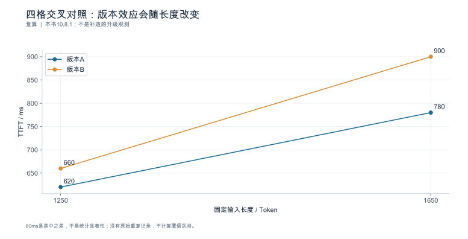

**数据身份：**`TEACHING_CALCULATION`。**条件：**四格数据均为本书设定；每格待以匹配负载、多次运行替换。

| 版本 | 1250Token/ms | 1650Token/ms | 长度增量/ms |
|---|---|---|---|
| A | 620 | 780 | 160 |
| B | 660 | 900 | 240 |
| B−A | 40 | 120 | 80 |

复算公式：`interaction=(900-660)-(780-620)=80ms`。

**出处与边界：**本书10.8.1；80ms是差中之差，不是统计显著性；没有原始重复记录，不计算置信区间。

[数据与绘图点](book_support_v06/data/ch10_factorial.json) · [PNG](book_support_v06/figures/ch10_factorial.png) · [重绘代码](book_support_v06/code/replot.py)

#### 图10-V2 版本变化会移动FP8的收益交点

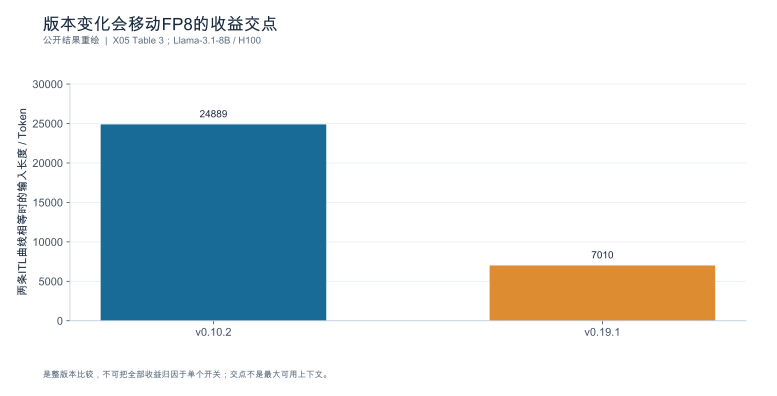

**数据身份：**`PUBLISHED_RESULT`。**条件：**Llama-3.1-8B；H100/FA3单请求上下文；before与after比较；交点由原文拟合得到。

| 版本 | 公开拟合交点/Token | FP8斜率为BF16的/% |
|---|---|---|
| v0.10.2 | 24889 | 63 |
| v0.19.1 | 7010 | 54 |

**出处与边界：**[X05](book_support_v06/来源与核验.md#x05)；是整版本比较，不可把全部收益归因于单个开关；交点不是最大可用上下文。

[数据与绘图点](book_support_v06/data/ch10_version_breakeven.json) · [PNG](book_support_v06/figures/ch10_version_breakeven.png) · [重绘代码](book_support_v06/code/replot.py)

<!-- V06-END -->
### 章末检查问题

**1. 何种实验最能区分"缓存污染"与"模型执行真的变快"？**

答案方向：两者都表现为"第二次跑更快"，区分点在**复用身份**。做法：① 用**独立于测试集的预热样本**重跑——若提速消失，说明先前是预热样本与测试集内容重合造成的缓存污染（第8章 8.5）；② 在同一负载下**清空缓存测冷态**——若冷态仍有提速，才是执行路径的真实改善；③ 同时记录命中率与命中来源层级（协议层会话 / 引擎前缀 / 外部缓存服务），因为"命中"本身不等于原因已定（10.4.4）。关键点：**预热的收益必须在不复用测试内容的前提下重测。**

**2. 改了三个参数性能提升，能证明哪一个有用？**

答案方向：**不能**。三个参数同时开启只有"全开 vs 全关"两组数据，无法归因。要完全分离主效应与交互效应需要 $2^3 = 8$ 组全因子；最小可行方案是**逐个回退**：保持另外两个开启，把目标参数改回基线，观察收益是否保持。还要注意 10.3.3 的两点：一是一次改多项后不得声称单一根因；二是若某参数的收益依赖另一个参数（交互），单项对照会显示"都无用"而组合有效——这时必须做组合实验并写明依赖关系，而不是各自判死刑。

**3. 发布说明指出默认 runner 变化，为什么还不能认定它就是当前回归根因？**

答案方向：发布说明只提供**候选机制**，不是本环境证据。要认定需要四步：① 确认本环境版本确实落在该变更之后，且生效配置回显显示走的是新 runner；② 用 trace 或日志确认**实际**走了哪条路径——"声明默认"不等于"实际启用"（第1章 1.5.3、第9章 9.5.4）；③ 用**回退**（版本回退或强制旧路径）复测，观察指标是否回到基线；④ 排除同期的其它变更与负载变化（10.1.1 的负载归一化）。缺任一步都只能写"runner 变化是候选机制之一"，不能写成根因 [SOURCE_REGISTERED] [S01]。

---

### 本章验收清单

| 节 | 验收标准 |
|---|---|
| 10.1 | 问题卡六项齐全；比较基准明确；结论与拟采用技术无关；负载归一化已做并写明假设 |
| 10.2 | 四主干分支齐全（含"测量变化"支）；每个节点有支持证据、可推翻条件与下一项检验 |
| 10.3 | 干预有对照、事前预测与回退复测；区分了"机制的一部分"与混杂因素；一次改多项不声称单一根因 |
| 10.4 | 每条路径含非 GPU 解释与测量自身出错；长运行退化区分请求侧泄漏与分配器缓存 |
| 10.5 | 整改项与诊断实验分开排序；诊断按信息量/成本；仿真不写成后端速度 |
| 10.6 | 失败五分类分别记录；负面样本进案例库；未区分时写明下一项证据 |
| 10.7 | 七步闭环完整，回退复测未跳过；结论分已证实/已排除/未解决三栏 |

---

### 配套资料

[新增图表与数据](book_support_v05/figures.md) · [来源登记](book_support_v05/references.md) · [E0测试清单](book_support_v05/data/e0_test_results.md) · [修订记录](book_support_v05/review/changes.md)

[R01]: book_support_v05/references.md#r01
[R12]: book_support_v05/references.md#r12
[R16]: book_support_v05/references.md#r16
[R17]: book_support_v05/references.md#r17
[R22]: book_support_v05/references.md#r22
[R24]: book_support_v05/references.md#r24
[R25]: book_support_v05/references.md#r25
[S01]: book_support_v05/references.md#s01
[S03]: book_support_v05/references.md#s03
[S06]: book_support_v05/references.md#s06
[S13]: book_support_v05/references.md#s13
[S17]: book_support_v05/references.md#s17

<!-- V10-START -->
<a id="sec-10-90"></a>

### 本章口径核对（公开来源）

#### 版本化候选的实际状态与剖析工具的能力边界

**版本化候选（回退与口径变化）**

| 组件 | 版本 | 变更 |
|---|---|---|
| vLLM | v0.29.0 | Model Runner V1 标记为废弃，计划在 v0.32 移除；MRV2 尚未支持序列并行、双批次重叠、弹性 EP、自定义 logits processor 与部分推测解码方法，**配置这些特性时仍回退 MRV1** |
| vLLM | v0.30.0 | `all` Mamba 缓存模式废弃并回退 MRV1；`--enable-scale-out` 取代 `VLLM_ENABLE_SCALE_OUT_ENDPOINTS` |
| Dynamo | v1.5.0 | KVBM 废弃，目标 v1.6.0 移除；Go EPP 由 Rust EPP 取代；`python -m dynamo.replay` 移除，改为 AISimulate CLI |
| SGLang | v0.5.20 | Prefill context parallelism v1 移除，仅保留策略式实现；CUDA 12 lane 退役 |

**边界**：回退是否真的触发、以及触发在引擎内哪一层，需要固定版本的启动日志与 trace 佐证。发布说明只声明了"会回退"，没有声明"在什么条件下必然回退"。

**PyTorch Profiler（文档版本 2.14.0）**

活动项为 `ProfilerActivity.CPU`、`CUDA`、`XPU`、`MTIA`、`HPU`、`PrivateUse1`；默认启用 CPU，并在可用时启用 CUDA 或 XPU。关键参数：`record_shapes`（记录算子输入形状）、`profile_memory`（跟踪张量分配与释放）、`with_stack`（记录算子来源文件与行号）、`with_flops`。`with_modules` 已废弃（只对 TorchScript 模型生效，eager 模式下不做任何事），应改用 `with_stack=True`；`export_memory_timeline` 亦已废弃。

能力与权限边界：CUDA 追踪依赖 CUPTI，CUPTI 不可用时回退到 legacy CUDA 路径——此时 profiler 表格中仍有 CUDA 时间，但 **JSON trace 中没有**。XPU 的每内核硬件指标需要 `ZET_ENABLE_METRICS=1` 且对 GPU 性能计数器有访问权限（`perf_stream_paranoid` 与 `observation_paranoid` 置 0）。`export_chrome_trace` 在启用 kineto 时**只导出 schedule 的最后一个 cycle**。开销方面，开启形状与栈追踪会带来额外开销；`record_shapes=True` 会临时持有张量引用，可能阻止依赖引用计数的优化并引入额外张量拷贝。分布式场景下 `worker_name` 应唯一，默认取 `[hostname]_[pid]`。

**Nsight Systems**

采集入口为 `nsys profile`，另有 `start` / `launch` / `stop` / `shutdown` 的会话式交互，以及 `analyze` / `export` / `import` / `finalize` / `recipe` / `stats` 等后处理子命令。

`--trace`（`-t`）可取值包括 `cuda`、`cuda-sw`、`cudnn`、`cublas`、`cusolver`、`cusparse`、`cudla`、`nvtx`、`osrt`、`openacc`、`openmp`、`mpi`、`nccl`、`vulkan`、`python-gil`、`gds`、`wddm`、`none`，默认组合为 `cuda,opengl,nvtx,osrt`。CUDA 侧还有 `--cuda-graph-trace graph|node`、`--cuda-memory-usage`、`--cuda-trace-all-apis`、`--cuda-trace-scope`、`--cudabacktrace`。NVTX 侧有 `--capture-range none|cudaProfilerApi|hotkey|nvtx`、`--nvtx-capture`、`--hotkey-capture`（默认 F12）。采样侧有 `--sample`（`-s`）、`--sampling-frequency`（100 ~ 8000，默认 1000）、`--sampling-trigger`（默认 timer）、`--backtrace`（`-b`，auto/fp/lbr/dwarf/none，默认 fp）。

**权限**：非 root 是官方推荐模式——把工具安装到有写权限的目录即可，不需要 root。Windows 上 CLI 必须以管理员运行；`--isr` 需要管理员权限。该页未提及 `perf_event_paranoid`，也未给出计数器被拒时的报错形态。

**开销**：`--cuda-memory-usage`、`--cuda-trace-all-apis`、`--cudabacktrace`、`--cuda-graph-trace=node` 均被标注"可能带来显著运行时开销"；`nvtx-precapture` 为实验特性并增加图构建开销与内存占用；`--dynamic-tables` 导出为实验特性。

**容器与多机**：该页未明确说明容器支持；多机通过 `--mpi-impl openmpi|mpich` 与 `nsys launch` 支持，`nccl` 可作为 trace 取值。另需注意：采集完成（含 `--duration`）后被启动的进程会被终止，除非显式指定 `--kill none`；若用 NVTX、`cudaProfilerStart/Stop` 或热键控制时长，则应用会继续运行。
<!-- V10-END -->


---

<a id="ch-11"></a>
## 第11章 配置、执行与内存优化

**核心论点：**每项优化都必须说明**改动什么机制、在什么条件下成立、质量风险是什么、怎么回退、端到端怎么验收**——而不是默认把所有功能都打开。

---

<a id="sec-11-01"></a>
### 11.1 主机路径、调度与缓存参数优化

**本节要回答的问题：**哪些低风险改动可以先验证？

#### 11.1.1 参数不是清单，是假设

每项参数调整都必须对应第10章的一条瓶颈证据。没有证据的调参不是优化，是抽奖。推荐字段：

| 字段 | 内容 |
|---|---|
| 参数与取值 | 改前 → 改后 |
| **预期机制** | 它改变了什么（供给？批形状？复用？） |
| 观测项 | 用什么指标验证机制确实发生 |
| 生效证据 | 如何确认实际生效（配置回显/trace），而非只写了命令行 |
| 质量影响 | 哪个质量门槛需要复测 |
| 回退方式 | 怎么改回去，回退后要复测什么 |

#### 11.1.2 释放显存 ≠ 自动增加容量

一个反复出现的误判：权重变小了，就说"容量变大了"。算例：将 70B 权重量与独立指定的状态量组合，非特定真实 70B 架构；单卡可用 80 GB，每 rank 固定开销 4 GB，状态账沿用第4章（4096 上下文每路 0.537 GB）。

| 权重格式 | 位宽/元素 | 权重 | 状态池 | 可容纳 4096 路数 |
|---|---:|---:|---:|---:|
| BF16 | 16 | 140.0 GB | — | **装不下** |
| FP8 | 8 | 70.0 GB | 6.0 GB | **11** |
| 分块 4-bit（含缩放） | 4.5 | 39.4 GB | 36.6 GB | **68** |

三个读法：

1. **位宽减半不等于容量翻倍。**16→8 bit 只换来 11 路，8→4.5 bit 却换来 68 路——因为存在"能否装下"的阈值效应与固定开销。用线性比例外推容量是最常见的错。
2. **可用的路数还受调度与尾延迟约束**，不只是显存。扩大批预算后吞吐可能上升而 P99 恶化（见下）。
3. 若 $h_{kv}$ 与并行度不满足分片条件，实际占用还会高于这里（第4章 4.2、第6章 6.1）。

#### 11.1.3 一个"吞吐涨、尾延迟超标"的案例

批内 Token 预算 4096 → 8192：

| 指标 | 4096 | 8192 | 变化 |
|---|---:|---:|---|
| 吞吐（排空法） | 1200 token/s | 1368 token/s | **+14.0%** |
| P99 ITL | 120 ms | 185 ms | **+54.2%** |

若 SLO 规定 ITL P99 ≤ 150 ms，**这个改动应当被拒绝**，尽管吞吐涨了 14%。这正是第7章"三个量纲"的用途：吞吐是速率，SLO 是约束，两者不能互相抵扣。

**依据与核验入口：**[R01] [R07] [R30]

---

<a id="sec-11-02"></a>
### 11.2 低精度推理：格式、执行路径与质量

**本节要回答的问题：**位宽降低以后，**存储、计算、状态、任务质量**分别发生了什么变化？

#### 11.2.1 四类精度必须分开说

| 精度 | 影响什么 | 常见误判 |
|---|---|---|
| **权重** | 驻留体积、权重访存量 | 用权重位宽代表整个模型的精度 |
| **激活** | 计算内核选择与数值路径 | 认为权重量化后激活也自动低精度 |
| **累加** | 数值稳定性、长序列误差 | 完全忽略累加类型 |
| **KV** | 状态驻留、长上下文容量 | 用权重量化的节省比例推 KV |

#### 11.2.2 分块缩放：为什么"4 bit"不等于四分之一

分块缩放格式在数据位宽之外还要存缩放因子。以每 16 个元素配一个 FP8 缩放为例，实际位宽是

$$
b_{\text{elem}} = 4 + \frac{8}{16} = \mathbf{4.5\ \text{bit/元素}}
$$

对一个 $[4096, 4096]$ 权重矩阵：

| 格式 | 数据 | 缩放 | 合计 | 相对 BF16 |
|---|---:|---:|---:|---:|
| BF16 | 32 MiB | — | 32 MiB | 100% |
| FP8 | 16 MiB | — | 16 MiB | 50.0% |
| 分块 4-bit | 8 MiB | **1 MiB** | **9 MiB** | **28.125%** |

**相对 BF16 是 28.125%，不是 25%。**差的 3.125 个百分点全部来自缩放因子（占 0.5/4.5 = **11.1%**）。所以这条硬规则必须守住：**不能用 4 bit 推出四倍速度，也不能用模型体积下降代替实际显存或成本下降。**

不同格式必须分别核对。官方技术说明 [N04] 中，NVFP4 为每 16 个数据元素配一个 E4M3 FP8 缩放，并有张量级 FP32 缩放；MXFP4 为每 32 个元素配一个 E8M0 缩放。忽略张量级常数和对齐时，二者平均位宽分别约为 $4+8/16=4.5$ 与 $4+8/32=4.25$ bit。前者对大矩阵约为 BF16 的 28.125%，后者约 26.5625%；这是格式字节推导，不是端到端显存或速度保证。

FP8 也可能有缩放、分块、排除层与布局转换。上表 FP8 一行是仅计主体数据的基准，不应写成任意 FP8 制品无缩放元数据。

#### 11.2.3 四列对照：制品、张量、执行、验收

| 观察对象 | 必填字段 | 禁止的替代推断 |
|---|---|---|
| 模型制品 | 权重格式、缩放、校准集身份、摘要 | 文件里写 FP4 就代表完整执行是 FP4 |
| 运行张量 | 权重/激活/累加/KV 各自的 dtype 与布局 | 用权重位宽代替全部张量精度 |
| 实际执行 | GEMM / attention / MoE 后端、设备、形状、回退原因 | 参数被接受就代表原生低精度内核生效 |
| 输出验收 | 任务分层、质量阈值、失败样本与性能 | 只保留更快或更短的答案 |

**量化制品、加载后的张量、实际执行的内核三者必须分别存档。**第9章 9.5.4 的三档证据（源码 / 日志 / trace）在这里直接适用：需要 trace、运行插桩或可核对执行计数证明本次路径；内核名称本身还需结合 dtype 和形状。

#### 11.2.4 质量验收：校准集与独立集分开

七项对照表，每项候选都要填（模板）：

| 列 | 说明 |
|---|---|
| 模型体积 | 制品字节数（含缩放元数据） |
| 物理显存 | 实测 allocated / reserved，不是理论体积 |
| Prefill / 生成时间 | 分阶段，不合并成一个"延迟" |
| 合格完成速率 | 第7章三量纲之一，带 SLO |
| 质量 | 分层达标率 + 失败样本 |
| 恢复成本 | 出问题后回退所需时间与风险 |
| 支持状态 | 支持 / 不支持 / 未验证 |

**校准集用于产生量化参数，独立集用于验收。**用同一份数据既校准又验收，等于没有验收。质量门槛必须覆盖**业务分层、长上下文、结构化输出**三类——只在短问答上测质量是常见的漏项。

未支持的组合标为**能力缺口**，不要人为给一个"性能较差"的分数（第6章 6.6.4 同理）。缩放格式或激活精度的细节未从来源固定前，**不发布精确节省比例**。

**依据与核验入口：**[R26] [R04] [R14] [S10] [S09] [S02]

---

<a id="sec-11-03"></a>
### 11.3 执行器、编译、图执行与内核选择

**本节要回答的问题：**减少调度开销和数据移动，什么时候能改善**整体**？

按三个层次分开讲，因为它们解决的是不同问题，也常常被混为一谈：

| 层次 | 解决什么 | 代表来源 |
|---|---|---|
| **算法** | 减少数据移动本身（IO 感知的注意力） | [SOURCE_REGISTERED] [R03] |
| **内核库** | 提供具体实现与后端 | [SOURCE_REGISTERED] [S08] [S09] |
| **引擎调度** | 决定这一次走哪条路径、是否回退 | [SOURCE_REGISTERED] [S01] [S03] [S04] |

#### 11.3.1 从算法到被调用，中间隔着两道门

FlashAttention 的原始论文提供的是 **IO 感知的原理** [SOURCE_REGISTERED] [R03]；某个内核库提供了实现 [SOURCE_REGISTERED] [S08] [S09]；但**服务是否真的调用了它，是第三件事**。这三者的关系是"可能 → 提供 → 实际"，**不能从库名推断它被服务真正调用**——必须绑定所选 commit、设备、形状，并用 trace 内核名确认。

同理，引擎侧的执行器代际变化、旧路径移除、RC 版本的入口变更候选 [SOURCE_REGISTERED] [S01] [S03] [S04] 只说明"该版本声明了什么"，不说明本环境走了哪条。**没有实际环境时，交付的是代码路径图，不是伪造的 trace。**

#### 11.3.2 冷启动与稳态必须分开验收

编译与图捕获的一次性成本要用**稳态收益去摊**。算例：编译 23 s + 图捕获 11 s = **34 s**；稳态每步节省 0.8 ms。

$$
\text{回本步数} = \frac{34\ \text{s}}{0.8\ \text{ms}} = \mathbf{42\,500\ \text{步}}
$$

若单步 20 ms，回本需要 $42\,500 \times 0.02 = \mathbf{850\ s}$（约 14.2 分钟）的连续服务。

**推论：在短任务、频繁重启、或按需伸缩的场景里，编译/图捕获可能是净亏的。**所以验收必须分冷启动与稳态两栏，并且把**常驻工作区开销**与预热收益一起算（第8章 8.5）。

#### 11.3.3 图命中率：平均值会掩盖尾部

形状不在已捕获的桶里时会回退到逐次执行。算例：图内每步 1.4 ms、回退后 3.2 ms、命中率 96%。

| 量 | 值 |
|---|---:|
| 加权平均单步 | $1.4\times0.96 + 3.2\times0.04 = \mathbf{1.472\ ms}$ |
| 相对"全命中"慢 | **5.1%** |
| **回退迭代相对图内迭代** | $3.2/1.4 = \mathbf{2.29\ 倍}$ |

只看均值只看到 5.1%，但这是迭代级命中率，不能推出恰有 4% 的请求回退；一个请求可跨越许多迭代。这就是"回退"必须从能力表里单独记录、并进入尾延迟分析的原因。

#### 11.3.4 单内核收益不外推整个服务

第3章的 Amdahl 式上限在这里直接适用：某内核占关键路径 8%，提速 30%，整体加速

$$
\frac{1}{(1-0.08) + 0.08/1.3} = \mathbf{1.0188} \;(\text{仅 } +1.88\%)
$$

所以"微基准里快 30%"与"服务端到端改善"之间隔着三道门槛：**是否在关键路径上、占比是否足够、节省是否被排队反馈吸收**（第9章 9.5.4 已给出两条可区分假设与判别实验）。**单内核结果不外推整个服务**，这是本节的硬要求。

每份性能记录必须带：runner、graph mode、compiler、attention/GEMM/MoE backend、device target、实际形状、`fallback_reason`。

**依据与核验入口：**[R03] [R16] [R23] [R31] [S01] [S02] [S03] [S04] [S08] [S09]

---

<a id="sec-11-04"></a>
### 11.4 推测解码：草稿、验证与当前实现组合

**本节要回答的问题：**接受率高，为什么仍可能没有速度收益？

#### 11.4.1 两个计数不能混

第2章已给出：草稿接受率 $\alpha$、每轮候选数 $k$ 时

$$
\mathbb{E}[\text{接受的草稿数}] = \sum_{i=1}^{k}\alpha^{i}, \qquad
\mathbb{E}[\text{本轮推进量}]    = \sum_{i=0}^{k}\alpha^{i}
$$

后者包含被拒后的校正 Token（或全接受时的额外 Token），**比前者多一个量级为 1 的项**。$k=4$、$\alpha=0.7$ 时是 **1.7731** 与 **2.7731**。算加速比必须用**推进量**。

#### 11.4.2 整轮成本，不是验证成本

每轮耗时必须拆成四段并记录，因为**只算目标验证会系统性高估收益**。算例 （相对普通一步 = 1.00）：

| 段 | 成本 |
|---|---:|
| 草稿生成 | 0.30 |
| 目标验证 | 1.00 |
| 接受处理 | 0.15 |
| 同步等待 | 0.20 |
| **整轮** | **1.65** |

$\alpha=0.7$、$k=4$：每 Token 相对成本 $= 1.65/2.7731 = 0.595$，加速 **1.68×**（而不是按"验证成本 1.0"算出的 2.77×）。

#### 11.4.3 接受率上升而加速比下降

这正是本节标题问题的答案：

| $\alpha$ | 本轮推进量 | 整轮成本 | 每 Token 成本 | 加速比 |
|---:|---:|---:|---:|---:|
| 0.70 | 2.7731 | 1.65 | 0.595 | **1.68×** |
| 0.75 | 3.0508 | **1.95** | 0.639 | **1.56×** |

接受率从 0.70 提到 0.75（+7%），两行仍固定 $k=4$；另假设更昂贵的草稿器或额外处理让整轮成本从 1.65 涨到 1.95，**加速比反而从 1.68 降到 1.56**。原因是分母（推进量）只涨了 10%，分子（整轮成本）涨了 18%。

所以：**接受率是中间量，不是收益。**最终要报的是第7章的三个量纲——目标延迟、合格完成速率、质量。

#### 11.4.4 组合支持与质量回归

运行矩阵需记录：模型、草稿或预测头身份、TP/PP/EP/CP、图模式、缓存布局、支持状态（支持/不支持/未验证）。当前实现的研究入口包括 MTP、EAGLE3、DFlash、DSpark 等 [SOURCE_REGISTERED] [S02]，但本章**按草稿来源与验证方式组织**，不把名称清单当作机制解释；未固定机制或版本时只作候选资料，不承诺精确采样性质。

经典精确采样算法的分布性质依赖算法条件 [SOURCE_REGISTERED] [R27]；**近似变体、校正实现与数值路径必须另行验证**，不能把经典性质直接外推。

验收要求：同一**真实内容分布**做关闭/开启对照，**随机 Token 不能替代内容相关的接受率测试**（第8章 8.2）；拒绝的候选消耗资源但**不计入有效输出**。接受率上升而服务达标率下降的结果必须保留（第10章 10.6.2）。

**依据与核验入口：**[R27] [R12] [S02] [S16]

---

<a id="sec-11-05"></a>
### 11.5 上下文、结构化输出与应用边界优化

**本节要回答的问题：**"少做工作"与"更快完成同样工作"，如何区分？

#### 11.5.1 语义保持 vs 信息裁剪

这是本章最容易越界的一节。判定标准很简单：**改动之后，交付给用户的是不是同一个任务？**

算例：上下文从 8000 Token 裁到 3000 Token。

| 指标 | 裁剪前 | 裁剪后 | 变化 |
|---|---:|---:|---|
| TTFT P50 | 780 ms | 320 ms | **−59.0%** |
| 任务层达标率 | 88% | 71% | **−17 个百分点** |

TTFT 改善了 59%，但达标率掉了 17 个百分点。**这不是系统优化，是改变了任务。**正确做法：若业务确实同意缩短上下文，必须**另立一条对照轨道**并单独签署，不能混进"纯系统提升"的收益里报告。

三条明令禁止的"制造加速"：**删除必要证据、减少必需分支、缩短回答要求。**共享历史分支、上下文裁剪、非前缀缓存三类改动都必须分别做语义验收 [SOURCE_REGISTERED] [S13] [S18]。

#### 11.5.2 结构化约束：净收益怎么算

约束生成（语法/格式约束）的收益与代价在不同层，必须放在一张表上算净账：

| 层次 | 变化 |
|---|---|
| 每步成本 | 合法 Token 掩码计算使单步 +8% |
| 任务层 | 格式错误率 12% → 1%，重试减少 |
| **任务层达标率** | 81% → **92%**（+11 个百分点） |

单 Token 慢了 8%，但任务达标率涨了 11 个百分点——联合表现有改善迹象，仍须核对资源成本、截止时间与分层 SLO 后决定是否采用。判据是任务层而不是单步时间；只看单步会得出相反结论。

#### 11.5.3 输入结构与模板版本

输入侧的改动（模板版本、检索片段组织、共享前缀布局）会改变 Token 化与复用命中率（第8章 8.1 的脱敏偏差同理）。因此每次改动必须记录：**输入差异、模板版本、格式校验结果、任务样本集**。敏感业务只用授权测试集 [SOURCE_REGISTERED] [R29]。

**依据与核验入口：**[R06] [R29] [R14] [S13] [S18]

---

<a id="sec-11-06"></a>
### 11.6 组合优化、交互与收益消融

**本节要回答的问题：**单项有效的改动，叠加后为何可能相互抵消？

#### 11.6.1 资源格局会被改写

三项改动各自释放/占用的资源不同：量化**释放**容量、图执行**占用**工作区、推测解码**改变批形状**。组合之后资源格局不是三者之和。

#### 11.6.2 一个完整的消融表

基线吞吐 1000 token/s、P99 ITL 120 ms、质量达标率 92%；A = 量化、B = 图执行、C = 推测解码：

| 组合 | 吞吐 | 相对基线 | P99 ITL | 质量达标率 |
|---|---:|---:|---:|---:|
| 基线 | 1000 | — | 120 ms | 92% |
| A | 1120 | +12.0% | 118 ms | 91% |
| B | 1080 | +8.0% | 115 ms | 92% |
| C | 1180 | +18.0% | 131 ms | 92% |
| AB | 1150 | +15.0% | 116 ms | 91% |
| **AC** | **1240** | **+24.0%** | 142 ms | 90% |
| BC | 1210 | +21.0% | 138 ms | 92% |
| ABC | 1210 | **+21.0%** | 145 ms | 90% |

四条结论：

1. **单项收益不能直接相加。**12%＋8%＋18%=38%，表中的ABC只有21%。
2. **添加优化可能降低产出。**ABC为1210 token/s，低于AC的1240；具体机制仍需实测区分。
3. **吞吐、尾延迟和质量必须联合判断。**AC虽吞吐最高，却把ITL P99推到142 ms、质量降到90%。
4. **推荐取决于联合门槛，而不是只看质量。**质量至少 92% 时，基线、B、C、BC 都在质量可行集。若再要求 ITL P99≤135 ms，则 BC 被排除，在其余表中候选里 C 吞吐最高；若上限放宽为 140 ms，BC 的 1210 token/s 高于 C 的 1180。若允许质量至少 90% 且 ITL≤150 ms，表中 AC 的 1240 高于 ABC 的 1210。以上仅是对表的确定性筛选；真实采用还需重复运行的不确定性与独立质量验收。

**禁止把各单项最高提升简单相加** [SOURCE_REGISTERED] [S02] [S06]；只运行**有支持依据且能回答问题**的组合，不做无意义全排列。

#### 11.6.3 维护成本与适用边界

采用决策还要算三笔账：**新增依赖的成熟度、回退方式、撤回接口是否还在**。一个收益 20% 但依赖 RC 版本、且没有关闭开关的优化，其风险远高于收益 12% 但可随时回滚的优化。第10章 10.5 的可逆性列在这里直接适用。

**依据与核验入口：**[R26] [R27] [R31] [S02] [S06] [S20]

---

<a id="sec-11-07"></a>
### 11.7 实验：提交一份可上线的优化证据

**本节要回答的问题：**什么时候可以把"实验更快"升级为"值得采用"？

#### 11.7.1 顺序不能颠倒

```text
① 质量与正确性门槛   → 不合格就直接淘汰，不进性能比较
② 同负载性能对照     → 基线 vs 候选，配对设计（第8章 8.6）
③ 组合消融           → 只做有依据的组合
④ 留出负载复核       → 用未参与调参的负载复测
⑤ 长运行与异常恢复   → 12h+ 稳定性、OOM/重启恢复
⑥ 采用 / 拒绝 / 回滚 → 三选一，写明条件与触发线
```

**"先测性能再补质量"是错误顺序**，会导致为了保住性能数字而放宽质量门槛。

#### 11.7.2 报告必须写明区间而不是一个数

合格报告要回答：在哪些区间改善、在哪些区间**退步**、退步多少、维护成本是什么、什么条件下回滚。只有实验结果支持时才建议采用；**"无收益"或"风险过高"同样是合格结论。**

#### 11.7.3 决策卡模板

| 字段 | 内容 |
|---|---|
| 候选与机制假设 | 改动什么、预期改变什么 |
| 生效证据 | 配置回显 + trace（证明实际启用，非仅声明） |
| 质量结果 | 校准集与独立集分别；失败样本 |
| 性能结果 | 三量纲 + 分位 + 样本量 + 区间 |
| 组合消融 | 与已采用项的交互 |
| 负面与副作用 | 退步区间、稳定性问题 |
| **采用/拒绝/回滚条件** | 明确触发线与回退步骤 |
| 证据等级 | 源码 / 日志 / trace 分别标注 |

部署本身需要**另行授权**，本书不默认执行生产变更。执行路径身份与质量回归列为报告附件；**资料支持但没有 trace 的项目，不填"启用已验证"**。

**依据与核验入口：**[R14] [R24] [R25] [S08] [S09] [S10]

---

### 11.8 深化：精确推测采样、图形状成本与优化交互

#### 11.8.1 接受率公式背后是概率校正

经典推测解码方法要求目标分布 $p$ 与草稿分布 $q$ 在同一候选空间和相同条件上下文下可比较。草稿Token $x\sim q$ 以 $\min(1,p(x)/q(x))$ 的概率接受；拒绝后从与 $[p(x)-q(x)]_+$ 成比例的剩余分布采样 [N03]。

其正确性的核心可直接验证：直接接受给 $x$ 带来的概率质量为 $q(x)\min(1,p(x)/q(x))=\min(p(x),q(x))$；拒绝后补回正差部分 $[p(x)-q(x)]_+$，二者相加为 $p(x)$。因而接受率低不意味着目标分布退化，主要意味着资源浪费增大。近似接受、数值实现、不同的logits处理或停止语义则需要各自证明与测试，不能沿用这一等价性结论。

设第 $i$ 个草稿在前面全部接受的条件下，以概率 $a_i$ 被接受，则期望草稿接受数是 $\sum_{i=1}^{k}\prod_{j=1}^{i}a_j$。只有各位置条件接受概率都可近似为同一个 $\alpha$ 时，才化成 $\sum\alpha^i$。推测轮的推进量还包含校正或全部接受后的额外Token；临近EOS、输出预算或停止串时，需要截断这个理想公式。

#### 11.8.2 净收益阈值可以在实验前写出来

普通一步耗时为 $t_0$，推测完整一轮耗时为 $t_{round}$，期望实际推进量为 $m$，则理想速度收益要求 $t_{round}<m t_0$。增加候选长度会增加 $m$，也会增加草稿、目标验证、KV暂存和同步成本；当后几个候选很少被接受时，边际收益可能转负。


图中 $k=4$，整轮相对成本分别取1.3、1.65、1.95；曲线不是实测接受率，也不考虑EOS截断。读者可以先用它排除明显不可能的成本组合，再在真实语义负载上测位置接受分布与整轮时间，而不是只看一个全局接受率。

#### 11.8.3 图命中和形状桶也有资源优化问题

假设覆盖更多形状可以减少回退，但每个形状桶增加捕获时间、保留缓冲或编译制品。于是图配置也不是“捕获越多越好”：应最大化长期节省的发起开销，减去启动、存储和被挤出的状态容量成本。对短生命周期实例，更多捕获可能直到下线都未回本。

迭代命中率也不等于请求命中率。若一个请求经历100步、每步独立回退概率为4%，那么至少回退一次的概率为 $1-0.96^{100}\approx98.31\%$；实际回退往往由形状成簇出现，并不独立，这个计算只是反例，说明不能把“96%迭代命中”翻译成“只有4%请求受影响”。报告应分别给出迭代级、请求级和回退事件连续长度。

#### 11.8.4 交互项决定能否叠加

对第11.6节吞吐表，用同一基线尺度计算两因素交互：$I_{AB}=Y_{AB}-Y_A-Y_B+Y_0$。A、B分别提高到1120、1080，而AB为1150，故交互为−50 token/s。ABC比AC还低，说明在该表里添加B并非单调有益；它不能被“图执行本来应该加速”这一先验否定。

真实运行要用重复与区间判断交互是否超过噪声，并检查容量、实际批形状和路径变化。这个公式只是描述差异结构，不会自动指出机制；要把−50归因于图工作区挤占KV，仍需要分配记录与隔离干预。

#### 11.8.5 公开初始化案例与测量边界

vLLM v0.30.0发布说明报告，在H200上于图捕获期间冻结GC，图捕获由12秒降至2秒、引擎初始化由28.9秒降至8.2秒 [N06]。这是初始化案例，不是稳态请求性能；摘要未给出的模型、形状与重复条件保留未知。


初始化可能包含图捕获，不能把两组时间加总计算节省；本书未复现该运行。

---

<!-- V06-START -->
<a id="sec-11-09"></a>
### 11.9 实验图表补充：补齐推测解码、混合精度与质量失败三个公开案例

**推测解码。**EAGLE-3论文v2的Table 4给出SGLang团队在1×H100、LLaMA-Instruct 3.1 8B、MT-Bench、bs=1上的原值：无推测158.34、EAGLE-2 244.10、EAGLE-3 373.25 Token/s。EAGLE-3相对基线约2.357倍。原表列标题写Latency，但单位为Token/s；本书据单位称“单请求生成速率”，不当作毫秒时延，也不与表3的batch64吞吐混用。

**混合注意力。**同一vLLM FP8博客的gpt-oss-20b Table 5说明一刀切量化不是唯一选项。保留滑窗层BF16的skip-SW策略输出871.8 Token/s，相比全BF16的831.6增加约4.83%，相比全FP8的853.0增加约2.20%。有限滑窗的缓存规模受限，量化固定开销可能难以回收；但这个机制解释仍受具体模型和内核路径约束，不能预设所有滑窗模型都该跳过量化。

**负面质量证据。**博客Figure 1的Hopper/FA3、128k needle-in-a-haystack案例报告91%→13%→89%，对应BF16、修复前FP8、两级累加修复后FP8。文章未给该三值的具体模型与样本数，因此不补标准误，也不把89%解释为与91%统计等价。这里最有价值的不是“修复后提升多少”，而是提醒低精度路径的累加与实现可以造成严重质量回归。

**采用门槛：**速度、质量、资源峰值、异常率和回退能力同时验收；没有可复核的质量结果时，不接受仅凭吞吐的上线结论。

#### 图11-V1 推测解码的公开单请求生成速率


**数据身份：**`PUBLISHED_RESULT`。**条件：**LLaMA-Instruct 3.1 8B；SGLang团队实验；batch size=1；同一H100。

| 方法 | Token/s | 相对基线/倍 |
|---|---|---|
| 无推测 | 158.34 | 1.0 |
| EAGLE-2 | 244.1 | 1.5416 |
| EAGLE-3 | 373.25 | 2.3573 |

**出处与边界：**[X06](book_support_v06/来源与核验.md#x06)；原表标题Latency但单位Token/s；不把此单请求速率当并发服务容量，未给误差条。

[数据与绘图点](book_support_v06/data/ch11_eagle.json) · [PNG](book_support_v06/figures/ch11_eagle.png) · [重绘代码](book_support_v06/code/replot.py)

#### 图11-V2 混合注意力：有选择地量化比一刀切更合理


**数据身份：**`PUBLISHED_RESULT`。**条件：**150请求、并发8、约20k输入/2k输出±15%；H100/FA3上下文；skip-SW保留滑窗层BF16。

| KV策略 | TTFT中位数/ms | ITL中位数/ms | 总时长/s | 输出Token/s |
|---|---|---|---|---|
| BF16 | 468.9 | 8.09 | 364.2 | 831.6 |
| FP8 | 451.7 | 7.9 | 355.1 | 853.0 |
| FP8 skip-SW | 456.4 | 7.7 | 347.4 | 871.8 |

**出处与边界：**[X05](book_support_v06/来源与核验.md#x05)；这不是Llama的数据；不得把两个模型的柱高比较解释成优化优劣。

[数据与绘图点](book_support_v06/data/ch11_hybrid_fp8.json) · [PNG](book_support_v06/figures/ch11_hybrid_fp8.png) · [重绘代码](book_support_v06/code/replot.py)

#### 图11-V3 质量回归：更低精度并不自动保持正确性


**数据身份：**`PUBLISHED_RESULT`。**条件：**Hopper、FA3 FP8长上下文路径；两级累加修复；具体模型、样本数未披露。

| 配置 | 公开准确率/% |
|---|---|
| BF16基线 | 91 |
| FP8修复前 | 13 |
| FP8修复后 | 89 |

**出处与边界：**[X05](book_support_v06/来源与核验.md#x05)；91→13→89是不同配置的公开结果，不是时间序列；89不能证明与91统计等价。

[数据与绘图点](book_support_v06/data/ch11_quality_failure.json) · [PNG](book_support_v06/figures/ch11_quality_failure.png) · [重绘代码](book_support_v06/code/replot.py)

<!-- V06-END -->
<!-- V07-START -->
<a id="sec-11-10"></a>
### 11.10 实验深化补充：量化省的是字节，不是等比例的时延

本章前面已补齐 EAGLE-3 推测解码、混合注意力与长上下文质量负例。这一节补一条常被忽略的通信侧账：**把权重/激活压小，省下的字节和实际时延并不是等比例。**

TensorRT-LLM同一篇NVLink AlltoAll博客的Post-Quant Dispatch表（batch2048）给出三种dispatch格式：BF16为14336 byte/Token、311.8μs、报告逻辑753.3 GB/s；MXFP8为7392 byte/Token、172.2μs、703.4 GB/s；NVFP4为4032 byte/Token、101.7μs、649.3 GB/s。

按原值复算：NVFP4的payload是BF16的4032/14336=28.125%（约3.56倍压缩），但dispatch时延为101.7/311.8=32.617%（约3.06倍加速）。**少搬的字节更多，省下的时延更少，差额来自固定开销与协议成本。**因此不能把局部3.06倍写成模型整体3.06倍。

**采用门槛不变：**这里只覆盖dispatch一步，不含combine与专家计算，也不含量化质量验收。低精度路径必须先过质量与数值稳定性，再谈通信收益；图像alt标B200而章节文字标GB200 NVL72，本书不做更细的硬件保证。

#### 图11-E1 通信前量化：少搬字节与实际时延并非等比例


**数据身份：**`PUBLISHED_MICROBENCHMARK`。**条件：**Post-Quant Dispatch表，batch2048；性能章节写GB200 NVL72，EP8按同一BF16基线和复现命令对应，表未单独标EP。

| dispatch格式 | byte/Token | Dispatch/us | 报告逻辑GB/s | BF16字节数/当前字节数 |
|---|---|---|---|---|
| BF16 | 14336 | 311.8 | 753.3 | 1.0 |
| MXFP8 | 7392 | 172.2 | 703.4 | 1.94 |
| NVFP4 | 4032 | 101.7 | 649.3 | 3.56 |

**出处与边界：**[Y04](book_support_v07/来源与核验_v07.md#y04)；图像alt标B200、章节写GB200 NVL72，本书不作更细硬件保证；未含量化质量验收；仅dispatch，不是整轮。

[数据与绘图点](book_support_v07/data/ch11_dispatch_precision.json) · [PNG](book_support_v07/figures/ch11_dispatch_precision.png) · [重绘代码](book_support_v07/code/replot_v07.py)

<!-- V07-END -->
### 章末检查问题

**1. 量化后模型体积降到 28%，为什么不能说显存和成本也降到 28%？**

答案方向：三件事量纲不同。① **体积是制品字节**，物理显存还含分配器开销、工作区、图捕获缓冲与碎片（第4章 4.3、第11章 11.3.2）；② **分块缩放的元数据**占 11.1%，且不同格式缩放规则不同，不能互推（11.2.2）；③ **成本由完成速率决定，不由驻留体积决定**——若低精度路径走了回退内核或代价更高的布局，速率可能不升反降。所以正确写法是分别报"制品体积 / 实测 allocated-reserved / 同 SLO 下合格完成速率"三项，并说明各自口径。

**2. 图执行开启后单步从 3.2 ms 降到 1.4 ms，服务端到端为什么可能不变？**

答案方向：三道门槛（11.3.4）。① **是否在关键路径上**——若该步不在关键路径，优化的是空闲；② **占比是否足够**——按 Amdahl，占 8% 提速 30% 只改善 1.88%；③ **排队反馈**——但这只在特定条件下成立：开环固定到达下服务时间下降应改善等待，闭环或自适应到达才可能吸收（第9章 9.5.4 给了两条可区分假设）。此外还有 11.3.2 的**冷启动摊薄**：34 s 的一次性成本需要 42500 步回本。正确做法是写出这几条假设，用不同负载模式的实验判别，而不是直接判"优化无效"。

**3. 接受率从 0.70 提到 0.75，为什么服务反而更慢？**

答案方向：因为收益的分母是**本轮推进量**，分子是**整轮成本**，而接受率只是中间量（11.4.3）。候选量变大会同时抬高整轮成本：本例中推进量从 2.7731 涨到 3.0508（+10%），整轮成本却从 1.65 涨到 1.95（+18%），于是每 Token 成本从 0.595 升到 0.639，加速比从 1.68 降到 1.56。另外还要检查：更大的验证批是否改变了批形状与图命中率（11.6）、拒绝候选是否消耗了资源却不计入产出（第2章 2.1）、质量是否退步（10.6.2）。**最终判据是三个量纲，不是接受率。**

---

### 本章验收清单

| 节 | 验收标准 |
|---|---|
| 11.1 | 参数与瓶颈证据一一对应；有生效证据；释放显存不自动等于容量增加；尾延迟超标的改动被拒绝 |
| 11.2 | 四类精度分开；分块缩放的位宽与元数据占比已算；四列对照齐全；校准集与独立集分开；未支持组合标能力缺口 |
| 11.3 | 算法/内核库/引擎调度三层分开；冷启动与稳态分开验收并算回本步数；图命中率与回退倍率分别记录；单内核不外推服务 |
| 11.4 | 接受草稿数与推进量分开；按整轮成本算加速比；真实内容分布做开关对照；拒绝候选不计产出 |
| 11.5 | 语义保持与信息裁剪分开；任务变更另立对照轨道；结构化约束按任务层算净收益 |
| 11.6 | 不叠加单项收益；组合实测；推荐方案能对应到具体质量门槛；维护成本与回退方式已记 |
| 11.7 | 质量先于性能；有留出负载复核与长运行检查；决策卡含采用/拒绝/回滚条件与证据等级 |

---

### 配套资料

[新增图表与数据](book_support_v05/figures.md) · [来源登记](book_support_v05/references.md) · [E0测试清单](book_support_v05/data/e0_test_results.md) · [修订记录](book_support_v05/review/changes.md)

[N03]: book_support_v05/references.md#n03
[N04]: book_support_v05/references.md#n04
[N06]: book_support_v05/references.md#n06
[R01]: book_support_v05/references.md#r01
[R03]: book_support_v05/references.md#r03
[R04]: book_support_v05/references.md#r04
[R06]: book_support_v05/references.md#r06
[R07]: book_support_v05/references.md#r07
[R12]: book_support_v05/references.md#r12
[R14]: book_support_v05/references.md#r14
[R16]: book_support_v05/references.md#r16
[R23]: book_support_v05/references.md#r23
[R24]: book_support_v05/references.md#r24
[R25]: book_support_v05/references.md#r25
[R26]: book_support_v05/references.md#r26
[R27]: book_support_v05/references.md#r27
[R29]: book_support_v05/references.md#r29
[R30]: book_support_v05/references.md#r30
[R31]: book_support_v05/references.md#r31
[S01]: book_support_v05/references.md#s01
[S02]: book_support_v05/references.md#s02
[S03]: book_support_v05/references.md#s03
[S04]: book_support_v05/references.md#s04
[S06]: book_support_v05/references.md#s06
[S08]: book_support_v05/references.md#s08
[S09]: book_support_v05/references.md#s09
[S10]: book_support_v05/references.md#s10
[S13]: book_support_v05/references.md#s13
[S16]: book_support_v05/references.md#s16
[S18]: book_support_v05/references.md#s18
[S20]: book_support_v05/references.md#s20

<!-- V10-START -->
<a id="sec-11-90"></a>

### 本章口径核对（公开来源）

#### 草稿路径、非前缀缓存与内核库的版本对应

**草稿路径的机制与版本（vLLM 与 SGLang 发布说明）**

| 路径 | 出处与原文要点 |
|---|---|
| MTP | vLLM v0.29.0："DP-sync skipping before EAGLE/MTP draft prefill"；使用 EAGLE/MTP 的混合模型自动恢复 dense retention。v0.30.0：MRV2 在流水并行下支持 MTP；"Gemma4 MTP under CUDA graphs" |
| EAGLE-3 | vLLM v0.29.0："PLaMo3 EAGLE-3/DFlash"。v0.30.0："full-vocab EAGLE3 drafters skipping vocab remapping"；"Mamba state cached at the EAGLE resume position and preserved for padded prompt tails" |
| DFlash / DFlash2 | vLLM v0.29.0："DFlash2 loading from speculators format"；"DFlash draft RoPE layout" 修复。SGLang v0.5.19："DFlash2: local convolution + candidate selector"（batch 1 相比无推测提速 3.43×，并发 64 时比 DFlash 高约 24%） |
| DSpark | vLLM v0.29.0："Qwen3-Omni DSpark drafts"、"K3 DCP with DSpark"。v0.30.0："DSpark preserving the target DCP config"。SGLang v0.5.19："LFM2 and LFM2-MoE DSpark"（LFM2.5 目标上 1.05× ~ 2.42×） |

自适应验证在 vLLM v0.30.0 中表述为"对每个草稿模型推测器通过在线接受率估计器做自适应验证"；v0.29.0 提供了 `--per-request-spec-decode-metrics` 以在 OpenAI 接口响应中返回逐请求接受统计。

**边界**：以上均为各版本发布说明中的特性条目，说明"该版本已支持该路径"，不构成各路径之间接受率或加速比的横向比较——不同条目对应的模型、批量与硬件条件不同。

**非前缀缓存与上下文改动的语义影响**

LMCache 的"非前缀 KV 复用"在 prompt 任意位置复用缓存块，并以 CacheBlend 对部分 token 选择性重算来恢复质量。SGLang v0.5.20 的统一 radix 树对 SWA 分量做**分支点缓存**，把滑动窗口状态保存在请求从共享前缀分叉的位置：官方给出 DeepSeek-V4-Flash 在共享系统提示下的 token 命中率由 43.8% 提升到 60.8%，平均 TTFT 由 1.57 s 降到 1.07 s。

vLLM 侧的安全口径是 `cache_salt` 注入首块哈希，只有同 salt 的请求才能复用。

**边界**：命中率与 TTFT 的改善数字来自特定模型与特定共享前缀形状，不能外推到任意上下文改动模式。上下文改动若改变了前缀 token 序列，则依赖前缀哈希的复用全部失效——这是语义层面的必然结果，与实现无关。

**内核库与引擎的版本对应**

| 库 | 包名与世代 | 要求 |
|---|---|---|
| FlashAttention | `flash-attn`（FA2，Ampere/Ada/Hopper；ROCm MI200x/MI250x/MI300x/MI355x 与 RDNA 3/4）、`flash-attn-3`（Hopper，CUDA ≥ 12.3，官方建议 12.8）、`flash-attn-4`（CuTeDSL，Hopper 与 Blackwell） | PyTorch ≥ 2.2；CUDA ≥ 12.0 或 ROCm ≥ 6.0；分页 KV 的 `page_block_size` 必须为 256 的倍数；`flash_attn_with_kvcache` 不支持反向 |
| FlashInfer | 统一 attention / GEMM / MoE API，多后端（FlashAttention-2/3、cuDNN、CUTLASS、TensorRT-LLM） | SM75 起至 Blackwell；`flashinfer-python` + `flashinfer-cubin` + `flashinfer-jit-cache`；Blackwell CuTe DSL 需 `[cu13]`；CUDA 12.9 / 13.0 / 13.4 |

引擎侧的默认选择也随版本变化：vLLM v0.29.0 起 FlashInfer all-reduce 成为 TP CUDA 组的默认（`VLLM_ALLREDUCE_USE_FLASHINFER=0` 关闭）；v0.30.0 起 FlashInfer CuTeDSL 的 NVFP4 W4A16 在 SM100/103 上取代 Marlin 成为默认。

**边界**：以上是各库自身文档的口径。引擎实际链接到哪个 commit 需查引擎自身的构建清单；"库支持"与"引擎启用"是两件事。

**国产后端预发布版本的限定范围（vLLM-Ascend v0.26.0rc1，2026-09-03，commit `f2f74a16`）**

该版本被官方明确定义为 **model-restricted version**。完全验证的模型为：Kimi K3、GLM-5.2、DeepSeek V4 Flash 0731、DeepSeek V4 Pro 0813，官方原文为"其它模型的可用性不做保证"。

依赖矩阵：上游 vLLM v0.26.0；Python `>=3.10, <3.13`；CANN 9.1.0；torch / torch_npu 2.10.0 / 2.10.0.post4；Triton Ascend 3.2.2（适用于 A2、A3 与 Ascend 950，**Atlas 300I DUO 不支持**）；发布镜像内 Mooncake 0.3.11.post1。

> **时效提示（2026-10-09）**：本节锚定在 **vLLM-Ascend v0.26.0rc1**（2026-09-03，commit `f2f74a16`）；截至检索日最新为 **v0.27.1rc1**（2026-09-24），仍是 model-restricted 预发布。两版之间两处关键变化：
> - **验证范围收缩**：v0.27.1rc1 声明的完整验证模型为 **MiniMax-M3**（Atlas 800 A3 与 950DT；W8A8 / W8A8C8；两节点 1P1D 与 KV Cache Pool）与 **DeepSeek-V4-Flash**（950DT；W4A8C8；两节点 1P1D DSpark 与 KV Cache Pool）**两项**，官方原文 "Other models and hardware combinations…were not sufficiently validated for this release"。**本节的四模型清单是 v0.26.0rc1 的声明，不是"项目支持模型全集"**，引用时必须写版本与检索日。
> - **依赖矩阵变化**：v0.27.1rc1 为上游 vLLM v0.27.1、Python ≥3.10 且 <3.13（镜像用 3.12）、Ascend HDK 26.1.1、CANN 9.1.0、PyTorch/torch_npu 2.10.0 / 2.10.0.post4、Triton Ascend 3.2.2、Mooncake 0.3.11.post1。
> 另需注意：`DeepSeek-V3 / V3.1 / R1` 的支持**计划**在 v0.28.0 移除、DSA-CP 计划自 v0.29.0 在 MRV2 部署中弃用——**均为官方计划，非既成事实**，不得写成"已不支持"。

已声明的已知问题包括：Kimi K3 DSpark 在长输入序列上草稿接受率偏低；DeepSeek-V4-Flash 在开启 pooling 时 128K 输入/1K 输出场景可能回退；Qwen3-32B W8A8/QuaRot 在 PD 分离或 pooling 场景可能小幅回退；DeepSeek-V3.1 在 PD 分离与高并发 PD 混合推理下可能挂起或失败（属支持的导出模型范围之外）；DeepSeek-V4 的 sleep mode 配合 `sleep_mode_extra_cleanup` 可能在唤醒后无法恢复，且官方注明 sleep mode 主要面向训练场景。
<!-- V10-END -->


---

<a id="ch-12"></a>
## 第12章 分布式推理服务：P/D 分离、状态传输与控制平面

**核心论点：**架构价值必须在**模型数据面**与**服务控制面**共同验证——阶段独立配置可以减少干扰，但状态转移、路由、流控、版本变化与恢复会新增成本。

---

<a id="sec-12-01"></a>
### 12.1 数据面、控制面与分离架构的采用条件

**本节要回答的问题：**阶段独立调度能解决当前哪个**已证实**的问题？

#### 12.1.1 先把两个面分开

| | 组成 | 关心的问题 |
|---|---|---|
| **数据面** | 执行器、缓存、状态传输、内核 | 一次前向走了哪条路径、状态搬了多少字节 |
| **控制面** | 服务发现、路由、准入、版本管理、扩缩容决策 | 请求交给谁、谁的版本、失败后谁接管 |

具体进程可以跨越这两个边界——但**分析口径不能混淆**。把"控制面路由延迟"记进"模型慢"，是分离式架构里最常见的记账错误（第1章 1.1.1 的依赖假设在这里直接适用）。

#### 12.1.2 分离不是天然优于共置

共置（Prefill 与 Decode 在同一实例）的问题是**阶段间干扰**：一次长 prefill 会占用批位与 Token 预算，让正在 decode 的请求被拖慢（第5章 5.4）。分离把两阶段放到独立资源池，可减少实例内执行干扰；共享网络、主机、存储和控制面仍可能产生跨池干扰，但引入：

- 状态传输（12.2）；
- 两个池的配比与瓶颈迁移（12.3）；
- 版本感知路由与状态身份管理（12.4）；
- 新的故障域与恢复路径（12.5）。

因此**采用条件必须是可测试的三条**，而不是"感觉有干扰"：

1. 存在**已证实**的阶段间干扰（有分层数据：某类请求的 ITL/TPOT 因另一类请求而恶化）；
2. 两阶段的**最优资源形状不同**（例如 P 更受算力约束、D 更受带宽与容量约束，第2章 2.3、第3章）；
3. 状态传输与协调成本**小于**分离带来的收益（有量级估算）。

#### 12.1.3 一个完整的共置/分离对照

构造数据。负载为混合负载，长输入（4096 Token）占 20%，短输入占 80%，平均输出 300 Token；总资源 8 卡。

| 指标 | 共置（TP=8 ×1） | 分离（P 池 4 卡 + D 池 4 卡） | 变化 |
|---|---:|---:|---|
| 长输入首个 D 侧可见输出 P50 | 420 ms | **330 ms** | −21.5% |
| 短请求 ITL P99 | 195 ms | **78 ms** | −60.0% |
| 集群合格完成速率 | 4.00 req/s | **5.20 req/s** | **+30.0%** |

本协议规定 P 端首 Token 暂不对客户端写出、D 端首步后才出现可见输出；该端点不是所有分离架构的 TTFT。其时间构成：$285$（P 池 prefill）$+ 26.8$（状态传输）$+ 18$（D 池首步）$= \mathbf{329.8\ ms}$。

**注意这里的关键点：传输的 26.8 ms 已经包含在 330 ms 里，占 8.1%。**分离之所以更快，是因为 P 池专精且无传输部分的设定时间从 420 ms 变成 303 ms，减少约 117 ms；扣去新增传输 26.8 ms 后，净减少约 90.2 ms。**如果只报"分离让 TTFT 从 420 降到 330"，而不拆出这 26.8 ms，读者就无法判断换个网络或换个序列长度会怎样。**

#### 12.1.4 反面情形：什么结果支持继续共置

同样是分离架构，换成**短输出负载**（平均输出 30 Token）：

| 指标 | 共置 | 分离 | 变化 |
|---|---:|---:|---:|
| 合格完成速率 | 6.10 req/s | 6.25 req/s | **+2.5%** |

传输成本（26.8 ms）没变，但 prefill 在总时长里的占比更高，隔离带来的收益更小。若项目的工程收益门槛高于 2.5%，或新增成本超过可兑现收益，则支持维持共置；仅凭这个百分比本身不能证明分离不值得。

本节验收要求的正是这一点：**能说明什么结果支持继续共置**，而不是先选架构再找理由。

#### 12.1.5 新增成本清单

| 新增项 | 本例 |
|---|---|
| 状态传输延迟 | 26.8 ms/请求（逻辑量） |
| 控制面组件 | 3 个（路由、服务发现、传输协调） |
| 启动时间 | +38 s |
| 新增故障域 | 2 个（路由器、传输/缓存服务） |

固定集成栈的资料案例：Dynamo 1.5.0 与 llm-d 0.9 [SOURCE_REGISTERED] [S06] [S07]。**选择一套完整固定集成解释请求路径，另一套只比较设计职责**——不把两者的组件混搭。原论文的实验倍数只作**原论文结论**引用 [SOURCE_REGISTERED] [R09]，不是本环境的预期。

**依据与核验入口：**[R09] [R10] [S06] [S07]

---

<a id="sec-12-02"></a>
### 12.2 状态传输：布局、字节、链路与"可用性"

**本节要回答的问题：**一次请求从 P 端到 D 端，到底要搬哪些状态，搬完是否就能用？

#### 12.2.1 三种口径，不能直接互相替代

| 口径 | 本例（4096 Token） | 说明 |
|---|---:|---|
| **逻辑状态大小** | 512 MiB（0.5369 GB） | $4096 \times 128$ KiB，第4章状态账 |
| **线上字节数** | 逻辑 + 分块头/对齐 | 需实测，通常略高于逻辑量 |
| **设备端读写量** | 可达逻辑的 2—4 倍 | D2H + 网络缓冲 + H2D；若需布局转换再加一读一写 |

用**逻辑大小 ÷ 标称带宽**得到的传输时间是**乐观下界**，不是预测值。

#### 12.2.2 五段计时：重叠只省下 8.2%


| 段 | 时长 |
|---|---:|
| 注册与准备（内存注册、连接建立） | 3.0 ms（可提前到热身完成） |
| D2H 拷贝 | 6.7 ms |
| 网络传送 | 26.8 ms |
| H2D 拷贝 | 6.7 ms |
| 校验与可用确认 | 1.8 ms |
| **串行合计** | **45.0 ms** |
| **设定的端到端** | **41.3 ms** |

重叠只省下 **8.2%**。这条数据的用途是反驳一个常见假设——**"传输会被计算完全隐藏"**。这个例子没有完全隐藏；真实可隐藏比例必须由路径依赖和运行记录确定，既不能预设完全隐藏，也不能预设一定无法隐藏。

有效带宽 $= 0.5369\ \text{GB} / 41.3\ \text{ms} = \mathbf{13.0\ GB/s}$，即标称 20 GB/s 的 **65.0%**。所以本节验收的硬要求是：**传输结论基于真实路径与有效带宽，不得把标称网络带宽当成应用吞吐。**

#### 12.2.3 传输库与 Store 是两个组件

点到点传输库解决"字节怎么搬" [SOURCE_REGISTERED] [S15]；分层存储解决"状态放哪、能留多久" [SOURCE_REGISTERED] [S14]（Transfer Engine 与 Store 是不同组件）。**传输库不自动承担状态语义验证、请求调度或租户授权。**

#### 12.2.4 "搬完了"不等于"可以安全参与解码"

在消费方确认之前，必须先核对四元组：

| 项 | 为什么 |
|---|---|
| 模型 revision | 不同 revision 的状态语义不同 |
| **状态布局** | 布局不同则同样的字节被解释成不同的东西 |
| dtype（含缩放元数据） | 低精度状态的缩放规则必须一致（第11章 11.2） |
| 分词器与模板版本 | 影响 Token 序列与位置编码的含义 |

这条尤其危险的地方在于：**字节搬过去了但布局不同，可能校验失败、运行报错，也可能静默产生错误答案。**因此必须有消费端的显式校验，且校验结果要进事件记录。

非前缀复用与分层缓存服务的兼容性入口 [SOURCE_REGISTERED] [S13] 只解决"能不能复用"，不解决"这次复用是否安全"。

**依据与核验入口：**[R09] [R10] [R08] [S14] [S15] [S13]

---

<a id="sec-12-03"></a>
### 12.3 资源配比、路由流控与阶段容量

**本节要回答的问题：**两个资源池如何避免一端闲置、一端排队？

#### 12.3.1 配比由负载结构决定，不是由输入输出 Token 比例直接换算

设 P 池单卡 prefill 能力 $2400$ Token/s（输入）、D 池单卡 decode 能力 $480$ Token/s（输出）。每请求所需的"卡·秒"为 $S_{\text{in}}/2400$ 与 $S_{\text{out}}/480$：

| 负载 | P 需求（卡·秒） | D 需求（卡·秒） | **P 池占比** |
|---|---:|---:|---:|
| 输入 1200 / 输出 300 | 0.500 | 0.625 | **44.4%** |
| 输入 1200 / 输出 900 | 0.500 | 1.875 | **21.1%** |
| 输入 3600 / 输出 300 | 1.500 | 0.625 | **70.6%** |

**P 池占比在 21.1% 与 70.6% 之间变化，跨度 3.3 倍。**所以固定配比只适用于某一个负载分布；输出长度变化或输入长度变化都会让瓶颈迁移。这也解释了为什么**不能只用输入/输出 Token 比例直接换算卡数**——两阶段的单卡吞吐能力不同，且各自随形状变化。

#### 12.3.2 配比扫描：瓶颈迁移可见

| 配比 P:D | P 池利用率 | D 池利用率 | 合格完成速率 |
|---|---:|---:|---:|
| 2:6 | 96% | 62% | 4.35 req/s |
| 3:5 | 88% | 78% | 5.05 req/s |
| **4:4** | 71% | 94% | **5.20 req/s** |
| 5:3 | 58% | 99% | 4.80 req/s |

最优出现在 D 池接近饱和（94%）而 P 池有余量（71%）处。这个形态说明：**当前负载下 D 是瓶颈端**；若负载变成长输入短输出，在其它条件不变时，通常需要增加 P 侧资源，表中配比应向更大的 P:D 方向移动。

#### 12.3.3 路由开销与反馈延迟也要监测

控制层按工作量、队列与状态分布做决定时，它自己也有成本：

- **路由决策延迟**：查状态位置、判版本、算成本估计的时间；
- **反馈延迟**：控制层看到的队列与状态分布是多久之前的（陈旧的控制信号会导致震荡）；
- **缓存亲和 vs 排队均衡**：第6章 6.4.3 已给出权衡算例——命中收益可能被新增排队吃掉，这里同样适用，只是现在跨了阶段。

#### 12.3.4 组合变化后必须重测

推测解码、专家路由、并行度任一变化都会改变两阶段的能力曲线，**此前的固定配比不再有效**。第11章 11.6 的消融在这里同样成立：不能沿用旧配比直接推荐。

**依据与核验入口：**[R09] [R10] [S06] [S07] [S02]

---

<a id="sec-12-04"></a>
### 12.4 版本感知路由、状态身份与一致性

**本节要回答的问题：**请求如何到达**持有正确状态**的**正确版本**实例？

#### 12.4.1 四类身份，缺一不可

| 身份 | 谁分配 | 解决什么 |
|---|---|---|
| `task_id` | 业务/编排层 | 一次业务任务的聚合 |
| `request_id` | 客户端或网关 | 逻辑请求 |
| `attempt_id` | 重试产生 | 区分物理尝试（第1章 1.6） |
| **`state_id`（cache_id）** | 缓存/传输层 | **状态块属于谁、属于哪个版本** |

分离架构把这些身份拆到了不同组件：**命中、重试、取消可能发生在不同的进程里**。错误的身份或错误的回收时机，会造成错误结果或资源泄漏——这属于**正确性问题**，不是性能问题。

#### 12.4.2 状态生命周期状态机

```text
CREATED ──▶ TRANSFERRING ──▶ READY ──▶ IN_USE ──▶ RELEASED
   │             │              │
   └──▶ FAILED   └──▶ FAILED    └──▶ STALE（版本失效/布局不匹配）
                                 └──▶ ORPHAN（生产方完成、消费方从未接收）
```

关键规则：**"传输成功"不等于"状态可安全使用"**。只有进入 `READY` 且消费方完成四元组校验（12.2.4）后，才能参与解码。

#### 12.4.3 版本路由与滚动更新

把**服务版本、模型 revision、缓存格式**三者同时作为路由约束。旧请求排空与新请求准入必须分别定义：

- **排空（drain）**：不再给待退役实例分配新请求，但允许在途请求完成；
- **准入（admit）**：新请求只发给新版本实例。

算例：4 个 D 实例逐个滚动更新，单实例排空窗口 45 s（长请求最大 30 s + 余量 15 s），总切换窗口 $4 \times 45 = \mathbf{180\ s}$，期间稳态容量降为 **75%**。

**切换流量不代表旧缓存可以给新模型复用。**模型 revision 变化会让全部旧状态失效：命中率从 45% 掉到 0，TTFT P50 从 330 ms 涨到 **512 ms**（**+55.2%**），直到新状态重建完成。这段"版本切换悬崖"必须写进容量计划，否则上线即跌 SLO。

遥测字段必须带版本登记 [SOURCE_REGISTERED] [R18]，不能假设字段语义已稳定。

#### 12.4.4 租户隔离与回收

状态 key 必须含租户标识。未经授权的跨租户状态复用属于安全问题；经过授权的公共前缀或信任组共享可以另立隔离契约——因此隔离校验不能为了省一次传输而省略。失效与回收要有明确的触发条件与终态记录。

**依据与核验入口：**[R07] [R10] [R18] [S06] [S07] [S13]

---

<a id="sec-12-05"></a>
### 12.5 故障、重试、滚动升级与退化路径

**本节要回答的问题：**P 端完成而 D 端失败时，系统怎么收场？

#### 12.5.1 四类故障分开定义终态

| 故障点 | 已完成的工作 | 重试语义 | 成本 |
|---|---|---|---|
| **P 执行失败** | 部分 prefill | 重跑 prefill（可能部分复用） | ≈1× prefill |
| **传输失败** | 完整 prefill 状态 | **优先重传**，状态不在才重算 | 重传 **26.8 ms** vs 重算 **285 ms** |
| **D 执行失败** | 已生成 $N$ 个 Token | 重传后重生成，或整体重算 | 按策略定 |
| **路由/控制面失败** | 无 | 换实例重发 | 重跑全部 |

关键对比：**重传 26.8 ms 与重算 285 ms 相差 10.6 倍。**这组成本提示优先评估重传，但策略还必须检查状态身份、保留租约、剩余截止时间、幂等性与目标实例是否可用；不满足时应重算、拒绝或结束，而不是无条件重传。

#### 12.5.2 孤儿状态：被遗忘的成本

P 完成但 D 从未接收的状态，会一直占着 P 池的状态池。算例：故障注入 5 分钟产生 240 个孤儿状态：

$$
240 \times 0.5369\ \text{GB} = \mathbf{128.8\ GB}
$$

P 池状态池总量 $4 \times 41.0 = 164$ GB → 孤儿占 **78.6%**。也就是说，**一次 5 分钟的控制面故障，可以让 P 池在恢复前基本失去承载能力**。孤儿状态的回收策略（超时扫描、生产方主动释放、消费方确认驱动的回收）必须与超时时间一起设计。

#### 12.5.3 重试放大与失败分母

故障期间 P 失败率 30%、重试上限 2 次，按第1章 1.6.5 的公式：

$$
\mathbb{E}[N_{\text{attempt}}] = \frac{1-0.3^{3}}{1-0.3} = \mathbf{1.39}
$$

尝试次数放大 **39%**，而这些额外尝试产生的工作**不会被计入任何"成功请求"统计**。报告必须包含失败分母与重算预算，只报稳态吞吐会低估故障期的真实负载。

#### 12.5.4 滚动升级的"健康"定义

**健康判定必须包含实际质量与 SLO**，而不只是容器进程存活。还要求：

- 检查不可用实例是否被路由避开（而不是继续被分配）；
- 长请求是否被正确排空（而不是被硬杀）；
- 恢复期间的重试是否放大了负载；
- **退化路径是否可用**：控制面失效时能否退回共置模式——这必须**预先验证并演练过**，不能假定"到时候可以切回去"。

**依据与核验入口：**[R10] [R25] [S06] [S07] [S13]

---

<a id="sec-12-06"></a>
### 12.6 异构资源、共享状态与多阶段服务

**本节要回答的问题：**分离架构怎样扩展到不同硬件和多模态？

#### 12.6.1 异构 P/D：兼容性是前提

异构资源可以让 P 池用算力更强的设备、D 池用带宽/容量更合适的设备。但**状态格式、精度、布局与传输协议必须兼容**——这一条比性能更重要，因为不兼容既可能显式失败，也可能静默出错。

本节只把它们写成**设计与验证问题**，不因为框架有功能入口就声称任意硬件组合可工作。

#### 12.6.2 分层缓存：重算 vs 从哪一层读

（读取 512 MiB 状态）：

| 层 | 有效带宽 | 读取耗时 | vs 重算 prefill（285 ms） |
|---|---:|---:|---|
| 设备显存 | — | 不需额外载入；正常访问时间仍非零 | 取决于是否可直接消费 |
| 主机内存 | 20 GB/s | **26.8 ms** | 优（10.6×） |
| 本地 NVMe | 3 GB/s | **179.0 ms** | 优（1.6×） |
| 远端存储 | 0.5 GB/s | **1073.7 ms** | **劣**（3.8× 于重算） |

**结论是分层的**：本地 NVMe 划算，远端存储不划算。所以"要不要下沉到远端"不能一概而论，必须按本环境的重算成本与链路带宽计算。分层缓存的设计入口 [SOURCE_REGISTERED] [R32] [S13] [S14]，介质、后端与部署限制需另行锁定。

#### 12.6.3 编码器分离：关键路径变长

多模态可以把编码器作为独立阶段，于是关键路径变成

$$
45\ (\text{图像编码}) + 285\ (\text{prefill}) + 26.8\ (\text{传输}) + 18\ (\text{首步}) = \mathbf{374.8\ ms}
$$

多一个阶段就多一个排队点、多一个故障域、多一次状态交接。**每加一个阶段都要重新做关键路径与瓶颈分析**，不能只在原有路径上"加一项"。

#### 12.6.4 集成栈依赖与迁移风险

固定集成栈是维护者给出的**版本化集成组合**；本书未本地重建，不能称为作者验证通过：Dynamo 1.5.0 固定集成 vLLM 0.28.0、SGLang 0.5.18、TensorRT-LLM 1.3.0rc25 [SOURCE_REGISTERED] [S06]。

由此产生三条硬规则：

1. **不能把其中的引擎分别换成各自 latest 后，仍称"同一集成"**——那是新的、未验证的组合；
2. 该快照把 KVBM 标为弃用并**计划**在 1.6 移除——**"计划移除"不是已发生**，本稿不预判后续发布状态；
3. 相关名称（如 AISimulate 更名）按该版本登记，不用新名称回推旧版本的行为。

昇腾等其它后端的适配栈与版本依赖另行核验 [SOURCE_ENTRY_ONLY] [R19]。

**依据与核验入口：**[R10] [R19] [R32] [S06] [S13] [S14] [S15]

---

<a id="sec-12-07"></a>
### 12.7 实验：固定集成栈的服务能力与恢复对照

**本节要回答的问题：**什么对照能回答"架构变化是否值得"？

#### 12.7.1 至少声明一种公平性

与第6章 6.7.1 同一规则，但这里更严格：

| 公平性 | 固定什么 | 比较什么 |
|---|---|---|
| **固定资源** | 设备总数与型号 | 服务能力（同 SLO 下的合格完成速率） |
| **固定 SLO** | 目标与门槛 | 达成它所需的资源成本 |

**不能混用，也不可把不同硬件数量与不同质量的结果当作纯架构对比。**

#### 12.7.2 主实验只选一套可获得的集成

完整保存镜像、后端、路由与 connector 配置（含版本与 commit）。除稳态的共置/分离比较外，还要检验：

1. 控制面失败（路由不可用、传输服务不可用）；
2. 模型版本切换（状态失效与恢复曲线）；
3. 状态清理（孤儿回收是否生效）；
4. **可服务时间**（从启动到能接流量，含控制面就绪）。

另一套平台完成**设计对照**；没有证据的格子保持未知，不填推测值。

#### 12.7.3 最后把成本放回结论

稳态性能之后，必须把**传输成本、运维成本、回滚成本**放回结论里。一个稳态 +30% 但需要 3 个新组件、2 个新故障域、且回滚需 180 s 的方案，与 +2.5% 的共置方案相比，未必更划算——这是项目决策，不是技术优劣。

**依据与核验入口：**[R09] [R10] [R24] [S06] [S07]

---

### 12.8 深化：分离的收益边界、首输出协议与状态交接

#### 12.8.1 从公开实验读出问题，而不是只摘最大倍数

DistServe的OSDI 2024论文图1使用13B模型、单张A100 80GB、512输入／64输出的合成负载。该图及相邻正文报告，共置系统在给定TTFT/TPOT约束下约1.6 req/s，单独Prefill与单独Decode分别约5.6和10 req/s [N01]。


后两根柱是**阶段隔离实验**，不是两套各自完成端到端任务的服务。论文用它们讨论理想资源组合；本书不把10／1.6算成同资源端到端加速，也不从图中补造未公开的逐请求数据、置信区间或2026版本表现。

#### 12.8.2 转移是否值得，先比较暴露成本

设隔离及资源匹配减少的关键路径时间为 $\Delta T_{saved}$，额外状态交接的暴露时间为 $T_{handoff}$，新增控制等待为 $T_{control}$，则这条请求延迟改善要求

$$\Delta T_{saved}>T_{handoff}+T_{control}.$$

这只是单请求条件，容量还取决于两个池的排队与共享网络。例如在设定状态128 KiB/Token、8192前缀下，需转移1 GiB。若隔离净省100 ms且其它暴露开销20 ms，那么仅按连续传输下界就需有效带宽高于 $1\text{ GiB}/80\text{ ms}\approx13.42$ GB/s。低于此值不能满足这组时间预算；高于它也不代表保证满足，因为排队、注册和布局转换尚未全部计入。

不同请求长度对应不同转移量，远端缓存命中还可能替代重算。一个“开了分离就快”的固定判断，应改为按状态大小、当前队列、链路和期限选择共置或分离路径；但动态选择本身也有控制开销，需保留简单基线。

#### 12.8.3 首Token到底由谁发出，改变计量结果

一种协议让P端完成Prefill后立即发首Token，同时把状态发给D端。此时TTFT可以不包含完整转移，但首Token到第二Token之间可能出现明显停顿。另一种协议由D端确认就绪后统一开始流式输出，转移就进入首输出时间。两者都可以正确，却不能用同名TTFT直接比较。

因此分离验收应同时记录：P端首Token生成、客户端首内容、D端状态可消费、D端首次前向完成，以及首两个客户端内容事件的间隔。仅测TTFT可能把等待从“首Token之前”搬到“首Token之后”，用户感知未必改善。原 330 ms的算式已限定为D端首步后开始可见输出的协议，不再当成所有P/D系统的通则。

#### 12.8.4 状态所有权需要处理迟到完成

考虑传输超时后P端已释放缓冲，旧的网络完成回调又迟到。如果控制面只按 `request_id` 认领状态，就可能把旧字节当成新尝试的状态。一个更稳健的设计应把状态身份写成 `{model_revision, layout_version, attempt_id, transfer_id, generation}`，消费端校验当前generation，过期结果只做清理，不能重新进入READY。

释放也应依赖安全条件：生产者不再写入、传输没有引用、消费者不再计算、缓存策略允许回收。租约或引用计数可以实现部分条件，但不替代设备完成语义。故障恢复要验证超时重传、重复确认、迟到确认、取消与版本切换的交错，而不只是验证一次成功传输。

#### 12.8.5 固定集成不是把组件版本逐个取最大

Dynamo 1.5.0发布表分别固定了vLLM、SGLang和TensorRT-LLM后端，并按后端列出不同NIXL版本 [N10]。本书将其录入来源矩阵，而不是生成一个未经运行验证的通用安装脚本。尤其应保留KVBM“本版弃用、目标在后续版移除”的时间语义；迁移目标是否等价，要按所需能力另行核验。

---

<!-- V06-START -->
<a id="sec-12-09"></a>
### 12.9 实验图表补充：把状态传输成本与论文SLO契约并排核对

本节第一张图是明确的下界：512MiB状态以0.5、3、20GB/s有效带宽传输，仅payload项分别约1073.74、178.96、26.84ms。与285ms重算时间比较，慢层级可能输给重算，快层级才值得继续核算其他成本。图中的0.5/3/20是设定带宽；排队、注册、复制、序列化与重传必须再加回真实依赖图。

第二张图来自DistServe正式论文Table 1，展示TTFT/TPOT的**目标门槛**而非达成的时延。OPT-13B、66B、175B聊天TTFT分别0.25、2.5、4.0秒；代码OPT-66B为0.125秒，摘要为15秒。不同任务的门槛差异本身就会改变“最佳布局”与可交付容量。

**版本勘界：**arXiv v2的前两组聊天TTFT是0.2、0.4秒，66B TPOT也不同；全书统一用 OSDI 正式版。Figure 1的P-only约5.6、D-only约10 req/s不是完整服务。论文“2P1D可达10 req/s、约3.3 req/s/GPU”以Ideally引出，属于理想资源配比推演，本书不将它画为已测的端到端结果。

**实验落点：**同时固定首Token产生位置、线上状态字节与实际传输路径；分离前后使用相同质量和联合SLO，再比较合格完成速率，而非取某阶段最大值相除。

#### 图12-V1 状态转移：带宽足够才有讨论分离的前提


**数据身份：**`TEACHING_CALCULATION`。**条件：**S=512MiB=536870912byte；带宽0.5/3/20GB/s均为假设；重算285ms。

| 有效带宽假设/GB每秒 | 理想payload/ms | 285ms与传输时间之比 |
|---|---|---|
| 0.5 | 1073.742 | 0.265 |
| 3 | 178.957 | 1.593 |
| 20 | 26.844 | 10.617 |

复算公式：`T_ms=S_bytes/(B_GBs*10^9)*1000`。

**出处与边界：**本书12.5、12.6；仅payload理想时间，不含排队、序列化、注册、复制和重传；不代表真实链路。

[数据与绘图点](book_support_v06/data/ch12_transfer_floor.json) · [PNG](book_support_v06/figures/ch12_transfer_floor.png) · [重绘代码](book_support_v06/code/replot.py)

#### 图12-V2 同一论文，不同任务采用不同服务目标


**数据身份：**`PUBLISHED_RESULT`。**条件：**OPT-13B/66B/175B；FP16；论文全局测试床4节点32×A100-80GB；不同实验使用相应子集。

| 任务/模型 | TTFT门槛/ms | TPOT门槛/ms |
|---|---|---|
| 对话13B | 250 | 100 |
| 对话66B | 2500 | 150 |
| 对话175B | 4000 | 200 |
| 代码66B | 125 | 200 |
| 摘要66B | 15000 | 150 |

**出处与边界：**[X07](book_support_v06/来源与核验.md#x07)；图中是门槛不是测得的延迟；不混用arXiv v2的0.2/0.4s聊天TTFT。

[数据与绘图点](book_support_v06/data/ch12_slo_contract.json) · [PNG](book_support_v06/figures/ch12_slo_contract.png) · [重绘代码](book_support_v06/code/replot.py)

<!-- V06-END -->
<!-- V07-START -->
<a id="sec-12-10"></a>
### 12.10 实验深化补充：真实系统与模拟器：校准的是模型，不是容量

本章前面明确了“阶段速率≠端到端”，并采用DistServe OSDI正式版的SLO契约。这一节补上该论文最能说明方法论的一张表：Table 2把真实系统结果与模拟器结果并排校准。

平台为4节点、32×A100-80GB、FP16。到达率由1.0升到4.0 req/s时，vLLM真实/模拟由97.0%/96.8%降到23.6%/24.1%；DistServe-Low真实/模拟由100%/100%降到70.0%/68.9%。逐点复算绝对差：vLLM最大1.8个百分点，出现在2.0 req/s（52.8对51.0）；DistServe-Low最大1.1个百分点，出现在3.0 req/s（83.0对84.1）与4.0 req/s（70.0对68.9）。**这是“模拟器能多准地复现真实”的校准证据，不是“DistServe比vLLM快多少”的加速证据。**偏差是绝对百分点，不是相对误差<2%。

**读图纪律：**实线为真实系统、虚线为论文模拟器，两者不可混画为一条曲线。有限速率网格只提供已测点，不能外推精确容量边界；本表未单列模型/负载/每行分配卡数，因此**不据此计算公平的卡均容量倍率**。也不把论文Figure 1以“Ideally”引出的2P1D理想推演当作端到端实测。

#### 图12-E1 P/D系统证据：真实结果与模拟器必须分开


**数据身份：**`PUBLISHED_REAL_AND_SIMULATED`。**条件：**OSDI正式版Table2；整体平台4节点/32×A100-80GB、FP16；本表模型/负载/每行分配卡数未单列，附近图11为OPT-66B/ShareGPT，仅作上下文。

| 到达率/req每秒 | vLLM真实/% | vLLM模拟/% | DistServe-Low真实/% | DistServe-Low模拟/% |
|---|---|---|---|---|
| 1.0 | 97.0 | 96.8 | 100.0 | 100.0 |
| 1.5 | 65.5 | 65.1 | 100.0 | 100.0 |
| 2.0 | 52.8 | 51.0 | 99.3 | 99.3 |
| 2.5 | 44.9 | 46.1 | 87.3 | 88.3 |
| 3.0 | 36.7 | 38.3 | 83.0 | 84.1 |
| 3.5 | 27.8 | 28.0 | 77.3 | 77.0 |
| 4.0 | 23.6 | 24.1 | 70.0 | 68.9 |

**出处与边界：**[Y05](book_support_v07/来源与核验_v07.md#y05)；实线是真实系统、虚线是论文模拟器。缺表级配置，不据此算公平的卡均容量倍率；不得混入Figure1的理想2P1D。

[数据与绘图点](book_support_v07/data/ch12_distserve_calibration.json) · [PNG](book_support_v07/figures/ch12_distserve_calibration.png) · [重绘代码](book_support_v07/code/replot_v07.py)

<!-- V07-END -->
### 章末检查问题

**1. P/D 分离改善了 TPOT，却恶化了 TTFT，应该如何判断？**

答案方向：**用业务目标与联合达标率判定，而不是挑好的那个指标报。**先确认两个前提：① 两类指标分别落在哪些请求上（分层，不是总平均）；② TTFT 与 TPOT 各自的契约阈值是什么。然后按第7章的联合达标率算总账——TTFT 恶化会减少达标请求数，可能**完全抵消** TPOT 的改善。对照：TTFT 420→455 ms（阈值 450 ms，超限请求增多）、ITL 195→78 ms，联合达标率 82% → **79%**，此时应当**不采用**。只有在 TTFT 仍在阈值内、且达标率与合格完成速率同时改善时，分离才成立；若 TTFT 已接近阈值，则应改进传输路径或调整配比后重测，而不是接受这个权衡。

**2. 状态可传输，是否等于跨后端兼容？**

答案方向：**不等于，而且这是最危险的一类误解。**传输库解决"字节怎么搬"，兼容还要求四件事同时成立：模型 revision、状态布局、dtype（含缩放元数据）、分词器/模板版本。字节搬过去了而布局不同，**可能校验失败、运行报错，也可能静默产生错误答案**——所以这不是"性能差"，是静默的正确性故障。因此必须在消费端做显式校验（12.2.4 的四元组），校验结果进入事件记录，且未通过时状态进入 `STALE` 而不是 `READY`。跨后端组合要先验证再使用，不能因为某框架提供了连接器就认为任意两端可互操作。

**3. 为什么不能给固定 Dynamo 集成中的引擎分别换成各自 latest 后保留同一兼容结论？**

答案方向：因为官方集成记录针对的是**具体版本组合**，实际可用性还需复现验证，与任一组件单独的最新状态无关。分别换成 latest 之后：① 组件间的接口与协议可能变化（连接器、控制面接口、状态格式约定）；② 原集成声明的版本依赖矩阵不再成立；③ 已被验证过的行为（例如状态传输对 dtype 与缩放元数据的处理）在新组合下**未经验证**。所以得到的是一个新的、未验证的组合，必须重新验证，不能沿用原结论 [SOURCE_REGISTERED] [S06]。同理，"某组件被标记为弃用并计划移除"是计划，不是既成事实，不得据此预判后续版本的行为。

---

### 本章验收清单

| 节 | 验收标准 |
|---|---|
| 12.1 | 采用条件三条可测试；对照同时给出支持分离的与支持继续共置的结果；新增成本列全（传输、组件、启动、故障域） |
| 12.2 | 逻辑/线上/设备端三种口径分开；五段计时与有效带宽已测；重叠比例实测而非假设；四元组校验已定义 |
| 12.3 | 配比注明负载区间；给出配比扫描与瓶颈迁移；路由开销与反馈延迟被监测；组合变化后重测 |
| 12.4 | 四类身份齐全；状态机含 `STALE`/`ORPHAN`；排空与准入分别定义；版本切换的容量跌落已计入计划 |
| 12.5 | 四类故障各有终态与成本；重传 vs 重算的策略写死；孤儿状态占用已量化；重试放大与失败分母已报；退化路径已演练 |
| 12.6 | 兼容矩阵明确；分层缓存按本环境重算成本决策；多阶段关键路径重新计算；集成依赖三条规则遵守 |
| 12.7 | 公平性原则明确且未混用；主案例锁定一套集成；传输/运维/回滚成本放回结论 |

---

### 配套资料

[新增图表与数据](book_support_v05/figures.md) · [来源登记](book_support_v05/references.md) · [E0测试清单](book_support_v05/data/e0_test_results.md) · [修订记录](book_support_v05/review/changes.md)

[N01]: book_support_v05/references.md#n01
[N10]: book_support_v05/references.md#n10
[R07]: book_support_v05/references.md#r07
[R08]: book_support_v05/references.md#r08
[R09]: book_support_v05/references.md#r09
[R10]: book_support_v05/references.md#r10
[R18]: book_support_v05/references.md#r18
[R19]: book_support_v05/references.md#r19
[R24]: book_support_v05/references.md#r24
[R25]: book_support_v05/references.md#r25
[R32]: book_support_v05/references.md#r32
[S02]: book_support_v05/references.md#s02
[S06]: book_support_v05/references.md#s06
[S07]: book_support_v05/references.md#s07
[S13]: book_support_v05/references.md#s13
[S14]: book_support_v05/references.md#s14
[S15]: book_support_v05/references.md#s15

<!-- V10-START -->
<a id="sec-12-90"></a>

### 本章口径核对（公开来源）

#### 固定集成的版本矩阵、控制面职责与遥测语义版本

**Dynamo v1.5.0 的版本依赖与弃用项**

> **时效提示（2026-10-09）**：本节锚定 Dynamo **v1.5.0**（GA 2026-09-18）；截至检索日已发布 **v1.5.1**（2026-10-07），为补丁版。同时各上游已推进：vLLM 最新稳定版 **v0.31.0**（2026-10-05，commit `db9527a`；另有 RC v0.31.1rc0 于 2026-10-07）、SGLang **v0.5.21**（2026-10-02）、NIXL **v1.5.0**（2026-09-30）、Mooncake **v0.3.13.post1**（2026-08-31）。**固定集成的版本矩阵 ≠ 各组件最大版本号**：升级任一组件都必须重新确认"该集成是否仍被验证"，不能逐个升到 latest 仍称同一集成。本节所有"已弃用/已移除"状态都只对 v1.5.0 成立，其中 KVBM 的移除目标是 **v1.6.0**（官方 docs；GitHub 镜像页另有 v1.7.0 说法，以 docs 为准）。

该版本为第 18 个功能版本（658 个 PR、123 位贡献者）。对接的引擎版本为：vLLM v0.28.0、SGLang v0.5.18、TensorRT-LLM v1.3.0rc25。SGLang sidecar 固定在 v0.5.18，理由是"第一个其 gRPC `GetServerInfo` 能报告结构化 KV 事件描述符的版本"；弹性 EP 要求 SGLang v0.5.16 及以上；xpu 镜像上的 vLLM-Omni 固定在 v0.27.0rc1（对应 vLLM v0.27.1）。

弃用与移除：KVBM 废弃，目标 v1.6.0 移除；Go EPP 由 Rust EPP 取代（二进制位于前端镜像的 `/epp`）；`AIConfigurator` 更名为 `AISimulate` 并成为独立包；`python -m dynamo.replay` 移除；`--vllm-endpoint` 移除改用 `--grpc-endpoint`；`--router-reset-states` 从前端与文档移除；`--dyn-tool-call-parser` 更名为 `--tool-call-parser`。

v1.5.0 中标注为**实验性**（接口、默认值与镜像布局可能在无弃用周期的情况下变化）的能力：Dynamo Sidecar、Triton 后端、SGLang RL rollout 契约。此外该版本未发布预编译的 Triton 运行时镜像；GMS 的 `commit_layout()` 默认关闭（由 `DYN_GMS_PERSIST_KV` 控制）；容量受限的近似 LRU 为实验性且需显式开启。

**llm-d v0.9（2026-08-28，CNCF Sandbox）的设计职责**

llm-d 把自己定位为**推理控制面**。组件职责划分：Router（内含 Endpoint Picker，负责路由、打分、流控与插件生命周期）、调度与打分过滤管线、KV 缓存层（多层缓存、KV 传输、卸载连接器、P2P KV 共享）、分离 sidecar（P/D 拓扑与 KV 传输）、Workload Variant Autoscaler（自动扩缩容）。网关侧通过 LiteLLM、Kong AI Gateway 接入，并用 Inference Payload Processor 与 HTTPRoute 把请求导向 InferencePool。

v0.9 的"为规模加固"包含：多 EPP 拓扑的路由高可用（非 leader 副本仍可填充数据存储并转发流量，而非返回 503）；`--drain-timeout` 优雅退出；插件生命周期分为 Alpha / Beta / Stable，Alpha 需 `--allow-experimental-plugins`；流控默认值收敛为请求 TTL 60 s 与每 band 最大请求数 5000；503 表示端点池为空，429 表示可重试背压；`DisaggregatedSet` 的版本化路由支持跨模型版本的 P/D 滚动更新；新增拓扑感知的路由过滤与打分；引入不依赖 RDMA 的早期卸载连接器（vLLM OffloadingConnector + ZMQ，孵化阶段）；打分路径覆盖 OpenTelemetry span 并贯穿 P/D 传输链；EPP 指标端点启用 mTLS，EPP 的 KV 指标迁入 `llm_d_router_epp` 子系统（过渡期保留已弃用别名）。默认 vLLM 镜像更新为 v0.26.0。

**边界**：llm-d 明确声明 RL 相关工作仍在孵化阶段，"完整方案目标 v0.10 及以后"；时间切片进入孵化；标准化模型服务接口尚不可用，而它是时间切片与快速模型生效的前置条件。指标重命名要求同步更新看板与告警。

**传输库与分层存储组件（Mooncake 0.3.14 / NIXL）**

Mooncake 的组件划分为 Transfer Engine、Mooncake Store、Mooncake EP 与 Mooncake PG，另有 Conductor 与 Reshard。Store 支持 DRAM 与 SSD/NVMe 两级，并提供对象级策略（副本数、首选段、软 pin 与硬 pin）。PG 可检测失效 rank、上报失败并在**不重启推理服务**的前提下恢复 rank，支持弹性 rank 恢复。Mooncake 在 2025 年 FAST 会议获最佳论文奖。

NIXL 侧见第 4 章：README 页未给出版本号（书内表述为"README 页未给出版本号"，指**正文未写死版本**），插件清单与平台限制如上。

**边界**：NIXL 与 Mooncake 之间是插件关系（NIXL 支持把 Mooncake TE 作为后端插件），但 NIXL 文档页未声明与 vLLM / SGLang / TensorRT-LLM / LMCache 的集成，这些集成关系必须从各引擎一侧确认。

> **核对补充（2026-10-09）**：① NIXL 的版本可由 **GitHub release 定位**——截至检索日最新为 **v1.5.0**（2026-09-30）；README 只以徽章动态引用版本、正文不写死，故引用应写 tag 而非"文档声明版本"。② 平台限制：官方声明"supported on a Linux environment only"，测试于 Ubuntu 22.04/24.04 与 Fedora；ROCm 上 `LIBFABRIC` plugin 处于 disabled（列在 Known gaps），v1.5.0 的 Known Issues 另说明 `pip install nixl` 不自动安装 ROCm wheel、需单独 `nixl_rocm` 后端。③ **集成关系的证据等级**：NIXL 仓库自身**未声明**与 vLLM / SGLang / TRT-LLM / LMCache 的集成；该说法出自 **NVIDIA 官方技术博客**。两者证据等级不同，引用时须标明是"NVIDIA 博客声明"还是"NIXL 仓库声明"。④ Mooncake 截至检索日最新 release 为 **v0.3.13.post1**（2026-08-31）；"不重启推理服务恢复 rank"的能力归属是 **Mooncake PG**，不是 Store。

**GenAI 遥测字段的语义版本（OpenTelemetry GenAI 语义约定）**

当前状态为 **Development**：页面级 `DocumentStatus` 与几乎所有指标、属性都标记 Development，没有任何稳定级的 GenAI 指标。桶边界规范引用 OTel spec v1.55.0。文档自述"这些是初始的生成式 AI 客户端指标与属性，后续可能新增"，并注明内容为自动生成、不可手工编辑。

> **核对说明（2026-10-09）**：GenAI 语义约定已迁出 OTel 核心仓库，独立为 `open-telemetry/semantic-conventions-genai`，该仓库**无 release / tag**，README 的 Schema URL 写作 `TODO`；文档内引用的 `v1.44.0` 是**其依赖的上游核心 semconv 版本，不是 GenAI 约定自身的版本**。因此书稿不得写成"semconv vX.Y.Z 规定……"，只能写"截至检索日的 GenAI 语义约定快照"。

客户端指标：`gen_ai.client.operation.duration`（Histogram, s；该指标的现名**尚未取得**，不作改写）、`gen_ai.client.inference.time_to_first_chunk`、`gen_ai.client.inference.time_per_output_chunk`（均为 Histogram, s）。服务端指标：`gen_ai.server.request.duration`、`gen_ai.server.time_to_first_token`、`gen_ai.server.time_per_output_token`（均为 Histogram, s）。工作流与智能体侧还有 `gen_ai.invoke_workflow.duration`、`gen_ai.invoke_agent.duration`、`gen_ai.invoke_agent.inference_calls`、`gen_ai.invoke_agent.tool_calls`、`gen_ai.execute_tool.duration`。

> **核对说明（2026-10-09）**：客户端两个 chunk 指标名为 **`gen_ai.client.inference.*`**（命名空间为 `inference`），官方未定义 `operation.*` 这一组名——按旧名引用会取不到指标。另，客户端这两个指标的"仅流式"是 SHOULD 级措辞（"SHOULD be reported for streaming calls and SHOULD NOT be reported otherwise"），**服务端 `gen_ai.server.*` 无此限制**——两侧语义不对称，不可互相套用。`operation.duration` 的现行名称尚未取得，保留原名并标注为待核验。

属性要求：`gen_ai.operation.name` 为必需；`gen_ai.provider.name` 在涉及服务商调用时条件必需，在 `time_to_first_chunk` / `time_per_output_chunk` 上为必需；`gen_ai.request.model` 在可得时条件必需；`gen_ai.response.model` 与 `server.address` 为推荐；`error.type` 在出错时条件必需。`gen_ai.provider.name` 明确要求低基数。

**边界**：token 计数指标与响应结束原因属性**不在该页定义**，分别位于 token 指标页与属性注册表页；因此不能从指标页推断 token 计数字段名。此外全部 GenAI 指标均为 Development 级，跨版本升级时需要预期破坏性变更。

**分离架构下的国产后端支持组合**

vLLM-Ascend 支持矩阵中，Prefill-Decode Disaggregation 为 🟢 Functional 且支持 xPyD；Sleep Mode、Context Parallel、Graph Mode 均为 🟢 Functional；KVPP 为 🔵 Experimental，且限定在非混合 MLA/SFA 模型与 eager 模式。MindIE 侧（3.1.0）提供 PD 实例级故障隔离与恢复，官方给出的恢复口径为自愈型故障 60 秒内、系统级故障 7 分钟内，并支持核心组件主备倒换与 AutoPD 自动 PD 配比寻优。

> **核对说明（2026-10-09）**：① **vLLM-Ascend 版本已推进**——上述矩阵对应 v0.26.0rc1（2026-09-03）；截至检索日最新为 **v0.27.1rc1**（2026-09-24），仍是 model-restricted 预发布，且其**声明的完整验证模型收缩为两项**（MiniMax-M3、DeepSeek-V4-Flash），其余组合官方明确"未充分验证、不属于本次发布声明范围"。引用矩阵时必须写明版本与检索日。② **MindIE 的 60 秒 / 7 分钟须降级引用**——该数字出自 MindIE 产品页"关键特性"，页面**未标注版本号、未给出测试规模、故障定义与 SLO 条件**；在版本说明与 Motor 开发指南中未检索到同数字的工程口径。因此它是**厂商宣称**，不能写成"3.1.0 实测指标"，也不能用于容量或可用性承诺。AutoPD 同为产品页口径，官方未给配置项与算法。
<!-- V10-END -->


---

<a id="ch-13"></a>
## 第13章 软件栈与硬件适配

**核心论点：**兼容性是**具体版本、模型、算子与功能组合**的属性，不是某个框架名称或 API 声明的属性。

---

<a id="sec-13-01"></a>
### 13.1 驱动、运行时、框架与服务层

**本节要回答的问题：**同一个故障属于哪个软件层？

#### 13.1.1 分层与依赖方向

| 层 | 组成 | 典型故障表现 |
|---|---|---|
| 设备驱动 / 固件 | 内核态驱动、固件 | 设备不可见、ECC 报错、时钟异常 |
| 运行时 | 设备运行时、内存与流管理 | 初始化失败、上下文丢失 |
| 算子库 / 通信库 | 计算内核、集合通信 | 某形状走另一条路径、同步超时 |
| 模型框架 | 张量、图、dtype 语义 | 精度路径不一致、布局转换开销 |
| 推理引擎 | 调度、状态管理、执行器 | 排队、抢占、回退 |
| 服务封装 | 协议、流式、取消 | 首字节延迟、取消未传播 |

在此之外还有三个独立组件：**独立缓存服务、状态传输、服务控制层** [SOURCE_REGISTERED] [S06] [S13] [S15]。

关键纪律：**能独立安装的组件，不等于可以组合使用。**依赖图要标出**调用方向与版本约束**，而不是把各组件的 latest 拼在一起。

#### 13.1.2 同一表象可以来自不同层

案例：驱动从 535 升到 550 后，TTFT P50 从 320 ms 涨到 **480 ms**（**+50.0%**），吞吐不变、无报错。

| 候选层 | 支持证据 | 可能推翻它的结果 |
|---|---|---|
| 驱动/固件 | 变更与恶化时间对齐 | 回退驱动后不恢复 |
| 算子库 | 该版本可能换了内核 | trace 中内核名未变 |
| 引擎配置 | 同期可能改过开关 | 配置回显与基线一致 |
| 负载 | 输入长度可能变了 | 长度分层后同层也恶化 |

区分的实验顺序（按信息量/成本）：先看长度分层（E0，纯计算）→ 再看 trace 内核名（E2）→ 最后回退驱动复测（需变更授权）。回退复测是提高归因可信度的重要步骤，但不是唯一证据，也不能单独排除时间漂移和同时发生的变更（第10章 10.3）。

#### 13.1.3 责任边界

记录每层的版本、来源、依赖与回退方式，目的不只是排查，更是**把问题交给正确的维护者**。升某一层破坏另一层是常态，不是异常。

**依据与核验入口：**[R19] [R21] [R23] [S06] [S13] [S15]

---

<a id="sec-13-02"></a>
### 13.2 支持矩阵：模型、功能组合与发布成熟度

**本节要回答的问题：**支持某模型，是否意味着支持它的所有运行方式？

#### 13.2.1 组合数量：为什么"支持模型"是很弱的一句话

把可独立开关的功能维度列出来——精度、并行方式、上下文长度、缓存、推测解码、多模态、结构化输出——共 **7 个维度**。若每维取"开启/关闭"两态，组合空间是

$$
2^{7} = \mathbf{128}
$$

若把全部 128 个都定义为有效候选、实际只验证其中 11 个，则形式覆盖率为 8.6%。实际工程应先去除无意义或互斥组合，再报告需求覆盖率，不能把独立二元开关模型当成真实支持空间。

**这就是"支持某模型"不能推出"支持量化 + 多卡 + 长上下文"的定量形式。**模型支持列表回答的是"至少有一个组合能跑"，不是"所有组合都能跑"。

#### 13.2.2 四态矩阵，未知不能写成支持

每一格必须落到一个状态，且**附证据来源**：

| 状态 | 含义 | 证据要求 |
|---|---|---|
| **支持** | 该组合经过验证 | 官方条目 |
| **实验性** | 可用但不承诺稳定 | 标记与已知限制 |
| **未支持** | 明确不可用 | 官方声明或实测失败 |
| **未知** | 没有证据 | **不得留空**（留空会被读成"应该没问题"） |

四态不可合并：**"未支持"与"未知"是不同信息**——前者是负面证据，后者是没有证据。

#### 13.2.3 两个轴：发布成熟度 与 功能状态

| 成熟度 | 含义 | 常见误读 |
|---|---|---|
| 正式维护线 | 有维护承诺 | 误读为"所有模型都支持" |
| **模型限定 RC** | 只面向特定模型 | 误读为"通用升级" |
| 预览 / 实验 | 可能变更或撤回 | 误读为"可用即可上线" |
| 主干 | 未发布 | 误读为"最新即最好" |

"正式维护版本 ≠ 全部功能可用"，"模型专项 RC ≠ 通用升级"——这两条是本节最容易出错的地方 [SOURCE_REGISTERED] [S19] [S20] [S12]。

每行矩阵要标出：**模型 revision、硬件、依赖版本、并行/精度/缓存/推测组合、来源正文状态、本地运行状态**。

#### 13.2.4 三个证据维度不可互换

| 维度 | 回答什么 |
|---|---|
| **来源支持** | 官方说支持什么 |
| **发布成熟度** | 该版本的维护策略 |

官方支持状态与实际验证状态相互独立：官方可以为“支持”，而实际仍为“未验证”。不将二者压成一个含义含混的状态。

**依据与核验入口：**[R19] [R23] [R26] [R30] [S19] [S20] [S12]

---

<a id="sec-13-03"></a>
### 13.3 适配器、算子后端与回退路径

**本节要回答的问题：**表面接口相同，实际执行为什么可能不同？

#### 13.3.1 抽象层降低的是调用差异，不是执行差异

硬件插件与抽象层让**调用形式**统一，但算子实现、图模式与回退路径仍可能不同。算例：

| | 后端 A | 后端 B |
|---|---:|---:|
| 同一 API 调用的实际路径 | 原生内核 | 通用回退 |
| 单步耗时 | 1.4 ms | **4.6 ms**（**3.29 倍**） |
| 输出内容 | 一致 | 一致 |

**输出一致而性能差 3.29 倍**——这正好说明"只验证 API 返回了文本"是不够的。适配章节必须保留**路径确认步骤**。

#### 13.3.2 实际调用图

```text
engine release ──▶ Model Runner ──▶ graph mode ──▶ 内核/算子后端 ──▶ 设备
        │                │               │                │
        └─ 版本 ─────────┴─ 回退 ────────┴─ 形状/桶 ─────┴─ 能力等级
```

四层各有版本化事实，且各有独立的回退可能。要分别记录：引擎 release 与 commit、Runner 代际与是否走了回退、图模式与命中 key、内核后端与设备能力等级 [SOURCE_REGISTERED] [S01] [S04] [S20]。

**不要把旧教程的类名与默认参数继续当成通用入口。**

#### 13.3.3 回退是结果，不是失败

回退本身没错，错在**不知道发生了回退**。因此报告必须说明：实际后端是什么、关键功能是否真正生效、未生效的原因是什么。未知内部路径**不作具体归因**——写"未取得该层证据"优于猜测。

**依据与核验入口：**[R19] [R23] [R31] [S01] [S04] [S20]

---

<a id="sec-13-04"></a>
### 13.4 制品、集成依赖与版本冻结

**本节要回答的问题：**怎样避免"同一个镜像标签"指向不同实验？

#### 13.4.1 制品链

```
原始权重(revision) + 校准数据 + 转换配置 → 量化/转换制品 → 构建参数与本地补丁 → 容器镜像(digest) → 运行配置(hash)
```

**浮动标签（`latest`、分支名）不足以保证复现。**只有把这一整条链固定住，升级后结果变化时才可能区分：是权重变了、算子变了，还是运行配置变了。

manifest 必备字段：`model_revision` / `quant_config` / `calibration_id` / `image_digest` / `commit` / `config_hash` / `patch_list` / `maturity`。**不包含凭据或受限权重本体。**

#### 13.4.2 集成版本 ≠ 各组件最大版本号

反例：Dynamo 1.5.0 固定集成 vLLM 0.28.0、SGLang 0.5.18、TensorRT-LLM 1.3.0rc25 [SOURCE_REGISTERED] [S06]。

**集成中的引擎版本不等于每个项目的最大版本号。**把集成中的组件分别升到各自 latest，得到的是另一个未验证的组合，不是"更好的同一个集成"。

#### 13.4.3 驱动、固件与补丁

驱动与固件也要进 manifest，它们影响内核选择与时钟行为（13.1.2 的案例）。本地补丁必须记录，否则"同一镜像"在不同机器上不是同一环境。

#### 13.4.4 生命周期三态

| 状态 | 含义 | 能否推荐 |
|---|---|---|
| 已弃用（deprecated） | 仍可用，不建议新用 | 仅存量 |
| **计划移除** | 尚未发生 | **不得写成已移除** |
| 已移除 | 路径不存在 | 不可推荐 |

**不根据版本号大小推断兼容性** [SOURCE_REGISTERED] [S20]。

**依据与核验入口：**[R19] [R26] [R29] [S06] [S19] [S20]

---

<a id="sec-13-05"></a>
### 13.5 服务部署、健康、路由与隔离

**本节要回答的问题：**可启动、可接流量、可稳定服务分别如何确认？

#### 13.5.1 三个状态，不是一个

沿用第8章的冷启动分解（容器 8 + 制品 46 + 权重就绪 12 + 编译 23 + 图捕获 11 + 热身 15 = **115 s**）：

| 状态 | 时刻 | 能否放流量 |
|---|---:|---|
| 进程存活 | 8 s | **否** |
| 模型就绪 | 66 s | 否（未预热、未编译） |
| **可接流量（可服务）** | **115 s** | 是 |

**若健康检查只看进程存活，会比真正可服务早 107 s 放流量。**这 107 s 内的请求会撞上权重加载与编译，产生一批被误判为"系统慢"的坏样本。

健康检查要与业务流量分开：存活探针用于重启决策，就绪探针用于是否接入。

#### 13.5.2 控制面与数据面拓扑

在主案例范围内检查：路由更新、独立缓存服务、状态转移的 readiness 条件。**只完成模型加载不能标为满足业务 SLO** [SOURCE_REGISTERED] [S06] [S07] [S13]。共享状态服务不可用时的**退化路径必须可描述**，不能假定它永远在线。

#### 13.5.3 排空与缓存失效

长请求排空窗口（第12章 12.4.3 用 45 s）与版本切换时的缓存失效要在部署方案里预先定义，旧请求必须有**可解释的终态**。

#### 13.5.4 隔离

权限、资源与租户隔离既影响稳定性，也影响**测试公平性**——共享主机上的两个被测实例会互相污染测量结果（第8章 8.4）。

**依据与核验入口：**[R25] [R30] [R24] [S06] [S07] [S13]

---

<a id="sec-13-06"></a>
### 13.6 跨后端指标与工具适配层

**本节要回答的问题：**如何统一报告，又不抹平底层差异？

#### 13.6.1 统一的是数据契约，不是指标集合

适配层保留四件事：**原生名称、单位、来源、版本**，再映射可比部分。统一报告的每个字段都要能回溯到原始字段与映射版本。

#### 13.6.2 缺失必须留空

**适配器必须能表达"不存在"或"不可观察"，而不是为凑统一表格填零。**对照：

| 字段 | 后端 A | 后端 B |
|---|---|---|
| 设备忙碌率（时间占比） | 96% | **留空**（该后端无同语义计数器） |
| 若填 0 的后果 | — | 把"没采到"当成"完全空闲" |

这与第7章"缺失记缺失，不记 0"是同一条规则。

#### 13.6.3 不比较同名百分比

不同厂商的"利用率"定义不同（第9章 9.4.2 已给出原生定义）：有的是"采样周期内一个或多个内核执行的时间占比"，有的是字节/s 与峰值之比。**跨后端不直接比较同名百分比** [SOURCE_REGISTERED] [R20] [R21]。

指标迁移（AIPerf 与 GenAI-Perf 的 TTFT/TTFO 差异）作为适配层的回归测试 [SOURCE_REGISTERED] [S17]：工具升级时必须重跑指标口径单元测试。

**依据与核验入口：**[R01] [R12] [R19] [R20] [R21] [S17] [S24] [S25]

---

<a id="sec-13-07"></a>
### 13.7 实验：交付最小可复现后端

**本节要回答的问题：**怎样证明环境不是一次性的"装成功了"？

三步：

1. **固定制品与启动**：冻结完整依赖（不是各组件 latest），保存 manifest 与启动日志；
2. **功能冒烟与异常**：短/长请求、流式、停止、取消、必要的结构化校验，**以及异常路径**（超时、错误输入、取消后资源）；
3. **观测及重建验证**：核对指标口径与环境档案，**最好由全新环境重建一次**；无法重建时记录依赖缺口。

目标是**可审查与有条件复现**，不是宣称所有平台通用。随环境提交：来源正文、依赖矩阵、版本成熟度、弃用清单、实际路径身份。**未选定主环境时不提供看似可运行的占位命令。**

**依据与核验入口：**[R19] [R23] [R29] [S06] [S19] [S20]

---

### 13.8 深化：兼容性不是一个版本号，而是一组可检验的约束

#### 13.8.1 把“能安装”拆成四个层次

适配失败至少有四种不同机制。第一是接口不匹配：调用参数、返回对象或协议不同。第二是二进制不匹配：扩展库、运行时和驱动所依赖的符号或设备目标不同。第三是语义不匹配：接口调用成功，但布局、缩放、位置处理或停止规则不等价。第四是观测不匹配：服务可以运行，却无法提供诊断所需的事件与字段。

四种问题不能都用“换一个镜像”处理。接口问题需要最小调用；二进制问题需要装载错误和构建身份；语义问题需要已知输入的数值、格式或任务检查；观测问题需要证明确实存在相应事件，而不是把空缺字段填成零。一个后端可以通过前三层、却不满足本项目的可运维要求。

依赖清单因此应写成有方向的约束图。例如“引擎→框架扩展→运行时→驱动”是加载关系，“生产方缓存格式→消费方缓存格式”是语义关系，“原生事件→解析器→指标字典”是观测关系。同一个版本升级可能同时影响三条边，单纯比较包版本列表发现不了这些变化。

#### 13.8.2 官方支持与本地验证必须保留为两个坐标

| 官方状态 | 本地状态 | 可写的结论 |
|---|---|---|
| 声明支持 | 官方声明支持，实际未验证 |
| 声明支持 | 失败 | 本环境复现失败；先核对完整条件，不能直接改写官方支持范围 |
| 未声明 | 成功 | 本组合局部测试成功；不能升级为官方支持 |
| 明确不支持 | 偶然成功 | 存在超出支持边界的运行；不宜据此承诺维护和稳定性 |

这张二维表解决“官方支持而作者未测就一律未知”的概念冲突。未知的是本地运行结果，不是已经存在的官方声明。反过来，一个成功响应也不等于取消、长上下文或量化组合全部通过。

对没有定义或无法达到的组合，分母也要调整：七个二元开关的128个组合只是取值空间，其中有些配置可能互斥。真正的测试覆盖率应是“已测试的有效组合／项目要求覆盖的有效组合”，不能用没有业务意义的笛卡尔积制造精确的覆盖百分比。

#### 13.8.3 制品链要允许重建，也要允许比较

建议把环境清单写成机器可读的结构，并保存原生输出与人工确认来源。模型revision、量化制品摘要、校准集身份、镜像digest、依赖版本、本地补丁、运行参数和观测映射各自独立编号；不要把所有差异压进一个“实验版本”。

当A、B两个运行表现不同，先生成制品差异表。若只改变引擎而权重、模板、负载和指标均固定，才能把引擎列为主要干预；若校准集或模板也变了，则需要拆分实验。这个过程可以完全在E0执行：它检查记录是否一致，不需要GPU，但不能替代功能测试。

完整性校验只证明文件未被意外改动，不自动证明下载来源可信、许可证允许发布或镜像安全。公开包宜保存摘要和来源，不应把受限制权重、访问令牌或内部镜像凭据直接分发。

#### 13.8.4 冒烟测试应覆盖状态变化，而不只是输出文本

最小测试序列可以围绕状态迁移组织：冷启动→就绪→短请求完成→长请求→主动取消→再次短请求→正常排空。每一步既检查协议结果，也检查是否影响下一步。取消以后还能回复短请求，不能证明所有状态已释放；但若服务再也无法接流量，就已经发现生命周期异常。

对量化、图执行、推测解码和远程缓存，优先选择一个会触发边界的形状，再记录配置声明与实际运行证据。不支持的项明确跳过并说明原因，不能把跳过计成通过。后续再扩成固定版本的能力矩阵，逐项复用已有证据，而不是每次升级都从“装好了”重新开始。

---

<!-- V06-START -->
<a id="sec-13-09"></a>
### 13.9 实验图表补充：把官方支持声明变成有边界的覆盖矩阵

本章补入vLLM-Ascend v0.26.0rc1测试总结中实际列出的四模型部署组合。矩阵只转写Model Validation表：A3的节点数与EP/DP、1P1D都保留；Ascend 950仅在Kimi K3行出现，其余格记“未声明”。这比画一大片“支持”更接近原始证据。

> **时效提示（2026-10-09）**：上述四模型组合是 **v0.26.0rc1** 的声明。截至检索日 vLLM-Ascend 已到 **v0.27.1rc1**（2026-09-24），其声明的完整验证模型收缩为 **MiniMax-M3** 与 **DeepSeek-V4-Flash** 两项，并明确"Other models and hardware combinations…were not sufficiently validated for this release"。**引用本节矩阵必须写明版本与检索日**；它不是能力上限，也不是项目支持模型全集。

“未声明”不等于不支持，官方声明过的蓝格也不代表本书本地验证过。尤其不能从某模型W4A8在A3和Ascend950被验证，推导其他W8A8C8模型在两种平台所有并行度也可用。矩阵没有附成功率、吞吐或成熟度评分，因为报告未提供这些逐格量。

X09把原N09的浮动分支引用加强为固定提交 `f2f74a16c3c50a76f4349d807918e83edec1e35c`，但不覆盖旧记录当时的核验状态。运行身份仍需要驱动、固件、CANN、torch_npu、vLLM、插件、镜像digest与模型revision，缺任何一环都不能把源代码声明当作可重建的完整环境。

**本地接入表的规则：**每一组合分别增加声明、启动成功、数值通过、性能通过、长期稳定五项，不用一个“支持”布尔值把它们压平。

#### 图13-V1 官方验证过哪些组合？空白不等于不支持


**数据身份：**`DOCUMENTED_COVERAGE`。**条件：**仅保留报告列出的模型、精度、节点数、EP/DP和1P1D组合。

| 模型/量化 | A3部署 | Ascend950部署 |
|---|---|---|
| GLM-5.2 · W8A8C8 | 4节点 EP / 1P1D | 未声明 |
| Kimi K3 · W4A8 | 8节点 EP / 1P1D | 4节点 EP / 1P1D |
| DeepSeek-V4-Flash · W8A8C8 | 4节点 DP / 1P1D | 未声明 |
| DeepSeek-V4-Pro · W8A8C8 | 2节点 EP / 1P1D | 未声明 |

**出处与边界：**[X09](book_support_v06/来源与核验.md#x09)；未声明≠不支持；蓝格也不代表本书已验证；不得展开为任意功能笛卡尔积。

[数据与绘图点](book_support_v06/data/ch13_declared_matrix.json) · [PNG](book_support_v06/figures/ch13_declared_matrix.png) · [重绘代码](book_support_v06/code/replot.py)

<!-- V06-END -->
### 章末检查问题

**1. 为什么支持模型不等于支持"量化 + 多卡 + 长上下文"组合？**

答案方向：因为"支持"是**属性集合上的命题**，而验证只在笛卡尔积的一个子集上进行。7 个可独立开关的维度、每维两态就是 **128** 个组合，实测 11 个只覆盖 **8.6%**。模型支持列表回答的是"至少有一个组合能跑通"，能力矩阵才回答"这个具体组合能不能跑"。因此每个要用的组合都要单独进矩阵并标注四态（支持/实验性/未支持/未知），未知不得留空。

**2. 统一 API 能够保证跨后端输出和指标一致吗？**

答案方向：**都不能完全保证。**API 统一的是**调用形式**；执行路径可能不同（13.3.1 中同一调用 1.4 ms vs 4.6 ms，输出一致而性能差 3.29 倍）。至于指标，统一的是**数据契约**（原生名称、单位、来源、版本 + 映射规则），不是指标集合——某后端没有同语义计数器时必须留空，不能填 0，也不比较同名百分比。所以正确说法是："统一 API 降低了调用差异与报告口径差异，**不保证**执行路径、性能与可观测字段相同。"

**3. 正式维护版、模型限定 RC 与来源支持为什么是不同维度？**

答案方向：它们回答三个不同的问题——**发布成熟度**（该版本有没有维护承诺）、**适用范围**（是通用还是只面向特定模型）、**来源支持**（官方声明支持什么）。一个正式维护版也可以不支持某些模型或组合；一个模型限定 RC 不是通用升级；官方声明支持但未经验证的组合，登记为“官方支持／未验证”。因此能力矩阵的每一行必须把这三项分别记录，不能互相替代或合并成一个"支持"标记 [SOURCE_REGISTERED] [S19] [S20] [S12]。

---

### 本章验收清单

| 节 | 验收标准 |
|---|---|
| 13.1 | 能定位每个组件的版本、来源、依赖与回退方式；能举出同一表象来自不同层的案例与区分顺序 |
| 13.2 | 矩阵四态齐全且每格附证据；发布成熟度与功能状态分开；来源支持/成熟度/实测三维度分别记录 |
| 13.3 | 说明了实际后端与关键功能是否真正生效；保留路径确认步骤；未知内部路径不强行归因 |
| 13.4 | 制品链完整可定位；集成版本不被替换为各组件 latest；生命周期三态不混用 |
| 13.5 | 进程存活/模型就绪/可接流量三态分开；健康检查与业务流量分开；排空与失效有定义 |
| 13.6 | 统一列可回溯到原生字段与映射版本；缺失留空不填 0；不跨后端比较同名百分比 |
| 13.7 | 环境文档足以重建已测试组合；未测试功能保持未知；异常路径已覆盖 |

---

### 配套资料

[新增图表与数据](book_support_v05/figures.md) · [来源登记](book_support_v05/references.md) · [E0测试清单](book_support_v05/data/e0_test_results.md) · [修订记录](book_support_v05/review/changes.md)

[R01]: book_support_v05/references.md#r01
[R12]: book_support_v05/references.md#r12
[R13]: book_support_v05/references.md#r13
[R19]: book_support_v05/references.md#r19
[R20]: book_support_v05/references.md#r20
[R21]: book_support_v05/references.md#r21
[R23]: book_support_v05/references.md#r23
[R24]: book_support_v05/references.md#r24
[R25]: book_support_v05/references.md#r25
[R26]: book_support_v05/references.md#r26
[R29]: book_support_v05/references.md#r29
[R30]: book_support_v05/references.md#r30
[R31]: book_support_v05/references.md#r31
[S01]: book_support_v05/references.md#s01
[S04]: book_support_v05/references.md#s04
[S06]: book_support_v05/references.md#s06
[S07]: book_support_v05/references.md#s07
[S12]: book_support_v05/references.md#s12
[S13]: book_support_v05/references.md#s13
[S15]: book_support_v05/references.md#s15
[S17]: book_support_v05/references.md#s17
[S19]: book_support_v05/references.md#s19
[S20]: book_support_v05/references.md#s20
[S23]: book_support_v05/references.md#s23
[S24]: book_support_v05/references.md#s24
[S25]: book_support_v05/references.md#s25

<!-- V10-START -->
<a id="sec-13-90"></a>

### 本章口径核对（公开来源）

#### 集成栈的弃用清单、原生剖析工具与跨后端映射

**vLLM-Ascend v0.26.0rc1 的移除与弃用清单**

> **时效提示（2026-10-09）**：本清单锚定在 **v0.26.0rc1**；截至检索日最新为 **v0.27.1rc1**（2026-09-24）。引用"已移除/已废弃"这类生命周期状态时必须带版本——**旧教程里的开关在新版本会直接失效**，这正是本节的意图。另需区分三态语义：`已移除`（路径不存在）、`已弃用`（仍可用、不建议新用）、`计划移除`（移除动作未发生，只能写"官方计划"）。本节中"DeepSeek-V3 / V3.1 / R1 将在 v0.28.0 移除"、以及 DSA-CP 自 v0.29.0 在 MRV2 部署中弃用，均属**计划**，不得写成"已不支持"。

已移除项（附官方 PR 号）：layer sharding（#11953）、FlashComm2 优化（#12117）、multistream overlap gate（#11956）、dynamic-batch SLO（#11933）、weight prefetch 配置（#11949）、matmul all-reduce 与 matmul all-reduce RMSNorm 融合（#12119）、KV Pool 中的 KV offload（#11904）、`dp_allreduce_on_npu` 附加配置（#12496）、MRV1 的 PCP（#12592，改用 MRV2 做 prefill 上下文并行）、AscendC 自定义 top-k/top-p 实现（#12232，改用 CANN 算子）、sparse action（#12049）。

已废弃项：`ASCEND_BUFFER_POOL` 环境变量（改用 `ASCEND_ENABLE_USE_FABRIC_MEM=1` 或 `HCCL_INTRA_ROCE_ENABLE=1`）；W4A8 linear、W4A8 MoE per-group 与 W8A8 PDMix MoE 量化路径（未来版本移除）；`additional-config` 中的 `mega_moe_max_tokens` 与 `enable_fused_mc2` 将迁入独立字典；**DeepSeek-V3、DeepSeek-V3.1 与 DeepSeek-R1 的支持将在 v0.28.0 移除**；`reduce sampling` 为实验特性，后续将跟随上游社区改用 batch-sharded sampling。

vLLM 上游侧（v0.29.0 / v0.30.0）：移除十个已废弃模型架构、PyAV 视频解码后端、`VLLM_TEST_FORCE_FP8_MARLIN`、`VLLM_ROCM_USE_AITER_FP4_ASM_GEMM`、`--attention-config.use_prefill_decode_attention`、GPTQ 的 `g_idx` 激活排序、`VLLM_PREFIX_CACHE_RETENTION_INTERVAL` 与 `VLLM_MM_HASHER_ALGORITHM` 环境变量、`use_fp4_indexer_cache` 别名、ROCm 上的 `CUDA_VISIBLE_DEVICES` 回退；`python -m vllm.entrypoints.openai.api_server` 与 `python -m vllm.entrypoints.grpc_server` 分别改为 `vllm serve` 与 `vllm serve --grpc`。另外 YaRN 与 Transformers 对齐后，部分模型的派生 `max_model_len` 会下降（如 TeleChat3-36B-Thinking 由 131072 降至 32768，sarvam-105b 由 5242880 降至 131072）。

**原生剖析工具的命令、字段与权限**

msprof 的完整开关表、`--aic-metrics` 取值、`PROF_XXX` 落盘结构与 EP/RC 差异见第 9 章；Nsight Systems 与 PyTorch Profiler 的命令、权限与开销边界见第 10 章。三者的共同点是：**能力由版本决定，权限由平台决定，开销由开关组合决定**，任何一条都不能从另一条推断。

**跨后端指标映射与回归测试（AI Perf 迁移映射）**

| 旧（GenAI-Perf） | 新（AI Perf） | 说明 |
|---|---|---|
| `--max-threads` | `--workers-max` | 不再需要全局线程数上限；改为更细粒度的工作进程数控制 |
| `--`（透传参数） | 不再需要 | 所有选项已被 AI Perf 原生支持 |
| `--server-metrics-url` | `--gpu-telemetry` | **不可**映射到 `--server-metrics`：后者抓的是推理端点自身的 Prometheus 指标，前者抓的是 DCGM 遥测（GPU 功耗、利用率、显存） |
| `inputs.json` 中的 `payload` | `payloads` | 数组每一项代表会话中的一轮，以支持多轮交互 |
| 无 | `session_id` | 新增字段，用于把请求与输入负载关联 |

`--gpu-telemetry` 默认使用 DCGM exporter HTTP 端点（`localhost:9400`、`localhost:9401`），也接受 `pynvml` 以走本地 NVML。`--server-metrics` 默认开启，抓取 `base_url + /metrics`。

**边界**：该映射表覆盖 CLI 与指标口径，不构成跨后端等价性证明。TTFT 与 OSL 的语义变化见第 7 章——直接沿用旧指标名做前后对比会系统性失真。

**其它厂商栈的当前版本对应物（ROCm 文档 7.14.0）**

工具与计数器见第 9 章。硬件侧对应物：MI350P 为 PCIe 形态，128 个计算单元、144 GB HBM3E、最高 4 TB/s；MI350X / MI355X 最高 256 个计算单元、288 GB HBM3E、8 TB/s；8 卡平台合计 2.3 TB HBM3E 与 64 TB/s 聚合带宽。峰值算力口径（稀疏、峰值理论值）：FP16/BF16 5.0 vs B200 4.5、FP8 10.1 vs 9、FP6 10.1 vs 4.5（单位 PFLOPs）。数据格式支持 MXFP6 与 MXFP4。
<!-- V10-END -->


---

<a id="ch-14"></a>
## 第14章 跨平台比较与迁移验收

**核心论点：**跨平台比较必须先确定**比较对象**——硬件、软件实现，还是完整交付方案；**无法控制的差异不能被隐去。**

---

<a id="sec-14-01"></a>
### 14.1 定义比较对象与公平性

**本节要回答的问题：**比较的是单卡、实例、机柜，还是完整服务方案？

#### 14.1.1 比较单位决定结论方向

算例。两平台各 8 卡，单卡吞吐与整机扩展效率如下：

| | 平台 A | 平台 B |
|---|---:|---:|
| 单卡吞吐 | 1200 token/s | 980 token/s |
| 单机扩展效率 | 0.78 | 0.95 |
| **整机吞吐** | $1200\times8\times0.78 = \mathbf{7488}$ | $980\times8\times0.95 = \mathbf{7448}$ |
| 相对差 | — | A 仅高 **0.5%** |

**单卡层面 A 快 22.4%，整机层面只差 0.5%。**如果把单卡结论写成"平台 A 快 22%"，就是一次**比较单位错误**——扩展效率的差异（互联、主机供给、软件栈）把优势吃掉了。

所以比较单位必须显式声明，并且可以有多层：**卡 → 服务器 → 互联域 → 完整服务资源池** [SOURCE_REGISTERED] [S21] [S22]。

#### 14.1.2 匹配条件与不可控差异

同模型同精度可以减少一部分差异，但仍可能使用**不同内核与并行布局**；同质量不同精度则属于**方案比较**，不是硬件比较。

差异账本要逐项列出三类：

| 类别 | 例子 | 处理 |
|---|---|---|
| 已匹配 | 模型 revision、负载卡、SLO | 写入契约 |
| 可匹配但未匹配 | 并行度、批预算 | 说明为什么保留差异 |
| **不可控** | 内核实现、驱动、固件、主机 | **必须披露，不得隐去** |

#### 14.1.3 结论归属

**报告结论属于被测组合，不能把完整软件栈结果归因给单一芯片。**不能从整套方案表现反推单卡优劣——方向反了。

**依据与核验入口：**[R14] [R26] [R30] [S21] [S22]

---

<a id="sec-14-02"></a>
### 14.2 迁移前的功能与负载盘点

**本节要回答的问题：**目标平台必须真正支持哪些使用方式？

#### 14.2.1 从业务要求倒推，不从平台功能正推

这是本节最重要的一条纪律：**先写需求，再看平台**；反过来做会静默删减要求。

三类清单：

| 类别 | 处理 | 例子 |
|---|---|---|
| **必需** | 不支持则迁移不成立 | 流式输出、取消传播、结构化约束 |
| 可替代 | 有等价实现即可 | 某种缓存策略换成另一种 |
| 非必需 | 可暂缓 | 某项调试接口 |

#### 14.2.2 非演示功能必须进清单

**取消、超时、日志、观测能力**这些"不演示就看不见"的功能，最容易在迁移后被发现缺失。而**观测缺失本身就是迁移风险**——它影响后续诊断与运维，不是"以后再补"的小事。

#### 14.2.3 迁移成功的定义在部署前确定

验收标准要在部署前写死。典型失败形态是：迁移到一半发现某功能不支持，于是**悄悄把它从需求里删掉**，最后报告"全部通过"。

**依据与核验入口：**[R19] [R23] [R29]

---

<a id="sec-14-03"></a>
### 14.3 模型、数值与任务质量对齐

**本节要回答的问题：**如何判断迁移后仍满足原业务目标？

#### 14.3.1 先对齐身份，再看数值

顺序不能颠倒：权重 revision → 模板版本 → 停止规则 → 采样设置，全部对齐之后才谈数值差异。**身份没对齐就比数值，得到的差异没有解释价值。**

#### 14.3.2 逐字相同不是质量指标

算例：

| 指标 | 来源平台 | 目标平台 |
|---|---:|---:|
| 输出逐字相同率 | — | **78%** |
| 任务层达标率 | 91% | **90%** |
| └ 分类任务 | 96% | 96% |
| └ 长文档摘要 | 84% | **82%** |

**逐字相同率只有 78%，但任务达标率只差 1 个百分点。**不同执行顺序、不同内核的浮点累加顺序都会造成文本差异，这不等于质量下降。反过来，**只看平均任务得分也会漏掉分层退步**（长文档摘要掉了 2 个百分点）。

所以本节验收要求三条同时做：身份对齐、数值分布检查、**独立任务质量验收并分层**。保留关键业务分层与失败样本，量化变体单独验收。

#### 14.3.3 同名称不代表同路径

同称 FP4 / FP8 **不保证存储、激活、累加或 KV 路径相同**（第11章 11.2）。量化格式、缩放规则与实际内核必须在报告中**显式披露** [SOURCE_REGISTERED] [S10] [S09]。

**依据与核验入口：**[R14] [R26] [R27] [R29] [S10] [S09]

---

<a id="sec-14-04"></a>
### 14.4 两条性能比较轨道

**本节要回答的问题：**是要求相同配置，还是允许各平台合理调优？

#### 14.4.1 两条轨道，分别报告

| 轨道 | 定义 | 回答的问题 |
|---|---|---|
| **约束匹配轨** | 同精度、同并行、同批形状等尽量一致 | "在相同约束下谁更快" |
| **平台优化轨** | 各平台在同质量与同 SLO 下合理调优 | "可交付能力谁更强" |

算例：

| 轨道 | 平台 A | 平台 B | 结论 |
|---|---:|---:|---|
| 约束匹配轨 | **5.20** req/s | 4.60 req/s | A 高 **13.0%** |
| 平台优化轨 | 5.80 req/s | **6.10** req/s | B 高 **5.2%** |

**两条轨道的结论方向相反。**只报告一条并非天然错误，但必须把结论严格限定到该轨道；以下是越界表述：

- 只报约束匹配轨 → 宣称"A 更快"，但掩盖了 B 调优后更强；
- 只报平台优化轨 → 宣称"B 更快"，但**把工程投入伪装成了硬件差异**。

#### 14.4.2 调参预算必须披露

上例中 A 用 **2 人日**、B 用 **10 人日**。这个数字必须写进报告，因为"合理调优"不是免费的，而且两侧投入不等时，完整方案差异中包含调优投入；可以用于交付方案选择，但不能全部归因于硬件。

#### 14.4.3 命名与分开报告

每个结果都要有完整命名：{平台, 精度路径, 并行布局, 轨道, 调参预算, 负载, SLO}。**不要求不存在的跨平台相同参数**——强行统一参数会让某一侧处于不合理劣势。

**依据与核验入口：**[R14] [R19] [R23]

---

<a id="sec-14-05"></a>
### 14.5 差异诊断与不可比项处理

**本节要回答的问题：**发现性能差距后，哪些解释有证据？

#### 14.5.1 先排除再解释

按顺序排除：输入与 Token 口径 → 并行布局 → 客户端与网络 → 执行路径（内核/图/回退）→ 指标映射。软件默认值、内核回退、集成依赖与 API 指标迁移都在排除清单里 [SOURCE_REGISTERED] [S01] [S17] [S20]。

**某项能力在指定版本已移除时，应记录为迁移缺口，而不是继续扫一个不存在的参数。**

#### 14.5.2 只用共同观测边界作差

**不能拿一侧的内部时间与另一侧的端到端时间作差。**若平台 A 能取到引擎内部排队时刻而平台 B 不能，则排队这一层在跨平台比较中**不可比**，只能在共同边界（如客户端端到端 + 服务端终态）上比较。

#### 14.5.3 无法隔离时如实报告

无法隔离硬件与软件影响时，正确写法是"**方案差异**"，并说明需要什么证据才能进一步拆分。归因粒度必须与证据粒度一致——**不能用不可比指标填补结论**。

**依据与核验入口：**[R01] [R12] [R20] [R21] [S01] [S17] [S20]

---

<a id="sec-14-06"></a>
### 14.6 上线验收、双跑与回滚

**本节要回答的问题：**基准通过以后，迁移还需要证明什么？

#### 14.6.1 灰度与影子验证

从实验流量走向真实服务，需要独立检查：长运行、突发、错误恢复、资源配额、观测覆盖。

**影子流量与双跑必须经过授权并控制数据与资源影响**——不能把双倍请求无条件发向生产。

#### 14.6.2 回滚不只是恢复软件

算例：

| 回滚组成 | 耗时 |
|---|---:|
| 软件回滚（进程重启） | 15 min |
| **旧缓存/状态制品重建** | **42 min** |
| **合计** | **57 min** |

**完整时长是只算重启的 3.8 倍；按完整时长作分母，漏计比例为 73.7%。**若旧状态格式不可读，就必须重新构建，这部分成本属于迁移成本的一部分，应在评估阶段就计入 [SOURCE_REGISTERED] [S13]。

正式维护线与模型限定 RC 要**分别建立回滚路径** [SOURCE_REGISTERED] [S19] [S20]。

#### 14.6.3 变更治理

迁移报告包含：回滚触发条件、旧环境保留策略、旧状态兼容性说明。本书交付**设计**，不默认实际执行生产切换。

**依据与核验入口：**[R24] [R25] [S19] [S20] [S13]

---

<a id="sec-14-07"></a>
### 14.7 实验：编写一份可决策的迁移报告

**本节要回答的问题：**怎样在不夸大差异的情况下给出采用建议？

#### 14.7.1 逐项归纳，不给综合分

用同一任务集完成两侧证据收集，按**功能、质量、性能、稳定性、运维**逐项归纳。**不要强行给每个平台一个综合分**——综合分会掩盖不可比项与未知项。

#### 14.7.2 允许分负载的差异化结论

合格的结论形态包括：

- "某类负载适合迁移，另一类保留原平台"；
- "仍缺关键证据，暂不决策"；
- "功能缺口 2 项，补齐后再评估"。

#### 14.7.3 未完成的项不写成已通过

每条建议都要能回到验收数据。**未完成的项目保持未完成状态。**

**依据与核验入口：**[R14] [R19] [R24] [S19] [S20] [S21] [S22]

---

### 14.8 深化：质量非劣、配对比较与迁移风险预算

#### 14.8.1 先规定“允许差多少”，再看结果

迁移验收不应只有“目标平台质量约90%”一句话。设来源与目标在同一独立任务集上的通过概率差为 $\Delta=q_B-q_A$，业务预先允许的最大退步为 $\delta$。一个非劣判据可以写为：差值置信区间的下界高于 $-\delta$。这里的 $\delta$ 来自业务风险，不由观察到的差值倒推。

例如两侧都得到90%的通过率，可能是同一批任务失败，也可能是完全不同的任务失败。总体百分比相同不能说明关键任务被保住。因此按同一任务配对，保留四格：两侧都通过、只有A通过、只有B通过、两侧都失败。真正影响差异判断的是两个不一致格，而不是只保存两侧独立的均值。

对于开放式生成，评审需要明确盲评方式、裁判版本、评分规则与重复生成次数。固定seed可能降低部分波动，但不同执行路径未必逐字一致；逐字一致性与任务质量是两条验收轴。长上下文、工具参数和结构化任务的严重错误可以设单独否决门槛，不能用其它简单任务的高分抵扣。

#### 14.8.2 两条性能轨道各有可回答的问题

约束匹配轨用于控制差异，平台优化轨用于比较可交付方案。两者都不自动隔离纯硬件因果：即使模型、精度和设备数量相同，内核、编译、驱动和互联仍可能不同。报告应明确结论单位是“这个完整组合”，不能把方案差距直接缩写成芯片差距。

调参预算可以按预先限定的人员工时、候选配置数或实验设备小时约束。较大的调参预算不必然使结果无效，但它是可交付成本的一部分：一侧需要持续专项维护才能保持优势，另一侧默认配置即可满足契约，这本身就是采购与迁移的决策信息。

不要为了表面公平强迫两侧使用语义不同的同名参数。例如两个后端的批预算可能统计不同Token集合，或一个参数控制活跃序列、另一个控制调度轮次。先对齐控制对象，再决定参数是否有可比值。

#### 14.8.3 性能差异要有运行级配对

把相同负载轨迹分别用于A、B，并按区组记录环境、顺序和冷暖状态。对第 $j$ 个区组计算性能差 $d_j$ 或对数比 $\log(Y_{B,j}/Y_{A,j})$，再汇总区组分布。不能因为一次运行里有十万条请求，就把十万条都当成独立的跨平台重复实验。

若业务关注SLO约束容量，比较对象是各自满足同一质量、延迟、拒绝和稳定条件的最大已测到达率，而不是分别挑选各自最高tokens/s。没有覆盖可行边界时，结论应写成“至少支持当前档位”，不能输出未经测量的精确容量。

#### 14.8.4 把迁移风险写成可停止的窗口

迁移期间至少有三种负担：双跑增加资源消耗，缓存变冷增加每请求工作量，回滚保留环境增加固定成本。它们发生在不同时间段，应分别计入而不是用一个固定百分比代替。

设灰度阶段允许增加的失败请求预算为 $B_f$、额外设备小时预算为 $B_h$、最长回滚恢复时间为 $T_r$。每个扩流阶段都检查累计预算和关键分层门槛；达到停止条件就不再扩流，先恢复或补证据。这样的验收比“跑三天没报错”更可执行，因为它明确了运行期间可以承担多少风险。

本章 57 分钟的回滚示例属于构造数据，只在软件恢复15分钟和状态重建42分钟串行时相加。若两者可并行，应该重新画依赖图；若旧实例仍保持就绪，回滚路径可能完全不同。任何一个数字都不能脱离实际部署结构成为通用承诺。

---

<!-- V06-START -->
<a id="sec-14-09"></a>
### 14.9 实验图表补充：保留双轨比较，而不是制造硬件排行榜

检索 MLCommons 官方比较规则后，本书没有把不同模型、精度、可用性分类、场景和设备数量的公开结果拼成芯片排行榜。那样可以很容易填满一张图，却会违背本章的可比性契约。这里把14.4.1的双轨数据画清楚，数字仍保持原有证据身份。

约束匹配轨A/B为5.20/4.60 req/s，A相对B高13.04%；平台优化轨为5.80/6.10，B相对A高5.17%。方向反转不是矛盾：前者回答在限定条件下的差异，后者回答允许各自优化后交付方案的差异。两轨不能只挑有利的一轨写结论。

**真实迁移实验需补齐：**固定任务集、质量门槛、输入输出分布、并发/到达轨迹、预热与缓存状态；列清调参人日、精度变更、功耗和系统边界。质量使用相同样本配对评估，性能按独立运行重复，不能把一次运行的几千个请求假装几千次独立复现实验。

本书没有本机双平台资源，也没有与本章 A/B 一一对应的公开运行记录，因此不以别人的数字替换A/B。

#### 图14-V1 约束匹配轨与平台优化轨，结论可以反向

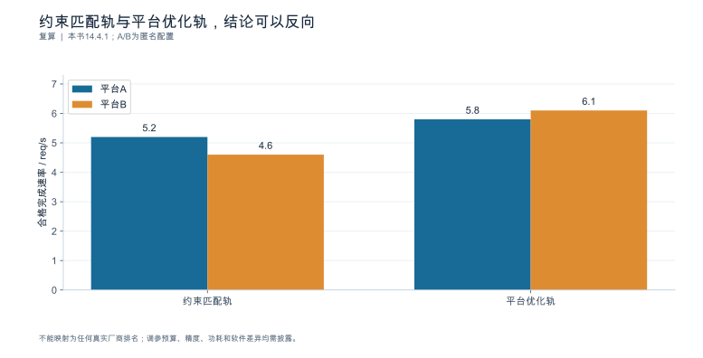

**数据身份：**`TEACHING_CALCULATION`。**条件：**数字沿用本章设定；轨道内需相同质量/SLO/负载；不混用卡、节点、资源池边界。

| 轨道 | A req/s | B req/s | 该轨道结论 |
|---|---|---|---|
| 约束匹配轨 | 5.2 | 4.6 | A较B高13.04% |
| 平台优化轨 | 5.8 | 6.1 | B较A高5.17% |

**出处与边界：**[X12](book_support_v06/来源与核验.md#x12)；不能映射为任何真实厂商排名；调参预算、精度、功耗和软件差异均需披露。

[数据与绘图点](book_support_v06/data/ch14_two_tracks.json) · [PNG](book_support_v06/figures/ch14_two_tracks.png) · [重绘代码](book_support_v06/code/replot.py)

<!-- V06-END -->
<!-- V08-START -->
<a id="sec-14-10"></a>
### 14.10 第三方数据补充：跨平台比较：先确认条件等价，再谈数字

本章前面讲迁移验收的口径。这一节补一组同轮次、同规则的跨平台第三方条目，并**刻意放入一个不可比的反例**。

**可比的三个（MLPerf Inference v4.1，Closed division，llama2-70b-99.9，Server 场景，约束 TTFT≤2 s 且 TPOT≤200 ms）。**同为 8 加速器、同模型、同精度档、同场景、同可用性时：H200×8 为 32,789.74、H100×8 为 21,605.79、MI300X×8 为 21,028.23 tokens/s。

**不可比的一个。**同轮次还有 B200-SXM-180GB×1 的 10,755.59 tokens/s。它**不能**与前三个排名：加速器数量是 1 而不是 8，可用性分类是 Preview 而不是 Available。**跨平台比较的第一条纪律不是"选哪个指标"，而是"条件是否等价"。**

**吞吐相当 ≠ 体验相当（同轮次条目的延迟分位）。**MI300X×8 与 H100×8 的吞吐很接近（21,028 对 21,606），但 TTFT 的 P50 是 990.2 对 272.95 ms——差 3.6 倍，P99 差 3.5 倍。前者反映稳态产能，后者反映每个请求要等多久才开始出字。同时 MI300X 的 TPOT P99 已达 197.87 ms，逼近 200 ms 门槛，余量远小于 Hopper 平台。

**边界：**提交方为各硬件厂商（运行于 MLCommons 统一规则并经受审收录）；仅覆盖 NVIDIA 与 AMD 两家具备可比条目的 LLM 加速器；软件栈不同；系统级结果。

#### 图14-T1 同规则同条件下的跨平台吞吐：可比的三个与不可比的一个（第三方实测）

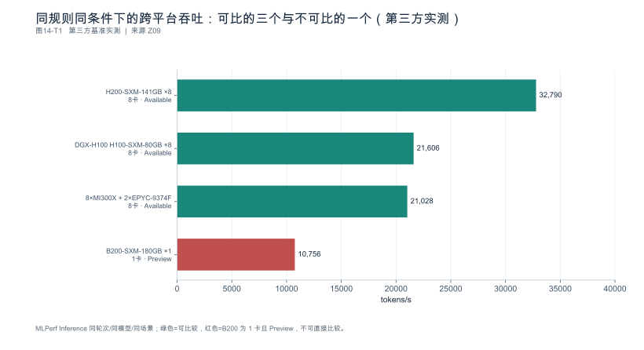

**数据身份：**`THIRD_PARTY_BENCHMARK`（第三方公开数据）。**条件：**MLPerf Inference v4.1，Closed division，llama2-70b-99.9，Server 场景，统一约束 TTFT≤2s 且 TPOT≤200ms；各系统 performance/run_1/mlperf_log_summary.txt。

| 系统 | 加速器数 | 可用性 | tokens/s | 是否可直接比较 |
|---|---|---|---|---|
| H200-SXM-141GB ×8 | 8 | Available | 32789.74 | 可（同轮次/同模型/同场景/同加速器数） |
| DGX-H100 H100-SXM-80GB ×8 | 8 | Available | 21605.79 | 可 |
| 8×MI300X + 2×EPYC-9374F | 8 | Available | 21028.23 | 可 |
| B200-SXM-180GB ×1 | 1 | Preview | 10755.59 | 不可（加速器数=1 且可用性=Preview） |

**出处与边界：**[Z09](book_support_v08/来源与核验_v08.md#z09)；提交方为各硬件厂商（NVIDIA/AMD），运行于 MLCommons 统一规则并经受审收录；仅覆盖 NVIDIA 与 AMD 两家具备可比条目的 LLM 加速器；软件栈不同。

[数据与绘图点](book_support_v08/data/ch14_tp_throughput.json) · [PNG](book_support_v08/figures/ch14_tp_throughput.png) · [重绘代码](book_support_v08/code/replot_v08.py)

#### 图14-T2 跨平台不只看吞吐：尾延迟的形态差得更远（第三方实测）

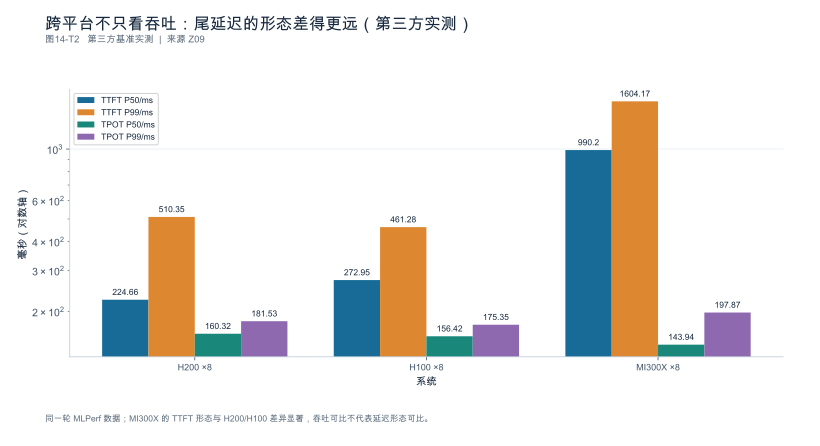

**数据身份：**`THIRD_PARTY_BENCHMARK`（第三方公开数据）。**条件：**同图14-T1 的三个可比条目；约束同为 TTFT≤2s、TPOT≤200ms（P99）。

| 系统 | TTFT P50/ms | TTFT P99/ms | TPOT P50/ms | TPOT P99/ms |
|---|---|---|---|---|
| H200 ×8 | 224.66 | 510.35 | 160.32 | 181.53 |
| H100 ×8 | 272.95 | 461.28 | 156.42 | 175.35 |
| MI300X ×8 | 990.2 | 1604.17 | 143.94 | 197.87 |

**出处与边界：**[Z09](book_support_v08/来源与核验_v08.md#z09)；提交方为各硬件厂商；软件栈不同；系统级结果。

> **时效提示（2026-10-09）**：图14-T1/T2 锚定在 **MLPerf Inference v4.1**，数字对该轮次成立，但已非最新轮次。截至检索日的最新可比锚点为 **v5.0 / v5.1**：NVIDIA 官方博客公布的 v5.0 Closed / Datacenter 结果为 8×B200 **98,443** token/s 对 8×H200 **33,072** token/s（Server 场景，3.0×）。**换轮次必须整表重取**——v4.1 的 H200×8 = 32,789.74 与 v5.0 的 H200×8 = 33,072.00 分属两轮，不能混在同一张表里比排名。
>
> 另有一条**可独立复核**的佐证，用来支撑"吞吐相当 ≠ 体验相当"这一节结论：AMD ROCm 官方发布的 MLPerf 复现文档中，一次 Server 场景性能跑给出 completed **29,522.56** token/s，TTFT P50 **950.5** ms / P99 **1,761.0** ms，TPOT P50 **132.6** ms / P99 **165.0** ms，约定门槛为 2000/200 ms。它达标了，但 P99 TPOT 距门槛仅剩 17.5% 余量，而 P99 TTFT 距门槛尚有余量——**约束卡在 TPOT 侧**的形态与图14-T2 一致。**引用边界**：该日志片段未标明具体平台与加速器数，用作论据时必须补注这一项，不能当作某型平台的官方成绩。

[数据与绘图点](book_support_v08/data/ch14_tp_latency.json) · [PNG](book_support_v08/figures/ch14_tp_latency.png) · [重绘代码](book_support_v08/code/replot_v08.py)

<!-- V08-END -->
### 章末检查问题

**1. 同模型不同精度可以比较，但该如何命名结论？**

答案方向：命名为**方案比较**，不是硬件比较。结论必须带完整限定：{平台, 精度路径, 并行布局, 轨道, 调参预算, 负载, SLO}，并显式披露精度细节——同称 FP4/FP8 不保证存储、激活、累加与 KV 路径相同（第11章 11.2），分块缩放的实际位宽也不同（NVFP4 为 4.5 bit/元素）。若两侧精度路径不同，报告中应写"在 A 走 FP8、B 走分块 4-bit 的方案下……"，而不是"平台 B 比 A 快 X%"。

**2. 一方经过两周调优、另一方默认配置，报告必须披露什么？**

答案方向：三件事。① **调参预算**（人日）与调优项清单；② **两条轨道分别报告**——约束匹配轨 5.20 vs 4.60（A 高 13.0%）、平台优化轨 5.80 vs 6.10（B 高 5.2%），只报一条时必须限定其结论，不能外推为另一轨道的结论；③ **结论归属**——平台优化轨的差异包含工程投入，不能写成硬件能力差异。若只报平台优化轨，等于把 10 人日的投入伪装成平台优势。

**3. 回滚恢复软件后旧缓存无法读取，迁移成本应如何补记？**

答案方向：回滚成本 = 软件回滚 + **状态/缓存制品重建** + 兼容配置恢复，三者都要进迁移评估，不能只算进程重启（本例 15 min vs 合计 **57 min**，完整时长为原估计的 3.8 倍）。因此：① 迁移前就要确认新旧状态格式是否可读，不可读时把重建时间写进回滚预案；② 灰度期间保留旧环境与旧制品，使回滚路径真实可用；③ 报告里把"回滚时间"作为一项独立的验收门槛，而不是运维细节。

---

### 本章验收清单

| 节 | 验收标准 |
|---|---|
| 14.1 | 比较对象明确（卡/服务器/互联域/资源池）；差异账本列出已匹配、可匹配未匹配与不可控三类；结论归属到组合而非单一芯片 |
| 14.2 | 需求在部署前写死；必需/可替代/非必需分列；取消、超时、观测等非演示功能已入清单 |
| 14.3 | 身份对齐先于数值比较；质量验收分层且用独立集；同名称精度路径显式披露 |
| 14.4 | 两条轨道分别报告；调参预算披露；结果命名完整 |
| 14.5 | 排除顺序已执行；只用共同观测边界作差；无法隔离时写"方案差异" |
| 14.6 | 双跑经授权；回滚含状态制品重建；正式维护线与 RC 分别有回滚路径 |
| 14.7 | 建议按负载分列；未完成项不写已通过；不给综合分掩盖未知 |

---

### 配套资料

[新增图表与数据](book_support_v05/figures.md) · [来源登记](book_support_v05/references.md) · [E0测试清单](book_support_v05/data/e0_test_results.md) · [修订记录](book_support_v05/review/changes.md)

[R01]: book_support_v05/references.md#r01
[R12]: book_support_v05/references.md#r12
[R14]: book_support_v05/references.md#r14
[R19]: book_support_v05/references.md#r19
[R20]: book_support_v05/references.md#r20
[R21]: book_support_v05/references.md#r21
[R23]: book_support_v05/references.md#r23
[R24]: book_support_v05/references.md#r24
[R25]: book_support_v05/references.md#r25
[R26]: book_support_v05/references.md#r26
[R27]: book_support_v05/references.md#r27
[R29]: book_support_v05/references.md#r29
[R30]: book_support_v05/references.md#r30
[S01]: book_support_v05/references.md#s01
[S09]: book_support_v05/references.md#s09
[S10]: book_support_v05/references.md#s10
[S13]: book_support_v05/references.md#s13
[S17]: book_support_v05/references.md#s17
[S19]: book_support_v05/references.md#s19
[S20]: book_support_v05/references.md#s20
[S21]: book_support_v05/references.md#s21
[S22]: book_support_v05/references.md#s22

<!-- V10-START -->
<a id="sec-14-90"></a>

### 本章口径核对（公开来源）

#### 产品页规格与实际可用配置的关系，以及两侧观测字段的可比性

**产品页规格的性质**

GB300 NVL72 的产品页规格为：72 个 Blackwell Ultra GPU 与 36 个 Grace CPU，NVLink 域带宽 130 TB/s，GPU 显存 20 TB，聚合显存带宽最高 576 TB/s，CPU 内存 17 TB LPDDR5X（14 TB/s），2592 个 Arm Neoverse V2 核心；每 GPU 通过 ConnectX-8 SuperNIC 提供 800 Gb/s 网络连接。产品页同时注明"所有 Tensor Core 规格均含稀疏性，除非另有说明"。

AMD MI350 系列的产品页规格为：MI350P 为 128 CU / 144 GB HBM3E / 最高 4 TB/s；MI350X 与 MI355X 为最高 256 CU / 288 GB HBM3E / 8 TB/s；8 卡平台为 2.3 TB 总 HBM3E 与 64 TB/s 聚合带宽，最高 80.5 PFLOPS（MXFP4 与 MXFP6 峰值理论值）。

**这些数字应当如何使用**

产品页脚注明确：算力数字为 AMD Performance Labs 于 2025 年 5 月基于当时规格"计算或估算"的**峰值理论值**，且"服务器厂商配置不同，结果可能不同"。NVIDIA 侧同样注明"预测性能，可能变化"。

因此产品页规格的正当用途是**上界与量级参照**：用于判断某个配置在物理上是否可能，或用于量级估算。它不能替代目标环境的实际可用配置——实际可用值还受固件、驱动、拓扑、散热、电源策略与并发访问模式影响。

**两侧原生观测工具的可比字段**

| 侧 | 工具与字段 |
|---|---|
| NVIDIA | Nsight Systems 的 `--trace`/`-t`（cuda、nvtx、osrt、nccl、cudnn、cublas 等）、`--cuda-graph-trace graph\|node`、`--capture-range`、`--sample`/`-s`、`--sampling-frequency`、`--backtrace`/`-b`（详见第 10 章） |
| ROCm | `rocprofv3`（achieved FLOPs、内存事务、运算强度）、`amd-smi metric --usage`、`rocminfo`（每 GPU CU 数）、`ROCProfiler` / `Omnitrace`（硬件计数器） |

ROCm 侧计数器示例：`SQ_ACCUM_PREV_HI_BUSY`、`SQ_ACCUM_MFMA_BUSY`、`SQ_ACCUM_LDS_BUSY`、`SQ_ACCUM_VMEM_BUSY`、`SQ_ACCUM_SALU_BUSY`、`SQ_WAVES_BUSY`、`SQ_WAVES_ISSUED`、`SQ_ACCUM_INSTS_ISSUED`、`SQ_ACCUM_CYCLES_BUSY`。

**可比性边界**：ROCm 的 `SQ_*` 系列与 NVIDIA 的 SM/pipe 利用率指标在语义上**并非一一对应**，两侧的"忙占比"定义、采样机制与聚合方式都不同，跨栈直接比较数值会得出错误结论。ROCm 文档本身也强调"占用率衡量的是 CU 被加载的充分程度，而不是被高效利用的程度"，并指出 MFMA 类 GEMM 内核常在低占用率下运行——同一提醒同样适用于 NVIDIA 侧。跨栈比较应当比较**同一语义量**（如相同的 SLO 下的 goodput），而不是比较同名但不同义的计数器。
<!-- V10-END -->


---

<a id="ch-15"></a>
## 第15章 国产加速器推理实践

**核心论点：**国产实践采用**具体软件栈与具体实验**说话：先验证功能与质量，再诊断执行、通信与服务边界。

---

<a id="sec-15-01"></a>
### 15.1 建立国产平台研究对象

**本节要回答的问题：**本章验证的是**哪款硬件、哪个版本、哪种部署**？

#### 15.1.1 不存在抽象的"国产卡"

第一条纪律：**不能以"国产卡"作为统一测试对象。**必须记录到：具体硬件型号、卡数与服务器拓扑、模型与完整软件版本、部署形态。

案例身份卡字段：

| 字段 | 内容 |
|---|---|
| 硬件 | 型号、卡数、拓扑（同域/跨节点） |
| 软件栈 | 驱动、固件、CANN、框架适配、推理后端及各自版本 |
| 模型 | 名称、revision、精度方案 |
| 部署 | 单实例/多副本/是否分离 |
| **资源层级** | E1—E4 中实际具备哪一级 |
| **证据分层** | 官方说明 / 第三方结果 分别标记 |

#### 15.1.2 研究问题与能力范围

先写清要回答的问题（功能是否齐全？质量是否达标？性能边界在哪？），再说明**本次能验证到哪一层**。没有设备的部分可以完成**资料研究与实验设计**，但**不能填写性能结果**。

#### 15.1.3 不沿用未经核验的产品参数

不沿用传闻、二手评测或未经核验的规格。**公开官方能力与第三方结果分开标记**，不得混写。

#### 15.1.4 结论绑定组合

所有结论绑定明确组合，**不从一个案例外推整个国产生态**。

**依据与核验入口：**[R19] [R20] [R33]

---

<a id="sec-15-02"></a>
### 15.2 国产栈依赖：正式版、模型限定 RC 与原生路径

**本节要回答的问题：**如何把驱动、CANN、框架与推理后端组合起来？

#### 15.2.1 版本化依赖对照

以下表是**资料登记，不是部署推荐或已跑通的环境** [SOURCE_REGISTERED] [S19] [S20] [S26]：

| 路径 | 来源身份 | 已补齐的官方依赖 | 本地状态与限制 |
|---|---|---|---|
| vLLM Ascend 维护版本条目 | 0.23.0.post1（S19） | 保留历史身份；不与 RC 的依赖混搭 | 本书未重建 |
| 模型限定 RC | 0.26.0rc1；短提交 f2f74a1（N07） | vLLM 0.26.0；Python≥3.10、<3.13；CANN 9.1.0；PyTorch 2.10.0；torch_npu 2.10.0.post4 | 限定 Kimi K3、GLM-5.2、DeepSeek V4 Flash0731／Pro0813；不是通用升级推荐 |
| 原生服务路径 | MindIE 等 | 仍需其自身兼容矩阵 | 不继承 vLLM Ascend 结论 |

该 RC 发布说明还给出 Triton Ascend 3.2.2 的硬件范围，以及镜像内 Mooncake 0.3.11.post1。驱动、固件、镜像 digest 和完整部署启动条件仍需按所选硬件补齐。第15.8节使用其测试报告做**公开证据阅读案例**，不把维护者验证当作独立验证。

#### 15.2.2 原生路径独立核验

MindIE 与其它原生服务路径**单独建立矩阵**，不套用 vLLM Ascend 的结论。现有复核对 MindIE 入口**未取得实质正文** [SOURCE_ENTRY_ONLY] [S26]，因此**只保留研究入口与需要核验的字段**，不给最新版本、支持能力或性能结论。

#### 15.2.3 至少一套组合完成实际重建后才可声明可复现

**仅资料快照不构成兼容认证。**本节验收要求：至少一套组合完成实际重建，其余保持"设计/待验证"。

**依据与核验入口：**[R19] [R20] [S19] [S20] [S26]

---

<a id="sec-15-03"></a>
### 15.3 模型部署与功能质量基线

**本节要回答的问题：**第一份国产平台基线应该先证明什么？

#### 15.3.1 先对齐输入

沿用第13、14章规范：模板版本、分词器、停止规则、采样设置**先对齐**，再谈性能。模型与输入没对齐，后面所有数字都不可比。

#### 15.3.2 功能边界测试结果优先于性能

匿名后端的否决示例（不是对昇腾或该 RC 的功能测试结果）：

| 检查项 | 结果 |
|---|---|
| 功能冒烟 12 项 | 通过 **10** 项 |
| 不支持 2 项 | **取消传播**、**结构化输出约束** |
| 质量达标率 | **87%**（目标 90%） |

结论：**质量未达标，性能数据不能作为合格迁移能力。**这两项不支持的功能也不是"以后再补"——取消传播缺失会直接产生幽灵负载（第1章 1.6），结构化约束缺失会让下游解析失败率上升。

#### 15.3.3 基线选择标准

基线不需要一开始用最大模型或最大并行度。优先选择**可长期访问并能重复测试**的组合——可重复比规模更重要。

**依据与核验入口：**[R19] [R29] [R14]

---

<a id="sec-15-04"></a>
### 15.4 原生剖析与指标语义

**本节要回答的问题：**怎样从国产工具中取得可解释证据？

#### 15.4.1 入口与正文是两个状态

所引特定入口（msprof 26.1.0）的复核**只取得站点框架**，`body_verified = false` [SOURCE_ENTRY_ONLY] [S24] [R20]。

这意味着：**不能按该入口宣称具体命令已核验。**正确做法是——执行前先取得对应版本的工具文档，保存**字段列表、权限要求、采集开销、时间域**，然后才开始。该特定入口的空缺继续保留；CANN 8.5.0 工具正文另见 15.8.3，示例有版本边界，不把两者视为同一环境。

#### 15.4.2 禁止按名称猜测指标等价

厂商原生计数器**不必与其它平台的工具同名，也不必同义**。典型形态：

| 原生计数器 | 不能直接等价于 | 原因 |
|---|---|---|
| 计算核心占用率 | 另一平台的"GPU 利用率" | 分母可能是时间占比、容量占用或带宽比（第9章 9.4） |
| 内存占用率 | 显存字节/s ÷ 峰值带宽 | 定义不同 |

**统一报告应保留原始语义**（第13章 13.6），并为每个字段记录映射规则与版本。

#### 15.4.3 可追溯性

本节验收要求：读者能从一条分析结论追溯到**原生记录、时间域、转换规则**三者。缺任一项，该结论不可发布。

**依据与核验入口：**[R20] [R19] [S24]

---

<a id="sec-15-05"></a>
### 15.5 执行、内存优化与已撤回配置核对

**本节要回答的问题：**怎样判断问题来自模型适配、算子还是资源调度？

#### 15.5.1 竞争假设，不套用其它平台的参数

复用第10章的方法，先列候选：输入或版本不匹配 / 实际执行回退 / 状态压力 / 主机供给 / 通信等待。然后按信息量排序取证。

**硬纪律：不默认套用其它平台的参数名与取值。**匿名反例（不代表某个已核验的国产引擎存在该行为）：把某个在 CUDA 侧常见的融合开关直接迁移过来配置 —— **无效**，因为该版本没有这条路径，而且**不报错**。

改用本版本支持的图模式后：单步从 **4.6 ms** 降到 **2.9 ms**（**−37.0%**），另假设独立质量评估从 87% 降到 85%，则需回退复核；不能把这段构造示例解释为图执行必然损害质量。

#### 15.5.2 已移除配置不能照旧教程推荐

复核快照中 0.26.0rc1 已移除 FlashComm2 等旧优化路径 [SOURCE_REGISTERED] [S20]。

**旧教程中的预取或融合开关不能直接成为新 RC 的建议。**每次实验先查本版本支持、替代方式与实际执行。

#### 15.5.3 不把差距笼统称作"生态问题"

两个本节明令禁止的写法：

- **"只调通参数"不算归因成功**——需要机制解释与回退复测；
- **不把全部差距笼统称作生态问题**——那是不归因，不是结论。

#### 15.5.4 每次调整后回到同一业务负载

优化后必须回到同一负载，验证质量、延迟与稳定性三者（第11章 11.7 的顺序：质量先于性能）。

**依据与核验入口：**[R19] [R20] [R26] [S20]

---

<a id="sec-15-06"></a>
### 15.6 多卡通信、集群与混合部署

**本节要回答的问题：**通信异常与模型计算问题怎样分离？

#### 15.6.1 三类结论分开

| 结论类型 | 测什么 | 能推出什么 |
|---|---|---|
| **通信微基准** | 链路带宽与延迟 | 链路健康 |
| **模型性能** | 端到端与阶段耗时 | 该模型在此布局下的表现 |
| **业务容量** | 同 SLO 下的合格完成速率 | 可服务能力 |

**三者互不替代。**微基准健康不保证模型端到端高效；模型通信时间长也不一定代表链路故障（可能是消息尺寸分布或 rank 偏斜，第6章 6.5）。

#### 15.6.2 原生通信库入口的状态

HCCL 的历史 alpha 入口在复核中**未取得实质正文** [SOURCE_ENTRY_ONLY] [S25] [R33]。

**它不能证明当前部署的通信兼容性。**选定运行环境后必须补：原生通信文档 + 小规模健康测试，再讨论真实模型的 dispatch/combine 或其它消息。**不能以旧网页标题替代验证。**

#### 15.6.3 示意形态

典型观察（构造示例）：某通信微基准带宽设为 **190 GB/s**（取值；未给消息、拓扑与合格基线，不能仅据此判健康），但模型端到端中通信段占比 **24%**，且最慢 rank 比均值慢 **38%**。

→ 三个数字分别提示传输速率、通信活动与 rank 差异；链路是否健康及通信是否暴露在关键路径，仍需进一步证据。**微基准健康与模型高效是两件事。**

#### 15.6.4 混合部署

跨节点或混合部署需分别验证：状态兼容性、失败恢复、服务目标。集群实测**必须有实际资源**，无资源时只提交设计。

**依据与核验入口：**[R33] [R19] [R20] [S25] [S20]

---

<a id="sec-15-07"></a>
### 15.7 实验：形成国产平台工程案例

**本节要回答的问题：**一章完整案例应当交付哪些证据？

#### 15.7.1 同一证据链

最终案例按同一链条编写：

```
环境身份 → 任务与契约 → 质量基线 → 性能基线 → 竞争假设 → 受控干预 → 回退复测 → 结论与边界
```

#### 15.7.2 允许三种结论

- **采用**：功能、质量、性能、稳定性全通过；
- **继续验证**：部分证据不足；
- **不采用**：质量不达标或代价过高。

**不需要预设宣传方向。**能证明某项配置不值得采用，同样是一份合格案例。

#### 15.7.3 分层不能混

**官方说明、第三方结果与待验证判断**三层清楚分开。**不用第三方数字冒充官方声明。**其它国产后端沿用相同案例模板，只有证据完整后才加入比较。

**依据与核验入口：**[R19] [R20] [R33] [S19] [S20] [S24] [S25] [S26]

---

### 15.8 深化：用官方测试报告建立一个可审查的国产栈案例

#### 15.8.1 已补齐的证据是什么

本节依据 vLLM Ascend v0.26.0rc1 发布说明及其链接的测试总结 [N07] [N09]。它们分别提供依赖／支持边界和测试覆盖记录；没有提供本书自己的运行日志。因此本节是一份**官方案例审读**，不把它改写成作者部署成功的经历。

> **时效提示（2026-10-09）**：本节锚定在 vLLM-Ascend **v0.26.0rc1**；截至检索日最新为 **v0.27.1rc1**（2026-09-24），其声明的完整验证模型已收缩为 **MiniMax-M3** 与 **DeepSeek-V4-Flash** 两项（两节点 1P1D 与 KV Cache Pool 部署），并明确其余组合"未充分验证、不属于本次发布声明范围"。读官方报告时必须区分**"覆盖场景"与"场景结果"**、区分**实测与按接受率折算**——这两条纪律在版本更替时同样适用。

测试总结列出Kimi K3 W4A8在A3八节点EP、1P1D，以及Ascend 950四节点EP、1P1D等组合。质量表给出Kimi K3的GPQA报告得分92.42与OCRBench报告得分0.88 [N09]。不同基准的得分量表不同，本书保留原值，不将两者放在同一百分比柱图上，也不据此计算跨平台优劣。

| 证据对象 | 官方报告实际提供 | 本书不能补造 |
|---|---|---|
| 环境与覆盖 | 具体模型、量化、平台及部分并行／P/D组合 | 完整驱动固件、镜像digest和全部运行参数 |
| 性能场景 | P-only、D-only、端到端和不同长度／前缀比例 | 页面未给出的逐项吞吐、延迟分布、误差条 |
| 质量 | 部分基准原始分数 | 样本级标签、配对差异或统计区间 |
| 稳定性 | 报告声明的测试覆盖 | 本书环境的长期稳定保证 |

这些缺失不是“可以按相近型号估算后填入”的空白。实验条件不足的公开结果可以用来选择测试问题，不能直接拿来填本地容量表。

#### 15.8.2 一个真实的负面案例：长输入下草稿并未带来有效收益

同一官方测试总结的已知问题记录指出，Kimi K3长输入场景存在性能未达预期的问题，并讨论DSpark草稿在较长输入下接受效果不足、未取得有效收益，修复被列入后续版本计划 [N09]。这比构造“国产平台某功能不支持”的故事更有价值：它给出了版本、模型、场景和待改进方向。

这条记录支持的结论是**该报告中的特定组合存在已知限制**，不是“国产平台不适合推测解码”，也不是“草稿接受率低就是全部根因”。本地复查应固定真实内容、输入长度、并发与输出规则，记录接受长度分布、草稿时间、目标验证时间和合格完成速率。后续版本的修复是否完成，须另查对应发布记录并复测；计划本身不等于修复结果。

#### 15.8.3 原生剖析正文已经取得，但版本范围不能串用

另据 CANN 社区版 8.5.0 离线剖析指南 [N08]，指南给出的基本形式是 `msprof --output=<输出目录> <用户应用>`，并说明可导出时间线与算子统计。以下是按该形式编写的**条件化启动包装**，仅做本地shell语法检查，未在昇腾设备执行；使用前必须核对已安装工具的帮助与权限。

```bash
#!/usr/bin/env bash
set -euo pipefail
: "${OUT:?请设置隔离的输出目录}"
: "${APP:?请设置待剖析应用的路径}"
command -v msprof >/dev/null || { echo "未找到 msprof" >&2; exit 1; }
[[ -f "$APP" ]] || { echo "APP 文件不存在" >&2; exit 1; }
mkdir -p "$OUT"
# 示例仅适用于已经验证依赖的 Python 应用。
# 其余应用形式、参数和采集开关应按所用版本指南改写。
msprof --output="$OUT" python3 "$APP"
```

该指南列出的产物包括 `msprof_*.json` 时间线、`op_summary_*.csv` 算子明细、`op_statistic_*.csv` 算子汇总和 `task_time_*.csv` 任务调度记录 [N08]。先确认实际产物，再按任务身份、时间域和调用关系解释；列名相似不等于可与CUDA工具直接比较。

**8.5.0剖析指南与RC所列CANN 9.1.0不是同一环境。**本节只是补全了一个以前未取得正文的工具路径，不能把两份资料拼成已验证的安装组合。

#### 15.8.4 下一步实验必须能区分机制

若模型通信耗时很高，先记录消息类型、尺寸、rank启动和结束时刻，再在相同布局下做通信健康检查。通信微基准正常只能排除它覆盖的故障模式，不能排除模型负载中的偏斜、同步频率或计算—通信依赖问题。

若图执行前后质量变化，应先检查模型、精度、模板、采样和停止条件是否真正一致，再判断是否存在数值路径问题。不能把一次质量下降当成图执行的固有性质。国产平台实践的深度来自这种可区分的证据链，而不是多列几个品牌名称或没有出处的性能倍率。

#### 15.8.5 一个可重绘的官方负面数值

同一测试总结的已知问题还记录了Qwen3-32B W8A8在A2、P/D共置pooling测试中，开启pooling后原生TPS由2443降至2313，约下降5.32% [N09]。它是报告中的历史问题记录，不代表该RC当前对该模型作全面支持承诺。

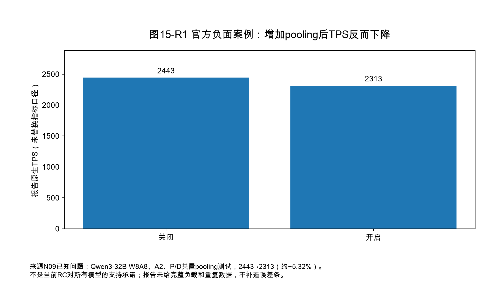

完整长度、并发和重复条件未提供，所以本书只重绘两项原值，不补造性能曲线，也不将它解释成所有缓存池都会退化。

---

<!-- V06-START -->
<a id="sec-15-09"></a>
### 15.9 实验图表补充：补齐官方质量表与测试场景范围

X09固定提交的Accuracy表给出GLM-5.2、Kimi K3、DeepSeek-V4-Flash、DeepSeek-V4-Pro的GPQA Score分别92.165、92.42、91.67、91.92，另给Kimi K3 OCRBench Score 0.88。图将GPQA和OCRBench分成两个面板，完整保留报告原值与模型名。

原文只写Score，未在这张表中完整交代GPQA子集、样本数、提示模板及统计区间。本书不因分数相差 0.255 就判断模型显著更优；也不把OCRBench的0.88直接转成“880道正确”，因为报告未披露足够的计分和归一化链路。正文相应用语改为“报告得分”，避免与基准原生量表混淆。

该报告还列出9种性能场景：P-only与D-only分别覆盖16k→1k、128k→1k、40k—80k变长→2.5k；端到端覆盖16k→1k且前缀0%、128k→1k且前缀90%、1M→1k且前缀比例未注明。**覆盖场景不等于给出了场景结果**，逐项吞吐、P99、误差条仍缺，不能用相近型号推算补入。

图 15-R1 的 pooling 由 2443 降到 2313 TPS，按原值复算下降 5.32%。它仍是特定Qwen3-32B/W8A8/A2/P-D共置单前缀负例，不扩大成所有缓存池结论；DSpark长输入无收益也只保留为该组合限制。

#### 图15-V1 国产推理栈公开质量数据：先保留量表，再谈结论

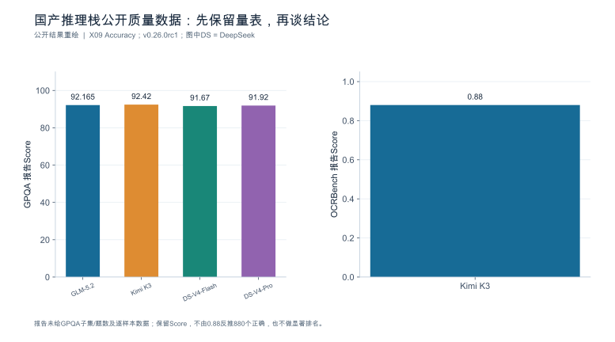

**数据身份：**`PUBLISHED_RESULT`。**条件：**报告4模型GPQA与1模型OCRBench原值；对应部署见图13-V1；量表分开。

| 基准 | 模型 | 报告Score |
|---|---|---|
| GPQA | GLM-5.2 | 92.165 |
| GPQA | Kimi K3 | 92.42 |
| GPQA | DeepSeek-V4-Flash | 91.67 |
| GPQA | DeepSeek-V4-Pro | 91.92 |
| OCRBench | Kimi K3 | 0.88 |

**出处与边界：**[X09](book_support_v06/来源与核验.md#x09)；报告未给GPQA子集/题数及逐样本数据；保留Score，不由0.88反推880个正确，也不做显著排名。

[数据与绘图点](book_support_v06/data/ch15_quality_scales.json) · [PNG](book_support_v06/figures/ch15_quality_scales.png) · [重绘代码](book_support_v06/code/replot.py)

<!-- V06-END -->
<!-- V07-START -->
<a id="sec-15-10"></a>
### 15.10 实验深化补充：昇腾公开数据的两种口径：阶段实测与接受率折算

本章前面固定了 vLLM-Ascend 的部署覆盖与质量原值。这一节补入华为《昇腾服务器 DeepSeek V3/R1 推理部署最佳实践》的阶段性性能数据，并**严格区分两种口径**。

**口径一，阶段实测（Prefill，Atlas800I A2、2节点16卡、MLA TP16、A8W8C16）。**报告表3给出卡均输入Token/s：2K×8为1622，1K×16为1650。两者总Token量相近但请求数不同（8对16），说明“相同总Token不等于相同请求数”。

**口径二，接受率折算（Decode，4节点32卡、MTP）。**在TPOT≤100ms约束下，按默认70%接受率折算，2K+2K与1K+2K分别为卡均723与784输出Token/s；若按80%接受率折算为765与830；按90%折算为808与876。**这六个数值全部是按接受率折算得到的，不是六次独立的实测。**723→808来自接受率假设的变化，不能当作已验证的生产提速；90%接受率也不是任意业务都能达到的值。

**不要相加。**Prefill的1622是卡均输入吞吐，Decode的723是卡均输出吞吐，二者维度不同，不能相加成端到端吞吐，也不能据此推整机服务能力。具体芯片型号、权重revision与软件精确commit报告未完整披露，本书不补造。

#### 图15-E1 昇腾Prefill：先把单阶段实测与服务能力分开

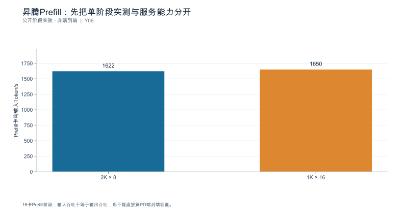

**数据身份：**`PUBLISHED_STAGE_EXPERIMENT`。**条件：**Atlas800I A2，Prefill2节点/16卡，MLA TP16；总输入16K；DeepSeek V3/R1报告A8W8C16路径；表3。

| 输入×总batch | Prefill卡均输入Token/s |
|---|---|
| 2K × 8 | 1622 |
| 1K × 16 | 1650 |

**出处与边界：**[Y06](book_support_v07/来源与核验_v07.md#y06)；卡均输入吞吐不是输出吞吐或完整PD能力；具体芯片、权重revision、软件精确commit未披露，不补造。

[数据与绘图点](book_support_v07/data/ch15_ascend_prefill.json) · [PNG](book_support_v07/figures/ch15_ascend_prefill.png) · [重绘代码](book_support_v07/code/replot_v07.py)

#### 图15-E2 昇腾Decode：接受率折算不是六次独立实测

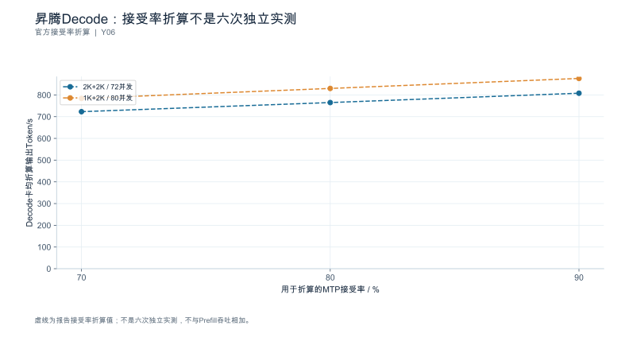

**数据身份：**`PUBLISHED_ACCEPTANCE_ADJUSTED`。**条件：**Atlas800I A2；Decode4节点/32卡；DeepSeek V3/R1、A8W8C16、MTP；TPOT≤100ms；报告默认70%接受率折算，80/90%为其他折算。

| MTP接受率/% | 2K+2K、卡均72并发/输出Token每秒 | 1K+2K、卡均80并发/输出Token每秒 |
|---|---|---|
| 70 | 723 | 784 |
| 80 | 765 | 830 |
| 90 | 808 | 876 |

**出处与边界：**[Y06](book_support_v07/来源与核验_v07.md#y06)；全部点标为报告折算值，不称六组真实内容实验；不能把90%接受率当作任意业务可达值。

[数据与绘图点](book_support_v07/data/ch15_ascend_mtp.json) · [PNG](book_support_v07/figures/ch15_ascend_mtp.png) · [重绘代码](book_support_v07/code/replot_v07.py)

<!-- V07-END -->
### 章末检查问题

**1. 为何不能把其它平台的参数名称直接迁到国产后端？**

答案方向：参数名对应的是**具体内核与执行路径的存在性**，不是通用语义。路径不存在时，开关要么被忽略、要么报错，而"被忽略"最危险——你以为开启了优化，实际什么都没发生（15.5.1 的反例）。正确做法：先查本版本的能力矩阵与实际执行路径（trace 内核名），确认路径存在后再调，并且**每次调整后回到同一业务负载**验证质量、延迟与稳定性。另外，同一名称在不同版本上的默认值与生效条件也可能不同（第1章 1.5 的四态记录）。

**2. 通信微基准通过为何仍可能有模型同步问题？**

答案方向：微基准测的是**链路的带宽与延迟**，模型侧还受四件事影响：消息尺寸分布（Decode 侧消息很小，延迟主导，第6章 6.2）、rank 偏斜（容量由最忙 rank 决定，6.5.4）、依赖链与缓冲生命周期（6.5.3）、以及图模式与批形状是否让通信落在关键路径上。本节的构造示例中，微基准的读数为 190 GB/s（不足以单独判定健康），但通信段仍占端到端 24%、最慢 rank 慢 38%。所以三类结论（微基准 / 模型性能 / 业务容量）必须分开报告，互不替代。

**3. 特定 RC 已移除的优化，能否照旧教程继续推荐？**

答案方向：**不能**，而且要区分三种生命周期状态。**已移除**意味着路径不存在——旧教程的开关在新版本上直接失效（或静默无效）；**已弃用**意味着仍可用但不建议新用；**计划移除**尚未发生，不得提前写成事实 [SOURCE_REGISTERED] [S20] [S06]。正确做法：每次实验前先查本版本的支持情况与替代方式，用 trace 确认实际执行路径，并把"已移除"记为**迁移缺口**而不是继续扫描一个不存在的参数。

---

### 本章验收清单

| 节 | 验收标准 |
|---|---|
| 15.1 | 结论绑定到具体硬件/版本/部署；官方与第三方证据分层；不从一个案例外推整个生态 |
| 15.2 | 依赖一致且有来源；正式维护线与模型受限 RC 分开；原生路径不继承其它服务栈结论；仅快照不构成兼容认证 |
| 15.3 | 输入身份先对齐；功能与质量结果优先于性能；质量不达标时性能数据不作合格能力 |
| 15.4 | 入口与正文状态分开；原生计数器不按名称等价；结论可追溯到原生记录、时间域与转换规则 |
| 15.5 | 竞争假设完整；不套用其它平台参数；已移除配置不照旧推荐；不把差距笼统称作生态问题 |
| 15.6 | 通信微基准、模型性能、业务容量三类结论分开；原生通信库入口状态如实登记 |
| 15.7 | 案例沿同一证据链；允许"不采用"结论；官方说明与第三方结果不混写 |

---

### 配套资料

[新增图表与数据](book_support_v05/figures.md) · [来源登记](book_support_v05/references.md) · [E0测试清单](book_support_v05/data/e0_test_results.md) · [修订记录](book_support_v05/review/changes.md)

[N07]: book_support_v05/references.md#n07
[N08]: book_support_v05/references.md#n08
[N09]: book_support_v05/references.md#n09
[R14]: book_support_v05/references.md#r14
[R19]: book_support_v05/references.md#r19
[R20]: book_support_v05/references.md#r20
[R26]: book_support_v05/references.md#r26
[R29]: book_support_v05/references.md#r29
[R33]: book_support_v05/references.md#r33
[S06]: book_support_v05/references.md#s06
[S19]: book_support_v05/references.md#s19
[S20]: book_support_v05/references.md#s20
[S24]: book_support_v05/references.md#s24
[S25]: book_support_v05/references.md#s25
[S26]: book_support_v05/references.md#s26

<!-- V10-START -->
<a id="sec-15-90"></a>

### 本章口径核对（公开来源）

#### MindIE 的版本与能力、msprof 的命令字段、HCCL 的测试方法

**MindIE（社区版 3.1.0，公告日 2026-08-19）**

3.1.0 的发布同时伴随"架构升级与模块更名"。组件划分为：MindIE Motor（昇腾推理服务）、MindIE SD（多模态生成）、MindIE LLM（文本生成）、MindIE Turbo（可选的推理模型加速库），并支持对接第三方引擎 vLLM / SGLang。

服务化能力方面，官方给出的口径是：基于 K8S 模板一键拉起服务并支持弹性伸缩与调度；**PD 实例级故障隔离与恢复**——自愈型故障 60 秒内恢复、系统级故障 7 分钟内恢复，核心组件支持主备倒换；负载感知的 PD 分离调度，按 SLO 要求对 DP 与 KVCache 做感知与均衡，并提供 AutoPD 自动 PD 配比寻优；服务化组件 MindIE Motor 可对接 vLLM 等开源引擎以增强其服务化调度能力。

**边界**：产品页给出的是能力声明与恢复时间口径，未给出具体版本对 CANN / torch_npu / 驱动固件的完整兼容矩阵表。兼容矩阵须查对应版本的发布公告与文档，不能由产品页推出。

> **核对说明（2026-10-09）**：① **60 秒 / 7 分钟须降级为厂商宣称**。该数字出自 MindIE 产品页"关键特性"，页面**未标注版本号、未给出测试规模、故障定义与 SLO 条件**；在版本说明与 Motor 开发指南中未检索到同数字的工程口径。不能写成"3.1.0 实测指标"，也不能用于可用性或容量承诺。AutoPD 同为产品页口径，官方未给配置项与算法。② 补充两条同轮取得的官方事实：**MindIE LLM 官方声明"暂停后续功能演进，现有功能维持维护状态，不再支持新特性和新模型"**，推荐路径改为 MindIE Motor + vLLM Ascend（是"停止演进"，不是"已移除"）；**SGLang 仅在产品页并列出现**，未检索到独立开发指南或版本配套表，其"支持"止于产品页口径。③ 公告日：社区版 3.1.0 的公告日期为 **2026-08-19**，同日另有"架构升级与模块更名"公告；Motor 3.1.0 的配套要求是 CANN 9.0.1（Atlas 800I A2/A3）或 9.1.0（Atlas 850 超节点）、MindCluster 26.1.0、TorchNPU 26.0.0/26.1.0、vLLM v0.23.0、Mooncake v0.3.11.post1，官方注明"各组件需要配套使用，请勿跨版本混用"——**配套版本表比版本号本身更能决定可复现性**。

**msprof 的具体命令、字段、权限与采集开销**

完整内容见第 9 章。此处只重申与本环境最相关的三点：

1. **命令与档位**：`msprof [options] <app>`；算子耗时用 `--task-time=l0|l1|l2|l3|on|off`，其中 `l0` 不采集算子基本信息、开销较小，`l1` 与 `l2` 支持集合通信算子数据，`l3` 采集 PyPTO 数据且官方标注为"试用特性，不支持应用于生产环境"。
2. **字段与落盘**：`--output` 目录下生成 `PROF_XXX`；EP 场景直接可读（`task_time`、`op_summary`、`op_statistic`、`msprof_*.json`、`api_statistic_*.csv`），RC 场景文件未经解析、须回开发环境解析。
3. **平台差异**：`--task-block` 仅 Ascend 950PR/950DT 支持；`--aic-metrics` 各取值的产品支持范围不同；glibc < 2.34 上采集 memory 数据可能触发 glibc 缺陷 19329。

> **核对说明（2026-10-09）**：① **`--task-time` 的默认值存在跨版本冲突**——CANN 社区版 9.2.0-beta.1 文档写"默认 `on`，和配置为 `l1` 的效果一样"，而 MindStudio 侧 msprof 快速入门文档写"默认 `l0` 级别"。**引用默认值必须绑定文档版本**，不得跨版本套用；实际值以运行环境的 `msprof --help` 为准。② **`--aicore-shape` 的官方出处未取得**——在 CANN 社区版 9.2.0-beta.1 的采集命令页全篇检索未命中该参数，仅见于第三方博客与源码枚举（称"仅 `--task-time=l0` 时生效"）。因此"仅 `--task-time=l0` 生效"不作为官方事实引用，登记为待核验。③ 档位表按 9.2.0-beta.1 补齐了 `l3` 与其"试用特性"限定。

该文档未单独声明采集开销的量化上限，但通过档位设计（`l0` 相比 `l1` "性能开销较小"）与频率上限（`--aic-freq` 1~100 Hz、`--sys-hardware-mem-freq` 1~100 Hz）体现了开销与信息量的取舍关系。

**HCCL 的通信能力与健康测试方法（HCCL Test / HCCL 性能测试工具）**

工具原理：把算子输入初始化为固定值，再检验输出是否符合预期，据此判定通信结果是否正确。

输出字段：

| 字段 | 含义 |
|---|---|
| `data_size` | 单个 NPU 上参与集合通信的数据量，单位 Bytes |
| `aveg_time` | 集合通信算子执行耗时，单位 μs |
| `alg_bandwidth` | 集合通信算子执行带宽，单位 GB/s；口径为"集合通信数据量 / 耗时"，即**算法带宽** |
| `check_result` | 结果校验标识，取值 `success` / `failed` / `NULL` |

`-c` 参数控制结果校验：`0` 为不开启，`1`（默认）为开启。`check_result` 为 `NULL` 有两种情形：`-c` 配为 0；或算子结果溢出、超出可精确表示的范围。

归约类算子的结果校验存在明确的**最大卡数上界**：

| 操作 | 算子 | INT8 | INT16 | INT32 | INT64 | FP32 | FP16 | BF16 |
|---|---|---|---|---|---|---|---|---|
| 乘（Prod） | AllReduce / Reduce / ReduceScatter | 6 | 14 | 30 | 62 | 127 | 15 | 127 |
| 加（Sum） | AllReduce | 63 | 16383 | ~1e9 | ~1e18 | ~1e6 | 511 | 63 |
| 加（Sum） | ReduceScatter | 11 | 181 | 46340 | ~1e9 | 2896 | 31 | 11 |
| 加（Sum） | ReduceScatterV | 11 | 181 | 46340 | ~1e9 | 2896 | 31 | 11 |

对 AllGather、AllGatherV、AlltoAll、AlltoAllV、AlltoAllVC 与 Scatter，当数据类型为 int8 或 uint8 时最大支持 127 卡。

`-p` 规格：按单节点参与 NPU 数从 Device 0 起连续拉起。A3 训练/推理系列支持 1~16；A2 训练系列支持 1~8；Atlas 训练系列支持 1/2/4/8；Atlas 300I Duo 上 `all_gather_test` 最大 32、`all_gatherv_test` 最大 4。大规模集群下开启结果校验会显著增加工具执行耗时。

**边界**：`alg_bandwidth` 是算法带宽（数据量/耗时），不是物理链路带宽，两者不可混用；`check_result` 为 `NULL` 不等于通信失败，只表示未做校验或超出可校验范围。
<!-- V10-END -->


---

<a id="ch-16"></a>
## 第16章 容量规划与扩容决策

**核心论点：**容量是一组**负载、质量与服务目标约束下的可用边界**，不是设备数量乘以单卡峰值。

---

<a id="sec-16-01"></a>
### 16.1 容量对象与需求分层

**本节要回答的问题：**需要支撑的是请求数、Token 工作量，还是业务完成量？

#### 16.1.1 日均相同不等于容量相同

算例：日均 100 万请求，两种到达形态：

| 情景 | 计算 | 情景中的窗口到达率 |
|---|---|---:|
| A 均匀（日系数 1.5） | $10^6 / 86400 \times 1.5$ | **17.4 req/s** |
| B 集中在 4 小时（占 60%） | $10^6 \times 0.6 / (4\times3600)$ | **41.7 req/s** |

日均相同，两个**所设时间窗口**的到达率约差 2.4 倍。4小时的均值不是短窗口峰值；若窗口内不均匀，还需叠加突发轨迹。这就是"平均每日请求量不足以定义瞬时容量"的定量形式。

#### 16.1.2 三个容量对象

| 对象 | 单位 | 适用问题 |
|---|---|---|
| 请求数 | req/s | 准入与排队 |
| **Token 工作量** | Token/s | 显存与批预算 |
| **业务完成量** | 任务/s | 真正的交付目标 |

只报 req/s 会掩盖长度结构差异：100 req/s 的长文档与 100 req/s 的短问答是两种不同的负载（第5章 5.5.3）。

#### 16.1.3 增长用情景不用单点

增长预测分成**低/中/高情景**，每个情景都绑定负载画像与服务目标，便于将来用实际数据更新。**增长假设与观测事实分开记录。**

**依据与核验入口：**[R24] [R25]

---

<a id="sec-16-02"></a>
### 16.2 建立容量包络与服务曲线

**本节要回答的问题：**系统在哪个负载区间**持续**满足全部门槛？

#### 16.2.1 包络来自联合约束

扫描到达率与长度混合，按**延迟、拒绝、质量、稳定性**四项找可用区域 （构造数据；联合达标率门槛设为 90%、TTFT P99≤1000 ms；另假设已标可用行的队列稳定且拒绝率满足约定）：

| 到达率 | 长输入占比 | 排空法吞吐 | P99 TTFT | 达标率 | 可用？ |
|---:|---:|---:|---:|---:|---|
| 20 | 20% | 19.8 req/s | 780 ms | 96% | **是** |
| 35 | 20% | 34.2 req/s | 890 ms | 95% | **是** |
| 45 | 20% | 43.1 req/s | 1180 ms | 92% | **否：TTFT 超门槛** |
| 50 | 20% | **44.0** req/s | 1650 ms | **84%** | **否** |
| 45 | 50% | 41.8 req/s | 1420 ms | 86% | **否** |

**关键读法：可用边界不是最高吞吐点。**44.0 req/s 那一行的吞吐最高，但达标率 84% 已跌破 90% 门槛——**它不是容量，它是过载点。**35 req/s 是这张稀疏网格中最高的可行已测档位，不是已经精确识别的容量边界；35与45之间需加密扫描。

#### 16.2.2 不稳定的判据

以下任一出现即限制边界：**队列持续增长、资源累积（显存/句柄）、失败率上升、达标率下降**。**某次峰值表现不能代表持续容量。**

#### 16.2.3 分负载类别保留各自曲线

长输入档与短输入档各自的服务曲线要分开保存，因为瓶颈机制不同（第5章 5.4）。未测区间明确标记为**外推**。

**依据与核验入口：**[R09] [R12] [R24]

---

<a id="sec-16-03"></a>
### 16.3 突发、长尾和会话累积

**本节要回答的问题：**峰值需求与平均需求之间应留多少缓冲？

#### 16.3.1 缓冲取决于三个量，不是一个百分比

算例：突发 **3 倍**、持续 **90 s**，队列积压峰值 **620** 个请求，回落后消化耗时 **340 s**。

$$
\frac{340}{90} = \mathbf{3.8}
$$

**积压消化时间是突发时长的 3.8 倍。**所以缓冲 = f(突发强度, 突发时长, 恢复速率)，三者缺一不可。

**"固定留 20% 余量"不是通用答案**——同一个 20%，在突发持续 90 s 与 15 min 的场景下可能都不够，且在其它条件相同时，更长突发不会凭空减少缓冲需求。

#### 16.3.2 长任务与状态驻留

长输出与多轮会话会延长状态驻留，改变后续请求的可用空间（第4章）。**共享历史分支与独立子任务**要分别测并发与状态驻留 [SOURCE_REGISTERED] [S18]。

**分支完成依赖决定任务长尾**——不能用各子请求平均耗时相加代替真实任务时序（第1章 1.1.1）。

#### 16.3.3 取消也要检验回收

任务取消后，子请求与状态能否及时回收要单独检验；否则取消只会把积压变成幽灵负载。

**依据与核验入口：**[R04] [R25] [S18] [S13]

---

<a id="sec-16-04"></a>
### 16.4 故障、权重热状态与实际可用容量

**本节要回答的问题：**少一个节点或正在升级时，服务还能维持什么水平？

#### 16.4.1 三种容量分别报告

| 情景 | 可用容量 | 说明 |
|---|---:|---|
| 正常 | 40 req/s | 全部实例在役 |
| **维护中**（滚动更新，1/4 下线） | **30 req/s** | 75% |
| **单节点故障** | **32 req/s** | 80%，但状态重建慢 |

**未演练的恢复部分列为风险**，不能假设冗余自动生效。故障期间允许的降级必须**预先定义**，不能在事故后修改成功标准。

#### 16.4.2 冷启动进入容量账

新实例从创建到可接流量 = **115 s**（第8章分解）。要维持故障期容量，扩容必须**提前于需求至少 115 s 发起**——这直接决定了扩容信号的提前量。

vLLM 0.30.0 的 Fast Start 由常驻 GPU 权重进程与 CUDA IPC 映射组成 [N06]。容量核算应按底层物理权重身份去重，而不是把 daemon 的权重和映射进程中的同一权重重复相加。若另设每卡 4 GB 非共享常驻开销，8卡共32 GB，只能标为假设；它不是该机制的官方固定开销。启动收益、实际增量显存与失效恢复分别测量。

**冗余容量应扣除恢复过程的网络、存储与常驻状态成本**，不是"加一台设备就完成" [SOURCE_REGISTERED] [S06]。

#### 16.4.3 重新核验触发

缓存冷失效、驱动变更或模型更新后，启动时间与常驻收益都要**重新核验**。

**依据与核验入口：**[R25] [R30] [S02] [S06]

---

<a id="sec-16-05"></a>
### 16.5 扩缩容信号、控制回路与仿真边界

**本节要回答的问题：**什么信号比单一设备利用率更接近真实压力？

#### 16.5.1 四类信号

| 信号 | 说明 |
|---|---|
| 等待 | 排队时间、P99/P50 比 |
| 工作量 | Token/s、在途 Token |
| 状态压力 | 状态池占用、块可用数 |
| **SLO 失守风险** | 达标率趋势 |

**不依赖单一平均利用率**——第9章 9.4 已说明"96% 忙碌"与真实压力是两回事。

#### 16.5.2 控制回路要按真实时序相加，而不是累加所有配置数

设采样周期为 15 s，需要连续 3 次超阈值观测，创建实例至 readiness 为 115 s。阈值刚好在一次采样前越过时，第三次确认约在 30 s 后；刚好错过一次采样时，约在 45 s 后。因此，没有额外限速时，从越阈值到新实例可服务的区间为 **145—160 s**。

| 环节 | 时长／区间 | 是否必然串行累加 |
|---|---:|---|
| 等待第一次命中采样 | 0—15 s | 是 |
| 再取得两次确认 | 30 s | 是 |
| 实例启动与 readiness | 115 s | 是 |
| 300 s 冷却／稳定窗口 | 取决于方向、上次动作与策略 | **不能默认全额加入本次扩容** |

若一个自定义策略明确规定扩容前还必须等待剩余 $c$ 秒，$0\le c\le300$，则上述区间再加 $c$；若等待与采样确认重叠，应取依赖图的最大值而非再次求和。“15 s 采样、3 周期却为 180 s、合计 610 s”的计算不能成立。Kubernetes 的稳定窗口与扩缩容行为还区分方向，不能把缩容稳定窗口当成固定的扩容阻塞 [N19]。

缩容另需处理在途请求排空、缓存损失和回滚，不与扩容等待混成一个常数。

#### 16.5.3 仿真只用于筛选

历史轨迹回放或受控仿真可以用来**测试触发逻辑**（防振荡、无效扩容），但**仿真与实测必须有不同 `run_type`** [SOURCE_REGISTERED] [S03] [S06] [S07]。模型质量与真实通信恢复仍需实际验证。

#### 16.5.4 防振荡

触发、冷却、排空与回滚条件都要明确。**算法不会把反复扩缩当成正常成功**——反复扩缩本身是要被监控的失败模式。

**依据与核验入口：**[R25] [R24] [R30] [S06] [S07] [S03]

---

<a id="sec-16-06"></a>
### 16.6 优化、加副本、扩大并行还是分离

**本节要回答的问题：**增加预算之前，怎样比较可选路径？

四条路径按**同一质量与 SLO**比较可用增量：

| 路径 | 增加什么 | 代价 | 证据成熟度要求 |
|---|---|---|---|
| **优化现有配置** | 单位资源产出 | 工程投入、质量风险 | 需第11章的消融与回归 |
| **加副本** | 容量近似线性 | 权重重复驻留 | 需路由与偏斜检查（6.4） |
| **扩大并行度** | 单请求延迟 | 副本数减少、同步增加 | 需第6章布局表 |
| **阶段分离** | 抗干扰 | 传输、控制面、新故障域 | 需第12章对照 |

三个纪律：

1. **控制层与常驻权重资源一并计入** [SOURCE_REGISTERED] [S06] [S13]；
2. **不能把已被固定集成栈弃用的组件无条件推荐为新方案**；
3. 应用侧减少重复工作也是一条独立选项，但要检查**任务是否被改变**（第11章 11.5）。

**至少保留一个低复杂度基线**——方案推荐应来自对照，而不是技术偏好。

**依据与核验入口：**[R09] [R30] [R24] [S06] [S13]

---

<a id="sec-16-07"></a>
### 16.7 实验：形成有条件的扩容建议

**本节要回答的问题：**报告应该怎样表达推荐数量与风险？

#### 16.7.1 数量必须可复算

从实测容量和业务情景推导资源范围，再考虑故障、加载与负载漂移。**任何资源数量都要可复算**，并附带：假设、敏感参数、后续验收条件。

#### 16.7.2 不写成绝对保证

推荐数量的正确写法是**区间 + 前提**：

> 在负载画像 X、SLO Y、维护窗口 1/4 实例下线的前提下，需 12—14 台；若长输入占比超过 35%，需重新测量（该区间未覆盖）。

#### 16.7.3 尚未具备规模实验时

可以给**规划区间**并明确"扩展效率仍需确认"，而不是填一个保证值（第6章 6.7）。

**依据与核验入口：**[R24] [R25] [R30] [S06] [S07]

---

### 16.8 深化：从有限窗口账本到扩容控制

#### 16.8.1 瞬时积压可以守恒，稳态容量不能凭空外推

在一个固定系统边界中，定义 $A(t)$ 为累计准入请求数，$C(t)$ 为累计完成数，$D(t)$ 为累计取消或其它离开数，$N(t)$ 为在途数，则

$$N(t)-N(0)=A(t)-C(t)-D(t).$$

这是有限窗口计数关系，不要求稳态。拒绝在准入之前发生，另记offered与admitted之差；同一个取消请求只应按定义离开一次。若守恒式对不上，应先找丢失终态、重试混计或窗口边界错误，而不是立即拟合排队模型。

相反，Little定律里的均值需要稳定边界与长期平均条件。一个不断增长的队列可以满足计数守恒，却没有可以外推的稳态平均等待。容量报告应同时给出完成率与在途变化，否则“吞吐不再增长”可能只是已经进入积压阶段。

#### 16.8.2 突发缓冲取决于净流入面积

在简化流体模型中，净积压近似为正的到达需求减去可服务速率的时间积分。若基础到达率20 req/s、可服务率25 req/s，突发变为40 req/s并持续60 s，则新增积压约 $(40-25)\times60=900$ 个；回到20 req/s后，净消化能力只有5 req/s，需要约180 s排完。这些数字是模型，尚未包括拒绝、期限超时与长度变化。

这个算例说明，增加25%的稳态能力不等于能够轻松吸收两倍突发。恢复速度取决于“服务能力减基础需求”，接近零时消化时间会很长。若积压请求在恢复前就超过业务期限，单纯允许更大队列并不能保住有效完成量。

#### 16.8.3 扩容是一条有延迟的依赖链

第16.5节修正后的自定义策略是：每15 s采样，需要连续三次满足条件，启动到就绪115 s。阈值越过至首个命中采样需要0—15 s，随后两次确认需要30 s，所以无其它等待时为145—160 s。不是“3×15=180”，也不能将300 s冷却窗口无条件加到每一次扩容。


Kubernetes的HPA文档区分扩容和缩容行为，并允许分别配置稳定窗口 [N19]。本书的三次确认策略是设定，不是宣称HPA默认采用该逻辑。真实控制器还要记录采样陈旧度、调度等待、镜像／权重加载、探针和路由收敛；可重叠的等待按依赖处理。

#### 16.8.4 整数副本数与故障约束一起计算

若已测每副本在目标负载下可持续服务 $g$ 个合格请求每秒，规划需求为 $\lambda$，并要求任意一个副本离线后仍满足需求，则同质、独立且路由均衡的简化条件为 $(n-1)g\ge\lambda$。因此 $n\ge\lceil\lambda/g\rceil+1$。这不是任意集群通用公式：跨节点TP组的故障单位可能是一整组，而不是一张卡。

例如 $g=8$、$\lambda=35$ 时需至少6个副本满足上述单副本故障条件。这里的8必须来自相同质量与SLO下的已测能力；若仅为假设，则副本数也只是条件化规划。不能用峰值tokens/s代入，再把答案写成生产保证。

容量扫描中，补齐的门槛是TTFT P99不超过1000 ms、联合达标率至少90%。35 req/s是表中**最高已测可行点**，45 req/s已超过延迟门槛；35到45之间仍需细扫。可行点、真实极限和推荐运行点是三个不同概念，运营余量还要覆盖漂移、故障和突发。

---

<!-- V06-START -->
<a id="sec-16-09"></a>
### 16.9 实验图表补充：用完整参数补出突发积压与恢复曲线

为避免把不同案例拼在一起，本图只沿用16.8.2：初始无积压，服务能力25 req/s；0—60秒到达40 req/s，之后恢复20 req/s，忽略取消、拒绝和重试。突发期净增长15 req/s，共积压900；恢复后净消化5 req/s，需要180秒，从突发开始算到第240秒才排空。

这解释了为什么“突发只有1分钟”不代表影响也只持续1分钟。图中没有发生扩容，容量恒定；如果在中途新增副本，就需要把服务率改为分段函数，并计入加载、预热、健康检查和状态就绪，而不是把新卡算力从触发时刻就加进去。

16.3.1的620积压/340秒恢复来自另一组轨迹，两者互不换算，不用一张图冒充两者。原图145—160秒扩容生效区间是自选采样/确认/启动策略；Kubernetes文档只支持区分扩容与缩容控制规则，不能给这组时延背书。

**真实实验采集：**计划到达、实际到达、接收、拒绝、在途、完成、超时与新增副本ready按同一窗口对账，逐时间段验证积压变化等于到达减离开，保留故障和维护两种容量情景。

#### 图16-V1 一次60秒突发，会留下180秒恢复尾巴


**数据身份：**`TEACHING_CALCULATION`。**条件：**服务25req/s；0—60s到达40，其后20；无取消、拒绝、重试，初始积压0。

| 时点/s | 积压 | 该时点后到达率/req每秒 | 服务率/req每秒 |
|---|---|---|---|
| 0 | 0 | 40 | 25 |
| 60 | 900 | 20 | 25 |
| 120 | 600 | 20 | 25 |
| 180 | 300 | 20 | 25 |
| 240 | 0 | 20 | 25 |

复算公式：`Qpeak=(40-25)*60=900; recovery=900/(25-20)=180s`。

**出处与边界：**[X11](book_support_v06/来源与核验.md#x11)；与16.3.1的620/340s属于不同模型；不作为生产恢复时长保证。

[数据与绘图点](book_support_v06/data/ch16_backlog.json) · [PNG](book_support_v06/figures/ch16_backlog.png) · [重绘代码](book_support_v06/code/replot.py)

<!-- V06-END -->
<!-- V08-START -->
<a id="sec-16-10"></a>
### 16.10 第三方数据补充：突发与长度分布：容量规划的两个现实输入

本章前面用算例演示扩容决策。这一节把两个输入换成真实 trace 的复算值（BurstGPT，KDD\'25，`data/BurstGPT_1.csv`；本次复算 61 天、1,429,737 条请求、平均到达率 0.2713 RPS）。

**输入一：突发是尺度相关的。**峰值/均值比只统计非空窗口时为：1 s 窗口 49.5 倍、10 s 窗口 53.0 倍、60 s 窗口 53.2 倍、300 s 窗口 56.3 倍、3600 s 窗口 33.3 倍。**"系统有 50 倍突发"这句话如果不写窗口就没有意义。**容量规划真正要问的是：在你的扩容生效时间尺度上，突发倍数是多少。这正是算例里"突发只持续 1 分钟"那个假设的现实版本。

**输入二：请求与响应不是同一个分布。**输入长度均值 610.6、p50 251、p90 1796、p99 3387、最大 29665 tokens；输出长度均值 123.3、p50 34、p90 272、p99 1491、最大 7315 tokens。输入是长尾重的（均值≈2.4×p50），输出相对集中在低位（均值≈3.6×p50）。**这意味着容量规划不能只用一个"平均长度"：Prefill 侧被 p99 输入主导，Decode 侧被输出长度分布主导，两者要用不同的分位数。**

**边界：**BurstGPT 为单一区域服务商子集（会话与 API 混合），非全行业代表；原始平均到达率只有 0.2713 RPS，用于容量规划必须按目标 RPS 缩放；失败请求未逐条区分原因。

#### 图16-T1 突发是尺度相关的：换一个窗口，倍数就变了（第三方真实 trace）


**数据身份：**`THIRD_PARTY_TRACE`（第三方公开数据）。**条件：**BurstGPT（KDD'25）data/BurstGPT_1.csv，本次复算：61 天、1,429,737 条请求、平均到达率 0.2713 RPS；峰值/均值比仅统计非空（active）窗口。

| 统计窗口 | 峰值/均值比 | 口径 |
|---|---|---|
| 1 s | 49.5 | BurstGPT 非空窗口 |
| 10 s | 53.0 | BurstGPT 非空窗口 |
| 60 s | 53.2 | BurstGPT 非空窗口 |
| 300 s | 56.3 | BurstGPT 非空窗口 |
| 3600 s | 33.3 | BurstGPT 非空窗口 |

**出处与边界：**[Z10](book_support_v08/来源与核验_v08.md#z10)；单一区域服务商子集（会话与 API 混合），非全行业代表；原始 RPS 很低（0.2713），用于容量规划须按目标 RPS 缩放；失败请求未逐条区分原因。

[数据与绘图点](book_support_v08/data/ch16_tp_burst.json) · [PNG](book_support_v08/figures/ch16_tp_burst.png) · [重绘代码](book_support_v08/code/replot_v08.py)

#### 图16-T2 请求与响应不是同一个分布：长度决定容量怎么算（第三方真实 trace）


**数据身份：**`THIRD_PARTY_TRACE`（第三方公开数据）。**条件：**BurstGPT data/BurstGPT_1.csv 本次复算；1,429,737 条请求；长度单位为 token。

| 类型 | 均值/tokens | p50/tokens | p90/tokens | p99/tokens | 最大/tokens |
|---|---|---|---|---|---|
| 请求（输入） | 610.6 | 251 | 1796 | 3387 | 29665 |
| 响应（输出） | 123.3 | 34 | 272 | 1491 | 7315 |

**出处与边界：**[Z10](book_support_v08/来源与核验_v08.md#z10)；单一区域服务商子集；未按模型或服务类型分层；最大值受长尾极端样本影响。

[数据与绘图点](book_support_v08/data/ch16_tp_lengths.json) · [PNG](book_support_v08/figures/ch16_tp_lengths.png) · [重绘代码](book_support_v08/code/replot_v08.py)

<!-- V08-END -->
### 章末检查问题

**1. 平均日请求量相同，为什么实例数可能相差很大？**

答案方向：因为容量是**瞬时约束**，取决于情景中的窗口到达率与长度结构，而不是日总量。本节算例中，日均同为 100 万，均匀到达峰值 17.4 req/s、集中 4 小时峰值 **41.7 req/s**，相差 **2.4 倍**——对应的实例数也近似差这么多。另外还要看：长输入占比（改变每请求的工作量）、突发时长（决定积压消化时间）、以及维护与故障情景（容量分别降到 75% 与 80%）。所以规划输入必须是**到达轨迹 + 负载画像 + 服务目标**，不是日均数字。

**2. 为什么固定留 20% 余量不是通用答案？**

答案方向：余量要覆盖的是**突发期间的积压**,而积压 = 突发强度 × 突发时长 − 期间的消化能力。本节算例中，3 倍突发持续 90 s，积压 620 个请求，回落后消化要 **340 s**（突发时长的 **3.8 倍**）。同一个 20% 余量，在持续 90 s 时可能不够；其它条件相同时持续 15 min 的积压只会更多；在示例扩容滞后 145—160 s（不含另有明确策略的等待）的系统里，20% 更是不够——因为新实例还没上线，积压就已经形成了。所以余量应按"突发强度 × 时长 / 恢复速率 + 扩容滞后内的需求增长"计算，并分别给出正常、维护、故障三种情景的余量。

**3. Fast Start 缩短启动但增加常驻资源，容量与成本如何同时验收？**

答案方向：**两栏一起报。**① 恢复期容量：启动从 115 s 降到 75 s（−40 s），意味着故障与扩容情景下可更早恢复，这要折算成"故障期可服务容量随时间的曲线"，而不是只报一个启动秒数；② 常驻成本：若另外确认每卡存在 4 GB **非共享的增量常驻开销**，则8卡合计32 GB减少状态池；只有非共享增量会进一步减少可容纳并发路数，共享映射的同一物理权重不能重复扣减（第6章 6.1 的表要按新的状态池重算）。同时还要核验：缓存冷失效、驱动变更或模型更新后收益是否仍在，以及稳态吞吐**不变**（第8章 8.5）——启动收益不能代替稳态收益；是否接受启动与稳态容量之间的交换，取决于故障恢复和成本契约。

---

### 本章验收清单

| 节 | 验收标准 |
|---|---|
| 16.1 | 容量目标有单位、时间尺度与负载分布；增长分情景；假设与观测事实分开 |
| 16.2 | 容量来自四项联合约束；可用边界不是最高吞吐点；不稳定判据已定义；外推区间已标记 |
| 16.3 | 缓冲按强度×时长×恢复速率计算；长任务与分支分别测；取消后回收已检验 |
| 16.4 | 正常/维护/故障容量分别报告；冷启动时间进容量账；常驻资源扣除；未演练项列为风险 |
| 16.5 | 信号来自四类而非单一利用率；控制回路滞后已量化；仿真与实测 `run_type` 分开；防振荡条件明确 |
| 16.6 | 四条路径按同 SLO 比较；控制层与常驻资源计入；保留低复杂度基线 |
| 16.7 | 推荐数量可复算且带前提；写成区间而非保证；扩容后的验收条件已定义 |

---

### 配套资料

[新增图表与数据](book_support_v05/figures.md) · [来源登记](book_support_v05/references.md) · [E0测试清单](book_support_v05/data/e0_test_results.md) · [修订记录](book_support_v05/review/changes.md)

[N06]: book_support_v05/references.md#n06
[N19]: book_support_v05/references.md#n19
[R04]: book_support_v05/references.md#r04
[R09]: book_support_v05/references.md#r09
[R12]: book_support_v05/references.md#r12
[R24]: book_support_v05/references.md#r24
[R25]: book_support_v05/references.md#r25
[R30]: book_support_v05/references.md#r30
[S02]: book_support_v05/references.md#s02
[S03]: book_support_v05/references.md#s03
[S06]: book_support_v05/references.md#s06
[S07]: book_support_v05/references.md#s07
[S13]: book_support_v05/references.md#s13
[S18]: book_support_v05/references.md#s18

<!-- V10-START -->
<a id="sec-16-90"></a>

### 本章口径核对（公开来源）

#### 权重缓存的公开收益口径与仿真偏差的公开校准

**权重缓存：公开资料给出了什么，没给出什么**

vLLM v0.30.0 的 Fast Start 机制（详见第 8 章）是当前可查的权重常驻实现：常驻的 per-GPU 守护进程把量化后、TP 分片后的权重留在显存，重启引擎时用 `--load-format ipc_cache` 经 CUDA IPC 映射，覆盖 FP4 checkpoint 与多机 TP，非 CUDA/ROCm 平台明确报错。

发布说明给出的量化数字**只涉及相邻的图捕获路径**：MRV2 冻结 gc 后图捕获由 12 s 降到 2 s、引擎初始化由 28.9 s 降到 8.2 s（H200 上）。对权重缓存机制本身的收益与常驻显存占用，发布说明未给出任何数字。

**因此可确定的只有机制与前提**：命中前提是同一机器上已有该权重形态的守护进程存活；常驻资源是该守护进程占用的显存；失效恢复方面 v0.30.0 修复了 sleep 模式下 NCCL 通信子内存的释放与 MRV2 在 shutdown/sleep 时的内存释放。**收益与常驻开销必须按目标模型与拓扑分别度量**，冷启动分阶段计时是唯一能给出该口径的方法。

> **时效提示（2026-10-09）**：上述结论锚定在 **vLLM v0.30.0** 的发布说明；截至检索日 vLLM 最新稳定版为 **v0.31.0**（2026-10-05，commit `db9527a`）。本节的关键结论——"发布说明未给出权重缓存的收益与常驻开销数字"——是对 v0.30.0 文档的取证结果；**若后续版本补充了量化口径，应重新取证并新增记录，不覆盖本节结论**。这正是第 18 章"升级不覆盖旧数据"的做法。

**仿真偏差：给出公开校准口径的仿真器**

SGLang Simulator 运行真实的调度器、radix cache 与分层 cache，只把模型前向替换为时延预测器。官方给出的精度口径是"**所有预测误差均低于 5% MAPE**"，验证条件为 **H20** 上对 **Qwen3-8B** 与 **Qwen3-32B-FP8** 两个模型、对照真实 SGLang 部署：Mean TTFT 误差为 Qwen3-8B **3.42% / 4.15% / 2.38%**、Qwen3-32B-FP8 **2.77% / 2.40% / 3.05%**（三档依次为 no_cache / L1 命中 / L2 命中）；Prefix Hit Ratio 误差为 **0.0% / 0.04% / 0.00%**。

> **核对说明（2026-10-09）**：官方口径为 **<5% MAPE**，并明确限定为两个模型 + H20。注意 MAPE 是平均百分比误差，**不是"最坏情况下的误差"**，不得据此写"预测最多偏 5%"。

Dynamo 侧的对应物是 `AISimulate`（原 `AIConfigurator`），在 v1.5.0 中成为独立包，旧的 `python -m dynamo.replay` CLI 已移除；Dynamo 还提供 `Mocker` 与多 worker 仿真，用于把 Router 的 radix 重叠估计与调度器实际复用的 token 数做对照。

> **核对补充（2026-10-09）**：截至检索日 Dynamo 最新为 **v1.5.1**（2026-10-07）。`AISimulate` **未被弃用、未被移除**，但官方文档标注为 **Experimental**，并明确 "intended for evaluation and feedback, **not production capacity planning**"——它同样不能作为容量承诺的依据。KVBM 在 v1.5.0 已弃用、移除计划指向 **v1.6.0**（官方 docs 与 GitHub 镜像页对目标版本存在 v1.6.0 / v1.7.0 的分歧，**以 docs.dynamo.nvidia.com 为准**）。

**边界**：<5% MAPE 是官方自述值，绑定在 SGLang 自身的调度器与 radix cache 实现、两个特定模型与 H20 硬件上；换引擎、换负载形状或改变分层缓存配置后不可外推。Dynamo 侧未给出可比的偏差数字。仿真只用于筛选实验与触发逻辑，`run_type` 必须与实测区分。
<!-- V10-END -->


---

<a id="ch-17"></a>
## 第17章 成本、效率与优化收益

**核心论点：**成本必须与**同一质量和服务目标下的有效完成量**对应；**资源释放、能力增加与现金节省是三种不同结果。**

---

<a id="sec-17-01"></a>
### 17.1 成本边界：现金、折旧与机会成本

**本节要回答的问题：**我们准备比较哪一种成本？

#### 17.1.1 三个口径不能混加

| 口径 | 含义 | 常见错误 |
|---|---|---|
| **现金支出** | 本期实际付出去的钱 | 与分摊混加 |
| 管理分摊 | 购置成本在使用期内分摊 | 与现金**重复计入**同一口径 |
| **机会成本** | 占用存量资源而放弃的其它用途 | 被当成零成本 |

**购买款与折旧不能在同一口径中重复计入。**租赁价格还要说明是否包含主机、存储与网络——不包含的话，整机成本被系统性低估。

#### 17.1.2 先定义视角与时间区间

成本卡必须注明：**币种、日期、包含项、来源、时间区间**。价格随日期变化，没有日期的成本数据无法复核。

本书采用**管理决策账本**，不预设设备一定失去使用价值，也不固定折旧轨迹。

**依据与核验入口：**[R24]

---

<a id="sec-17-02"></a>
### 17.2 从设备小时到每个有效完成单位

**本节要回答的问题：**应该除以所有 Token，还是**成功且达标**的任务？

#### 17.2.1 分母是有效完成量，不是产出量

算例。8 卡服务器，设备小时成本 **¥96/h**（**假设**，需按实际报价替换）：

| 项 | 值 |
|---|---:|
| 设备小时成本 | ¥96/h |
| 一小时内发出的 attempt | 1200 |
| **达标完成的任务** | **1000** |
| **单位有效完成成本** | $96 / 1000 = \mathbf{¥0.096/任务}$ |

**关键在分子分母的覆盖范围：分子包含全部 1200 次 attempt 的计算（它们都消耗了资源），分母只计 1000 个契约规定的有效任务。**

#### 17.2.2 一个会低估的错误算法

若只把"成功 attempt 消耗的资源"计入分子，而忽略失败与超时的部分：

$$
\text{错误值} = \frac{1000 \times (96/1200)}{1000} = \mathbf{¥0.080/任务}
$$

比正确值 **低估 16.7%**。这类错误很常见，因为失败尝试常常不进任何"成功"统计，于是看起来"没花钱"。

**分支任务的成本分子包括所有子调用、失败尝试、重算与工具资源**，分母只计有效任务 [SOURCE_REGISTERED] [S18]。**不能用隐藏失败或缩短任务来制造单位成本下降。**

#### 17.2.3 时间分母与需求利用

潜在峰值不是实际产量。**无业务需求的空闲时段仍然可能产生费用**——所以单位成本要用"实际完成量"而不是"理论产能"作分母。

四个口径分别报告：任务、请求、推理 Token、可见输出。Token 单价只是**特定负载下的派生指标**，不能跨负载比较。

**依据与核验入口：**[R09] [R12] [R24] [S17] [S18]

---

<a id="sec-17-03"></a>
### 17.3 利用率、缓存与需求匹配

**本节要回答的问题：**性能提升什么时候可以转化为**可实现**的收益？

#### 17.3.1 三类收益必须分开记

| 收益类型 | 含义 | 是否已兑现 |
|---|---|---|
| **资源释放** | 单位资源产出提高 | 否（只是潜力） |
| **可交付能力** | 同资源下能服务更多 | 否（需有需求承接） |
| **可执行财务动作** | 退租、合并实例、承接新业务 | **是** |

算例：优化释放 **30%** 容量，但需求利用率只有 55%。可执行动作是**合并实例减少 2 台**（16 台中减 2）：

$$
\text{实际节省} = \frac{2}{16} = \mathbf{12.5\%}
$$

**释放 30% 容量，实际只省 12.5% 现金。**不能把30%技术容量与12.5%现金节省直接相减，二者分母不同；未兑现部分应以设备小时、可服务任务量或可退租实例数单独计量。

#### 17.3.2 缓存收益要看真实复用

缓存提升要结合**真实复用率**与**存储成本**，不能把压测上限当成全年平均 [SOURCE_REGISTERED] [S13]。权重常驻降低某类延迟，但增加保留资源 [SOURCE_REGISTERED] [S02]——这两笔要分别记账。

#### 17.3.3 建立"技术变化—运营动作—收益兑现"链

没有第二步（运营动作），第一步（技术变化）就不是收益。未知需求用**情景**而非确定增长表示。

**依据与核验入口：**[R07] [R24] [R25] [S02] [S13]

---

<a id="sec-17-04"></a>
### 17.4 能源、主机、网络与运维

**本节要回答的问题：**除了加速器，还有哪些成本不能漏掉？

#### 17.4.1 系统边界必须一致

算例：

| 测量位置 | 功耗 | 占比 |
|---|---:|---:|
| 8 张加速卡板卡 | 5.6 kW | **57.1%** |
| **整机设定值** | **9.8 kW** | 100% |

**只测板卡会漏掉 42.9%。**额定功耗也不等于实际能耗——必须注明**测量位置、采样方式与时间积分**。

#### 17.4.2 年化示例

按整机 9.8 kW、全年 8760 h、电价 ¥0.8/kWh（**均为假设**）：

$$
9.8 \times 8760 \times 0.8 = \mathbf{¥68{,}678/年}
$$

**若只测板卡，年电费会被算成 ¥39,245，低估 43%。**

#### 17.4.3 其它不能漏的项

主机、网络、缓存存储、运维人力、控制面组件都要按**同一边界**记录，并**避免重复分摊**。机柜级互联、共享存储与服务控制层纳入同一预算边界 [SOURCE_REGISTERED] [S21] [S22] [S13]——**不把机柜汇总资源当成零成本共享池。**

**依据与核验入口：**[R17] [R20] [R21] [S21] [S22] [S13]

---

<a id="sec-17-05"></a>
### 17.5 优化收益与工程投入

**本节要回答的问题：**提高效率的项目是否值得做？

#### 17.5.1 反事实对照

比较三种方案的**可执行成本变化**：继续现状 / 优化 / 扩容。不能只算优化一项。

#### 17.5.2 完整投入账本

算例 （金额均为假设）：

| 项 | 值 |
|---|---:|
| 单位成本变化 | ¥0.096 → **¥0.082**（**−14.6%**） |
| 年任务量 | $1000 \times 8760 = \mathbf{8{,}760{,}000}$ |
| 年节省 | $8{,}760{,}000 \times 0.014 = \mathbf{¥122{,}640}$ |
| 一次性开发验证 | 18 人日 × ¥2000 = **¥36,000** |
| 持续维护 | 4 人日/年 × ¥2000 = **¥8,000** |
| **第一年净收益** | **¥78,640** |
| **回本周期** | $36{,}000 / [(122{,}640-8{,}000)/12] = \mathbf{3.77\ 个月}$（按净持续节省） |

#### 17.5.3 投入与风险分列

一次性开发、验证、持续维护、失败风险**分开列**。收益未验证时用**范围或情景**，并说明什么证据能支持继续投入。

新增缓存/传输/控制组件的**开发、回归与升级维护**都要计入 [SOURCE_REGISTERED] [S06] [S13]。**仿真节省的是研究筛选成本，不是已证明的生产节省。**

**依据与核验入口：**[R24] [R25] [S02] [S06] [S13]

---

<a id="sec-17-06"></a>
### 17.6 敏感性、盈亏边界与不确定性

**本节要回答的问题：**哪些假设一变，方案结论就会反转？

#### 17.6.1 盈亏边界

按上例，年投入 ¥44,000（36,000 + 8,000）、单位节省 ¥0.014：

$$
\text{盈亏平衡年任务量} = \frac{44{,}000}{0.014} = \mathbf{3{,}142{,}857\ 任务/年}
$$

低于这个量级，优化项目**不划算**。这是比"回本约 3.77 个月（净持续节省口径）"更有用的数字——因为它给出了结论反转的条件。

#### 17.6.2 敏感参数扫描

| 参数 | 变化 | 对结论的影响 |
|---|---|---|
| **需求利用率** | 55% → 30% | 不能由利用率单独推断；需求下降可能增加缩容空间，也可能受最低副本数、故障冗余或已付承诺费用限制 |
| 长度混合 | 长输入占比 +30% | 单位成本上升，节省缩小 |
| SLO 收紧 | P99 阈值降低 | 达标率下降，有效完成量减少 |
| 价格 | 设备小时 +20% | 节省绝对值放大 |
| 维护成本 | 4 → 12 人日/年 | 首年投入由 ¥44,000 增至 ¥60,000，盈亏边界上移 **36.4%** |

#### 17.6.3 稳健方案

优先选择**在多数情景下都成立**的方案，而不是在乐观情景下收益最大的那个。无法确定的外部条件保留区间，**不用单点掩盖风险**。

**依据与核验入口：**[R24] [R25]

---

<a id="sec-17-07"></a>
### 17.7 实验：从性能报告走向成本决策

**本节要回答的问题：**怎样把一次可信测试转换成管理上可用的说明？

#### 17.7.1 输入身份与核算口径

引用**已验证的性能基线与质量结果**（不是压测峰值），用项目真实成本或明确标注的假设完成成本模型。价格输入**保留来源日期**。

#### 17.7.2 四类输出分别写

报告要分别写出：**当前支出、单位有效完成成本、潜在容量、可兑现节省**。四者量纲不同，不能互相替代。

#### 17.7.3 没有真实报价时

交付的是**可填写模型与决策方法**，不宣称"能省某个确定金额"。每个数字都要有**来源或假设标签**。

**依据与核验入口：**[R09] [R12] [R24] [S18] [S13]

---

### 17.8 深化：把技术改善换成可兑现的成本变化

#### 17.8.1 “吞吐提高30%”与“资源节省30%”的分母不同

若优化使单位资源能力从 $g$ 提高到 $1.3g$，在相同需求、完全连续可缩放且其它条件不变时，所需资源比例为 $1/1.3$，减少的是

$$1-\frac{1}{1.3}=23.08\%,$$

不是30%。真实实例必须取整数，还受最低副本、故障冗余、合同和已付费用约束，现金节省可能更小，也可能暂时为零。反过来，服务改善也可能降低失败和超时，使有效任务成本下降，而不是单靠减少机器。

这应落实为三张独立表：技术能力变化、可执行运营动作、现金支出变化。不要把不同分母的百分比相减后称为“剩余收益”。

#### 17.8.2 整数实例会产生阶梯式收益

设需求为35个有效请求每秒，基线每副本8个，候选每副本10个，均要求一副本故障余量。基线需 $\lceil35/8\rceil+1=6$ 个，候选需 $\lceil35/10\rceil+1=5$ 个；可减少一副本，比例16.7%。在另一个需求点，两个方案可能都需要相同实例数，技术提升暂时只转化为余量。


图中每副本能力均为假设，不是任何硬件的测量。图的用途是解释为什么资源价格相同、技术提速相同，现金收益仍会随需求区间呈阶梯变化。把平滑吞吐曲线直接转换为平滑现金曲线，会漏掉这个关键约束。

#### 17.8.3 回本计算要扣除持续支出

沿用第17.5节账目：年毛节省122,640元、持续维护8,000元、一次性投入36,000元。若毛节省和维护均匀发生，不考虑折现与资金时间差，则年净持续节省为114,640元，简单回本周期为 $36000/114640\times12\approx3.77$ 个月。首年净收益仍是78,640元。

盈亏平衡的首年任务量以44,000元总投入除以每任务0.014元节省，约314.3万任务。若维护由4人日增至12人日、单价仍2,000元，则首年投入变为60,000元，盈亏边界增加36.4%，不是57%。这些只是同一模型的算术结果，不能代替实际报价、需求预测和合同安排。

更重要的是，单位成本降低是否真的带来现金下降。已购买设备的管理分摊减少、额外业务的机会价值与当期退租节省应分列；不存在退租动作时，不应把管理分摊的变化写成银行账户已少付的金额。

#### 17.8.4 能耗用时间积分，并保持同一边界

对离散功率采样，能量可用梯形法近似：$E\approx\sum_i (P_i+P_{i+1})(t_{i+1}-t_i)/2$。单位要统一，例如kW与小时得到kWh。丢失的采样区间应披露，不能默认功率为零；额定功率也不能替代运行采样。

若已测的是设施总电量，就不能再乘一次设施开销系数；若只测IT设备，设施附加能耗要单列并说明分摊口径。对共享缓存、网络和控制面，比较前后应采用同一边界，避免把设备省下的功耗转移到另一个没计费的组件。

有效任务能耗是总能量除以同一窗口的有效完成数。优化可能降低平均功率却延长执行时间，也可能提高平均功率但更快完成；仅比较某个瞬时瓦数，无法判断总能耗。第17.4节全年功率不变的年化示例明确保留为假设，不作为设备全年真实运行画像。

---

<!-- V06-START -->
<a id="sec-17-09"></a>
### 17.9 实验图表补充：将优化收益落到带维护支出的回本曲线

沿用本章账目：每年毛节省122640元，一次开发验证36000元。若每年维护8000元且收支均匀，年净持续节省114640元，简单回本约3.77个月，首年净收益78640元；维护升至24000元时，回本约4.38个月，首年净收益62640元。

两条线都在第0月先支出36000元，再按净持续节省累计。它们并不预测真实合同的付款时间，也没有纳入折现、税费、故障损失或业务量波动。曲线使用本章自设金额，不是当前云厂商报价或电价调查。

**不能跨越的三步：**技术提升先转成满足质量/SLO的可用容量，再确定是否跨过整数副本门槛，最后确认能否取消租赁、少采购或避免支出。没有执行的资源动作，只能记容量余量或效率改善，不能登记为现金节省。

真实实验报告应保留单位有效任务成本的分子分母，失败、重试和闲置资源不能从成本分子删掉；维护时间和回退投入也应在接受优化前预估，并在上线后复核。

#### 图17-V1 技术收益要扣掉维护，才是回本曲线


**数据身份：**`TEACHING_CALCULATION`。**条件：**年毛节省122640元、一次投入36000元；维护8000/24000元；均匀发生、未折现。

| 年维护/元 | 年净持续节省/元 | 简单回本/月 | 首年净收益/元 |
|---|---|---|---|
| 8000 | 114640 | 3.768 | 78640 |
| 24000 | 98640 | 4.38 | 62640 |

复算公式：`cash=-36000+(122640-maintenance)*month/12`。

**出处与边界：**本书17.5、17.8；经济模型，不代表当前采购、电价、云价格或必能兑现的现金节省。

[数据与绘图点](book_support_v06/data/ch17_payback.json) · [PNG](book_support_v06/figures/ch17_payback.png) · [重绘代码](book_support_v06/code/replot.py)

<!-- V06-END -->
<!-- V08-START -->
<a id="sec-17-10"></a>
### 17.10 第三方数据补充：价格不是成本：先把口径对齐

本章前面讲优化收益怎么算。这一节补第三方价格与成本口径，核心是一句话：**标价、租金、成本、电费是四个不同的数，混用会系统性算错。**

**标价下降很快，但那是价格（a16z《LLMflation》；Epoch AI 数据洞察）。**以 MMLU 为等效性能锚，最便宜达标模型的标价从约 60 美元/百万 token 降到约 0.06 美元，约 1000 倍。但 Epoch 对"不同任务"的下降率给出 9×–900× 的极宽区间。**这两个数字都不能直接写进成本模型**：标价下降同时混合了硬件进步、模型变小、竞争定价与补贴。用标价当成本，会系统性高估节省。

**租金口径：两个"H100 一小时"差 37.5%（Epoch AI《Inference economics of language models》，arXiv:2506.04645；Silicon Data SDH100RT 指数，2026-10-01 读数）。**成本模型里的假设是 2.00 美元/GPU-hour，市场租赁价指数读数是 2.75 美元/GPU-hour——差 37.5%，而**两者都还不含折旧、电费、PUE、运维与闲置**。做回本测算时，这个差异比大多数优化收益都大。

**电费不是零头（LBNL《2024 United States Data Center Energy Usage Report》）。**美国数据中心用电从 2023 年的约 176 TWh，到 2028 年的情景区间约 325–580 TWh。这是国家/行业级情景估算，**不能直接换算成单次推理电费**，但它说明：规模化推理的成本结构里必须给电留位置。

**边界：**以上全部是第三方分析、测算与情景；标价含利润率变化与选择偏差；Epoch 成本模型作者自称 crude；Silicon Data 是租赁价指数而非 TCO；LBNL 2028 为跨度极大的情景区间。

#### 图17-T1 标价下降很快，但那是价格不是成本（第三方分析）


**数据身份：**`THIRD_PARTY_ANALYSIS`（第三方公开数据）。**条件：**a16z《LLMflation》（价格取自 Internet Archive 历史标价，MMLU 为等效性能锚，输入输出价取平均）；Epoch AI 数据洞察（以"达到某基准分数的最便宜模型"标价做对数线性回归）。

| 口径 | 起点 | 终点 | 降幅 | 单位 |
|---|---|---|---|---|
| a16z LLMflation（MMLU 门槛最便宜模型） | 60 | 0.06 | 约 1000× | 美元/百万 token（API 标价） |
| Epoch AI：任务间下降率区间 | — | — | 9×–900× | 区间（对数线性回归） |

**出处与边界：**[Z12](book_support_v08/来源与核验_v08.md#z12)；【口径警示】两者都是 API 标价（list price），不是厂商成本，含利润率变化；样本仅覆盖部分厂商与第三方托管，存在选择偏差；MMLU 锚点受基准污染影响；Epoch 的区间极宽（9×–900×），不宜作为单一预测常数。

[数据与绘图点](book_support_v08/data/ch17_tp_price.json) · [PNG](book_support_v08/figures/ch17_tp_price.png) · [重绘代码](book_support_v08/code/replot_v08.py)

#### 图17-T2 成本口径必须先对齐：租金假设与能耗情景（第三方测算）


**数据身份：**`THIRD_PARTY_MODELED_COST`（第三方公开数据）。**条件：**Epoch AI《Inference economics of language models》（arXiv:2506.04645，H100 3.3 TB/s 显存带宽）；Silicon Data SDH100RT 指数（2026-10-01 读数）；LBNL《2024 United States Data Center Energy Usage Report》。

| 项目 | 数值 | 单位 | 口径 |
|---|---|---|---|
| H100 租金（Epoch 成本模型假设） | 2.00 | 美元/GPU-hour | 作者选取的市场租金假设 |
| H100 租金（Silicon Data 指数读数） | 2.75 | 美元/GPU-hour | 市场租赁价指数（含 neocloud 与私人租赁） |
| 美国数据中心用电（2023） | 176 | TWh | 历史估算 |
| 美国数据中心用电（2028 情景） | 325–580 | TWh | 情景区间 |

**出处与边界：**[Z14](book_support_v08/来源与核验_v08.md#z14)；【测算非实测】Epoch 成本模型作者自称 crude，口径只含 GPU 租金，未系统包含折旧、电费、PUE、运维与闲置；Silicon Data 为租赁价指数而非 TCO；LBNL 为国家/行业级情景估算，不能直接换算单次推理电费；2028 区间跨度大。

[数据与绘图点](book_support_v08/data/ch17_tp_cost.json) · [PNG](book_support_v08/figures/ch17_tp_cost.png) · [重绘代码](book_support_v08/code/replot_v08.py)

<!-- V08-END -->
### 章末检查问题

**1. 优化释放 30% 容量，是否等于节省 30% 现金？**

答案方向：**不等于，这是本章最重要的一条。**释放的是**技术容量**，要变成现金需要两个条件：存在可承接的新需求，或存在可执行的资源缩减动作（退租、合并实例）。本例中释放 30% 容量、需求利用率 55%，实际能合并掉 2 台（16 台中减 2），只省 **12.5%**。技术容量变化与现金变化不能直接相减；未兑现能力以设备小时或可服务任务量单列，不能记作现金节省。同理，缓存与权重常驻带来的延迟改善也要扣除其**保留资源成本**（第16章 16.4.2）。

**2. 单卡功率下降是否能证明整套服务能耗下降？**

答案方向：**不能。**两层理由：① **边界不一致**——板卡只占整机的 **57.1%**（5.6 kW / 9.8 kW），只看板卡会漏掉 42.9%；② **可能存在功耗转移**——主机、网络、存储与控制组件的能耗可能上升（例如更激进的预处理、更大的缓存层、更多的传输）。正确做法是：固定系统边界（整机或机柜），注明测量位置、采样与时间积分，用额定功耗之外的**实测能耗**做前后对照，并在同一边界下同时报主机与网络项。

**3. 任务失败但多数子请求成功，其计算是否保留在任务成本分子中？**

答案方向：**保留。**资源已经消耗，无论任务是否成功。成本分子包括**全部子调用、失败尝试、重算与工具资源**；分母只计契约规定的有效任务 [SOURCE_REGISTERED] [S18]。本章算例中，一小时内发出 1200 次 attempt、达标 1000 个任务，单位成本 = ¥96 / 1000 = **¥0.096**；若错误地只把成功 attempt 的资源计入分子，会得到 ¥0.080，**低估 16.7%**。这也意味着：**降低失败率本身就是降成本**，而不是"只是稳定性问题"。

---

### 本章验收清单

| 节 | 验收标准 |
|---|---|
| 17.1 | 成本口径单一且不混加；成本卡含币种、日期、包含项与来源 |
| 17.2 | 分子含全部 attempt 的资源；分母只计有效任务；四个口径分别报告；不用隐藏失败制造成本下降 |
| 17.3 | 资源释放 / 可交付能力 / 可执行财务动作三类分开；有"技术变化—运营动作—兑现"链 |
| 17.4 | 能耗与成本的系统边界一致；测量位置与采样已注明；未测组件明确排除 |
| 17.5 | 反事实对照完整；开发/验证/维护/风险分列；未验证收益用情景表示 |
| 17.6 | 给出盈亏边界与结论反转条件；敏感参数已扫描；不用单点掩盖风险 |
| 17.7 | 每个数有来源或假设标签；成本、产出与时间范围完全对应；无报价时标为模型 |

---

### 配套资料

[新增图表与数据](book_support_v05/figures.md) · [来源登记](book_support_v05/references.md) · [E0测试清单](book_support_v05/data/e0_test_results.md) · [修订记录](book_support_v05/review/changes.md)

[R07]: book_support_v05/references.md#r07
[R09]: book_support_v05/references.md#r09
[R12]: book_support_v05/references.md#r12
[R17]: book_support_v05/references.md#r17
[R20]: book_support_v05/references.md#r20
[R21]: book_support_v05/references.md#r21
[R24]: book_support_v05/references.md#r24
[R25]: book_support_v05/references.md#r25
[S02]: book_support_v05/references.md#s02
[S06]: book_support_v05/references.md#s06
[S13]: book_support_v05/references.md#s13
[S17]: book_support_v05/references.md#s17
[S18]: book_support_v05/references.md#s18
[S21]: book_support_v05/references.md#s21
[S22]: book_support_v05/references.md#s22

<!-- V10-START -->
<a id="sec-17-90"></a>

### 本章口径核对（公开来源）

#### 机柜级分摊口径与失败分支成本的公开边界

**机柜级与共享资源的分摊口径**

公开资料能提供的是厂商侧的整机标称：GB300 NVL72 为 72 GPU + 36 CPU、NVLink 域 130 TB/s、GPU 显存 20 TB、聚合显存带宽最高 576 TB/s；MI350 8 卡平台为 2.3 TB HBM3E 与 64 TB/s 聚合带宽。这些是**单机柜内**的标称值。

机柜级的电力、制冷、交换与运维成本如何在租户或任务之间分摊，属于设施侧数据，公开资料不涉及。因此本节的成本口径只能覆盖到"加速器与机柜内互联"这一层；再往上（配电、制冷、交换、机架空间、运维人力）需要设施侧的计费或能耗数据。

**失败分支与工具资源的计入口径**

公开资料能给出的是各栈的**故障恢复口径**，而不是失败分支的成本占比：

| 组件 | 公开口径 |
|---|---|
| MindIE（产品页口径，**未标版本**） | PD 实例级故障隔离与恢复；自愈型故障 60 秒内恢复、系统级故障 7 分钟内恢复；核心组件支持主备倒换。**属厂商宣称**：页面未标版本号、未给测试规模与 SLO 条件，版本说明与开发指南中未取得同数字的工程口径 |
| Mooncake PG | 可检测失效 rank、上报失败，并在不重启推理服务的前提下恢复；支持弹性 rank 恢复 |
| Dynamo v1.5.0 | 全部候选 worker 被过滤时返回 HTTP 503；端点池为空返回 503，可重试背压返回 429 |
| llm-d v0.9 | 同上；`--drain-timeout` 控制优雅退出期间的排空 |

**边界**：把失败分支消耗的算力、以及观测与仿真工具自身占用的资源折算进成本分子，需要任务级资源账本——即按任务维度记录各阶段的实际资源占用与失败重试次数。公开资料不提供该类账本，只能提供"恢复需要多久"这一时间口径。恢复时间与资源浪费是两件事：快速恢复不代表没有浪费，反之亦然。

> **核对说明（2026-10-09）**：表中 MindIE 一行的"3.1.0"已从版本号改为"产品页口径、未标版本"。该恢复时间口径出自产品页"关键特性"，**页面未标注版本号、未给出测试规模、故障定义与 SLO 条件**，在版本说明与 Motor 开发指南中亦未检索到同数字的工程口径。因此它只能作为厂商宣称进入"恢复需要多久"这一类时间口径，**不能换算成失败分支的成本占比**，也不能作为可用性承诺的依据。

同理，机柜内标称带宽与"实际可用于分摊的容量"也不等价——标称值是峰值理论值，分摊必须基于实际可交付的容量。
<!-- V10-END -->


---

<a id="ch-18"></a>
## 第18章 端到端案例、回归测试与版本治理

**核心论点：**工程能力的终点不是得到一次最好结果，而是形成**可复核、可回退、能随版本持续更新**的证据与决策体系。

---

<a id="sec-18-01"></a>
### 18.1 贯穿案例：从业务问题到决策

**本节要回答的问题：**十八章的方法怎样连接成一次完整工程工作？

#### 18.1.1 一条链，八个环节

沿用全书同一个主案例，串成完整档案：

```text
① 任务与环境登记（第1章：SUT 边界、完成单位、制品清单）
        ↓
② 指标与服务目标（第7章：三量纲 + 起点/终点/时间域）
        ↓
③ 负载与可信基线（第8章：负载卡 W01—W08、发压器自检、重复）
        ↓
④ 观测与剖析（第9章：四层观测、三档证据、 trace 判读）
        ↓
⑤ 瓶颈假设与受控干预（第10章：四主干、事前预测、回退复测）
        ↓
⑥ 优化与消融（第11章：决策卡、组合消融、质量先于性能）
        ↓
⑦ 容量与扩容（第16章：包络、情景、控制回路滞后）
        ↓
⑧ 成本与治理（第17章 + 本章：单位有效成本、回归矩阵、版本台账）
```

**每一步引用已有运行而不重复造数据。**主案例尚未实测时保留可执行设计；实测到位后替换对应证据层。

#### 18.1.2 展示"哪条事实推动了下一步"

档案的价值在于可追溯：**最终建议能追溯到原始运行、适用负载与质量条件**。不是"我们优化了 X，提升了 Y%"，而是"由于 ⑤ 中排队主导被证实，⑥ 才选择改批预算而非换内核；若 ⑤ 的结论反转，⑥ 的选择应当改变"。

**依据与核验入口：**[R24] [R14]

---

<a id="sec-18-02"></a>
### 18.2 三类支线案例：没有唯一胜利路径

**本节要回答的问题：**如何用不同结局训练工程判断？

三类模板（**写作结构，不是预设结果**）：

| 类型 | 结构 | 训练的判断 |
|---|---|---|
| **配置改进有效** | 低复杂度调整获得改善 | 先做便宜的对照，别急着上架构 |
| **架构调整不值得** | 收益小于新增成本与风险 | 能说"不采用"也是成果 |
| **迁移部分适用** | 某类负载适合、某类保留 | 结论按负载分列，不给综合分 |

三条纪律：

1. **结果栏保持待验证**，实验后按事实选用；
2. **至少保留一个无收益或不采用的真实案例**，不能伪造反例以显得全面；
3. **作者应服从证据，而不是为了故事完整而修改结论。**

**依据与核验入口：**[R09] [R19] [R25]

---

<a id="sec-18-03"></a>
### 18.3 回归矩阵与发布门槛

**本节要回答的问题：**哪些变化值得重新跑哪些测试？

#### 18.3.1 三层回归

| 层 | 内容 | 成本 | 触发频率 |
|---|---|---|---|
| **低成本冒烟** | 功能、输出格式、指标口径单元测试 | 分钟级 | 每次变更 |
| **代表负载基线** | W01—W08 中的代表档 + 质量集 | 小时级 | 每日/每版本 |
| **条件触发扩展** | 长运行、故障恢复、容量扫描 | 天级 | 按变更类型 |

#### 18.3.2 变更 → 范围矩阵

| 变更 | 必须触发 |
|---|---|
| 模型 revision | 全套（质量、性能、容量）+ 制品清单更新 |
| **模板 / 分词器** | 质量集、输出格式与停止条件、长度分布与 TTFT/TPOT 基线、**前缀复用命中率** |
| 驱动 / 固件 | 全套 + **执行路径取证**（trace 内核名） |
| 引擎版本 / runner 默认切换 | 全套 + 图模式与回退取证 [SOURCE_REGISTERED] [S01] |
| **指标映射 / 工具升级** | **指标口径单元测试必须重跑** [SOURCE_REGISTERED] [S17] |
| 上游弃用 / 移除 | 受影响配置与实验清单 |
| 并行布局 / 配比 | 容量扫描与阶段能力 |

#### 18.3.3 阈值要考虑波动

**避免把噪声当回归，也避免因为总体平均不变而忽略关键场景退步。**推荐做法：

| 指标 | 建议触发线（示例，按业务定） |
|---|---|
| P50 延迟 | 变化 > 5% |
| **P99 / P99.9** | 变化 > 12%（尾部方差更大，第7章 7.4.3） |
| **质量达标率** | 下降 > 1 个百分点即触发 |
| 单位有效成本 | 上升 > 5% |

关键补充：**分层看，不只看总平均**——总平均不变而某一档退步是常见形态（第10章 10.1.2）。

**需要设备证据的执行回归，不得被"配置解析通过"替代。**

**依据与核验入口：**[R14] [R24] [R29] [S01] [S17] [S20]

---

<a id="sec-18-04"></a>
### 18.4 版本、来源命题、实验与结论的关联

**本节要回答的问题：**怎样知道某个判断对哪些版本仍然成立？

#### 18.4.1 六类身份分别保留

模型 revision、制品链、软件栈、负载画像、指标映射与图表脚本——**各自保留身份**，结论绑定完整实验组合。

#### 18.4.2 source_record：把"命题"登记下来

在 `run_manifest` 之外建立 `source_record`，每条来源命题记录：

| 字段 | 说明 |
|---|---|
| 具体命题 | 这句话在说什么（不是"某文档支持 X"这种笼统说法） |
| 产品 / 版本 / commit | 身份 |
| 模型 revision、硬件范围 | 适用边界 |
| **事件日 / 发布日期 / 查阅日** | **三个日期分开** |
| 正文定位 | 章节、段落或原文摘录 |
| 发布成熟度 | GA / RC / 预览 / 主干 |
| **两个独立布尔** | **`body_verified`（是否取到正文）与 `runtime_verified`（是否本地运行）** |
| 复核触发条件 | 什么情况下需要重新核验 |

**找到入口不等于核验了正文** [SOURCE_REGISTERED] [S06] [S23] [S24] [S25]。三条特定入口保留历史正文状态。本次另增加 CANN 8.5.0 离线剖析正文（N08）与 Ascend RC 测试报告（N09），它们可以支持各自范围内的新内容，不覆盖旧入口记录；HCCL/MindIE 尚缺所选部署版本的完整证据。

#### 18.4.3 升级不覆盖旧数据

后续版本升级**新增运行与比较**，不覆盖旧数据。旧结论可标为"待复核"或"不再适用"；修订记录解释变化来自**版本变化、负载变化，还是纠正错误**——这三者必须分开。

#### 18.4.4 合并稿不产生新的验证

**本合并稿的来源日期与正文状态承接各章登记与复核报告，不因编辑合并而自动产生一次新的技术验证。**来源仍浮动且未固定 commit 的地方已明确标注；后续网页更新**新增记录**而不覆盖旧结论。

**禁止用浮动 `latest` 作为唯一身份。**

**依据与核验入口：**[R01] [R13] [R19] [R31] [S06] [S23] [S24] [S25]

---

<a id="sec-18-05"></a>
### 18.5 失败案例、弃用清单与技术时效性更新

**本节要回答的问题：**一次故障怎样变成以后少走弯路的资产？

#### 18.5.1 失败案例卡

字段：症状、环境、证据、处理、反例、复现状态。

**不把一次成功修复升级为所有系统的经验定律**——案例必须带适用条件。**复现失败同样记录**，并指出环境差异或信息缺失。

#### 18.5.2 生命周期三态

| 状态 | 含义 | 能否写成事实 |
|---|---|---|
| 已弃用 | 仍可用，不建议新用 | 是（已发生） |
| **计划移除** | 移除动作尚未发生 | 可写“官方计划”，不可写“已移除” |
| 已移除 | 路径不存在 | 是（已发生） |

两个真实案例 [SOURCE_REGISTERED] [S06] [S20]：

- **Dynamo 1.5.0 把 KVBM 标为弃用，并计划在 1.6 移除**——"计划移除"不是已发生，本稿不预判后续发布状态；
- **Ascend 0.26.0rc1 已移除 FlashComm2**——这是已发生的移除，旧教程的相关开关在该版本上直接失效。

#### 18.5.3 更新记录链接到受影响部位

每条生命周期变化要链接到：**受影响的章节、配置、实验与回滚路径**。状态语义不可混用：**已移除的功能不能继续作为默认推荐。**

**依据与核验入口：**[R16] [R24] [R25] [S06] [S20]

---

<a id="sec-18-06"></a>
### 18.6 公开技术书、公众号与工程资产

**本节要回答的问题：**如何共享研究而不把书变成营销材料？

#### 18.6.1 分层

| 载体 | 内容 |
|---|---|
| **技术书** | 完整论证、实验与反例 |
| 单篇笔记 | 选一个问题形成独立文章 |
| 工具与商业交付 | 可从实践中生长，但**不决定书中结论** |

二者引用同一研究资产，**不必逐字相同**。

#### 18.6.2 公开前检查

客户信息脱敏、授权、引用、实测状态四项都要检查。**读者无需购买服务也能理解并有条件复现公开内容**，商业材料不混入技术结论。

**依据与核验入口：**[R18]

---

<a id="sec-18-07"></a>
### 18.7 毕业项目：提交可审计的工程决策包

**本节要回答的问题：**怎样证明读者已经能独立接手一套推理系统？

#### 18.7.1 交付清单

系统档案、可信基线、诊断假设、受控优化、质量验收、容量成本、回滚建议——**七项齐全**。

#### 18.7.2 审查重点

三条：

1. **数据是否支持结论**（而不是结论挑选数据）；
2. **未知项是否明确**（缺口表是否诚实）；
3. **决策是否可执行**（有采用条件、风险、回滚与后续验证范围）。

#### 18.7.3 两种合格成果

- 证明了某项优化有效并给出边界；
- **证明了某项复杂优化不值得采用**。

**无需追求最大模型或最高提升。**

#### 18.7.4 不能做的事

**不存在把设计当实测、把引用当自测、把局部结果当通则的情况。**可交付完整设计而诚实保留缺口。

**依据与核验入口：**[R14] [R24] [R25] [S06] [S17] [S20]

---

### 18.8 深化：让书中的结论变成可持续审查的工程资产

#### 18.8.1 结论、来源、运行和图表不再是孤立文件

一条可维护的结论至少关联四种对象：声明它说了什么的claim、支持它的source或run、重算它的test、展示它的figure。它们的身份不必相同。例如“Qwen2.5-7B的逻辑KV为56 KiB/Token”依赖模型配置、BF16状态假设和计算程序；它不依赖一条GPU吞吐日志，也不能被标成GPU测量。

配套目录将来源登记、新核验来源、公开案例数值、输入、E0测试结果与图表分开放置。原始章节的修改记录保留旧文和新文，便于追踪某个结论为什么改变。来源页面升级，只新增适用记录，不覆盖旧运行的事实。

#### 18.8.2 回归门槛必须区分噪声与业务风险

固定“P99变化超过12%就失败”可以是某个项目的规则，但不是全书通用统计标准。应先定义最小重要效应、可接受风险和重复单位，再估计运行波动。关键功能错误可以直接否决；性能则应结合差值区间、重复方向和实际业务影响。

同时检查很多指标会产生多重比较问题。作为纯统计例子，若20个相互独立、实际无变化的检验都使用5%误报率，则至少一个误报的概率为 $1-0.95^{20}\approx64.15\%$。真实指标相关，不能把这个值照搬，但它说明“指标越多就越可靠”不成立。可以预注册少量主指标，把其它指标作为诊断信息，再用独立运行确认报警。

对于模板升级，权重哈希不变只说明权重制品未变。输入分布和激活范围可能改变，量化、长上下文和关键任务仍需按影响范围回归。因此本书不设无条件豁免权重量化验收。

#### 18.8.3 真正执行的端到端链条是 E0，不是假装 GPU 已测

本次可在普通计算机上完成的链条为：读取输入和公开数值→执行定义明确的计算→运行断言→生成数据表→重绘图表→检查文件关联。它验证了指标、公式和出版资产之间的一致性。读取官方报告、复算其数字，不等于重新运行报告中的模型。

读者可从配套程序的测试入口重跑：首Token与终端时间差、单Token请求的TPOT空值、分位算法差异、KV分片容量、关键路径和区间并集、推测推进量、扩容等待、净收益与整数副本数。报告中记录实际执行的测试数量和结果，不再靠正文反复写“已复算”作为证明。

硬件LAB另需服务授权、运行manifest、逐请求输出、质量标签和观测证据。其状态不因E0通过而自动升级。一个没有这些证据的“18章端到端实验全部完成”结论，在本书仍然不允许出现。

#### 18.8.4 发布应有三个独立门槛

第一是内容门槛：公式、单位、术语和跨章引用一致，重要论断有来源或明确推导。第二是资产门槛：图表可重建、链接有效、运行输入和脚本身份可追溯。第三是证据门槛：每个论断都能追溯到来源或明确推导，构造数据与公开数据分别标记。

公开资料、推导与第三方实测可以长期共存，不要求把所有例子替换掉。真正需要避免的是混淆它们，从而让读者误以为所有精确数字都来自同一套设备、同一模型和同一次实验。

---

<!-- V06-START -->
<a id="sec-18-09"></a>
### 18.9 实验图表补充：把多指标回归变成可验证的发布门槛

当每项指标都用5%的显著性门槛，且20项检验的零假设都为真、检验相互独立时，至少一项误报的概率是 $1-0.95^{20}\approx64.15\%$。这不是指标越多质量越差，而是未经调整的多重检验会改变整体误报风险。

图的第二条线给每项分配 $0.05/m$ 的Bonferroni门槛。独立示例可画精确曲线；“整体误报率不超过5%”的并集界本身不要求独立。代价是统计功效下降，因此不能据此机械制定所有发布规则。关键业务门槛、重大质量失败和统计比较应分层，而非把所有量塞入同一个p值体系。

本节新增图表均对应 JSON 数据、公式或来源定位，并给出E0算术/资产检查。本次69项算术与资产检查全部通过（具体清单见随包JSON）；它们不测试GPU/NPU运行正确性，也不能把早期版本的 98 项计数当作这次全部重跑。

**发布纪律：**新实验新增run_id和source_record，不覆盖旧记录；数据与预期故事冲突时修改结论。将图、数值表、原始样本、环境身份、阈值与决策绑定。公开案例缺少逐请求样本时，就保留证据缺口，而不是为了完整章节补出一份不存在的结果。

#### 图18-V1 回归指标越多，误报至少一次的概率越高


**数据身份：**`TEACHING_CALCULATION`。**条件：**所有零假设为真；独立检验时画精确族错误率；Bonferroni的≤5%保证不要求独立。

| 指标数 | 未校正至少一次/% | Bonferroni独立例/% |
|---|---|---|
| 1 | 5.0 | 5.0 |
| 5 | 22.622 | 4.901 |
| 10 | 40.126 | 4.889 |
| 20 | 64.151 | 4.883 |
| 50 | 92.306 | 4.879 |

复算公式：`FWER=1-(1-alpha)^m`。

**出处与边界：**本书18.8；概率复算；回归指标往往相关，红线不是实测误报率；统计显著也不能替代业务阈值。

[数据与绘图点](book_support_v06/data/ch18_multiple_tests.json) · [PNG](book_support_v06/figures/ch18_multiple_tests.png) · [重绘代码](book_support_v06/code/replot.py)

<!-- V06-END -->
<!-- V08-START -->
<a id="sec-18-10"></a>
### 18.10 第三方数据补充：漂移与噪声：回归治理的两个前提

本章前面讲回归测试与版本治理。这一节补两组第三方实测，为"必须先固定制品与运行条件"这条纪律提供依据。

**前提一：确实会漂移（Chen、Zaharia、Zou《How Is ChatGPT\'s Behavior Changing over Time?》，arXiv:2307.09009；HDSR 2024）。**同一 provider、同一批任务、同一套提示（仅 user prompt、默认 system prompt、temperature=0.1），三个月内：GPT-4 的素数判定准确率从 84.0% 掉到 51.1%（−32.9 个百分点），代码可执行率从 52.0% 掉到 10.0%（−42.0 个百分点）。**这不是"模型变笨了"的段子，而是回归治理的现实：升级可能是静默的，且方向不保证。**

**前提二：不固定条件，连自己和自己都比不了。**两个方向相反的噪声同时存在。**污染让分数虚高**：对泄漏样本做难度保持改写后，GSM8K 准确率下降 22.9%、MMLU 下降 19.0%（Inference-Time Decontamination，arXiv:2406.13990）。**非确定性让分数抖动**：同一提示、temperature=0、重复 1000 次贪心采样，竟得到 80 个不同结果；换成 batch 不变内核后才收敛为 1 个（Thinking Machines Lab）。**前者要求评测集去污染，后者要求固定内核与批处理。**

**边界：**漂移实验仅两版快照、单一 provider、时间窗 3 个月，部分任务样本小（代码 n=50），不能外推到所有升级。ITD 去污染依赖检测器精度（报告检测到 62.7%/79.4% 泄漏），残留污染仍会高估；其证明性实验为人工注入污染，下降幅度不等于真实污染程度。非确定性实验来自单一团队、集中于 vLLM 与少数内核。

#### 图18-T1 同一个模型，三个月后就不一样了（第三方跨版本实测）


**数据身份：**`THIRD_PARTY_MEASURED`（第三方公开数据）。**条件：**Chen、Zaharia、Zou《How Is ChatGPT's Behavior Changing over Time?》（arXiv:2307.09009；HDSR 2024）；两版均为当时在售 API 版本，仅用 user prompt、默认 system prompt、temperature=0.1。

| 任务 | GPT-4 (2023-03) | GPT-4 (2023-06) | 变化 |
|---|---|---|---|
| 素数判定准确率/% | 84.0 | 51.1 | −32.9 个百分点 |
| 代码可执行率/% | 52.0 | 10.0 | −42.0 个百分点 |

**出处与边界：**[Z17](book_support_v08/来源与核验_v08.md#z17)；仅两版快照、单一 provider、时间窗 3 个月，不能外推到所有版本升级；部分任务样本较小（代码 n=50）；未公开确切内部版本号。

[数据与绘图点](book_support_v08/data/ch18_tp_drift.json) · [PNG](book_support_v08/figures/ch18_tp_drift.png) · [重绘代码](book_support_v08/code/replot_v08.py)

#### 图18-T2 评测噪声的两个来源：基准污染与内核非确定性（第三方实测）


**数据身份：**`THIRD_PARTY_MEASURED`（第三方公开数据）。**条件：**ITD（arXiv:2406.13990）：对泄漏样本做难度保持改写，GSM8K 8-shot CoT、MMLU 官方 5-shot、greedy；Thinking Machines Lab：vLLM + FlexAttention，temperature=0，重复 1000 次贪心采样。

| 现象 | 数值 | 口径 |
|---|---|---|
| GSM8K 去污染后准确率下降 | 22.9 | %（Inference-Time Decontamination） |
| MMLU 去污染后准确率下降 | 19.0 | %（Inference-Time Decontamination） |
| temperature=0 重复 1000 次得到的不同结果数 | 80 | 个（batch 不变性缺失） |
| 替换为 batch 不变内核后的不同结果数 | 1 | 个（1000 次完全一致） |

**出处与边界：**[Z18](book_support_v08/来源与核验_v08.md#z18)；ITD 去污染依赖检测器精度（报告检测到 62.7%/79.4% 泄漏），残留污染仍会高估；其证明性实验为人工注入污染，下降幅度不能等同真实污染程度。非确定性实验来自单一团队、集中于 vLLM 与少数内核；batch 不变内核的端到端开销随实现而变。

[数据与绘图点](book_support_v08/data/ch18_tp_nondet.json) · [PNG](book_support_v08/figures/ch18_tp_nondet.png) · [重绘代码](book_support_v08/code/replot_v08.py)

<!-- V08-END -->
### 章末检查问题

**1. 实测结果与预期故事冲突时，应该修改什么？**

答案方向：**修改结论，不修改数据。**具体三步：① 先检查是不是测量问题（口径、时间域、分母、工具映射）——第10章假设树的第 ④ 支就是为此而设；② 若测量无误，则按证据改写结论，包括允许"尚无法区分两种解释"这种结论，并写明下一项证据；③ 记录这次冲突本身进案例库（18.5），症状、环境、证据、处理、反例齐全。**严禁的是**：为了故事完整而删掉不利样本、放宽质量门槛，或把推测写成已验证。第18.2 节的三类支线模板明确要求结果栏标注证据状态。

**2. 模型模板变化但权重没变，哪些回归必须触发？**

答案方向：模板变化至少触发质量、格式与停止、长度分布、性能与前缀命中回归。**权重文件未改变，只能复用制品身份校验，不能无条件豁免量化质量与数值风险验收。**模板会改变输入分布、激活范围、推理长度和校准覆盖；若它触及量化敏感场景、长上下文或关键任务，必须重跑相应独立子集。回归范围按影响分析决定，而不是仅检查权重哈希。

**3. 如何防止官网更新覆盖历史实验适用的版本事实？**

答案方向：三条机制。① **固定身份**：来源必须固定 commit 或存档快照，禁止用浮动 `latest` 作为唯一身份；② **三个日期分开存**：事件日、发布日期、查阅日分别记录（18.4.2），后续更新**新增一条记录**而不是修改旧记录；③ **两个独立布尔**：`body_verified`（是否取到正文）与 `runtime_verified`（是否本地运行）分开，找到入口不等于核验了正文。这样旧实验结论仍绑定它当时的版本事实，新版网页只产生一条待复核的新记录。三条入口的历史状态不变；本次已补的 N08/N09 使用新记录，不能倒填为旧入口当时已核验 [SOURCE_REGISTERED] [S24] [S25] [S26]。

---

### 本章验收清单

| 节 | 验收标准 |
|---|---|
| 18.1 | 主案例八环节齐全且不重复造数据；最终建议可追溯到原始运行、负载与质量条件 |
| 18.2 | 三类支线模板齐全；结果栏待验证；至少保留一个无收益/不采用的真实案例 |
| 18.3 | 三层回归与变更→范围矩阵完整；阈值考虑波动与分层；设备证据不被配置解析替代 |
| 18.4 | 六类身份分别保留；source_record 含三日期与两布尔；升级不覆盖旧数据；不用 latest 作唯一身份 |
| 18.5 | 失败案例卡带适用条件；生命周期三态不混用；更新记录链接到受影响部位 |
| 18.6 | 技术书与单篇笔记分层；公开前四项检查完成；商业材料不混入技术结论 |
| 18.7 | 七项交付齐全；审查三重点通过；存在"不采用"类合格成果；不把设计当实测 |

---

### 配套资料

[新增图表与数据](book_support_v05/figures.md) · [来源登记](book_support_v05/references.md) · [E0测试清单](book_support_v05/data/e0_test_results.md) · [修订记录](book_support_v05/review/changes.md)

[R01]: book_support_v05/references.md#r01
[R09]: book_support_v05/references.md#r09
[R13]: book_support_v05/references.md#r13
[R14]: book_support_v05/references.md#r14
[R16]: book_support_v05/references.md#r16
[R18]: book_support_v05/references.md#r18
[R19]: book_support_v05/references.md#r19
[R20]: book_support_v05/references.md#r20
[R24]: book_support_v05/references.md#r24
[R25]: book_support_v05/references.md#r25
[R29]: book_support_v05/references.md#r29
[R31]: book_support_v05/references.md#r31
[R33]: book_support_v05/references.md#r33
[S01]: book_support_v05/references.md#s01
[S06]: book_support_v05/references.md#s06
[S17]: book_support_v05/references.md#s17
[S20]: book_support_v05/references.md#s20
[S23]: book_support_v05/references.md#s23
[S24]: book_support_v05/references.md#s24
[S25]: book_support_v05/references.md#s25
[S26]: book_support_v05/references.md#s26

<!-- V10-START -->
<a id="sec-18-90"></a>

### 本章口径核对（公开来源）

#### 三条昇腾入口的公开正文对照

本节把全书引用的三条昇腾入口的公开文档口径集中列出，便于在回归测试与版本治理中逐条核对。

**入口一：msprof（性能数据采集）**

命令为 `msprof [options] <app>`。与本环境最相关的参数：`--output`（落盘目录）、`--type=text|db`、`--task-time=l0|l1|l2|l3|on|off`（CANN 社区版 9.2.0-beta.1 文档：默认 `on`，等价 `l1`；`l1`/`l2` 支持集合通信算子数据；`l3` 采 PyPTO，官方标注为试用特性）、`--ai-core`、`--aic-mode=task-based|sample-based`（默认 task-based）、`--aic-freq`（1~100 Hz，默认 100）、`--aic-metrics`（9 种指标 + `Custom:` 自定义寄存器，最多 8 个）、`--aicpu`、`--sys-hardware-mem`、`--sys-hardware-mem-freq`（默认 50）、`--l2`、`--ge-api`、`--task-memory`、`--task-block`（仅 Ascend 950PR/950DT）。`--aicore-shape` 的官方出处尚未取得，已从第 9 章与本节的参数清单中移除（见下方订正）。

落盘为 `--output` 下的 `PROF_XXX` 目录；EP 场景直接可读，RC 场景须回开发环境解析。`--model-execution` 与 `--hccl` 已标注后续版本废弃，改用 `--task-time`。完整清单见第 9 章。

**入口二：HCCL Test（通信能力与健康测试）**

工具以固定初值初始化算子输入并校验输出，输出字段为 `data_size`（Bytes）、`aveg_time`（μs）、`alg_bandwidth`（GB/s，算法带宽口径）、`check_result`（`success` / `failed` / `NULL`）。`-c` 控制是否开启校验（默认 1 开启）；`check_result` 为 `NULL` 表示未校验或超出可精确表示范围。归约类算子的校验卡数存在明确上界，AllGather/AlltoAll 等算子在 int8/uint8 下最大 127 卡。`-p` 的可用范围随产品不同。完整表格见第 15 章。

**入口三：MindIE（推理服务）**

社区版 3.1.0（公告日 **2026-08-19**；同日另有"架构升级与模块更名"公告），组件划分为 MindIE Motor（服务化）、MindIE SD（多模态生成）、MindIE LLM（文本生成）与可选的 MindIE Turbo，支持对接 vLLM / SGLang。服务化能力包括 K8S 云原生部署与弹性伸缩、PD 实例级故障隔离与恢复（自愈型 60 秒内、系统级 7 分钟内——**属产品页厂商宣称，未标版本与条件**）、负载感知的 PD 分离调度与 AutoPD 自动配比寻优、核心组件主备倒换。完整口径见第 15 章。

**三条入口的边界共性**

- 三者都以**版本**为口径单位：msprof 的默认值与产品支持范围随 CANN 版本变化，HCCL Test 的校验上界与 `-p` 范围随产品型号变化，MindIE 的模块划分在 3.1.0 发生过更名。
- 三者的公开文档都未给出完整的跨版本兼容矩阵表，因此回归测试中必须显式记录实际使用的版本与型号，而不是引用"最新文档"。
- msprof 的文档明确要求以运行环境的 `msprof --help` 输出为准；这一原则同样适用于另两条入口。

> **核对说明（2026-10-09）**：
> ① **`--aicore-shape` 已从参数清单移除**——CANN 社区版 9.2.0-beta.1 官方页全篇未收录该参数，原"仅 `--task-time=l0` 生效"的说法只见于第三方博客与源码枚举，登记为待核验，不作官方事实引用。
> ② **`--task-time` 默认值跨版本冲突**——本版 CANN 文档写默认 `on`(=l1)，MindStudio 侧文档写默认 `l0`；这正是"三者都以版本为口径单位"的实例，回归测试必须记录实际文档版本。
> ③ **MindIE 的 60 秒 / 7 分钟降级为厂商宣称**（同第 12、15、17 章订正）：出处为产品页"关键特性"，无版本号、无测试规模与 SLO 条件。
> ④ 公告日为 **2026-08-19**。差一天就可能把“计划移除”读成“既成事实”，这正是版本治理要防的错误——**公告日期决定"计划移除"与"已移除"的时间语义**，写错一天就可能把"计划"读成"既成事实"。
<!-- V10-END -->
