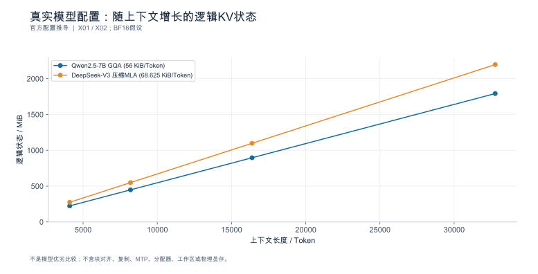
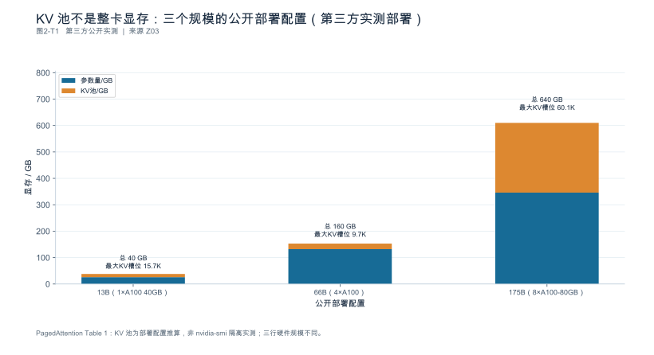
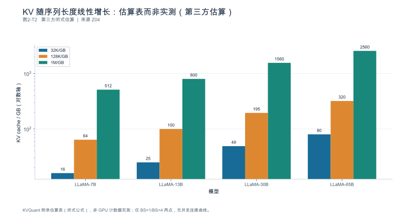

<a id="ch-02"></a>
## 第2章 Prefill、Decode 与模型执行

**版本：v0.10 公开来源补齐版（2026-10-05）。保留 v0.5 正文与 v0.6／v0.7／v0.8／v0.9 各轮增补节；新增 x.11 口径核对节，逐条落到可定位版本的公开来源上。全书内容为公开资料整理与工程推理；引用公开数据处均标注可定位的来源。**

> **来源约定：**计算核验范围以[测试清单](book_support_v05/data/e0_test_results.md)为准；N系列是[本轮来源记录](book_support_v05/references.md)，R/S及DOC别名保留原稿来源身份。各轮新增图均为可重绘资产。

**核心论点：**模型结构决定需要做哪些工作，负载与实现决定这些工作怎样消耗资源；**不能把阶段名称直接当成瓶颈结论**。

**开篇场景：**同一模型处理长文档和生成长答案，耗时结构可能不同。本章先解释工作量如何形成，再为后面的测试设计建立变量。

**本章产出：**模型执行图、关键张量形状表、输入输出工作量分解、以及一份**分项状态账本**。

**边界与衔接：**讲到足以解释性能的模型机制为止；不扩展为训练、微调或模型架构百科。资源模型（Roofline、带宽下界）在第3章，状态的管理与复用在第4章，阶段分离的架构在第12章。

### 本章导航

读完本章，你应该能够：说清"生成一个 Token"需要经过哪些步骤，以及推测解码如何改变"每轮一个 Token"的基线；分别估算 Prefill 与 Decode 的工作量与访存量；用模型配置算出每个 Token 的状态字节数，并知道常规公式何时失效；区分 MoE 的总参数、激活参数与驻留权重；把推理内容、可见答案、媒体输入、结构化约束与外部工具等待分别计量。

**单位约定：**状态容量用二进制单位（KiB/MiB/GiB），带宽与算力用十进制（GB/s、TFLOP/s）。两者混写是本书明文禁止的做法（写作规范 §6）。

---

<a id="sec-02-01"></a>
### 2.1 自回归生成与一次解码迭代

**本节要回答的问题：**生成一个新 Token 需要哪些已有信息？

#### 2.1.1 条件概率与前向计算

自回归模型在每一步做的是同一件事：给定已有上下文 $x_{1:t}$，计算下一个 Token 的条件分布 $P(x_{t+1}\mid x_{1:t})$，再从中取出一个。计算过程是一次**前向**：

1. 输入 Token 经嵌入层得到形状为 $[B,\,S,\,d_{\text{model}}]$ 的张量（$B$ 批大小、$S$ 序列长度、$d_{\text{model}}$ 隐藏维度）；
2. 依次通过 $L$ 层，每层做注意力与前馈计算，输出同形张量；
3. 最后一层经输出投影得到 logits，形状为 $[B,\,S,\,V]$（$V$ 为词表大小）；
4. 取最后一个位置的 logits 做采样。

在未命中前缀、未分块的普通 Prefill 示意中，$S$ 等于输入长度；分块时 $S$ 是本轮实际处理的位置数。普通 Decode 每个序列通常输入一个待消费 Token；推测验证可以一次处理多个位置，不能再说每次前向只推进一个位置。这就是两阶段工作量差异的根源：**同样的权重，处理的 Token 数量差了几个数量级。**

#### 2.1.2 采样与停止

logits 经温度、top-p/top-k 等处理得到采样分布，抽出一个 Token id，再判定是否停止（EOS、停止串、`max_tokens`、结构化约束完成）。采样与停止判定不是免费的：构建候选集合、排序、掩码计算都要时间，批很大或词表很大时它们是可观的每步开销。

#### 2.1.3 计算图与生成循环

生成循环与模型层内部计算要分开描述。伪代码如下（不冒充任何框架源码）：

```text
# 伪代码；不是具体引擎 API。
# 不变量：cache 只包含已经经过目标模型前向的位置。
cache, logits = prefill(prompt_tokens)
pending = sample(logits_at_last_prompt_position(logits))
outputs = [pending]                 # 刚采样的 Token 尚未写入目标 KV
while not should_stop(outputs):
    cache, logits = forward_and_commit(cache, pending)
    # 上一步把 pending 的 K/V 写入 cache；不是把下一个 Token 的状态提前写入。
    pending = sample(logits)
    outputs.append(pending)

# 推测解码的接口层示意：实现还要处理验证失败与截断。
# target_cache 保留已消费的位置，pending 是最近采样但尚未消费的位置。
drafts = propose_drafts(pending, k)
provisional_cache, distributions = verify_target(target_cache, [pending] + drafts)
accepted_prefix, correction_or_bonus = exact_accept_reject(distributions, drafts)
target_cache = keep_consumed_prefix(provisional_cache, pending, accepted_prefix)
outputs.extend(accepted_prefix)
outputs.append(correction_or_bonus)  # correction/bonus 暂为新的 pending
pending = correction_or_bonus
# 若停止符落在 accepted_prefix 内，应先截断并同步裁剪状态与输出。
```

首个采样结果就触发停止时，不再无条件执行一步 Decode。推测分支里，“提交了哪些 KV 位置”和“对外接受了哪些 Token”仍是两笔账：校正 Token 通常尚未经过目标模型前向。

**"每轮只产生一个 Token"只适用于普通自回归基线。**开启推测解码后，一次前向可能验证多个候选，因此必须区分三个量：**前向次数**、**解码迭代次数**、**最终接受的 Token 数**。把"迭代次数"当成"输出 Token 数"会让所有吞吐指标失真（第7章 7.3.2 已规定：被拒的候选不进产出分子）。

推测解码必须区分**两个不同的计数**：

$$
\mathbb{E}[\text{接受的草稿数}] = \sum_{i=1}^{k}\alpha^{i}
\qquad
\mathbb{E}[\text{本轮推进量}] = \sum_{i=0}^{k}\alpha^{i}
$$

后者包含被拒后的**校正 Token**（或全部接受时的额外 Token），因此比前者多 1 个量级为 1 的项。可算例：$k=4$、$\alpha=0.7$ 时两者分别为 **1.7731** 与 **2.7731**——**不能把它们都叫"接受草稿数"。**

若**整轮**相对成本（含提出草稿、目标验证、校正与相关开销）为普通一步的 $c=1.3$ 倍，则每 Token 相对成本为 $1.3/2.7731 = 0.469$，理论加速约 **2.13 倍**。注意这里的 $c$ 必须是整轮成本：**只给目标验证的成本不足以推出整个系统的加速比**；接受率随负载、批大小与模型而变，不是常数；被拒的 Token 消耗资源但不产出内容。

**本节要点**

- 前向次数 ≠ 解码迭代次数 ≠ 接受的 Token 数，三者必须分开计数。
- Prefill 逻辑上处理输入中未复用的位置，可分成多次前向；普通 Decode 与推测验证的输入长度和推进量分别计数。
- 采样与停止判定有成本，批大或词表大时不可忽略。
- 推测解码的理想加速 = 期望总推进量 ÷ 整轮相对成本，且依赖接受率这一实测变量。

**常见误区**

- **误：**迭代 300 次就是生成了 300 个 Token。
  **正：**开启候选验证后两者不同；分别计数。
- **误：**推测解码开启就等于快 $k$ 倍。
  **正：**实际倍数由接受率与验证成本决定，可能小于 1（反而变慢）。
- **误：**采样只是选个数字，不花时间。
  **正：**排序、掩码与停止判定在每步都有成本。

**本节验收**

1. 你能区分前向次数、解码迭代次数与最终接受 Token 数。
2. 你能用接受率与相对成本估算推测解码的收益区间。
3. 你能说明被拒绝的候选在吞吐与成本两处分别如何记账。

**依据与核验入口：**[R04] [R27]

---

<a id="sec-02-02"></a>
### 2.2 Prefill：从输入序列构建状态

**本节要回答的问题：**输入长度增加，会增加哪些工作？

#### 2.2.1 批量处理已知输入

Prefill 处理的是**已经给定的上下文**：整段输入可见，因此可以在序列维度与批维度上充分并行。它的实际工作量取决于两件事：**实际需要计算的 Token 数**（若命中前缀缓存，未复用的部分才是真正要算的）与**批内有效 Token 的编排方式**（引擎可能把长输入切成块与解码请求组批，第1章 1.2.2、第5章）。

#### 2.2.2 注意力与线性层工作量

Prefill 的计算量大致分两块：

- **线性层**：$\text{FLOPs}_{\text{lin}} \approx 2\,P\,T$，其中 $P$ 为参与计算的参数量，$T$ 为实际计算的 Token 数；
- **注意力**：$\text{FLOPs}_{\text{attn}} \approx 4\,L\,S^{2}\,d_{\text{model}}$（含 $QK^{\top}$ 与 $AV$ 两次矩阵乘）。

可算例：取 $L=32$、$d_{\text{model}}=4096$、稠密 $P=7\times10^{9}$、$S=T=4096$：

$$
\text{FLOPs}_{\text{attn}} = 4\times32\times4096^{2}\times4096 \approx 8.8\ \text{TFLOP}
\qquad
\text{FLOPs}_{\text{lin}} = 2\times7\times10^{9}\times4096 \approx 57.3\ \text{TFLOP}
$$

**先说清口径**：15.3% 是"注意力 ÷ 线性项"；若按"注意力 ÷ 两项总和"计，则为 **13.30%**。两个口径都合法，但必须声明。

| 输入 $S$ | 线性项 TFLOP | 注意力项 TFLOP | 注意力 / 两项总和 |
|---:|---:|---:|---:|
| 4096 | 57.34 | 8.80 | **13.30%** |
| 16384 | 229.38 | 140.74 | **38.03%** |

长度翻 4 倍后注意力占比从 13.30% 升到 38.03%，**但它仍未超过线性项**——所以不能不加定义地写"注意力成为主要项"。按这个简化公式，两项相等的长度为

$$S^{\ast} = \frac{2P}{4Ld_{\text{model}}} = \frac{2\times7\times10^{9}}{4\times32\times4096} \approx \mathbf{26703} \ \text{Token}$$

这是**代数阈值**，来自简化公式，不是硬件上瓶颈真正切换的实测点。

还要说明 $4LS^{2}d$ 的形式：它按**完整方阵**计数。因果语言模型只需下三角（约为一半），实现是否真正跳过被掩码的部分取决于内核与布局；因此"理论有效计算量"与"实际执行计算量"要分开记账。上表是内部一致性复算，不构成对该公式全部适用范围的认证。

**补充推导：命中前缀之后究竟省掉什么。** 设已有 $H$ 个前缀 Token 的状态可完全复用，本次新增 $U$ 个 Token，采用标准全因果注意力，暂不考虑稀疏、滑窗、共享层与重算。新增的第 $i$ 个 query 仍需关联它之前的 $H+i$ 个位置，因此新增的有效 query-key 对数为

$$N_{\text{pairs}} = \sum_{i=1}^{U}(H+i) = UH + \frac{U(U+1)}{2}$$

在每个 query-key 对的 $QK^{\top}$ 与 $AV$ 合计约 $4d_{\text{model}}$ 次运算、共 $L$ 层的模型下，注意力部分的有用计算量约为 $4Ld_{\text{model}}\,[\,UH + U(U+1)/2\,]$。

算例：$H=4096$、$U=128$：

| 情形 | 有效 query-key 对数 | 相对 |
|---|---:|---:|
| 独立 128 Token 请求（$H=0$） | $128\times129/2 = 8{,}256$ | 1.0× |
| 复用 4096 前缀 + 新增 128 | $128\times4096 + 8{,}256 = 532{,}544$ | **64.5×** |
| 不复用，4224 全部重算 | $4224\times4225/2 = 8{,}923{,}200$ | 1080.9× |

两个结论：**复用长前缀后新增128个Token，与独立128个Token请求的注意力工作量不同**（本例有效query-key对数相差约64.5倍，不代表全请求耗时同倍）；命中前缀相对全部重算省下约 94% 的注意力对数，但**这是注意力部分**，投影/前馈的线性项仍随实际处理的 Token 数走，所以不能把"命中率"直接换算成端到端提速。实际内核的块形状、数据读取、padding 与调度另需取证。

#### 2.2.3 首输出与状态建立

Prefill 的产出是两样东西：第一个输出 Token 的 logits，以及后续生成所需的每层状态。因此它的结束位置与"首 Token 时间"高度相关，但**不能把端到端 TTFT 全部算成 Prefill 计算**——其中还包含排队、网络与网关缓冲（第1章 1.2.3、第7章 7.2.2）。

状态规模是第4章的主角，这里只给出后续会反复引用的基本式。对常规注意力（MHA/GQA/MQA），每个 Token、每层需要存 K 与 V 两份：

$$
b_{\text{token}} = 2 \cdot h_{kv} \cdot d_{\text{head}} \cdot L \cdot b_{\text{dtype}} \quad [\text{byte/token}]
$$

取 $h_{kv}=8$、$d_{\text{head}}=128$、$L=32$、$b_{\text{dtype}}=2$（BF16）：

$$
b_{\text{token}} = 2\times8\times128\times32\times2 = 131072\ \text{B} = \mathbf{128\ KiB/token}
$$

一条 4096 Token 的序列即 $128\ \text{KiB}\times4096 = \mathbf{512\ MiB}$。这个数字后面会一直用到。

**本节要点**

- Prefill 处理已给定上下文，可充分并行；实际工作量取决于未复用 Token 数与批内编排。
- 在本节全注意力简化模型中，线性项随 $S$ 增长、注意力项随 $S^2$ 增长；是否占主导还取决于结构、长度区间和执行内核。
- 首 Token 时间与 Prefill 强相关，但 TTFT 不等于 Prefill 计算时间。
- 常规 KV 公式给出 128 KiB/token、4096 序列 512 MiB 的量级参照。

**常见误区**

- **误：**输入 4096 Token，Prefill 时间就是"每 Token 耗时 × 4096"。
  **正：**注意力项是平方增长，且排队与网络不属于 Prefill。
- **误：**命中了前缀缓存，输入长度还是按全部计入。
  **正：**实际计算的是未复用部分；两者都要记录。
- **误：**KV 公式对所有模型都成立。
  **正：**压缩/共享/递归结构必须换公式（见 2.4）。

**本节验收**

1. 你能解释"输入更长"与"实际需要重算的输入更多"的区别。
2. 你能算出本例在 4096 与 16384 两种长度下注意力项的占比变化。
3. 你能给出本模型每个 Token 的状态字节数，并说明公式成立的前提。

**依据与核验入口：**[R03] [R04] [R07]

---

<a id="sec-02-03"></a>
### 2.3 Decode：逐步生成与状态访问

**本节要回答的问题：**为什么并发、上下文和输出长度都影响生成表现？

#### 2.3.1 单步权重与状态访问

Decode 每一步要读三样东西：**权重**、**已有状态**、以及上一步的输出 Token。以 7B 稠密 BF16 模型为例，单步访存为

$$
M_{\text{weights}} = P \cdot b_{\text{dtype}} = 7\times10^{9}\times2 = 14\ \text{GB}
$$
$$
M_{\text{state,seq}} = b_{\text{token}} \cdot S = 128\ \text{KiB}\times4096 = 512\ \text{MiB} \approx 0.5369\ \text{GB}
$$

注意第二项随**上下文长度**增长，第一项与上下文无关但与模型大小成正比。批大小为 $B$ 时，**在"权重一次读入后在同一批内被复用"的理想近似下**，权重访存被摊薄，状态按序列累加：

$$
M_{\text{step}} \approx M_{\text{weights}} + B \cdot M_{\text{state,seq}}
$$

取 $B=8$：$M_{\text{step}} \approx 14 + 8\times0.5369 = \mathbf{18.29\ GB}$ [DERIVED]。若设备带宽为 $2.0\ \text{TB/s}=2000\ \text{GB/s}$，则单步下界

$$
t_{\text{step}} \approx \frac{18.29}{2000} = 9.15\ \text{ms}
$$

对应单序列约 $109\ \text{token/s}$、整批 $8/0.00915 \approx 874\ \text{token/s}$。**这是理想流量下界**：它假设权重与状态各读一次、无额外拷贝，并假设计入的权重与状态必须从该层存储读入。实际 DRAM 流量可因临时缓冲、重复加载而增加，也可因片上缓存命中而低于“全部从 HBM 读取”的估算，因此"理想流量 / 带宽"只在该流量假设成立时给出时间下界，不能当作预测值；两者的差额本身就是诊断对象（第9章）。**这是带宽下界的粗略估算，不是实测值**：它忽略了内核效率、缓存命中、通信与调度开销（第3章给出完整模型）。

#### 2.3.2 活跃序列与批次复用

上式已经说明了批处理的价值：权重访存被 $B$ 个序列摊薄。算术强度（FLOP/byte）随 $B$ 上升——$B=1$ 时约 $14\ \text{GFLOP}/14.54\ \text{GB}\approx0.96$，$B=8$ 时约 $112\ \text{GFLOP}/18.29\ \text{GB}\approx6.12$ [DERIVED]。这就是为什么**批大小是 Decode 阶段最关键的变量之一**（调度策略见第5章）。

但批大小受制于显存：每个活跃序列都要驻留自己的状态，$B$ 与 $S$ 的乘积决定容量上限（第4章）。

#### 2.3.3 长输出的累计成本

Decode 的成本是**逐步累加**的，且随输出变长而恶化：状态随已生成 Token 增长，每步都要读更多数据。因此长输出的边际成本递增，这与 Prefill 一次性付清的形态完全不同。

所以"Decode 永远是显存带宽瓶颈"这句话只能当作**起点假设**：随并发、上下文、并行策略与模型结构变化，瓶颈可能迁移——大批长上下文时可能是容量不足导致抢占与重算（第4、5章），多卡时可能变成通信（第6章），小批短上下文时可能是内核启动与调度开销占主导。**正确的做法是给出工作量分解，并写成至少两种可区分的假设**，再用第9章的观测去判别。

**本节要点**

- 单步访存 = 权重（与模型大小成正比）+ 状态（随上下文与并发增长）。
- 批处理摊薄权重访存、提高算术强度，但受显存容量约束。
- 全注意力下，随上下文增长的状态访问项会累积；总耗时是否明显超线性仍取决于权重项、缓存、调度以及是否为滑窗或递归结构。
- "Decode 一定是带宽瓶颈"是待验证假设，不是结论。

**常见误区**

- **误：**Decode 慢就一定是显存带宽不够。
  **正：**还可能是容量不足、通信、调度开销或内核效率；要写竞争假设并测量。
- **误：**批大小越大越好。
  **正：**受显存容量与尾延迟约束；过大可能引发抢占与重算。
- **误：**输出长度翻倍，耗时也翻倍。
  **正：**不能无条件按倍数推断；全注意力状态访问含增长项，权重主导或有界窗口时可以接近线性。

**本节验收**

1. 你能为同一模型写出至少两种不同的 Decode 瓶颈假设。
2. 你能说明区分这两种假设需要哪些测量（并指向第9章的哪一类证据）。
3. 你能估算本模型在给定批大小与上下文下的单步访存量。

**依据与核验入口：**[R04] [R22] [R30]

---
<a id="sec-02-04"></a>
### 2.4 注意力与状态结构：全量、压缩、稀疏与混合

**本节要回答的问题：**模型结构如何改变状态的种类、增长方式和实际缓存布局？

#### 2.4.1 MHA、GQA、MQA 与常规 K/V 账本

查询头数 $h$ 与键值头数 $h_{kv}$ 的关系决定状态的份数：

| 结构 | 关系 | 每 Token 字节（同参数下） | 相对倍率 |
|---|---|---|---|
| MHA | $h_{kv}=h$ | $2\cdot h\cdot d_{\text{head}}\cdot L\cdot b$ | 最大 |
| GQA | $h_{kv}<h$ | $2\cdot h_{kv}\cdot d_{\text{head}}\cdot L\cdot b$ | 按 $h_{kv}$ 缩放 |
| MQA | $h_{kv}=1$ | $2\cdot d_{\text{head}}\cdot L\cdot b$ | 最小 |

沿用 2.2.3 的参数（$d_{\text{head}}=128$、$L=32$、$b=2$）：GQA（$h_{kv}=8$）为 **128 KiB/token**，MQA（$h_{kv}=1$）为 **16 KiB/token**——相差 **8 倍**，正好是 $h_{kv}$ 之比。这就是为什么 $h_{kv}$ 必须写进实验记录：只看"模型 7B"推不出状态规模。

#### 2.4.2 MLA 与压缩表示：常规公式在这里失效

压缩潜在表示（如 MLA）不存两份 K/V，而是存一个低维潜在向量（外加少量用于位置编码的解耦部分）。**此时不能套用 $2\,h_{kv}\,d_{\text{head}}$ 公式**，必须按其真实维度计算：

$$
b_{\text{token}}^{\text{MLA}} = \left(d_{c} + d_{r}\right)\cdot L \cdot b_{\text{dtype}}
$$

取 $d_c=512$（潜在维度）、$d_r=64$（解耦位置部分）、$L=32$、$b=2$：

$$
b_{\text{token}}^{\text{MLA}} = (512+64)\times32\times2 = 36864\ \text{B} = \mathbf{36\ KiB/token}
$$

与同规模 GQA 的 128 KiB 相比为 $131072/36864 \approx \mathbf{3.56}$ 倍。

但"压缩存储"不等于"执行时也是压缩的"：**后端可能展开、复制或另行缓存**。因此状态预算要分三栏记：**逻辑字节**（按模型设计算）、**后端实际布局**、**实测分配**。三者不一致时，容量规划引用实际执行层，而差异本身要登记为证据缺口。

#### 2.4.3 稀疏索引、压缩主缓存与重算

稀疏注意力减少的是**参与计算的位置**，**不自动等比例减少被保存的状态**。三类机制要分开：

| 机制 | 减少什么 | 不减少什么 | 额外代价 |
|---|---|---|---|
| 稀疏选择 | 参与 Attention 的位置数 | 被保存的主缓存 | 索引器本身也是状态 |
| 压缩主缓存 | 每位置的存储字节 | 计算时可能需要解压 | 解压/重算的计算量 |
| 重算（recompute） | 存储占用 | 计算量 | 用计算换存储 |

判断这类结构对容量的影响，只能靠**逐项账本**，不能靠"它用了稀疏所以显存一定更小"的直觉。

#### 2.4.4 跨层共享、递归状态与混合层

还有一种容易算错的情形：**跨层共享的状态按物理身份只计一次**，不能按层数重复相加。若 $m$ 层共享同一份状态，它在容量账本里是一份，而不是 $m$ 份。

递归类结构（线性注意力、门控增量规则等）的状态大小**与上下文长度无关**（常数级 per layer per sequence），但每层都有一份。混合层布局（部分层用注意力、部分层用递归）必须**逐层记账**：

| 状态类型 | 是否随上下文增长 | 每层份数 | 是否跨层共享 | 何时重算 |
|---|---|---|---|---|
| 注意力主缓存 | 是（每个新 Token 追加） | 1（按 $h_{kv}$ 计） | 可能 | 被抢占或失效时 |
| 稀疏索引状态 | 视实现 | 1 | 可能 | 重算或增量更新 |
| 递归状态 | **否（常数）** | 1 | 可能 | 每步原地更新 |
| 跨层共享对象 | 视实现 | 共享层共用一份 | **是** | 失效时 |
| 临时展开张量 | 否 | 按需 | 否 | 每次前向 |

#### 2.4.5 模型卡、配置与实际后端布局的三重对照

最后要回答一个高频问题：**模型卡写 FP4，而后端记录的是另一种存储格式，该引用哪一层？**

答案是：**容量与带宽预算引用实际执行层**（后端实际分配与访问的格式），因为它是真正占用显存与带宽的量；但**模型卡的设计意图也要登记**，因为它是判断"这个数字为什么是这样"的依据，也是版本变化时复核的抓手。两者不一致时，把差异写进证据缺口，而不是挑一个好看的数字。

作为版本化资料案例：某模型卡描述了压缩/跨层共享结构与模型侧低精度主缓存，某引擎发布说明记录了特定硬件路径上的分块低精度存储 [SOURCE_REGISTERED] [S11] [S02]。**这两项记载用于说明"模型设计"与"后端落实"必须分开看，不能用于推算未经运行的显存或吞吐**（均为页面快照，`runtime_verified=false`）。

**本节要点**

- 常规 KV 公式只在 MHA/GQA/MQA 且无压缩共享时成立；$h_{kv}$ 是必须记录的配置字段。
- 压缩表示按真实潜在维度计算；同规模下与 GQA 可差 3.5 倍以上。
- 稀疏减计算不自动减存储；跨层共享只计一次；递归状态不随上下文增长。
- 三重对照：逻辑字节 / 后端实际布局 / 实测分配；容量引用实际执行层。

**常见误区**

- **误：**用了 MLA，就把 $h_{kv}$ 填进常规公式。
  **正：**公式不适用；按潜在维度算，并核对后端是否展开。
- **误：**稀疏注意力省显存。
  **正：**省的是计算；存储要按账本算，索引器还可能新增占用。
- **误：**跨层共享的状态乘以层数。
  **正：**按物理身份计一次。
- **误：**模型卡写了 FP4，就按 FP4 算显存。
  **正：**以后端实际分配为准，并登记两者差异。

**本节验收**

1. 你能指出常规 KV 公式在何种结构下必须替换。
2. 你能为一份模型配置写出分项状态账本（类型/增长/共享/重算/分配位置）。
3. 你能说明模型设计与后端布局不一致时，容量预算引用哪一层及理由。

**依据与核验入口：**[R04] [R05] [R28] [S11] [S12] [S02]

---

<a id="sec-02-05"></a>
### 2.5 Dense、MoE 与混合状态模型

**本节要回答的问题：**参数总量为什么不能直接代表每步计算与驻留内存？

#### 2.5.1 三张清单：参与计算、占用存储、发生传输

MoE 与 Dense 的根本区别在于：**计算只走被选中的专家，但所有专家都要在内存里。**因此必须用三张清单分别记账，而不是用一个参数量预测全部性能：

| 清单 | Dense | MoE |
|---|---|---|
| **参与计算** | 全部参数 | 每 Token 只有被激活的专家参数 |
| **占用存储** | 全部参数 | **全部专家**（除非显式卸载到主机/存储） |
| **发生传输** | 多卡时为激活、部分和等前向中间量（不含训练梯度） | 被路由 Token 的表示（dispatch/combine）、可能的专家权重搬运 |

可算例：设某 MoE 总参数 $80\times10^{9}$（BF16 下 **160 GB** 驻留），每 Token 从 64 个专家中选 2 个、激活参数 $8\times10^{9}$。则：

- 单步计算量 $=2\times8\times10^{9} = 16\ \text{GFLOP/token}$（按激活参数）；
- 驻留显存 $= 80\times10^{9}\times2 = \mathbf{160\ GB}$（按总参数）；
- 计算量与驻留的差异达到 **10 倍**。

因此"MoE 的激活参数等于 8B，所以可以当 8B 稠密模型用"是错的：**其参数参与的线性计算项按约 8B 计、未卸载权重驻留按约 80B 计；这不等于与 8B Dense 同速。**

#### 2.5.2 专家路由与通信工作量

路由把每个 Token 送到被选中的专家；跨卡部署时，这需要在设备间搬运 Token 表示。通信量的量级为

$$
M_{\text{route}} \approx 2 \cdot B \cdot d_{\text{model}} \cdot b_{\text{dtype}} \cdot k
$$

其中 $k$ 为每 Token 选择的专家数，系数 2 表示去程（dispatch）与回程（combine）。取 $B=8$、$d_{\text{model}}=4096$、$b=2$、$k=2$：

$$
M_{\text{route}} \approx 2\times8\times4096\times2\times2 = 262144\ \text{B} = \mathbf{256\ KiB/步}
$$

**这个数字必须带边界说明**：它是**一层**上的逻辑 payload（$B$ 个 Token、top-2、去回程合计），不是"整模型每步网络量"。要写成后者，还需说明：是否所有专家都跨设备（同设备命中不产生网络流量）、同一 Token 是否被重复发送到多个 rank、是否计元数据与填充、以及是全局批还是单个 rank 的批。单看字节数不大，但这是**每一步**都要发生的同步等待：它的耗时取决于延迟与同步频率，而不是带宽（第6章展开）。此外还有两个工程问题：

- **专家偏斜（skew）**：某些专家被过度选择，导致持有它们的设备成为尾延迟来源；
- **容量因子与丢弃**：超过专家容量的 Token 可能被丢弃或改路由，影响质量。

#### 2.5.3 注意力状态与递归状态并存

混合状态模型可能同时维护注意力缓存与递归状态。两者增长规则不同（前者随上下文线性增长，后者常数），**不能合并成一个"KV 大小"**，也不能用其中一个的经验去推另一个。分层记账见 2.4.4 的表。

#### 2.5.4 混合结构的模型与后端证据

作为资料案例：某模型卡描述了门控增量规则与稀疏注意力的混合结构，且在该快照中明确标注为**实验预览** [SOURCE_REGISTERED] [S12]。使用这类结构时有两条纪律：

1. **预览/实验状态不等于可复现的主实验环境**——主案例应选择版本可冻结、行为可验证的对象（第1章"三层写作结构"）；
2. **激活参数量不等于同参数稠密模型的等价性能**——计算、存储、传输三条账要分别算，路由与通信的实测留到第6章。

**本节要点**

- MoE 要分三张清单：计算按激活参数、存储按总参数、传输按路由量。
- 线性计算项按激活参数、未卸载驻留按总参数——激活参数不能代表驻留内存。
- 路由通信是每步同步，关注延迟与偏斜，不只是字节数。
- 混合状态模型要分层记账；预览模型不作主实验环境。

**常见误区**

- **误：**MoE 激活 8B，显存就按 8B 算。
  **正：**未选中的专家仍需驻留；按总参数算存储。
- **误：**路由传输才 256 KiB，通信可以忽略。
  **正：**它是每步同步，瓶颈常在延迟与偏斜而非带宽。
- **误：**混合结构只需一个"状态大小"数字。
  **正：**注意力与递归状态增长规则不同，分层记账。

**本节验收**

1. 你能分别估计 MoE 的计算量、权重驻留与会话状态。
2. 你能说明路由通信的瓶颈形态（带宽 vs 延迟/同步）。
3. 你能说明预览状态模型在本书中的使用边界。

**依据与核验入口：**[R05] [R28] [R30] [S11] [S12] [S16]

---
<a id="sec-02-06"></a>
### 2.6 推理模型、多模态与结构化生成负载

**本节要回答的问题：**文本之外的输入与输出约束如何进入性能分析？

#### 2.6.1 内部生成与可见答案

推理（思考）型模型会先产生一段内部生成，再输出可见答案。这带来三条计量规则：

1. **三者分开计数**：内部生成 Token、可见答案 Token、以及计费/用量字段可能互不相等；
2. **两个"首次"分开记录**：首内部 Token 与首可见 Token 对应不同体验（第7章 7.2.1 的 TTFT/TTFO）；
3. **观测不到的内部生成记未知**，不得用可见长度反推，也不得填 0。

结构化输出还要额外记录：格式约束类型（JSON Schema / 语法）、**解析成功率**、以及因约束失败而重生成的次数——后者消耗资源但不产出内容，与推测解码被拒的候选属同一类（不进产出分子，进成本分子）。

#### 2.6.2 编码器与媒体输入

多模态负载在文本之外多了三段：媒体读取与解码、预处理（缩放/分块/采样）、编码器执行。这三段通常发生在主机或独立编码器上，应**单独计时**，不要并入文本 Prefill 的时间。

记录字段建议：媒体类型与尺寸、分辨率或时长、分块与采样策略、**编码后产生的 Token 数**、以及编码器耗时。**不要把"图像数量"强行换算成通用文本 Token**——不同模型的投影方式与 Token 数差异很大，换算只能来自该模型的实际编码结果。

#### 2.6.3 结构约束与工具调用

工具调用负载要区分三段时间：模型生成调用信息、编排层等待外部函数、以及结果回填后的续生成。其中**编排层等待属于外部依赖**，不计入模型生成时间（第1章 1.1.3、第8章 8.3.3）。实验里建议用注入的固定延迟代替真实外部调用，以便复现与解释。

多轮分支任务还要同时报告两件事：**模型工作量**（Token 与状态）与**任务完成条件**（必需分支、容错策略、截止时间），后者按 `task_id` 判定（第7章 7.5）。

**本节要点**

- 内部生成、可见答案、用量字段分开计数；不可观测的内部生成记未知。
- 多模态的读取/预处理/编码三段单独计时；媒体 Token 数来自实际编码。
- 工具调用的编排等待不进模型生成时间；实验用注入延迟替代真实外部调用。
- 分支任务同时报告模型工作量与任务完成条件。

**常见误区**

- **误：**可见答案 300 Token，所以生成了 300 Token。
  **正：**内部生成可能数倍于此；分开记录或标记为未知。
- **误：**一张图约等于 N 个文本 Token。
  **正：**取决于模型与预处理；只能实测编码结果。
- **误：**工具调用慢就是模型慢。
  **正：**编排等待是外部依赖，单独计时。

**本节验收**

1. 你能把模型服务时间与外部工具时间分开，并各给一个测量点。
2. 你能为媒体输入列出记录字段与实际编码 Token 数。
3. 你能同时报告格式/任务质量，而不只报速度。

**依据与核验入口：**[R06] [R12] [R18] [R29] [S17] [S18]

---

<a id="sec-02-07"></a>
### 2.7 实验：把请求映射为工作量

**本节要回答的问题：**怎样从配置和 trace 校验工作量估计？

#### 2.7.1 张量尺寸提取

从模型配置文件提取决定工作量的字段：$L$、$d_{\text{model}}$、$h$、$h_{kv}$、$d_{\text{head}}$、$V$、最大位置、精度方案；若为 MoE 则加专家数、每 Token 激活专家数、专家容量因子；若为混合结构则加递归状态维度与层布局。提取结果随实验存档，并**绑定模型 revision**（第1章 1.3.1）。

#### 2.7.2 输入输出分离扫描

两个方向分开扫描，一次只动一个变量：

- **固定输出、扫输入**：固定 `max_tokens` 与实际输出长度，输入按 512 / 2048 / 8192 / 32768 变化，观察首 Token 时间与状态占用；
- **固定输入、扫输出**：固定输入，让输出自然停止，记录实际输出长度分布（**不是设置上限**），观察单步时间与端到端时间。

再叠加并发档位，观察单步时间随批大小的变化，验证 2.3.2 的"权重访存被摊薄"预期。

#### 2.7.3 模型估计与实际执行对照

把估计值（逻辑字节、理论 FLOPs、带宽下界）与实测放同一张表，分栏比较：

| 项 | 逻辑/理论 | 实际执行 | 差异 | 可能的解释 |
|---|---|---|---|---|
| 每 Token 状态字节 | 128 KiB | 待填 | — | 后端展开/压缩/共享 |
| Prefill 计算量 | 57.3 + 8.8 TFLOP | 待填 | — | 内核效率、未复用 Token |
| Decode 单步访存 | 18.29 GB（$B=8$） | 待填 | — | 缓存命中、额外拷贝 |
| 输出长度 | 设置上限 1024 | 实际分布 | — | 提前停止 |

**无法解释的残差本身就是诊断材料**——它指向第9章的观测与第10章的假设检验。实验的目标不是证明"某阶段一定更慢"，而是检验工作量模型能解释哪些变化。

无 GPU 时的支线：只做**模型配置解析**（E0），产出逻辑字节账本与理论工作量，不填写实际分配与实测栏。

**本节要点**

- 配置字段绑定 revision；MoE 与混合结构要额外提取对应字段。
- 输入输出分开扫描，输出长度取实际分布而非设置上限。
- 估计与实际分栏对照；残差是后续诊断的输入。
- 无资源时只做配置解析，不填实测栏。

**常见误区**

- **误：**`max_tokens=1024`，所以输出是 1024 Token。
  **正：**那是上限；必须记录实际停止原因与长度分布。
- **误：**理论 FLOPs 与实测对不上，说明公式错了。
  **正：**残差通常来自内核效率、缓存命中与调度，是诊断线索。

**本节验收**

1. 所有曲线的自变量来自真实 Token 计数，而非设置上限。
2. 你至少交付一份经典结构与一份当代结构的分项状态账本。
3. 未测量的实际分配栏保持空白，不填推算值冒充实测。

**依据与核验入口：**[R04] [R11] [S11] [S12] [S02]

---

### 2.8 深化：从真实模型配置到状态字节，再到注意力执行

#### 2.8.1 模型不能冒充任意同规模模型

参数规模相近的模型可以有不同层数、KV头数和状态结构。官方 Qwen2.5-7B-Instruct 配置给出28层、隐藏维度3584、28个查询头和4个KV头 [N11]。在标准GQA、头维128、BF16、全部28层均保存K/V的假设下，本书由配置推得

$$b_{token}=2\times28\times4\times128\times2=57344\text{ B}=56\text{ KiB}.$$

一条4096 Token序列为224 MiB，而不是贯穿模型的512 MiB。前者来自真实结构字段加上明确的存储假设，后者来自32层、8个KV头的独立设定。它们都可以用于，但不应在不同章节不加说明地替换。这个例子选择较早的模型，是为了提供可核查的结构基线，不是推荐它代表最新性能。

对MLA，直接读取 `num_key_value_heads` 后套常规双份K/V公式可能高估。DeepSeek-V3 配置中的潜在维度512、独立RoPE维度64、61层提供了另一种计算入口 [N12]。若执行后端每层仅缓存一份512维潜在向量和一份64维位置键，二者都用BF16，主体状态为

$$61(512+64)\times2=70272\text{ B}=68.625\text{ KiB/token}.$$

这是**指定压缩缓存布局**下的推导，未计MTP、暂存、索引、对齐和复制；若后端展开成逐头K/V，实际容量和流量就不是这个数。由此得到的工程顺序应当是：配置识别结构，源码或运行元数据识别布局，分配记录确认实际字节。

#### 2.8.2 为什么MLA的存储公式和执行公式可以不同

设第 $j$ 个注意力头的键由潜在状态 $c_t$ 投影而来，$k_{t,j}=W^K_jc_t$。对暂不含位置编码的内积分数，

$$q_j^T k_{t,j}=q_j^TW^K_jc_t=(W_j^{K\,T}q_j)^Tc_t.$$

这说明可以把键投影吸收到查询侧，然后直接与潜在状态做内积，而不必把全部历史键显式展开。若值也为 $v_{t,j}=W^V_jc_t$，则加权和满足 $\sum_t a_tW^V_jc_t=W^V_j\sum_t a_tc_t$，同样允许改变计算次序。

这些等式解释了压缩缓存为什么有实现空间，却不能证明任意位置编码与精度路径都能如此交换。RoPE的作用位置、缩放、混合精度以及分组布局可能要求保留额外状态或选择不同内核。性能判断还要比较“避免的历史展开”与“新增的查询投影、潜在空间计算和布局转换”，不能只把潜在维度除以头数当成加速比。

#### 2.8.3 FlashAttention减少什么，并不减少什么

FlashAttention论文将注意力优化放在分层存储和IO感知计算上 [N13]。用数学推导可以理解它为什么不必把整个 $S\times S$ 分数矩阵长期放到HBM：对一行分数，把当前处理区间的最大值记为 $m$，指数和记为 $\ell$，未归一化的加权值和记为 $o$。新块分数为 $s$、对应值为 $V$，则可以更新

$$m'=\max(m,\max s),$$
$$\ell'=e^{m-m'}\ell+\sum e^{s-m'},$$
$$o'=e^{m-m'}o+\sum e^{s-m'}V.$$

最后输出 $o'/\ell'$。旧块只需保留三个归约状态，不必保存所有历史分数。这是分块后维持同一softmax数学结果的关键；它并不把全注意力的有效query-key对数从平方级改成线性级。有限精度下计算次序改变，仍需按相应数值契约验收。

性能收益因此要分成三个问题：分数矩阵的中间读写减少多少；分块、流水和硬件指令是否适合该形状；引擎本次是否调用该实现。只在第二层展示一个漂亮的微基准，不能省掉第三层的路径取证，也不能证明整个业务请求按相同比例变快。

#### 2.8.4 2026结构变化应写成状态分类，而不是产品名堆砌

本次核对的DeepSeek-V4.1-Flash模型卡描述了CED和跨层共享的CSA2；Qwen3.8-Flash-Next模型卡将Gated DeltaNet与稀疏注意力组合，并标明实验预览属性 [N20][N21]。这些结构说明，经典“每层两份KV、每一步同等工作量”的假设不能无限延用。

更稳健的表达是为每类状态登记三个函数：驻留字节 $M(S)$、每步读取 $Q(S)$、更新计算 $F(S)$。递归状态可能使 $M$ 对长度有界，但中间检查点仍需空间；稀疏访问可能降低 $Q$，却未必等比例降低必须保留的 $M$；共享层可以减少物理份数，却不保证每层都不再访问同一数据。新模型出现时更新这三个函数，比再加一行“某模型支持”更能帮助读者做工程决策。

---

<!-- V06-START -->
<a id="sec-02-09"></a>
### 2.9 实验图表补充：用官方模型配置补齐状态量数据

模型名称只能指向候选制品，状态账本必须落实到结构参数。X01/X02给出了两个可公开复算的配置：Qwen2.5-7B-Instruct采用28层、4个KV头、头维128；DeepSeek-V3压缩MLA按61层、512维潜在KV与64维RoPE状态计算。以下均额外假定缓存以BF16的2字节保存。

Qwen每Token逻辑KV为 $2\times28\times4\times128\times2=57344$ 字节，即56 KiB；DeepSeek-V3为 $61\times(512+64)\times2=70272$ 字节，即68.625 KiB。图中把上下文长度从4096增加到32768，展示相同存储假设下的线性状态增长。

**读图时不要做模型排名。**两者参数规模、注意力结构和执行路径都不同。本章前文128 KiB/Token仍是独立配置；不能把它与56 KiB视为同一模型优化前后。MLA也不能用“KV头数×头维”的普通GQA公式替代。

**实验补录：**同一长度分别记录逻辑字节数、分块后分配字节、每rank分片/复制数、allocated/reserved及设备总占用。图中只预测第一项；MTP状态、写时复制峰值、通信工作区不在此曲线中。

#### 图2-V1 真实模型配置：随上下文增长的逻辑KV状态



**数据身份：**`CONFIG_DERIVED`。**条件：**Qwen:28层/4KV头/头维128；DSV3:61层/(512+64)；全部按2字节存储、单序列、未分片。

| 配置 | Token | KiB/Token | MiB |
|---|---|---|---|
| Qwen2.5-7B GQA | 4096 | 56.0 | 224.0 |
| Qwen2.5-7B GQA | 8192 | 56.0 | 448.0 |
| Qwen2.5-7B GQA | 16384 | 56.0 | 896.0 |
| Qwen2.5-7B GQA | 32768 | 56.0 | 1792.0 |
| DeepSeek-V3 压缩MLA | 4096 | 68.625 | 274.5 |
| DeepSeek-V3 压缩MLA | 8192 | 68.625 | 549.0 |
| DeepSeek-V3 压缩MLA | 16384 | 68.625 | 1098.0 |
| DeepSeek-V3 压缩MLA | 32768 | 68.625 | 2196.0 |

复算公式：`GQA=2*L*h_kv*d_head*b; MLA=L*(d_c+d_r)*b`。

**出处与边界：**[X01](book_support_v06/来源与核验.md#x01)、[X02](book_support_v06/来源与核验.md#x02)；不是模型优劣比较；不含块对齐、复制、MTP、分配器、工作区或物理显存。

[数据与绘图点](book_support_v06/data/ch02_config_kv.json) · [PNG](book_support_v06/figures/ch02_config_kv.png) · [重绘代码](book_support_v06/code/replot.py)

<!-- V06-END -->
<!-- V08-START -->
<a id="sec-02-10"></a>
### 2.10 第三方数据补充（v0.8）：KV 池占多大，长上下文又把内存推到哪

本章 v0.6 用配置推导说明"KV 随并发线性涨"。本轮补两组第三方数据：**公开部署里 KV 池的真实占比**，以及**长上下文把内存推到什么量级**。

**KV 池占多大（PagedAttention/vLLM，SOSP 2023，Table 1；OPT-13B/66B/175B，GCP A2）。**三个部署配置里，KV 池分别为 12 GB、21 GB、264 GB，占总显存的 30%–41%；参数量占 65%–54%。**"KV Cache 是瓶颈"这句话只在特定规模与长度下成立**：13B 单卡部署时，权重仍是最大那一项。这也是为什么"把池内利用率提上去"（分页管理）比"单纯加显存"更先被采用。

**一处必须同时标注的原文矛盾。**该论文正文写 OPT-13B 每 token KV 为 800 KB，但它自己的算式 2×5120×40×2 B ≈ 1.6 MB，相差 2 倍。本书引用该表时**两个数都不单独采信**，只把它当作"每 token KV 在百 KB 到 MB 量级"的佐证。

**长上下文推到哪（KVQuant，arXiv:2401.18079v3，Table 7/8；FP16 KV，batch=1，闭式估算）。**LLaMA-7B 在 32K/128K/1M 上下文下的 KV 估算为 16 GB/64 GB/512 GB。1M 上下文的 512 GB 远超单卡 80 GB——**这张图的价值不在精确值，而在量级：长上下文不是"开个参数"，而是把内存需求推到必须量化或多卡分片的地步。**同文给出 int4 量化后 128K 可降至 16 GB。

**边界：**Table 1 的 KV 池是部署配置推算，非 `nvidia-smi` 隔离实测；KVQuant 原表标题明确是 estimates（闭式公式），且只有 BS=1 与 BS=4 两点，没有随并发的连续曲线。

#### 图2-T1 KV 池不是整卡显存：三个规模的公开部署配置（第三方实测部署）



**数据身份：**`THIRD_PARTY_MEASURED`（第三方公开数据）。**条件：**PagedAttention/vLLM（SOSP 2023）Table 1；OPT-13B/66B/175B；GCP A2 实例；KV 池为部署配置推算（总显存−权重−开销）。

| 模型规模 | 参数量/GB | KV池/GB | 总显存/GB | 最大KV槽位 |
|---|---|---|---|---|
| 13B（1×A100 40GB） | 26 | 12 | 40 | 15.7K |
| 66B（4×A100） | 132 | 21 | 160 | 9.7K |
| 175B（8×A100-80GB） | 346 | 264 | 640 | 60.1K |

**出处与边界：**[Z03](book_support_v08/来源与核验_v08.md#z03)；【原文数值自相矛盾】正文称 OPT-13B 每 token KV 为 800 KB，但其自身算式 2×5120×40×2 B ≈ 1.6 MB，相差 2 倍，引用时须同时标注。KV 池为部署配置推算，非 nvidia-smi 隔离实测。

[数据与绘图点](book_support_v08/data/ch02_tp_kvpool.json) · [PNG](book_support_v08/figures/ch02_tp_kvpool.png) · [重绘代码](book_support_v08/code/replot_v08.py)

#### 图2-T2 KV 随序列长度线性增长：估算表而非实测（第三方估算）



**数据身份：**`THIRD_PARTY_ESTIMATE`（第三方公开数据）。**条件：**KVQuant（arXiv:2401.18079v3，NeurIPS 2024）Table 7/8；FP16 KV，batch size 1；闭式公式估算。

| 模型 | 32K/GB | 128K/GB | 1M/GB |
|---|---|---|---|
| LLaMA-7B | 16 | 64 | 512 |
| LLaMA-13B | 25 | 100 | 800 |
| LLaMA-30B | 49 | 195 | 1560 |
| LLaMA-65B | 80 | 320 | 2560 |

**出处与边界：**[Z04](book_support_v08/来源与核验_v08.md#z04)；【非实测】原表标题明确为 estimates；仅 BS=1 与 BS=4 两点，无随并发的连续曲线；未评测精度。

[数据与绘图点](book_support_v08/data/ch02_tp_kvlen.json) · [PNG](book_support_v08/figures/ch02_tp_kvlen.png) · [重绘代码](book_support_v08/code/replot_v08.py)

<!-- V08-END -->
### 章末检查问题

**1. 相同激活参数的 Dense 与 MoE 为什么不能直接等价比较？**

因为三条账不同：Dense 的计算、存储、传输都由同一组参数决定；MoE 的**计算按激活参数、存储按总参数、传输按路由量**。2.5.1 的算例里，激活 8B 而驻留 160 GB（80B 总参数的 BF16），线性计算项按激活参数、未卸载驻留按总参数，相差 10 倍。此外 MoE 还有每步同步的路由通信与专家偏斜，这些在稠密模型里不存在。因此只能用"参与计算 / 占用存储 / 发生传输"三张清单分别比较，不能用一个参数量换算。

**2. 推测解码中"每轮延迟"和"每 Token 时间"如何区分？**

"每轮延迟"是一次验证迭代的墙钟时间（含提出候选、一次前向、接受判定），"每 Token 时间"是**最终被接受的输出 Token** 分摊到的时间。若每轮最终推进 $m$ 个 Token（含校正或额外 Token）、每轮耗时为普通一步的 $c$ 倍，则每 Token 相对成本为 $c/m$。$m$ 由接受率决定（$k=4,\alpha=0.7$ 时 $m\approx2.77$），而 $c$ 是完整验证轮相对普通一步的实测成本，不预设其固定值。**只看每轮延迟会漏掉接受率，只看接受率会漏掉验证成本**，两者都要报；被拒绝的 Token 不进产出分子但要进成本分子。

**3. 模型卡用 FP4 而后端记录不同存储格式时，状态预算应该引用哪一层？**

引用**实际执行层**——即后端真正分配与访问的格式，因为它决定显存占用与带宽消耗；同时登记模型卡的设计意图与两者差异，作为版本变化时的复核抓手（2.4.5）。资料记载中存在这种不一致：模型卡描述模型侧的低精度主缓存，而引擎发布说明记录特定硬件路径上的另一种分块低精度存储 [SOURCE_REGISTERED] [S11] [S02]。这些是页面快照（`runtime_verified=false`），**可以用来说明"模型设计与后端落实必须分开看"，但不能用来推算未经运行的显存或吞吐**。

---

### 本章验收清单

| 节 | 验收标准 |
|---|---|
| 2.1 | 能区分前向次数、解码迭代次数与最终接受 Token 数；能用接受率与相对成本估算推测解码收益区间 |
| 2.2 | 能分别解释"输入更长"与"实际需要重算的输入更多"；能把线性项与 $S^{2}$ 项分开 |
| 2.3 | 能为同一模型写出至少两种 Decode 瓶颈假设并说明区分它们的测量 |
| 2.4 | 能指出常规 KV 公式何时适用、何时必须替换；模型配置可追溯；共享对象只按物理身份计一次；未知后端布局不靠模型名猜测 |
| 2.5 | 能分别估计计算量、权重驻留与会话状态；不把 MoE 简化为同激活参数 Dense 模型 |
| 2.6 | 能把模型服务时间与外部工具时间分开，并同时报告格式或任务质量 |
| 2.7 | 所有曲线的自变量来自真实 Token 计数；未把设置上限当成实际生成长度；未测量的实际分配栏保持空白 |

---

### 本版配套资料

[新增图表与数据](book_support_v05/figures.md) · [来源登记](book_support_v05/references.md) · [E0测试清单](book_support_v05/data/e0_test_results.md) · [修订记录](book_support_v05/review/changes.md)

[N11]: book_support_v05/references.md#n11
[N12]: book_support_v05/references.md#n12
[N13]: book_support_v05/references.md#n13
[N20]: book_support_v05/references.md#n20
[N21]: book_support_v05/references.md#n21
[R03]: book_support_v05/references.md#r03
[R04]: book_support_v05/references.md#r04
[R05]: book_support_v05/references.md#r05
[R06]: book_support_v05/references.md#r06
[R07]: book_support_v05/references.md#r07
[R11]: book_support_v05/references.md#r11
[R12]: book_support_v05/references.md#r12
[R18]: book_support_v05/references.md#r18
[R22]: book_support_v05/references.md#r22
[R27]: book_support_v05/references.md#r27
[R28]: book_support_v05/references.md#r28
[R29]: book_support_v05/references.md#r29
[R30]: book_support_v05/references.md#r30
[S02]: book_support_v05/references.md#s02
[S11]: book_support_v05/references.md#s11
[S12]: book_support_v05/references.md#s12
[S16]: book_support_v05/references.md#s16
[S17]: book_support_v05/references.md#s17
[S18]: book_support_v05/references.md#s18

<!-- V10-START -->
<a id="sec-02-90"></a>

### 本章口径核对（公开来源）

#### Prefill / Decode 在实现层的对应物

阶段划分是概念层的事，落到实现层则对应到具体的内核族与执行路径。以下条目说明"该版本提供了哪条路径"。

**内核族（FlashInfer 官方 README）**

FlashInfer 把 attention 内核按阶段与缓存形态拆分：**Paged and Ragged KV-Cache**（面向动态批的显存管理）、
**Decode / Prefill / Append** 三种阶段内核、**MLA Attention**（DeepSeek 的多潜在注意力原生支持）、
**Cascade Attention**（面向共享前缀的分层 KV 缓存）、**Sparse Attention**（块稀疏与变长块稀疏）、
以及 **POD-Attention**（融合 prefill 与 decode，用于混合批场景）。后端可在 FlashAttention-2/3、cuDNN、
CUTLASS 与 TensorRT-LLM 之间按硬件与负载自动选择。

**执行路径（vLLM 发布说明）**

vLLM v0.29.0 起 Model Runner V2 成为所有模型的默认执行器，其与阶段执行相关的条目包括：
CUDA graph 显存剖析用于 KV cache 自动定容；批次分片采样把每步 logits 显存降为 `1/TP`；
为推测解码下统一 decode 批引入 padded FULL cudagraph 分发。v0.30.0 进一步给出
**eager 模式下的双批次重叠**，以及微批次步骤的 FULL CUDA graph；并说明冻结 gc 后
图捕获由 12 s 降至 2 s、引擎初始化由 28.9 s 降至 8.2 s（H200 上）。

SGLang 侧的对应条目包括：按预热测量结果确定 CUDA graph 池大小、在完整 prefill CUDA graph 之间
复用输出存储、以及启用 prefill 阶段的 cuda-graph 捕获。

**边界**

- 上述均为各版本发布说明中的特性条目，说明"该版本已提供该路径"，**不构成** prefill / decode
  阶段划分本身定义的改变——阶段划分仍由自回归生成的依赖关系决定，不由执行器的实现方式决定。
- 同一份发布说明中的数字（如 12 s→2 s）对应特定模型与特定硬件，不能外推到其它配置。
- 内核族的存在不等于引擎已启用：引擎是否走某条内核路径，取决于其版本、后端选择与配置。
<!-- V10-END -->
