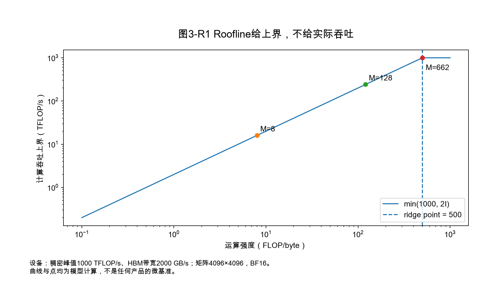
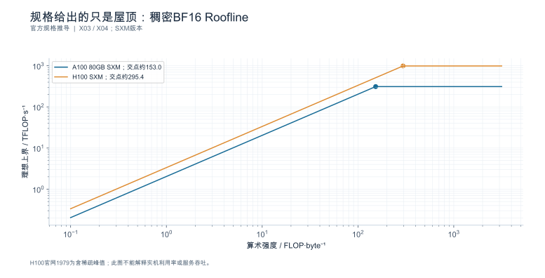
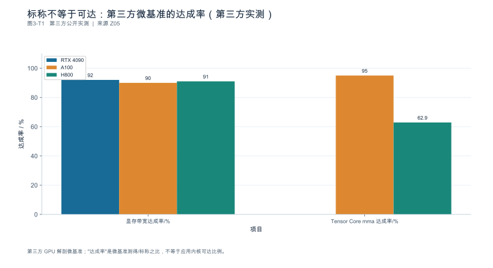
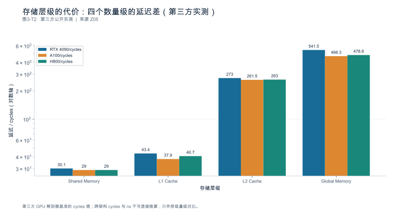

## 第3章 计算、显存、带宽与通信模型

**核心论点：**性能模型用于给出**有条件的边界与可检验预测**，不是把理论峰值包装成业务吞吐。

### 本章使用的设备参数

为避免"峰值算术"脱离单位，全章统一使用一组**显式声明的参数**（非任何具体产品）：

| 参数 | 取值 | 说明 |
|---|---:|---|
| 稠密 BF16 峰值算力 $F_{\text{peak}}$ | $1.0\times10^{15}$ FLOP/s（1000 TFLOP/s） | 仅用于单位换算演示 |
| 设备带宽 $B_{\text{peak}}$ | $2.0\times10^{12}$ B/s（2000 GB/s） | 十进制单位 |
| 由此得到的 ridge point | $F_{\text{peak}}/B_{\text{peak}} = \mathbf{500}$ FLOP/byte | 计算受限与访存受限的分界 |

ridge point 是两条理想吞吐上界的交点。强度低于 500 FLOP/byte 时，**带宽屋顶更低**；高于它时，计算屋顶更低。这只是在给定计量层级和流量假设下判断哪个上界更紧，不能排除启动、依赖、通信或低占用率把实际性能压在两条屋顶之下。真实设备须按有效精度与实际资源重新建模。

---

### 3.1 资源清单：单卡、服务器、互联域与资源池

**本节要回答的问题：**哪些资源数字真正属于这次部署？

规格书给的是**边界条件**，实际分配到这个实例的手才是当前的账。要记录的不只是加速器：

| 资源 | 必须记录 | 常见遗漏 |
|---|---|---|
| 加速器 | 型号、数量、可见性（是否独占、是否 MIG/虚拟化切分）、驱动与运行时版本 | 共享租户 |
| 主机内存与 CPU | 配额、NUMA 绑定、容器限制、是否超售 | CPU 配额被限但不报错 |
| 存储 | 权重所在介质、读取带宽、是否有本地缓存层 | 冷启动被网络盘拖慢 |
| 网络 | 网卡、到服务端的路径、是否跨机房 | 流式返回被代理缓冲 |
| 互联 | 卡间拓扑（是否同一 scale-up 域）、跨节点链路 | 把机柜带宽当成节点内带宽 |

一个易被忽略的事实：**容器里看到的"可用资源"可能与实际独占性不一致**。显存可能被其它实例共享、CPU 配额可能被限流而不产生错误、网络路径可能经过额外的代理层。因此资源账至少分三列：**额定规格 / 运行观测 / 人工假设**，任何未实测的项都要标为假设。

产品形态与成熟度也要分开登记：公开发布（GA）、维护版、预览（Preview/RC）、路线图与"已可获取"是五种不同状态，**预览与路线图不能作为容量承诺的依据**。以整系统级平台为例，机柜级产品资料会给出卡数、机柜内互联域与跨节点网络的边界，可用来练习"整系统资源账本"，但产品页规格不构成某个时间点的完整产品排行榜。成熟的上一代环境（如 H100 一类）仍可继续作为可重复基线 [SOURCE_REGISTERED] [S21] [S22]。

**依据与核验入口：**[R17] [R21] [R30] [S21] [S22]

---

### 3.2 计算量、数值精度与有效算力

**本节要回答的问题：**FLOPs、FLOP/s 与实际执行工作量如何对应？

#### 3.2.1 计数约定

先统一计数，否则所有比较都无效：**一次乘加（MAC）记为 2 FLOPs**。于是形状为 $[M,K]\times[K,N]$ 的 GEMM：

$$
W = 2MKN \quad [\text{FLOP}]
$$

**稠密与稀疏的峰值不能混用。**某些硬件提供结构化稀疏（如每四个元素保留两个非零的 2:4）的加速路径，其标称峰值可达稠密的 2 倍，但这只在权重满足相应稀疏布局、且内核真正走该路径时成立。**用稀疏峰值解释稠密执行，是最常见的一类"理论对不上实测"**。

#### 3.2.2 四项精度要分开写

"这个模型是 FP8"或"4 bit"这类说法承载不了工程判断，必须分四项：

| 项 | 含义 | 为什么重要 |
|---|---|---|
| 存储精度 | 权重在磁盘/显存中的表示 | 决定驻留与加载量 |
| 激活精度 | 参与矩阵乘的输入表示 | 决定 GEMM 走哪条内核 |
| 累加精度 | 中间累加的数值类型 | 决定长上下文的误差累积 |
| KV/状态精度 | 缓存状态的表示 | 决定状态容量（第2章 2.4） |

**不能从权重文件的扩展名推断全部执行精度**：量化制品可能带缩放因子、可能排除某些层、也可能在加载时被反量化成另一精度参与计算。判断依据是实际内核与配置回显（第1章 1.5.3）。

#### 3.2.3 分块缩放、填充与额外字节

低精度格式大多带**缩放元数据**，因此"标称位宽"不等于"实际位宽"。以分块缩放格式为例（需按所选版本核验块大小）：若每 16 个元素共享一个 8 bit 缩放因子，则

$$
b_{\text{eff}} = 4 + \frac{8}{16} = \mathbf{4.5\ \text{bit/元素}}
$$

元数据占 $0.5/4.5 \approx \mathbf{11.1\%}$。相应地，块越大元数据占比越低，但量化误差通常上升——这是**精度与开销的交换**，不是一个可以只看标称位宽决定的问题 [SOURCE_REGISTERED] [S10]。

还有两类"额外字节"要计入：**填充**（形状对齐带来的浪费）与**临时展开**（某些结构在执行时把压缩表示展开成更大的张量）。第2章 2.4.2 已说明压缩存储与执行布局可能不同，本节只需记住：容量与带宽账要按**执行时的实际张量**算，而不是按磁盘上的字节数算。

#### 3.2.4 有效算力：一步 GEMM 的完整演算

取第2章 Decode 中的一个隐藏层 GEMM：权重 $[K=4096]\times[N=4096]$，本步 $M=8$ 个 Token，BF16（$b=2$）：

$$
W = 2\times8\times4096\times4096 = \mathbf{268{,}435{,}456}\ \text{FLOP} \approx 0.268\ \text{GFLOP}
$$

理想访存（权重 + 输入激活 + 输出，各按 $b=2$ 字节）：

$$
Q \approx 4096\times4096\times2 \;+\; 8\times4096\times2 \;+\; 8\times4096\times2
= 33{,}554{,}432 + 65{,}536 + 65{,}536 = \mathbf{33{,}685{,}504\ \text{B}}
$$

运算强度：

$$
I = \frac{W}{Q} = \frac{268{,}435{,}456}{33{,}685{,}504} \approx \mathbf{7.97\ \text{FLOP/byte}}
$$

（这与"权重主导时 $I\approx 2M/b = M$"的直觉一致：$M=8$ 时约 8。）

对照本章设备的 ridge point $500$ FLOP/byte：$7.97 \ll 500$，**这一步明显在访存受限区**。它的时间下界取两者之大：

$$
T \ge \max\left(\frac{W}{F_{\text{peak}}},\ \frac{Q}{B_{\text{peak}}}\right)
= \max\left(\frac{2.684\times10^{8}}{1.0\times10^{15}},\ \frac{3.369\times10^{7}}{2.0\times10^{12}}\right)
= \max(0.268\ \mu\text{s},\ \mathbf{16.84\ \mu\text{s}})
$$

于是这一步在上述理想流量假设下的**吞吐上界**为

$$
F_{\text{roof}} = \frac{W}{T_{\min}} = \frac{2.684\times10^{8}}{16.84\times10^{-6}} \approx \mathbf{15.9\ \text{TFLOP/s}}
$$

该带宽屋顶对应约 15.9 TFLOP/s，即所设计算峰值的 1.6%，并非已经测得的有效算力。对方阵 $K=N=d$、BF16、计入权重与输入输出激活的模型，有

$$I(M)=\frac{2Md^2}{2d^2+4Md}=\frac{Md}{d+2M}.$$

当 $d=4096$、目标 $I=500$ 时，$M=500\times4096/(4096-1000)\approx661.50$，所以最小整数是 **662**。忽略激活时得到的 $M\approx500$ 只是权重主导近似；接近交点时必须恢复被忽略项。真实计算受限的切换点还受实际带宽、算力、布局与效率约束。

三个必须一并说明的限制：**这是理想下界**（忽略 L2/片上复用、内核效率、排队与同步）；**实际 DRAM 流量必须测量，缓存命中与重复加载可能使其低于或高于本近似**（第2章 2.3.1）；**有效算力必须用与估算相同的计数约定**才能与估算值比较。

**依据与核验入口：**[R21] [R22] [S10] [S09] [S22]

---

### 3.3 Roofline：计算与数据移动的约束

**本节要回答的问题：**什么时候值得优化算术，什么时候应该减少搬运？

#### 3.3.1 运算强度

运算强度定义为**针对某个存储层级**统计的比值：

$$
I = \frac{W\ [\text{FLOP}]}{Q\ [\text{byte}]}
$$

关键在于 $Q$ 统计在哪一层：是设备显存（HBM）、还是片上缓存、还是跨节点网络。**同一个算子在不同层级上强度不同**，从而可能在不同层级分别受限。写作时必须写明层级，否则 Roofline 图无法解释。

#### 3.3.2 两个时间下界取大，两个吞吐上界取小

$$
T \;\ge\; \max\left(\frac{W}{F_{\text{peak}}},\ \frac{Q}{B_{\text{peak}}}\right)
$$

它给出的是**不可逾越的下界**，不是预测值。3.2.4 已演示：访存项（16.84 µs）比计算项（0.268 µs）大两个数量级，因此优化方向是"减少搬运或提高复用"，而不是"让 GEMM 算得更快"。

同理，第2章 Prefill 的注意力项与线性项也可以用同一张图思考：大 $M$（长输入、大批）时强度高、趋近计算受限；Decode 的 $M$ 小、强度低、趋近访存受限。**两阶段落在 Roofline 的不同区域，这是它们优化手段不同的根本原因。**

#### 3.3.3 模型遗漏了什么

Roofline 只覆盖计算与某一层的数据移动，它**不解释**以下开销，报告时必须显式列出：

| 遗漏项 | 表现 |
|---|---|
| 排队与批组成 | 设备忙但单个请求的进展慢 |
| 同步与通信 | 时间线上出现非计算的等待 |
| 内核启动与小形状开销 | 短内核的执行时间远高于字节/带宽估算 |
| 片上复用与缓存命中 | 实际 HBM 流量小于原估算，应重算下界，而不是声称突破正确下界 |
| padding 与对齐 | 实际搬运字节多于理论 |

还有一个常被颠倒的推论：**库的 IO 复杂度更低，不自动保证端到端更快。**算法的数据移动模型、内核库实现、以及引擎实际 dispatch 到哪条路径是三层不同的事；必须先在 trace 中确认调用了哪个实现，再把实际形状与精度放回强度模型 [SOURCE_REGISTERED] [S08] [S09]。同理，一个高利用率百分比不能证明"贴近上界"——3.2.4 的例子里设备很忙，有效算力却只有峰值的 1.6%。

**依据与核验入口：**[R22] [R21] [S08] [S09]

---

### 3.4 显存预算：权重以外还有什么

**本节要回答的问题：**为什么权重能装下不等于服务能稳定运行？

#### 3.4.1 逐项预算

沿用第2章的 7B BF16 模型、4096 上下文、批 8，把账本补齐（需按环境替换）：

| 项 | 计算 | 容量 |
|---|---|---:|
| 权重 | $7\times10^{9}\times2$ | 14.00 GB |
| KV 状态 | $128\ \text{KiB}\times4096\times8 = 4\ \text{GiB}$ | 4.29 GB |
| 工作区与激活缓冲 | 假设 | 1.50 GB |
| 通信缓冲 | 假设 | 0.50 GB |
| 图捕获副本 | 假设 | 0.80 GB |
| **小计** | | **21.09 GB** |
| 分配器碎片与安全余量 10% | | **23.20 GB** |

（$14+4.29+1.5+0.5+0.8 = 21.09$；$\times1.1 = 23.20$ GB。）

在一张 24 GB 设备上余量只剩 **0.80 GB**，运行时很容易触到上限；在 40 GB 设备上则宽松得多。**这张预算表只说明 24 GB 设备余量偏薄，不能推出组合一定装不下**——容量是负载的函数，不是模型尺寸的函数。

#### 3.4.2 初始化峰值与稳态不同

加载期、预热期与稳态期的峰值并不相同：加载时可能同时存在磁盘缓冲、权重暂存与转换中间量；预热时图捕获与形状桶会额外占用；稳态才收敛到可复用水平。因此预算要**分阶段采样**，而不是只报一个数。

某些内存被预留但并非全部活跃使用——因此必须区分三种口径：**allocated**（进程向运行时申请）、**reserved**（运行时缓存未归还设备）、**设备占用**（驱动视角）。用其中一个解释另一个，是容量争议的常见来源。

#### 3.4.3 共享对象与常驻代价

跨层共享或多请求共享的状态按**物理存储身份去重**（第2章 2.4.4），不能按引用次数重复计入。反过来，权重常驻（快速启动一类机制）带来启动收益的同时，也带来**常驻资源代价与失效恢复路径**，收益与代价必须分列登记 [SOURCE_REGISTERED] [S02]。

**依据与核验入口：**[R04] [R28] [R31] [S11] [S02] [S13]

---

### 3.5 主机、互联与通信下界

**本节要回答的问题：**哪些等待不在加速器计算里？

#### 3.5.1 主机供给与 NUMA

主机侧的三类成本常被算进"模型时间"：预处理（分词、模板展开、媒体解码）、批组装与调度、以及输出序列化。此外还有 NUMA 与跨 socket 访存、容器 CPU 配额被限流、以及页错误/换页。判断方法见第9章 9.3：**时间关联 + 干预**，而不是资源占用率。

#### 3.5.2 传输与集合通信

通信的最简模型是"启动开销 + 字节/带宽"：

$$
T_{\text{comm}} \approx \alpha + \frac{M}{B_{\text{link}}}
$$

其中 $\alpha$ 为每次同步的固定开销（µs 级），$M$ 为消息字节，$B_{\text{link}}$ 为该链路的**有效**带宽。取参数 $\alpha=6\ \mu$s、$M=256$ KiB、$B_{\text{link}}=200$ GB/s：

$$
T_{\text{comm}} \approx 6 + \frac{262144}{2.0\times10^{11}}\times10^6 = 6 + 1.31 = \mathbf{7.31\ \mu s}
$$

字节传输只占 1.31 µs，而固定开销占 6 µs——**这说明小消息的通信由延迟主导，不是带宽主导。**于是：

| 单步时间 | 每步 8 次同步的固定启动项占比 | 说明 |
|---:|---:|---|
| 500 µs（小模型/小批） | $48/500 = \mathbf{9.6\%}$ | 同步开销显著 |
| 2000 µs（大批或长输出） | $48/2000 = \mathbf{2.4\%}$ | 被摊薄 |

**这就是"低字节量的频繁同步也可能拖慢单请求"的机制**：频率比字节数更重要。批量增大后占比下降，也解释了为什么同一套并行配置在轻载与满载下的表现不同。

#### 3.5.3 域内、跨域与远程状态

必须区分三类路径，它们的数量级差异很大：

| 路径 | 典型形态 | 记账方式 |
|---|---|---|
| 主机 ↔ 设备 | PCIe/一致性互联上的拷贝 | 记入冷启动与每步输入 |
| 设备 ↔ 设备（域内） | 同一 scale-up 域内的集合通信 | 记入每步同步 |
| 跨节点网络 | 以太网/RDMA | 记入跨节点执行与远程状态访问 |

机柜级产品会给出"机柜内汇总显存"一类的指标，便于理解 scale-up 域的容量边界，但**汇总容量不等于无代价的统一内存**：跨域访问仍然要穿过网络，带宽与延迟相差数量级，并且可能有副本与一致性开销 [SOURCE_REGISTERED] [S21]。通信字节应按上述三条边界分别记账，不能合并成一个"网络流量"。

**依据与核验入口：**[R08] [R17] [R30] [S21] [S14] [S15]

---

### 3.6 端到端组合与局部优化上限

**本节要回答的问题：**一个算子加速后，整体最多能改善多少？

#### 3.6.1 Amdahl 式估算

若某段在基线中占时间比例 $p$，该段被加速 $s$ 倍，且**其余阶段耗时不变、各阶段互斥**，则

$$
T_{\text{new}} = T_{\text{base}}\left[(1-p) + \frac{p}{s}\right]
\qquad
S_{\text{overall}} = \frac{1}{(1-p) + p/s}
$$

算例：

| 占比 $p$ | 局部加速 $s$ | 整体加速比 | 总延迟下降 |
|---:|---:|---:|---:|
| 10% | 2× | 1.0526× | **5%** |
| 40% | 2× | 1.25× | **20%** |
| 5%（另设的实际暴露占比） | 2× | 1.0256× | **2.5%** |

“速度提高 5.26%”与“延迟降低 5%”不是同一个百分比。第三行只演示暴露占比已经由依赖图确定为 5% 的情况，不能把任何“重叠一半”的活动都机械折半。若一个占关键路径 8% 的阶段提速三倍，总延迟下降 $0.08(1-1/3)=5.33\%$，整体加速约 1.0563×。

#### 3.6.2 两个假设必须写在结论里

1. **各阶段互斥**：若存在重叠，被优化的那部分可能根本不在关键路径上（第三行演示了占比减半的后果）。引用第1章的结论时尤其要注意：连续批处理让不同请求的工作在同一调度迭代中被组织，不等于它们的执行时间可以相互覆盖。
2. **其余阶段不变**：这在真实服务里往往不成立。局部变快会改变批组成、显存压力与排队行为；第9章 9.5.4 已说明，开环负载下服务时间下降通常带来端到端改善，而在闭环或自适应到达下收益可能被吸收。

因此这类估算的正确用法是**给出上限与采用门槛**，而不是给出承诺值。最终判断仍然回到端到端对照（第8章）。

**依据与核验入口：**[R17] [R22]

---

### 3.7 实验：从估算到校准

**本节要回答的问题：**偏差是参数错误、模型遗漏，还是测量问题？

#### 3.7.1 先登记预测，再看结果

测试前写下三类预测：**工作量**（FLOPs、访存字节）、**容量**（逐项预算）、**时间区间**（下界与期望区间）。预测必须带上参数来源标签：规格 / 微基准 / 拟合 / 假设。**先登记后跑**是为了避免"看到结果再倒推参数"的拟合幻觉。

#### 3.7.2 残差按来源分类

示例：3.2.4 那一步 GEMM 的理想下界为 16.84 µs，观测为 21.3 µs，残差 **+4.46 µs（+26.5%）**。残差只能归为三类并逐条取证：

| 类别 | 候选原因 | 下一步取证 |
|---|---|---|
| 参数错误 | 实际带宽低于标称、时钟/功耗限制 | 微基准实测带宽与频率 |
| 模型遗漏 | 额外拷贝、L2 未命中、padding、同步 | 计数器与 trace（第9章） |
| 测量问题 | 计时点选错、异步未同步、跨域时钟 | 复测并核对时间域 |

**残差不能通过"调参数"消化掉**：只有能独立验证的参数才允许调整，否则就是把拟合当成校准。

#### 3.7.3 只在覆盖区间内校准

校准点与验证点必须分开：用一部分负载点拟合，用**留出的**负载点检验预测能力。对高负载、不同拓扑、不同并行度外推时必须重新核验——**几个贴合点不能证明模型普适**。

无设备时的可行工作：校验单位与配置、用公开资料登记整系统资源账本、完成显存与工作量预算表；**资料规格不作为校准点**，也不把峰值规格当作容量结论。

**依据与核验入口：**[R22] [R11] [S21] [S22]

---

### 3.8 深化：分层Roofline、逐算子下界与模型失配

#### 3.8.1 先按依赖分段，再合成屋顶

对一个计算阶段，$\max(F/P,Q/B)$ 表示理想情况下计算和搬运可重叠时的下界。对两个严格串行且性质不同的阶段，应先分别求界，再求和：

$$T_{serial}\ge\sum_j\max(F_j/P_j,Q_j/B_j).$$

把全部FLOPs和全部字节先相加，再求一次最大值，得到的仍可能是一个更松的乐观界，却丢掉了瓶颈交替。反例：阶段A的计算下界10 ms、访存下界1 ms，阶段B为1 ms和10 ms。逐段下界合计20 ms，聚合后却只有11 ms。差出的9 ms不是实现低效，而是聚合模型错误地允许两个串行阶段互相覆盖。

同理，HBM、L2、共享内存和跨设备链路不是同一份带宽预算。一个算子可以在HBM层复用良好，却受片上访存或指令发射限制；系统也可能在计算屋顶之下先遇到主机供给限制。只画一张HBM Roofline并不能完成诊断，但它能帮助排除一些不可能的解释。

图中采用本章的设备参数，不对应具体产品。曲线由算术强度公式生成，**不是采样点**。配套CSV同时保存 $M$、FLOPs、字节和屋顶值，便于读者更换参数后重画。

#### 3.8.2 峰值、可持续带宽与工作量效率必须分开

若使用厂商峰值带宽 $B_{peak}$，$Q/B_{peak}$ 是更乐观的界；若使用同种访问模式微基准的持续带宽 $B_{sustained}$，则是校准模型的输入。两者不能混名。对不同访问粒度、读写比例或并发规模，持续带宽也可能不同；拿大块连续拷贝校准不规则分页读取，仍可能留下系统性误差。

计算端同样如此。$2P$ 每Token是一种工作量近似，不是实际发射指令数。稀疏跳过、填充、重算、路由、归一化与输出投影会使真实工作量不同。为了发现差异，应同时记录“有用工作量”和“执行工作量”：前者衡量任务所需，后者解释资源实际消耗。低精度或稀疏硬件峰值只能与其适用的数据路径匹配，不能将稠密工作量除以稀疏峰值来制造更短时间。

#### 3.8.3 用残差定位模型遗漏，不用一个效率系数掩盖一切

可以从 $T=\alpha+F/P_{eff}+Q/B_{eff}$ 这样的校准式开始，但它并不自动描述计算搬运重叠。拟合前需声明这是串行近似、分阶段模型还是经验预测模型，避免把拟合参数再解释成物理峰值。

设预测误差 $e_i=T_i^{obs}-T_i^{pred}$。若残差随小批量增大，可能遗漏了固定启动开销；随上下文增长而增大，可能遗漏了状态读取或稀疏索引；只在特定形状突然跳变，优先检查内核选择、padding或图回退。若用一个“统一效率0.6”把所有误差压平，就失去了这种判别力。

校准还应保留训练形状与留出形状，分别报告误差分布。对留出的大上下文或不同并行布局，模型参数未必可迁移。真正有用的性能模型不是处处给出一个精确数字，而是能说明哪些区间已校准、哪些属于外推，以及一个新观测能推翻哪个假设。

---

<!-- V06-START -->

### 3.9 实验图表补充：用官方规格校准Roofline的量纲

原稿1000 TFLOP/s、2000 GB/s是便于推导的设备，不是某张卡的事实。本节补入NVIDIA官方SXM规格作为量纲锚点：A100 80GB SXM稠密BF16为312 TFLOP/s，HBM带宽2039 GB/s；H100 SXM官网1979 TFLOP/s带有“含稀疏”脚注，按两倍稀疏倍率换算的稠密近似值为989.5 TFLOP/s，HBM带宽3.35 TB/s。

统一十进制单位后，理想Roofline为 $P(I)=\min(F_{peak},B_{peak}I)$。两者交点约153.02与295.37 FLOP/byte。交点是标称资源屋顶的相交位置，不是Prefill/Decode的固定分界，更不是模型到这个长度就会自动切换瓶颈。

**为什么不在图上补“实测点”：**没有同精度、同形状的算子运行记录，就不知道实际访存量、有效带宽、launch开销和同步成本；凭利用率百分比构造点位会把假设伪装成证据。下一次实验应先选3—5个矩阵形状，固定累加精度、布局和预热，记录运行时间及字节口径，再把点叠在屋顶下方。

#### 图3-V1 规格给出的只是屋顶：稠密BF16 Roofline

**数据身份：**`SPEC_DERIVED`。**条件：**A100 312TFLOP/s与2.039TB/s；H100约989.5TFLOP/s与3.35TB/s；十进制单位。

| 设备 | BF16稠密 TFLOP/s | TB/s | 交点 FLOP/byte |
|---|---|---|---|
| A100 80GB SXM | 312 | 2.039 | 153.02 |
| H100 SXM | 989.5 | 3.35 | 295.37 |

复算公式：`roof=min(F_peak,B_peak*I)`。

**出处与边界：**[X03](book_support_v06/来源与核验.md#x03)、[X04](book_support_v06/来源与核验.md#x04)；H100官网1979为含稀疏峰值；此图不能解释实机利用率或服务吞吐。

[数据与绘图点](book_support_v06/data/ch03_spec_roofline.json) · [PNG](book_support_v06/figures/ch03_spec_roofline.png) · [重绘代码](book_support_v06/code/replot.py)

<!-- V06-END -->
<!-- V08-START -->

### 3.10 第三方数据补充（v0.8）：标称峰值的两个折扣：指令路径与访存层级

本章 v0.6 用官方规格算 roofline。本轮补第三方指令级微基准，把"标称峰值"再打两个折扣。

**折扣一：用哪条指令（Hopper 架构剖析，arXiv:2402.13499，Table V/VII/VIII）。**显存带宽普遍能到标称的 90%–92%（RTX 4090 92%、A100 90%、H800 91%），属于"标称可信"的量级。但 Tensor Core 的 `mma` 指令在 Hopper 上平均只到 62.9%，而同卡的 `wgmma` 指令超过 95%。**同一个"峰值算力"数字，换一条指令路径就能差约 1.5 倍。**用标称值画出的 roofline 屋顶，必须再乘一个"用哪条指令"的折扣。

**折扣二：访存层级的代价（同文 Table IV，cycles）。**Shared Memory 约 29–30、L1 约 38–43、L2 约 261–273、Global 约 466–541。从片上到显存，延迟差约 18 倍，其中 Global 比 L2 又高约 2 倍。**这解释了 FlashAttention 这类 IO-aware 算法为什么收益巨大：它没有减少计算，而是把访存从 Global 挪到了片上。**也说明"带宽够不够"和"延迟忍不忍得住"是两个独立问题。

**一处必须披露的硬件身份。**被测的 Hopper 卡是 **H800 PCIe**（NVLink 被削减、350 W 功耗墙），不是 H100 SXM；因此 62.9% 这个数**不能**读作"H100 的 Tensor Core 达成率"。A100 的 95% 原文是"超过 95%"的表述。

**边界：**单 SM/warp 级微基准；两篇论文测量方法不同，跨论文的 cycles 值不完全可比；cycles 与 ns 不可直接换算。

#### 图3-T1 标称不等于可达：第三方微基准的达成率（第三方实测）

**数据身份：**`THIRD_PARTY_MEASURED`（第三方公开数据）。**条件：**Hopper 架构剖析（arXiv:2402.13499v1）Table V/III/VII/VIII；CUDA 12.1/12.2；指令级微基准。

| 项目 | RTX 4090 | A100 | H800 |
|---|---|---|---|
| 显存带宽达成率/% | 92 | 90 | 91 |
| Tensor Core mma 达成率/% | — | 95 | 62.9 |

**出处与边界：**[Z05](book_support_v08/来源与核验_v08.md#z05)；【重要】被测 Hopper 卡是 H800 PCIe（NVLink 削减、350W 功耗墙），不是 H100 SXM；未测 H100 SXM 的 HBM3 3352 GB/s 达成率；A100 的 95% 为"超过 95%"的表述。

[数据与绘图点](book_support_v08/data/ch03_tp_achieved.json) · [PNG](book_support_v08/figures/ch03_tp_achieved.png) · [重绘代码](book_support_v08/code/replot_v08.py)

#### 图3-T2 存储层级的代价：四个数量级的延迟差（第三方实测）

**数据身份：**`THIRD_PARTY_MEASURED`（第三方公开数据）。**条件：**Hopper 架构剖析（arXiv:2402.13499v1）Table IV；另与 Ampere 剖析（arXiv:2208.11174，A100 Global 290 / L2 200 / L1 33 / Shared 23-19）互为交叉参考。

| 层级 | RTX 4090/cycles | A100/cycles | H800/cycles |
|---|---|---|---|
| Shared Memory | 30.1 | 29.0 | 29.0 |
| L1 Cache | 43.4 | 37.9 | 40.7 |
| L2 Cache | 273.0 | 261.5 | 263.0 |
| Global Memory | 541.5 | 466.3 | 478.8 |

**出处与边界：**[Z05](book_support_v08/来源与核验_v08.md#z05)；单 SM/warp 级微基准；两篇论文的测量方法不同（Hopper 用 P-chase 变体），跨论文数值不完全可比。

[数据与绘图点](book_support_v08/data/ch03_tp_latency.json) · [PNG](book_support_v08/figures/ch03_tp_latency.png) · [重绘代码](book_support_v08/code/replot_v08.py)

<!-- V08-END -->
### 章末检查问题

**1. 一个占总时间 10% 的算子提速两倍，串行假设下整体如何变化？**

按 $S=1/[(1-p)+p/s]$：$p=0.10$、$s=2$ 时 $S = 1/0.95 = \mathbf{1.0526}$，即端到端改善约 **5.26%**，而不是 10%。若这 10% 中有一半并不在关键路径上（与其它段重叠），有效占比降到 5%，改善只剩 **2.56%**。所以拿到"内核快 2 倍"这类结论时，第一件事是问它占端到端的多少、且是否互斥。

**2. 权重除以 HBM 带宽何时只能当粗下界？**

$W/B$ 只对"权重必须整体读一遍、且完全无复用"的情形成立。它在以下情况会失真：批量较大时权重被多个 Token 摊薄（按 3.2.4，达到 ridge point 需要约 500 个 Token）；存在片上缓存命中或预取；实际 DRAM 流量高于理想流量（额外拷贝、临时缓冲、未命中）；以及并发排队与同步占据的时间未被计入。**它是下界，不是预测值**，用于判断"这个配置至少不可能快于多少"。

**3. 机柜汇总显存为何不能直接当作无代价统一内存？**

因为"汇总容量"描述的是**可寻址的容量上界**，而不是访问代价。跨出 scale-up 域的访问要穿过网络，带宽与延迟与域内相差数量级，还可能引入副本、一致性与传输开销 [SOURCE_REGISTERED] [S21]。所以正确做法是：把域内带宽/延迟与跨域带宽/延迟分别登记，把远程状态访问单独计时，容量账与传输账分开写。

---

### 本章验收清单

| 节 | 验收标准 |
|---|---|
| 3.1 | 资源账分额定/观测/假设三列；能指出是否独占、拓扑是否确认、哪些参数未验证 |
| 3.2 | 能用同一计数约定复算 FLOPs 与访存字节；四项精度分开登记；能审出稀疏峰值误用与精度不匹配 |
| 3.3 | 能说明数据移动统计在哪一层；能列出模型未包含的开销；不把高利用率当成贴近上界 |
| 3.4 | 容量预测含工作区与余量；分阶段（加载/预热/稳态）采样；区分 allocated/reserved/设备占用 |
| 3.5 | 能按主机—设备、域内、跨节点三条边界分别记账；能解释低字节量高频同步的影响 |
| 3.6 | 局部倍数不直接等同整体倍数；写明互斥与"其余不变"两个假设 |
| 3.7 | 预测先登记；残差按三类归因且只用可验证参数调整；留出验证点，外推区重新核验 |

---

### 本版配套资料

[新增图表与数据](book_support_v05/figures.md) · [来源登记](book_support_v05/references.md) · [E0测试清单](book_support_v05/data/e0_test_results.md) · [修订记录](book_support_v05/review/changes.md)

[R04]: book_support_v05/references.md#r04
[R08]: book_support_v05/references.md#r08
[R11]: book_support_v05/references.md#r11
[R17]: book_support_v05/references.md#r17
[R21]: book_support_v05/references.md#r21
[R22]: book_support_v05/references.md#r22
[R28]: book_support_v05/references.md#r28
[R30]: book_support_v05/references.md#r30
[R31]: book_support_v05/references.md#r31
[S02]: book_support_v05/references.md#s02
[S08]: book_support_v05/references.md#s08
[S09]: book_support_v05/references.md#s09
[S10]: book_support_v05/references.md#s10
[S11]: book_support_v05/references.md#s11
[S13]: book_support_v05/references.md#s13
[S14]: book_support_v05/references.md#s14
[S15]: book_support_v05/references.md#s15
[S21]: book_support_v05/references.md#s21
[S22]: book_support_v05/references.md#s22

<!-- V10-START -->

### 本章口径核对（公开来源）

#### 分块缩放格式的块大小与缩放位宽

低精度格式的"块大小"与"缩放位宽"决定了量化误差的量级，二者必须以厂商原始定义为准。

**NVFP4（NVIDIA 技术博客，2025-06-24）**

| 项 | 取值 |
|---|---|
| 元素格式 | E2M1 —— 1 符号位 + 2 指数位 + 1 尾数位 |
| 可表示值域 | 约 −6 ~ +6（0.0、0.5、1.0、1.5、2、3、4、6 及其负值） |
| 微块大小 | 16 个值 |
| 一级缩放 | 每 16 值微块共享 1 个 FP8（E4M3）缩放因子 |
| 二级缩放 | 每张量 1 个 FP32 标量 |
| 等效位宽 | 约 4.5 bit/值（4 bit 元素 + 每 16 值 1 个 FP8 缩放），另加每张量 1 个 FP32 |

**与 MXFP4 的差异**

| 维度 | MXFP4 | NVFP4 |
|---|---|---|
| 块大小 | 32 值共享 1 个缩放 | 16 值共享 1 个缩放 |
| 缩放类型 | 2 的幂（E8M0 语义） | E4M3（非 2 的幂） |
| 精度风险 | 相对 FP8 存在明显精度下降风险 | 尤其对较大模型，精度下降风险更低 |

E8M0 会把缩放吸附到最近的 2ⁿ，对 amax 可能产生较大量化误差；E4M3 则是求解使整块误差最小的缩放，文中给出的平均 MSE 为 0.08。

**精度与支持面**

以 DeepSeek-R1-0528 为例，从原始 FP8 经后训练量化（PTQ）转到 NVFP4，在七项评测上精度损失不超过 1%；AIME 2024 上反而高 2%。硬件侧由 Blackwell 第五代 Tensor Core 直接处理微缩放分组、动态缩放与 4 bit 矩阵运算。软件侧量化使用 TensorRT Model Optimizer 与 LLM Compressor，部署侧 TensorRT-LLM 与 vLLM 提供早期支持，SGLang 为待支持。

**边界**

- 上述精度数字是厂商在指定模型、指定评测集上的结果，不构成对其它模型或其它任务的保证。
- 该文未使用 `SM100` 这一架构代号，架构对应关系需另据硬件文档确认。
- 文中未给出 FlashInfer 的支持情况。
<!-- V10-END -->
