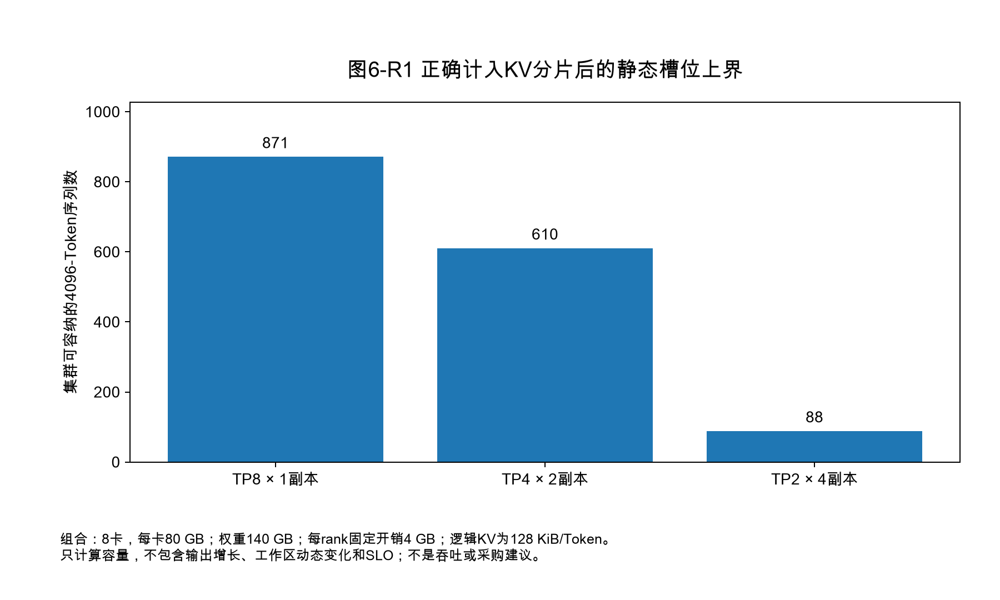
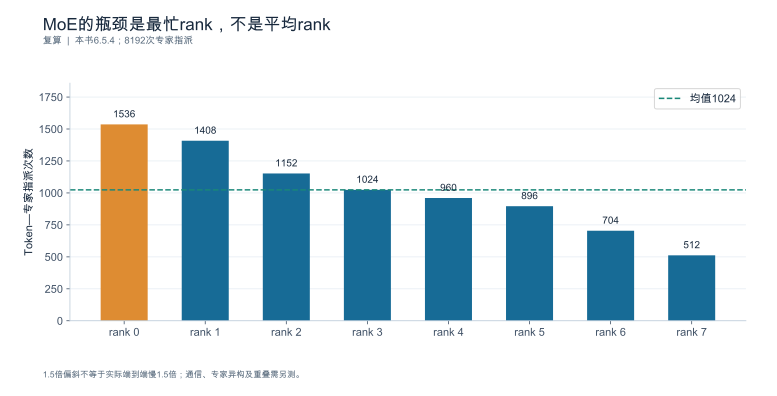
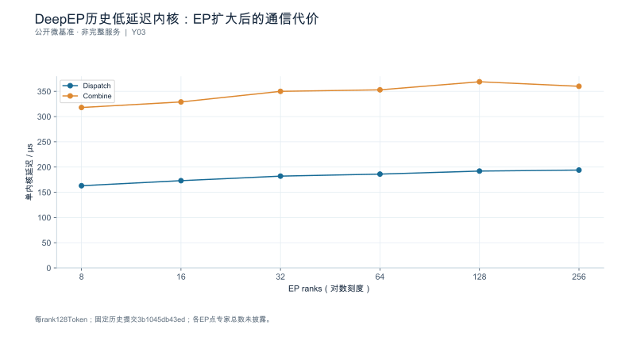
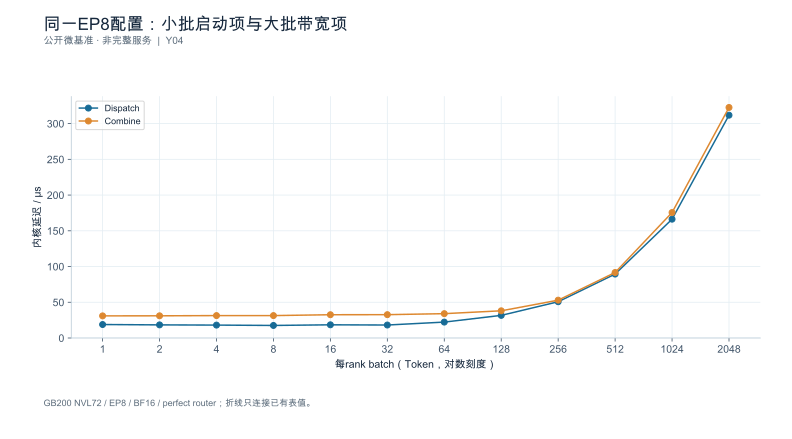
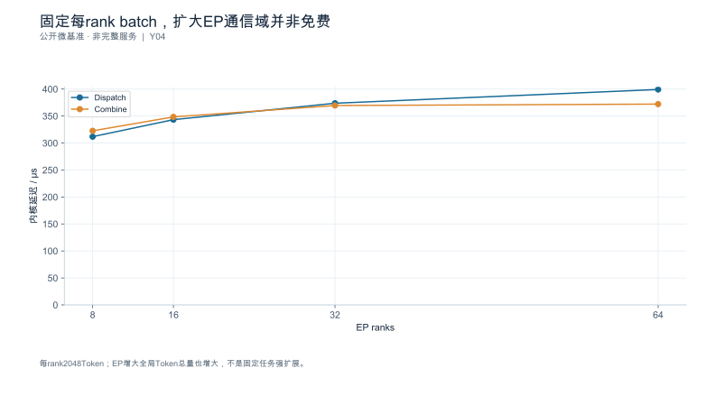

## 第6章 多卡并行、拓扑与 MoE

**核心论点：**多卡策略同时改变**驻留方式、通信位置、执行粒度与副本数**；四种影响必须在同一服务目标下一起比较，任何只看其中一项的结论都可能反向。

---

### 6.1 先区分容量并行与吞吐复制

**本节要回答的问题：**增加设备究竟是在装下模型，还是服务更多请求？

增加卡数只有三个目的，且它们**互相竞争**：

| 目的 | 机制 | 代价 |
|---|---|---|
| **装下模型** | 把权重与状态分片到多卡 | 每 rank 仍要留工作区与状态池；分片引入同步 |
| **缩短单请求** | 把一次前向的计算摊到更多设备 | 同步次数增加；单步工作量变小，固定开销占比上升 |
| **服务更多请求** | 增加副本数 | 每副本都要重复驻留权重，容量被权重吃掉 |

因此**总设备数固定时，扩大并行度必然减少副本数**。这是本节最关键的一句话：不存在"并行度越大越好"这回事，只存在"在当前负载与服务目标下哪一种划分更划算"。

#### 6.1.1 布局候选表：先统一全模型量与每 rank 量

为单独检验分片算术，这里使用**构造数据**：权重总量 140 GB、每卡可用 80 GB、每 rank 固定开销 4 GB、全模型每 Token 的 KV 为 128 KiB，$h_{kv}=8$，总设备数为 8。它把权重量与状态量作为独立输入，**不是某个真实 70B 模型的配置**。真实模型应按第2、4章重新提取层数与头数。

无复制且按头均分时，一条 4096 Token 序列的全模型 KV 为 $K=0.536870912$ GB，每 rank 为 $K/TP$。所以

$$C_{replica}=\left\lfloor\frac{80-140/TP-4}{K/TP}\right\rfloor,\qquad C_{cluster}=\frac{8}{TP}C_{replica}.$$

| 布局 | TP | 副本数 | 权重/rank（GB） | KV 池/rank（GB） | 每序列 KV/rank（GB） | 每副本路数 | 集群路数 |
|---|---:|---:|---:|---:|---:|---:|---:|
| A | 8 | 1 | 17.5 | 58.5 | 0.067108864 | **871** | **871** |
| B | 4 | 2 | 35 | 41 | 0.134217728 | **305** | **610** |
| C | 2 | 4 | 70 | 6 | 0.268435456 | **22** | **88** |

先对每副本取整，再乘副本数，不能让不同副本共享小数路数。上述只是**静态显存上限**，未包含分块浪费、额外图工作区、状态增长及服务目标。

这次修正会改变原表结论：在这些假设下 A 的静态集群状态容量高于 B；B 是否有更高服务吞吐，要由两个副本各自的服务曲线判断，不能由容量表推出。C 可以运行较小并发，不是“模型不可运行”；若项目要求每副本至少 64 路，它仅因不满足该准入门槛而被排除。三种布局的单请求延迟均未知。

头数不足时，某些实现会复制 KV 头。对只采用均匀头切分或均匀复制的简化实现，$h_{local}=\max(h_{kv}/TP,1)$ 只适用于整除关系成立的组合；任意不整除布局应读取实际分配，不能向上取整后假装已经确认实现支持。

**依据与核验入口：**[R30] [R08]

---

### 6.2 Tensor Parallel：分片与同步

**本节要回答的问题：**算子被拆开以后，增加了哪些通信，它们是否落在关键路径上？

#### 6.2.1 切分位置决定通信类型

以线性层 $Y = XW$ 为例，两种切法对应两种集合通信：

| 切法 | 数学形式 | 每 rank 持有 | 需要的通信 |
|---|---|---|---|
| **列切**（按输出维） | $W = [W_1 \; W_2]$，$Y = [XW_1 \; XW_2]$ | 部分输出列 | 下游需要完整输入时需 **all-gather** |
| **行切**（按输入维） | $W = \begin{bmatrix}W_1 \\ W_2\end{bmatrix}$，$Y = X_1W_1 + X_2W_2$ | 部分和 | 需要求和 → **all-reduce** |

经典 Megatron 式布局把两者配对使用：注意力与 MLP 内部先列切、输出投影再行切，于是**每层产生 2 次 all-reduce**；启用序列并行后，原本的 all-reduce 会被拆成 reduce-scatter 与 all-gather，每层变成 **4 次集合通信**。

**这个"2 次还是 4 次"必须按实现取证，不能照抄。**判据是 trace 中的集合通信内核名与调用次数（第9章 9.5），而不是文档里的示意图。

#### 6.2.2 通信账本：Prefill 与 Decode 的主导项完全不同

设 $d_{\text{model}}=4096$、BF16（$2$ B）、TP $=8$、$L=32$ 层、每层 2 次 all-reduce（合计 64 次/步），互联有效带宽取 $200$ GB/s、每次集合通信固定开销取 $6$ µs（均为参数）。按 ring 算法，单次 all-reduce 每 rank 传输量约 $2(N-1)/N \cdot M = 1.75M$：

| 阶段 | 张量形状 | 单次 $M$ | 每 rank 每次 | 64 次合计 | 带宽项 | 延迟项 | **延迟占比** |
|---|---|---:|---:|---:|---:|---:|---:|
| Prefill（$B{=}1,S{=}4096$） | $[1,4096,4096]$ | 32 MiB | 56 MiB | 3584 MiB | 18.79 ms | 0.38 ms | **2.0%** |
| Decode（$B{=}8,S{=}1$） | $[8,1,4096]$ | 64 KiB | 0.109 MiB | 7 MiB | 0.04 ms | 0.38 ms | **91.3%** |

**这是本章最该记住的一张表。**同样的层数、同样的并行度，只因为张量形状不同：

- **Prefill 由带宽主导**（延迟只占 2%）：优化方向是减少通信字节（序列并行、融合、降低精度传输）。
- **Decode 由延迟主导**（延迟占 91%）：每 step 要发起 64 次同步而每次只搬 64 KiB，优化方向包括减少必要的同步轮次、降低主机发起开销和改善拓扑；图捕获主要减少发起开销，并不会自动消除数学上必需的集合通信。

所以"TP 度提高有没有收益"这个问题**在 Prefill 与 Decode 上答案可以相反**，必须分开回答。也正因如此，不能把"all-reduce 微基准的带宽"当作 TP 收益的依据——Decode 侧压根不受带宽限制。

通信是否在关键路径上，要依据实际算子依赖。经典列切与行切配对可以让中间分片直接被下一算子消费，从而**避免某次 all-gather**；避免通信与把仍存在的通信隐藏在计算后面是两种机制。Reduce-scatter 也不是能任意替换 all-gather 的操作，必须满足下游对张量分片和求和结果的语义要求。

#### 6.2.3 小批次与拓扑敏感性

TP 度提高会减小本地 GEMM 的工作量，但**并不保证每次 all-reduce 的逻辑张量变小**；经典行切输出的部分和常仍为完整输出形状，于是固定开销占比上升；同时增加 rank 数会让 ring 的跳数增加、跨域时每跳代价更高。因此存在明显的负载区间与互联条件依赖：

- 批内 Token 数很小时（在线低并发 Decode），提高 TP 度可能**净变差**；
- 长输入 Prefill 时，提高 TP 度通常划算，前提是分片后的状态与通信不跨域；
- 一旦 TP 组跨越节点边界（而非高速互联域内），每次同步都要走慢链路，上面的 200 GB/s 假设直接失效。

**可行结论的形式是区间而不是方向**："在本环境的 X 负载、Y 批形状、Z 互联下，TP 从 4 到 8 的收益是多少"——而不是"TP 越大越好"或"TP 超过 4 就劣化"。

**依据与核验入口：**[R08] [R30] [S02]

---

### 6.3 Pipeline Parallel：阶段与气泡

**本节要回答的问题：**把层分到不同设备上，哪些时间会空转？

#### 6.3.1 阶段切分与传递

流水并行沿**层**切分：把 $L$ 层分成 $p$ 个连续阶段，每阶段驻留在一组设备上，阶段间只传递隐藏状态张量。与 TP 的关键区别：**通信频率低（每微批每阶段边界一次）但消息大**，且通信是点对点而非集合。

它解决的是 TP 解决不了的问题——当模型大到 TP 组也装不下，或 TP 组内同步成本过高时，PP 提供了第二个切分维度。

#### 6.3.2 气泡：为什么在线场景尤其吃亏

流水启动需要填充、结束需要排空，中间形成**气泡**。在经典 GPipe 式稳态模型下，若每阶段耗时相同为 $t$、微批数为 $m$、阶段数为 $p$，则总时长 $(m+p-1)t$，理想时长 $mt$，气泡占比为

$$
\text{bubble} = \frac{p-1}{m+p-1}
$$

| 阶段数 $p$ | 微批数 $m$ | 气泡占比 | 场景 |
|---:|---:|---:|---|
| 4 | 8 | **27.3%** | 中等批量 |
| 4 | 32 | **8.6%** | 离线大批量 |
| 2 | 8 | **11.1%** | 少阶段 |
| 4 | 4 | **42.9%** | **在线低并发** |

**关键推论：同样 $p=4$ 的布局，离线大批量（$m=32$）气泡只有 8.6%，在线低并发（$m=4$）却高达 42.9%。**因此在训练里得到的流水效率结论**不能搬到在线推理**：

1. 训练的微批数由全局批大小决定，可以堆到很大；推理的微批数上限由**在途请求数**决定（第5章），在线低并发时它天然很小；
2. 推理还要处理 Prefill 与 Decode 混合、请求长度参差、随时到达与结束——这些都会破坏"每个微批等长"的假设；
3. 训练可以重跑，推理的一次气泡直接付给用户。

因此 $(m+p-1)t$ 仅用于独立、等长、均衡阶段的理想微批流水；自回归反馈依赖、混合阶段与在线到达需另建模型，并用在线推理实验验证。

#### 6.3.3 阶段平衡与可用性

气泡之外还有**阶段不平衡**：总时长由最慢阶段决定。设 32 层分 4 阶段、每阶段 8 层，但首尾阶段额外承担嵌入与输出投影，假设各阶段耗时 $[10.0,\,9.5,\,9.5,\,11.5]$ ms，则节拍为 $11.5$ ms，阶段利用率

$$
\frac{10.0+9.5+9.5+11.5}{4\times11.5} = \frac{40.5}{46} = \mathbf{88.0\%}
$$

也就是说，即便完全消除气泡，仍有 12% 因不平衡损失。改善办法是**按实测耗时而非按层数切分**。

可用性也必须写明：某阶段异常时，整条流水上的在途微批如何处理、是否需要整流水重启、恢复时间多长，这些属于运维契约，与效率分开记录（第12章展开）。

**依据与核验入口：**[R30]

---

### 6.4 Data Parallel：副本、路由与局部性

**本节要回答的问题：**请求平均分配，是否就能负载均衡？

#### 6.4.1 副本容量与健康

数据并行复制整个模型实例，副本间不需要同步计算。它的代价是**每副本都要完整驻留权重**，因此并行度受 6.1 那张表的约束；它的收益是容量随副本数近似线性增长（前提是路由真的均衡）。

副本级必须分别记录：到达率、在途数、状态占用、达标率与拒绝率。**聚合曲线会掩盖热点**——把空闲副本与拥塞副本平均在一起，得到的是一条看起来健康的曲线和一批实际超时的用户。

#### 6.4.2 请求成本估计：数量均衡 ≠ 工作量均衡

第5章已说明不同请求的成本差异极大。这里给出定量对照：4 个副本各收到 100 个请求（**数量完全均衡**），但生成的输出 Token 分别为

| 副本 | 请求数 | 输出 Token | 相对集群均值 |
|---|---:|---:|---:|
| A | 100 | 300 000 | **2.45×** |
| B | 100 | 80 000 | 0.65× |
| C | 100 | 60 000 | 0.49× |
| D | 100 | 50 000 | 0.41× |
| **合计/均值** | 400 | 490 000 | 122 500 |

按请求数看完全均衡，按 Token 工作量看最忙副本是均值的 **2.45 倍**。结论：**路由决策的输入应当是成本估计（输入长度、预期输出长度、是否命中前缀、状态占用），不是请求计数。**轮询均衡的是计数，有限窗口内可能出现工作量偏斜；不能保证均衡实际成本。

#### 6.4.3 缓存局部性与热点的取舍

缓存亲和路由（把共享前缀的请求送到同一副本）能提高命中率，但会制造热点。这是一次**权衡而非优化**，必须两边都测：

| 指标 | 无亲和 | 有亲和 | 变化 |
|---|---:|---:|---|
| Token 复用率 | 20% | 45% | +25 个百分点 |
| 最热副本在途数 | 3 | 17 | **+14** |
| 该副本 P99 排队等待 | 40 ms | 310 ms | **+270 ms** |
| 单请求省下的 Prefill | — | ≈120 ms | −120 ms |

**省下的 120 ms 小于新增的 270 ms 排队等待，净效应为负。**这个算例的价值在于它说明：命中率上升是局部收益，排队上升是全局代价，两者量纲相同（都是时间）却常常被分别汇报、从不放在一起比。

路由还必须在**队列长度、缓存复用、故障规避**三者间取舍，且要注意一个常见陷阱：**缓存亲和会与副本故障规避冲突**——把某前缀固定到某副本，该副本下线时命中率会骤降。因此要记录失效后的重建时间与命中率恢复曲线。

路由层的能力边界须按固定版本核验，不能假定控制面支持哪些策略 [SOURCE_REGISTERED] [S06] [S07]。

**依据与核验入口：**[R07] [R30] [R25] [S06] [S07]

---

### 6.5 Expert Parallel：dispatch、combine 与专家偏斜

**本节要回答的问题：**专家选择如何转化为跨设备通信与等待？

MoE 的三张清单已在第2章给出（计算按激活参数、存储按总参数、传输按路由量）。本节处理它落到多卡上的后果。

#### 6.5.1 路由分布、专家容量与驻留

设 $E=64$ 专家、分布在 $W=8$ 个 rank（每 rank 8 专家）、全局批 $4096$ Token、top-2 路由 → 共 $8192$ 次"Token—专家"指派。均匀时每 rank $1024$ 次。

#### 6.5.2 dispatch、专家计算与 combine

一次 MoE 迭代拆成四段：

1. **路由**（Router）：计算每个 Token 的专家选择，产生指派表；
2. **dispatch**：按指派把 Token 发到持有目标专家的 rank（all-to-all）；
3. **专家计算**：各 rank 在本地专家上做前馈；
4. **combine**：把结果按原顺序聚合回 Token 所在 rank（第二次 all-to-all），并应用权重。

消息量按第2章的口径（$d=4096$、BF16、top-2）：

| 阶段 | 全局 Token | 一层单向总 payload | 每 rank 发送 | 32 层累计（每 rank） |
|---|---:|---:|---:|---:|
| Prefill | 4096 | 64 MiB | 8.00 MiB | **256 MiB** |
| Decode | 64 | 1 MiB | 0.12 MiB | **4 MiB** |

与 6.2 的表呈现**同一个规律**：Prefill 侧通信量以百 MiB 计（带宽主导），Decode 侧只有几 MiB 却每步都要发生（延迟主导）。所以 MoE 的多卡优化在两阶段上同样是两套思路。

#### 6.5.3 通信—计算依赖与缓冲生命周期

dispatch 与 combine 之间夹着专家计算，形成严格的**依赖链**：combine 必须等所有目标 rank 算完，因此**一次 all-to-all 的等待时间取决于最慢的接收方**，而不是平均值。

缓冲生命周期也是一个常被忽略的成本项：dispatch 的接收缓冲要一直保留到 combine 完成，其大小由**最坏情况**（某 rank 收到的 Token 数）决定，而不是平均情况。因此容量规划必须按上界分配，否则会触发动态扩容或阻塞。

在可用实现上，应以所选提交的接口与依赖说明来解释通信与计算的耦合 [SOURCE_REGISTERED] [S16]；**不要用 all-reduce 微基准代替专家通信的证据**——两者的消息模式、同步结构与缓冲生命周期都不同。

#### 6.5.4 偏斜：容量由最忙 rank 决定

一组用于偏斜分析的指派分布（8 个 rank）：

$$[1536,\;1408,\;1152,\;1024,\;960,\;896,\;704,\;512]$$

和为 $8192$，均值 $1024$，**最忙 rank 为均值的 1.50 倍**。由此：

- 该 rank 成为**节拍**，整步时间由它决定；
- 若按均匀分配估算容量，会高估约 **50%**（$1/1.5 = 66.7\%$ 的实际容量）；
- 平均值（1024）完全看不出这件事——**平均专家负载不能反映最忙设备**。

因此本章的硬要求：**必须有逐 rank（或逐专家）的分布记录，而不是一份全局平均。**没有分布就没有偏斜结论。

偏斜的来源要分开：路由本身的偏斜（某些专家天然更常被选中）、负载内容偏斜（某批请求都集中在同一领域）、以及拓扑偏斜（某些专家刚好跨了慢链路）。三者对策不同，混为一谈会导致"加专家/加设备"无效。

#### 6.5.5 版本化说明与证据边界

关于专家并行的通信实现，公开仓库提供了弹性缓冲等机制以支持通信与计算的重叠 [SOURCE_REGISTERED] [S16]。**这是"某仓库写了什么"层面的证据，不是本项目的实测**；该仓库是浮动来源，正式引用前必须固定 commit 或存档快照。能写的是"该机制意图解决什么依赖"，不能写的是"本环境启用后加速多少"。

**依据与核验入口：**[R05] [R08] [R30] [S16] [S02]

---

### 6.6 Context Parallel、混合并行与互联域

**本节要回答的问题：**长上下文为何需要新的切分维度，以及各维度组合有哪些硬约束？

#### 6.6.1 长上下文切分

上下文并行沿**序列**切分：把长序列分到多个 rank，各自持有自己分片的状态。TP 可以通过头分片降低每 rank KV 容量，但收益会受 KV 头数、复制与内核布局限制；上下文并行提供沿序列切分的另一条容量和工作量扩展路径。代价是注意力需要跨分片访问，产生额外通信；且分片间存在依赖，实现上通常以环形或分块方式传递键值。

它可能带来状态容量扩展和注意力工作量分摊；是否缩短单请求还取决于新增通信——这一点必须与 6.1 的目的分类对应清楚。

#### 6.6.2 五种维度的组合约束

| 维度 | 切的是什么 | 主要通信 | 主要代价 |
|---|---|---|---|
| TP | 张量（头/隐层维） | all-reduce / all-gather | 同步次数多，Decode 延迟主导 |
| PP | 层 | 点对点传递 | 气泡与阶段不平衡 |
| DP | 模型副本 | 无（计算内） | 权重重复驻留 |
| EP | 专家 | all-to-all | 偏斜与缓冲上界 |
| CP | 序列 | 跨分片键值传递 | 依赖链与通信量 |

组合时必须逐维回答"**这一维实际切了什么、产生了什么通信、复制了什么**"。两个典型陷阱：

- TP 与 CP 同时启用时，状态可能被**复制**（第4章的每 rank 占用不等于总量除以设备数）；
- PP 与 EP 组合时，专家组是否跨越阶段边界决定了 all-to-all 是否跨节点。

#### 6.6.3 互联域边界

通信代价高度依赖它发生在**域内**还是**跨域**。机柜级高速互联域（如公开产品页所述的整机柜 NVLink 域 [SOURCE_REGISTERED] [S21]）与跨节点网络的带宽通常差一个数量级，因此：

- **TP 组必须在高速互联域内**（同步次数最多）；
- **PP 的相邻阶段尽量域内**（消息大）；
- **EP 组是否跨域是本布局最重要的单一决策**（all-to-all 消息量大且对延迟敏感）。

产品页的带宽与倍数是**厂商标称**，不是本项目实测，不得作为性能结论的依据 [SOURCE_REGISTERED] [S21]。本环境必须自己测。

#### 6.6.4 交叉支持矩阵

并行维度与**推测解码、图模式、缓存布局**之间存在组合约束，必须为每个模型与后端建立交叉矩阵，并按固定版本的能力表填写 [SOURCE_REGISTERED] [S02]：

| 组合 | 需确认的问题 | 记录方式 |
|---|---|---|
| 并行 × 推测解码 | 草稿验证是否跨越并行边界；接受率是否随并行度变化 | 支持 / 不支持 / 未验证 |
| 并行 × 图模式 | 图捕获是否覆盖集合通信；形状变化后是否重捕获 | 支持 / 回退 / 不支持 |
| 并行 × 缓存布局 | 状态分片后前缀复用是否仍成立；命中是否跨域 | 支持 / 受限 / 不支持 |
| 并行 × 量化 | 通信是否以低精度传输；缩放元数据是否随消息走 | 支持 / 精度受限 |

**发布页记载某组合可用，只证明该版本声明了这条路径，不保证任意组合可用。**未验证的格子必须写"未验证"，不能留空（留空会被读成"应该没问题"），也不能写成"性能差"（那是另一类判断）。混合层结构的状态管理另有专门机制，不适用单一全注意力缓存公式 [SOURCE_REGISTERED] [R28]。不同后端的适配栈与版本依赖需按各自入口核验 [SOURCE_ENTRY_ONLY] [R19]。

**依据与核验入口：**[R28] [R30] [R19] [S02] [S16] [S21]

---

### 6.7 实验：并行扩展不只看加速比

**本节要回答的问题：**怎样在公平边界下比较不同设备数量和布局？

#### 6.7.1 两种公平性，不能混用

| 公平性标准 | 固定什么 | 比较什么 | 回答的问题 |
|---|---|---|---|
| **固定任务**（强扩展） | 同一份负载计划 | 完成时间 / 单请求延迟 | "加卡能让这一个请求快多少" |
| **固定资源总量**（弱扩展） | 设备总数 | 同 SLO 下的合格完成速率 | "这批卡怎么切分能服务最多请求" |

**两种标准不可混用，一次实验只能声明一种。**用固定任务的加速比去论证"应该这样部署"，是最常见的越界。

#### 6.7.2 扩展效率的两个口径

- **强扩展**：同一单请求，4 卡 TP=4 时单步 $18$ ms，8 卡 TP=8 时 $11$ ms → 加速 $18/11 = \mathbf{1.64}$，效率 $1.64/2 = \mathbf{81.8\%}$。
- **弱扩展**：设备与副本等比增加，吞吐 $240 \to 470$ token/s → 加速 $\mathbf{1.96}$，效率 $\mathbf{97.9\%}$。

两者相差 16 个百分点，这正好说明：**弱扩展效率高是因为它没有要求单请求变快**，只是复制了容量。报告扩展效率必须标明是哪一种。

同时必须给出**同 SLO 下的合格完成速率**（第7章三个量纲中的第二个）。只报"吞吐提升 96%"而不报"在 P99 TTFT ≤ 1 s 且质量达标下提升多少"，无法支持部署决策。

#### 6.7.3 没有单卡基线时怎么办

单卡装不下模型时，**不能虚构单卡基线**。正确做法是选**最小可运行布局**作为参照，并明确写出：参照布局是什么、为什么它是最小可行、加速比是相对它而非相对单卡。

证据身份与全书一致：来源快照、配置设计、合成/仿真与公开实测**分别标识**；没有证据支持的地方保持空白，不给倍数。

扩展报告还要附带：每 rank 内存、每 rank 执行与通信时间、副本分布、失败记录与资源数量；MoE 场景另需 per-rank 状态、路由分布、消息尺寸、最慢 rank 与互联域说明。

**依据与核验入口：**[R08] [R30] [S16] [S02]

---

### 6.8 深化：并行度的转折点来自容量、通信和副本收益的竞争

#### 6.8.1 通信模型中的“启动一次”需要定义

对一个 $p$ rank 的ring all-reduce，若 $\alpha$ 表示**每个通信步**的固定延迟、$\beta$ 表示每字节时间，理想串行ring近似可写为

$$T_{AR}\approx2(p-1)\alpha+2\frac{p-1}{p}M\beta.$$

若微基准直接给出一次完整collective的启动截距，则应把它记作 $\alpha_{coll}(p)$，不能又乘 $2(p-1)$。本章前面的6 μs是整次集合通信的截距，已包含在该配置下的固定项；它不是任意规模每跳延迟。

增加TP时，权重矩阵的本地工作量降低，但用于求和的逻辑输出张量可能不变，启动次数也可能基本不变。于是计算收益逐渐被通信下限吞没。在某些布局里消息算法会由ring改为tree或专用互联内核，斜率与截距同时变化，因此不能把一个两卡微基准的拟合参数直接外推到八卡。

#### 6.8.2 先算静态可行，再测服务曲线

第6.1节修正后的871／610／88是独立模型的**显存路数上限**。它不能替代三种布局在同一SLO下的吞吐。设TP度为 $p$ 时每副本合格完成能力为 $g_p(\mathcal W)$，固定总卡数 $G$ 的集群能力才近似为

$$G_p(\mathcal W)=\lfloor G/p\rfloor\,g_p(\mathcal W),$$

而这个乘法还要求路由均衡、公共链路和控制面不先饱和。$g_p$ 是负载画像的函数，不是仅由权重大小决定的常数。并行度提高即使让某条请求更快，也可能因副本数减少而降低总能力；反过来，扩大TP释放足够KV、减少抢占后，单副本吞吐增幅也可能补回副本损失。必须测服务曲线才能判断方向。

#### 6.8.3 MoE要区分本地路由、远程路由与最慢专家

若全局有 $T$ 个Token、每Token选 $k$ 个专家、隐藏维 $d$、每元素 $b$ 字节，则单向逻辑载荷为 $Tkdb$。它包括发给同rank专家的部分，不一定全部经过网络。假设专家在 $p$ 个rank均匀分布且选择均匀独立，远程份额的期望约为 $(p-1)/p$；真实路由有亲和或复制时，这个比例需要实测。Dispatch和combine还应分别记录，不能只算一次就称为整层通信。

总字节也不是完整预测器。每个rank需要等相关输入和专家结果，最忙专家决定一部分节拍；小批时，单专家的Token数量不足以形成高效GEMM；大批时，热点专家又可能占满接收缓冲。优化可以改变专家复制、路由局部性或负载均衡，却会增加权重驻留和一致性管理成本。用“总参数大但激活参数小”概括这些取舍，不足以解释多卡效率。

#### 6.8.4 长上下文并行要同时对账状态和位置

沿序列分片后，每rank持有的是不同位置的状态。注意力必须取得正确的全局位置、掩码及可访问分片，否则即使通信字节正确，也可能算出错误结果。推测验证的多个新位置、滑窗、稀疏索引和跨层共享会进一步改变访问集合。每个CP候选至少应验证数值或任务质量、每rank实际驻留、跨rank载荷、以及缺失或超时分片的失败路径。

训练中的序列并行、Prefill CP、Decode CP和KV分片未必是同一维度。读者在给布局命名时应写清“切谁、在哪个阶段切、谁复制、需要什么归约”，而不只是写一个TP×PP×CP乘法。这种布局描述才能在第14章的跨平台比较中保持可解释。

---

<!-- V06-START -->

### 6.9 实验图表补充：把MoE偏斜从一句话变成rank负载图

本章6.5节设置4096个Token、top-2路由、8个rank，总共8192次Token—专家指派。用原稿负载向量作图后，可直接看到最忙rank为1536，平均1024，偏斜系数1.5。这里只核验指派次数与算术，不声称拿到了真实路由trace。

若每次指派的计算成本一致、同步步骤必须等最慢rank完成，那么用平均1024代替最忙1536，会把可服务能力高估约50%；等价地，最忙约束下的能力为均匀理想值的2/3。这不等于服务时延必然变成1.5倍，因为真实系统还有共享专家、不同内核效率、通信与计算重叠，以及不相等的专家Token分布。

**从示意图升级为实测图：**同一迭代保存每rank指派数、接收字节、dispatch/专家计算/combine时间与开始结束事件。对比均值、最大值和max/mean，并沿依赖链判断最忙rank是否真的位于关键路径。通信微基准正常与模型路由均衡是两种独立证据。

#### 图6-V1 MoE的瓶颈是最忙rank，不是平均rank

**数据身份：**`TEACHING_CALCULATION`。**条件：**4096Token、top-2、8rank；相同单位指派计算成本、无重叠的简化假设。

| rank | 指派数 | 相对均值 |
|---|---|---|
| 0 | 1536 | 1.5 |
| 1 | 1408 | 1.375 |
| 2 | 1152 | 1.125 |
| 3 | 1024 | 1.0 |
| 4 | 960 | 0.938 |
| 5 | 896 | 0.875 |
| 6 | 704 | 0.688 |
| 7 | 512 | 0.5 |

复算公式：`skew=max(load)/mean(load)`。

**出处与边界：**本书6.5；1.5倍偏斜不等于实际端到端慢1.5倍；通信、专家异构及重叠需另测。

[数据与绘图点](book_support_v06/data/ch06_rank_skew.json) · [PNG](book_support_v06/figures/ch06_rank_skew.png) · [重绘代码](book_support_v06/code/replot.py)

<!-- V06-END -->
<!-- V07-START -->

### 6.10 实验深化补充：通信成本既随批大小变，也随通信域变

本章v0.6只有rank偏斜与官方规格roofline。本轮补三组可核验的通信微基准，把“多卡通信很贵”拆成可测的两条轴：**批大小**与**通信域**。

**轴一，批大小（TensorRT-LLM NVLink One-Sided AlltoAll，GB200 NVL72，EP8，BF16，DeepSeek-V3结构profile）。**每rank batch从1增到2048时，dispatch从18.9μs升到311.8μs，combine从31.0μs升到322.6μs。batch1—32阶段时延近乎常数（dispatch 17.6—18.9μs），说明这是启动/固定开销主导；到batch128以后明显进入带宽项（逻辑GB/s由6.07升到753.28）。**这解释了为什么Decode小批和Prefill大批走的是不同的瓶颈路径。**

**轴二，通信域（DeepEP历史低延迟RDMA内核，H800+每GPU CX7 400Gb/s，每rank 128Token、hidden 7168、top8）。**EP由8扩大到256时，dispatch从163μs升到194μs，combine从318μs升到360μs。**该表dispatch为FP8、combine为BF16，两列dtype不同，不能只看高低判断内核优劣。**每rank负载固定，但EP扩大后全局数据量也随之增大，因此这是“固定局部负载下的通信扩展”，不是固定任务强扩展。

**第三组（同NVLink配置，固定每rank batch=2048）。**EP8→64时dispatch由311.8μs升到399.2μs、combine由322.6μs升到372.1μs。通信域扩大并非免费。

**边界：**以上都是通信微基准。“逻辑GB/s”包含本rank流量，不是NIC或NVLink的物理计数，不能当带宽上限；也**不能据此推出同模型2/4/8卡的端到端吞吐扩展效率**——那需要端到端扫描，尚未找到严格同条件的公开表，如实留缺。

#### 图6-E1 DeepEP历史低延迟内核：EP扩大后的通信代价

**数据身份：**`PUBLISHED_MICROBENCHMARK`。**条件：**固定3b1045db43ed；H800，每GPU配CX7 400Gb/s；每rank128Token，hidden7168、top8、FP8 dispatch/BF16 combine。

| EP ranks | Dispatch/us | Combine/us | Dispatch报告GB/s | Combine报告GB/s |
|---|---|---|---|---|
| 8 | 163 | 318 | 46 | 46 |
| 16 | 173 | 329 | 43 | 44 |
| 32 | 182 | 350 | 41 | 41 |
| 64 | 186 | 353 | 40 | 41 |
| 128 | 192 | 369 | 39 | 39 |
| 256 | 194 | 360 | 39 | 40 |

**出处与边界：**[Y03](book_support_v07/来源与核验_v07.md#y03)；每rank负载固定，EP增大全局量也变；不是固定任务强扩展。各EP专家总数未公开；图不外推当前DeepEP版本。

[数据与绘图点](book_support_v07/data/ch06_deepep_latency.json) · [PNG](book_support_v07/figures/ch06_deepep_latency.png) · [重绘代码](book_support_v07/code/replot_v07.py)

#### 图6-E2 同一EP8配置：小批启动项与大批带宽项

**数据身份：**`PUBLISHED_MICROBENCHMARK`。**条件：**GB200 NVL72；DeepSeek-V3结构profile：hidden7168/top8/256专家；BF16、EP8；每rank batch1—2048；理想路由。

| 每rank batch | Dispatch/us | Combine/us | Dispatch逻辑GB/s | Combine逻辑GB/s |
|---|---|---|---|---|
| 1 | 18.9 | 31.0 | 6.07 | 3.7 |
| 2 | 18.4 | 31.1 | 12.47 | 7.36 |
| 4 | 18.1 | 31.4 | 25.34 | 14.59 |
| 8 | 17.6 | 31.4 | 52.22 | 29.23 |
| 16 | 18.5 | 32.6 | 99.34 | 56.31 |
| 32 | 18.2 | 32.7 | 201.72 | 112.25 |
| 64 | 22.3 | 34.1 | 328.68 | 215.18 |
| 128 | 31.7 | 38.1 | 462.4 | 384.96 |
| 256 | 50.8 | 53.0 | 578.18 | 554.44 |
| 512 | 89.5 | 91.7 | 656.24 | 640.56 |
| 1024 | 166.3 | 175.6 | 706.34 | 668.62 |
| 2048 | 311.8 | 322.6 | 753.28 | 728.2 |

**出处与边界：**[Y04](book_support_v07/来源与核验_v07.md#y04)；每个标记为原表值；连线仅辅助阅读。逻辑带宽包括本rank流量，不能当NIC或NVLink物理计数。

[数据与绘图点](book_support_v07/data/ch06_nvlink_batch.json) · [PNG](book_support_v07/figures/ch06_nvlink_batch.png) · [重绘代码](book_support_v07/code/replot_v07.py)

#### 图6-E3 固定每rank batch，扩大EP通信域并非免费

**数据身份：**`PUBLISHED_MICROBENCHMARK`。**条件：**同Y04 BF16扫描，每rank batch=2048，EP8/16/32/64，256总专家，GB200 NVL72域内。

| EP ranks | Dispatch/us | Combine/us | Dispatch逻辑GB/s | Combine逻辑GB/s |
|---|---|---|---|---|
| 8 | 311.8 | 322.6 | 753.28 | 728.2 |
| 16 | 343.3 | 348.4 | 684.1 | 674.15 |
| 32 | 373.7 | 369.5 | 628.54 | 635.66 |
| 64 | 399.2 | 372.1 | 588.34 | 631.18 |

**出处与边界：**[Y04](book_support_v07/来源与核验_v07.md#y04)；全局Token数随EP增加；这是固定局部负载的通信扩展，不是同模型2/4/8卡吞吐强扩展。

[数据与绘图点](book_support_v07/data/ch06_nvlink_ep.json) · [PNG](book_support_v07/figures/ch06_nvlink_ep.png) · [重绘代码](book_support_v07/code/replot_v07.py)

<!-- V07-END -->
### 章末检查问题

**1. 单卡不能运行时，扩展效率应该如何定义？**

答案方向：**不虚构单卡基线**，选最小可运行布局作参照并写明它是最小可行。加速比相对该布局而非相对单卡；效率 = 加速比 ÷ 设备倍数，但必须同时说明采用的公平性标准（固定任务还是固定资源）。若参照布局本身也是多卡，效率数字的含义是"相对于最小可行布局再投入设备的边际收益"，要在结论里写清，不能简写成"扩展效率 81.8%"。

**2. 多两个副本和扩大 TP 度如何公平比较？**

答案方向：**总设备数固定时两者互斥**（6.1）。公平比较必须在同一总资源下，比**同 SLO 的集群级合格完成速率**，而不是单实例峰值吞吐。且要分三项分别给出：单请求延迟（倾向大 TP）、集群总容量（倾向多副本）、尾延迟与拒绝率（受路由与偏斜影响，见 6.4）。只报其中一项必然偏向某一种布局。另需重算每 rank 状态占用——分片可能引入复制（第4章），这会改变容量结论本身。

**3. MoE 平均通信量不变而最慢 rank 变慢，扩展结论如何变化？**

答案方向：**容量由最忙 rank 决定，不由平均决定**。6.5.4 的例子里均值 1024 而最忙 1536（偏斜 1.50），按均值估算会高估约 50%。因此：① 平均通信量不变**不能**推出扩展结论不变，要看分布与缓冲上界；② 增加设备未必改善——若偏斜来自路由分布本身（某些专家天然更热）而非容量不足，加设备只会把同样的偏斜复制到更多 rank 上；③ 报告必须给出 per-rank 分布与最慢 rank，而不是全局平均。判别方法是分别记录路由偏斜、负载内容偏斜与拓扑偏斜，看加设备后偏斜系数是否变化。

---

### 本章验收清单

| 节 | 验收标准 |
|---|---|
| 6.1 | 每个候选布局都注明实例卡数、副本数与比较目标；排除理由区分"装不下"与"性能差"；每 rank 占用按分片规则重算而非均分 |
| 6.2 | 能说明切分位置对应的通信类型；通信结论区分带宽主导与延迟主导，并说明在 Prefill 还是 Decode；通信次数按 trace 取证而非照抄文档 |
| 6.3 | 气泡比例按在线实际微批数计算，不套用训练批量；给出阶段平衡利用率；写明单阶段异常的恢复边界 |
| 6.4 | 副本级到达、在途、状态占用、达标率分别记录；能识别请求数均衡而 Token 工作量不均衡；缓存亲和同时报告命中收益与排队代价 |
| 6.5 | 有逐 rank／逐专家分布；dispatch/combine 与依赖链分开描述；缓冲按上界而非均值规划；不把 all-reduce 微基准当专家通信证据 |
| 6.6 | 能画出 rank 映射并指出域内与跨域路径；五种维度各自说明切了什么、通信是什么、复制了什么；交叉矩阵未验证项写"未验证" |
| 6.7 | 每个加速或效率数字都说明基准、公平性标准与 SLO 条件；无单卡基线时选最小可行布局并说明 |

---

### 本版配套资料

[新增图表与数据](book_support_v05/figures.md) · [来源登记](book_support_v05/references.md) · [E0测试清单](book_support_v05/data/e0_test_results.md) · [修订记录](book_support_v05/review/changes.md)

[R05]: book_support_v05/references.md#r05
[R07]: book_support_v05/references.md#r07
[R08]: book_support_v05/references.md#r08
[R19]: book_support_v05/references.md#r19
[R25]: book_support_v05/references.md#r25
[R28]: book_support_v05/references.md#r28
[R30]: book_support_v05/references.md#r30
[S02]: book_support_v05/references.md#s02
[S06]: book_support_v05/references.md#s06
[S07]: book_support_v05/references.md#s07
[S16]: book_support_v05/references.md#s16
[S21]: book_support_v05/references.md#s21

<!-- V10-START -->

### 本章口径核对（公开来源）

#### 路由策略、专家通信重叠与并行支持矩阵

**路由策略的实际范围**

| 平台 | 版本 | 策略名（官方原文） |
|---|---|---|
| Dynamo | v1.5.0 | `dynamo-two-tier-cost-fn`：先按活动请求负载、再按设备端 KV 前缀重叠排序；`WorkerScorer` / `WorkerPicker` / `WorkerFilter`；`DYN_ROUTER_MODE=kv` 开启 KV 感知路由；`--router-session-affinity-mode hard\|soft`（`hard` 为默认） |
| llm-d | v0.9 | sticky-until-saturated（默认）、token-aware、prefix-cache affinity、GPU utilization-aware、session affinity（`session_id` 策略）、utilization filter（取代原 active-request-filter）、predicted latency、SLO 驱动扩缩容 |

需要特别指出：Dynamo 中**没有**名为"版本感知路由"的策略。版本兼容性是以 `runtimeVersionOverride` 这类运行时兼容参数表达的，而不是一种路由打分。把"版本感知路由"当成既有能力来引用会失真。

**专家通信的通信—计算重叠机制（DeepEP V2.5，2026-09-29，commit `def8651`）**

DeepEP 把高吞吐与低时延两套 API 统一到单一 `EPBuffer` 接口，重叠机制由以下原语构成：

| 原语 | 作用 |
|---|---|
| `EventHandle` / `EventOverlap` | 事件句柄与重叠控制 |
| `async_with_compute_stream=True` | 在计算流上异步等待 |
| `defer_epilogue=True` | 延迟收尾，`.wait()` 时才在当前流上执行 |
| `previous_event` / `_buffer.capture()` | 捕获输入就绪事件，供后续流依赖 |
| `allocate_on_comm_stream=True` | 在通信流上分配缓冲 |
| `do_cpu_sync` | `True` 取精确输出尺寸与 CPU 侧专家计数；`False` 走 GPU 侧接收计数，适合解码 |
| `handle.psum_num_recv_tokens_per_expert` | 每专家接收 token 数 |
| `lb_prefetch_weights` / `lb_reduce_grads` / `redundancy_mapping` | 冗余专家侧的权重预取、梯度规约与副本映射 |

官方给出的使用原则是："先发起通信，在专家计算需要其结果的位置再等待。" V2.5 已**彻底移除 V1**（含 API、NVSHMEM 后端与旧文档），并明确"NVSHMEM 不再是依赖"，改用轻量 NCCL Gin 后端。内核经 DeepJIT 运行时编译。

环境要求：Hopper 及以上 GPU、CUDA 13.1 及以上、PyTorch 2.10 及以上、NCCL 2.32.3 及以上、节点内 NVLink 与节点间 RDMA、Linux、Python 3.10 及以上。明确不支持的是"零 SM 的 RDMA EP"——EP 的 dispatch 与 combine 必须占用 GPU SM。Bucket、Engram 与 PP 属实验特性。昇腾 950 侧由 DeepEP-Ascend 提供同 API 与同等性能。

**并行支持矩阵（vLLM-Ascend 官方支持矩阵）**

| 能力 | 状态 |
|---|---|
| Chunked Prefill / Automatic Prefix Caching | 🟢 Functional |
| Tensor Parallel / Pipeline Parallel | 🟢 Functional（TP>4 需配合图模式） |
| Expert Parallel | 🟢 Functional（MRv1 legacy EPLB 与 MRv2 异步 EPLB） |
| Data Parallel | 🟢 Functional（Qwen3 MoE） |
| Context Parallel / Sleep Mode / Graph Mode | 🟢 Functional |
| Prefill-Decode Disaggregation | 🟢 Functional（支持 xPyD） |
| 量化 | 🟢 Functional（W8A8 可用，W4A8 等在推进） |
| 推测解码 / Guided Decoding / 多模态 | 🟢 Functional |
| LoRA / Pooling / Beam search | 🔵 Experimental |
| KVPP | 🔵 Experimental（仅非混合 MLA/SFA 模型、eager 模式） |
| Enc-Dec | 🟡 Planned（依赖上游 vLLM 先行支持） |

图例：🟢 Functional 表示功能完整且持续优化；🔵 Experimental 表示接口与功能可能变化；🟡 Planned 表示已排期。

**机柜级互联的标称带宽**

GB300 NVL72 的 NVLink 域标称带宽为 130 TB/s，每 GPU 通过 ConnectX-8 SuperNIC 提供 800 Gb/s 网络连接。这是**标称值**：实际可达带宽取决于拓扑、交换机配置与并发访问模式，二者不可等同。
<!-- V10-END -->
