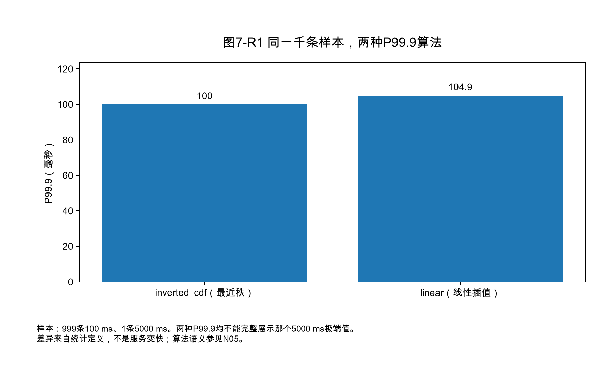
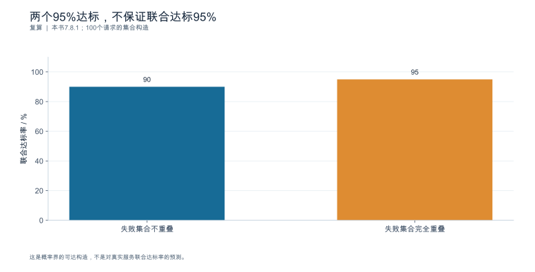
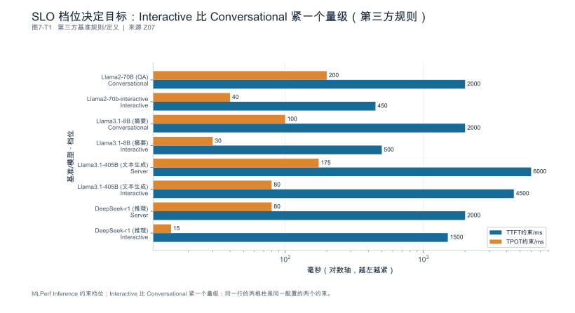
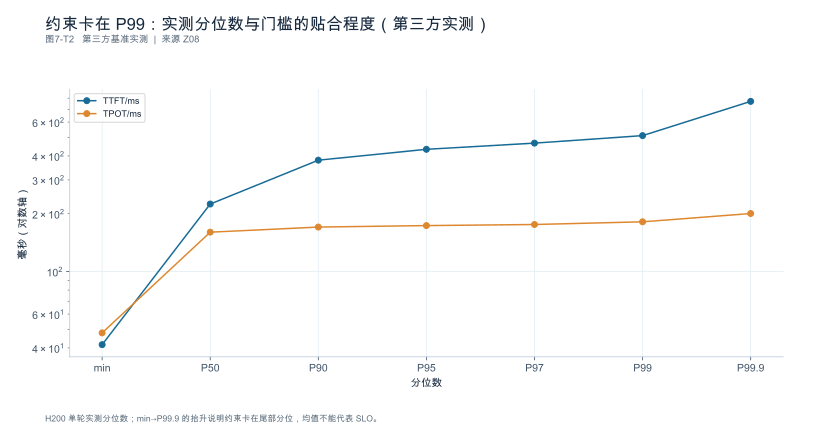

## 第7章 服务目标与性能指标

**核心论点：**性能指标首先是一份统计契约：事件、边界、单位、样本、分母和聚合方式缺一不可。

### 本章与指标字典的关系

`book_support_v05/metrics_dict_v05.md` 提供六部分基座：事件字典（§1）、指标定义（§2）、分母规则（§3）、工具字段映射（§4）、Sample-B0 样例（§5）、E0 单元测试断言表（§6）。本章在此之上做三件事：

1. 把指标接回**业务目标**（7.1 的 SLO 契约）——指标不是目的，达成契约才是；
2. 把 Sample-B0 的复算过程**完整展开**，并补齐异常样本的处理规则（7.2、7.7）；
3. 补足字典里只给了定义、没给统计方法的部分：吞吐（7.3）、分位数聚合（7.4）、Goodput（7.5）、质量验收（7.6）。

文中所有数值均为构造数据，程序复算范围见E0清单。

### 本章导航

读完本章，你应该能够：写出一份六要素齐全的 SLO 契约；在同一条事件流上复算 TTFT/TTFO/ITL/TPOT 并解释两个工具为何给出不同数字；说清一个"tokens/s"究竟算了哪些 Token；解释为什么两个实例的 P99 不能取平均；把联合达标率、合格完成速率与 SLO 约束容量分开定义，而不是拿两个分位数互相比较；以及给指标计算器写一组不需要 GPU 的单元测试。

---

### 7.1 从业务体验定义 SLI 与 SLO

**本节要回答的问题：**什么表现才算对目标用户可用？

指标是回答契约的工具，反过来就本末倒置。先定义"对谁、完成什么、在什么窗口内、算不算达标"，再挑可观测的指标去度量它。

#### 7.1.1 完成单位与服务边界

SLI（Service Level Indicator）是**被度量的量**，SLO（Service Level Objective）是**对它的目标**。二者都要先确定完成单位——沿用第1章的五类对象：任务、请求、模型调用、尝试、会话。**同一个数字在不同完成单位下含义完全不同**：一次任务可能包含三次请求，一次请求可能留下两个 attempt。

服务边界还必须写明链路范围：从哪个事件起、到哪个事件止、包含哪些外部依赖（第1章 1.1.3 的责任边界表）。接口延迟是否包含检索，取决于接口完成是否依赖检索；不能仅因它是下游服务就排除。用户任务时延则按完整任务边界计量。**边界不写清，达标率就会变成一场各说各话的争论。**

#### 7.1.2 延迟、可用性与质量三类门槛

一份完整的契约至少覆盖三类门槛，缺任何一类都可能"达标但不可用"：

| 类别 | 典型指标 | 失败表现 |
|---|---|---|
| 延迟 | TTFT_client、TTFO_client、E2E、P99 分位 | 用户等待过久 |
| 可用性 | 成功率、取消率、超时率、拒绝率（按 attempt 计） | 请求没结果 |
| 质量 | 任务通过率、格式合规率、关键字段正确率 | 有结果但不可用 |

质量门槛最常被省略，也最致命：**一个把输出长度截断到 10 个 Token 的系统，延迟和可用性都会非常漂亮。**因此任何性能优化的结论都必须带上质量门槛（7.6 展开）。

#### 7.1.3 分层目标、观察窗口与异常处理

不同负载形态不该套用同一阈值。建议至少分三层，各自单独设阈值与窗口：

| 层 | 场景 | 主指标 | 窗口建议 |
|---|---|---|---|
| 交互 | 短输入短输出问答 | TTFO_client P95、E2E P99 | 滚动 5—30 分钟 |
| 长文档/长输出 | 摘要、生成、代码 | E2E P90、中断率 | 滚动 1—24 小时 |
| 异步/离线任务 | 批量处理、报告 | 单位时间完成任务数、任务成功率 | 批次窗口 |

契约六要素，缺一不可：

| 要素 | 内容 | 常见缺失 |
|---|---|---|
| 对象 | 哪一类请求/任务/租户 | 只写"服务" |
| 指标 | 名称 + 起点/终点/时间域 | 只写 "P99 延迟" |
| 阈值 | 数值与单位 | 无来源的"行业标准" |
| 窗口 | 滚动窗口长度与更新频率 | 未写，导致用 5 分钟峰值对 24 小时承诺 |
| 分母 | 哪些 attempt 进分母 | 静默剔除超时与取消 |
| 异常处理 | 超时、取消、部分成功、数据缺失如何记 | 缺失值默认记 0 |

最后一条尤其要写死：**缺失不等于零。**未观测到首个可见 Token 时，`TTFO` 应记为缺失（null），不能填 0——填 0 会把"完全没输出"伪装成"极快"。同理，单 Token 请求的 TPOT 应记为不适用，而不是 0（7.2.3、7.7）。

还有一条组织层面的约定：**内部工程目标与对外承诺必须分开登记。**内部目标可以激进，用于驱动优化；对外承诺要留余量，并写明违约处理。本书出现的所有阈值都是演示值，**不构成任何生产建议**。

**本节要点**

- 先定义完成单位与服务边界，再挑指标；边界不清则达标率无意义。
- 契约需同时覆盖延迟、可用性、质量三类门槛，质量最易被省略也最致命。
- 分层设阈值：交互、长文档/长输出、异步任务各有主指标与窗口。
- 六要素齐全，且缺失值一律记为缺失而非零。

**常见误区**

- **误：**SLO 写"P99 延迟 < 2 秒"就够明确了。
  **正：**缺对象、起点终点、时间域、窗口与分母，无法判断是否达标。
- **误：**超时和取消的请求不算失败，所以从分母里去掉。
  **正：**去掉后成功率是被过滤过的；应单列一层报告。
- **误：**行业里都要求 2 秒，所以我们的阈值也是 2 秒。
  **正：**阈值应来自业务体验与该系统的负载结构，引用外部值须给出来源。

**本节验收**

1. 你能写出一份六要素齐全的 SLO 契约，并指出其中每个指标的起点、终点、时间域。
2. 你能为交互、长文档、异步三类场景各设一套阈值与窗口。
3. 你能说明本系统对"缺失值"的处理规则，并证明没有把缺失填成 0。

**依据与核验入口：**[R24] [R14] [S18]

---

### 7.2 时间指标与工具迁移：TTFT、TTFO、ITL、TPOT

**本节要回答的问题：**名称相同的指标，怎样确认含义也相同？

四个缩写背后至少有十几种合法定义。本节不追求统一全世界，只要求一件事：**任何一次报告，都要能把它用到的定义写在表格里。**

#### 7.2.1 首字节、首事件、首推理与首答案

一次流式响应里，"第一次出现某样东西"至少有四个候选时刻，它们可以相差数秒：

| 时刻 | 定义 | 是否用户可感知 |
|---|---|---|
| $t_{\text{first-byte}}$ | 客户端收到第一个响应字节（可能只是响应头） | 否 |
| $t_{\text{first-content-event}}$ | 客户端收到第一个含内容的事件 | 取决于内容类型 |
| $t_{\text{first-reasoning}}$ | 收到第一个推理/思考内容 | 通常否 |
| $t_{\text{first-visible}}$ | 收到第一个可见答案 Token | **是** |

第1章 1.4.1 已给出五类协议事件（控制、元数据、工具调用、内容、终端），这里的关键是：**内容事件里还要再分"推理内容"与"可见答案"。**当模型先输出推理内容时，$t_{\text{first-content-event}}$ 与 $t_{\text{first-visible}}$ 的差值就是用户"看到进度条动但看不到答案"的那段时间。

本书口径（与字典 §2 一致）：

$$
T_{\text{TTFT}} = t(\text{engine.first\_token\_generated}) - t(\text{engine.queued})
\qquad
T_{\text{TTFO}} = t(\text{首个可见内容写出}) - t(\text{engine.queued})
$$

**两个都要报。**只报 TTFT 会让推理先行模型的用户体验被系统性高估；只报 TTFO 又会丢掉"系统确实开始工作了"的信息。

#### 7.2.2 客户端时间域与引擎时间域

同一个指标在两个时间域里是不同的量，不能混用：

| 口径 | 起点 | 含什么 | 不含什么 |
|---|---|---|---|
| `TTFT_server` | `engine.queued` | 排队、prefill、首 Token 生成 | 连接、鉴权、网络、客户端解析 |
| `TTFT_client` | `client.send` | 上述全部 + 网络与网关缓冲 | 客户端渲染（若终点取收到事件） |

差值不是误差，是信息。以 Sample-B0 为例（字典 §5）：`TTFT_server = 634 - 21 = 613` ms，`TTFT_client = 668` ms，差 55 ms 由"进入引擎前的 21 ms"与"服务端首 Token 生成后到客户端收到的 34 ms"构成；后者在带误差上界的关联下可进一步拆为**生成完成到写出 7 ms**（634→641）与**传输/网关缓冲/客户端接收 27 ms**（641→668）。**若两个时间域未校准，则不能报告由跨域端点相减得到的 21 ms、34 ms 或 27 ms 分段；只能在各自域中报告时长，并将跨域分解标为不可识别。**这 55 ms 若在跨地域部署下变成 300 ms，那么只优化引擎内部的人永远看不到它，而用户全部感受到它。

#### 7.2.3 请求级 TPOT 与间隔级 ITL

这是本章最容易出错的一对指标，也是开篇场景的根源。

- **`TPOT_req`**：按 **Token** 分摊，$(T_{\text{e2e}} - T_{\text{TTFT}})/(N_{\text{out}} - 1)$；
- **`ITL_event`**：在本例观测能力下按 **内容事件** 采样，样本数 $M - 1$，报告的是相邻输出事件间隔的分布。

Sample-B0 的复算（20 个输出事件、301 个输出 Token）：

| 指标 | 算式 | 结果 |
|---|---|---:|
| `TTFT_server` | $634-21$ | 613 ms |
| `TTFO_server` | $1180-21$ | 1159 ms |
| `TTFO_client` | $1180+27-0$ | 1207 ms |
| `E2E_server` | $4210-21$ | 4189 ms |
| `TPOT_req` | $3576/300$ | 11.92 ms |
| $\overline{\text{ITL}}$ | $3569/19$ | 187.84 ms |
| 推理→可见答案间隔 | $1207-668$ | 539 ms |

三个必须一起检查的恒等式：

$$
613 + 11.92 \times 300 = 4189 \quad\checkmark\qquad
n_{\text{ITL}} = 19 \quad\checkmark\qquad
\frac{\overline{\text{ITL}}}{\text{TPOT}} = \frac{3569}{19}\Big/\frac{3576}{300} = \frac{3569}{3576}\cdot\frac{300}{19} \approx 15.7586
$$

最后一项说明比值由两个因子组成：**时间窗因子 $3569/3576\approx0.998$** 与**分母因子 $(N-1)/(M-1)=300/19\approx15.79$**。因此**不能把比值无条件写成 $(N-1)/(M-1)$**：只有当两者时间窗相同时（此处相差 7 ms，源于"首 Token 生成"与"首个事件写出"不是同一刻），分母因子才是唯一解释。跨请求聚合时还要写明**请求权重与间隔权重**——按请求平均的 ITL 与把全部间隔混合后的 ITL 也不是同一个量。把两者直接比较，或拿 A 工具（按事件计）的数字去比 B 工具（按 Token 计）的历史基线，会得出"性能退化 15 倍"的荒谬结论——这正是开篇场景的第二种成因。

官方也明确了这一点：当一个输出包含多个 Token 或聚合权重不同时，按事件采样的 ITL 与按请求计算的 TPOT 不相等 `[SOURCE_REGISTERED]` [DOC-W07]。

还有两类样本必须单独处理：

| 样本 | 正确做法 | 错误做法 |
|---|---|---|
| 输出 Token 数 $N_{\text{out}} \le 1$ | `TPOT` 记为**不适用**，从统计中排除；`ITL` 同样无样本 | 记 0，把"没输出"混入均值 |
| 未观测到首可见 Token | `TTFO` 记为**缺失** | 记 0，伪装成极快 |

某实现对 $N_{\text{out}} \le 1$ 的请求把 TPOT 记为 0 且基准统计将其排除——**"记为 0"是它的存储约定，"被排除"才是统计口径**；照抄前者会得到被污染的分母 `[SOURCE_REGISTERED]` [DOC-W07]。

#### 7.2.4 推理输出与可见输出的计数契约

"生成了多少 Token"至少要能回答四个不同的问题，四个数可以同时存在且互不相等：

1. **生成总数**：模型实际产生的 Token（含推理内容），来自服务端计数；
2. **可见答案 Token**：用户看到的正文，用于体验类指标；
3. **推理 Token**：可观测时单独统计，用于成本与"思考时长"分析；
4. **拼接后重新分词**：客户端对完整文本重新分词的结果，**不等于**生成总数。

计数契约必须写明：`token_scope`（全部/可见/推理/重算）、来源（服务端 `usage` / 事件 `delta` 累加 / 客户端重算）、以及块边界是否与分词边界对齐（通常不对齐）。第1章 1.4.2 已说明：按 `delta` 累加可以重建内容，但不能反推准确 Token 数或逐 Token 时刻。

**规则：只能取得分块到达时刻时，就只报告"该观测层的事件间隔"，不得称之为 Token 间隔。**

#### 7.2.5 工具原值、规范化值与迁移回归

同一条事件流，两个工具给出不同的 TTFT，往往不是谁错了，而是"首"的定义不同。

在复核资料描述的推理模型场景中，AIPerf 的 TTFT 指首个 Token（**含推理内容**），TTFO 指首个**非推理**输出；因此要对齐该迁移说明中的 GenAI-Perf 的 TTFT，应取 AIPerf 的 TTFO，而不是按字段名匹配 TTFT `[SOURCE_REGISTERED, 继承]` [S17]（与 [DOC-W09] 同址，尚未重新取正文，也未本地执行）。

用一个算例说明后果（延续 Sample-B0）：

| 报告口径 | 数值 | 谁的体验 |
|---|---:|---|
| 首 Token（含推理） | 668 ms | 系统开始产出 |
| 首可见答案 | 1207 ms | 用户开始读到答案 |
| 差值 | 539 ms | 用户"看着进度条等"的时间 |

**换工具后 TTFT 从 1207 ms 变成 668 ms，不构成系统提速 539 ms**——它只是换了"首"的定义。这类变化必须被识别为口径迁移，而不是性能收益。

为了让它可审计，每条指标的迁移都要登记七列：

| 字段 | 含义 |
|---|---|
| `raw_field` | 工具原始字段名与所在输出 |
| `normalized_field` | 本书口径名（如 `TTFO_client`） |
| `event_scope` | 起点/终点事件 |
| `token_scope` | 计入哪一类 Token |
| `unit` | 单位与量级 |
| `mapping_version` | 映射依据：工具版本 + parser 版本 + 查阅日 |
| `missing_reason` | 缺失原因（未观测/不适用/被排除） |

**最终报告保留三列：工具原值、规范化值、差异原因。**不要把原值抹掉只留规范化值——下次工具升级时，原值是唯一能定位口径漂移的证据。

**本节要点**

- 四个"首"时刻要分开；推理先行模型必须同时报 TTFT 与 TTFO。
- 服务端域与客户端域是两个不同的量，差值是信息不是误差。
- 本例 TPOT 按 Token 分摊，ITL_event 按事件取间隔；其比值还包含时间窗因子，只有窗口完全一致时才能简化为 $(N-1)/(M-1)$。
- $N_{\text{out}}\le1$ 记不适用、未观测记缺失，**都不记 0**。
- 工具迁移保留原值、规范化值与差异原因三列，并登记 `mapping_version`。

**常见误区**

- **误：**两个工具都叫 TTFT，可以直接比。
  **正：**先看 `event_scope` 与 `token_scope`；推理先行时 TTFT 与 TTFO 可能差数百毫秒。
- **误：**单 Token 请求的 TPOT 是 0，所以系统极快。
  **正：**应记为不适用并排除；记 0 会污染分母。
- **误：**块到达间隔就是 Token 生成间隔。
  **正：**块 ≠ Token；只能报告观测层的事件间隔。
- **误：**换工具后 TTFT 变好了，说明优化生效。
  **正：**先确认是不是口径迁移；用 Sample-B0 复算两边。

**本节验收**

1. 你能在同一条事件流上复算 TTFT/TTFO/ITL/TPOT，并写出每个的起点、终点、时间域。
2. 你能解释本系统中 ITL 与 TPOT 相差多少倍，以及倍数来自哪里。
3. 你能说明 $N_{\text{out}}\le1$ 与"未观测到首可见 Token"两类样本的处理规则。
4. 你能为自己的工具链填出七列迁移登记表。

**依据与核验入口：**[R01] [R11] [R12] [S17] [DOC-W07] [DOC-W09]

---

### 7.3 吞吐：请求、输入、输出与有效完成

**本节要回答的问题：**一个 tokens/s 数字究竟算了哪些 Token？

吞吐是唯一一个"单位不写就等于没写"的指标：它可以是请求/秒、输入 Token/秒、输出 Token/秒、生成候选/秒，或有效完成任务/秒。五个数可以同时存在且互相矛盾。

#### 7.3.1 完成请求与生成 Token

$$
R = \frac{N_{\text{completed}}}{T_{\text{window}}}\quad[\text{req/s}],\qquad
X_{\text{out}} = \frac{\sum N_{\text{out}}}{T_{\text{window}}}\quad[\text{Token/s}],\qquad
X_{\text{in}} = \frac{\sum N_{\text{in}}}{T_{\text{window}}}\quad[\text{Token/s}]
$$

$R$ 为请求完成速率，$X$ 为 Token 速率，$T_{\text{window}}$ 为观察窗口长度（s）。三者必须**同时报告**，否则无法判断一次变化的性质：输出长度分布变长时，$X_{\text{out}}$ 可能上升而 $R$ 下降——这时"吞吐提升了 20%"和"吞吐下降了 15%"说的是同一件事。

#### 7.3.2 输入、输出、缓存与候选 Token 各归各账

至少四类 Token 不能混在一个总数里：

| 类别 | 是否计入吞吐分子 | 说明 |
|---|:--:|---|
| 输入 Token | 逻辑输入速率与实际执行输入速率分列 | 前缀命中减少执行量，但被服务的逻辑输入仍可计入业务输入速率 |
| 输出 Token（最终保留） | 计入 $X_{\text{out}}$ | 用户可见与推理内容建议分列 |
| 缓存复用省下的计算 | **不计入** | 省下的计算不是新产生的吞吐；只作为"节省量"单独报告 |
| 推测解码草稿候选 | **不计入**有效输出 | 被拒绝的 Token 消耗了资源，但不产出内容；记入成本分子，不记入产出分子 |

两条容易踩的坑：

- **混淆逻辑输入与执行输入。**前缀缓存可以真实提高同资源下完成请求或服务逻辑输入的速率；错误在于把复用 Token 伪装成重新计算的 Token，或把“避免的 FLOPs”直接加到输出吞吐。报告应分别命名 `logical_input_tokens/s`、`executed_input_tokens/s`、`replayed_tokens/s` 与有效输出速率。

#### 7.3.3 固定窗口与排空：两种方法差多少

同一套系统、同一负载，用两种方法测出的吞吐可以差 20% 以上。算例：

| 方法 | 定义 | 算例 | 结果 |
|---|---|---|---:|
| 固定窗口法 | 开窗 60 s，数窗口内完成的请求 | $240/60$ | **4.00 req/s** |
| 排空法 | 固定 300 个请求，测"首发→末完成"的时间 | $300/62$ | **4.84 req/s** |

对应的输出 Token 速率：窗口法 $240\times300/60 = 1200$ Token/s；排空法 $300\times300/62 = 1451.6$ Token/s。

差异不是测量误差，是方法差异：完成事件窗口法计入所有在窗口内完成的请求，包括窗口开始前已经到达的请求；窗口末仍在途的请求单列。如果只计窗口内到达的队列，那是另一个 cohort 口径，须等队列排空或说明删失，排空法则包含爬坡与收尾阶段，且把"最后一个请求"的完整耗时摊进了分母。**因此每次报告吞吐都必须写明方法、窗口长度、并发度与在途处理规则**，否则两次实验的数字不可比。

**本节要点**

- 请求速率、输入 Token 速率、输出 Token 速率必须同时报告。
- 避免的计算不计作新执行量；已服务的逻辑输入可以进入逻辑吞吐。被拒候选不进入有效输出，实际消耗计入成本。
- 固定窗口法与排空法的结果不可直接比较，报告必须写明方法、窗口与并发。

**常见误区**

- **误：**吞吐提升了 20%，系统变快了。
  **正：**先看是哪个吞吐；输出变长时 Token/s 与 req/s 可以反向变化。
- **误：**命中缓存省下的计算可以计入吞吐。
  **正：**服务的逻辑输入Token可以计入逻辑输入吞吐；避免的计算只能单列，不伪装成实际执行量。
- **误：**被拒绝的草稿 Token 不算数，所以不占成本。
  **正：**它消耗了资源，必须进成本分子。

**本节验收**

1. 你能给出三个吞吐数字（req/s、输入 Token/s、输出 Token/s）及其窗口定义。
2. 你能说明本系统中缓存复用与草稿候选分别计入哪个集合。
3. 你能说明一次吞吐对比实验用的是窗口法还是排空法，并给出并发度。

**依据与核验入口：**[R11] [R12] [R14] [S17] [S18]

---

### 7.4 分位数、分层与统计不确定性

**本节要回答的问题：**平均值和 P99 分别遗漏了什么？

#### 7.4.1 分布与长尾

均值确实会掩盖长尾：1000 个请求中 999 个 100 ms、1 个 5000 ms，均值为 $(999\times100+5000)/1000 = 104.9$ ms。**但"用高分位数就能抓住单个极端值"是错的**——分位数看不看得见这个长尾，取决于分位算法与所选的 $q$：

| 条件 | 结果 | 说明 |
|---|---:|---|
| 最近秩法，$q=0.999$ | 取第 $\lceil 0.999\times1000\rceil = 999$ 个样本 = **100 ms** | 极端值未被计入 |
| 线性插值（NumPy `method="linear"`），$q=0.999$ | $100 + 0.001\times(5000-100) = \mathbf{104.9\ ms}$ | 只反映插值位置 |
| 最近秩法，$q=0.9995$ | 取第 $\lceil999.5\rceil=1000$ 个 = **5000 ms** | 极端值进入分位数 |

结论有两层：**对这里的最近秩法，应根据 $\lceil qn\rceil$ 是否落入极端值所在秩判断；插值法还受相邻两个秩的权重影响**；选 P99 还是 P99.9，本身就是在决定"容忍多少比例的坏体验"，必须与阈值一起写进契约。不同工具实现不同的分位算法（最近秩、线性插值、桶插值），同一份数据可以给出不同答案，因此必须选定并全程保持一致。

但分位数也不是万能的。它会被负载结构变化伪装成系统变化：某天 P95 从 800 ms 降到 500 ms，可能只是因为长文档请求占比从 30% 掉到 10%。因此分位数必须**分层报告**——按输入长度档、输出长度档、租户/模型、冷启动与否分层，每层单独给样本量与分位数。不分层就说"P95 改善了 37%"，结论无法复核。

#### 7.4.2 跨实例聚合：P99 不能取平均

这是本章最硬的禁止项。先看一个可手算的算例：

| 实例 | 样本构成 | 该实例 P99 |
|---|---|---:|
| A | 98 个 100 ms + 2 个 1000 ms | 1000 ms |
| B | 100 个 500 ms | 500 ms |

（两个实例各 100 个样本，分位算法固定为最近秩法：$\lceil 0.99\times100\rceil = 99$，即取第 99 个样本。A 的第 99、100 个样本都是 1000 ms，故 A 的 P99 为 1000 ms；若改成"99 个 100 ms + 1 个 1000 ms"，同一算法下第 99 个样本是 100 ms，演示结论就会反过来。**算法与数据必须同时写清。**）

- 对两个实例的 P99 取平均：$(1000+500)/2 = \mathbf{750}$ **ms**
- 合并 200 个样本后重新计算：第 $\lceil 0.99\times200\rceil = 198$ 个样本为 **500 ms**

750 ms 与 500 ms 相差 50%，而系统一毫秒都没变。**平均出来的分位数是统计上无意义的值。**

Prometheus 官方文档对此有明确结论（参见所列来源正文与版本记录）：对 summary 预计算的分位数做聚合"rarely makes sense"，在本例中"averaging the quantiles yields statistically nonsensical values"，并直接把 `avg(http_request_duration_seconds{quantile="0.95"})` 标注为 BAD `[SOURCE_REGISTERED]` [R15]。文档给出的可行路径是：用 histogram 表示分布，通过 `histogram_quantile()` 与 `sum by (le)` 聚合；其中 classic histogram 要求各实例的 bucket 边界一致，native histogram 的误差由配置的分辨率决定，classic histogram 的误差由分位数所在 bucket 的宽度决定 [SOURCE_REGISTERED] [R15]。文档还给出三条经验法则：能用 native histogram 就按其分辨率满足精度要求；不能用 native 但需要聚合时用 classic histogram 并谨慎设置 bucket 边界；**只有在不需要聚合时才考虑 summary** [SOURCE_REGISTERED] [R15]。

落到本书的操作要求：**分位数必须从原始样本或可合并的分布摘要中计算；报告时必须写明样本量 $n$、分位算法（最近秩/线性插值/桶插值）与聚合层级。**

#### 7.4.3 重复实验与置信区间

三个决定结论可信度的因素：样本量、运行间波动、请求之间的相关性。

- **样本量用区间说话，不用倍率口号**。分位数有一种不依赖分布假设的区间估计：真值 $\xi_q$ 落在第 $r$ 到第 $s$ 个顺序统计量之间的概率为 $P(r \le Y \le s-1)$，其中 $Y\sim\mathrm{Bin}(n,q)$。取 $q=0.99$、覆盖约 95%：

| 样本量 $n$ | 秩区间 | 相对宽度 | 最近秩估计位置 |
|---:|---|---:|---:|
| 1000 | 第 983—995 个 | 1.20% | 第 990 个 |
| 20000 | 第 19770—19825 个 | 0.27% | 第 19800 个 |

样本量扩大 20 倍，相对宽度从 1.20% 收窄到 0.27%（约 $\sqrt{20}\approx4.5$ 倍）——**这就是"尾部要更多样本"的定量形式**，而不是"多两个数量级"这类无条件的口号。报告尾部指标时给出 $n$ 与区间，而不是只给一个点估计。
- **运行间波动**：同一配置重复 $k$ 次运行，报告的是"运行"这个单位上的分布，而不是把所有请求混在一起。混在一起会低估不确定性（把相关样本当成独立样本）。
- **相关性**：同一批请求在同一运行内彼此相关（共享排队、共享批组成）。用 bootstrap 时应以**运行**或**会话**为重抽样单位，而不是单个请求，否则置信区间过窄。

最低要求是：**尾部指标附样本量与聚合方法；比较实验给出重复次数与置信区间或至少给出区间宽度；不把少量尾部样本包装成稳定结论。**

**本节要点**

- 均值掩盖长尾，分位数掩盖结构变化——两者都要，且分位数要分层。
- 跨实例的分位数**不能取平均**，必须从原始样本或可合并摘要重算。
- 分位数误差取决于表示方式：classic histogram 由 bucket 宽度决定，native 由分辨率决定，summary 不可聚合。
- 尾部指标必须带样本量与聚合方法；重复实验以运行或会话为重抽样单位。

**常见误区**

- **误：**两个实例的 P99 平均一下就是集群 P99。
  **正：**统计上无意义；合并原始样本或用可合并摘要重算。
- **误：**P95 从 800 降到 500，系统改善了 37%。
  **正：**先看负载结构是否变化；分层后再判断。
- **误：**跑一次 5000 个请求，P99 就很准了。
  **正：**尾部分位数需要远多样本，且要报告样本量与区间宽度。

**本节验收**

1. 你能用手算例说明"平均 P99"错在哪里，并能给出正确的聚合方式。
2. 你能说明本系统分位数使用的分位算法、样本量与聚合层级。
3. 你能为自己的对比实验设计重复次数与置信区间，并说明重抽样单位。

**依据与核验入口：**[R15] [R12]

---

### 7.5 联合达标率、合格完成速率与 SLO 约束容量

**本节要回答的问题：**最快的配置是不是完成合格请求最多的配置？

#### 7.5.1 用联合条件，而不是两个分位数并列

先澄清一个容易混用的词：本节原来的"Goodput"其实是**比例**，而分离式服务研究的经典文献把 goodput 定义为**速率**——"在给定 SLO 达成率目标下，每个已配置 GPU 能服务的最大请求速率" [SOURCE_REGISTERED] [DOC-E01]。两者量纲不同，不能互相替代。本书因此把它们拆成三个量：

| 名称 | 定义 | 量纲 | 用途 |
|---|---|---|---|
| **联合达标率**（joint attainment） | 同时满足延迟 $\le\tau$、协议成功、质量达标的**观察对象数 / 观察集合总数** | 比例 | 判断一批流量里有多少是"真合格" |
| **合格完成速率** | 在明确时间窗内完成且满足契约的请求或任务数 / 窗口秒数 | req/s 或 task/s | 容量与成本 |
| **SLO 约束容量** | 在联合达标率不低于目标、且系统满足所声明稳态条件时，可**持续承载的最大到达率** | req/s | 上线决策与扩容 |

第一个量的定义式为

$$
\text{联合达标率} = \frac{|\{\,r \in \mathcal{A} : \text{延迟}(r)\le \tau \;\wedge\; \text{协议成功}(r) \;\wedge\; \text{质量}(r)\ \text{达标}\,\}|}{|\mathcal{A}|}
$$

其中 $\mathcal{A}$ 是**观察集合**。关键有两点：一是 $\wedge$，三项必须同时成立；二是**观察集合按层确定**——attempt 层、逻辑请求层、任务层各有自己的集合，不能为了"保留失败"就把所有层的分母统一成 attempt（同一任务内的多次尝试不应变成多个任务），也不能反过来用"最后成功的那次尝试"代表整个任务。常见错误是把"P95 延迟达标"和"质量合格率 98%"并列展示，然后宣称达标率 95%——两个分位数不能相乘，也不能互相代替，因为命中的可能不是同一批请求。

#### 7.5.2 分母：成功样本与全部尝试

本小节在 attempt 层使用全部符合契约的尝试作为分母，包含：超时、取消、被限流拒绝、客户端放弃、以及服务端仍在处理（orphaned）的请求。**在成功样本里挑好看的延迟，再隐藏拒绝和超时，是最容易也最致命的自欺。**

以字典 §5.4 的四条请求为例（构造数据）：

| 口径 | 计算 | 结果 |
|---|---|---:|
| 接口成功率（按返回 200 计） | $4/4$ | 100% |
| 请求层联合达标率（延迟 ∧ 质量） | $1/4$ | **25%** |

两条都对——因为回答的是不同的问题。任何只报第一个数字的报告都应被视为不完整。

#### 7.5.3 吞吐约束与质量门槛

质量门槛有两种落地方式，不能混为一谈：

| 方式 | 适用 | 报告要求 |
|---|---|---|
| 在线逐请求质量标签 | 有确定性校验（格式、JSON Schema、工具参数、单测断言） | 可进联合达标率的分子 |
| 离线抽样质量评估 | 需人工或裁判模型评分 | **作为独立门槛单列**，不能假装每个在线请求都有标签 |

分支任务还要区分两个层级：请求层达标率按 `request_id` 计，任务层达标率按 `task_id` 计，两者**并列报告**。业务契约需预先写明：哪些分支是必需的、哪些可容错降级、父任务终态如何判定（第1章 1.1.2）。不能把成功的几个子请求计成多个完成任务，也不能从分母里删掉导致任务失败的长尾分支 `[SOURCE_REGISTERED]` [S18]。

**本节要点**

- 联合达标率是延迟、协议成功、质量三项的**联合条件**；它与合格完成速率（req/s）、SLO 约束容量（最大可持续到达率）是三个不同量纲的量，不可互相替代。
- 分母按对象层级定义：attempt 不遗漏异常尝试，逻辑请求按 request_id 去重，任务按 task_id 聚合；未知终态按截止规则登记，不把一次重试计为一个新任务。
- 在线质量标签与离线抽样评估分开报告，后者不得冒充逐请求标签。
- 请求层与任务层达标率并列；任务终态由契约判定。

**常见误区**

- **误：**延迟达标率 96%、质量合格率 98%，所以达标率约 97%。
  **正：**命中的未必是同一批请求；必须按联合条件计数。
- **误：**只在成功请求里统计延迟，因为失败请求没有延迟可言。
  **正：**失败与超时正是要计入分母的部分。
- **误：**离线抽样的质量评分可以给每个在线请求打标签。
  **正：**抽样结果只能作为独立门槛，不能回填到逐请求分子。

**本节验收**

1. 你能写出本系统三个量（联合达标率 / 合格完成速率 / SLO 约束容量）的定义与观察集合。
2. 你能分别给出请求层与任务层达标率，并说明分支任务的必需/容错集合。
3. 你能说明质量标签是在线逐请求还是离线抽样，并在报告中如实标注。

**依据与核验入口：**[R09] [R14] [R24] [S18]

---

### 7.6 正确性、输出质量与功能验收

**本节要回答的问题：**速度改善之后，系统还是在完成同一种任务吗？

性能提升最常见的副作用不是崩溃，而是**静默变质**：格式还合规，接口还返回 200，答案却不再可用。所以任何性能结论都必须携带质量门槛。

#### 7.6.1 三层验收

| 层 | 检查什么 | 通过标准 | 能否自动化 |
|---|---|---|---|
| Q1 接口与终态 | 协议合规、终态正确、无截断、取消可传播 | 终态字典全项匹配（第1章 1.6.1） | 完全可自动化 |
| Q2 数值或分布 | 必要时逐 Token/逐数值一致，或分布一致 | 取决于声明的可复现层次 | 可自动化（见第1章 1.3.4） |
| Q3 业务质量 | 任务是否真的被完成 | 契约中的质量门槛 | 常需抽样或裁判模型 |

三层质量验收记为 Q1—Q3，与第1章可复现性 L1—L4 是不同分类，不能按编号互相替代。格式正确不代表答案可用，任务质量相近也不代表输出逐位不变。“不改变输出”的主张应先声明是逐位、逐 Token、概率分布还是业务质量层面的等价，再提交相应证据。

#### 7.6.2 格式、工具与停止行为

功能验收至少覆盖四项：

1. **结构化约束**：JSON Schema/语法约束下的输出是否仍可被解析，字段类型与必填项是否完整；
2. **工具调用参数**：模型返回的调用信息是否参数正确、可被下游执行——注意"返回了调用信息"与"调用成功"是两件事（第1章 1.4.2）；
3. **停止行为**：`max_tokens`、`stop` 与 EOS 是否按预期生效；停止位置改变会改变输出长度分布，从而改变所有吞吐与延迟指标；
4. **长上下文与多轮**：长输入下是否出现截断、重复或失焦；多轮下上下文是否被正确复用或失效。

**格式成功不等于任务正确**：一个返回合法 JSON 但字段全为空的输出，能通过格式校验却完全不可用。质量门槛必须落在"任务是否完成"上。

#### 7.6.3 优化变更的验收集

量化、非前缀缓存复用、推测解码是三类最容易"静默变质"的变更，**它们不能共享同一份等价性假设**——各自的质量风险不同，必须分别验收：

| 变更 | 主要质量风险 | 必查场景 |
|---|---|---|
| 低精度/量化 | 长上下文累积误差、极端激活值、特定层的敏感度 | 长上下文、数值/代码类任务、工具参数 [SOURCE_REGISTERED] [S10] [R26] |
| 非前缀缓存复用 | 复用的状态与当前模型/模板/配置是否对应 | 模板或 revision 变更后的复用、跨实例复用 [SOURCE_REGISTERED] [S13] |
| 推测解码 | **不是"草稿分布不同"本身**——经典精确算法正是通过接受/拒绝与校正，在草稿分布不同的情况下保持目标分布 [SOURCE_REGISTERED] [DOC-E04]；真正的风险在校正实现、近似变体、数值路径与停止逻辑 | 校正路径的逐 Token 分布对照、结构化输出、停止条件、长输出 [SOURCE_REGISTERED] [R27] [S02] |

数据集要三分，且**不能用调过参的那一批宣称独立验证**：

| 集合 | 用途 | 禁止 |
|---|---|---|
| 校准集 | 量化校准、阈值初调 | 不能作为最终验收集 |
| 调参集 | 选择配置与阈值 | 结论不得外推为独立验证 |
| 独立验收集 | 最终发布判定 | 不得在调优过程中被反复查看 |

（推测解码的算法正确性前提来自原始论文，实现变体必须另外核验 [SOURCE_REGISTERED] [R27]；低精度格式的存储与缩放表示参见厂商技术说明，其中宣传性倍数不得作为本书结果 [SOURCE_REGISTERED] [S10]。）

**本节要点**

- 三层验收：接口终态、数值/分布、业务质量，证据不能互相替代。
- 格式合规不等于任务完成；工具调用要验"能否执行"，不只是"是否返回"。
- 量化、非前缀缓存、推测解码分别验收，不共享等价性假设。
- 校准集/调参集/独立验收集三分，禁止用调参集宣称独立验证。

**常见误区**

- **误：**输出格式 100% 可解析，所以质量没问题。
  **正：**格式与内容质量是两件事；要验任务是否完成。
- **误：**质量分布稳定，说明优化没有改变输出。
  **正：**那是 L3；声称逐位一致需要 L2 的证据。
- **误：**量化只影响速度，不影响质量。
  **正：**低精度会改变长上下文与数值类任务的表现，必须实测。

**本节验收**

1. 你能为一次优化变更列出三层验收项，并说明各自的通过标准。
2. 你能为量化/缓存复用/推测解码分别设计质量风险检查场景。
3. 你能证明自己报告的质量结果来自独立验收集，而非调参集。

**依据与核验入口：**[R14] [R26] [R27] [R29] [S10] [S13] [S02]

---

### 7.7 实验：给指标计算做单元测试

**本节要回答的问题：**压测工具的报告，能否从原始事件重新算出来？

在信任任何工具输出之前，先用一组**人工构造**的事件序列检验"我的计算器"是否正确。这一步不需要 GPU，也不产生任何性能结论。

#### 7.7.1 事件样本

样本沿用字典 §5 的 Sample-B0（20 个输出事件、301 个输出 Token、前 5 个为推理内容），复算结果与恒等式见 7.2.3。它的作用是**给定义钉死一组可验证的数字**：任何一次工具升级、解析器改动、字段改名之后，重跑这组断言，若结果不一致，变化一定出在口径而不是硬件。

#### 7.7.2 边界条件与期望值

真正的 bug 都藏在边界样本里。下表给出必须覆盖的异常样本与其**确定处理规则**（不是虚构的测量结果）：

| # | 样本 | 正确期望 | 错误做法 |
|---|---|---|---|
| 1 | 输出 $N_{\text{out}} = 1$ | `TPOT` = 不适用并从统计排除；`ITL` 无样本 | 记 0，污染分母 |
| 2 | 输出 $N_{\text{out}} = 0$（仅元数据） | 首内容时间记缺失；不计入延迟分布 | 记 0 ms，伪装成极快 |
| 3 | 仅推理内容后超时 | `TTFT` 有值、`TTFO` 记缺失；请求计入失败与超时层 | 用 TTFT 冒充用户可见首字 |
| 4 | 一个块含多个 Token | 只报事件间隔；Token 数以服务端计数为准 | 捏造逐 Token 时刻 |
| 5 | 客户端中途取消 | 计入取消层；若未完成则不计入完成率分子 | 从分母删除 |
| 6 | 分支任务中一个分支失败 | 任务结果按契约判定（可能部分成功或失败） | 把成功的子请求计成多个完成任务 |
| 7 | 重试（3 个 attempt，最后成功） | 任务可能成功；attempt 层记 2 次失败 | 只记最后一次成功 |
| 8 | 跨主机时间未校准 | 只报本地间隔与因果顺序 | 输出伪精确的单向延迟 |
| 9 | 空流/连接中断无终端事件 | 记未完成并保留未知 | 按成功或按 0 处理 |
| 10 | 工具调用后无后续生成 | 编排层等待单列，不并入生成时间 | 混入模型生成耗时 |

#### 7.7.3 反例：专门用来击中错误实现

只验证"正确输入得到正确输出"的测试，会把写死的常数当成真理。**必须同时准备能击中错误公式与错误分母的反例**：

| # | 错误实现 | 反例输入 | 期望断言（应失败/应报错） |
|---|---|---|---|
| 1 | 把分位数当最近秩却对数据写成"极端值必进 P99.9" | 1000 个样本：999×100 ms + 1×5000 ms | 最近秩 P99.9 = **100 ms**，不是 5000 ms；测试应捕获 5000 |
| 2 | 对实例分位数取平均 | A(98×100+2×1000)、B(100×500) | 平均 = 750 ms，而合并重算 = **500 ms**；断言两者不等且以合并值为准 |
| 3 | 把 ITL/TPOT 比值写成 $(N-1)/(M-1)$ | Sample-B0（窗 3569 vs 3576） | 比值 = **15.7586**，不是 15.7895 |
| 4 | 单 Token 请求的 TPOT 填 0 后进均值 | 含 1 条 $N_{\text{out}}=1$ 的样本集 | 该条**被排除**；统计条数减少 1，不得出现 0 值参与均值 |
| 5 | 达标率分母用"成功返回的请求" | 含超时/取消/失败 attempt 的集合 | 分母必须含全部已发出 attempt；断言与"仅成功集"结果不同 |
| 6 | 任务层用子请求数计数 | 一个任务含 3 个必需分支、1 个失败 | 任务结果 = 失败（按契约），完成计数**不增加 3** |
| 7 | 跨时间域直接相减 | 客户端与服务端各带未校准时钟 | 应拒绝输出单向延迟，或标记 $\varepsilon$ 缺失 |

第 7 条尤其重要：它不是"算错了"，而是"这个数字根本不该被算出来"。**测试应当检查结论，而不只是复现被写死的错误常数。**

#### 7.7.4 工具差异定位

对照真实工具输出时，最终保留**三列**：工具原值、规范化值、差异原因。差异原因只能来自以下几类：起点/终点事件不同、时间域不同、Token 范围不同、单位或量级不同、聚合方式不同、缺失值处理不同。**不允许用"取平均"来消除差异。**

流程是：手算样本 → 算逐请求指标 → 算聚合 → 加入边界样本 → 对照工具实现 → 记录差异 → 固化 `mapping_version`。工具升级后重跑字典 §6 的 12 条断言与本节表 7-2 的 10 条规则；无 GPU 的测试结果只能证明计算器正确，**不能作为任何设备性能证据**。

**本节要点**

- 先用人工样本验证计算器，再处理真实压测输出；人工样本不证明后端性能。
- 十类边界样本都必须有确定处理规则；缺失记缺失，不适用记不适用，都不记 0。
- 工具对照保留原值/规范化值/差异原因三列，不用平均消除差异。

**常见误区**

- **误：**手算样本通过，说明压测工具的输出可信。
  **正：**手算只验证计算器；工具口径仍需按 `mapping_version` 逐项核对。
- **误：**边界样本太少见，可以不处理。
  **正：**它们正是分母污染与假性提速的来源。
- **误：**把示意数据保存进实测结果库没关系，反正标了 synthetic。
  **正：**必须物理隔离；混库后无法区分哪些数字可对外。

**本节验收**

1. 你能跑通 Sample-B0 的全部复算，并通过三条恒等式。
2. 你能为表 7-2 的十类边界样本各给出一条处理规则与对应单元测试。
3. 你能给出一次工具对照的三列记录，并说明差异原因。

**依据与核验入口：**[R01] [R11] [R12] [R15] [S17] [S18]

---

### 7.8 深化：联合达标、删失样本与指标计算器

#### 7.8.1 两个P95达标，不等于95%的请求同时达标

设事件 $A$ 表示请求TTFT达标，$B$表示生成间隔达标。即使 $P(A)=P(B)=0.95$，联合达标率也只能由边际信息限制在

$$0.90\le P(A\cap B)\le0.95.$$

下界来自并集界，上界来自交集不大于任一事件。最差的5%首Token请求和最差的5%生成请求若不重合，联合只有90%；若完全重合，才可能95%。所以一个报告同时写“TTFT P95达标”“TPOT P95达标”，并没有计算请求级联合SLO。加入质量、错误、截止时间之后，必须在同一请求记录上逐项求交，不能把多个总体比例相乘或取最小值当成结果。

任务包含多个请求时，再做一次按任务契约聚合。尝试失败后重试成功，可能形成一个成功逻辑请求；任务超过总截止时间，则所有子请求最终完成也不能倒填为任务及时成功。层级、分母和观察窗口必须一起进入指标身份。

#### 7.8.2 分位数定义会改变尾部读数

对999个100 ms和1个5000 ms的样本，最近秩/经验逆CDF的P99.9取第999个值，仍为100 ms；线性插值则在相邻秩之间给出约104.9 ms。NumPy明确将 `inverted_cdf` 与 `linear` 列为不同方法 [N05]。这不是性能变化，而是有限样本下的估计定义差异。

单个很慢的请求可能几乎不改变某个分位数，却明显增加均值、总资源面积或失败成本。因此长尾报告至少还应给出超过业务阈值的数量、最大值的出处以及时间分布，而不是只保留一个P99。跨实例聚合时也应合并可合并分布或原始样本；分位数本身不是可线性平均的统计量 [N24]。

#### 7.8.3 超时样本既不能填零，也不能悄悄消失

一个请求在2 s被客户端放弃，只能证明用户未在2 s内得到结果，不能证明服务真实完成时长正好2 s。对“是否在2 s内交付”的二元SLO，它是不达标；对“最终完成时长分布”，它是右删失或缺失终态，需要另行处理。

如果只对完成请求画延迟分布，应明确命名为“完成条件下的延迟”，同时报告全量失败与删失比例。不能用该分布独立宣称总体用户体验变好。反过来，把所有超时都用一个固定巨大值填入直方图，也会引入人为分布；更稳妥的是保留原始终态、观察截止和缺失原因，分别计算二元达标率与可解释的完成分布。

#### 7.8.4 可直接运行的最小计算器

`book_support_v05/code/e0_reference.py` 使用显式事件域计算持续时间；输出Token数≤1时TPOT返回空值；内容事件少于2个时，事件间隔样本为空；域不同或时间倒置直接拒绝计算。它把 `ITL_event` 与逐Token间隔分开，没有从分块大小猜测Token时间。

Sample-B0的服务器内容终点是4210 ms，终端事件是4213 ms，故两个E2E分别为4189 ms与4192 ms。对应TPOT必须选择同一个约定，不能在计算中混用。配套断言保留了11.92 ms的内容端点TPOT、19个事件间隔，以及不适用和跨域失败用例。

官方AIPerf迁移说明还区分推理模型的TTFT和首个非推理输出TTFO [N16]。本书计算器不是某个工具的兼容替代品；它是一组可审查的规范样例。接入工具时，原生字段仍须保留，并通过独立映射测试接到这些定义。

图中100与104.9 ms来自同一样本的不同分位算法；原始极端值5000 ms仍须单独报告。

---

<!-- V06-START -->

### 7.9 实验图表补充：把联合SLO门槛画成可达边界

分别95%的TTFT与TPOT通过率，并不保证联合95%。取100个请求：若两项各失败5个且失败集合不相交，联合通过90个；若两项失败的恰好是同5个，则联合通过95个。图给出两个可以精确构造的端点，展示 $0.90\le P(A\cap B)\le0.95$。

实验报告应保存请求级两个布尔条件，先做AND再统计，不能把两个分位数通过当成同一批请求联合达标。若还加入质量、超时、取消或格式条件，继续按同一请求身份合并，失败和未终结请求也必须按预先定义的分母处理。

**指标与网络案例的边界：**第4章公开中位数无法推出本章联合达标率；第12章论文SLO门槛也不是本地阈值。Prometheus官方文档支持分位数聚合的注意事项，但不提供本书的逐请求数据。本图仍是一项集合论/E0示例，而非服务压测。

#### 图7-V1 两个95%达标，不保证联合达标95%

**数据身份：**`TEACHING_CALCULATION`。**条件：**100个请求；TTFT与TPOT分别95个达标；两种失败集合安排。

| 失败集合关系 | TTFT通过数 | TPOT通过数 | 联合通过数 | 至少一项失败数 |
|---|---|---|---|---|
| 不重叠 | 95 | 95 | 90 | 10 |
| 完全重叠 | 95 | 95 | 95 | 5 |

复算公式：`max(0,pA+pB-1)<=P(A∩B)<=min(pA,pB)`。

**出处与边界：**本书7.8.1；这是概率界的可达构造，不是对真实服务联合达标率的预测。

[数据与绘图点](book_support_v06/data/ch07_joint_slo.json) · [PNG](book_support_v06/figures/ch07_joint_slo.png) · [重绘代码](book_support_v06/code/replot.py)

<!-- V06-END -->
<!-- V08-START -->

### 7.10 第三方数据补充：SLO 档位与分位数：门槛是规则，达成是另一回事

本章前面用联合 SLO 做了推演。这一节补两组第三方事实：**门槛本身**，以及**实测分位与门槛的贴合程度**。

**门槛（MLCommons 现行 inference_rules.adoc 的 LLM 目标列）。**同为 Llama2-70B，从 Conversational 切到 Interactive，TTFT 门槛由 2000 ms 收紧到 450 ms（4.4 倍），TPOT 由 200 ms 收紧到 40 ms（5 倍）。**同一套硬件在两个档位下的"可交付吞吐"根本不是同一个数。**报容量时若不说档位，数字就没有意义——这正是本章联合 SLO 讨论的现实依据。规则本身是"门槛"，不是"达成值"。

**达成（MLPerf Inference v4.1，H200-SXM-141GB×8 + TensorRT-LLM，llama2-70b-99.9，Server 场景，约束 TTFT≤2 s、TPOT≤200 ms，P99）。**实测 TTFT 的 P99 为 510.35 ms，离 2 s 门槛还有近 4 倍余量；而 TPOT 的 P99 为 181.53 ms，距 200 ms 门槛只剩约 10%。**真正把系统卡住的是 TPOT 这一侧。**同一轮的 P99.9 是 200.53 ms，已越过 200 ms——这不矛盾，因为约束针对的是 P99；它说明的是：**当约束卡在 P99，P99.9 就是下一个会被追问的指标。**

**边界：**规则文本随轮次演进，与历史轮次可能存在模型与约束差异；该实测的提交方是硬件厂商（在 MLCommons 统一规则下运行并经合规审查），系统级结果不能拆成单卡；单一软件栈。

#### 图7-T1 SLO 档位决定目标：Interactive 比 Conversational 紧一个量级（第三方规则）

**数据身份：**`THIRD_PARTY_RULES`（第三方公开数据）。**条件：**MLCommons 现行 inference_rules.adoc 的 LLM TTFT/TPOT 目标列；Server 场景尾延迟取 P99，指标为约束下最大 Poisson 吞吐参数。

| 基准/模型 | 档位 | TTFT约束/ms | TPOT约束/ms |
|---|---|---|---|
| Llama2-70B (QA) | Conversational | 2000 | 200 |
| Llama2-70b-interactive | Interactive | 450 | 40 |
| Llama3.1-8B (摘要) | Conversational | 2000 | 100 |
| Llama3.1-8B (摘要) | Interactive | 500 | 30 |
| Llama3.1-405B (文本生成) | Server | 6000 | 175 |
| Llama3.1-405B (文本生成) | Interactive | 4500 | 80 |
| DeepSeek-r1 (推理) | Server | 2000 | 80 |
| DeepSeek-r1 (推理) | Interactive | 1500 | 15 |

**出处与边界：**[Z07](book_support_v08/来源与核验_v08.md#z07)；规则文本随轮次演进，与历史轮次（如 v4.1）可能存在模型与约束差异；规则本身不含实测数值；这是"门槛"，不是"达成值"。

[数据与绘图点](book_support_v08/data/ch07_tp_slo.json) · [PNG](book_support_v08/figures/ch07_tp_slo.png) · [重绘代码](book_support_v08/code/replot_v08.py)

#### 图7-T2 约束卡在 P99：实测分位数与门槛的贴合程度（第三方实测）

**数据身份：**`THIRD_PARTY_BENCHMARK`（第三方公开数据）。**条件：**MLPerf Inference v4.1，H200-SXM-141GB×8 + TensorRT-LLM，llama2-70b-99.9，Server 场景（Poisson 到达，P99 尾延迟约束 TTFT≤2s、TPOT≤200ms）；原始单位 ns 已换算为 ms。

| 指标 | min | P50 | P90 | P95 | P97 | P99 | P99.9 |
|---|---|---|---|---|---|---|---|
| TTFT/ms | 41.61 | 224.66 | 380.21 | 433.13 | 466.44 | 510.35 | 769.62 |
| TPOT/ms | 47.91 | 160.32 | 170.44 | 173.47 | 175.75 | 181.53 | 200.53 |

**出处与边界：**[Z08](book_support_v08/来源与核验_v08.md#z08)；提交方为硬件厂商 NVIDIA（在 MLCommons 统一规则下运行并经合规审查）；系统级结果不能拆为单卡；单一软件栈。

> **时效提示（2026-10-09）**：图7-T2 锚定在 **MLPerf Inference v4.1**；该数字对 v4.1 仍成立，但已不是最新轮次。截至检索日，套件已推进到 **v5.0 / v5.1**，两处需要一并更新口径：
> - **门槛侧**：`mlperf.conf`（MLCommons `inference` 仓库 master）给出的 Server 场景约束仍为 Llama2-70B TTFT 2000 ms / TPOT 200 ms、Interactive 450 ms / 40 ms，与图7-T1 一致；新增 `gpt-oss-120b` 3000/80 与 Interactive 2000/20。门槛取自配置文件而非规则 PDF，是最可定位的一手来源。
> - **实测侧**：NVIDIA 官方博客公布的 v5.0 Closed / Datacenter 结果为 8×B200 **98,443** token/s 对 8×H200 **33,072** token/s（Server，3.0×；Offline 98,858 对 34,988，2.8×）；每加速器记录（v5.0 + v5.1 Closed，Server）为 Llama2-70B **12,701**、Llama3.1-405B **170**、DeepSeek-R1 **2,907** token/s/GPU。
> - **两条边界**：① **跨轮次数字不可混用**——换轮次必须整表重取，不能只替换其中一格；② NVIDIA 原文注明"每芯片性能由总吞吐除以报告芯片数得出，**不是 MLPerf 的主要指标**"，引用时须保留该限定。

[数据与绘图点](book_support_v08/data/ch07_tp_percentiles.json) · [PNG](book_support_v08/figures/ch07_tp_percentiles.png) · [重绘代码](book_support_v08/code/replot_v08.py)

<!-- V08-END -->
### 章末检查问题

**1. 两个实例的 P99 能否取平均作为集群 P99？**

不能。7.4.2 的算例中，两个实例 P99 分别为 1000 ms 与 500 ms，平均得 750 ms，而合并 200 个样本后重算为 500 ms——相差 50%，系统毫无变化。Prometheus 官方文档明确指出，对预计算分位数取平均"yields statistically nonsensical values"，并把 `avg(...{quantile="0.95"})` 标为 BAD `[SOURCE_REGISTERED]` [R15]。正确做法是从原始样本或可合并的分布摘要（histogram，按 `le` 聚合后用 `histogram_quantile`）重算，并写明分位算法、样本量与聚合层级。

**2. 单 Token 请求应怎样处理 TPOT？**

记为**不适用并排除**，不是记 0。公式的分母是 $N_{\text{out}}-1$，单 Token 请求会让分母为 0；某些实现把它存成 0，但基准统计会将其排除——照抄存储值会把"没有输出"混入均值，污染分母。报告时须写明：此类请求有多少条、是否被排除、以及在达标率中如何判定——**不能因为 TPOT 不适用就推断质量不合格**：分类、判定、路由类任务的合法答案可能只有 1 个 Token，是否合格由任务契约判定。

**3. 首推理 Token 为 0.30 秒、首答案为 1.20 秒，换工具后 TTFT 改善是否成立？**

不成立，除非先证明口径未变。若新工具的 TTFT 统计的是"首个任意 Token（含推理）"，而旧口径统计的是"首个可见答案"，那么 1.20 s → 0.30 s 只是换了个"首"的定义，差值是用户"看着进度条等"的时间。判别方法：在同一条事件流上复算两边（Sample-B0 给出 613 ms 与 1159/1207 ms 的对照），并检查 `event_scope`、`token_scope` 与 `mapping_version`。**口径迁移必须被识别为口径变化，不能记为性能收益。**

---

### 本章验收清单

| 节 | 验收标准 |
|---|---|
| 7.1 | 每项 SLO 都有对象、指标（含起点/终点/时间域）、阈值、窗口、分母与异常处理规则；缺失值不记为 0 |
| 7.2 | 能在同一事件流上复算 TTFT/TTFO/ITL/TPOT；知道何时只能报"客户端分块间隔"；未观测到的首答案记缺失；工具迁移有七列登记 |
| 7.3 | 任一吞吐值都能追溯到计数集合、时间分母与 Token 定义；写明窗口法或排空法与并发度 |
| 7.4 | 分位数附样本量与聚合方法；不对实例分位数取平均；对比实验给出重复次数与区间宽度 |
| 7.5 | 三个量纲分开定义；观察集合按层确定（attempt/请求/任务）；分母含超时与取消 |
| 7.6 | 性能对比附带质量门槛与评估方法；量化/缓存复用/推测解码分别验收；结果来自独立验收集 |
| 7.7 | 十类边界样本各有确定处理规则；工具差异可解释而非强行平均；示意数据不进实测库 |

---

### 配套资料

[新增图表与数据](book_support_v05/figures.md) · [来源登记](book_support_v05/references.md) · [E0测试清单](book_support_v05/data/e0_test_results.md) · [修订记录](book_support_v05/review/changes.md)

[DOC-E01]: book_support_v05/references.md#doc-e01
[DOC-E04]: book_support_v05/references.md#doc-e04
[DOC-W07]: book_support_v05/references.md#doc-w07
[DOC-W09]: book_support_v05/references.md#doc-w09
[N05]: book_support_v05/references.md#n05
[N16]: book_support_v05/references.md#n16
[N24]: book_support_v05/references.md#n24
[R01]: book_support_v05/references.md#r01
[R09]: book_support_v05/references.md#r09
[R11]: book_support_v05/references.md#r11
[R12]: book_support_v05/references.md#r12
[R14]: book_support_v05/references.md#r14
[R15]: book_support_v05/references.md#r15
[R24]: book_support_v05/references.md#r24
[R26]: book_support_v05/references.md#r26
[R27]: book_support_v05/references.md#r27
[R29]: book_support_v05/references.md#r29
[S02]: book_support_v05/references.md#s02
[S10]: book_support_v05/references.md#s10
[S13]: book_support_v05/references.md#s13
[S17]: book_support_v05/references.md#s17
[S18]: book_support_v05/references.md#s18

<!-- V10-START -->

### 本章口径核对（公开来源）

#### `TTFO` 的语义与 `arrival_time` 的起算点

**`TTFO` 的确切定义（AI Perf 官方迁移文档）**

AI Perf 引入 `Time to First Output Token`（`TTFO`），定义为"到第一个**非推理**输出 token 的时间"，并明确它**等价于 GenAI-Perf 的 TTFT**。与之对照：

| 指标 | 计量对象 |
|---|---|
| AI Perf `TTFT` | 到任意类型第一个 token（**含推理 token**）的时间，数值低于 GenAI-Perf TTFT |
| AI Perf `TTFO` | 到第一个非推理输出 token 的时间，等价于 GenAI-Perf TTFT |
| GenAI-Perf `TTFT` | 到第一个非推理输出 token 的时间，数值高于 AI Perf TTFT |

GenAI-Perf 完全不解析推理 token，`reasoning_content` 字段被忽略，因此它等到第一个非推理 token 才记录 TTFT。AI Perf 则同时给出两个指标。

同源的输出长度口径变化：AI Perf 的 `OSL` 含推理 token，因此高于 GenAI-Perf 的 `OSL`；AI Perf 的 `Output Token Count` 不含推理 token，等价于 GenAI-Perf 的 `OSL`；`Reasoning Token Count` 为 AI Perf 独有。

**跨工具的迁移口径**：拿 AI Perf 的 `TTFO` 去对比 GenAI-Perf 的 `TTFT`；拿 AI Perf 的 `Output Token Count` 去对比 GenAI-Perf 的 `OSL`。直接拿 AI Perf `TTFT` 对齐 GenAI-Perf `TTFT` 会系统性地低估首 token 时延。

**引擎侧的对应物（vLLM 指标文档）**

vLLM 中**不存在** `TTFO` 这一指标。最接近的是 `vllm:inter_token_latency_seconds`。`vllm:time_to_first_token_seconds` 是直方图，相对 `arrival_time` 计量，而官方注明"目前 `arrival_time` 从分词开始时起算"——这意味着该指标包含了分词耗时，与从"请求到达服务进程"起算的口径不同。

**遥测侧的对应物（OpenTelemetry GenAI 语义约定）**

| 指标 | 类型 | 单位 | 语义 |
|---|---|---|---|
| `gen_ai.client.inference.time_to_first_chunk` | Histogram | s | 客户端发出请求到收到响应流第一个分片；官方脚注为 SHOULD 级"应仅对流式调用上报，非流式不应上报" |
| `gen_ai.client.inference.time_per_output_chunk` | Histogram | s | 相邻分片间隔，同上仅流式约束 |
| `gen_ai.server.time_to_first_token` | Histogram | s | 服务端成功响应生成首 token 的时间；无"仅流式"限制 |
| `gen_ai.server.time_per_output_token` | Histogram | s | 首 token 之后每个输出 token 的时间；定义为（请求时长 − 首 token 耗时）/ 首 token 之后的输出 token 数 |

客户端桶边界为 `[0.01, 0.02, 0.04, 0.08, 0.16, 0.32, 0.64, 1.28, 2.56, 5.12, 10.24, 20.48, 40.96, 81.92]`；服务端 TTFT 桶为 `[0.001, 0.005, 0.01, 0.02, 0.04, 0.06, 0.08, 0.1, 0.25, 0.5, 0.75, 1.0, 2.5, 5.0, 7.5, 10.0]`；服务端 TPOT 桶为 `[0.01, 0.025, 0.05, 0.075, 0.1, 0.15, 0.2, 0.3, 0.4, 0.5, 0.75, 1.0, 2.5]`。

> **核对说明（2026-10-09）**：客户端指标的命名空间是 `inference`（`gen_ai.client.inference.*`）；官方未定义 `operation.*` 这一组名，按旧名引用会取不到指标。
> **引用纪律**：GenAI 语义约定已迁出 OTel 核心仓库，独立为 `open-telemetry/semantic-conventions-genai`，该仓库**无 release / tag**（README 的 Schema URL 写作 `TODO`），因此**不得写成"semconv vX.Y.Z 规定"**。指标页 `Status` 为 Development，页面内所有 GenAI 指标均为 Development 级，**不存在 Stable 级 GenAI 指标**——跨版本升级须预期破坏性变更。另：`time_per_output_token` 的分母是"首 token 之后"的输出 token 数，与压测工具常见的 `output_tokens − 1` 数值接近但定义来源不同，不可等同引用。

**边界**：OTel 的 `time_to_first_chunk` 与引擎侧的 `time_to_first_token` 不是同一件事——前者是客户端视角的分片到达，后者是服务端视角的 token 生成，两者的差额包含网络与序列化开销。跨这两层做对比时必须显式声明视角。
<!-- V10-END -->
