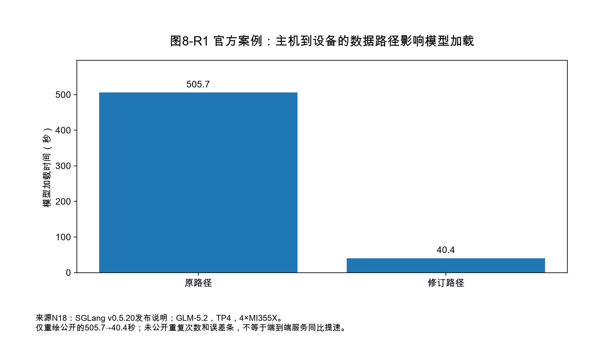
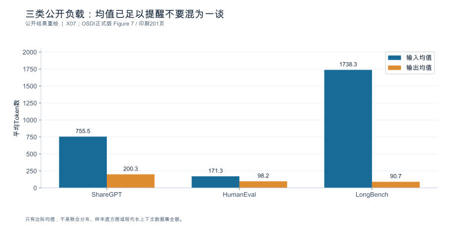

## 第8章 业务负载与基准设计

**版本：v0.10 公开来源补齐版（2026-10-05）。保留 v0.5 正文与 v0.6／v0.7／v0.8／v0.9 各轮增补节；新增 x.11 口径核对节，逐条落到可定位版本的公开来源上。全书内容为公开资料整理与工程推理；引用公开数据处均标注可定位的来源。**

> **来源约定：**计算核验范围以[测试清单](book_support_v05/data/e0_test_results.md)为准；N系列是[本轮来源记录](book_support_v05/references.md)，R/S及DOC别名保留原稿来源身份。各轮新增图均为可重绘资产。

**核心论点：**可信基准的关键不是运行某条命令，而是让负载、质量、计量和实验条件足以支持目标结论。

**开篇场景：**重复同一段提示词能跑出漂亮数字，但它回答的是缓存友好负载的表现，不一定是生产容量。

**本章产出：**负载数据卡、实验矩阵、发压器自检清单、版本化测试清单与基准报告规范。

**边界与衔接：**可以借鉴标准基准的控制思想，但**自建测试不得自称 MLPerf 认证或符合某版本规则**，除非真正满足其要求 `[SOURCE_REGISTERED]` [R14]。到达与并发的定义沿用第1章；指标与分母沿用第7章。

### 本章导航

读完本章，你应该能够：把生产记录整理成一张保留相关性与到达结构的负载卡；判断合成、公开、回放三类数据各自能检验什么；用"长度—到达—缓存—拓扑"四维矩阵选出最小实验集；证明自己的发压器没有成为瓶颈；声明冷启动与稳态的边界，并避免预热污染；用配对与重复把"配置带来的差异"从"运行间的漂移"中分离出来；最后交出一份第三方可复核的基准报告。

---

### 8.1 从业务记录构建负载画像

**本节要回答的问题：**生产负载中哪些分布必须保留？

#### 8.1.1 输入输出联合分布

只统计"输入均值"和"输出均值"是不够的，因为**决定资源占用的是二者的联合分布**：Prefill 成本随输入增长，Decode 步数与显存占用随输出增长，两者同时长才是显存与并发的最坏组合。

可算例：设生产样本中"长输入"占 0.44、"长输出"占 0.50，而真实的联合分布里"长输入且长输出"只占 **0.06**（两者负相关——文档问答通常是长输入短输出，生成任务通常是短输入长输出）。若在合成负载中按边际分布**独立**采样，则

$$
P(\text{长},\text{长})_{\text{独立}} = 0.44 \times 0.50 = \mathbf{0.22}
$$

真实值是 0.06，独立采样把它高估约 **3.7 倍**（$=0.22/0.06$）。后果是把最消耗显存的组合人为放大了近四倍，测出的容量会显著低于生产，而吞吐也可能偏低。**匹配边际不等于匹配联合分布。**

因此负载卡至少要记录：输入长度分布（不只是均值，含分位与尾部）、输出长度分布、**二者的联合分箱**、以及长度与业务类别的交叉分布。

**相关系数只能作为摘要，不能代替联合分布**：它是一个标量，无法表达高阶依赖与尾部共同出现的形态。两组负载可以有相同的相关系数却在"长输入且长输出"这一最坏组合上差数倍——而上例已经说明这一格决定容量。所以校验合成负载与生产是否等价时，比较的是**联合分箱（或多维分位）**，不是相关系数。

#### 8.1.2 会话、复用与到达相关性

到达过程同样不能只用 QPS 描述：

| 维度 | 要记录什么 | 为什么影响结果 |
|---|---|---|
| 到达间隔分布 | 指数/固定/突发；自相关 | 排队延迟对突发最敏感 |
| 会话结构 | 平均轮数、轮间思考时间 | 决定输入增长与前缀复用机会 |
| 前缀复用率 | 共享前缀的请求占比与共享长度 | 直接影响 Prefill 成本（第4章） |
| 并发在途数 | 同时未完成的请求/会话/任务 | 决定显存占用与批组成 |

注意**在途数由到达率与延迟共同决定**（$L = \lambda W$，Little 定律）：到达率 $\lambda=200$ req/s、平均停留 $W=1.2$ s 时，在途 $L=240$。只报 QPS 而不报在途数，读报告的人无法判断显存是否够用。

#### 8.1.3 业务类别、时段与脱敏偏差

负载还要按业务类别与时段分层：白天交互型为主、夜间批处理为主时，用一套混合负载代表全天会两头不讨好。建议保留"类别占比 + 每类的长度与到达特征"，而不是合成一个平均值。

**脱敏会改变负载本身**，这一点常被忽略：替换实体、截断文本、改写模板，都会改变 Token 化结果、前缀复用机会与内容难度。正确做法是记录脱敏方法并**评估它对关键统计量的影响**（长度分布、复用率、词表覆盖），把偏差写进负载卡，而不是假装脱敏无损。

无生产数据时可以构造负载，但必须写明：它代表什么（例如"长输入短输出的文档问答"）、**不能代表什么**（例如不能代表质量、不能代表真实的复用率与突发结构）。

负载卡的推荐字段（可直接作为 JSON 模板保存，随每次实验归档）：

| 字段 | 内容 | 缺失后果 |
|---|---|---|
| `source` | 生产/合成/公开/回放，含授权与许可 | 无法判断结论适用范围 |
| `length_joint` | 输入—输出联合分箱；相关系数仅作补充摘要 | 最坏组合被扭曲 |
| `arrival` | 间隔分布、突发模式、目标与实际 QPS | 排队行为不可复现 |
| `session` | 轮数分布、轮间时间、共享前缀占比 | 复用收益被误估 |
| `topology` | 独立/顺序多轮/共享分支/子任务 | 并发定义含糊 |
| `category_mix` | 业务类别占比与时段 | 混合负载代表不了任何一类 |
| `concurrency` | 请求/会话/任务三级在途数 | 显存与批组成无法核对 |
| `desensitization` | 脱敏方法与偏差评估 | 静默改变 Token 化与复用 |
| `quality_gate` | 该负载的质量判定方法 | 只有速度没有可用性 |

**本节要点**

- 负载画像要保留输入—输出的**联合分布**，匹配边际会把最坏组合放大数倍。
- 到达过程要记间隔分布、会话结构、复用率与在途数，不能只报 QPS。
- 按业务类别与时段分层；脱敏的偏差必须评估并写入负载卡。
- 无生产数据时的合成负载须写明"代表什么、不代表什么"。

**常见误区**

- **误：**输入均值 2100、输出均值 340，照着造一批就行。
  **正：**联合分布才决定资源占用；独立采样会显著扭曲最坏组合。
- **误：**峰值 QPS 就是负载画像。
  **正：**还要有在途数、复用率与突发结构。
- **误：**脱敏只改了人名地名，不影响性能。
  **正：**会改变 Token 化与前缀复用；必须评估偏差。

**本节验收**

1. 你的负载卡包含联合分布（相关系数不能替代），而不只是两个平均长度。
2. 你能给出在途数估计与到达间隔特征。
3. 你能说明脱敏方法及其对关键统计量的影响。

**依据与核验入口：**[R11] [R12] [R18]

---

### 8.2 合成负载、公开数据与真实回放

**本节要回答的问题：**三种数据分别能检验什么？

三类数据不是三选一，而是**各管一段**，且不能互相替代：

| 类型 | 能检验什么 | 不能检验什么 | 主要风险 |
|---|---|---|---|
| 合成负载 | 隔离长度、到达、并发等**结构变量** | 内容相关机制（质量、接受率、格式） | 把结构结论外推成业务质量结论 |
| 公开任务集 | 有语义的**内容与质量**；便于他人对照 | 本业务的复用率与突发结构 | 许可与版本漂移；数据集污染 |
| 授权回放 | **生产相关性**：真实联合分布、复用、突发 | 新业务形态、负载漂移、闭环交互反馈、未记录的内部状态 | 隐私、许可、泄漏；脱敏偏差 |

（"回放不能检验什么"一栏不能写"无"：它记录的是**历史**，因此对新业务、负载漂移、需要闭环交互才能触发的行为，以及当时未被记录的状态，都不构成证据。）

#### 8.2.1 可控变量的合成样本

合成负载的价值是**可隔离**：固定输出长度只改输入长度，能干净地测出 Prefill 的斜率；固定到达率只改会话轮数，能测出前缀复用的收益。它的边界也很清楚——**随机 Token 不能代表内容相关机制**。推测解码的接受率、结构化输出的合规率、工具调用的参数正确率，都依赖内容语义，用随机 Token 测出的数字不能写成业务结论（第7章 7.6）。

#### 8.2.2 有内容语义的公开任务

公开任务集用于补齐质量与内容维度。使用时必须记录：数据集名称与版本、许可条款、抽样方法与样本量、以及**是否与调优/训练数据存在泄漏**。同一数据集的不同版本可能有不同的提示词格式，直接比较会引入口径漂移。

#### 8.2.3 带授权的业务回放

回放是最接近真实的负载来源，也是责任最重的：需要授权、脱敏与留存期限约束；**不得复制受限制的真实提示词到公开材料**（第1章与本章授权与脱敏要求（原附录D尚未随本包提供））。回放还要保留时间结构——打乱顺序会破坏到达相关性与复用模式。

无论哪一类，负载文件都要带上来源、许可、生成方法、内容哈希与使用边界四件套，并在报告中注明它支撑哪一条结论。

**本节要点**

- 合成管结构、公开管内容、回放管相关性，三者互补且不可互换。
- 随机 Token 测不出接受率、格式合规率与工具参数正确率。
- 公开数据集要记版本、许可、抽样与泄漏检查。
- 回放须授权、脱敏、保留时间结构，并说明脱敏偏差。

**常见误区**

- **误：**合成负载测出的吞吐就是业务吞吐。
  **正：**它只回答结构问题；质量类结论需要语义负载。
- **误：**用了公开数据集，质量结论就可以泛化到业务。
  **正：**公开集代表它的分布，不是你的业务分布。
- **误：**回放只要留下文本就行，顺序无所谓。
  **正：**顺序决定到达相关性与复用，打乱即失真。

**本节验收**

1. 你能为每条结论指明它依赖哪一类负载，且不越界外推。
2. 你的负载文件带来源、许可、生成方法与哈希。
3. 你能说明回放数据的授权、脱敏与偏差。

**依据与核验入口：**[R11] [R12] [R27]

---

### 8.3 多轮与分支负载：长度矩阵、会话和任务

**本节要回答的问题：**最小实验集如何覆盖主要变化，而不是穷举一切？

#### 8.3.1 短长输入输出与独立请求基线

先建立四条基线，再往上叠加维度（长度为相对档位，实际取值按模型窗口与资源确定）：

| 档位 | 输入 | 输出 | 主要受压资源 |
|---|---|---|---|
| S/S | 短 | 短 | 排队与调度开销 |
| L/S | 长 | 短 | Prefill 计算与 KV 写入 |
| S/L | 短 | 长 | Decode 单步成本与 KV 驻留 |
| L/L | 长 | 长 | 显存容量与在途上限 |

（上一版把 S/L 的两列写反了，本表已修正。）

**L/S 与 S/L 必须分开测**；但要注意"主要受压资源"一栏是**待检验的预期**，不是结论：L/S 通常更接近计算受限、S/L 更接近访存与驻留受限，这是在典型模型、典型批量与给定设备下的起点假设，会随并行策略、批大小、内核选择与负载结构而迁移（第1章 1.2.2、第2章 2.3.3）。把"L/S 必然算力受限、S/L 必然带宽受限"写成通则，与全书的条件化表述冲突。

四条基线之上，全书统一使用 W01—W08 负载族作为引用代号（相对档位，实际长度按模型窗口与资源确定）：

| 代号 | 负载 | 主要验证问题 | 建议资源层级 |
|---|---|---|---|
| W01 | 短输入／短输出交互 | 基础开销、排队与调度 | E1 |
| W02 | 长输入／短输出文档问答 | Prefill 成本、前缀复用收益 | E1 |
| W03 | 短输入／长输出生成 | Decode 带宽、KV 驻留、写出节奏 | E1 |
| W04 | 保留相关性的混合负载 | 真实联合分布下的容量 | E1 |
| W05 | 前缀与多轮会话复用 | 命中率、节省量与失效策略 | E1—E2 |
| W06 | 推理／结构化／工具流程扩展 | TTFO 与可见输出、外部等待、任务完成 | E1 |
| W07 | 多模态扩展 | 额外编码路径与状态规模 | E1（按模型可用性） |
| W08 | 突发、取消与恢复 | 过载行为、幽灵负载、恢复时间 | E1—E2 |

引用时写代号而不是重述内容，可以让第 10—18 章的实验直接复用同一套负载定义；未启用的负载族要在结论边界里说明。

#### 8.3.2 顺序多轮与共享历史分支

在长度矩阵之上加**拓扑维度**，四类结构在第1章 1.1.2 已定义，此处给出各自的测量重点：

| 拓扑 | 结构 | 测量重点 | 易错点 |
|---|---|---|---|
| 独立请求 | 无关联 | 单请求延迟与吞吐 | 用单请求结论代表会话场景 |
| 顺序多轮 | $n$ 轮依赖前 $n-1$ 轮 | 逐轮输入增长、复用率、TTFT 随轮次变化 | 只测第一轮 |
| 共享历史分支 | 一前缀派生多后续 | 命中率、节省的 Prefill、失效策略 | 把命中率当成节省时间 |
| 独立子任务 | 任务拆成并行子调用 | 任务完成时间与成本，按 `task_id` 统计 | 把子请求成功数当成完成任务数 |

#### 8.3.3 独立子任务、工具等待与取消

工具与外部等待必须**单独计时**，不计入模型生成时间：外部等待属于编排层，把它混进生成耗时会得出"模型变慢"的错误归因（第1章 1.4.2、第7章 7.7）。取消与超时也要作为负载的一部分——它们产生幽灵负载并改变容量（第1章 1.6）。

建议把外部等待设计成显式变量：注入固定延迟（如 0 ms / 200 ms / 800 ms）而不是调用真实外部服务，这样才能复现且可解释。

#### 8.3.4 请求、会话与任务并发的区分

三种并发是三个不同的量，混用会让"并发 200"这个词失去意义：

| 并发类型 | 定义 | 谁受限 |
|---|---|---|
| 请求并发 | 同时未完成的 `request_id` 数 | 批处理与批组成 |
| 会话并发 | 同时活跃的 `session_id` 数 | 上下文驻留与复用 |
| 任务并发 | 同时未完成的 `task_id` 数 | 编排、外部依赖与分支 |

报告必须写明是哪一个，并给出其余两个的取值或其上限。

#### 8.3.5 工具支持的拓扑与负载可解释性

工具能表达的拓扑是有限制的。以分支会话为例：相关资料描述了 FORK/SPAWN 一类操作与当前的树形拓扑，**不能从"支持树形分支示例"推断支持任意菱形 DAG** `[SOURCE_REGISTERED]` [S18]。工具不支持的图结构，可以用合成事件解析或自行实现，但必须**标出实现来源**，并在报告中说明"该拓扑由本书合成而非工具原生"。

选择实验组合的原则是：**每个组合对应一个待验证的问题**，未覆盖的区间写进结论边界，而不是假装覆盖。

**本节要点**

- 四条长度基线分开；L/S 与 S/L 受不同资源约束，结论不可互换。
- 拓扑维度至少覆盖独立、顺序多轮、共享历史分支、独立子任务。
- 外部等待与取消要作为显式变量注入，不混进生成耗时。
- 请求/会话/任务并发是三个量；工具的拓扑限制须声明，不支持的图结构要标实现来源。

**常见误区**

- **误：**分支压测跑通了，说明任意任务图都支持。
  **正：**工具支持的是特定拓扑；推断更一般的图结构需要证据。
- **误：**子请求全部返回 200，任务并发就达标了。
  **正：**任务并发按 `task_id` 与契约判定。
- **误：**外部工具延迟属于端到端，所以并进模型延迟。
  **正：**编排层等待必须单列，否则归因错误。

**本节验收**

1. 你能给出长度—到达—缓存—拓扑四维矩阵中选出的最小实验集，并说明每个组合验证什么。
2. 你能区分三种并发并给出各自取值。
3. 你能说明所用工具支持的拓扑边界，以及不支持部分是合成还是原生。

**依据与核验入口：**[R04] [R11] [R12] [S17] [S18]

---

### 8.4 发压模式与客户端自检

**本节要回答的问题：**是不是客户端先到极限，或者偷偷替服务器排队？

#### 8.4.1 开环、闭环与轨迹回放

| 模式 | 定义 | 适用 | 风险 |
|---|---|---|---|
| 开环 | 按计划的到达时刻发出，不等前一批返回 | 研究排队、过载、真实到达相关性 | 客户端要能维持目标速率 |
| 闭环 | 维持固定并发，完成一个再发一个 | 测稳态吞吐与延迟 | **会替服务端排队**：服务端慢时到达率自动下降，看起来"稳定" |
| 轨迹回放 | 按记录的到达时刻与请求内容回放 | 最接近生产 | 需要授权数据；时间轴校准 |

**闭环测试的最危险之处是它天然限流**：当服务端变慢，闭环客户端发得更少，于是延迟看起来没有恶化、吞吐看起来只是略降——**过载被客户端吸收了**。要研究过载行为，必须用开环或轨迹回放。

#### 8.4.2 计划到达与实际发出

必须同时记录"计划发出时刻"与"实际发出时刻"，并报告**调度迟滞**（实际−计划）的分布。若迟滞长期为正，说明发压器跟不上目标，此时"目标 200 req/s"只是名义值。

可算例：目标 $\lambda = 200$ req/s、平均停留 $W = 1.2$ s，则需要同时维持在途

$$
L = \lambda W = 200 \times 1.2 = 240
$$

若客户端连接池上限为 128，**并假设一条连接同一时刻只能承载一个在途请求、服务时间可取 $W=1.2$ s 且该值稳定**，则其能维持的最大到达率为

$$
\lambda_{\max} = \frac{128}{1.2} = 106.67\ \text{req/s}
$$

也就是说，在这个假设模型下目标 200 req/s **根本达不到**，实际只有约 107 req/s。**若使用 HTTP 多路复用，或并发受其它因素（线程数、令牌桶、解析能力）限制，这个模型就要改写**：连接池数不等于在途请求数，需要先确认实际的并发限制机制。若不记录这一条，报告会显示"系统在 200 req/s 下延迟稳定"——而真相是客户端把它限流到了 107。**被客户端限流的请求不得从分母里省略。**

#### 8.4.3 客户端资源与连接限制

在给服务加压之前，先用**受控回显服务**（收到即返回，不做推理）验证发压器本身：能否维持目标速率、CPU/网络/文件描述符是否成为瓶颈、流式解析是否跟得上、分支调度是否正确。

清单至少覆盖：连接池与最大并发、TLS 握手成本（是否复用连接）、JSON 解析开销、时钟获取开销、事件写入 I/O、以及客户端所在主机与被测系统的网络路径。

工具迁移时还要保留**旧、新版本对同一事件流的解析结果**，用于确认字段变化不是服务容量变化（第7章 7.2.5 的七列登记）。

**本节要点**

- 闭环会替服务端排队；研究过载必须用开环或轨迹回放。
- 同时记录计划与实际发出时刻，报告调度迟滞。
- 用 Little 定律核对客户端并发上限是否支持目标到达率。
- 先用回显服务验证发压器，再测服务；被限流的请求必须计入分母。

**常见误区**

- **误：**闭环压测下延迟很稳，说明系统容量充足。
  **正：**闭环会自动限流，把过载藏起来了。
- **误：**目标 200 req/s 就是实际 200 req/s。
  **正：**要核对实际发出率与调度迟滞。
- **误：**客户端并发调大就行。
  **正：**并发上限与延迟共同决定可达到达率；还要看连接与解析开销。

**本节验收**

1. 你能说明本次用的是开环、闭环还是回放，并证明它匹配研究问题。
2. 你能给出计划 vs 实际发出的对比与调度迟滞分布。
3. 你能在加压前用回显服务证明发压器不是瓶颈。

**依据与核验入口：**[R11] [R12] [R13] [S17] [S18]

---

### 8.5 冷启动、权重常驻、预热与缓存污染

**本节要回答的问题：**预热了什么，又是否改变了被测负载？

#### 8.5.1 容器启动、制品加载与转换

冷启动不是一个数，是一串阶段。**每一段分别计时**，否则无法判断优化落在哪里：

| 阶段 | 示例耗时 (s) | 受什么影响 |
|---|---:|---|
| 容器/进程启动 | 8 | 镜像体积、初始化 |
| 制品读取（权重分片） | 46 | 存储带宽、网络、分片数 |
| 权重就绪（格式转换/量化预处理） | 12 | 精度方案、是否发生转换 |
| 编译（如启用） | 23 | 编译缓存是否命中、模型结构 |
| 图捕获/形状桶生成 | 11 | 模式与桶集合 |
| 缓存池热身 | 15 | 预热负载、目标容量 |
| **首次可接业务流量** | **115** | 上述全部 |

以上为构造数据 （$8+46+12+23+11+15=115$）。关键要求是**报告"首次可接流量时间"，而不是只报"启动用了几秒"**——前者才是运维真正关心的量。

#### 8.5.2 编译、图捕获与缓存热身

编译与图捕获属于一次性成本，但它们的**触发条件**决定是否会重复付出：编译缓存失效（形状/配置变化）、图捕获遇到未覆盖的形状、以及运行时降级到 eager 都会让"第二次也很慢"。第1章 1.5.2 已给出机制，此处只需记住实验要求：**在报告中记录编译与图模式的实际状态，而不是假设它们已完成。**

缓存热身要独立设计：用**独立样本**预热，而不是拿测试集样本预热——后者会把测试前缀全部填满缓存，人为抬高命中率，这就是缓存污染。

#### 8.5.3 权重常驻与实际接流量时间

把权重缓存在本地（或常驻内存/显存）可以显著缩短首次可接流量时间。资料示例：某版本发布说明包含 GPU 权重缓存类的快速启动机制 `[SOURCE_REGISTERED]` [S02]（页面快照，未本地执行）。沿用上表的构造数据：若制品读取由 46 s 降至 6 s，则首次可接流量时间从 115 s 降至 **75 s**（$-40$ s），并另作假设：稳态吞吐保持不变。

因此登记此类机制时必须同时写清三项：**命中前提**（什么情况下走缓存）、**常驻资源**（额外占用的内存/显存/磁盘）、**失效恢复**（缓存失效或缺失时退回到哪条路径、耗时多少）。**启动更快不等于稳态更快**，把两者混在一句"性能提升 34%"里是最典型的误报。

#### 8.5.4 冷暖分层、丢弃规则与失败恢复

正确做法是**冷暖并列报告**：分别给出冷启动后的首批结果、稳态结果，以及从冷到稳的时间（例如"第 200 个请求后 TTFT 进入稳态区间"）。丢弃规则必须**预先定义**（丢弃前 $k$ 个请求 / 丢弃前 $t$ 秒 / 不丢弃但分层），而不是事后看着数据挑。

预热停止条件应依据**稳定性判据**（如连续若干窗口内指标变异系数低于阈值，或可用容量达到稳态），而不是照搬"预热 100 次"。

失败恢复也要计时：进程重启、缓存清空、编译缓存失效之后重新达到稳态需要多久，这直接决定扩容与故障场景下的容量（第16章）。

**本节要点**

- 冷启动分阶段计时，报告"首次可接流量时间"。
- 预热用独立样本，避免用测试集前缀污染命中率。
- 权重常驻类机制要登记命中前提、常驻资源与失效恢复；启动更快 ≠ 稳态更快。
- 冷暖并列报告，丢弃规则与预热停止条件预先定义。

**常见误区**

- **误：**启动耗时 12 秒，所以系统 12 秒后可服务。
  **正：**可服务取决于"首次可接流量时间"，包含加载、编译、图捕获与热身。
- **误：**预热跑一遍测试集最省事。
  **正：**那是缓存污染；命中率被人为抬高。
- **误：**权重缓存让启动快了 40 秒，等于性能提升。
  **正：**改善的是冷启动，稳态吞吐未变；且要付出常驻资源。

**本节验收**

1. 你能给出冷启动各阶段的分项计时与首次可接流量时间。
2. 你能说明预热样本的来源与停止条件，并证明没有用测试集污染缓存。
3. 你能给出权重常驻机制的命中前提、常驻资源与失效恢复路径。

**依据与核验入口：**[R11] [R13] [R31] [R07] [S02] [S03] [S06]

---

### 8.6 受控对照、重复与统计分析

**本节要回答的问题：**怎样知道差异来自配置，而不是顺序、温度或运气？

#### 8.6.1 配对与分块实验

最有效的低成本手段是**配对（paired）+ 交错（interleaved）**：同一份负载在两个配置上各跑一遍，且按 A/B/A/B 的顺序交错，而不是先跑完所有 A 再跑所有 B。这可降低部分顺序偏差，但不会自动消除单调漂移或残留效应；应优先使用随机化区组或 AB/BA 对称安排，并规定状态重置。

分析时看**配对差值的分布**，而不是两组的均值之差：差值序列能告诉你改善是稳定的还是被一两次异常运行拉出来的。

#### 8.6.2 交互因素与重复

永远只改一个变量（OFAT）会漏掉交互：某开关在小批量时有利、大批量时有害，OFAT 会得出"总体略好"的错误结论。对明显存在交互的参数，用小型因子设计（如 $2\times2$）比增加更多 OFAT 实验更省样本。

重复次数由**波动与所需精度**决定，不是固定三次。可算例：

| 配置 | 三次运行 (req/s) | 均值 | 极差 |
|---|---|---:|---:|
| A | 4.02 / 4.18 / 3.96 | 4.05 | 0.22 |
| B | 4.31 / 4.22 / 4.40 | 4.31 | 0.18 |

把三轮按顺序配对，得到差值序列 $[4.31-4.02,\;4.22-4.18,\;4.40-3.96] = [0.29,\;0.04,\;0.44]$，均值 $\bar{d} = 0.77/3 = \mathbf{0.257}$ req/s（约 6.3%），区间从 0.04 到 0.44。

**正确的判断分两步，不能靠"极差 0.22 与均值差 0.26 同量级"这种比较**——那不是有效的统计判断：

1. **先定效应目标**：本业务认为小于 0.15 req/s 的改善不值得付出迁移成本（这是业务决策，不是统计结论）；
2. **再看配对差值**：三轮差值**全为正**（方向一致，3/3），但离散度很大（0.04–0.44），说明样本中方向一致，但只有三组时仍不足以把总体改善方向当成统计上确定的事实。

因此可写的结论是：**B 优于 A 的方向在三次配对中一致，但效应幅度的区间（0.04–0.44）跨越了 0.15 的采用门槛，需要更多区组或更严格的对照才能给出采用决定**；不可写的是"B 快 6%"或"三次不足以判断"这类没有效应目标与区间的断言。

还要注意**交错不等于消除漂移**：ABAB 只在漂移是随机且对称时才把它平均掉；若存在单调时间漂移、热状态累积，或 A→B 之间有残留效应（缓存、连接池、编译缓存未重置），顺序仍会与配置混淆。因此必须说明随机化或区组方式、**必要的状态重置**，并在报告里写明采用条件。

#### 8.6.3 选择偏差、留出与仿真边界

- **先定义主指标与停止规则，再查看结果。**跑完一大堆配置再挑最好的一组，等于在选择噪声的最大值。
- **留出验证**：用于调参的负载与用于最终结论的负载要分开（第7章 7.6.3 的三分数据集同理）。
- **仿真不能顶替实测**：CPU-only 模拟器一类的工具可用于**筛选实验**与研究调度 `[SOURCE_REGISTERED]` [S03]；另有资料记录将配置器更名为仿真器 `[SOURCE_REGISTERED]` [S06]。仿真结果必须标 `run_type = SIMULATED`，写明仿真输入、模型假设与校准来源，**不得与 `MEASURED` 混淆来源；校准图允许明确区分后并列展示，但仿真不承担模型数值质量验收**。

**本节要点**

- 配对 + 交错，看差值分布而不是两组均值。
- 存在交互时用因子设计；重复次数由波动与精度决定。
- 先定主指标与停止规则，再跑；调参与结论负载分离。
- 仿真标 SIMULATED，来源必须清晰，不承担质量验收；**但这不等于禁止与实测并列比较**——在验证预测或校准模型时，把仿真与实测画在同一坐标系、用不同标识区分来源，恰恰是必要的对照。禁止的是混淆来源，不是并列展示。

**常见误区**

- **误：**A 跑了 4.31、B 跑了 4.05，所以 A 快 6%。
  **正：**给出配对差值序列与区间，并对照事先设定的效应目标；不比较"均值差"与"极差"两个不同性质的量。
- **误：**改一个变量最干净，所以永远只改一个。
  **正：**会漏掉交互；必要时用因子设计。
- **误：**仿真跑得快，可以用它出性能结论。
  **正：**仿真只能筛选假设，结论仍需实测证据。

**本节验收**

1. 你能说明实验是否配对、是否交错，并给出差值分布。
2. 你能为存在交互的参数设计小型因子实验。
3. 你能说明重复次数的依据，并把仿真与实测分开标注。

**依据与核验入口：**[R12] [R15] [S03] [S06]

---

### 8.7 实验：交付一份可复核基准

**本节要回答的问题：**别人拿到报告，是否知道怎样重跑并检查结论？

#### 8.7.1 实验清单与制品身份

一份可复核的报告至少包含以下 12 项，缺任何一项都会让结论无法追溯：

| # | 项目 | 说明 |
|---|---|---|
| 1 | 实验身份 | `run_id`、时间、执行者、授权范围 |
| 2 | 制品身份 | 模型 revision、权重哈希、分词器、模板、精度方案 |
| 3 | 运行身份 | 引擎版本/commit、生效配置、执行路径、硬件与驱动 |
| 4 | 负载卡 | 来源、联合分布、到达结构、拓扑、脱敏偏差 |
| 5 | 发压方式 | 开环/闭环/回放、连接池上限、调度迟滞 |
| 6 | 预热与缓存状态 | 预热样本来源、停止条件、冷暖分层、丢弃规则 |
| 7 | 指标口径 | 起点/终点/时间域、`mapping_version` |
| 8 | 质量门槛 | 判定方法、评估集、是否在线逐请求 |
| 9 | 分母与终态 | 成功/失败/取消/超时/未知各层的计数 |
| 10 | 统计方法 | 分位算法、样本量、重复次数、区间或差值分布 |
| 11 | `run_type` | MEASURED / SIMULATED / SYNTHETIC / CONFIG_ANALYSIS |
| 12 | 失败与负面结果 | 失败运行、异常、排除理由 |

#### 8.7.2 原始事件与汇总

图表必须由**原始记录派生**，不得手工改动数值；脚本与数据一同存档。工具接口随版本变化时，**保留原生结果**，再通过受控映射生成统一口径；**禁止把多个版本的输出混作一套数据**。

结果索引至少包含：逐请求原生记录、规范化结果、汇总表、环境日志、统计说明与图表生成脚本。这样即使第三方没有同款硬件，也能审查口径是否自洽。

#### 8.7.3 结论范围与复现说明

报告的最后一节必须写明结论边界：本结论适用于哪些负载、哪些长度档、哪些拓扑、哪些版本组合；**未覆盖的区间要明说**。复现说明给出最短路径：拿这份 manifest 与负载卡，在何种资源层级下可重跑；在何种条件下只能审查口径而不能复现。

**本节要点**

- 12 项报告清单齐全，第三方才能定位每个结论对应的运行与源数据。
- 图表由原始记录派生；保留工具原值与映射版本，不混版本。
- 结论边界写明适用范围与未覆盖区间，并给出复现或审查的最短路径。

**常见误区**

- **误：**报告里有性能表和结论就够了。
  **正：**没有制品身份、口径与分母，结论无法被检查。
- **误：**多跑几个工具版本取平均更全面。
  **正：**那是混数据；应保留原值并标注映射版本。

**本节验收**

1. 你的报告包含 12 项清单，且每项可定位到具体文件或字段。
2. 所有图表可追溯到原始记录与生成脚本。
3. 结论边界写明了未覆盖的负载与版本区间。

**依据与核验入口：**[R11] [R12] [R13] [R14] [S17] [S18] [S03] [S06]

---

### 8.8 深化：基准是一个采样与识别问题

#### 8.8.1 同一负载文件不一定产生同一计算负载

同一份文本经过不同模板、分词器、媒体处理器或停止规则，会变成不同的Token序列和输出分布。即使输入Token一致，采样随机性、前缀冷热、推测接受和路由也会改变实际执行工作。报告应把三个层次分开：用户任务样本、引擎看到的逻辑Token、设备实际执行的位置和候选。

因此，回放文件除了文本或ID，还需保存到达计划、依赖拓扑和采样配置；执行后再导出实际Token统计。对“固定输出长度”的性能实验，要明确通过什么机制实现，是否禁止EOS，以及该机制是否改变业务任务。它可以作为控制变量的微基准，但不能直接代表自然生成的质量与成本。

#### 8.8.2 计划时间和发出时间共同决定遗漏发生在哪里

在真正的开环实验中，计划到达与服务完成没有反馈关系。但客户端自身的连接池、协程数、流式解析或磁盘写入仍可能阻塞发出。此时若从实际发出开始计时，客户端等待被排除，可能再次把系统体验测得过于乐观。

可以并列报告两种时间：`scheduled_to_complete`含发压器迟滞，帮助审查是否忠实执行计划；`sent_to_complete`反映请求实际进入网络后的表现。前者不能全部归因于服务端，后者不能证明发压器没有漏掉外部到达。若迟滞持续增长，应停止扩压并标记客户端受限，而不是把名义目标速率写成实际速率。

#### 8.8.3 三个正差值不是已经证明总体改善

第8.6节的配对差值为0.29、0.04、0.44 req/s，样本均值约0.257。样本最小值到最大值是**观察范围**，不是置信区间。在一个对称、独立且无平局的零效应假设下，三个差值恰好同号的双侧符号检验概率为 $2/2^3=0.25$，并不构成常见5%水平下的显著结果。

这里不是要求机械追求某个p值，而是强调报告应同时回答：效应的业务门槛是多少，重复运行之间变动有多大，样本是否足以区分有价值的改善与噪声。若要估计总体效应的区间，采样单位应按运行、时间块或会话确定；对高度相关的逐Token记录做独立bootstrap，会把样本量夸大。

调参也会引入选择偏差。观察几十个配置后挑最快者，再用同一批数据估计提升，通常偏乐观。应预先限制候选、记录全部尝试，并用未参与选择的负载与新运行作最终确认。留出的是对决策的独立检验，不是简单换一个随机种子就算完成。

#### 8.8.4 公开加载案例说明为何冷启动必须独立

SGLang 0.5.20发布说明记录了一个GLM-5.2、TP4、4×MI355X的加载优化案例：加载时间505.7 s变为40.4 s [N18]。这是项目方报告的加载阶段结果，不是本书测量，也不是在线Token吞吐。其价值在于提供了明确的阶段、模型和硬件身份，而不是给出一个可通用套用的加速倍数。

图只重绘这两个公开数值，保留原指标和单位，没有补造误差条或重复次数。正式工程验收仍需补镜像与模型revision、冷缓存条件、存储路径和重复分布；若这些字段缺失，就不能把该图用作跨平台采购比较。公开数据能填补一个案例，但不能填满本地环境所有实验栏。

---

<!-- V06-START -->

### 8.9 实验图表补充：补入论文真实负载长度，而不伪造分布

DistServe OSDI 2024正式论文Figure 7图例直接给出三组均值：ShareGPT输入755.5/输出200.3，HumanEval输入171.3/输出98.2，LongBench输入1738.3/输出90.7。本文核对了正式PDF第10页（印刷201页）的图中文字，而不是从曲线像素估计数值。

这些均值足以提醒基准不能混为一谈：论文中的摘要负载相对代码补全明显更偏输入。但它们**不足以恢复联合分布**，也不能推出“长输入且长输出”的概率。因此图只画均值柱，不生成散点、直方图或相关系数。

LongBench还受到OPT绝对位置嵌入的2048输入上限限制。不能把1738.3当作LongBench在现代128k模型上的天然平均长度，也不能据此设定今日业务负载。论文未披露完整tokenizer与三套数据的全部预处理规则，这些内容留在来源边界中。

**实际使用：**用本业务采样生成输入×输出联合分布、到达轨迹、缓存共享与多轮依赖，再判断哪个公开负载最接近；公开论文的均值只作对照点。原v0.5中505.7→40.4秒仍是SGLang特定模型加载实验，不与这里的OPT负载混合。

#### 图8-V1 三类公开负载：均值已足以提醒不要混为一谈

**数据身份：**`PUBLISHED_RESULT`。**条件：**OPT评测；LongBench输入被限制到2048；数值为原图图例avg标签；tokenizer未披露。

| 论文工作负载 | 输入均值/Token | 输出均值/Token |
|---|---|---|
| ShareGPT | 755.5 | 200.3 |
| HumanEval | 171.3 | 98.2 |
| LongBench | 1738.3 | 90.7 |

**出处与边界：**[X07](book_support_v06/来源与核验.md#x07)；只有边际均值，不是联合分布、样本直方图或现代长上下文数据集全貌。

[数据与绘图点](book_support_v06/data/ch08_public_lengths.json) · [PNG](book_support_v06/figures/ch08_public_lengths.png) · [重绘代码](book_support_v06/code/replot.py)

<!-- V06-END -->
### 章末检查问题

**1. 只匹配平均输入输出长度为何不足以复现业务？**

因为决定资源占用的是**联合分布**。8.1.1 的算例中，边际独立采样把"长输入且长输出"这一最耗显存的组合从真实的 0.06 抬到 0.22（约 3.7 倍）。此外还有到达相关性、会话复用率与在途数——只给两个均值，既复现不了显存占用，也复现不了排队行为。正确做法是给负载卡：联合分箱、到达间隔分布、复用率、在途数。

**2. 同一提示词重复运行是否一定是不公平测试？**

不一定，取决于研究问题。若测的是**缓存友好场景下的上限**（例如前缀复用的最大收益、稳态单请求延迟），重复同一提示词是合法且可控的手段，但结论必须限定为"缓存全命中场景"。若研究的是**生产容量或质量**，它就是不公平的：除非生产确实具有同样的共享结构，否则不能假设真实负载也是 100% 复用，而重复负载会让 Prefill 成本被系统性低估、命中率被系统性高估。**关键是声明它回答什么问题，而不是默认它代表业务。**

**3. 树形分支压测为何不能宣称已覆盖任意菱形 DAG？**

因为工具支持的拓扑是具体的：资料描述了 FORK/SPAWN 一类操作与当前的树形结构限制 `[SOURCE_REGISTERED]` [S18]；"树形分支能跑通"只证明该拓扑可用。菱形 DAG 需要汇合（join）语义与依赖判定，属于另一类能力。若需要测试它，应自行合成事件或实现，并**标明这是本书合成而非工具原生**，同时把该限制写进结论边界。

---

### 本章验收清单

| 节 | 验收标准 |
|---|---|
| 8.1 | 负载画像含相关性与采样范围，不只是两个平均长度；脱敏偏差已评估 |
| 8.2 | 每个负载有来源和用途说明；随机负载结论未外推为业务质量结论 |
| 8.3 | 每个组合对应一个待验证问题；三种并发分别定义；外部等待与引擎等待分开；工具拓扑限制已声明 |
| 8.4 | 实际发压接近声明模式，达不到时明确标注客户端受限；被限流请求计入分母 |
| 8.5 | 预热范围与丢弃规则预先定义；正式测试的缓存状态可解释；启动加速与稳态吞吐分别报告 |
| 8.6 | 结果含重复分布、失败运行与选择过程；无法确认的改善不写成确定增益；仿真与实测分离 |
| 8.7 | 第三方能定位每个结论对应的运行及源数据；无环境时也能审查口径；同名指标同事件同分母才可比 |

---

### 本版配套资料

[新增图表与数据](book_support_v05/figures.md) · [来源登记](book_support_v05/references.md) · [E0测试清单](book_support_v05/data/e0_test_results.md) · [修订记录](book_support_v05/review/changes.md)

[N18]: book_support_v05/references.md#n18
[R04]: book_support_v05/references.md#r04
[R07]: book_support_v05/references.md#r07
[R11]: book_support_v05/references.md#r11
[R12]: book_support_v05/references.md#r12
[R13]: book_support_v05/references.md#r13
[R14]: book_support_v05/references.md#r14
[R15]: book_support_v05/references.md#r15
[R18]: book_support_v05/references.md#r18
[R27]: book_support_v05/references.md#r27
[R31]: book_support_v05/references.md#r31
[S02]: book_support_v05/references.md#s02
[S03]: book_support_v05/references.md#s03
[S06]: book_support_v05/references.md#s06
[S17]: book_support_v05/references.md#s17
[S18]: book_support_v05/references.md#s18

<!-- V10-START -->

### 本章口径核对（公开来源）

#### 权重常驻机制、仿真工具与分支工具的拓扑边界

**权重常驻（vLLM v0.30.0 的 Fast Start）**

v0.30.0 引入常驻的 per-GPU 权重缓存守护进程：它把**量化后、TP 分片后**的权重常驻在显存中，重启引擎时通过 CUDA IPC 直接映射，用 `--load-format ipc_cache` 取代从磁盘重载。该机制已覆盖 FP4 checkpoint 与多机 TP，按 GPU UUID 建立 socket 目录，并对非 CUDA/ROCm 平台明确报错。

命中前提是"同一台机器上已有该权重形态的守护进程存活"；常驻资源即被守护进程占用的显存。失效恢复方面，v0.30.0 同时修复了 sleep 模式下 NCCL 通信子内存的释放，以及 MRV2 在 shutdown 与 sleep 时的内存释放。

**边界**：发布说明未给出该机制在具体模型与拓扑下的收益数字，也未给出常驻显存的量化口径；收益与占用需要按目标配置分别度量。发布说明给出的唯一量化数字属于相邻的图捕获路径——MRV2 在冻结 gc 后把图捕获从 12 s 降到 2 s、引擎初始化从 28.9 s 降到 8.2 s（H200 上）。

**仿真工具（SGLang Simulator，v0.5.20）**

SGLang 的 CPU-only 模拟器运行**真实的调度器、radix cache 与分层 cache**，只把模型前向替换为时延预测器。官方给出的校准口径是"**所有预测误差均低于 5% MAPE**"，验证条件为 **H20** 上对 **Qwen3-8B** 与 **Qwen3-32B-FP8** 两个模型对照真实部署：Mean TTFT 误差 3.42% / 4.15% / 2.38%（Qwen3-8B）与 2.77% / 2.40% / 3.05%（Qwen3-32B-FP8），三档依次为 no_cache / L1 / L2；前缀命中率误差 0.0% / 0.04% / 0.00%。

> **v0.11 订正（检索日 2026-10-09）**：原稿的"TTFT 约 6%、最长轨迹 10%、前缀复用 0.05 个百分点"在官方口径中未取得，已按官方口径改写。MAPE 是平均百分比误差，不是最坏情况误差。

Dynamo 侧的对应物是 `AISimulate`（原 `AIConfigurator`），在 v1.5.0 中成为独立包；旧的 `python -m dynamo.replay` CLI 已移除。截至检索日（2026-10-09）Dynamo 已到 **v1.5.1**，`AISimulate` 未弃用、未移除，但官方标注为 **Experimental** 且明确"不作为生产容量规划依据"。

**边界**：SGLang 的误差数字是官方自述，且绑定在 SGLang 自身的调度器与 radix cache 实现、上述两个模型与 H20 硬件上；换引擎、换模型、换负载形状后该偏差不可直接外推。

**分支工具的拓扑能力边界（AI Perf 会话 DAG）**

AI Perf 用 `--custom-dataset-type dag_jsonl` 启用会话 DAG 模式，每行一个会话对象，字段包括 `session_id`（必填且全文件唯一）、`turns`（必填、有序、非空）、`forks`、`spawns`、`join_at`、`pre_session_spawns`、`orchestrator`、`rounds` 与 `context_mode`。两种子会话语义不同：

| 模式 | 语义 |
|---|---|
| `FORK` | 子会话是父会话的延续，共享长前导文本，适合前缀缓存与 KV 感知路由测试 |
| `SPAWN` | 每个子会话从零开始，不带父会话历史，适合子智能体树 |

**拓扑边界（关键结论）**：官方明确"**只支持树拓扑**"。菱形拓扑——即一个会话被两个 `FORK` 父节点引用——被**显式拒绝**，报错信息形如 `session 'Y' forked by both 'A' turn 0 and 'B' turn 0; FORK-mode children require a single parent`。环路为硬错误，因为必然导致无限递归。一个会话最多只能是一个父节点的 `FORK` 目标；而 `SPAWN` 目标可以被多个父节点引用。

以下构造在加载时由 `validate_for_orchestrator_v1` 抛出 `NotImplementedError`：逐子会话门控 `child_conversation_ids`、运行时菱形屏障 `barrier_id`、定时前置条件 `timer_seconds`、外部事件前置条件 `event_name`。

其它已声明的限制：v1 不含合成输入生成器（只接受手写的 turn 对象）；`--concurrency` 可被扇出因子临时突破（单根 `forks:[A,B,C]` 且 `--concurrency=10` 时最多 30 个在途）；单根文件下 `--num-conversations` 自动取根数量，可能使 `--concurrency` 无法超过 1；`--request-count` 对子会话生效而 `--num-conversations` 对子会话被绕过；`system` 消息只允许出现在累积播种轮（根的第 0 轮或 `SPAWN` 子会话的第 0 轮），`FORK` 子会话的第 0 轮不允许带 `system` 消息。
<!-- V10-END -->
