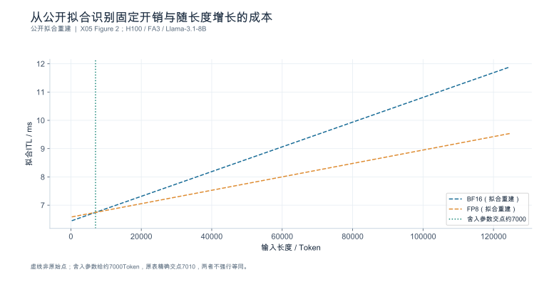
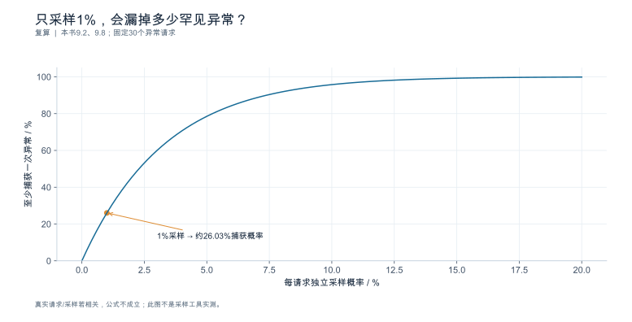

## 第9章 监控、日志与性能剖析

**核心论点：**观测的价值在于区分候选解释；采集更多数据并不自动形成更强证据。

### 本章导航

读完本章，你应该能够：按问题选择观测层级而不全量开采集；用标识把指标异常定位到具体请求与执行；检查主机侧是否拖累了设备；区分"设备忙碌率""显存容量占用""有效算力"三种语义；从系统时间线读出关键路径与空洞，并把执行路径落到可取证的身份；控制采集本身的扰动与合规风险；最后交出一个能让下一位工程师继续排查的最小诊断包。

---

### 9.1 观测分层与最小证据集

**本节要回答的问题：**回答不同问题，需要观察到哪一层？

#### 9.1.1 四层观测

| 层 | 典型证据 | 能回答 | 不能回答 |
|---|---|---|---|
| 客户端 | 逐事件时间戳、终态、错误分类 | 用户体感、网络与网关缓冲 | 引擎内部发生了什么 |
| 服务端 | 请求级指标、队列长度、终态计数 | 排队与调度、成功率、缓存命中 | 设备在执行什么 |
| 运行时 | 引擎内部事件、执行路径、状态块 | 批组成、执行路径、回退、缓存命中来源 | 硬件计数器细节 |
| 设备 | 原生计数器、系统时间线、内核 trace | 内核身份、通信、空洞、带宽 | 业务含义 |

层不是越深越好：**越深的观测通常越贵、越易扰动系统、也越难与业务请求关联**。先用便宜的服务端指标确定异常窗口，再针对假设向下采集。

#### 9.1.2 权限决定可达边界

第1章定义的资源层级在这里直接决定能写什么结论：

| 资源层级 | 可观测 | 必须承认的边界 |
|---|---|---|
| E1（只有接口权限） | 客户端事件、终态、端到端分布 | 不能确认内核路径、排队内部、显存回收 |
| E2（可访问主机与设备观测） | 服务端指标、系统 trace、设备计数器 | 单设备不代表多卡或跨节点 |
| E3—E5 | 节点内/跨节点拓扑与通信 | 未覆盖拓扑不得外推 |

**E1 条件下写到内部机制的结论都是推测**，必须标注为假设并给出验证路径。

#### 9.1.3 假设驱动的采集计划

正确的顺序是：**先列出候选解释，再决定采集什么**，而不是"先把所有采集打开再说"。为每一项采集写明四列：目的（要区分哪两个解释）、频率或采样率、成本（时间/内存/存储/扰动）、以及停止条件。

一份最小采集计划通常长这样：

| 采集项 | 目的 | 频率 | 成本 | 停止条件 |
|---|---|---|---|---|
| 请求级指标 | 发现异常窗口 | 连续 | 低 | 常驻 |
| 服务端队列与终态 | 区分排队与计算 | 连续 | 低 | 常驻 |
| 系统时间线 trace | 定位空洞与通信 | 异常窗口内 30—60 s | 中高 | 拿到 3 个可解释窗口即可 |
| 内核级剖析 | 确认内核身份 | 单次、短窗、开关对照 | 高 | 取得一次路径证据即可 |

**本节要点**

- 四层观测各有能回答与不能回答的问题，越深越贵越难关联。
- 权限决定结论边界；E1 条件下的内部结论必须是标注过的假设。
- 采集计划先列候选解释，每项写明目的、频率、成本与停止条件。

**常见误区**

- **误：**监控越全越好，全都开着最保险。
  **正：**深度采集有扰动与存储成本，且与业务请求难以关联；应按假设开。
- **误：**有了设备 trace 就能解释业务变慢。
  **正：**还需要请求级证据把设备行为与具体请求/负载对应起来。
- **误：**E1 也能通过端到端延迟推断内核问题。
  **正：**推断是假设，不是结论；必须标注并给出验证路径。

**本节验收**

1. 你能说出每个计划采集的数据对应哪一组待区分的解释。
2. 你能按自己当前的资源层级列出可写与不可写的结论。
3. 你的采集计划含成本与停止条件，而不是"一直开着"。

**依据与核验入口：**[R01] [R16] [R17] [R18]

---

### 9.2 Metrics、Logs 与 Traces 的关联

**本节要回答的问题：**如何把汇总异常定位到具体请求和执行？

#### 9.2.1 指标：发现变化，不解释原因

指标（metrics）是聚合量，用于**发现**变化与设定告警。两个约束必须记住：

- **分位数不可跨实例平均**（第7章 7.4.2）；聚合要用可合并的分布表示，并写明分位算法与样本量；
- **不要把 `request_id`、`task_id` 等高基数标识作为指标标签**——它会把时间序列基数爆炸，也会把请求级信息错误地塞进聚合通道。请求级信息属于日志与 trace。

低基数标签的推荐集合：模型/版本、路由类别、长度档、终态类别、租户分层。

#### 9.2.2 结构化日志：记录状态与细节

日志按事件而不是按文本行组织，每条至少带：时间戳 + 时钟域、`request_id` / `attempt_id` / `task_id` / `session_id`、`trace_id` / `span_id`、`run_id`、终态与原因。**敏感提示词默认不入日志**（9.6 展开），只保留哈希或脱敏摘要 + 私有索引。

#### 9.2.3 Trace 与跨进程关联

trace 的价值是把调用与执行组织成因果关系。关联靠标识，不靠时间接近：

| 标识 | 关联什么 |
|---|---|
| `request_id` / `attempt_id` | 请求与重试 |
| `trace_id` / `span_id` | 跨进程调用链 |
| `run_id` | 一次实验或一次运行 |
| `transfer_id` | 状态/缓存传输（分布式场景） |
| `model_call_id` | 具体到某次模型调用 |

三条使用规则：

1. **记录采样率**。trace 通常是采样的，覆盖率决定了能下什么结论。可算例：10000 个请求、采样率 1/100 → 100 条 trace；若异常只发生在 0.3% 的请求上（$10000\times0.003=30$ 条），期望被采到的只有 $30\times0.01=0.3$ 条——**随机采样基本抓不到**。这类尾部异常必须用定向采样（按终态、按长度、按租户条件采样）。
2. **记录时钟域**。跨进程、跨主机使用不同时钟时，不能直接相减伪造传输耗时（第1章 1.2.3、第7章 7.2.2）。
3. **缺失片段不等于零耗时**。未采集到的区间应标为缺失，不能填 0；把空洞填成 0 会让"没采到"变成"极快"。

分布式场景还要把**路由决策、缓存查找、状态传输发起、接收确认、回收**五类事件与 `transfer_id` 关联到同一 `run_id` `[SOURCE_REGISTERED]` [S13] [S15] [S06]。

**本节要点**

- 指标发现变化、日志记录状态、trace 组织因果，三者靠标识关联。
- 高基数标识不进指标标签；请求级信息走日志与 trace。
- 必须记录采样率与时钟域；缺失片段记缺失，不记 0。
- 分布式事件（路由/缓存/传输/确认/回收）与 `transfer_id`、`run_id` 关联。

**常见误区**

- **误：**给指标加个 `request_id` 标签就能查单请求。
  **正：**那会毁掉指标系统；请求级数据属于日志与 trace。
- **误：**trace 里没看到的耗时就是 0。
  **正：**是未采集；标缺失，并说明覆盖率。
- **误：**按 1% 采样就能分析千分之一的异常。
  **正：**千分之一在 10000 条里是 10 条，独立 1% 采样的期望命中只有 **0.1 条**；
  若是 0.3%（30 条），期望命中 0.3 条，**至少命中一次的概率约 26.03%**（$=1-0.99^{30}$）。
  所以结论是"覆盖不足、不可依赖"，而不是"绝对抓不到"；尾部异常仍应改用定向采样。

**本节验收**

1. 你能从一段指标异常回到对应的请求样本，并说明 trace 覆盖率。
2. 你的日志事件带齐五级标识与时钟域。
3. 你能说明分布式场景下的传输事件如何与 `run_id` 关联。

**依据与核验入口：**[R01] [R15] [R18] [S13] [S15] [S06]

---

### 9.3 CPU、内存、存储与网络观测

**本节要回答的问题：**设备空闲是否可能因为主机没有及时供给？

#### 9.3.1 线程与进程调度

设备空闲的第一嫌疑往往是主机：预处理（分词、模板展开、图像解码）、批处理组装、采样与停止判定、输出序列化**在多数部署中**发生在主机侧，但**采样与停止判定由哪一侧执行取决于实现**（第1章 1.5.2 已要求按实现取证）。排查时应逐路径核验，而不是默认把它们都算在主机账上。检查项包括：进程的 CPU 配额与 cgroup 限制、线程是否被调度及时、是否存在锁竞争、以及 Python 层的 GIL 争用。

判据不是"CPU 高就一定是瓶颈"，而是**时间关联**：设备空闲区间是否与主机繁忙区间重合？可算例：某窗口内设备空闲占 31%，其中 22 个百分点落在"等待主机数据/预处理"的时间线区间内；干预（提高预处理并发并预取）后空闲降到 9%（$=31\%-22\%$）。**31% → 9% 的改善来自时间关联 + 干预验证，不是因为看到 CPU 高就下结论。**

#### 9.3.2 内存与数据路径

主机内存压力（换页、OOM 风险）、容器内存上限、以及数据加载路径（本地盘/网络存储/对象存储）都可能成为隐性瓶颈。加载慢会延长冷启动（第8章 8.5），外部缓存的读取慢会抵消复用收益。

检查时要把"内存使用率高"与"发生了回收/换页"分开：前者可能只是缓存占用，**后者才是性能事件**。

#### 9.3.3 连接与网络状态

网络问题常表现为流式返回的台阶、重传导致的间隔抖动，以及跨节点执行中的通信长条。检查：连接数与队列、重传率、MTU/分片、代理缓冲、以及客户端与服务端的路径。

**不要孤立截取一张高占用截图。**正确做法是：记录主机资源与设备行为的**同一时间轴**，做受控干预（例如增加预处理并发、调整连接池、改变数据位置），再复测。有时间关联 + 干预响应，才算候选解释；只有资源高低，不算。

**本节要点**

- 主机供给不足是设备空闲的常见原因，但要靠时间关联与干预验证，不靠资源高低。
- 内存要区分"占用高"与"发生回收/换页"。
- 网络问题表现为流式台阶、重传与跨节点通信长条。
- 同一时间轴 + 受控干预，才构成候选解释。

**常见误区**

- **误：**CPU 用了 90%，所以 CPU 是瓶颈。
  **正：**要看它与设备空闲是否在时间上重合，并用干预验证。
- **误：**内存占用接近上限，所以内存不足。
  **正：**关键是是否发生回收/换页，而不是占用率。
- **误：**设备空闲说明设备没问题。
  **正：**可能是主机没喂上数据，属于主机侧问题。

**本节验收**

1. 你能给出主机资源与设备行为的同一时间轴，并标出重合区间。
2. 你能设计一次干预来验证主机侧假设。
3. 你能区分"资源占用高"与"发生了影响性能的事件"。

**依据与核验入口：**[R17] [R21]

---

### 9.4 设备计数器与利用率语义

**本节要回答的问题：**"利用率高"究竟是在统计忙碌、带宽，还是有效计算？

#### 9.4.1 忙碌率不等于有效算力

"利用率"在不同工具里至少有四种分母：**时间忙碌率**（采样窗口内设备非空闲的时间占比）、**容量占用率**（显存被占用的比例）、**带宽利用率**（相对峰值带宽）、**有效运算吞吐**（实际达成的 FLOP/s 占峰值的比例）。把它们统称为"利用率"，是性能诊断里最普遍的错误。

先看一个容易算错的对照：5 分钟（$=300$ s）窗口内设备忙碌 288 s（96%），某类矩阵活动的记录量为 126 s。

**126 s 是什么，决定了能推出什么**：

| 126 s 的含义 | 可以推出 | 不能推出 |
|---|---|---|
| 多个流/内核的**累计时长** | 它**可能超过**窗口长度（跨流重叠） | 不能用 $300-126$ 得到"非矩阵时间" |
| 活动区间的**并集**，且包含于 288 s | 忙碌但非该活动 $=288-126=\mathbf{162}$ s，空闲 $=300-288=\mathbf{12}$ s | 不能推出"总共浪费 174 s" |

也就是说，只有在第二种解释下才能做减法，而且结果是 162 s 与 12 s 两笔账——**绝不是"174 s 全是浪费"**。此外，"矩阵活动时长占比"也不是"有效 FLOP/s 占峰值比例"：前者是时间，后者是速率，两者的分母不同，只能通过各自原生字段分别取得。

结论：**96% 忙碌不代表 96% 的有效算力**；但要追问"那 162 s 花在哪"，必须先确定 126 s 的口径。**只看一个百分比无法区分这两类。**

**必须落到具体原生字段。**以 `nvidia-smi` 为例，它的两个"利用率"定义完全不同（原生定义见本版N17）[SOURCE_REGISTERED] [DOC-E05]：

| 字段 | 官方定义要点 | 常见误读 |
|---|---|---|
| GPU 利用率 | "Percent of time over the past sample period during which **one or more kernels was executing** on the GPU." | 当成"算力用满了" |
| Memory 利用率 | "Percent of time ... during which **global (device) memory was being read or written**." | 当成"实际字节/s ÷ 峰值带宽" |

此外该文档还给出三条使用边界：采样周期随产品在 1 秒到 1/6 秒之间（读数不可假定为 1 秒平均）；MIG 启用时不支持查询 gpu/memory 等利用率；ECC 初始化期间可能出现虚高读数。**因此正确做法是先选定原生字段、写明其定义与采样，再谈分析**——不能先把所有 "utilization" 概括成一个"设备忙碌率"。

#### 9.4.2 显存容量占用与显存带宽

这是另一组常被混用的量：

| 量 | 含义 | 高值意味着 | 不等于 |
|---|---|---|---|
| 容量占用率 | 权重 + 状态 + 临时缓冲占显存的比例 | 并发与长度接近上限 | 带宽压力 |
| 带宽利用率 | 实际读写速率 / 峰值带宽 | 访存密集（典型如 Decode） | 容量不足 |
| 有效运算吞吐 | 实际 FLOP/s / 峰值 | 计算密集（典型如大批量 Prefill） | 设备忙碌 |

典型形态是"容量占用高但带宽空闲"（长上下文、小批量）与"带宽饱和但容量有余"（大批量 Decode）。二者对应的优化方向完全不同：前者要减状态或分离，后者要提访存效率或调批。

#### 9.4.3 采样窗口、工具差异与厂商边界

同一名称的计数器，在不同工具与不同厂商之间**不一定可比**：采样粒度不同（毫秒级采样会把短内核平均掉）、分母定义不同、以及是否计入等待。使用前的三条纪律：

1. **先查定义，再引用数字**：记录指标名、单位、分母、采样窗口、原生工具及版本；
2. **用已知工作量或微基准校验**：把计数器读数与可独立推算的量对照（例如已知的输入 Token 数与理论运算量）；
3. **不跨厂商对齐同名百分比**：不同架构的计数器语义可能完全不同。

【版本化补证】原稿 S24/S25 的特定网页入口仍不足以支持当时的命令结论。本次另取得 CANN 8.5.0 的离线推理性能分析正文 [N08]，已能核对基本 `msprof` 调用和导出文件类别，见第15章 15.8。它是独立来源，不能将其版本替换成 msprof 26.1.0 或 CANN 9.1.0，也不能据此认证未经验证的硬件组合。

推荐的计数器语义登记字段：

| 字段 | 内容 |
|---|---|
| `metric_name` | 原生指标名 |
| `unit` | 单位（%、GB/s、GiB/s、FLOP/s…） |
| `denominator` | 分母定义（时间/容量/带宽/峰值） |
| `sampling` | 采样粒度与窗口 |
| `tool_version` | 原生工具与版本 |
| `scope` | 适用硬件与驱动范围 |
| `cross_vendor_comparable` | 是否可跨厂商比较（默认否） |

**本节要点**

- 利用率至少有四种分母；"忙碌率 96%"不等于"有效算力 96%"。
- 显存容量占用与显存带宽利用率是两件事，对应不同优化方向。
- 引用计数器前先查定义、用已知工作量校验、不跨厂商对齐。
- 原生工具字段按版本核验；正文未取得的入口保持未知，不写命令与字段语义。

**常见误区**

- **误：**利用率 96%，算力已经榨干了。
  **正：**可能大部分时间在等数据或等批；要看有效运算量与空洞构成。
- **误：**显存用了 90%，所以显存带宽是瓶颈。
  **正：**容量与带宽是两个量；需要带宽类计数器判断。
- **误：**两个平台的"利用率 80%"可以直接比较。
  **正：**分母与采样可能不同；跨厂商默认不可比。

**本节验收**

1. 你能说清所用利用率指标的分母与采样窗口。
2. 你能区分容量占用、带宽利用与有效运算吞吐三个量。
3. 你能为自己的原生工具登记语义表，并标明未取得正文的入口。

**依据与核验入口：**[R17] [R20] [R21] [R22] [S23] [S24] [S25]

---

### 9.5 时间线剖析：执行路径、同步、传输与回退

**本节要回答的问题：**时间线上的空白和长条意味着什么？

#### 9.5.1 系统关键路径与设备空洞

正确顺序是**先系统、后算子**：先看系统级时间线找出阶段关系（排队 / 计算 / 传输 / 同步 / 输出），确认关键路径，再挑少量区间做算子级剖析。直接在设备时间线上找"最长的那个内核"，很容易优化掉一段根本不在关键路径上的工作。

设备空洞（gap）至少有三类来源，处理方式完全不同：

| 空洞来源 | 特征 | 下一步 |
|---|---|---|
| 数据未就绪 | 空洞前有主机侧活动、输入拷贝 | 查主机供给与预处理（9.3） |
| 调度未排入 | 空洞位于批与批之间，随负载变化 | 查批组成与排队（第5章） |
| 依赖未满足 | 空洞紧邻通信或同步操作 | 查通信与并行拓扑（第6章） |

#### 9.5.2 通信等待、数据移动与计算重叠

通信长条往往**包含等待**：集合通信的完成时间取决于最慢的参与者，因此一条长条可能是"传输久"，也可能是"等别人"。判别需要结合 rank 视图与请求上下文，但**观测到的先后差异只提供候选解释，不能直接定性根因**：要确认"谁在等谁"，还需要时钟映射、消息身份（哪条消息属于哪次集合通信）、队列与依赖信息，以及协议层面的完成语义。一个常见的误导来源是：开始时间不齐本身可能就是时钟未对齐的产物，而不是调度问题。

集合通信的**语义**可由官方文档确定，但**性能取决于拓扑、消息大小与具体实现**，不能由语义推出耗时 [SOURCE_REGISTERED] [R08]。计算与传输是否重叠，需要用时间线证据而不是配置开关来判定。

#### 9.5.3 runner、graph 与实际内核身份

配置项只表示"请求使用某条路径"，**不等于实际生效**。证据分三档，强度递增：

| 档 | 证据 | 能证明 |
|---|---|---|
| 源码阅读 | 分支条件与 dispatch 逻辑 | 可能走这条路径 |
| 启动日志/配置回显 | 后端选择、模式、开关 | 声明了什么 |
| 运行 trace | 内核名、调用次数、形状 | 这一次实际走了哪条 |

运行期 trace、精确插桩或可核对的执行计数等证据，才能支撑“本次实际启用”的结论；仅有内核名称也未必足以区分全部配置（第1章 1.5.3）。内核库与注意力实现的具体能力范围需按所选版本核验，不能把仓库主页的描述当作当前生效行为 [SOURCE_REGISTERED] [S08] [S09] [S01]。

#### 9.5.4 采样开销与跨时钟关联

异步执行带来一个陷阱：**CPU 侧调用返回的时刻不等于设备完成的时刻**。以调用返回时间当完成时间，会把排队与执行颠倒。判别依据是设备时间线上的完成事件，或显式的同步/等待事件。

剖析本身也有开销（9.6 量化），并且跨进程/跨主机的关联需要时钟映射（9.2.3）。因此局部剖析的结论必须写明：采样率、时间域、以及是否做了开关对照。

最后一个值得警惕的现象：**微基准里内核变快，端到端却没变。**可能的原因有两类：一是该内核**不在关键路径上**（优化了空闲）；二是**排队反馈**——但这只在特定条件下成立。在一个到达过程固定、其余条件不变的**开环**队列模型里，服务时间下降会降低利用率与等待时间，端到端应当改善；而在**闭环**负载、自适应到达或存在其它瓶颈接管时，节省的时间才可能被吸收。所以正确做法是写成两条可区分的假设，并用改变负载模式的实验去判别，而不是宣布"优化无效""测量不准"或把"排队会吸收一切"当成普遍规律。

#### 9.5.5 一次完整判读（trace）

前面讲的是纪律，这一小节给一份可跟做的样例。以下为**构造数据**的合成 trace，与 Sample-B0 同一时间轴（服务端时钟域，ms），并假设采样在主机完成、输入拷贝可在最终调度确认前预取（实际需按实现核验）：

| 泳道 | 区间 (ms) | 时长 | 事件 |
|---|---|---:|---|
| 主机 | 0–6 | 6 | 分词与模板展开 |
| 引擎 | 21 | — | `engine.queued` |
| 主机 | 18–21 | 3 | 批组装 |
| 引擎 | 140 | — | `engine.scheduled` |
| 设备 | 134–141 | 7 | 输入拷贝 H2D |
| 设备 | 141–600 | 459 | Prefill 线性层 |
| 设备 | 600–620 | 20 | Prefill 注意力 |
| 主机 | 620–634 | 14 | 采样与停止判定（首 Token） |
| 主机 | 634–641 | 7 | 写出首个响应块 |
| 设备 | 641–900 | 259 | 推理内容生成（E1—E5） |
| **（无设备活动）** | **900–1180** | **280** | **待解释的空洞** |
| 设备 | 1180–4210 | 3030 | 可见答案生成（E6—E20） |

三步判读：

1. **算并集与关键路径。**设备活动并集 $=7+459+20+259+3030 = 3775$ ms；观测窗口（入队到最后内容事件）$=4210-21 = 4189$ ms；
   故设备空闲 $=4189-3775 = \mathbf{414}$ ms。关键路径 $= $调度等待及交接 $(21\to141) + $Prefill $(141\to620) + $采样 $(620\to634) + $写出 $(634\to641) + $生成 $(641\to4210) = 4189$ ms，与 `E2E_server` 一致。
2. **定位最大可解释项。**414 ms 的空闲里有 **280 ms** 集中在一个连续区间（900–1180），占空闲的约 **67.6%**——这是最值得解释的一块，而不是那些分散的内核间隙。
3. **提两个竞争解释，并给出下一项最便宜的取证。**候选：H1 编排层在等待外部工具返回；H2 调度未排入（等待下一轮批组成或其它请求）；H3 依赖/同步未满足（等待通信或内存回收）。
   区分它们的最便宜证据依次是：查该请求在引擎侧的**调度事件与批组成记录**（若期间无调度活动，倾向 H1；若有等待排队的记录，倾向 H2）；查是否存在对应的**通信或传输事件**（区分 H3）；以及**注入固定的外部延迟**看这段空洞是否随之等长变化（直接检验 H1）。

这份 trace 能教授判读方法，**不能证明任何硬件的性能**。剖析工具本身也会区分 CPU wrapper、launch latency、memory overhead 与设备工作排队等不同成分，判读时必须先分清长条里是哪一种，再谈原因 [SOURCE_ENTRY_ONLY] [DOC-E06]。

**本节要点**

- 先系统级关键路径，后算子级剖析；空洞要分类（数据/调度/依赖）。
- 通信长条可能含等待；需结合 rank 与请求上下文。
- 源码、启动声明与运行期证据分层；trace 是运行期证据的一种，需与形状和调用关联。
- 异步执行下调用返回 ≠ 设备完成；微内核提速不等于端到端改善。

**常见误区**

- **误：**找到最长的内核，优化它就能提速。
  **正：**先确认它在关键路径上；否则优化的是空闲。
- **误：**通信条很长，说明网络慢。
  **正：**可能是等最慢的参与者；要看 rank 视图。
- **误：**内核快了 30%，端到端应该也快 30%。
  **正：**看关键路径占比与排队反馈；不在关键路径上就没有端到端收益。

**本节验收**

1. 你能指出一段窗口的关键路径，并给出至少一个替代解释。
2. 你能把执行路径结论落到三档证据中的最高档。
3. 你能说明剖析的采样率、时间域与是否做了开关对照。

**依据与核验入口：**[R16] [R17] [R08] [S08] [S09] [S01] [S15]

---

### 9.6 观测开销、权限与数据保护

**本节要回答的问题：**采集行为是否改变了我们想测的系统？

#### 9.6.1 采样与剖析扰动

详细剖析会增加时间、内存与存储开销，也会改变批组成与缓存行为。**基线性能与诊断采集必须分别标识**，不能拿"开着 trace 跑出来的数字"当作系统基线。

可算例：同一负载下，关闭采集时端到端 P50 为 1.82 s，开启详细 trace 后为 2.31 s，增加 0.49 s（约 **27%**）。因此：

- 任何"开启采集"的运行都要在 `run_id` 上标记采集配置；
- 性能实验与诊断实验分开存档，报告时不得混用；
- 采集开关要做对照：先测关闭、再测开启、最后再测一次关闭，确认扰动可复现且系统已恢复。

降低扰动的常用手段：只对异常窗口采集、降低采样率、只采必要的流与计数器、避免全量请求级日志落盘。

#### 9.6.2 权限与环境控制

采集前要确认：谁授权、采集范围（进程/主机/设备）、是否允许改变配置（例如临时开启调试开关）、以及采集数据的留存期限与存放位置。**配置变更本身要记录**——它会成为下一次实验的混淆因素。

对生产环境的采集还应写明停止条件与回滚方式：出现异常时如何立即关闭采集、如何恢复到采集前的配置。

#### 9.6.3 脱敏、保留与发布

敏感字段默认不公开：原始提示词、用户标识、凭据与密钥、业务数据。日志里保留哈希或脱敏摘要，原始内容存放在受控的私有索引中。

公开材料采用**脱敏摘要 + 私有原始索引**的结构，而不是直接上传全部日志：

| 层 | 内容 | 可见范围 |
|---|---|---|
| 公开包 | 指标口径、脱敏事件样本、结论与证据索引 | 读者 |
| 私有索引 | 原始日志、trace、请求内容 | 授权内部 |

发布前用一张审查表逐项确认：无凭据、无未授权内容、无生产提示词、图表可追溯到原始记录与脚本、以及所有数字标了来源状态。

**本节要点**

- 剖析有扰动：基线采集与诊断采集分别标识，并做开关对照。
- 采集要有授权、范围、留存期限与停止/回滚方式。
- 敏感字段默认不公开；公开包是脱敏摘要 + 私有索引。

**常见误区**

- **误：**开个 trace 不影响结果，可以顺便测性能。
  **正：**扰动可达数十个百分点；性能与诊断实验必须分开。
- **误：**日志里留着提示词方便排查，反正不对外。
  **正：**公开或共享时会泄漏；默认不写原文，只留哈希。
- **误：**脱敏就是把名字换成 X。
  **正：**还要处理可重识别的组合字段与结构信息，并评估对负载统计的影响（第8章 8.1.3）。

**本节验收**

1. 你能给出采集开销的对照数字，并证明基线运行未被混入。
2. 你的采集有授权记录、停止条件与回滚方式。
3. 你的公开包不含凭据、密钥或未授权内容，且保留私有索引。

**依据与核验入口：**[R16] [R17] [R18]

---

### 9.7 实验：建立最小诊断观测包

**本节要回答的问题：**哪些证据足以让另一位工程师继续排查？

#### 9.7.1 异常窗口定位

先选一个**可稳定复现**的问题窗口（时间区间 + 负载条件 + 版本组合），再开始采集。但**"无法稳定复现"不等于只能留下模糊印象**：要区分两条路径——**事后证据分析**（用当时已保存的日志、指标、trace 与终态记录做现场取证，结论标为假设并说明证据强度）与**受控复现验证**（重建条件后重跑，用于确认因果）。前者即使不能复现也常常能得到可检验的结论，后者才需要可复现性。

窗口要写成一条记录：起止时间（含时区与时钟域）、负载卡代号（第8章 W01—W08）、目标与实际到达率、版本与配置摘要、观察到的异常指标及其口径。

#### 9.7.2 聚焦采集与事件关联

按 9.1.3 的计划，先取端到端与服务指标，再采集短时系统 trace，最后（只在必要时）做内核级剖析。每一步都把新证据与已有的 `request_id` / `run_id` 关联起来，**不给孤立的时间线**。

关联的最小集合：请求事件（客户端 + 服务端）、服务指标窗口、系统 trace 片段、设备计数器片段、以及采集配置与开销记录。分布式场景再加上路由、缓存查找、状态传输（`transfer_id`）与回收事件。

#### 9.7.3 证据分级与交接

观测包的产出不是一堆图，而是一张**事实 / 假设 / 待验证**三分表，每项配上请求索引与运行索引：

| 分级 | 判据 | 例子 |
|---|---|---|
| 事实 | 有原始记录与口径，可复核 | "该窗口 P95 端到端为 3.9 s（样本 n=1240，最近秩法）" |
| 假设 | 与证据一致但未被干预验证 | "空闲疑似由主机预处理供给不足导致" |
| 待验证 | 缺证据或需更高资源层级 | "内核身份未取证，需服务端 trace" |

接手者应当能立刻回答三个问题：这些数字的时间口径是什么、采集有哪些缺口、以及**下一项最有价值的实验是什么**。观测包的价值在于减少猜测，而不是生成最多的图。

**本节要点**

- 先锁定可复现的异常窗口，再采集。
- 采集按层级推进，并与请求/运行标识关联，不留孤立时间线。
- 产出是事实/假设/待验证三分表 + 索引，目标是减少猜测。

**常见误区**

- **误：**把所有能采的都放进包里，接手者自己挑。
  **正：**包要有分级与索引，否则等于把排查成本转嫁给别人。
- **误：**结论写"疑似""可能"就够了。
  **正：**要区分假设与待验证，并写明验证所需的资源层级与实验。

**本节验收**

1. 你的观测包含可复现的窗口定义与负载/版本摘要。
2. 每条证据都有来源、时间域与完整性说明。
3. 三分表标出了下一项最有价值的实验。

**依据与核验入口：**[R01] [R16] [R17] [R18] [S13] [S15] [S24]

---

### 9.8 深化：从“看到活动”到“识别阻塞”的证据距离

#### 9.8.1 活动并集、累计时长和关键路径是三个运算

设两个GPU流分别有区间[0,10] ms和[5,15] ms。累计活动时长为20 ms，活动并集为15 ms，而某个请求的关键路径取决于它是否需要等待这两个活动。直接把20 ms放进15 ms的窗口作“忙碌率”，会得到超过100%的值；这不一定是采集错误，而是用了累计时间而非并集。

即使算出并集，也不能把所有活动都归给某个请求。共享批、通信流和后台预取可以同时服务多个请求。请求级归因需要调用ID、迭代ID、批组成或可追溯的运行插桩；没有这些连接，只能报告窗口级活动，而不能宣称某个用户请求有多少设备计算时间。

本版E0程序提供区间裁剪与并集计算，覆盖重叠、相邻、窗口外和倒置区间。第9.5节的trace在入队至最后内容窗口内得到3775 ms设备活动、414 ms未观测到设备活动；“未观测到”仍可能包含采集缺口，真实运行不能不加检查就命名为空闲。

#### 9.8.2 采样设计决定能否见到尾部

若存在30个异常请求，每个独立以1%概率被采样，则至少看到一个异常的概率是 $1-0.99^{30}\approx26.03\%$。提升到5%时约78.54%，仍非必然。定向采样可以提高覆盖，但会改变样本分布：按慢请求采到的trace不能再用于估计总体慢请求比例。

因此应分开两个目的：持续低开销指标用于估计异常发生率，定向trace用于解释异常机制。报告还需记录采样策略改变的时刻，否则“今天异常trace变多”可能只因采样率提高，而不是系统退化。

#### 9.8.3 内核名是定位入口，不是完整的执行证明

同名内核可能处理不同形状、不同精度或不同分支；一个图中存在某个内核，也不证明全部请求都走该图。比较时应至少关联设备、流、形状或批桶、调用次数、执行区间和回退原因。对编译融合后的代码，源码中的多个算子可能只对应一个运行内核，反向逐名匹配也会失效。

NVIDIA对 `nvidia-smi` GPU利用率的定义是采样窗口内存在内核执行的时间比例，Memory利用率也是相应时间比例，而非字节带宽比 [N17]。因此“100%”只能提示持续活动；若要判断是否接近带宽屋顶，必须取得实际字节计数或有明确语义的带宽指标，并与同层模型比较。

#### 9.8.4 剖析开销可能改变被研究的机制

采集不仅增加固定时间，还可能改变调度。一次本来短于批等待窗口的操作，因同步采集变长后会改变下轮批组成；多租户竞争、缓存命中和推测接受也可能随之变化。此时不能简单从剖析时长减去一个平均开销得到“真实值”。

更可靠的做法是把无深度采集基线、低开销观测和短窗口剖析分为不同运行类型。用第一类确认用户可见差异，用后两类支持机制；当机制证据与无采集表现不一致时，应先检验采集是否改变了路径。发布的时间线应明确标为，公开厂商trace应标注其来源，本书没有采集的现场不应画成仿真的工具截图。

---

<!-- V06-START -->

### 9.9 实验图表补充：一张公开拟合图，一张采样漏报图

vLLM官方博客给出单H100、FA3、Llama-3.1-8B、并发1、输出128Token的上下文扫描，输入从256到125k。它报告的ITL线性拟合参数为BF16斜率 $4.37\times10^{-5}$ ms/Token、截距6.44ms；FP8斜率 $2.37\times10^{-5}$、截距6.58ms。这里每个点由公式重建，不是取回的原始测量点，因此全部画为虚线。

较低斜率意味着新增缓存Token的增量时间降低，较高截距意味着固定开销增加。使用正文舍入参数求交点约7000Token；Table 3报告7010Token。二者差异是精度/舍入层面的信息，不应修改原表去强求一致，也不应把交点当成容量边界。

另一张图针对观测盲区：窗口内固定30个异常，每请求独立1%采样时，至少捕获一次的概率为 $1-0.99^{30}\approx26.03\%$。图展示的是独立伯努利采样假设，不是某个trace平台实测；错误请求定向采样、相关采样和限额策略需要另外建模。

**两类证据应分开：**拟合参数帮助形成瓶颈假设，采样概率帮助解释为什么没有看到异常不等于异常不存在。真正归因仍要请求日志、调度事件与设备区间相互印证。

#### 图9-V1 从公开拟合识别固定开销与随长度增长的成本

**数据身份：**`PUBLIC_FIT_RECONSTRUCTION`。**条件：**单H100、FA3、并发1、输出128、输入256到125k；采用文中舍入斜率和截距。

| 格式 | 斜率/ms每Token | 截距/ms |
|---|---|---|
| BF16 | 4.37e-05 | 6.44 |
| FP8 | 2.37e-05 | 6.58 |

复算公式：`ITL=slope*input_len+intercept`。

**出处与边界：**[X05](book_support_v06/来源与核验.md#x05)；虚线非原始点；舍入参数给约7000Token，原表精确交点7010，两者不强行等同。

[数据与绘图点](book_support_v06/data/ch09_public_fit.json) · [PNG](book_support_v06/figures/ch09_public_fit.png) · [重绘代码](book_support_v06/code/replot.py)

#### 图9-V2 只采样1%，会漏掉多少罕见异常？

**数据身份：**`TEACHING_CALCULATION`。**条件：**窗口内恰有30个异常请求；每次独立伯努利采样；采样不依赖异常。

| 采样概率/% | 至少捕获一次/% |
|---|---|
| 1 | 26.03 |
| 2 | 45.452 |
| 5 | 78.536 |
| 10 | 95.761 |
| 20 | 99.876 |

复算公式：`P=1-(1-p)^30`。

**出处与边界：**本书9.2、9.8；真实请求/采样若相关，公式不成立；此图不是采样工具实测。

[数据与绘图点](book_support_v06/data/ch09_sampling.json) · [PNG](book_support_v06/figures/ch09_sampling.png) · [重绘代码](book_support_v06/code/replot.py)

<!-- V06-END -->
### 章末检查问题

**1. 如何证明 CPU 供给不足而非设备故障？**

靠**时间关联 + 受控干预**，不靠资源高低。做法：把主机资源与设备行为画在同一时间轴上，确认设备空闲区间与主机繁忙/等待区间重合（9.3.1 的算例中，31% 的空闲里有 22 个百分点落在等待主机数据的区间）；然后做一次干预（提高预处理并发或预取、调整线程/配额），复测看空闲是否按预期下降（该例降到 9%）。**若干预后没有变化，也不能直接判定假设被排除**：可能干预未真正生效、力度不足、测量精度不够，或另一个瓶颈接管了。下一步应先验证"干预确实作用到了目标机制"（例如确认预处理并发真的提高了、确实命中了预取路径），再决定是否放弃该假设——这比"CPU 高所以是 CPU 问题"强得多。

**2. 为何平均设备利用率不能用于直接诊断？**

因为它的分母通常是**时间忙碌**，而忙碌包含等待、数据搬运与低效执行。9.4.1 的算例中，忙碌率 96% 而矩阵运算只占 42%，若 126 s 为忙碌窗口内的活动并集，则应分成忙碌但非该活动的 162 s 和空闲的 12 s；174 s 不能统称浪费。此外还有三类同名量（容量占用、带宽利用、有效运算吞吐）会被混为一谈，且不同工具的采样粒度与分母定义不同、跨厂商不可比。**利用率是筛选信号，不是诊断结论。**

**3. 只有原生工具入口而没有正文时，哪些字段必须保持未知？**

必须保持未知的有：采集命令与参数、字段名与其语义（分母、单位、采样窗口）、以及由此推出的能力或性能结论。已登记的情况是部分昇腾入口（性能采集命令行文档、集合通信库文档）本轮只取得站点框架，因此标 `SOURCE_ENTRY_ONLY`，书中不写命令也不解释字段 [SOURCE_ENTRY_ONLY] [S24] [S25] [R20]。另有历史版本平台文档只可用于其标明范围，不能作为整套栈的证据 [SOURCE_REGISTERED] [S23] [R21]。**可写的只有"存在该入口、状态待核验"，以及把它补正的验证计划。**

---

### 本章验收清单

| 节 | 验收标准 |
|---|---|
| 9.1 | 任何计划采集的数据都能对应一个待区分的解释；采集项写明目的、频率、成本与停止条件；结论不超出资源层级 |
| 9.2 | 能从指标异常回到对应样本并说明 trace 覆盖率；高基数标识不进指标标签；缺失记缺失不记 0 |
| 9.3 | 主机候选瓶颈有时间关联与下一步检验，而不是只凭资源高低判断 |
| 9.4 | 能区分容量占用、时间忙碌与有效运算吞吐；计数器有语义登记表；未取得正文的入口保持未知 |
| 9.5 | 能指出关键路径与替代解释；执行路径结论落到 trace 档证据；不把不同流的累计时间直接相加 |
| 9.6 | 说明采集影响与缺失指标；公开包不含凭据或未授权内容；基线采集与诊断采集分开 |
| 9.7 | 接手者能辨认时间口径、采集缺口与下一项最有价值的实验 |

---

### 本版配套资料

[新增图表与数据](book_support_v05/figures.md) · [来源登记](book_support_v05/references.md) · [E0测试清单](book_support_v05/data/e0_test_results.md) · [修订记录](book_support_v05/review/changes.md)

[DOC-E05]: book_support_v05/references.md#doc-e05
[DOC-E06]: book_support_v05/references.md#doc-e06
[N08]: book_support_v05/references.md#n08
[N17]: book_support_v05/references.md#n17
[R01]: book_support_v05/references.md#r01
[R08]: book_support_v05/references.md#r08
[R15]: book_support_v05/references.md#r15
[R16]: book_support_v05/references.md#r16
[R17]: book_support_v05/references.md#r17
[R18]: book_support_v05/references.md#r18
[R20]: book_support_v05/references.md#r20
[R21]: book_support_v05/references.md#r21
[R22]: book_support_v05/references.md#r22
[S01]: book_support_v05/references.md#s01
[S06]: book_support_v05/references.md#s06
[S08]: book_support_v05/references.md#s08
[S09]: book_support_v05/references.md#s09
[S13]: book_support_v05/references.md#s13
[S15]: book_support_v05/references.md#s15
[S23]: book_support_v05/references.md#s23
[S24]: book_support_v05/references.md#s24
[S25]: book_support_v05/references.md#s25

<!-- V10-START -->

### 本章口径核对（公开来源）

#### 昇腾原生采集工具的命令与字段语义

**msprof 命令形态**

基本形态为 `msprof [options] <app>`，也可用 `--application=<app>` 传入被采集程序。`--output=<path>` 指定落盘目录（优先级高于环境变量 `ASCEND_WORK_PATH`）；`--type=text|db` 选择解析产物格式（`text` 为默认，产出 `.json` / `.csv` / `.db`；`db` 汇总为单个 `msprof_时间戳.db` 供 MindStudio Insight 展示）；`--storage-limit` 限定目录最大容量（200 ~ 4294967295 MB，接近上限时自动老化删除最早文件）。

**主要采集开关与默认值**

| 开关 | 取值 | 默认 | 用途 |
|---|---|---|---|
| `--ascendcl` | on/off | **on** | acl 接口性能数据（Host↔Device、Device↔Device 的同步/异步内存拷贝时延） |
| `--runtime-api` | on/off | off | runtime API 性能数据 |
| `--task-time` | l0/l1/l2/l3/on/off | **on（等价 l1）** | 算子下发耗时与执行耗时；`l1`/`l2` 支持集合通信算子数据；`l3` 为 PyPTO 试用特性 |
| `--aicpu` | on/off | off | AICPU 算子的计算耗时与数据拷贝耗时 |
| `--ai-core` | on/off | 随 `--task-time` 联动 | AI Core 数据开关 |
| `--aic-mode` | task-based/sample-based | **task-based** | 采集粒度 |
| `--aic-freq` | 1~100 Hz | **100** | sample-based 采样频率 |
| `--aic-metrics` | 见下 | 随产品不同 | AI Core 性能指标 |
| `--sys-hardware-mem` | on/off | off | 片上内存读写速率、QoS 带宽、LLC 带宽、SoC 带宽、组件内存占用 |
| `--sys-hardware-mem-freq` | 1~100 Hz | **50** | 片上内存采集频率 |
| `--l2` | on/off | off | L2 Cache 与 TLB 命中率（aclgraph 场景下不生效） |
| `--ge-api` | off/l0/l1 | off | 动态 Shape 算子在 Host 调度阶段的耗时 |
| `--task-memory` | on/off | off | CANN 算子级内存占用与生命周期 |
| `--aicore-shape` | on/off | off | 算子 Shape 数据，**仅 `--task-time=l0` 时生效**；证据来自 **CANN runtime 主干源码**，已发布版本文档未收录（见下方订正） |
| `--task-block` | all/on/off | off | block 级 profiling，**仅 Ascend 950PR/950DT 支持** |

**`--aic-metrics` 的取值**：`ArithmeticUtilization`（计算类指令耗时占比）、`PipeUtilization`（计算类与搬运类指令耗时和占比，统计 `*_icache_miss_rate` 时需要）、`Memory`、`MemoryL0`、`MemoryUB`、`ResourceConflictRatio`、`L2Cache`、`PipelineExecuteUtilization`（统计 `fixpipe_exe_ratio` 时需要）、`MemoryAccess`。产品支持范围不同：`L2Cache` 在 Atlas 推理系列不支持；`PipelineExecuteUtilization` 在 Atlas 推理/训练系列、A2、A3 与 Ascend 950PR/950DT 均不支持；`MemoryAccess` 在 Atlas 200I/500 A2 推理产品、Atlas 推理/训练系列与 950 系列不支持。各产品默认值多为 `PipeUtilization`（Atlas 200I/500 A2 推理产品为 `PipelineExecuteUtilization`）。

自定义寄存器采集形如 `--aic-metrics=Custom:0x49,0x8,0x15,0x1b,0x64,0x10`，寄存器个数最多 8 个，取值支持十六进制或十进制，范围 `[0x1, 0x7FFFFFFF]`；无对应 PMU 寄存器的取值可能采集为 0。

**落盘结构与 EP/RC 差异**

采集完成后在 `--output` 目录下生成 `PROF_XXX` 目录。**Ascend EP 场景**下其中是自动解析后的数据，可直接查看（`task_time`、`op_summary`、`op_statistic`、`msprof_*.json`、`api_statistic_*.csv` 等）；**Ascend RC 场景**下文件未经解析无法直接查看，需将 `PROF_XXX` 目录上传到开发环境解析。

**已标注废弃的参数**：`--model-execution`（GE 模型执行数据）与 `--hccl`（通信数据，仅多卡/多节点/集群场景生成）均标注"后续版本会废弃"，应改用 `--task-time` 的 `l1`/`l2` 档位。

> **核对说明（2026-10-10，CANN 社区版 9.2.0-beta.1）**：
> ① **`--aicore-shape` 的证据等级**：该参数**确实存在**，官方源码帮助文本为 "Collect AI Core operator shape data. This option takes effect only when task-time is l0. The possible values are 'on' and 'off', and the default value is off."（CANN runtime 合并请求 !4301，2026-08-18 合入 master）。但截至复核日，社区版 9.2.0-beta.1/9.2.0-beta.2、商用版 8.0.RC1 / 8.1.RC1 / 8.2.RC1 / 8.5.0 / 9.0 的参数页与 Ascend/msprof 文档**均未收录它**。因此其证据身份是"**主干源码**"而非"已发布版本文档"——**不能由主干源码倒推为某个已交付 CANN 版本的能力**，实际支持情况仍以运行环境的 `msprof --help` 为准。
> ② **`--task-time` 默认值存在跨版本冲突**：本版文档写"默认 `on`，和配置为 `l1` 的效果一样"，而 MindStudio 侧 msprof 快速入门文档写"默认 `l0` 级别"。引用默认值必须绑定文档版本；实际值以运行环境的 `msprof --help` 为准。
> ③ 档位补齐：本版 `--task-time` 取值为 `l0|l1|l2|l3|on|off`；`l3` 采集 PyPTO 数据，**官方标注"试用特性，不支持应用于生产环境"**——这一条直接决定它不能被写进生产采集方案。
> ④ 自定义寄存器范围上限 8 个、`[0x1, 0x7FFFFFFF]` 属实；无对应 PMU 寄存器的取值可能采成 0。

**环境依赖**：在 glibc < 2.34 的环境上采集 memory 数据可能触发 glibc 已知缺陷 19329，升级 glibc 可解。

**边界**：以上参数与默认值以 CANN oam-tools 仓库源码与文档为准；不同 CANN 版本与不同昇腾型号下的实际支持情况，须以运行环境中的 `msprof --help` 输出为准，不能跨版本直接套用。

**ROCm 侧的对应工具（ROCm 文档 7.14.0）**

`rocprofv3` 用于收集 achieved FLOPs、内存事务与运算强度（roofline 分析）；`amd-smi metric --usage` 报告整体 GPU 活动率；`rocminfo` 给出每个 GPU 的 CU 数；硬件性能计数器通过 `ROCProfiler` 或 `Omnitrace` 暴露。文档中列出的计数器名包括 `SQ_ACCUM_PREV_HI_BUSY`（VALU 流水忙占比）、`SQ_ACCUM_MFMA_BUSY`（MFMA 利用率）、`SQ_ACCUM_LDS_BUSY`、`SQ_ACCUM_VMEM_BUSY`、`SQ_ACCUM_SALU_BUSY`、`SQ_WAVES_BUSY`、`SQ_WAVES_ISSUED`、`SQ_ACCUM_INSTS_ISSUED`、`SQ_ACCUM_CYCLES_BUSY` 等。

**边界**：该页是方法论页，未给出 `rocprofv3` 的完整命令与权限要求，也未说明计数器采集的权限门槛；文档同时强调"占用率衡量的是 CU 被加载的充分程度，而不是被高效利用的程度"，并指出 MFMA 类 GEMM 内核常在低占用率下运行。
<!-- V10-END -->
