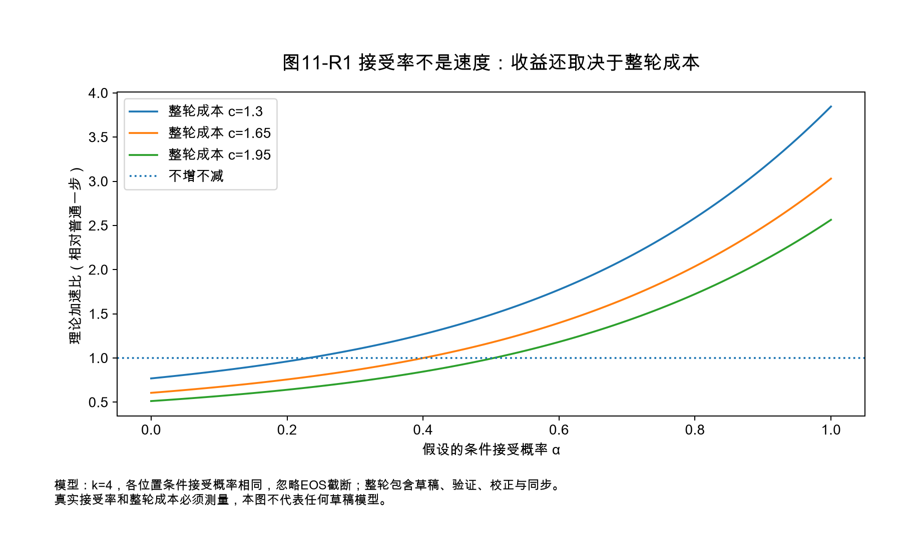
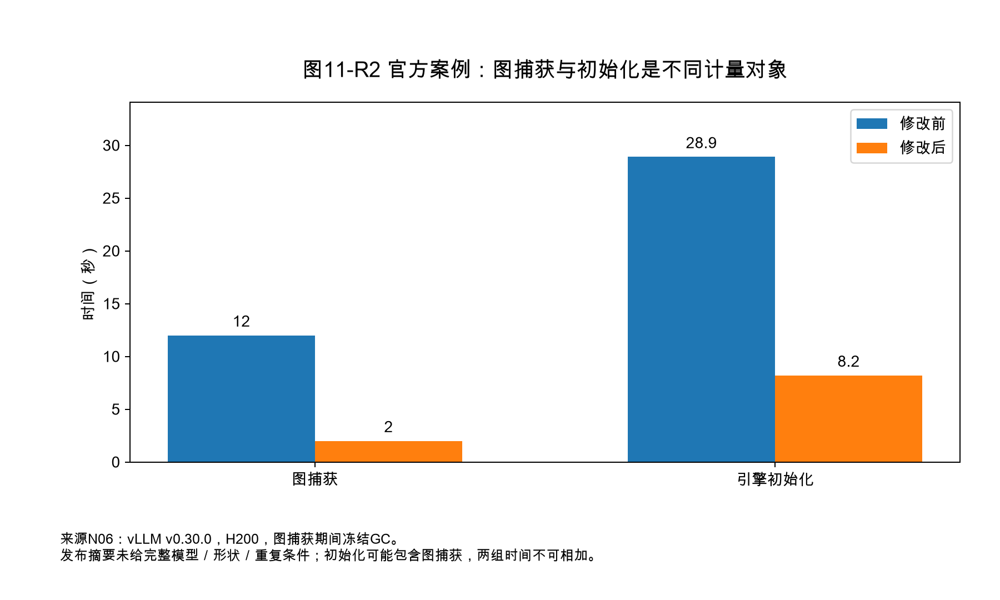
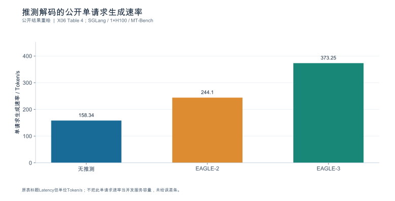
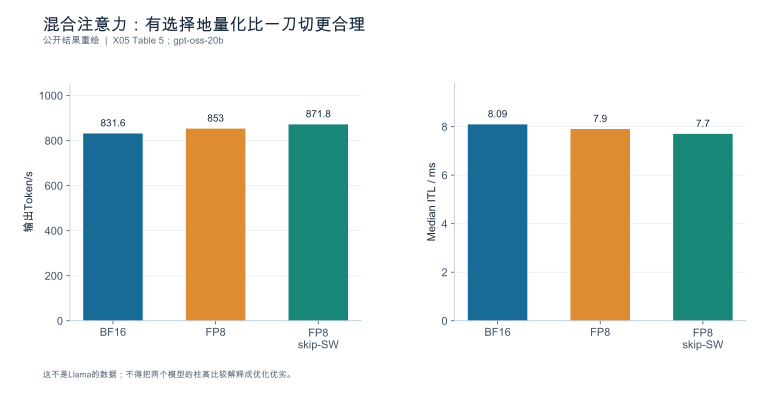
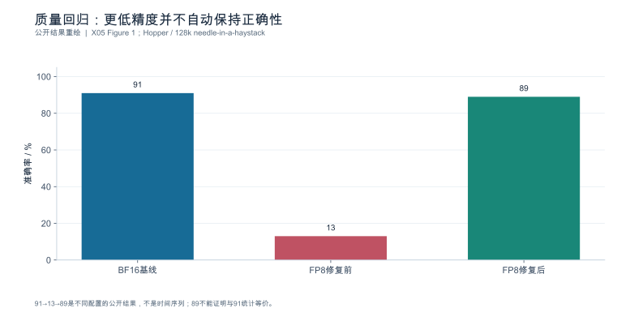
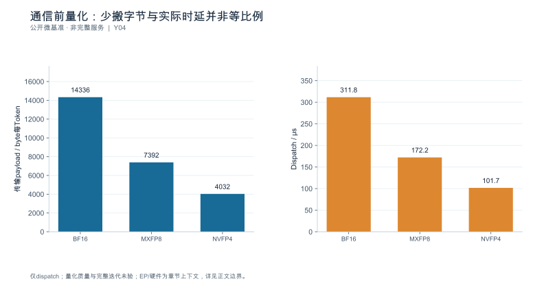

<a id="ch-11"></a>
## 第11章 配置、执行与内存优化

**核心论点：**每项优化都必须说明**改动什么机制、在什么条件下成立、质量风险是什么、怎么回退、端到端怎么验收**——而不是默认把所有功能都打开。

---

<a id="sec-11-01"></a>
### 11.1 主机路径、调度与缓存参数优化

**本节要回答的问题：**哪些低风险改动可以先验证？

#### 11.1.1 参数不是清单，是假设

每项参数调整都必须对应第10章的一条瓶颈证据。没有证据的调参不是优化，是抽奖。推荐字段：

| 字段 | 内容 |
|---|---|
| 参数与取值 | 改前 → 改后 |
| **预期机制** | 它改变了什么（供给？批形状？复用？） |
| 观测项 | 用什么指标验证机制确实发生 |
| 生效证据 | 如何确认实际生效（配置回显/trace），而非只写了命令行 |
| 质量影响 | 哪个质量门槛需要复测 |
| 回退方式 | 怎么改回去，回退后要复测什么 |

#### 11.1.2 释放显存 ≠ 自动增加容量

一个反复出现的误判：权重变小了，就说"容量变大了"。算例：将 70B 权重量与独立指定的状态量组合，非特定真实 70B 架构；单卡可用 80 GB，每 rank 固定开销 4 GB，状态账沿用第4章（4096 上下文每路 0.537 GB）。

| 权重格式 | 位宽/元素 | 权重 | 状态池 | 可容纳 4096 路数 |
|---|---:|---:|---:|---:|
| BF16 | 16 | 140.0 GB | — | **装不下** |
| FP8 | 8 | 70.0 GB | 6.0 GB | **11** |
| 分块 4-bit（含缩放） | 4.5 | 39.4 GB | 36.6 GB | **68** |

三个读法：

1. **位宽减半不等于容量翻倍。**16→8 bit 只换来 11 路，8→4.5 bit 却换来 68 路——因为存在"能否装下"的阈值效应与固定开销。用线性比例外推容量是最常见的错。
2. **可用的路数还受调度与尾延迟约束**，不只是显存。扩大批预算后吞吐可能上升而 P99 恶化（见下）。
3. 若 $h_{kv}$ 与并行度不满足分片条件，实际占用还会高于这里（第4章 4.2、第6章 6.1）。

#### 11.1.3 一个"吞吐涨、尾延迟超标"的案例

批内 Token 预算 4096 → 8192：

| 指标 | 4096 | 8192 | 变化 |
|---|---:|---:|---|
| 吞吐（排空法） | 1200 token/s | 1368 token/s | **+14.0%** |
| P99 ITL | 120 ms | 185 ms | **+54.2%** |

若 SLO 规定 ITL P99 ≤ 150 ms，**这个改动应当被拒绝**，尽管吞吐涨了 14%。这正是第7章"三个量纲"的用途：吞吐是速率，SLO 是约束，两者不能互相抵扣。

**依据与核验入口：**[R01] [R07] [R30]

---

<a id="sec-11-02"></a>
### 11.2 低精度推理：格式、执行路径与质量

**本节要回答的问题：**位宽降低以后，**存储、计算、状态、任务质量**分别发生了什么变化？

#### 11.2.1 四类精度必须分开说

| 精度 | 影响什么 | 常见误判 |
|---|---|---|
| **权重** | 驻留体积、权重访存量 | 用权重位宽代表整个模型的精度 |
| **激活** | 计算内核选择与数值路径 | 认为权重量化后激活也自动低精度 |
| **累加** | 数值稳定性、长序列误差 | 完全忽略累加类型 |
| **KV** | 状态驻留、长上下文容量 | 用权重量化的节省比例推 KV |

#### 11.2.2 分块缩放：为什么"4 bit"不等于四分之一

分块缩放格式在数据位宽之外还要存缩放因子。以每 16 个元素配一个 FP8 缩放为例，实际位宽是

$$
b_{\text{elem}} = 4 + \frac{8}{16} = \mathbf{4.5\ \text{bit/元素}}
$$

对一个 $[4096, 4096]$ 权重矩阵：

| 格式 | 数据 | 缩放 | 合计 | 相对 BF16 |
|---|---:|---:|---:|---:|
| BF16 | 32 MiB | — | 32 MiB | 100% |
| FP8 | 16 MiB | — | 16 MiB | 50.0% |
| 分块 4-bit | 8 MiB | **1 MiB** | **9 MiB** | **28.125%** |

**相对 BF16 是 28.125%，不是 25%。**差的 3.125 个百分点全部来自缩放因子（占 0.5/4.5 = **11.1%**）。所以这条硬规则必须守住：**不能用 4 bit 推出四倍速度，也不能用模型体积下降代替实际显存或成本下降。**

不同格式必须分别核对。官方技术说明 [N04] 中，NVFP4 为每 16 个数据元素配一个 E4M3 FP8 缩放，并有张量级 FP32 缩放；MXFP4 为每 32 个元素配一个 E8M0 缩放。忽略张量级常数和对齐时，二者平均位宽分别约为 $4+8/16=4.5$ 与 $4+8/32=4.25$ bit。前者对大矩阵约为 BF16 的 28.125%，后者约 26.5625%；这是格式字节推导，不是端到端显存或速度保证。

FP8 也可能有缩放、分块、排除层与布局转换。上表 FP8 一行是仅计主体数据的基准，不应写成任意 FP8 制品无缩放元数据。

#### 11.2.3 四列对照：制品、张量、执行、验收

| 观察对象 | 必填字段 | 禁止的替代推断 |
|---|---|---|
| 模型制品 | 权重格式、缩放、校准集身份、摘要 | 文件里写 FP4 就代表完整执行是 FP4 |
| 运行张量 | 权重/激活/累加/KV 各自的 dtype 与布局 | 用权重位宽代替全部张量精度 |
| 实际执行 | GEMM / attention / MoE 后端、设备、形状、回退原因 | 参数被接受就代表原生低精度内核生效 |
| 输出验收 | 任务分层、质量阈值、失败样本与性能 | 只保留更快或更短的答案 |

**量化制品、加载后的张量、实际执行的内核三者必须分别存档。**第9章 9.5.4 的三档证据（源码 / 日志 / trace）在这里直接适用：需要 trace、运行插桩或可核对执行计数证明本次路径；内核名称本身还需结合 dtype 和形状。

#### 11.2.4 质量验收：校准集与独立集分开

七项对照表，每项候选都要填（模板）：

| 列 | 说明 |
|---|---|
| 模型体积 | 制品字节数（含缩放元数据） |
| 物理显存 | 实测 allocated / reserved，不是理论体积 |
| Prefill / 生成时间 | 分阶段，不合并成一个"延迟" |
| 合格完成速率 | 第7章三量纲之一，带 SLO |
| 质量 | 分层达标率 + 失败样本 |
| 恢复成本 | 出问题后回退所需时间与风险 |
| 支持状态 | 支持 / 不支持 / 未验证 |

**校准集用于产生量化参数，独立集用于验收。**用同一份数据既校准又验收，等于没有验收。质量门槛必须覆盖**业务分层、长上下文、结构化输出**三类——只在短问答上测质量是常见的漏项。

未支持的组合标为**能力缺口**，不要人为给一个"性能较差"的分数（第6章 6.6.4 同理）。缩放格式或激活精度的细节未从来源固定前，**不发布精确节省比例**。

**依据与核验入口：**[R26] [R04] [R14] [S10] [S09] [S02]

---

<a id="sec-11-03"></a>
### 11.3 执行器、编译、图执行与内核选择

**本节要回答的问题：**减少调度开销和数据移动，什么时候能改善**整体**？

按三个层次分开讲，因为它们解决的是不同问题，也常常被混为一谈：

| 层次 | 解决什么 | 代表来源 |
|---|---|---|
| **算法** | 减少数据移动本身（IO 感知的注意力） | [SOURCE_REGISTERED] [R03] |
| **内核库** | 提供具体实现与后端 | [SOURCE_REGISTERED] [S08] [S09] |
| **引擎调度** | 决定这一次走哪条路径、是否回退 | [SOURCE_REGISTERED] [S01] [S03] [S04] |

#### 11.3.1 从算法到被调用，中间隔着两道门

FlashAttention 的原始论文提供的是 **IO 感知的原理** [SOURCE_REGISTERED] [R03]；某个内核库提供了实现 [SOURCE_REGISTERED] [S08] [S09]；但**服务是否真的调用了它，是第三件事**。这三者的关系是"可能 → 提供 → 实际"，**不能从库名推断它被服务真正调用**——必须绑定所选 commit、设备、形状，并用 trace 内核名确认。

同理，引擎侧的执行器代际变化、旧路径移除、RC 版本的入口变更候选 [SOURCE_REGISTERED] [S01] [S03] [S04] 只说明"该版本声明了什么"，不说明本环境走了哪条。**没有实际环境时，交付的是代码路径图，不是伪造的 trace。**

#### 11.3.2 冷启动与稳态必须分开验收

编译与图捕获的一次性成本要用**稳态收益去摊**。算例：编译 23 s + 图捕获 11 s = **34 s**；稳态每步节省 0.8 ms。

$$
\text{回本步数} = \frac{34\ \text{s}}{0.8\ \text{ms}} = \mathbf{42\,500\ \text{步}}
$$

若单步 20 ms，回本需要 $42\,500 \times 0.02 = \mathbf{850\ s}$（约 14.2 分钟）的连续服务。

**推论：在短任务、频繁重启、或按需伸缩的场景里，编译/图捕获可能是净亏的。**所以验收必须分冷启动与稳态两栏，并且把**常驻工作区开销**与预热收益一起算（第8章 8.5）。

#### 11.3.3 图命中率：平均值会掩盖尾部

形状不在已捕获的桶里时会回退到逐次执行。算例：图内每步 1.4 ms、回退后 3.2 ms、命中率 96%。

| 量 | 值 |
|---|---:|
| 加权平均单步 | $1.4\times0.96 + 3.2\times0.04 = \mathbf{1.472\ ms}$ |
| 相对"全命中"慢 | **5.1%** |
| **回退迭代相对图内迭代** | $3.2/1.4 = \mathbf{2.29\ 倍}$ |

只看均值只看到 5.1%，但这是迭代级命中率，不能推出恰有 4% 的请求回退；一个请求可跨越许多迭代。这就是"回退"必须从能力表里单独记录、并进入尾延迟分析的原因。

#### 11.3.4 单内核收益不外推整个服务

第3章的 Amdahl 式上限在这里直接适用：某内核占关键路径 8%，提速 30%，整体加速

$$
\frac{1}{(1-0.08) + 0.08/1.3} = \mathbf{1.0188} \;(\text{仅 } +1.88\%)
$$

所以"微基准里快 30%"与"服务端到端改善"之间隔着三道门槛：**是否在关键路径上、占比是否足够、节省是否被排队反馈吸收**（第9章 9.5.4 已给出两条可区分假设与判别实验）。**单内核结果不外推整个服务**，这是本节的硬要求。

每份性能记录必须带：runner、graph mode、compiler、attention/GEMM/MoE backend、device target、实际形状、`fallback_reason`。

**依据与核验入口：**[R03] [R16] [R23] [R31] [S01] [S02] [S03] [S04] [S08] [S09]

---

<a id="sec-11-04"></a>
### 11.4 推测解码：草稿、验证与当前实现组合

**本节要回答的问题：**接受率高，为什么仍可能没有速度收益？

#### 11.4.1 两个计数不能混

第2章已给出：草稿接受率 $\alpha$、每轮候选数 $k$ 时

$$
\mathbb{E}[\text{接受的草稿数}] = \sum_{i=1}^{k}\alpha^{i}, \qquad
\mathbb{E}[\text{本轮推进量}]    = \sum_{i=0}^{k}\alpha^{i}
$$

后者包含被拒后的校正 Token（或全接受时的额外 Token），**比前者多一个量级为 1 的项**。$k=4$、$\alpha=0.7$ 时是 **1.7731** 与 **2.7731**。算加速比必须用**推进量**。

#### 11.4.2 整轮成本，不是验证成本

每轮耗时必须拆成四段并记录，因为**只算目标验证会系统性高估收益**。算例 （相对普通一步 = 1.00）：

| 段 | 成本 |
|---|---:|
| 草稿生成 | 0.30 |
| 目标验证 | 1.00 |
| 接受处理 | 0.15 |
| 同步等待 | 0.20 |
| **整轮** | **1.65** |

$\alpha=0.7$、$k=4$：每 Token 相对成本 $= 1.65/2.7731 = 0.595$，加速 **1.68×**（而不是按"验证成本 1.0"算出的 2.77×）。

#### 11.4.3 接受率上升而加速比下降

这正是本节标题问题的答案：

| $\alpha$ | 本轮推进量 | 整轮成本 | 每 Token 成本 | 加速比 |
|---:|---:|---:|---:|---:|
| 0.70 | 2.7731 | 1.65 | 0.595 | **1.68×** |
| 0.75 | 3.0508 | **1.95** | 0.639 | **1.56×** |

接受率从 0.70 提到 0.75（+7%），两行仍固定 $k=4$；另假设更昂贵的草稿器或额外处理让整轮成本从 1.65 涨到 1.95，**加速比反而从 1.68 降到 1.56**。原因是分母（推进量）只涨了 10%，分子（整轮成本）涨了 18%。

所以：**接受率是中间量，不是收益。**最终要报的是第7章的三个量纲——目标延迟、合格完成速率、质量。

#### 11.4.4 组合支持与质量回归

运行矩阵需记录：模型、草稿或预测头身份、TP/PP/EP/CP、图模式、缓存布局、支持状态（支持/不支持/未验证）。当前实现的研究入口包括 MTP、EAGLE3、DFlash、DSpark 等 [SOURCE_REGISTERED] [S02]，但本章**按草稿来源与验证方式组织**，不把名称清单当作机制解释；未固定机制或版本时只作候选资料，不承诺精确采样性质。

经典精确采样算法的分布性质依赖算法条件 [SOURCE_REGISTERED] [R27]；**近似变体、校正实现与数值路径必须另行验证**，不能把经典性质直接外推。

验收要求：同一**真实内容分布**做关闭/开启对照，**随机 Token 不能替代内容相关的接受率测试**（第8章 8.2）；拒绝的候选消耗资源但**不计入有效输出**。接受率上升而服务达标率下降的结果必须保留（第10章 10.6.2）。

**依据与核验入口：**[R27] [R12] [S02] [S16]

---

<a id="sec-11-05"></a>
### 11.5 上下文、结构化输出与应用边界优化

**本节要回答的问题：**"少做工作"与"更快完成同样工作"，如何区分？

#### 11.5.1 语义保持 vs 信息裁剪

这是本章最容易越界的一节。判定标准很简单：**改动之后，交付给用户的是不是同一个任务？**

算例：上下文从 8000 Token 裁到 3000 Token。

| 指标 | 裁剪前 | 裁剪后 | 变化 |
|---|---:|---:|---|
| TTFT P50 | 780 ms | 320 ms | **−59.0%** |
| 任务层达标率 | 88% | 71% | **−17 个百分点** |

TTFT 改善了 59%，但达标率掉了 17 个百分点。**这不是系统优化，是改变了任务。**正确做法：若业务确实同意缩短上下文，必须**另立一条对照轨道**并单独签署，不能混进"纯系统提升"的收益里报告。

三条明令禁止的"制造加速"：**删除必要证据、减少必需分支、缩短回答要求。**共享历史分支、上下文裁剪、非前缀缓存三类改动都必须分别做语义验收 [SOURCE_REGISTERED] [S13] [S18]。

#### 11.5.2 结构化约束：净收益怎么算

约束生成（语法/格式约束）的收益与代价在不同层，必须放在一张表上算净账：

| 层次 | 变化 |
|---|---|
| 每步成本 | 合法 Token 掩码计算使单步 +8% |
| 任务层 | 格式错误率 12% → 1%，重试减少 |
| **任务层达标率** | 81% → **92%**（+11 个百分点） |

单 Token 慢了 8%，但任务达标率涨了 11 个百分点——联合表现有改善迹象，仍须核对资源成本、截止时间与分层 SLO 后决定是否采用。判据是任务层而不是单步时间；只看单步会得出相反结论。

#### 11.5.3 输入结构与模板版本

输入侧的改动（模板版本、检索片段组织、共享前缀布局）会改变 Token 化与复用命中率（第8章 8.1 的脱敏偏差同理）。因此每次改动必须记录：**输入差异、模板版本、格式校验结果、任务样本集**。敏感业务只用授权测试集 [SOURCE_REGISTERED] [R29]。

**依据与核验入口：**[R06] [R29] [R14] [S13] [S18]

---

<a id="sec-11-06"></a>
### 11.6 组合优化、交互与收益消融

**本节要回答的问题：**单项有效的改动，叠加后为何可能相互抵消？

#### 11.6.1 资源格局会被改写

三项改动各自释放/占用的资源不同：量化**释放**容量、图执行**占用**工作区、推测解码**改变批形状**。组合之后资源格局不是三者之和。

#### 11.6.2 一个完整的消融表

基线吞吐 1000 token/s、P99 ITL 120 ms、质量达标率 92%；A = 量化、B = 图执行、C = 推测解码：

| 组合 | 吞吐 | 相对基线 | P99 ITL | 质量达标率 |
|---|---:|---:|---:|---:|
| 基线 | 1000 | — | 120 ms | 92% |
| A | 1120 | +12.0% | 118 ms | 91% |
| B | 1080 | +8.0% | 115 ms | 92% |
| C | 1180 | +18.0% | 131 ms | 92% |
| AB | 1150 | +15.0% | 116 ms | 91% |
| **AC** | **1240** | **+24.0%** | 142 ms | 90% |
| BC | 1210 | +21.0% | 138 ms | 92% |
| ABC | 1210 | **+21.0%** | 145 ms | 90% |

四条结论：

1. **单项收益不能直接相加。**12%＋8%＋18%=38%，表中的ABC只有21%。
2. **添加优化可能降低产出。**ABC为1210 token/s，低于AC的1240；具体机制仍需实测区分。
3. **吞吐、尾延迟和质量必须联合判断。**AC虽吞吐最高，却把ITL P99推到142 ms、质量降到90%。
4. **推荐取决于联合门槛，而不是只看质量。**质量至少 92% 时，基线、B、C、BC 都在质量可行集。若再要求 ITL P99≤135 ms，则 BC 被排除，在其余表中候选里 C 吞吐最高；若上限放宽为 140 ms，BC 的 1210 token/s 高于 C 的 1180。若允许质量至少 90% 且 ITL≤150 ms，表中 AC 的 1240 高于 ABC 的 1210。以上仅是对表的确定性筛选；真实采用还需重复运行的不确定性与独立质量验收。

**禁止把各单项最高提升简单相加** [SOURCE_REGISTERED] [S02] [S06]；只运行**有支持依据且能回答问题**的组合，不做无意义全排列。

#### 11.6.3 维护成本与适用边界

采用决策还要算三笔账：**新增依赖的成熟度、回退方式、撤回接口是否还在**。一个收益 20% 但依赖 RC 版本、且没有关闭开关的优化，其风险远高于收益 12% 但可随时回滚的优化。第10章 10.5 的可逆性列在这里直接适用。

**依据与核验入口：**[R26] [R27] [R31] [S02] [S06] [S20]

---

<a id="sec-11-07"></a>
### 11.7 实验：提交一份可上线的优化证据

**本节要回答的问题：**什么时候可以把"实验更快"升级为"值得采用"？

#### 11.7.1 顺序不能颠倒

```text
① 质量与正确性门槛   → 不合格就直接淘汰，不进性能比较
② 同负载性能对照     → 基线 vs 候选，配对设计（第8章 8.6）
③ 组合消融           → 只做有依据的组合
④ 留出负载复核       → 用未参与调参的负载复测
⑤ 长运行与异常恢复   → 12h+ 稳定性、OOM/重启恢复
⑥ 采用 / 拒绝 / 回滚 → 三选一，写明条件与触发线
```

**"先测性能再补质量"是错误顺序**，会导致为了保住性能数字而放宽质量门槛。

#### 11.7.2 报告必须写明区间而不是一个数

合格报告要回答：在哪些区间改善、在哪些区间**退步**、退步多少、维护成本是什么、什么条件下回滚。只有实验结果支持时才建议采用；**"无收益"或"风险过高"同样是合格结论。**

#### 11.7.3 决策卡模板

| 字段 | 内容 |
|---|---|
| 候选与机制假设 | 改动什么、预期改变什么 |
| 生效证据 | 配置回显 + trace（证明实际启用，非仅声明） |
| 质量结果 | 校准集与独立集分别；失败样本 |
| 性能结果 | 三量纲 + 分位 + 样本量 + 区间 |
| 组合消融 | 与已采用项的交互 |
| 负面与副作用 | 退步区间、稳定性问题 |
| **采用/拒绝/回滚条件** | 明确触发线与回退步骤 |
| 证据等级 | 源码 / 日志 / trace 分别标注 |

部署本身需要**另行授权**，本书不默认执行生产变更。执行路径身份与质量回归列为报告附件；**资料支持但没有 trace 的项目，不填"启用已验证"**。

**依据与核验入口：**[R14] [R24] [R25] [S08] [S09] [S10]

---

### 11.8 深化：精确推测采样、图形状成本与优化交互

#### 11.8.1 接受率公式背后是概率校正

经典推测解码方法要求目标分布 $p$ 与草稿分布 $q$ 在同一候选空间和相同条件上下文下可比较。草稿Token $x\sim q$ 以 $\min(1,p(x)/q(x))$ 的概率接受；拒绝后从与 $[p(x)-q(x)]_+$ 成比例的剩余分布采样 [N03]。

其正确性的核心可直接验证：直接接受给 $x$ 带来的概率质量为 $q(x)\min(1,p(x)/q(x))=\min(p(x),q(x))$；拒绝后补回正差部分 $[p(x)-q(x)]_+$，二者相加为 $p(x)$。因而接受率低不意味着目标分布退化，主要意味着资源浪费增大。近似接受、数值实现、不同的logits处理或停止语义则需要各自证明与测试，不能沿用这一等价性结论。

设第 $i$ 个草稿在前面全部接受的条件下，以概率 $a_i$ 被接受，则期望草稿接受数是 $\sum_{i=1}^{k}\prod_{j=1}^{i}a_j$。只有各位置条件接受概率都可近似为同一个 $\alpha$ 时，才化成 $\sum\alpha^i$。推测轮的推进量还包含校正或全部接受后的额外Token；临近EOS、输出预算或停止串时，需要截断这个理想公式。

#### 11.8.2 净收益阈值可以在实验前写出来

普通一步耗时为 $t_0$，推测完整一轮耗时为 $t_{round}$，期望实际推进量为 $m$，则理想速度收益要求 $t_{round}<m t_0$。增加候选长度会增加 $m$，也会增加草稿、目标验证、KV暂存和同步成本；当后几个候选很少被接受时，边际收益可能转负。



图中 $k=4$，整轮相对成本分别取1.3、1.65、1.95；曲线不是实测接受率，也不考虑EOS截断。读者可以先用它排除明显不可能的成本组合，再在真实语义负载上测位置接受分布与整轮时间，而不是只看一个全局接受率。

#### 11.8.3 图命中和形状桶也有资源优化问题

假设覆盖更多形状可以减少回退，但每个形状桶增加捕获时间、保留缓冲或编译制品。于是图配置也不是“捕获越多越好”：应最大化长期节省的发起开销，减去启动、存储和被挤出的状态容量成本。对短生命周期实例，更多捕获可能直到下线都未回本。

迭代命中率也不等于请求命中率。若一个请求经历100步、每步独立回退概率为4%，那么至少回退一次的概率为 $1-0.96^{100}\approx98.31\%$；实际回退往往由形状成簇出现，并不独立，这个计算只是反例，说明不能把“96%迭代命中”翻译成“只有4%请求受影响”。报告应分别给出迭代级、请求级和回退事件连续长度。

#### 11.8.4 交互项决定能否叠加

对第11.6节吞吐表，用同一基线尺度计算两因素交互：$I_{AB}=Y_{AB}-Y_A-Y_B+Y_0$。A、B分别提高到1120、1080，而AB为1150，故交互为−50 token/s。ABC比AC还低，说明在该表里添加B并非单调有益；它不能被“图执行本来应该加速”这一先验否定。

真实运行要用重复与区间判断交互是否超过噪声，并检查容量、实际批形状和路径变化。这个公式只是描述差异结构，不会自动指出机制；要把−50归因于图工作区挤占KV，仍需要分配记录与隔离干预。

#### 11.8.5 公开初始化案例与测量边界

vLLM v0.30.0发布说明报告，在H200上于图捕获期间冻结GC，图捕获由12秒降至2秒、引擎初始化由28.9秒降至8.2秒 [N06]。这是初始化案例，不是稳态请求性能；摘要未给出的模型、形状与重复条件保留未知。



初始化可能包含图捕获，不能把两组时间加总计算节省；本书未复现该运行。

---

<!-- V06-START -->
<a id="sec-11-09"></a>
### 11.9 实验图表补充：补齐推测解码、混合精度与质量失败三个公开案例

**推测解码。**EAGLE-3论文v2的Table 4给出SGLang团队在1×H100、LLaMA-Instruct 3.1 8B、MT-Bench、bs=1上的原值：无推测158.34、EAGLE-2 244.10、EAGLE-3 373.25 Token/s。EAGLE-3相对基线约2.357倍。原表列标题写Latency，但单位为Token/s；本书据单位称“单请求生成速率”，不当作毫秒时延，也不与表3的batch64吞吐混用。

**混合注意力。**同一vLLM FP8博客的gpt-oss-20b Table 5说明一刀切量化不是唯一选项。保留滑窗层BF16的skip-SW策略输出871.8 Token/s，相比全BF16的831.6增加约4.83%，相比全FP8的853.0增加约2.20%。有限滑窗的缓存规模受限，量化固定开销可能难以回收；但这个机制解释仍受具体模型和内核路径约束，不能预设所有滑窗模型都该跳过量化。

**负面质量证据。**博客Figure 1的Hopper/FA3、128k needle-in-a-haystack案例报告91%→13%→89%，对应BF16、修复前FP8、两级累加修复后FP8。文章未给该三值的具体模型与样本数，因此不补标准误，也不把89%解释为与91%统计等价。这里最有价值的不是“修复后提升多少”，而是提醒低精度路径的累加与实现可以造成严重质量回归。

**采用门槛：**速度、质量、资源峰值、异常率和回退能力同时验收；没有可复核的质量结果时，不接受仅凭吞吐的上线结论。

#### 图11-V1 推测解码的公开单请求生成速率



**数据身份：**`PUBLISHED_RESULT`。**条件：**LLaMA-Instruct 3.1 8B；SGLang团队实验；batch size=1；同一H100。

| 方法 | Token/s | 相对基线/倍 |
|---|---|---|
| 无推测 | 158.34 | 1.0 |
| EAGLE-2 | 244.1 | 1.5416 |
| EAGLE-3 | 373.25 | 2.3573 |

**出处与边界：**[X06](book_support_v06/来源与核验.md#x06)；原表标题Latency但单位Token/s；不把此单请求速率当并发服务容量，未给误差条。

[数据与绘图点](book_support_v06/data/ch11_eagle.json) · [PNG](book_support_v06/figures/ch11_eagle.png) · [重绘代码](book_support_v06/code/replot.py)

#### 图11-V2 混合注意力：有选择地量化比一刀切更合理



**数据身份：**`PUBLISHED_RESULT`。**条件：**150请求、并发8、约20k输入/2k输出±15%；H100/FA3上下文；skip-SW保留滑窗层BF16。

| KV策略 | TTFT中位数/ms | ITL中位数/ms | 总时长/s | 输出Token/s |
|---|---|---|---|---|
| BF16 | 468.9 | 8.09 | 364.2 | 831.6 |
| FP8 | 451.7 | 7.9 | 355.1 | 853.0 |
| FP8 skip-SW | 456.4 | 7.7 | 347.4 | 871.8 |

**出处与边界：**[X05](book_support_v06/来源与核验.md#x05)；这不是Llama的数据；不得把两个模型的柱高比较解释成优化优劣。

[数据与绘图点](book_support_v06/data/ch11_hybrid_fp8.json) · [PNG](book_support_v06/figures/ch11_hybrid_fp8.png) · [重绘代码](book_support_v06/code/replot.py)

#### 图11-V3 质量回归：更低精度并不自动保持正确性



**数据身份：**`PUBLISHED_RESULT`。**条件：**Hopper、FA3 FP8长上下文路径；两级累加修复；具体模型、样本数未披露。

| 配置 | 公开准确率/% |
|---|---|
| BF16基线 | 91 |
| FP8修复前 | 13 |
| FP8修复后 | 89 |

**出处与边界：**[X05](book_support_v06/来源与核验.md#x05)；91→13→89是不同配置的公开结果，不是时间序列；89不能证明与91统计等价。

[数据与绘图点](book_support_v06/data/ch11_quality_failure.json) · [PNG](book_support_v06/figures/ch11_quality_failure.png) · [重绘代码](book_support_v06/code/replot.py)

<!-- V06-END -->
<!-- V07-START -->
<a id="sec-11-10"></a>
### 11.10 实验深化补充：量化省的是字节，不是等比例的时延

本章前面已补齐 EAGLE-3 推测解码、混合注意力与长上下文质量负例。这一节补一条常被忽略的通信侧账：**把权重/激活压小，省下的字节和实际时延并不是等比例。**

TensorRT-LLM同一篇NVLink AlltoAll博客的Post-Quant Dispatch表（batch2048）给出三种dispatch格式：BF16为14336 byte/Token、311.8μs、报告逻辑753.3 GB/s；MXFP8为7392 byte/Token、172.2μs、703.4 GB/s；NVFP4为4032 byte/Token、101.7μs、649.3 GB/s。

按原值复算：NVFP4的payload是BF16的4032/14336=28.125%（约3.56倍压缩），但dispatch时延为101.7/311.8=32.617%（约3.06倍加速）。**少搬的字节更多，省下的时延更少，差额来自固定开销与协议成本。**因此不能把局部3.06倍写成模型整体3.06倍。

**采用门槛不变：**这里只覆盖dispatch一步，不含combine与专家计算，也不含量化质量验收。低精度路径必须先过质量与数值稳定性，再谈通信收益；图像alt标B200而章节文字标GB200 NVL72，本书不做更细的硬件保证。

#### 图11-E1 通信前量化：少搬字节与实际时延并非等比例



**数据身份：**`PUBLISHED_MICROBENCHMARK`。**条件：**Post-Quant Dispatch表，batch2048；性能章节写GB200 NVL72，EP8按同一BF16基线和复现命令对应，表未单独标EP。

| dispatch格式 | byte/Token | Dispatch/us | 报告逻辑GB/s | BF16字节数/当前字节数 |
|---|---|---|---|---|
| BF16 | 14336 | 311.8 | 753.3 | 1.0 |
| MXFP8 | 7392 | 172.2 | 703.4 | 1.94 |
| NVFP4 | 4032 | 101.7 | 649.3 | 3.56 |

**出处与边界：**[Y04](book_support_v07/来源与核验_v07.md#y04)；图像alt标B200、章节写GB200 NVL72，本书不作更细硬件保证；未含量化质量验收；仅dispatch，不是整轮。

[数据与绘图点](book_support_v07/data/ch11_dispatch_precision.json) · [PNG](book_support_v07/figures/ch11_dispatch_precision.png) · [重绘代码](book_support_v07/code/replot_v07.py)

<!-- V07-END -->
### 章末检查问题

**1. 量化后模型体积降到 28%，为什么不能说显存和成本也降到 28%？**

答案方向：三件事量纲不同。① **体积是制品字节**，物理显存还含分配器开销、工作区、图捕获缓冲与碎片（第4章 4.3、第11章 11.3.2）；② **分块缩放的元数据**占 11.1%，且不同格式缩放规则不同，不能互推（11.2.2）；③ **成本由完成速率决定，不由驻留体积决定**——若低精度路径走了回退内核或代价更高的布局，速率可能不升反降。所以正确写法是分别报"制品体积 / 实测 allocated-reserved / 同 SLO 下合格完成速率"三项，并说明各自口径。

**2. 图执行开启后单步从 3.2 ms 降到 1.4 ms，服务端到端为什么可能不变？**

答案方向：三道门槛（11.3.4）。① **是否在关键路径上**——若该步不在关键路径，优化的是空闲；② **占比是否足够**——按 Amdahl，占 8% 提速 30% 只改善 1.88%；③ **排队反馈**——但这只在特定条件下成立：开环固定到达下服务时间下降应改善等待，闭环或自适应到达才可能吸收（第9章 9.5.4 给了两条可区分假设）。此外还有 11.3.2 的**冷启动摊薄**：34 s 的一次性成本需要 42500 步回本。正确做法是写出这几条假设，用不同负载模式的实验判别，而不是直接判"优化无效"。

**3. 接受率从 0.70 提到 0.75，为什么服务反而更慢？**

答案方向：因为收益的分母是**本轮推进量**，分子是**整轮成本**，而接受率只是中间量（11.4.3）。候选量变大会同时抬高整轮成本：本例中推进量从 2.7731 涨到 3.0508（+10%），整轮成本却从 1.65 涨到 1.95（+18%），于是每 Token 成本从 0.595 升到 0.639，加速比从 1.68 降到 1.56。另外还要检查：更大的验证批是否改变了批形状与图命中率（11.6）、拒绝候选是否消耗了资源却不计入产出（第2章 2.1）、质量是否退步（10.6.2）。**最终判据是三个量纲，不是接受率。**

---

### 本章验收清单

| 节 | 验收标准 |
|---|---|
| 11.1 | 参数与瓶颈证据一一对应；有生效证据；释放显存不自动等于容量增加；尾延迟超标的改动被拒绝 |
| 11.2 | 四类精度分开；分块缩放的位宽与元数据占比已算；四列对照齐全；校准集与独立集分开；未支持组合标能力缺口 |
| 11.3 | 算法/内核库/引擎调度三层分开；冷启动与稳态分开验收并算回本步数；图命中率与回退倍率分别记录；单内核不外推服务 |
| 11.4 | 接受草稿数与推进量分开；按整轮成本算加速比；真实内容分布做开关对照；拒绝候选不计产出 |
| 11.5 | 语义保持与信息裁剪分开；任务变更另立对照轨道；结构化约束按任务层算净收益 |
| 11.6 | 不叠加单项收益；组合实测；推荐方案能对应到具体质量门槛；维护成本与回退方式已记 |
| 11.7 | 质量先于性能；有留出负载复核与长运行检查；决策卡含采用/拒绝/回滚条件与证据等级 |

---

### 配套资料

[新增图表与数据](book_support_v05/figures.md) · [来源登记](book_support_v05/references.md) · [E0测试清单](book_support_v05/data/e0_test_results.md) · [修订记录](book_support_v05/review/changes.md)

[N03]: book_support_v05/references.md#n03
[N04]: book_support_v05/references.md#n04
[N06]: book_support_v05/references.md#n06
[R01]: book_support_v05/references.md#r01
[R03]: book_support_v05/references.md#r03
[R04]: book_support_v05/references.md#r04
[R06]: book_support_v05/references.md#r06
[R07]: book_support_v05/references.md#r07
[R12]: book_support_v05/references.md#r12
[R14]: book_support_v05/references.md#r14
[R16]: book_support_v05/references.md#r16
[R23]: book_support_v05/references.md#r23
[R24]: book_support_v05/references.md#r24
[R25]: book_support_v05/references.md#r25
[R26]: book_support_v05/references.md#r26
[R27]: book_support_v05/references.md#r27
[R29]: book_support_v05/references.md#r29
[R30]: book_support_v05/references.md#r30
[R31]: book_support_v05/references.md#r31
[S01]: book_support_v05/references.md#s01
[S02]: book_support_v05/references.md#s02
[S03]: book_support_v05/references.md#s03
[S04]: book_support_v05/references.md#s04
[S06]: book_support_v05/references.md#s06
[S08]: book_support_v05/references.md#s08
[S09]: book_support_v05/references.md#s09
[S10]: book_support_v05/references.md#s10
[S13]: book_support_v05/references.md#s13
[S16]: book_support_v05/references.md#s16
[S18]: book_support_v05/references.md#s18
[S20]: book_support_v05/references.md#s20

<!-- V10-START -->
<a id="sec-11-90"></a>

### 本章口径核对（公开来源）

#### 草稿路径、非前缀缓存与内核库的版本对应

**草稿路径的机制与版本（vLLM 与 SGLang 发布说明）**

| 路径 | 出处与原文要点 |
|---|---|
| MTP | vLLM v0.29.0："DP-sync skipping before EAGLE/MTP draft prefill"；使用 EAGLE/MTP 的混合模型自动恢复 dense retention。v0.30.0：MRV2 在流水并行下支持 MTP；"Gemma4 MTP under CUDA graphs" |
| EAGLE-3 | vLLM v0.29.0："PLaMo3 EAGLE-3/DFlash"。v0.30.0："full-vocab EAGLE3 drafters skipping vocab remapping"；"Mamba state cached at the EAGLE resume position and preserved for padded prompt tails" |
| DFlash / DFlash2 | vLLM v0.29.0："DFlash2 loading from speculators format"；"DFlash draft RoPE layout" 修复。SGLang v0.5.19："DFlash2: local convolution + candidate selector"（batch 1 相比无推测提速 3.43×，并发 64 时比 DFlash 高约 24%） |
| DSpark | vLLM v0.29.0："Qwen3-Omni DSpark drafts"、"K3 DCP with DSpark"。v0.30.0："DSpark preserving the target DCP config"。SGLang v0.5.19："LFM2 and LFM2-MoE DSpark"（LFM2.5 目标上 1.05× ~ 2.42×） |

自适应验证在 vLLM v0.30.0 中表述为"对每个草稿模型推测器通过在线接受率估计器做自适应验证"；v0.29.0 提供了 `--per-request-spec-decode-metrics` 以在 OpenAI 接口响应中返回逐请求接受统计。

**边界**：以上均为各版本发布说明中的特性条目，说明"该版本已支持该路径"，不构成各路径之间接受率或加速比的横向比较——不同条目对应的模型、批量与硬件条件不同。

**非前缀缓存与上下文改动的语义影响**

LMCache 的"非前缀 KV 复用"在 prompt 任意位置复用缓存块，并以 CacheBlend 对部分 token 选择性重算来恢复质量。SGLang v0.5.20 的统一 radix 树对 SWA 分量做**分支点缓存**，把滑动窗口状态保存在请求从共享前缀分叉的位置：官方给出 DeepSeek-V4-Flash 在共享系统提示下的 token 命中率由 43.8% 提升到 60.8%，平均 TTFT 由 1.57 s 降到 1.07 s。

vLLM 侧的安全口径是 `cache_salt` 注入首块哈希，只有同 salt 的请求才能复用。

**边界**：命中率与 TTFT 的改善数字来自特定模型与特定共享前缀形状，不能外推到任意上下文改动模式。上下文改动若改变了前缀 token 序列，则依赖前缀哈希的复用全部失效——这是语义层面的必然结果，与实现无关。

**内核库与引擎的版本对应**

| 库 | 包名与世代 | 要求 |
|---|---|---|
| FlashAttention | `flash-attn`（FA2，Ampere/Ada/Hopper；ROCm MI200x/MI250x/MI300x/MI355x 与 RDNA 3/4）、`flash-attn-3`（Hopper，CUDA ≥ 12.3，官方建议 12.8）、`flash-attn-4`（CuTeDSL，Hopper 与 Blackwell） | PyTorch ≥ 2.2；CUDA ≥ 12.0 或 ROCm ≥ 6.0；分页 KV 的 `page_block_size` 必须为 256 的倍数；`flash_attn_with_kvcache` 不支持反向 |
| FlashInfer | 统一 attention / GEMM / MoE API，多后端（FlashAttention-2/3、cuDNN、CUTLASS、TensorRT-LLM） | SM75 起至 Blackwell；`flashinfer-python` + `flashinfer-cubin` + `flashinfer-jit-cache`；Blackwell CuTe DSL 需 `[cu13]`；CUDA 12.9 / 13.0 / 13.4 |

引擎侧的默认选择也随版本变化：vLLM v0.29.0 起 FlashInfer all-reduce 成为 TP CUDA 组的默认（`VLLM_ALLREDUCE_USE_FLASHINFER=0` 关闭）；v0.30.0 起 FlashInfer CuTeDSL 的 NVFP4 W4A16 在 SM100/103 上取代 Marlin 成为默认。

**边界**：以上是各库自身文档的口径。引擎实际链接到哪个 commit 需查引擎自身的构建清单；"库支持"与"引擎启用"是两件事。

**国产后端预发布版本的限定范围（vLLM-Ascend v0.26.0rc1，2026-09-03，commit `f2f74a16`）**

该版本被官方明确定义为 **model-restricted version**。完全验证的模型为：Kimi K3、GLM-5.2、DeepSeek V4 Flash 0731、DeepSeek V4 Pro 0813，官方原文为"其它模型的可用性不做保证"。

依赖矩阵：上游 vLLM v0.26.0；Python `>=3.10, <3.13`；CANN 9.1.0；torch / torch_npu 2.10.0 / 2.10.0.post4；Triton Ascend 3.2.2（适用于 A2、A3 与 Ascend 950，**Atlas 300I DUO 不支持**）；发布镜像内 Mooncake 0.3.11.post1。

> **时效提示（2026-10-09）**：本节锚定在 **vLLM-Ascend v0.26.0rc1**（2026-09-03，commit `f2f74a16`）；截至检索日最新为 **v0.27.1rc1**（2026-09-24），仍是 model-restricted 预发布。两版之间两处关键变化：
> - **验证范围收缩**：v0.27.1rc1 声明的完整验证模型为 **MiniMax-M3**（Atlas 800 A3 与 950DT；W8A8 / W8A8C8；两节点 1P1D 与 KV Cache Pool）与 **DeepSeek-V4-Flash**（950DT；W4A8C8；两节点 1P1D DSpark 与 KV Cache Pool）**两项**，官方原文 "Other models and hardware combinations…were not sufficiently validated for this release"。**本节的四模型清单是 v0.26.0rc1 的声明，不是"项目支持模型全集"**，引用时必须写版本与检索日。
> - **依赖矩阵变化**：v0.27.1rc1 为上游 vLLM v0.27.1、Python ≥3.10 且 <3.13（镜像用 3.12）、Ascend HDK 26.1.1、CANN 9.1.0、PyTorch/torch_npu 2.10.0 / 2.10.0.post4、Triton Ascend 3.2.2、Mooncake 0.3.11.post1。
> 另需注意：`DeepSeek-V3 / V3.1 / R1` 的支持**计划**在 v0.28.0 移除、DSA-CP 计划自 v0.29.0 在 MRV2 部署中弃用——**均为官方计划，非既成事实**，不得写成"已不支持"。

已声明的已知问题包括：Kimi K3 DSpark 在长输入序列上草稿接受率偏低；DeepSeek-V4-Flash 在开启 pooling 时 128K 输入/1K 输出场景可能回退；Qwen3-32B W8A8/QuaRot 在 PD 分离或 pooling 场景可能小幅回退；DeepSeek-V3.1 在 PD 分离与高并发 PD 混合推理下可能挂起或失败（属支持的导出模型范围之外）；DeepSeek-V4 的 sleep mode 配合 `sleep_mode_extra_cleanup` 可能在唤醒后无法恢复，且官方注明 sleep mode 主要面向训练场景。
<!-- V10-END -->
