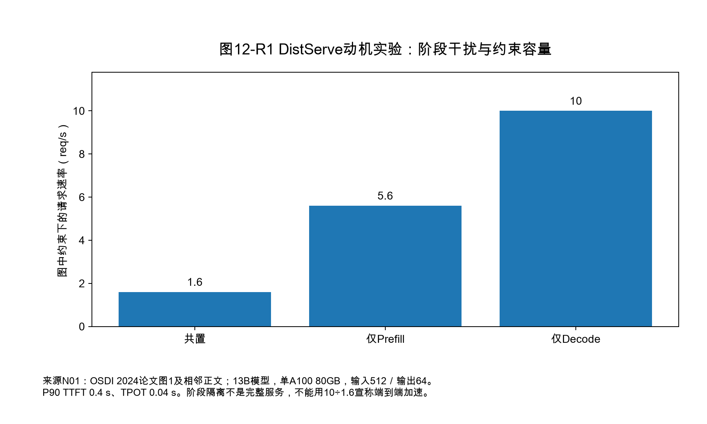
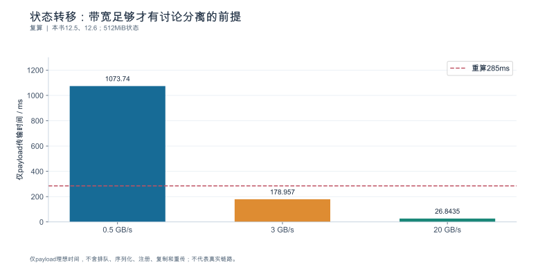
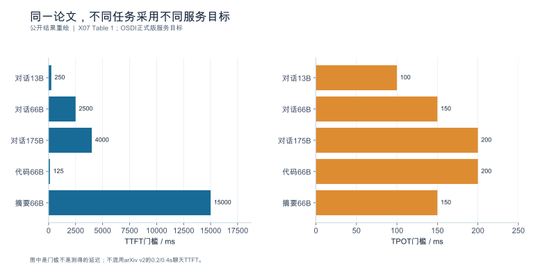
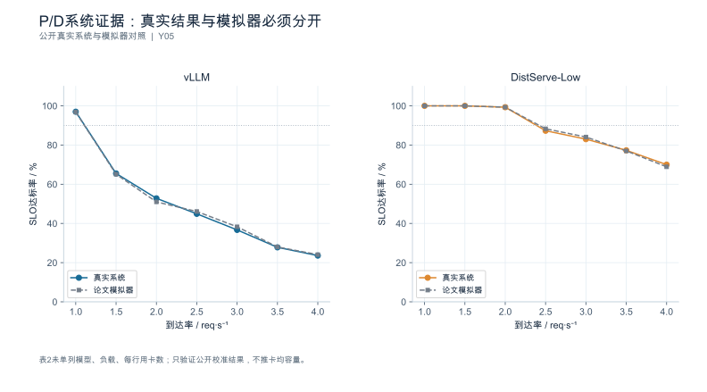

<a id="ch-12"></a>
## 第12章 分布式推理服务：P/D 分离、状态传输与控制平面

**核心论点：**架构价值必须在**模型数据面**与**服务控制面**共同验证——阶段独立配置可以减少干扰，但状态转移、路由、流控、版本变化与恢复会新增成本。

---

<a id="sec-12-01"></a>
### 12.1 数据面、控制面与分离架构的采用条件

**本节要回答的问题：**阶段独立调度能解决当前哪个**已证实**的问题？

#### 12.1.1 先把两个面分开

| | 组成 | 关心的问题 |
|---|---|---|
| **数据面** | 执行器、缓存、状态传输、内核 | 一次前向走了哪条路径、状态搬了多少字节 |
| **控制面** | 服务发现、路由、准入、版本管理、扩缩容决策 | 请求交给谁、谁的版本、失败后谁接管 |

具体进程可以跨越这两个边界——但**分析口径不能混淆**。把"控制面路由延迟"记进"模型慢"，是分离式架构里最常见的记账错误（第1章 1.1.1 的依赖假设在这里直接适用）。

#### 12.1.2 分离不是天然优于共置

共置（Prefill 与 Decode 在同一实例）的问题是**阶段间干扰**：一次长 prefill 会占用批位与 Token 预算，让正在 decode 的请求被拖慢（第5章 5.4）。分离把两阶段放到独立资源池，可减少实例内执行干扰；共享网络、主机、存储和控制面仍可能产生跨池干扰，但引入：

- 状态传输（12.2）；
- 两个池的配比与瓶颈迁移（12.3）；
- 版本感知路由与状态身份管理（12.4）；
- 新的故障域与恢复路径（12.5）。

因此**采用条件必须是可测试的三条**，而不是"感觉有干扰"：

1. 存在**已证实**的阶段间干扰（有分层数据：某类请求的 ITL/TPOT 因另一类请求而恶化）；
2. 两阶段的**最优资源形状不同**（例如 P 更受算力约束、D 更受带宽与容量约束，第2章 2.3、第3章）；
3. 状态传输与协调成本**小于**分离带来的收益（有量级估算）。

#### 12.1.3 一个完整的共置/分离对照

构造数据。负载为混合负载，长输入（4096 Token）占 20%，短输入占 80%，平均输出 300 Token；总资源 8 卡。

| 指标 | 共置（TP=8 ×1） | 分离（P 池 4 卡 + D 池 4 卡） | 变化 |
|---|---:|---:|---|
| 长输入首个 D 侧可见输出 P50 | 420 ms | **330 ms** | −21.5% |
| 短请求 ITL P99 | 195 ms | **78 ms** | −60.0% |
| 集群合格完成速率 | 4.00 req/s | **5.20 req/s** | **+30.0%** |

本协议规定 P 端首 Token 暂不对客户端写出、D 端首步后才出现可见输出；该端点不是所有分离架构的 TTFT。其时间构成：$285$（P 池 prefill）$+ 26.8$（状态传输）$+ 18$（D 池首步）$= \mathbf{329.8\ ms}$。

**注意这里的关键点：传输的 26.8 ms 已经包含在 330 ms 里，占 8.1%。**分离之所以更快，是因为 P 池专精且无传输部分的设定时间从 420 ms 变成 303 ms，减少约 117 ms；扣去新增传输 26.8 ms 后，净减少约 90.2 ms。**如果只报"分离让 TTFT 从 420 降到 330"，而不拆出这 26.8 ms，读者就无法判断换个网络或换个序列长度会怎样。**

#### 12.1.4 反面情形：什么结果支持继续共置

同样是分离架构，换成**短输出负载**（平均输出 30 Token）：

| 指标 | 共置 | 分离 | 变化 |
|---|---:|---:|---:|
| 合格完成速率 | 6.10 req/s | 6.25 req/s | **+2.5%** |

传输成本（26.8 ms）没变，但 prefill 在总时长里的占比更高，隔离带来的收益更小。若项目的工程收益门槛高于 2.5%，或新增成本超过可兑现收益，则支持维持共置；仅凭这个百分比本身不能证明分离不值得。

本节验收要求的正是这一点：**能说明什么结果支持继续共置**，而不是先选架构再找理由。

#### 12.1.5 新增成本清单

| 新增项 | 本例 |
|---|---|
| 状态传输延迟 | 26.8 ms/请求（逻辑量） |
| 控制面组件 | 3 个（路由、服务发现、传输协调） |
| 启动时间 | +38 s |
| 新增故障域 | 2 个（路由器、传输/缓存服务） |

固定集成栈的资料案例：Dynamo 1.5.0 与 llm-d 0.9 [SOURCE_REGISTERED] [S06] [S07]。**选择一套完整固定集成解释请求路径，另一套只比较设计职责**——不把两者的组件混搭。原论文的实验倍数只作**原论文结论**引用 [SOURCE_REGISTERED] [R09]，不是本环境的预期。

**依据与核验入口：**[R09] [R10] [S06] [S07]

---

<a id="sec-12-02"></a>
### 12.2 状态传输：布局、字节、链路与"可用性"

**本节要回答的问题：**一次请求从 P 端到 D 端，到底要搬哪些状态，搬完是否就能用？

#### 12.2.1 三种口径，不能直接互相替代

| 口径 | 本例（4096 Token） | 说明 |
|---|---:|---|
| **逻辑状态大小** | 512 MiB（0.5369 GB） | $4096 \times 128$ KiB，第4章状态账 |
| **线上字节数** | 逻辑 + 分块头/对齐 | 需实测，通常略高于逻辑量 |
| **设备端读写量** | 可达逻辑的 2—4 倍 | D2H + 网络缓冲 + H2D；若需布局转换再加一读一写 |

用**逻辑大小 ÷ 标称带宽**得到的传输时间是**乐观下界**，不是预测值。

#### 12.2.2 五段计时：重叠只省下 8.2%


| 段 | 时长 |
|---|---:|
| 注册与准备（内存注册、连接建立） | 3.0 ms（可提前到热身完成） |
| D2H 拷贝 | 6.7 ms |
| 网络传送 | 26.8 ms |
| H2D 拷贝 | 6.7 ms |
| 校验与可用确认 | 1.8 ms |
| **串行合计** | **45.0 ms** |
| **设定的端到端** | **41.3 ms** |

重叠只省下 **8.2%**。这条数据的用途是反驳一个常见假设——**"传输会被计算完全隐藏"**。这个例子没有完全隐藏；真实可隐藏比例必须由路径依赖和运行记录确定，既不能预设完全隐藏，也不能预设一定无法隐藏。

有效带宽 $= 0.5369\ \text{GB} / 41.3\ \text{ms} = \mathbf{13.0\ GB/s}$，即标称 20 GB/s 的 **65.0%**。所以本节验收的硬要求是：**传输结论基于真实路径与有效带宽，不得把标称网络带宽当成应用吞吐。**

#### 12.2.3 传输库与 Store 是两个组件

点到点传输库解决"字节怎么搬" [SOURCE_REGISTERED] [S15]；分层存储解决"状态放哪、能留多久" [SOURCE_REGISTERED] [S14]（Transfer Engine 与 Store 是不同组件）。**传输库不自动承担状态语义验证、请求调度或租户授权。**

#### 12.2.4 "搬完了"不等于"可以安全参与解码"

在消费方确认之前，必须先核对四元组：

| 项 | 为什么 |
|---|---|
| 模型 revision | 不同 revision 的状态语义不同 |
| **状态布局** | 布局不同则同样的字节被解释成不同的东西 |
| dtype（含缩放元数据） | 低精度状态的缩放规则必须一致（第11章 11.2） |
| 分词器与模板版本 | 影响 Token 序列与位置编码的含义 |

这条尤其危险的地方在于：**字节搬过去了但布局不同，可能校验失败、运行报错，也可能静默产生错误答案。**因此必须有消费端的显式校验，且校验结果要进事件记录。

非前缀复用与分层缓存服务的兼容性入口 [SOURCE_REGISTERED] [S13] 只解决"能不能复用"，不解决"这次复用是否安全"。

**依据与核验入口：**[R09] [R10] [R08] [S14] [S15] [S13]

---

<a id="sec-12-03"></a>
### 12.3 资源配比、路由流控与阶段容量

**本节要回答的问题：**两个资源池如何避免一端闲置、一端排队？

#### 12.3.1 配比由负载结构决定，不是由输入输出 Token 比例直接换算

设 P 池单卡 prefill 能力 $2400$ Token/s（输入）、D 池单卡 decode 能力 $480$ Token/s（输出）。每请求所需的"卡·秒"为 $S_{\text{in}}/2400$ 与 $S_{\text{out}}/480$：

| 负载 | P 需求（卡·秒） | D 需求（卡·秒） | **P 池占比** |
|---|---:|---:|---:|
| 输入 1200 / 输出 300 | 0.500 | 0.625 | **44.4%** |
| 输入 1200 / 输出 900 | 0.500 | 1.875 | **21.1%** |
| 输入 3600 / 输出 300 | 1.500 | 0.625 | **70.6%** |

**P 池占比在 21.1% 与 70.6% 之间变化，跨度 3.3 倍。**所以固定配比只适用于某一个负载分布；输出长度变化或输入长度变化都会让瓶颈迁移。这也解释了为什么**不能只用输入/输出 Token 比例直接换算卡数**——两阶段的单卡吞吐能力不同，且各自随形状变化。

#### 12.3.2 配比扫描：瓶颈迁移可见

| 配比 P:D | P 池利用率 | D 池利用率 | 合格完成速率 |
|---|---:|---:|---:|
| 2:6 | 96% | 62% | 4.35 req/s |
| 3:5 | 88% | 78% | 5.05 req/s |
| **4:4** | 71% | 94% | **5.20 req/s** |
| 5:3 | 58% | 99% | 4.80 req/s |

最优出现在 D 池接近饱和（94%）而 P 池有余量（71%）处。这个形态说明：**当前负载下 D 是瓶颈端**；若负载变成长输入短输出，在其它条件不变时，通常需要增加 P 侧资源，表中配比应向更大的 P:D 方向移动。

#### 12.3.3 路由开销与反馈延迟也要监测

控制层按工作量、队列与状态分布做决定时，它自己也有成本：

- **路由决策延迟**：查状态位置、判版本、算成本估计的时间；
- **反馈延迟**：控制层看到的队列与状态分布是多久之前的（陈旧的控制信号会导致震荡）；
- **缓存亲和 vs 排队均衡**：第6章 6.4.3 已给出权衡算例——命中收益可能被新增排队吃掉，这里同样适用，只是现在跨了阶段。

#### 12.3.4 组合变化后必须重测

推测解码、专家路由、并行度任一变化都会改变两阶段的能力曲线，**此前的固定配比不再有效**。第11章 11.6 的消融在这里同样成立：不能沿用旧配比直接推荐。

**依据与核验入口：**[R09] [R10] [S06] [S07] [S02]

---

<a id="sec-12-04"></a>
### 12.4 版本感知路由、状态身份与一致性

**本节要回答的问题：**请求如何到达**持有正确状态**的**正确版本**实例？

#### 12.4.1 四类身份，缺一不可

| 身份 | 谁分配 | 解决什么 |
|---|---|---|
| `task_id` | 业务/编排层 | 一次业务任务的聚合 |
| `request_id` | 客户端或网关 | 逻辑请求 |
| `attempt_id` | 重试产生 | 区分物理尝试（第1章 1.6） |
| **`state_id`（cache_id）** | 缓存/传输层 | **状态块属于谁、属于哪个版本** |

分离架构把这些身份拆到了不同组件：**命中、重试、取消可能发生在不同的进程里**。错误的身份或错误的回收时机，会造成错误结果或资源泄漏——这属于**正确性问题**，不是性能问题。

#### 12.4.2 状态生命周期状态机

```text
CREATED ──▶ TRANSFERRING ──▶ READY ──▶ IN_USE ──▶ RELEASED
   │             │              │
   └──▶ FAILED   └──▶ FAILED    └──▶ STALE（版本失效/布局不匹配）
                                 └──▶ ORPHAN（生产方完成、消费方从未接收）
```

关键规则：**"传输成功"不等于"状态可安全使用"**。只有进入 `READY` 且消费方完成四元组校验（12.2.4）后，才能参与解码。

#### 12.4.3 版本路由与滚动更新

把**服务版本、模型 revision、缓存格式**三者同时作为路由约束。旧请求排空与新请求准入必须分别定义：

- **排空（drain）**：不再给待退役实例分配新请求，但允许在途请求完成；
- **准入（admit）**：新请求只发给新版本实例。

算例：4 个 D 实例逐个滚动更新，单实例排空窗口 45 s（长请求最大 30 s + 余量 15 s），总切换窗口 $4 \times 45 = \mathbf{180\ s}$，期间稳态容量降为 **75%**。

**切换流量不代表旧缓存可以给新模型复用。**模型 revision 变化会让全部旧状态失效：命中率从 45% 掉到 0，TTFT P50 从 330 ms 涨到 **512 ms**（**+55.2%**），直到新状态重建完成。这段"版本切换悬崖"必须写进容量计划，否则上线即跌 SLO。

遥测字段必须带版本登记 [SOURCE_REGISTERED] [R18]，不能假设字段语义已稳定。

#### 12.4.4 租户隔离与回收

状态 key 必须含租户标识。未经授权的跨租户状态复用属于安全问题；经过授权的公共前缀或信任组共享可以另立隔离契约——因此隔离校验不能为了省一次传输而省略。失效与回收要有明确的触发条件与终态记录。

**依据与核验入口：**[R07] [R10] [R18] [S06] [S07] [S13]

---

<a id="sec-12-05"></a>
### 12.5 故障、重试、滚动升级与退化路径

**本节要回答的问题：**P 端完成而 D 端失败时，系统怎么收场？

#### 12.5.1 四类故障分开定义终态

| 故障点 | 已完成的工作 | 重试语义 | 成本 |
|---|---|---|---|
| **P 执行失败** | 部分 prefill | 重跑 prefill（可能部分复用） | ≈1× prefill |
| **传输失败** | 完整 prefill 状态 | **优先重传**，状态不在才重算 | 重传 **26.8 ms** vs 重算 **285 ms** |
| **D 执行失败** | 已生成 $N$ 个 Token | 重传后重生成，或整体重算 | 按策略定 |
| **路由/控制面失败** | 无 | 换实例重发 | 重跑全部 |

关键对比：**重传 26.8 ms 与重算 285 ms 相差 10.6 倍。**这组成本提示优先评估重传，但策略还必须检查状态身份、保留租约、剩余截止时间、幂等性与目标实例是否可用；不满足时应重算、拒绝或结束，而不是无条件重传。

#### 12.5.2 孤儿状态：被遗忘的成本

P 完成但 D 从未接收的状态，会一直占着 P 池的状态池。算例：故障注入 5 分钟产生 240 个孤儿状态：

$$
240 \times 0.5369\ \text{GB} = \mathbf{128.8\ GB}
$$

P 池状态池总量 $4 \times 41.0 = 164$ GB → 孤儿占 **78.6%**。也就是说，**一次 5 分钟的控制面故障，可以让 P 池在恢复前基本失去承载能力**。孤儿状态的回收策略（超时扫描、生产方主动释放、消费方确认驱动的回收）必须与超时时间一起设计。

#### 12.5.3 重试放大与失败分母

故障期间 P 失败率 30%、重试上限 2 次，按第1章 1.6.5 的公式：

$$
\mathbb{E}[N_{\text{attempt}}] = \frac{1-0.3^{3}}{1-0.3} = \mathbf{1.39}
$$

尝试次数放大 **39%**，而这些额外尝试产生的工作**不会被计入任何"成功请求"统计**。报告必须包含失败分母与重算预算，只报稳态吞吐会低估故障期的真实负载。

#### 12.5.4 滚动升级的"健康"定义

**健康判定必须包含实际质量与 SLO**，而不只是容器进程存活。还要求：

- 检查不可用实例是否被路由避开（而不是继续被分配）；
- 长请求是否被正确排空（而不是被硬杀）；
- 恢复期间的重试是否放大了负载；
- **退化路径是否可用**：控制面失效时能否退回共置模式——这必须**预先验证并演练过**，不能假定"到时候可以切回去"。

**依据与核验入口：**[R10] [R25] [S06] [S07] [S13]

---

<a id="sec-12-06"></a>
### 12.6 异构资源、共享状态与多阶段服务

**本节要回答的问题：**分离架构怎样扩展到不同硬件和多模态？

#### 12.6.1 异构 P/D：兼容性是前提

异构资源可以让 P 池用算力更强的设备、D 池用带宽/容量更合适的设备。但**状态格式、精度、布局与传输协议必须兼容**——这一条比性能更重要，因为不兼容既可能显式失败，也可能静默出错。

本节只把它们写成**设计与验证问题**，不因为框架有功能入口就声称任意硬件组合可工作。

#### 12.6.2 分层缓存：重算 vs 从哪一层读

（读取 512 MiB 状态）：

| 层 | 有效带宽 | 读取耗时 | vs 重算 prefill（285 ms） |
|---|---:|---:|---|
| 设备显存 | — | 不需额外载入；正常访问时间仍非零 | 取决于是否可直接消费 |
| 主机内存 | 20 GB/s | **26.8 ms** | 优（10.6×） |
| 本地 NVMe | 3 GB/s | **179.0 ms** | 优（1.6×） |
| 远端存储 | 0.5 GB/s | **1073.7 ms** | **劣**（3.8× 于重算） |

**结论是分层的**：本地 NVMe 划算，远端存储不划算。所以"要不要下沉到远端"不能一概而论，必须按本环境的重算成本与链路带宽计算。分层缓存的设计入口 [SOURCE_REGISTERED] [R32] [S13] [S14]，介质、后端与部署限制需另行锁定。

#### 12.6.3 编码器分离：关键路径变长

多模态可以把编码器作为独立阶段，于是关键路径变成

$$
45\ (\text{图像编码}) + 285\ (\text{prefill}) + 26.8\ (\text{传输}) + 18\ (\text{首步}) = \mathbf{374.8\ ms}
$$

多一个阶段就多一个排队点、多一个故障域、多一次状态交接。**每加一个阶段都要重新做关键路径与瓶颈分析**，不能只在原有路径上"加一项"。

#### 12.6.4 集成栈依赖与迁移风险

固定集成栈是维护者给出的**版本化集成组合**；本书未本地重建，不能称为作者验证通过：Dynamo 1.5.0 固定集成 vLLM 0.28.0、SGLang 0.5.18、TensorRT-LLM 1.3.0rc25 [SOURCE_REGISTERED] [S06]。

由此产生三条硬规则：

1. **不能把其中的引擎分别换成各自 latest 后，仍称"同一集成"**——那是新的、未验证的组合；
2. 该快照把 KVBM 标为弃用并**计划**在 1.6 移除——**"计划移除"不是已发生**，本稿不预判后续发布状态；
3. 相关名称（如 AISimulate 更名）按该版本登记，不用新名称回推旧版本的行为。

昇腾等其它后端的适配栈与版本依赖另行核验 [SOURCE_ENTRY_ONLY] [R19]。

**依据与核验入口：**[R10] [R19] [R32] [S06] [S13] [S14] [S15]

---

<a id="sec-12-07"></a>
### 12.7 实验：固定集成栈的服务能力与恢复对照

**本节要回答的问题：**什么对照能回答"架构变化是否值得"？

#### 12.7.1 至少声明一种公平性

与第6章 6.7.1 同一规则，但这里更严格：

| 公平性 | 固定什么 | 比较什么 |
|---|---|---|
| **固定资源** | 设备总数与型号 | 服务能力（同 SLO 下的合格完成速率） |
| **固定 SLO** | 目标与门槛 | 达成它所需的资源成本 |

**不能混用，也不可把不同硬件数量与不同质量的结果当作纯架构对比。**

#### 12.7.2 主实验只选一套可获得的集成

完整保存镜像、后端、路由与 connector 配置（含版本与 commit）。除稳态的共置/分离比较外，还要检验：

1. 控制面失败（路由不可用、传输服务不可用）；
2. 模型版本切换（状态失效与恢复曲线）；
3. 状态清理（孤儿回收是否生效）；
4. **可服务时间**（从启动到能接流量，含控制面就绪）。

另一套平台完成**设计对照**；没有证据的格子保持未知，不填推测值。

#### 12.7.3 最后把成本放回结论

稳态性能之后，必须把**传输成本、运维成本、回滚成本**放回结论里。一个稳态 +30% 但需要 3 个新组件、2 个新故障域、且回滚需 180 s 的方案，与 +2.5% 的共置方案相比，未必更划算——这是项目决策，不是技术优劣。

**依据与核验入口：**[R09] [R10] [R24] [S06] [S07]

---

### 12.8 深化：分离的收益边界、首输出协议与状态交接

#### 12.8.1 从公开实验读出问题，而不是只摘最大倍数

DistServe的OSDI 2024论文图1使用13B模型、单张A100 80GB、512输入／64输出的合成负载。该图及相邻正文报告，共置系统在给定TTFT/TPOT约束下约1.6 req/s，单独Prefill与单独Decode分别约5.6和10 req/s [N01]。



后两根柱是**阶段隔离实验**，不是两套各自完成端到端任务的服务。论文用它们讨论理想资源组合；本书不把10／1.6算成同资源端到端加速，也不从图中补造未公开的逐请求数据、置信区间或2026版本表现。

#### 12.8.2 转移是否值得，先比较暴露成本

设隔离及资源匹配减少的关键路径时间为 $\Delta T_{saved}$，额外状态交接的暴露时间为 $T_{handoff}$，新增控制等待为 $T_{control}$，则这条请求延迟改善要求

$$\Delta T_{saved}>T_{handoff}+T_{control}.$$

这只是单请求条件，容量还取决于两个池的排队与共享网络。例如在设定状态128 KiB/Token、8192前缀下，需转移1 GiB。若隔离净省100 ms且其它暴露开销20 ms，那么仅按连续传输下界就需有效带宽高于 $1\text{ GiB}/80\text{ ms}\approx13.42$ GB/s。低于此值不能满足这组时间预算；高于它也不代表保证满足，因为排队、注册和布局转换尚未全部计入。

不同请求长度对应不同转移量，远端缓存命中还可能替代重算。一个“开了分离就快”的固定判断，应改为按状态大小、当前队列、链路和期限选择共置或分离路径；但动态选择本身也有控制开销，需保留简单基线。

#### 12.8.3 首Token到底由谁发出，改变计量结果

一种协议让P端完成Prefill后立即发首Token，同时把状态发给D端。此时TTFT可以不包含完整转移，但首Token到第二Token之间可能出现明显停顿。另一种协议由D端确认就绪后统一开始流式输出，转移就进入首输出时间。两者都可以正确，却不能用同名TTFT直接比较。

因此分离验收应同时记录：P端首Token生成、客户端首内容、D端状态可消费、D端首次前向完成，以及首两个客户端内容事件的间隔。仅测TTFT可能把等待从“首Token之前”搬到“首Token之后”，用户感知未必改善。原 330 ms的算式已限定为D端首步后开始可见输出的协议，不再当成所有P/D系统的通则。

#### 12.8.4 状态所有权需要处理迟到完成

考虑传输超时后P端已释放缓冲，旧的网络完成回调又迟到。如果控制面只按 `request_id` 认领状态，就可能把旧字节当成新尝试的状态。一个更稳健的设计应把状态身份写成 `{model_revision, layout_version, attempt_id, transfer_id, generation}`，消费端校验当前generation，过期结果只做清理，不能重新进入READY。

释放也应依赖安全条件：生产者不再写入、传输没有引用、消费者不再计算、缓存策略允许回收。租约或引用计数可以实现部分条件，但不替代设备完成语义。故障恢复要验证超时重传、重复确认、迟到确认、取消与版本切换的交错，而不只是验证一次成功传输。

#### 12.8.5 固定集成不是把组件版本逐个取最大

Dynamo 1.5.0发布表分别固定了vLLM、SGLang和TensorRT-LLM后端，并按后端列出不同NIXL版本 [N10]。本书将其录入来源矩阵，而不是生成一个未经运行验证的通用安装脚本。尤其应保留KVBM“本版弃用、目标在后续版移除”的时间语义；迁移目标是否等价，要按所需能力另行核验。

---

<!-- V06-START -->
<a id="sec-12-09"></a>
### 12.9 实验图表补充：把状态传输成本与论文SLO契约并排核对

本节第一张图是明确的下界：512MiB状态以0.5、3、20GB/s有效带宽传输，仅payload项分别约1073.74、178.96、26.84ms。与285ms重算时间比较，慢层级可能输给重算，快层级才值得继续核算其他成本。图中的0.5/3/20是设定带宽；排队、注册、复制、序列化与重传必须再加回真实依赖图。

第二张图来自DistServe正式论文Table 1，展示TTFT/TPOT的**目标门槛**而非达成的时延。OPT-13B、66B、175B聊天TTFT分别0.25、2.5、4.0秒；代码OPT-66B为0.125秒，摘要为15秒。不同任务的门槛差异本身就会改变“最佳布局”与可交付容量。

**版本勘界：**arXiv v2的前两组聊天TTFT是0.2、0.4秒，66B TPOT也不同；全书统一用 OSDI 正式版。Figure 1的P-only约5.6、D-only约10 req/s不是完整服务。论文“2P1D可达10 req/s、约3.3 req/s/GPU”以Ideally引出，属于理想资源配比推演，本书不将它画为已测的端到端结果。

**实验落点：**同时固定首Token产生位置、线上状态字节与实际传输路径；分离前后使用相同质量和联合SLO，再比较合格完成速率，而非取某阶段最大值相除。

#### 图12-V1 状态转移：带宽足够才有讨论分离的前提



**数据身份：**`TEACHING_CALCULATION`。**条件：**S=512MiB=536870912byte；带宽0.5/3/20GB/s均为假设；重算285ms。

| 有效带宽假设/GB每秒 | 理想payload/ms | 285ms与传输时间之比 |
|---|---|---|
| 0.5 | 1073.742 | 0.265 |
| 3 | 178.957 | 1.593 |
| 20 | 26.844 | 10.617 |

复算公式：`T_ms=S_bytes/(B_GBs*10^9)*1000`。

**出处与边界：**本书12.5、12.6；仅payload理想时间，不含排队、序列化、注册、复制和重传；不代表真实链路。

[数据与绘图点](book_support_v06/data/ch12_transfer_floor.json) · [PNG](book_support_v06/figures/ch12_transfer_floor.png) · [重绘代码](book_support_v06/code/replot.py)

#### 图12-V2 同一论文，不同任务采用不同服务目标



**数据身份：**`PUBLISHED_RESULT`。**条件：**OPT-13B/66B/175B；FP16；论文全局测试床4节点32×A100-80GB；不同实验使用相应子集。

| 任务/模型 | TTFT门槛/ms | TPOT门槛/ms |
|---|---|---|
| 对话13B | 250 | 100 |
| 对话66B | 2500 | 150 |
| 对话175B | 4000 | 200 |
| 代码66B | 125 | 200 |
| 摘要66B | 15000 | 150 |

**出处与边界：**[X07](book_support_v06/来源与核验.md#x07)；图中是门槛不是测得的延迟；不混用arXiv v2的0.2/0.4s聊天TTFT。

[数据与绘图点](book_support_v06/data/ch12_slo_contract.json) · [PNG](book_support_v06/figures/ch12_slo_contract.png) · [重绘代码](book_support_v06/code/replot.py)

<!-- V06-END -->
<!-- V07-START -->
<a id="sec-12-10"></a>
### 12.10 实验深化补充：真实系统与模拟器：校准的是模型，不是容量

本章前面明确了“阶段速率≠端到端”，并采用DistServe OSDI正式版的SLO契约。这一节补上该论文最能说明方法论的一张表：Table 2把真实系统结果与模拟器结果并排校准。

平台为4节点、32×A100-80GB、FP16。到达率由1.0升到4.0 req/s时，vLLM真实/模拟由97.0%/96.8%降到23.6%/24.1%；DistServe-Low真实/模拟由100%/100%降到70.0%/68.9%。逐点复算绝对差：vLLM最大1.8个百分点，出现在2.0 req/s（52.8对51.0）；DistServe-Low最大1.1个百分点，出现在3.0 req/s（83.0对84.1）与4.0 req/s（70.0对68.9）。**这是“模拟器能多准地复现真实”的校准证据，不是“DistServe比vLLM快多少”的加速证据。**偏差是绝对百分点，不是相对误差<2%。

**读图纪律：**实线为真实系统、虚线为论文模拟器，两者不可混画为一条曲线。有限速率网格只提供已测点，不能外推精确容量边界；本表未单列模型/负载/每行分配卡数，因此**不据此计算公平的卡均容量倍率**。也不把论文Figure 1以“Ideally”引出的2P1D理想推演当作端到端实测。

#### 图12-E1 P/D系统证据：真实结果与模拟器必须分开



**数据身份：**`PUBLISHED_REAL_AND_SIMULATED`。**条件：**OSDI正式版Table2；整体平台4节点/32×A100-80GB、FP16；本表模型/负载/每行分配卡数未单列，附近图11为OPT-66B/ShareGPT，仅作上下文。

| 到达率/req每秒 | vLLM真实/% | vLLM模拟/% | DistServe-Low真实/% | DistServe-Low模拟/% |
|---|---|---|---|---|
| 1.0 | 97.0 | 96.8 | 100.0 | 100.0 |
| 1.5 | 65.5 | 65.1 | 100.0 | 100.0 |
| 2.0 | 52.8 | 51.0 | 99.3 | 99.3 |
| 2.5 | 44.9 | 46.1 | 87.3 | 88.3 |
| 3.0 | 36.7 | 38.3 | 83.0 | 84.1 |
| 3.5 | 27.8 | 28.0 | 77.3 | 77.0 |
| 4.0 | 23.6 | 24.1 | 70.0 | 68.9 |

**出处与边界：**[Y05](book_support_v07/来源与核验_v07.md#y05)；实线是真实系统、虚线是论文模拟器。缺表级配置，不据此算公平的卡均容量倍率；不得混入Figure1的理想2P1D。

[数据与绘图点](book_support_v07/data/ch12_distserve_calibration.json) · [PNG](book_support_v07/figures/ch12_distserve_calibration.png) · [重绘代码](book_support_v07/code/replot_v07.py)

<!-- V07-END -->
### 章末检查问题

**1. P/D 分离改善了 TPOT，却恶化了 TTFT，应该如何判断？**

答案方向：**用业务目标与联合达标率判定，而不是挑好的那个指标报。**先确认两个前提：① 两类指标分别落在哪些请求上（分层，不是总平均）；② TTFT 与 TPOT 各自的契约阈值是什么。然后按第7章的联合达标率算总账——TTFT 恶化会减少达标请求数，可能**完全抵消** TPOT 的改善。对照：TTFT 420→455 ms（阈值 450 ms，超限请求增多）、ITL 195→78 ms，联合达标率 82% → **79%**，此时应当**不采用**。只有在 TTFT 仍在阈值内、且达标率与合格完成速率同时改善时，分离才成立；若 TTFT 已接近阈值，则应改进传输路径或调整配比后重测，而不是接受这个权衡。

**2. 状态可传输，是否等于跨后端兼容？**

答案方向：**不等于，而且这是最危险的一类误解。**传输库解决"字节怎么搬"，兼容还要求四件事同时成立：模型 revision、状态布局、dtype（含缩放元数据）、分词器/模板版本。字节搬过去了而布局不同，**可能校验失败、运行报错，也可能静默产生错误答案**——所以这不是"性能差"，是静默的正确性故障。因此必须在消费端做显式校验（12.2.4 的四元组），校验结果进入事件记录，且未通过时状态进入 `STALE` 而不是 `READY`。跨后端组合要先验证再使用，不能因为某框架提供了连接器就认为任意两端可互操作。

**3. 为什么不能给固定 Dynamo 集成中的引擎分别换成各自 latest 后保留同一兼容结论？**

答案方向：因为官方集成记录针对的是**具体版本组合**，实际可用性还需复现验证，与任一组件单独的最新状态无关。分别换成 latest 之后：① 组件间的接口与协议可能变化（连接器、控制面接口、状态格式约定）；② 原集成声明的版本依赖矩阵不再成立；③ 已被验证过的行为（例如状态传输对 dtype 与缩放元数据的处理）在新组合下**未经验证**。所以得到的是一个新的、未验证的组合，必须重新验证，不能沿用原结论 [SOURCE_REGISTERED] [S06]。同理，"某组件被标记为弃用并计划移除"是计划，不是既成事实，不得据此预判后续版本的行为。

---

### 本章验收清单

| 节 | 验收标准 |
|---|---|
| 12.1 | 采用条件三条可测试；对照同时给出支持分离的与支持继续共置的结果；新增成本列全（传输、组件、启动、故障域） |
| 12.2 | 逻辑/线上/设备端三种口径分开；五段计时与有效带宽已测；重叠比例实测而非假设；四元组校验已定义 |
| 12.3 | 配比注明负载区间；给出配比扫描与瓶颈迁移；路由开销与反馈延迟被监测；组合变化后重测 |
| 12.4 | 四类身份齐全；状态机含 `STALE`/`ORPHAN`；排空与准入分别定义；版本切换的容量跌落已计入计划 |
| 12.5 | 四类故障各有终态与成本；重传 vs 重算的策略写死；孤儿状态占用已量化；重试放大与失败分母已报；退化路径已演练 |
| 12.6 | 兼容矩阵明确；分层缓存按本环境重算成本决策；多阶段关键路径重新计算；集成依赖三条规则遵守 |
| 12.7 | 公平性原则明确且未混用；主案例锁定一套集成；传输/运维/回滚成本放回结论 |

---

### 配套资料

[新增图表与数据](book_support_v05/figures.md) · [来源登记](book_support_v05/references.md) · [E0测试清单](book_support_v05/data/e0_test_results.md) · [修订记录](book_support_v05/review/changes.md)

[N01]: book_support_v05/references.md#n01
[N10]: book_support_v05/references.md#n10
[R07]: book_support_v05/references.md#r07
[R08]: book_support_v05/references.md#r08
[R09]: book_support_v05/references.md#r09
[R10]: book_support_v05/references.md#r10
[R18]: book_support_v05/references.md#r18
[R19]: book_support_v05/references.md#r19
[R24]: book_support_v05/references.md#r24
[R25]: book_support_v05/references.md#r25
[R32]: book_support_v05/references.md#r32
[S02]: book_support_v05/references.md#s02
[S06]: book_support_v05/references.md#s06
[S07]: book_support_v05/references.md#s07
[S13]: book_support_v05/references.md#s13
[S14]: book_support_v05/references.md#s14
[S15]: book_support_v05/references.md#s15

<!-- V10-START -->
<a id="sec-12-90"></a>

### 本章口径核对（公开来源）

#### 固定集成的版本矩阵、控制面职责与遥测语义版本

**Dynamo v1.5.0 的版本依赖与弃用项**

> **时效提示（2026-10-09）**：本节锚定 Dynamo **v1.5.0**（GA 2026-09-18）；截至检索日已发布 **v1.5.1**（2026-10-07），为补丁版。同时各上游已推进：vLLM 最新稳定版 **v0.31.0**（2026-10-05，commit `db9527a`；另有 RC v0.31.1rc0 于 2026-10-07）、SGLang **v0.5.21**（2026-10-02）、NIXL **v1.5.0**（2026-09-30）、Mooncake **v0.3.13.post1**（2026-08-31）。**固定集成的版本矩阵 ≠ 各组件最大版本号**：升级任一组件都必须重新确认"该集成是否仍被验证"，不能逐个升到 latest 仍称同一集成。本节所有"已弃用/已移除"状态都只对 v1.5.0 成立，其中 KVBM 的移除目标是 **v1.6.0**（官方 docs；GitHub 镜像页另有 v1.7.0 说法，以 docs 为准）。

该版本为第 18 个功能版本（658 个 PR、123 位贡献者）。对接的引擎版本为：vLLM v0.28.0、SGLang v0.5.18、TensorRT-LLM v1.3.0rc25。SGLang sidecar 固定在 v0.5.18，理由是"第一个其 gRPC `GetServerInfo` 能报告结构化 KV 事件描述符的版本"；弹性 EP 要求 SGLang v0.5.16 及以上；xpu 镜像上的 vLLM-Omni 固定在 v0.27.0rc1（对应 vLLM v0.27.1）。

弃用与移除：KVBM 废弃，目标 v1.6.0 移除；Go EPP 由 Rust EPP 取代（二进制位于前端镜像的 `/epp`）；`AIConfigurator` 更名为 `AISimulate` 并成为独立包；`python -m dynamo.replay` 移除；`--vllm-endpoint` 移除改用 `--grpc-endpoint`；`--router-reset-states` 从前端与文档移除；`--dyn-tool-call-parser` 更名为 `--tool-call-parser`。

v1.5.0 中标注为**实验性**（接口、默认值与镜像布局可能在无弃用周期的情况下变化）的能力：Dynamo Sidecar、Triton 后端、SGLang RL rollout 契约。此外该版本未发布预编译的 Triton 运行时镜像；GMS 的 `commit_layout()` 默认关闭（由 `DYN_GMS_PERSIST_KV` 控制）；容量受限的近似 LRU 为实验性且需显式开启。

**llm-d v0.9（2026-08-28，CNCF Sandbox）的设计职责**

llm-d 把自己定位为**推理控制面**。组件职责划分：Router（内含 Endpoint Picker，负责路由、打分、流控与插件生命周期）、调度与打分过滤管线、KV 缓存层（多层缓存、KV 传输、卸载连接器、P2P KV 共享）、分离 sidecar（P/D 拓扑与 KV 传输）、Workload Variant Autoscaler（自动扩缩容）。网关侧通过 LiteLLM、Kong AI Gateway 接入，并用 Inference Payload Processor 与 HTTPRoute 把请求导向 InferencePool。

v0.9 的"为规模加固"包含：多 EPP 拓扑的路由高可用（非 leader 副本仍可填充数据存储并转发流量，而非返回 503）；`--drain-timeout` 优雅退出；插件生命周期分为 Alpha / Beta / Stable，Alpha 需 `--allow-experimental-plugins`；流控默认值收敛为请求 TTL 60 s 与每 band 最大请求数 5000；503 表示端点池为空，429 表示可重试背压；`DisaggregatedSet` 的版本化路由支持跨模型版本的 P/D 滚动更新；新增拓扑感知的路由过滤与打分；引入不依赖 RDMA 的早期卸载连接器（vLLM OffloadingConnector + ZMQ，孵化阶段）；打分路径覆盖 OpenTelemetry span 并贯穿 P/D 传输链；EPP 指标端点启用 mTLS，EPP 的 KV 指标迁入 `llm_d_router_epp` 子系统（过渡期保留已弃用别名）。默认 vLLM 镜像更新为 v0.26.0。

**边界**：llm-d 明确声明 RL 相关工作仍在孵化阶段，"完整方案目标 v0.10 及以后"；时间切片进入孵化；标准化模型服务接口尚不可用，而它是时间切片与快速模型生效的前置条件。指标重命名要求同步更新看板与告警。

**传输库与分层存储组件（Mooncake 0.3.14 / NIXL）**

Mooncake 的组件划分为 Transfer Engine、Mooncake Store、Mooncake EP 与 Mooncake PG，另有 Conductor 与 Reshard。Store 支持 DRAM 与 SSD/NVMe 两级，并提供对象级策略（副本数、首选段、软 pin 与硬 pin）。PG 可检测失效 rank、上报失败并在**不重启推理服务**的前提下恢复 rank，支持弹性 rank 恢复。Mooncake 在 2025 年 FAST 会议获最佳论文奖。

NIXL 侧见第 4 章：README 页未给出版本号（书内表述为"README 页未给出版本号"，指**正文未写死版本**），插件清单与平台限制如上。

**边界**：NIXL 与 Mooncake 之间是插件关系（NIXL 支持把 Mooncake TE 作为后端插件），但 NIXL 文档页未声明与 vLLM / SGLang / TensorRT-LLM / LMCache 的集成，这些集成关系必须从各引擎一侧确认。

> **核对补充（2026-10-09）**：① NIXL 的版本可由 **GitHub release 定位**——截至检索日最新为 **v1.5.0**（2026-09-30）；README 只以徽章动态引用版本、正文不写死，故引用应写 tag 而非"文档声明版本"。② 平台限制：官方声明"supported on a Linux environment only"，测试于 Ubuntu 22.04/24.04 与 Fedora；ROCm 上 `LIBFABRIC` plugin 处于 disabled（列在 Known gaps），v1.5.0 的 Known Issues 另说明 `pip install nixl` 不自动安装 ROCm wheel、需单独 `nixl_rocm` 后端。③ **集成关系的证据等级**：NIXL 仓库自身**未声明**与 vLLM / SGLang / TRT-LLM / LMCache 的集成；该说法出自 **NVIDIA 官方技术博客**。两者证据等级不同，引用时须标明是"NVIDIA 博客声明"还是"NIXL 仓库声明"。④ Mooncake 截至检索日最新 release 为 **v0.3.13.post1**（2026-08-31）；"不重启推理服务恢复 rank"的能力归属是 **Mooncake PG**，不是 Store。

**GenAI 遥测字段的语义版本（OpenTelemetry GenAI 语义约定）**

当前状态为 **Development**：页面级 `DocumentStatus` 与几乎所有指标、属性都标记 Development，没有任何稳定级的 GenAI 指标。桶边界规范引用 OTel spec v1.55.0。文档自述"这些是初始的生成式 AI 客户端指标与属性，后续可能新增"，并注明内容为自动生成、不可手工编辑。

> **核对说明（2026-10-09）**：GenAI 语义约定已迁出 OTel 核心仓库，独立为 `open-telemetry/semantic-conventions-genai`，该仓库**无 release / tag**，README 的 Schema URL 写作 `TODO`；文档内引用的 `v1.44.0` 是**其依赖的上游核心 semconv 版本，不是 GenAI 约定自身的版本**。因此书稿不得写成"semconv vX.Y.Z 规定……"，只能写"截至检索日的 GenAI 语义约定快照"。

客户端指标：`gen_ai.client.operation.duration`（Histogram, s；该指标的现名**尚未取得**，不作改写）、`gen_ai.client.inference.time_to_first_chunk`、`gen_ai.client.inference.time_per_output_chunk`（均为 Histogram, s）。服务端指标：`gen_ai.server.request.duration`、`gen_ai.server.time_to_first_token`、`gen_ai.server.time_per_output_token`（均为 Histogram, s）。工作流与智能体侧还有 `gen_ai.invoke_workflow.duration`、`gen_ai.invoke_agent.duration`、`gen_ai.invoke_agent.inference_calls`、`gen_ai.invoke_agent.tool_calls`、`gen_ai.execute_tool.duration`。

> **核对说明（2026-10-09）**：客户端两个 chunk 指标名为 **`gen_ai.client.inference.*`**（命名空间为 `inference`），官方未定义 `operation.*` 这一组名——按旧名引用会取不到指标。另，客户端这两个指标的"仅流式"是 SHOULD 级措辞（"SHOULD be reported for streaming calls and SHOULD NOT be reported otherwise"），**服务端 `gen_ai.server.*` 无此限制**——两侧语义不对称，不可互相套用。`operation.duration` 的现行名称尚未取得，保留原名并标注为待核验。

属性要求：`gen_ai.operation.name` 为必需；`gen_ai.provider.name` 在涉及服务商调用时条件必需，在 `time_to_first_chunk` / `time_per_output_chunk` 上为必需；`gen_ai.request.model` 在可得时条件必需；`gen_ai.response.model` 与 `server.address` 为推荐；`error.type` 在出错时条件必需。`gen_ai.provider.name` 明确要求低基数。

**边界**：token 计数指标与响应结束原因属性**不在该页定义**，分别位于 token 指标页与属性注册表页；因此不能从指标页推断 token 计数字段名。此外全部 GenAI 指标均为 Development 级，跨版本升级时需要预期破坏性变更。

**分离架构下的国产后端支持组合**

vLLM-Ascend 支持矩阵中，Prefill-Decode Disaggregation 为 🟢 Functional 且支持 xPyD；Sleep Mode、Context Parallel、Graph Mode 均为 🟢 Functional；KVPP 为 🔵 Experimental，且限定在非混合 MLA/SFA 模型与 eager 模式。MindIE 侧（3.1.0）提供 PD 实例级故障隔离与恢复，官方给出的恢复口径为自愈型故障 60 秒内、系统级故障 7 分钟内，并支持核心组件主备倒换与 AutoPD 自动 PD 配比寻优。

> **核对说明（2026-10-09）**：① **vLLM-Ascend 版本已推进**——上述矩阵对应 v0.26.0rc1（2026-09-03）；截至检索日最新为 **v0.27.1rc1**（2026-09-24），仍是 model-restricted 预发布，且其**声明的完整验证模型收缩为两项**（MiniMax-M3、DeepSeek-V4-Flash），其余组合官方明确"未充分验证、不属于本次发布声明范围"。引用矩阵时必须写明版本与检索日。② **MindIE 的 60 秒 / 7 分钟须降级引用**——该数字出自 MindIE 产品页"关键特性"，页面**未标注版本号、未给出测试规模、故障定义与 SLO 条件**；在版本说明与 Motor 开发指南中未检索到同数字的工程口径。因此它是**厂商宣称**，不能写成"3.1.0 实测指标"，也不能用于容量或可用性承诺。AutoPD 同为产品页口径，官方未给配置项与算法。
<!-- V10-END -->
