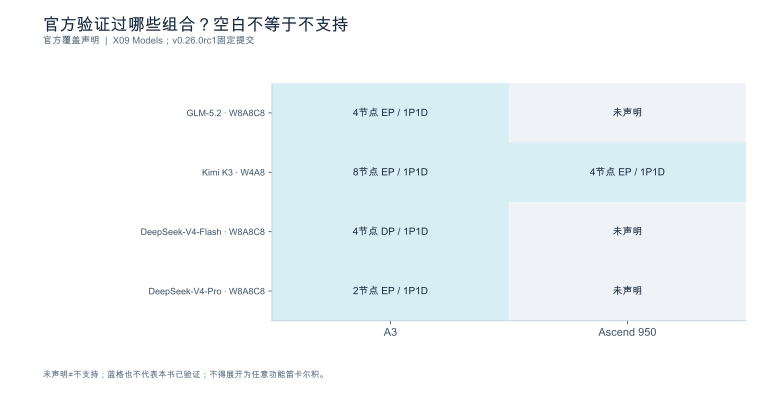

<a id="ch-13"></a>
## 第13章 软件栈与硬件适配

**核心论点：**兼容性是**具体版本、模型、算子与功能组合**的属性，不是某个框架名称或 API 声明的属性。

---

<a id="sec-13-01"></a>
### 13.1 驱动、运行时、框架与服务层

**本节要回答的问题：**同一个故障属于哪个软件层？

#### 13.1.1 分层与依赖方向

| 层 | 组成 | 典型故障表现 |
|---|---|---|
| 设备驱动 / 固件 | 内核态驱动、固件 | 设备不可见、ECC 报错、时钟异常 |
| 运行时 | 设备运行时、内存与流管理 | 初始化失败、上下文丢失 |
| 算子库 / 通信库 | 计算内核、集合通信 | 某形状走另一条路径、同步超时 |
| 模型框架 | 张量、图、dtype 语义 | 精度路径不一致、布局转换开销 |
| 推理引擎 | 调度、状态管理、执行器 | 排队、抢占、回退 |
| 服务封装 | 协议、流式、取消 | 首字节延迟、取消未传播 |

在此之外还有三个独立组件：**独立缓存服务、状态传输、服务控制层** [SOURCE_REGISTERED] [S06] [S13] [S15]。

关键纪律：**能独立安装的组件，不等于可以组合使用。**依赖图要标出**调用方向与版本约束**，而不是把各组件的 latest 拼在一起。

#### 13.1.2 同一表象可以来自不同层

案例：驱动从 535 升到 550 后，TTFT P50 从 320 ms 涨到 **480 ms**（**+50.0%**），吞吐不变、无报错。

| 候选层 | 支持证据 | 可能推翻它的结果 |
|---|---|---|
| 驱动/固件 | 变更与恶化时间对齐 | 回退驱动后不恢复 |
| 算子库 | 该版本可能换了内核 | trace 中内核名未变 |
| 引擎配置 | 同期可能改过开关 | 配置回显与基线一致 |
| 负载 | 输入长度可能变了 | 长度分层后同层也恶化 |

区分的实验顺序（按信息量/成本）：先看长度分层（E0，纯计算）→ 再看 trace 内核名（E2）→ 最后回退驱动复测（需变更授权）。回退复测是提高归因可信度的重要步骤，但不是唯一证据，也不能单独排除时间漂移和同时发生的变更（第10章 10.3）。

#### 13.1.3 责任边界

记录每层的版本、来源、依赖与回退方式，目的不只是排查，更是**把问题交给正确的维护者**。升某一层破坏另一层是常态，不是异常。

**依据与核验入口：**[R19] [R21] [R23] [S06] [S13] [S15]

---

<a id="sec-13-02"></a>
### 13.2 支持矩阵：模型、功能组合与发布成熟度

**本节要回答的问题：**支持某模型，是否意味着支持它的所有运行方式？

#### 13.2.1 组合数量：为什么"支持模型"是很弱的一句话

把可独立开关的功能维度列出来——精度、并行方式、上下文长度、缓存、推测解码、多模态、结构化输出——共 **7 个维度**。若每维取"开启/关闭"两态，组合空间是

$$
2^{7} = \mathbf{128}
$$

若把全部 128 个都定义为有效候选、实际只验证其中 11 个，则形式覆盖率为 8.6%。实际工程应先去除无意义或互斥组合，再报告需求覆盖率，不能把独立二元开关模型当成真实支持空间。

**这就是"支持某模型"不能推出"支持量化 + 多卡 + 长上下文"的定量形式。**模型支持列表回答的是"至少有一个组合能跑"，不是"所有组合都能跑"。

#### 13.2.2 四态矩阵，未知不能写成支持

每一格必须落到一个状态，且**附证据来源**：

| 状态 | 含义 | 证据要求 |
|---|---|---|
| **支持** | 该组合经过验证 | 官方条目 |
| **实验性** | 可用但不承诺稳定 | 标记与已知限制 |
| **未支持** | 明确不可用 | 官方声明或实测失败 |
| **未知** | 没有证据 | **不得留空**（留空会被读成"应该没问题"） |

四态不可合并：**"未支持"与"未知"是不同信息**——前者是负面证据，后者是没有证据。

#### 13.2.3 两个轴：发布成熟度 与 功能状态

| 成熟度 | 含义 | 常见误读 |
|---|---|---|
| 正式维护线 | 有维护承诺 | 误读为"所有模型都支持" |
| **模型限定 RC** | 只面向特定模型 | 误读为"通用升级" |
| 预览 / 实验 | 可能变更或撤回 | 误读为"可用即可上线" |
| 主干 | 未发布 | 误读为"最新即最好" |

"正式维护版本 ≠ 全部功能可用"，"模型专项 RC ≠ 通用升级"——这两条是本节最容易出错的地方 [SOURCE_REGISTERED] [S19] [S20] [S12]。

每行矩阵要标出：**模型 revision、硬件、依赖版本、并行/精度/缓存/推测组合、来源正文状态、本地运行状态**。

#### 13.2.4 三个证据维度不可互换

| 维度 | 回答什么 |
|---|---|
| **来源支持** | 官方说支持什么 |
| **发布成熟度** | 该版本的维护策略 |

官方支持状态与实际验证状态相互独立：官方可以为“支持”，而实际仍为“未验证”。不将二者压成一个含义含混的状态。

**依据与核验入口：**[R19] [R23] [R26] [R30] [S19] [S20] [S12]

---

<a id="sec-13-03"></a>
### 13.3 适配器、算子后端与回退路径

**本节要回答的问题：**表面接口相同，实际执行为什么可能不同？

#### 13.3.1 抽象层降低的是调用差异，不是执行差异

硬件插件与抽象层让**调用形式**统一，但算子实现、图模式与回退路径仍可能不同。算例：

| | 后端 A | 后端 B |
|---|---:|---:|
| 同一 API 调用的实际路径 | 原生内核 | 通用回退 |
| 单步耗时 | 1.4 ms | **4.6 ms**（**3.29 倍**） |
| 输出内容 | 一致 | 一致 |

**输出一致而性能差 3.29 倍**——这正好说明"只验证 API 返回了文本"是不够的。适配章节必须保留**路径确认步骤**。

#### 13.3.2 实际调用图

```text
engine release ──▶ Model Runner ──▶ graph mode ──▶ 内核/算子后端 ──▶ 设备
        │                │               │                │
        └─ 版本 ─────────┴─ 回退 ────────┴─ 形状/桶 ─────┴─ 能力等级
```

四层各有版本化事实，且各有独立的回退可能。要分别记录：引擎 release 与 commit、Runner 代际与是否走了回退、图模式与命中 key、内核后端与设备能力等级 [SOURCE_REGISTERED] [S01] [S04] [S20]。

**不要把旧教程的类名与默认参数继续当成通用入口。**

#### 13.3.3 回退是结果，不是失败

回退本身没错，错在**不知道发生了回退**。因此报告必须说明：实际后端是什么、关键功能是否真正生效、未生效的原因是什么。未知内部路径**不作具体归因**——写"未取得该层证据"优于猜测。

**依据与核验入口：**[R19] [R23] [R31] [S01] [S04] [S20]

---

<a id="sec-13-04"></a>
### 13.4 制品、集成依赖与版本冻结

**本节要回答的问题：**怎样避免"同一个镜像标签"指向不同实验？

#### 13.4.1 制品链

```
原始权重(revision) + 校准数据 + 转换配置 → 量化/转换制品 → 构建参数与本地补丁 → 容器镜像(digest) → 运行配置(hash)
```

**浮动标签（`latest`、分支名）不足以保证复现。**只有把这一整条链固定住，升级后结果变化时才可能区分：是权重变了、算子变了，还是运行配置变了。

manifest 必备字段：`model_revision` / `quant_config` / `calibration_id` / `image_digest` / `commit` / `config_hash` / `patch_list` / `maturity`。**不包含凭据或受限权重本体。**

#### 13.4.2 集成版本 ≠ 各组件最大版本号

反例：Dynamo 1.5.0 固定集成 vLLM 0.28.0、SGLang 0.5.18、TensorRT-LLM 1.3.0rc25 [SOURCE_REGISTERED] [S06]。

**集成中的引擎版本不等于每个项目的最大版本号。**把集成中的组件分别升到各自 latest，得到的是另一个未验证的组合，不是"更好的同一个集成"。

#### 13.4.3 驱动、固件与补丁

驱动与固件也要进 manifest，它们影响内核选择与时钟行为（13.1.2 的案例）。本地补丁必须记录，否则"同一镜像"在不同机器上不是同一环境。

#### 13.4.4 生命周期三态

| 状态 | 含义 | 能否推荐 |
|---|---|---|
| 已弃用（deprecated） | 仍可用，不建议新用 | 仅存量 |
| **计划移除** | 尚未发生 | **不得写成已移除** |
| 已移除 | 路径不存在 | 不可推荐 |

**不根据版本号大小推断兼容性** [SOURCE_REGISTERED] [S20]。

**依据与核验入口：**[R19] [R26] [R29] [S06] [S19] [S20]

---

<a id="sec-13-05"></a>
### 13.5 服务部署、健康、路由与隔离

**本节要回答的问题：**可启动、可接流量、可稳定服务分别如何确认？

#### 13.5.1 三个状态，不是一个

沿用第8章的冷启动分解（容器 8 + 制品 46 + 权重就绪 12 + 编译 23 + 图捕获 11 + 热身 15 = **115 s**）：

| 状态 | 时刻 | 能否放流量 |
|---|---:|---|
| 进程存活 | 8 s | **否** |
| 模型就绪 | 66 s | 否（未预热、未编译） |
| **可接流量（可服务）** | **115 s** | 是 |

**若健康检查只看进程存活，会比真正可服务早 107 s 放流量。**这 107 s 内的请求会撞上权重加载与编译，产生一批被误判为"系统慢"的坏样本。

健康检查要与业务流量分开：存活探针用于重启决策，就绪探针用于是否接入。

#### 13.5.2 控制面与数据面拓扑

在主案例范围内检查：路由更新、独立缓存服务、状态转移的 readiness 条件。**只完成模型加载不能标为满足业务 SLO** [SOURCE_REGISTERED] [S06] [S07] [S13]。共享状态服务不可用时的**退化路径必须可描述**，不能假定它永远在线。

#### 13.5.3 排空与缓存失效

长请求排空窗口（第12章 12.4.3 用 45 s）与版本切换时的缓存失效要在部署方案里预先定义，旧请求必须有**可解释的终态**。

#### 13.5.4 隔离

权限、资源与租户隔离既影响稳定性，也影响**测试公平性**——共享主机上的两个被测实例会互相污染测量结果（第8章 8.4）。

**依据与核验入口：**[R25] [R30] [R24] [S06] [S07] [S13]

---

<a id="sec-13-06"></a>
### 13.6 跨后端指标与工具适配层

**本节要回答的问题：**如何统一报告，又不抹平底层差异？

#### 13.6.1 统一的是数据契约，不是指标集合

适配层保留四件事：**原生名称、单位、来源、版本**，再映射可比部分。统一报告的每个字段都要能回溯到原始字段与映射版本。

#### 13.6.2 缺失必须留空

**适配器必须能表达"不存在"或"不可观察"，而不是为凑统一表格填零。**对照：

| 字段 | 后端 A | 后端 B |
|---|---|---|
| 设备忙碌率（时间占比） | 96% | **留空**（该后端无同语义计数器） |
| 若填 0 的后果 | — | 把"没采到"当成"完全空闲" |

这与第7章"缺失记缺失，不记 0"是同一条规则。

#### 13.6.3 不比较同名百分比

不同厂商的"利用率"定义不同（第9章 9.4.2 已给出原生定义）：有的是"采样周期内一个或多个内核执行的时间占比"，有的是字节/s 与峰值之比。**跨后端不直接比较同名百分比** [SOURCE_REGISTERED] [R20] [R21]。

指标迁移（AIPerf 与 GenAI-Perf 的 TTFT/TTFO 差异）作为适配层的回归测试 [SOURCE_REGISTERED] [S17]：工具升级时必须重跑指标口径单元测试。

**依据与核验入口：**[R01] [R12] [R19] [R20] [R21] [S17] [S24] [S25]

---

<a id="sec-13-07"></a>
### 13.7 实验：交付最小可复现后端

**本节要回答的问题：**怎样证明环境不是一次性的"装成功了"？

三步：

1. **固定制品与启动**：冻结完整依赖（不是各组件 latest），保存 manifest 与启动日志；
2. **功能冒烟与异常**：短/长请求、流式、停止、取消、必要的结构化校验，**以及异常路径**（超时、错误输入、取消后资源）；
3. **观测及重建验证**：核对指标口径与环境档案，**最好由全新环境重建一次**；无法重建时记录依赖缺口。

目标是**可审查与有条件复现**，不是宣称所有平台通用。随环境提交：来源正文、依赖矩阵、版本成熟度、弃用清单、实际路径身份。**未选定主环境时不提供看似可运行的占位命令。**

**依据与核验入口：**[R19] [R23] [R29] [S06] [S19] [S20]

---

### 13.8 深化：兼容性不是一个版本号，而是一组可检验的约束

#### 13.8.1 把“能安装”拆成四个层次

适配失败至少有四种不同机制。第一是接口不匹配：调用参数、返回对象或协议不同。第二是二进制不匹配：扩展库、运行时和驱动所依赖的符号或设备目标不同。第三是语义不匹配：接口调用成功，但布局、缩放、位置处理或停止规则不等价。第四是观测不匹配：服务可以运行，却无法提供诊断所需的事件与字段。

四种问题不能都用“换一个镜像”处理。接口问题需要最小调用；二进制问题需要装载错误和构建身份；语义问题需要已知输入的数值、格式或任务检查；观测问题需要证明确实存在相应事件，而不是把空缺字段填成零。一个后端可以通过前三层、却不满足本项目的可运维要求。

依赖清单因此应写成有方向的约束图。例如“引擎→框架扩展→运行时→驱动”是加载关系，“生产方缓存格式→消费方缓存格式”是语义关系，“原生事件→解析器→指标字典”是观测关系。同一个版本升级可能同时影响三条边，单纯比较包版本列表发现不了这些变化。

#### 13.8.2 官方支持与本地验证必须保留为两个坐标

| 官方状态 | 本地状态 | 可写的结论 |
|---|---|---|
| 声明支持 | 官方声明支持，实际未验证 |
| 声明支持 | 失败 | 本环境复现失败；先核对完整条件，不能直接改写官方支持范围 |
| 未声明 | 成功 | 本组合局部测试成功；不能升级为官方支持 |
| 明确不支持 | 偶然成功 | 存在超出支持边界的运行；不宜据此承诺维护和稳定性 |

这张二维表解决“官方支持而作者未测就一律未知”的概念冲突。未知的是本地运行结果，不是已经存在的官方声明。反过来，一个成功响应也不等于取消、长上下文或量化组合全部通过。

对没有定义或无法达到的组合，分母也要调整：七个二元开关的128个组合只是取值空间，其中有些配置可能互斥。真正的测试覆盖率应是“已测试的有效组合／项目要求覆盖的有效组合”，不能用没有业务意义的笛卡尔积制造精确的覆盖百分比。

#### 13.8.3 制品链要允许重建，也要允许比较

建议把环境清单写成机器可读的结构，并保存原生输出与人工确认来源。模型revision、量化制品摘要、校准集身份、镜像digest、依赖版本、本地补丁、运行参数和观测映射各自独立编号；不要把所有差异压进一个“实验版本”。

当A、B两个运行表现不同，先生成制品差异表。若只改变引擎而权重、模板、负载和指标均固定，才能把引擎列为主要干预；若校准集或模板也变了，则需要拆分实验。这个过程可以完全在E0执行：它检查记录是否一致，不需要GPU，但不能替代功能测试。

完整性校验只证明文件未被意外改动，不自动证明下载来源可信、许可证允许发布或镜像安全。公开包宜保存摘要和来源，不应把受限制权重、访问令牌或内部镜像凭据直接分发。

#### 13.8.4 冒烟测试应覆盖状态变化，而不只是输出文本

最小测试序列可以围绕状态迁移组织：冷启动→就绪→短请求完成→长请求→主动取消→再次短请求→正常排空。每一步既检查协议结果，也检查是否影响下一步。取消以后还能回复短请求，不能证明所有状态已释放；但若服务再也无法接流量，就已经发现生命周期异常。

对量化、图执行、推测解码和远程缓存，优先选择一个会触发边界的形状，再记录配置声明与实际运行证据。不支持的项明确跳过并说明原因，不能把跳过计成通过。后续再扩成固定版本的能力矩阵，逐项复用已有证据，而不是每次升级都从“装好了”重新开始。

---

<!-- V06-START -->
<a id="sec-13-09"></a>
### 13.9 实验图表补充：把官方支持声明变成有边界的覆盖矩阵

本章补入vLLM-Ascend v0.26.0rc1测试总结中实际列出的四模型部署组合。矩阵只转写Model Validation表：A3的节点数与EP/DP、1P1D都保留；Ascend 950仅在Kimi K3行出现，其余格记“未声明”。这比画一大片“支持”更接近原始证据。

> **时效提示（2026-10-09）**：上述四模型组合是 **v0.26.0rc1** 的声明。截至检索日 vLLM-Ascend 已到 **v0.27.1rc1**（2026-09-24），其声明的完整验证模型收缩为 **MiniMax-M3** 与 **DeepSeek-V4-Flash** 两项，并明确"Other models and hardware combinations…were not sufficiently validated for this release"。**引用本节矩阵必须写明版本与检索日**；它不是能力上限，也不是项目支持模型全集。

“未声明”不等于不支持，官方声明过的蓝格也不代表本书本地验证过。尤其不能从某模型W4A8在A3和Ascend950被验证，推导其他W8A8C8模型在两种平台所有并行度也可用。矩阵没有附成功率、吞吐或成熟度评分，因为报告未提供这些逐格量。

X09把原N09的浮动分支引用加强为固定提交 `f2f74a16c3c50a76f4349d807918e83edec1e35c`，但不覆盖旧记录当时的核验状态。运行身份仍需要驱动、固件、CANN、torch_npu、vLLM、插件、镜像digest与模型revision，缺任何一环都不能把源代码声明当作可重建的完整环境。

**本地接入表的规则：**每一组合分别增加声明、启动成功、数值通过、性能通过、长期稳定五项，不用一个“支持”布尔值把它们压平。

#### 图13-V1 官方验证过哪些组合？空白不等于不支持



**数据身份：**`DOCUMENTED_COVERAGE`。**条件：**仅保留报告列出的模型、精度、节点数、EP/DP和1P1D组合。

| 模型/量化 | A3部署 | Ascend950部署 |
|---|---|---|
| GLM-5.2 · W8A8C8 | 4节点 EP / 1P1D | 未声明 |
| Kimi K3 · W4A8 | 8节点 EP / 1P1D | 4节点 EP / 1P1D |
| DeepSeek-V4-Flash · W8A8C8 | 4节点 DP / 1P1D | 未声明 |
| DeepSeek-V4-Pro · W8A8C8 | 2节点 EP / 1P1D | 未声明 |

**出处与边界：**[X09](book_support_v06/来源与核验.md#x09)；未声明≠不支持；蓝格也不代表本书已验证；不得展开为任意功能笛卡尔积。

[数据与绘图点](book_support_v06/data/ch13_declared_matrix.json) · [PNG](book_support_v06/figures/ch13_declared_matrix.png) · [重绘代码](book_support_v06/code/replot.py)

<!-- V06-END -->
### 章末检查问题

**1. 为什么支持模型不等于支持"量化 + 多卡 + 长上下文"组合？**

答案方向：因为"支持"是**属性集合上的命题**，而验证只在笛卡尔积的一个子集上进行。7 个可独立开关的维度、每维两态就是 **128** 个组合，实测 11 个只覆盖 **8.6%**。模型支持列表回答的是"至少有一个组合能跑通"，能力矩阵才回答"这个具体组合能不能跑"。因此每个要用的组合都要单独进矩阵并标注四态（支持/实验性/未支持/未知），未知不得留空。

**2. 统一 API 能够保证跨后端输出和指标一致吗？**

答案方向：**都不能完全保证。**API 统一的是**调用形式**；执行路径可能不同（13.3.1 中同一调用 1.4 ms vs 4.6 ms，输出一致而性能差 3.29 倍）。至于指标，统一的是**数据契约**（原生名称、单位、来源、版本 + 映射规则），不是指标集合——某后端没有同语义计数器时必须留空，不能填 0，也不比较同名百分比。所以正确说法是："统一 API 降低了调用差异与报告口径差异，**不保证**执行路径、性能与可观测字段相同。"

**3. 正式维护版、模型限定 RC 与来源支持为什么是不同维度？**

答案方向：它们回答三个不同的问题——**发布成熟度**（该版本有没有维护承诺）、**适用范围**（是通用还是只面向特定模型）、**来源支持**（官方声明支持什么）。一个正式维护版也可以不支持某些模型或组合；一个模型限定 RC 不是通用升级；官方声明支持但未经验证的组合，登记为“官方支持／未验证”。因此能力矩阵的每一行必须把这三项分别记录，不能互相替代或合并成一个"支持"标记 [SOURCE_REGISTERED] [S19] [S20] [S12]。

---

### 本章验收清单

| 节 | 验收标准 |
|---|---|
| 13.1 | 能定位每个组件的版本、来源、依赖与回退方式；能举出同一表象来自不同层的案例与区分顺序 |
| 13.2 | 矩阵四态齐全且每格附证据；发布成熟度与功能状态分开；来源支持/成熟度/实测三维度分别记录 |
| 13.3 | 说明了实际后端与关键功能是否真正生效；保留路径确认步骤；未知内部路径不强行归因 |
| 13.4 | 制品链完整可定位；集成版本不被替换为各组件 latest；生命周期三态不混用 |
| 13.5 | 进程存活/模型就绪/可接流量三态分开；健康检查与业务流量分开；排空与失效有定义 |
| 13.6 | 统一列可回溯到原生字段与映射版本；缺失留空不填 0；不跨后端比较同名百分比 |
| 13.7 | 环境文档足以重建已测试组合；未测试功能保持未知；异常路径已覆盖 |

---

### 配套资料

[新增图表与数据](book_support_v05/figures.md) · [来源登记](book_support_v05/references.md) · [E0测试清单](book_support_v05/data/e0_test_results.md) · [修订记录](book_support_v05/review/changes.md)

[R01]: book_support_v05/references.md#r01
[R12]: book_support_v05/references.md#r12
[R13]: book_support_v05/references.md#r13
[R19]: book_support_v05/references.md#r19
[R20]: book_support_v05/references.md#r20
[R21]: book_support_v05/references.md#r21
[R23]: book_support_v05/references.md#r23
[R24]: book_support_v05/references.md#r24
[R25]: book_support_v05/references.md#r25
[R26]: book_support_v05/references.md#r26
[R29]: book_support_v05/references.md#r29
[R30]: book_support_v05/references.md#r30
[R31]: book_support_v05/references.md#r31
[S01]: book_support_v05/references.md#s01
[S04]: book_support_v05/references.md#s04
[S06]: book_support_v05/references.md#s06
[S07]: book_support_v05/references.md#s07
[S12]: book_support_v05/references.md#s12
[S13]: book_support_v05/references.md#s13
[S15]: book_support_v05/references.md#s15
[S17]: book_support_v05/references.md#s17
[S19]: book_support_v05/references.md#s19
[S20]: book_support_v05/references.md#s20
[S23]: book_support_v05/references.md#s23
[S24]: book_support_v05/references.md#s24
[S25]: book_support_v05/references.md#s25

<!-- V10-START -->
<a id="sec-13-90"></a>

### 本章口径核对（公开来源）

#### 集成栈的弃用清单、原生剖析工具与跨后端映射

**vLLM-Ascend v0.26.0rc1 的移除与弃用清单**

> **时效提示（2026-10-09）**：本清单锚定在 **v0.26.0rc1**；截至检索日最新为 **v0.27.1rc1**（2026-09-24）。引用"已移除/已废弃"这类生命周期状态时必须带版本——**旧教程里的开关在新版本会直接失效**，这正是本节的意图。另需区分三态语义：`已移除`（路径不存在）、`已弃用`（仍可用、不建议新用）、`计划移除`（移除动作未发生，只能写"官方计划"）。本节中"DeepSeek-V3 / V3.1 / R1 将在 v0.28.0 移除"、以及 DSA-CP 自 v0.29.0 在 MRV2 部署中弃用，均属**计划**，不得写成"已不支持"。

已移除项（附官方 PR 号）：layer sharding（#11953）、FlashComm2 优化（#12117）、multistream overlap gate（#11956）、dynamic-batch SLO（#11933）、weight prefetch 配置（#11949）、matmul all-reduce 与 matmul all-reduce RMSNorm 融合（#12119）、KV Pool 中的 KV offload（#11904）、`dp_allreduce_on_npu` 附加配置（#12496）、MRV1 的 PCP（#12592，改用 MRV2 做 prefill 上下文并行）、AscendC 自定义 top-k/top-p 实现（#12232，改用 CANN 算子）、sparse action（#12049）。

已废弃项：`ASCEND_BUFFER_POOL` 环境变量（改用 `ASCEND_ENABLE_USE_FABRIC_MEM=1` 或 `HCCL_INTRA_ROCE_ENABLE=1`）；W4A8 linear、W4A8 MoE per-group 与 W8A8 PDMix MoE 量化路径（未来版本移除）；`additional-config` 中的 `mega_moe_max_tokens` 与 `enable_fused_mc2` 将迁入独立字典；**DeepSeek-V3、DeepSeek-V3.1 与 DeepSeek-R1 的支持将在 v0.28.0 移除**；`reduce sampling` 为实验特性，后续将跟随上游社区改用 batch-sharded sampling。

vLLM 上游侧（v0.29.0 / v0.30.0）：移除十个已废弃模型架构、PyAV 视频解码后端、`VLLM_TEST_FORCE_FP8_MARLIN`、`VLLM_ROCM_USE_AITER_FP4_ASM_GEMM`、`--attention-config.use_prefill_decode_attention`、GPTQ 的 `g_idx` 激活排序、`VLLM_PREFIX_CACHE_RETENTION_INTERVAL` 与 `VLLM_MM_HASHER_ALGORITHM` 环境变量、`use_fp4_indexer_cache` 别名、ROCm 上的 `CUDA_VISIBLE_DEVICES` 回退；`python -m vllm.entrypoints.openai.api_server` 与 `python -m vllm.entrypoints.grpc_server` 分别改为 `vllm serve` 与 `vllm serve --grpc`。另外 YaRN 与 Transformers 对齐后，部分模型的派生 `max_model_len` 会下降（如 TeleChat3-36B-Thinking 由 131072 降至 32768，sarvam-105b 由 5242880 降至 131072）。

**原生剖析工具的命令、字段与权限**

msprof 的完整开关表、`--aic-metrics` 取值、`PROF_XXX` 落盘结构与 EP/RC 差异见第 9 章；Nsight Systems 与 PyTorch Profiler 的命令、权限与开销边界见第 10 章。三者的共同点是：**能力由版本决定，权限由平台决定，开销由开关组合决定**，任何一条都不能从另一条推断。

**跨后端指标映射与回归测试（AI Perf 迁移映射）**

| 旧（GenAI-Perf） | 新（AI Perf） | 说明 |
|---|---|---|
| `--max-threads` | `--workers-max` | 不再需要全局线程数上限；改为更细粒度的工作进程数控制 |
| `--`（透传参数） | 不再需要 | 所有选项已被 AI Perf 原生支持 |
| `--server-metrics-url` | `--gpu-telemetry` | **不可**映射到 `--server-metrics`：后者抓的是推理端点自身的 Prometheus 指标，前者抓的是 DCGM 遥测（GPU 功耗、利用率、显存） |
| `inputs.json` 中的 `payload` | `payloads` | 数组每一项代表会话中的一轮，以支持多轮交互 |
| 无 | `session_id` | 新增字段，用于把请求与输入负载关联 |

`--gpu-telemetry` 默认使用 DCGM exporter HTTP 端点（`localhost:9400`、`localhost:9401`），也接受 `pynvml` 以走本地 NVML。`--server-metrics` 默认开启，抓取 `base_url + /metrics`。

**边界**：该映射表覆盖 CLI 与指标口径，不构成跨后端等价性证明。TTFT 与 OSL 的语义变化见第 7 章——直接沿用旧指标名做前后对比会系统性失真。

**其它厂商栈的当前版本对应物（ROCm 文档 7.14.0）**

工具与计数器见第 9 章。硬件侧对应物：MI350P 为 PCIe 形态，128 个计算单元、144 GB HBM3E、最高 4 TB/s；MI350X / MI355X 最高 256 个计算单元、288 GB HBM3E、8 TB/s；8 卡平台合计 2.3 TB HBM3E 与 64 TB/s 聚合带宽。峰值算力口径（稀疏、峰值理论值）：FP16/BF16 5.0 vs B200 4.5、FP8 10.1 vs 9、FP6 10.1 vs 4.5（单位 PFLOPs）。数据格式支持 MXFP6 与 MXFP4。
<!-- V10-END -->
