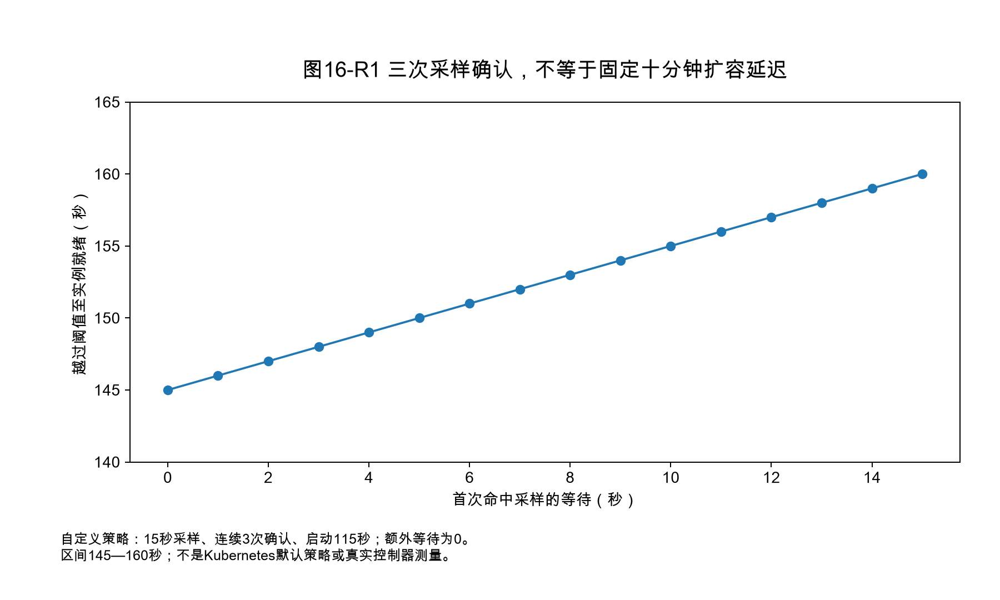
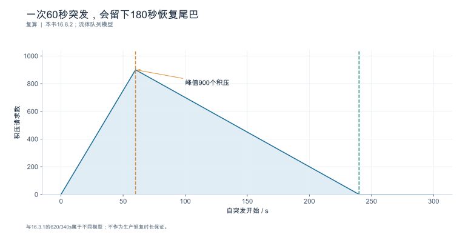
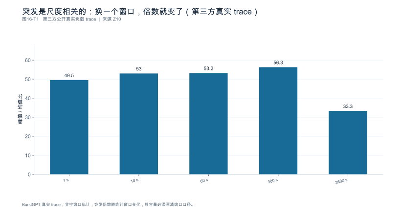
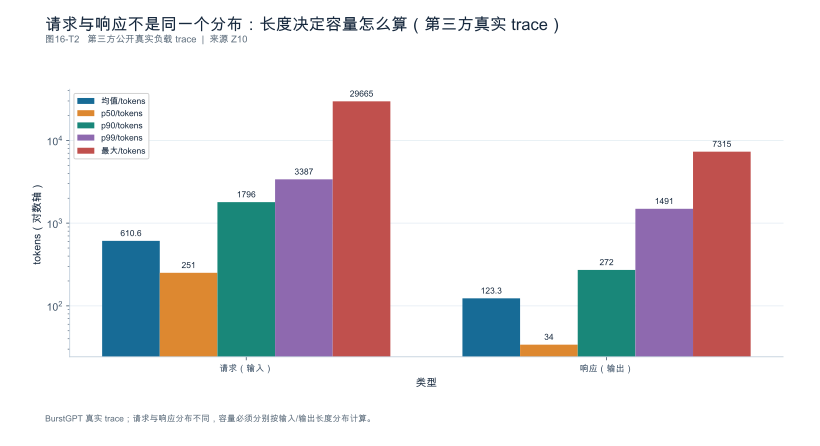

## 第16章 容量规划与扩容决策

**核心论点：**容量是一组**负载、质量与服务目标约束下的可用边界**，不是设备数量乘以单卡峰值。

---

### 16.1 容量对象与需求分层

**本节要回答的问题：**需要支撑的是请求数、Token 工作量，还是业务完成量？

#### 16.1.1 日均相同不等于容量相同

算例：日均 100 万请求，两种到达形态：

| 情景 | 计算 | 情景中的窗口到达率 |
|---|---|---:|
| A 均匀（日系数 1.5） | $10^6 / 86400 \times 1.5$ | **17.4 req/s** |
| B 集中在 4 小时（占 60%） | $10^6 \times 0.6 / (4\times3600)$ | **41.7 req/s** |

日均相同，两个**所设时间窗口**的到达率约差 2.4 倍。4小时的均值不是短窗口峰值；若窗口内不均匀，还需叠加突发轨迹。这就是"平均每日请求量不足以定义瞬时容量"的定量形式。

#### 16.1.2 三个容量对象

| 对象 | 单位 | 适用问题 |
|---|---|---|
| 请求数 | req/s | 准入与排队 |
| **Token 工作量** | Token/s | 显存与批预算 |
| **业务完成量** | 任务/s | 真正的交付目标 |

只报 req/s 会掩盖长度结构差异：100 req/s 的长文档与 100 req/s 的短问答是两种不同的负载（第5章 5.5.3）。

#### 16.1.3 增长用情景不用单点

增长预测分成**低/中/高情景**，每个情景都绑定负载画像与服务目标，便于将来用实际数据更新。**增长假设与观测事实分开记录。**

**依据与核验入口：**[R24] [R25]

---

### 16.2 建立容量包络与服务曲线

**本节要回答的问题：**系统在哪个负载区间**持续**满足全部门槛？

#### 16.2.1 包络来自联合约束

扫描到达率与长度混合，按**延迟、拒绝、质量、稳定性**四项找可用区域 （构造数据；联合达标率门槛设为 90%、TTFT P99≤1000 ms；另假设已标可用行的队列稳定且拒绝率满足约定）：

| 到达率 | 长输入占比 | 排空法吞吐 | P99 TTFT | 达标率 | 可用？ |
|---:|---:|---:|---:|---:|---|
| 20 | 20% | 19.8 req/s | 780 ms | 96% | **是** |
| 35 | 20% | 34.2 req/s | 890 ms | 95% | **是** |
| 45 | 20% | 43.1 req/s | 1180 ms | 92% | **否：TTFT 超门槛** |
| 50 | 20% | **44.0** req/s | 1650 ms | **84%** | **否** |
| 45 | 50% | 41.8 req/s | 1420 ms | 86% | **否** |

**关键读法：可用边界不是最高吞吐点。**44.0 req/s 那一行的吞吐最高，但达标率 84% 已跌破 90% 门槛——**它不是容量，它是过载点。**35 req/s 是这张稀疏网格中最高的可行已测档位，不是已经精确识别的容量边界；35与45之间需加密扫描。

#### 16.2.2 不稳定的判据

以下任一出现即限制边界：**队列持续增长、资源累积（显存/句柄）、失败率上升、达标率下降**。**某次峰值表现不能代表持续容量。**

#### 16.2.3 分负载类别保留各自曲线

长输入档与短输入档各自的服务曲线要分开保存，因为瓶颈机制不同（第5章 5.4）。未测区间明确标记为**外推**。

**依据与核验入口：**[R09] [R12] [R24]

---

### 16.3 突发、长尾和会话累积

**本节要回答的问题：**峰值需求与平均需求之间应留多少缓冲？

#### 16.3.1 缓冲取决于三个量，不是一个百分比

算例：突发 **3 倍**、持续 **90 s**，队列积压峰值 **620** 个请求，回落后消化耗时 **340 s**。

$$
\frac{340}{90} = \mathbf{3.8}
$$

**积压消化时间是突发时长的 3.8 倍。**所以缓冲 = f(突发强度, 突发时长, 恢复速率)，三者缺一不可。

**"固定留 20% 余量"不是通用答案**——同一个 20%，在突发持续 90 s 与 15 min 的场景下可能都不够，且在其它条件相同时，更长突发不会凭空减少缓冲需求。

#### 16.3.2 长任务与状态驻留

长输出与多轮会话会延长状态驻留，改变后续请求的可用空间（第4章）。**共享历史分支与独立子任务**要分别测并发与状态驻留 [SOURCE_REGISTERED] [S18]。

**分支完成依赖决定任务长尾**——不能用各子请求平均耗时相加代替真实任务时序（第1章 1.1.1）。

#### 16.3.3 取消也要检验回收

任务取消后，子请求与状态能否及时回收要单独检验；否则取消只会把积压变成幽灵负载。

**依据与核验入口：**[R04] [R25] [S18] [S13]

---

### 16.4 故障、权重热状态与实际可用容量

**本节要回答的问题：**少一个节点或正在升级时，服务还能维持什么水平？

#### 16.4.1 三种容量分别报告

| 情景 | 可用容量 | 说明 |
|---|---:|---|
| 正常 | 40 req/s | 全部实例在役 |
| **维护中**（滚动更新，1/4 下线） | **30 req/s** | 75% |
| **单节点故障** | **32 req/s** | 80%，但状态重建慢 |

**未演练的恢复部分列为风险**，不能假设冗余自动生效。故障期间允许的降级必须**预先定义**，不能在事故后修改成功标准。

#### 16.4.2 冷启动进入容量账

新实例从创建到可接流量 = **115 s**（第8章分解）。要维持故障期容量，扩容必须**提前于需求至少 115 s 发起**——这直接决定了扩容信号的提前量。

vLLM 0.30.0 的 Fast Start 由常驻 GPU 权重进程与 CUDA IPC 映射组成 [N06]。容量核算应按底层物理权重身份去重，而不是把 daemon 的权重和映射进程中的同一权重重复相加。若另设每卡 4 GB 非共享常驻开销，8卡共32 GB，只能标为假设；它不是该机制的官方固定开销。启动收益、实际增量显存与失效恢复分别测量。

**冗余容量应扣除恢复过程的网络、存储与常驻状态成本**，不是"加一台设备就完成" [SOURCE_REGISTERED] [S06]。

#### 16.4.3 重新核验触发

缓存冷失效、驱动变更或模型更新后，启动时间与常驻收益都要**重新核验**。

**依据与核验入口：**[R25] [R30] [S02] [S06]

---

### 16.5 扩缩容信号、控制回路与仿真边界

**本节要回答的问题：**什么信号比单一设备利用率更接近真实压力？

#### 16.5.1 四类信号

| 信号 | 说明 |
|---|---|
| 等待 | 排队时间、P99/P50 比 |
| 工作量 | Token/s、在途 Token |
| 状态压力 | 状态池占用、块可用数 |
| **SLO 失守风险** | 达标率趋势 |

**不依赖单一平均利用率**——第9章 9.4 已说明"96% 忙碌"与真实压力是两回事。

#### 16.5.2 控制回路要按真实时序相加，而不是累加所有配置数

设采样周期为 15 s，需要连续 3 次超阈值观测，创建实例至 readiness 为 115 s。阈值刚好在一次采样前越过时，第三次确认约在 30 s 后；刚好错过一次采样时，约在 45 s 后。因此，没有额外限速时，从越阈值到新实例可服务的区间为 **145—160 s**。

| 环节 | 时长／区间 | 是否必然串行累加 |
|---|---:|---|
| 等待第一次命中采样 | 0—15 s | 是 |
| 再取得两次确认 | 30 s | 是 |
| 实例启动与 readiness | 115 s | 是 |
| 300 s 冷却／稳定窗口 | 取决于方向、上次动作与策略 | **不能默认全额加入本次扩容** |

若一个自定义策略明确规定扩容前还必须等待剩余 $c$ 秒，$0\le c\le300$，则上述区间再加 $c$；若等待与采样确认重叠，应取依赖图的最大值而非再次求和。原稿“15 s采样、3周期却为180 s、合计610 s”的计算不能成立。Kubernetes 的稳定窗口与扩缩容行为还区分方向，不能把缩容稳定窗口当成固定的扩容阻塞 [N19]。

缩容另需处理在途请求排空、缓存损失和回滚，不与扩容等待混成一个常数。

#### 16.5.3 仿真只用于筛选

历史轨迹回放或受控仿真可以用来**测试触发逻辑**（防振荡、无效扩容），但**仿真与实测必须有不同 `run_type`** [SOURCE_REGISTERED] [S03] [S06] [S07]。模型质量与真实通信恢复仍需实际验证。

#### 16.5.4 防振荡

触发、冷却、排空与回滚条件都要明确。**算法不会把反复扩缩当成正常成功**——反复扩缩本身是要被监控的失败模式。

**依据与核验入口：**[R25] [R24] [R30] [S06] [S07] [S03]

---

### 16.6 优化、加副本、扩大并行还是分离

**本节要回答的问题：**增加预算之前，怎样比较可选路径？

四条路径按**同一质量与 SLO**比较可用增量：

| 路径 | 增加什么 | 代价 | 证据成熟度要求 |
|---|---|---|---|
| **优化现有配置** | 单位资源产出 | 工程投入、质量风险 | 需第11章的消融与回归 |
| **加副本** | 容量近似线性 | 权重重复驻留 | 需路由与偏斜检查（6.4） |
| **扩大并行度** | 单请求延迟 | 副本数减少、同步增加 | 需第6章布局表 |
| **阶段分离** | 抗干扰 | 传输、控制面、新故障域 | 需第12章对照 |

三个纪律：

1. **控制层与常驻权重资源一并计入** [SOURCE_REGISTERED] [S06] [S13]；
2. **不能把已被固定集成栈弃用的组件无条件推荐为新方案**；
3. 应用侧减少重复工作也是一条独立选项，但要检查**任务是否被改变**（第11章 11.5）。

**至少保留一个低复杂度基线**——方案推荐应来自对照，而不是技术偏好。

**依据与核验入口：**[R09] [R30] [R24] [S06] [S13]

---

### 16.7 实验：形成有条件的扩容建议

**本节要回答的问题：**报告应该怎样表达推荐数量与风险？

#### 16.7.1 数量必须可复算

从实测容量和业务情景推导资源范围，再考虑故障、加载与负载漂移。**任何资源数量都要可复算**，并附带：假设、敏感参数、后续验收条件。

#### 16.7.2 不写成绝对保证

推荐数量的正确写法是**区间 + 前提**：

> 在负载画像 X、SLO Y、维护窗口 1/4 实例下线的前提下，需 12—14 台；若长输入占比超过 35%，需重新测量（该区间未覆盖）。

#### 16.7.3 尚未具备规模实验时

可以给**规划区间**并明确"扩展效率仍需确认"，而不是填一个保证值（第6章 6.7）。

**依据与核验入口：**[R24] [R25] [R30] [S06] [S07]

---

### 16.8 深化：从有限窗口账本到扩容控制

#### 16.8.1 瞬时积压可以守恒，稳态容量不能凭空外推

在一个固定系统边界中，定义 $A(t)$ 为累计准入请求数，$C(t)$ 为累计完成数，$D(t)$ 为累计取消或其它离开数，$N(t)$ 为在途数，则

$$N(t)-N(0)=A(t)-C(t)-D(t).$$

这是有限窗口计数关系，不要求稳态。拒绝在准入之前发生，另记offered与admitted之差；同一个取消请求只应按定义离开一次。若守恒式对不上，应先找丢失终态、重试混计或窗口边界错误，而不是立即拟合排队模型。

相反，Little定律里的均值需要稳定边界与长期平均条件。一个不断增长的队列可以满足计数守恒，却没有可以外推的稳态平均等待。容量报告应同时给出完成率与在途变化，否则“吞吐不再增长”可能只是已经进入积压阶段。

#### 16.8.2 突发缓冲取决于净流入面积

在简化流体模型中，净积压近似为正的到达需求减去可服务速率的时间积分。若基础到达率20 req/s、可服务率25 req/s，突发变为40 req/s并持续60 s，则新增积压约 $(40-25)\times60=900$ 个；回到20 req/s后，净消化能力只有5 req/s，需要约180 s排完。这些数字是模型，尚未包括拒绝、期限超时与长度变化。

这个算例说明，增加25%的稳态能力不等于能够轻松吸收两倍突发。恢复速度取决于“服务能力减基础需求”，接近零时消化时间会很长。若积压请求在恢复前就超过业务期限，单纯允许更大队列并不能保住有效完成量。

#### 16.8.3 扩容是一条有延迟的依赖链

第16.5节修正后的自定义策略是：每15 s采样，需要连续三次满足条件，启动到就绪115 s。阈值越过至首个命中采样需要0—15 s，随后两次确认需要30 s，所以无其它等待时为145—160 s。不是“3×15=180”，也不能将300 s冷却窗口无条件加到每一次扩容。

Kubernetes的HPA文档区分扩容和缩容行为，并允许分别配置稳定窗口 [N19]。本书的三次确认策略是设定，不是宣称HPA默认采用该逻辑。真实控制器还要记录采样陈旧度、调度等待、镜像／权重加载、探针和路由收敛；可重叠的等待按依赖处理。

#### 16.8.4 整数副本数与故障约束一起计算

若已测每副本在目标负载下可持续服务 $g$ 个合格请求每秒，规划需求为 $\lambda$，并要求任意一个副本离线后仍满足需求，则同质、独立且路由均衡的简化条件为 $(n-1)g\ge\lambda$。因此 $n\ge\lceil\lambda/g\rceil+1$。这不是任意集群通用公式：跨节点TP组的故障单位可能是一整组，而不是一张卡。

例如 $g=8$、$\lambda=35$ 时需至少6个副本满足上述单副本故障条件。这里的8必须来自相同质量与SLO下的已测能力；若仅为假设，则副本数也只是条件化规划。不能用峰值tokens/s代入，再把答案写成生产保证。

原稿容量扫描中，补齐的门槛是TTFT P99不超过1000 ms、联合达标率至少90%。35 req/s是表中**最高已测可行点**，45 req/s已超过延迟门槛；35到45之间仍需细扫。可行点、真实极限和推荐运行点是三个不同概念，运营余量还要覆盖漂移、故障和突发。

---

<!-- V06-START -->

### 16.9 实验图表补充：用完整参数补出突发积压与恢复曲线

为避免把不同案例拼在一起，本图只沿用16.8.2：初始无积压，服务能力25 req/s；0—60秒到达40 req/s，之后恢复20 req/s，忽略取消、拒绝和重试。突发期净增长15 req/s，共积压900；恢复后净消化5 req/s，需要180秒，从突发开始算到第240秒才排空。

这解释了为什么“突发只有1分钟”不代表影响也只持续1分钟。图中没有发生扩容，容量恒定；如果在中途新增副本，就需要把服务率改为分段函数，并计入加载、预热、健康检查和状态就绪，而不是把新卡算力从触发时刻就加进去。

16.3.1的620积压/340秒恢复来自另一组轨迹，本轮明确两例互不换算，不用一个图冒充两者。原图145—160秒扩容生效区间是自选采样/确认/启动策略；Kubernetes文档只支持区分扩容与缩容控制规则，不能给这组时延背书。

**真实实验采集：**计划到达、实际到达、接收、拒绝、在途、完成、超时与新增副本ready按同一窗口对账，逐时间段验证积压变化等于到达减离开，保留故障和维护两种容量情景。

#### 图16-V1 一次60秒突发，会留下180秒恢复尾巴

**数据身份：**`TEACHING_CALCULATION`。**条件：**服务25req/s；0—60s到达40，其后20；无取消、拒绝、重试，初始积压0。

| 时点/s | 积压 | 该时点后到达率/req每秒 | 服务率/req每秒 |
|---|---|---|---|
| 0 | 0 | 40 | 25 |
| 60 | 900 | 20 | 25 |
| 120 | 600 | 20 | 25 |
| 180 | 300 | 20 | 25 |
| 240 | 0 | 20 | 25 |

复算公式：`Qpeak=(40-25)*60=900; recovery=900/(25-20)=180s`。

**出处与边界：**[X11](book_support_v06/来源与核验.md#x11)；与16.3.1的620/340s属于不同模型；不作为生产恢复时长保证。

[数据与绘图点](book_support_v06/data/ch16_backlog.json) · [PNG](book_support_v06/figures/ch16_backlog.png) · [重绘代码](book_support_v06/code/replot.py)

<!-- V06-END -->
<!-- V08-START -->

### 16.10 第三方数据补充（v0.8）：突发与长度分布：容量规划的两个现实输入

本章 v0.6 用算例演示扩容决策。本轮把两个输入换成真实 trace 的复算值（BurstGPT，KDD\'25，`data/BurstGPT_1.csv`；本次复算 61 天、1,429,737 条请求、平均到达率 0.2713 RPS）。

**输入一：突发是尺度相关的。**峰值/均值比只统计非空窗口时为：1 s 窗口 49.5 倍、10 s 窗口 53.0 倍、60 s 窗口 53.2 倍、300 s 窗口 56.3 倍、3600 s 窗口 33.3 倍。**"系统有 50 倍突发"这句话如果不写窗口就没有意义。**容量规划真正要问的是：在你的扩容生效时间尺度上，突发倍数是多少。这正是算例里"突发只持续 1 分钟"那个假设的现实版本。

**输入二：请求与响应不是同一个分布。**输入长度均值 610.6、p50 251、p90 1796、p99 3387、最大 29665 tokens；输出长度均值 123.3、p50 34、p90 272、p99 1491、最大 7315 tokens。输入是长尾重的（均值≈2.4×p50），输出相对集中在低位（均值≈3.6×p50）。**这意味着容量规划不能只用一个"平均长度"：Prefill 侧被 p99 输入主导，Decode 侧被输出长度分布主导，两者要用不同的分位数。**

**边界：**BurstGPT 为单一区域服务商子集（会话与 API 混合），非全行业代表；原始平均到达率只有 0.2713 RPS，用于容量规划必须按目标 RPS 缩放；失败请求未逐条区分原因。

#### 图16-T1 突发是尺度相关的：换一个窗口，倍数就变了（第三方真实 trace）

**数据身份：**`THIRD_PARTY_TRACE`（第三方公开数据）。**条件：**BurstGPT（KDD'25）data/BurstGPT_1.csv，本次复算：61 天、1,429,737 条请求、平均到达率 0.2713 RPS；峰值/均值比仅统计非空（active）窗口。

| 统计窗口 | 峰值/均值比 | 口径 |
|---|---|---|
| 1 s | 49.5 | BurstGPT 非空窗口 |
| 10 s | 53.0 | BurstGPT 非空窗口 |
| 60 s | 53.2 | BurstGPT 非空窗口 |
| 300 s | 56.3 | BurstGPT 非空窗口 |
| 3600 s | 33.3 | BurstGPT 非空窗口 |

**出处与边界：**[Z10](book_support_v08/来源与核验_v08.md#z10)；单一区域服务商子集（会话与 API 混合），非全行业代表；原始 RPS 很低（0.2713），用于容量规划须按目标 RPS 缩放；失败请求未逐条区分原因。

[数据与绘图点](book_support_v08/data/ch16_tp_burst.json) · [PNG](book_support_v08/figures/ch16_tp_burst.png) · [重绘代码](book_support_v08/code/replot_v08.py)

#### 图16-T2 请求与响应不是同一个分布：长度决定容量怎么算（第三方真实 trace）

**数据身份：**`THIRD_PARTY_TRACE`（第三方公开数据）。**条件：**BurstGPT data/BurstGPT_1.csv 本次复算；1,429,737 条请求；长度单位为 token。

| 类型 | 均值/tokens | p50/tokens | p90/tokens | p99/tokens | 最大/tokens |
|---|---|---|---|---|---|
| 请求（输入） | 610.6 | 251 | 1796 | 3387 | 29665 |
| 响应（输出） | 123.3 | 34 | 272 | 1491 | 7315 |

**出处与边界：**[Z10](book_support_v08/来源与核验_v08.md#z10)；单一区域服务商子集；未按模型或服务类型分层；最大值受长尾极端样本影响。

[数据与绘图点](book_support_v08/data/ch16_tp_lengths.json) · [PNG](book_support_v08/figures/ch16_tp_lengths.png) · [重绘代码](book_support_v08/code/replot_v08.py)

<!-- V08-END -->
### 章末检查问题

**1. 平均日请求量相同，为什么实例数可能相差很大？**

答案方向：因为容量是**瞬时约束**，取决于情景中的窗口到达率与长度结构，而不是日总量。本节算例中，日均同为 100 万，均匀到达峰值 17.4 req/s、集中 4 小时峰值 **41.7 req/s**，相差 **2.4 倍**——对应的实例数也近似差这么多。另外还要看：长输入占比（改变每请求的工作量）、突发时长（决定积压消化时间）、以及维护与故障情景（容量分别降到 75% 与 80%）。所以规划输入必须是**到达轨迹 + 负载画像 + 服务目标**，不是日均数字。

**2. 为什么固定留 20% 余量不是通用答案？**

答案方向：余量要覆盖的是**突发期间的积压**,而积压 = 突发强度 × 突发时长 − 期间的消化能力。本节算例中，3 倍突发持续 90 s，积压 620 个请求，回落后消化要 **340 s**（突发时长的 **3.8 倍**）。同一个 20% 余量，在持续 90 s 时可能不够；其它条件相同时持续 15 min 的积压只会更多；在示例扩容滞后 145—160 s（不含另有明确策略的等待）的系统里，20% 更是不够——因为新实例还没上线，积压就已经形成了。所以余量应按"突发强度 × 时长 / 恢复速率 + 扩容滞后内的需求增长"计算，并分别给出正常、维护、故障三种情景的余量。

**3. Fast Start 缩短启动但增加常驻资源，容量与成本如何同时验收？**

答案方向：**两栏一起报。**① 恢复期容量：启动从 115 s 降到 75 s（−40 s），意味着故障与扩容情景下可更早恢复，这要折算成"故障期可服务容量随时间的曲线"，而不是只报一个启动秒数；② 常驻成本：若另外确认每卡存在 4 GB **非共享的增量常驻开销**，则8卡合计32 GB减少状态池；只有非共享增量会进一步减少可容纳并发路数，共享映射的同一物理权重不能重复扣减（第6章 6.1 的表要按新的状态池重算）。同时还要核验：缓存冷失效、驱动变更或模型更新后收益是否仍在，以及稳态吞吐**不变**（第8章 8.5）——启动收益不能代替稳态收益；是否接受启动与稳态容量之间的交换，取决于故障恢复和成本契约。

---

### 本章验收清单

| 节 | 验收标准 |
|---|---|
| 16.1 | 容量目标有单位、时间尺度与负载分布；增长分情景；假设与观测事实分开 |
| 16.2 | 容量来自四项联合约束；可用边界不是最高吞吐点；不稳定判据已定义；外推区间已标记 |
| 16.3 | 缓冲按强度×时长×恢复速率计算；长任务与分支分别测；取消后回收已检验 |
| 16.4 | 正常/维护/故障容量分别报告；冷启动时间进容量账；常驻资源扣除；未演练项列为风险 |
| 16.5 | 信号来自四类而非单一利用率；控制回路滞后已量化；仿真与实测 `run_type` 分开；防振荡条件明确 |
| 16.6 | 四条路径按同 SLO 比较；控制层与常驻资源计入；保留低复杂度基线 |
| 16.7 | 推荐数量可复算且带前提；写成区间而非保证；扩容后的验收条件已定义 |

---

### 本版配套资料

[新增图表与数据](book_support_v05/figures.md) · [来源登记](book_support_v05/references.md) · [E0测试清单](book_support_v05/data/e0_test_results.md) · [修订记录](book_support_v05/review/changes.md)

[N06]: book_support_v05/references.md#n06
[N19]: book_support_v05/references.md#n19
[R04]: book_support_v05/references.md#r04
[R09]: book_support_v05/references.md#r09
[R12]: book_support_v05/references.md#r12
[R24]: book_support_v05/references.md#r24
[R25]: book_support_v05/references.md#r25
[R30]: book_support_v05/references.md#r30
[S02]: book_support_v05/references.md#s02
[S03]: book_support_v05/references.md#s03
[S06]: book_support_v05/references.md#s06
[S07]: book_support_v05/references.md#s07
[S13]: book_support_v05/references.md#s13
[S18]: book_support_v05/references.md#s18

<!-- V10-START -->

### 本章口径核对（公开来源）

#### 权重缓存的公开收益口径与仿真偏差的公开校准

**权重缓存：公开资料给出了什么，没给出什么**

vLLM v0.30.0 的 Fast Start 机制（详见第 8 章）是当前可查的权重常驻实现：常驻的 per-GPU 守护进程把量化后、TP 分片后的权重留在显存，重启引擎时用 `--load-format ipc_cache` 经 CUDA IPC 映射，覆盖 FP4 checkpoint 与多机 TP，非 CUDA/ROCm 平台明确报错。

发布说明给出的量化数字**只涉及相邻的图捕获路径**：MRV2 冻结 gc 后图捕获由 12 s 降到 2 s、引擎初始化由 28.9 s 降到 8.2 s（H200 上）。对权重缓存机制本身的收益与常驻显存占用，发布说明未给出任何数字。

**因此可确定的只有机制与前提**：命中前提是同一机器上已有该权重形态的守护进程存活；常驻资源是该守护进程占用的显存；失效恢复方面 v0.30.0 修复了 sleep 模式下 NCCL 通信子内存的释放与 MRV2 在 shutdown/sleep 时的内存释放。**收益与常驻开销必须按目标模型与拓扑分别度量**，冷启动分阶段计时是唯一能给出该口径的方法。

> **时效提示（2026-10-09）**：上述结论锚定在 **vLLM v0.30.0** 的发布说明；截至检索日 vLLM 最新稳定版为 **v0.31.0**（2026-10-05，commit `db9527a`）。本节的关键结论——"发布说明未给出权重缓存的收益与常驻开销数字"——是对 v0.30.0 文档的取证结果；**若后续版本补充了量化口径，应重新取证并新增记录，不覆盖本节结论**。这正是第 18 章"升级不覆盖旧数据"的做法。

**仿真偏差：给出公开校准口径的仿真器**

SGLang Simulator 运行真实的调度器、radix cache 与分层 cache，只把模型前向替换为时延预测器。官方给出的精度口径是"**所有预测误差均低于 5% MAPE**"，验证条件为 **H20** 上对 **Qwen3-8B** 与 **Qwen3-32B-FP8** 两个模型、对照真实 SGLang 部署：Mean TTFT 误差为 Qwen3-8B **3.42% / 4.15% / 2.38%**、Qwen3-32B-FP8 **2.77% / 2.40% / 3.05%**（三档依次为 no_cache / L1 命中 / L2 命中）；Prefix Hit Ratio 误差为 **0.0% / 0.04% / 0.00%**。

> **核对说明（2026-10-09）**：原稿写作"多数轨迹 TTFT 预测误差约 6%、32K–128K 最长轨迹可达 10%、前缀复用预测误差 0.05 个百分点"。**该表述在官方口径中未取得**；官方口径为 <5% MAPE，并明确限定为两个模型 + H20。另需注意：MAPE 是平均百分比误差，**不是"最坏情况下的误差"**，不得据此写"预测最多偏 5%"。

Dynamo 侧的对应物是 `AISimulate`（原 `AIConfigurator`），在 v1.5.0 中成为独立包，旧的 `python -m dynamo.replay` CLI 已移除；Dynamo 还提供 `Mocker` 与多 worker 仿真，用于把 Router 的 radix 重叠估计与调度器实际复用的 token 数做对照。

> **核对补充（2026-10-09）**：截至检索日 Dynamo 最新为 **v1.5.1**（2026-10-07）。`AISimulate` **未被弃用、未被移除**，但官方文档标注为 **Experimental**，并明确 "intended for evaluation and feedback, **not production capacity planning**"——它同样不能作为容量承诺的依据。KVBM 在 v1.5.0 已弃用、移除计划指向 **v1.6.0**（官方 docs 与 GitHub 镜像页对目标版本存在 v1.6.0 / v1.7.0 的分歧，**以 docs.dynamo.nvidia.com 为准**）。

**边界**：<5% MAPE 是官方自述值，绑定在 SGLang 自身的调度器与 radix cache 实现、两个特定模型与 H20 硬件上；换引擎、换负载形状或改变分层缓存配置后不可外推。Dynamo 侧未给出可比的偏差数字。仿真只用于筛选实验与触发逻辑，`run_type` 必须与实测区分。
<!-- V10-END -->
