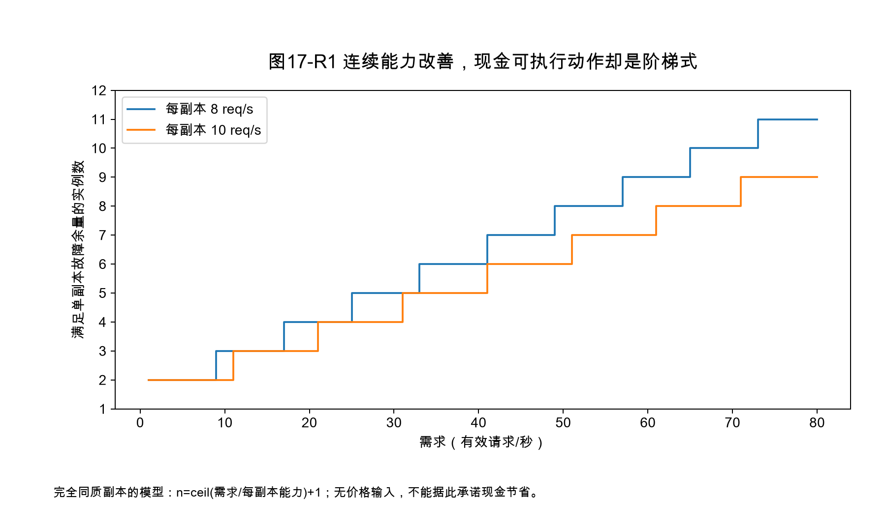
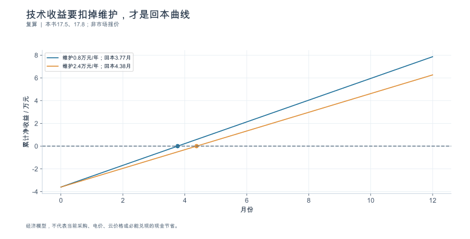
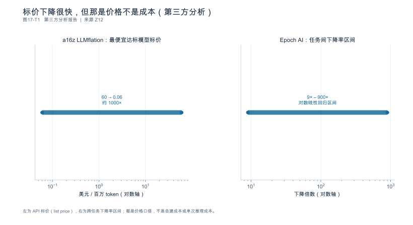
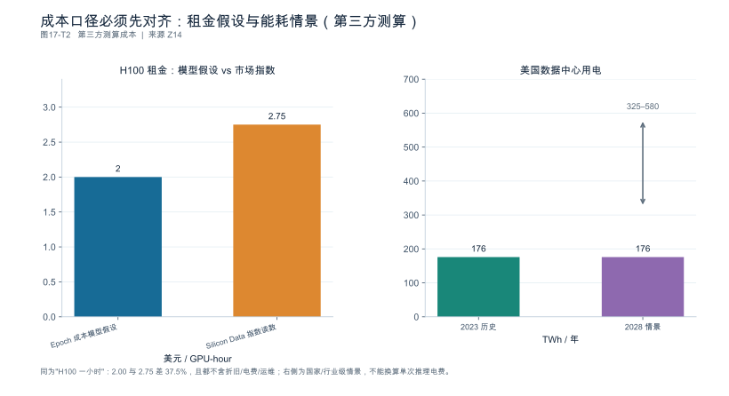

## 第17章 成本、效率与优化收益

**核心论点：**成本必须与**同一质量和服务目标下的有效完成量**对应；**资源释放、能力增加与现金节省是三种不同结果。**

---

### 17.1 成本边界：现金、折旧与机会成本

**本节要回答的问题：**我们准备比较哪一种成本？

#### 17.1.1 三个口径不能混加

| 口径 | 含义 | 常见错误 |
|---|---|---|
| **现金支出** | 本期实际付出去的钱 | 与分摊混加 |
| 管理分摊 | 购置成本在使用期内分摊 | 与现金**重复计入**同一口径 |
| **机会成本** | 占用存量资源而放弃的其它用途 | 被当成零成本 |

**购买款与折旧不能在同一口径中重复计入。**租赁价格还要说明是否包含主机、存储与网络——不包含的话，整机成本被系统性低估。

#### 17.1.2 先定义视角与时间区间

成本卡必须注明：**币种、日期、包含项、来源、时间区间**。价格随日期变化，没有日期的成本数据无法复核。

本书采用**管理决策账本**，不预设设备一定失去使用价值，也不固定折旧轨迹。

**依据与核验入口：**[R24]

---

### 17.2 从设备小时到每个有效完成单位

**本节要回答的问题：**应该除以所有 Token，还是**成功且达标**的任务？

#### 17.2.1 分母是有效完成量，不是产出量

算例。8 卡服务器，设备小时成本 **¥96/h**（**假设**，需按实际报价替换）：

| 项 | 值 |
|---|---:|
| 设备小时成本 | ¥96/h |
| 一小时内发出的 attempt | 1200 |
| **达标完成的任务** | **1000** |
| **单位有效完成成本** | $96 / 1000 = \mathbf{¥0.096/任务}$ |

**关键在分子分母的覆盖范围：分子包含全部 1200 次 attempt 的计算（它们都消耗了资源），分母只计 1000 个契约规定的有效任务。**

#### 17.2.2 一个会低估的错误算法

若只把"成功 attempt 消耗的资源"计入分子，而忽略失败与超时的部分：

$$
\text{错误值} = \frac{1000 \times (96/1200)}{1000} = \mathbf{¥0.080/任务}
$$

比正确值 **低估 16.7%**。这类错误很常见，因为失败尝试常常不进任何"成功"统计，于是看起来"没花钱"。

**分支任务的成本分子包括所有子调用、失败尝试、重算与工具资源**，分母只计有效任务 [SOURCE_REGISTERED] [S18]。**不能用隐藏失败或缩短任务来制造单位成本下降。**

#### 17.2.3 时间分母与需求利用

潜在峰值不是实际产量。**无业务需求的空闲时段仍然可能产生费用**——所以单位成本要用"实际完成量"而不是"理论产能"作分母。

四个口径分别报告：任务、请求、推理 Token、可见输出。Token 单价只是**特定负载下的派生指标**，不能跨负载比较。

**依据与核验入口：**[R09] [R12] [R24] [S17] [S18]

---

### 17.3 利用率、缓存与需求匹配

**本节要回答的问题：**性能提升什么时候可以转化为**可实现**的收益？

#### 17.3.1 三类收益必须分开记

| 收益类型 | 含义 | 是否已兑现 |
|---|---|---|
| **资源释放** | 单位资源产出提高 | 否（只是潜力） |
| **可交付能力** | 同资源下能服务更多 | 否（需有需求承接） |
| **可执行财务动作** | 退租、合并实例、承接新业务 | **是** |

算例：优化释放 **30%** 容量，但需求利用率只有 55%。可执行动作是**合并实例减少 2 台**（16 台中减 2）：

$$
\text{实际节省} = \frac{2}{16} = \mathbf{12.5\%}
$$

**释放 30% 容量，实际只省 12.5% 现金。**不能把30%技术容量与12.5%现金节省直接相减，二者分母不同；未兑现部分应以设备小时、可服务任务量或可退租实例数单独计量。

#### 17.3.2 缓存收益要看真实复用

缓存提升要结合**真实复用率**与**存储成本**，不能把压测上限当成全年平均 [SOURCE_REGISTERED] [S13]。权重常驻降低某类延迟，但增加保留资源 [SOURCE_REGISTERED] [S02]——这两笔要分别记账。

#### 17.3.3 建立"技术变化—运营动作—收益兑现"链

没有第二步（运营动作），第一步（技术变化）就不是收益。未知需求用**情景**而非确定增长表示。

**依据与核验入口：**[R07] [R24] [R25] [S02] [S13]

---

### 17.4 能源、主机、网络与运维

**本节要回答的问题：**除了加速器，还有哪些成本不能漏掉？

#### 17.4.1 系统边界必须一致

算例：

| 测量位置 | 功耗 | 占比 |
|---|---:|---:|
| 8 张加速卡板卡 | 5.6 kW | **57.1%** |
| **整机设定值** | **9.8 kW** | 100% |

**只测板卡会漏掉 42.9%。**额定功耗也不等于实际能耗——必须注明**测量位置、采样方式与时间积分**。

#### 17.4.2 年化示例

按整机 9.8 kW、全年 8760 h、电价 ¥0.8/kWh（**均为假设**）：

$$
9.8 \times 8760 \times 0.8 = \mathbf{¥68{,}678/年}
$$

**若只测板卡，年电费会被算成 ¥39,245，低估 43%。**

#### 17.4.3 其它不能漏的项

主机、网络、缓存存储、运维人力、控制面组件都要按**同一边界**记录，并**避免重复分摊**。机柜级互联、共享存储与服务控制层纳入同一预算边界 [SOURCE_REGISTERED] [S21] [S22] [S13]——**不把机柜汇总资源当成零成本共享池。**

**依据与核验入口：**[R17] [R20] [R21] [S21] [S22] [S13]

---

### 17.5 优化收益与工程投入

**本节要回答的问题：**提高效率的项目是否值得做？

#### 17.5.1 反事实对照

比较三种方案的**可执行成本变化**：继续现状 / 优化 / 扩容。不能只算优化一项。

#### 17.5.2 完整投入账本

算例 （金额均为假设）：

| 项 | 值 |
|---|---:|
| 单位成本变化 | ¥0.096 → **¥0.082**（**−14.6%**） |
| 年任务量 | $1000 \times 8760 = \mathbf{8{,}760{,}000}$ |
| 年节省 | $8{,}760{,}000 \times 0.014 = \mathbf{¥122{,}640}$ |
| 一次性开发验证 | 18 人日 × ¥2000 = **¥36,000** |
| 持续维护 | 4 人日/年 × ¥2000 = **¥8,000** |
| **第一年净收益** | **¥78,640** |
| **回本周期** | $36{,}000 / [(122{,}640-8{,}000)/12] = \mathbf{3.77\ 个月}$（按净持续节省） |

#### 17.5.3 投入与风险分列

一次性开发、验证、持续维护、失败风险**分开列**。收益未验证时用**范围或情景**，并说明什么证据能支持继续投入。

新增缓存/传输/控制组件的**开发、回归与升级维护**都要计入 [SOURCE_REGISTERED] [S06] [S13]。**仿真节省的是研究筛选成本，不是已证明的生产节省。**

**依据与核验入口：**[R24] [R25] [S02] [S06] [S13]

---

### 17.6 敏感性、盈亏边界与不确定性

**本节要回答的问题：**哪些假设一变，方案结论就会反转？

#### 17.6.1 盈亏边界

按上例，年投入 ¥44,000（36,000 + 8,000）、单位节省 ¥0.014：

$$
\text{盈亏平衡年任务量} = \frac{44{,}000}{0.014} = \mathbf{3{,}142{,}857\ 任务/年}
$$

低于这个量级，优化项目**不划算**。这是比"回本约 3.77 个月（净持续节省口径）"更有用的数字——因为它给出了结论反转的条件。

#### 17.6.2 敏感参数扫描

| 参数 | 变化 | 对结论的影响 |
|---|---|---|
| **需求利用率** | 55% → 30% | 不能由利用率单独推断；需求下降可能增加缩容空间，也可能受最低副本数、故障冗余或已付承诺费用限制 |
| 长度混合 | 长输入占比 +30% | 单位成本上升，节省缩小 |
| SLO 收紧 | P99 阈值降低 | 达标率下降，有效完成量减少 |
| 价格 | 设备小时 +20% | 节省绝对值放大 |
| 维护成本 | 4 → 12 人日/年 | 首年投入由 ¥44,000 增至 ¥60,000，盈亏边界上移 **36.4%** |

#### 17.6.3 稳健方案

优先选择**在多数情景下都成立**的方案，而不是在乐观情景下收益最大的那个。无法确定的外部条件保留区间，**不用单点掩盖风险**。

**依据与核验入口：**[R24] [R25]

---

### 17.7 实验：从性能报告走向成本决策

**本节要回答的问题：**怎样把一次可信测试转换成管理上可用的说明？

#### 17.7.1 输入身份与核算口径

引用**已验证的性能基线与质量结果**（不是压测峰值），用项目真实成本或明确标注的假设完成成本模型。价格输入**保留来源日期**。

#### 17.7.2 四类输出分别写

报告要分别写出：**当前支出、单位有效完成成本、潜在容量、可兑现节省**。四者量纲不同，不能互相替代。

#### 17.7.3 没有真实报价时

交付的是**可填写模型与决策方法**，不宣称"能省某个确定金额"。每个数字都要有**来源或假设标签**。

**依据与核验入口：**[R09] [R12] [R24] [S18] [S13]

---

### 17.8 深化：把技术改善换成可兑现的成本变化

#### 17.8.1 “吞吐提高30%”与“资源节省30%”的分母不同

若优化使单位资源能力从 $g$ 提高到 $1.3g$，在相同需求、完全连续可缩放且其它条件不变时，所需资源比例为 $1/1.3$，减少的是

$$1-\frac{1}{1.3}=23.08\%,$$

不是30%。真实实例必须取整数，还受最低副本、故障冗余、合同和已付费用约束，现金节省可能更小，也可能暂时为零。反过来，服务改善也可能降低失败和超时，使有效任务成本下降，而不是单靠减少机器。

这应落实为三张独立表：技术能力变化、可执行运营动作、现金支出变化。不要把不同分母的百分比相减后称为“剩余收益”。

#### 17.8.2 整数实例会产生阶梯式收益

设需求为35个有效请求每秒，基线每副本8个，候选每副本10个，均要求一副本故障余量。基线需 $\lceil35/8\rceil+1=6$ 个，候选需 $\lceil35/10\rceil+1=5$ 个；可减少一副本，比例16.7%。在另一个需求点，两个方案可能都需要相同实例数，技术提升暂时只转化为余量。

图中每副本能力均为假设，不是任何硬件的测量。图的用途是解释为什么资源价格相同、技术提速相同，现金收益仍会随需求区间呈阶梯变化。把平滑吞吐曲线直接转换为平滑现金曲线，会漏掉这个关键约束。

#### 17.8.3 回本计算要扣除持续支出

沿用第17.5节账目：年毛节省122,640元、持续维护8,000元、一次性投入36,000元。若毛节省和维护均匀发生，不考虑折现与资金时间差，则年净持续节省为114,640元，简单回本周期为 $36000/114640\times12\approx3.77$ 个月。首年净收益仍是78,640元。

盈亏平衡的首年任务量以44,000元总投入除以每任务0.014元节省，约314.3万任务。若维护由4人日增至12人日、单价仍2,000元，则首年投入变为60,000元，盈亏边界增加36.4%，不是57%。这些只是同一模型的算术结果，不能代替实际报价、需求预测和合同安排。

更重要的是，单位成本降低是否真的带来现金下降。已购买设备的管理分摊减少、额外业务的机会价值与当期退租节省应分列；不存在退租动作时，不应把管理分摊的变化写成银行账户已少付的金额。

#### 17.8.4 能耗用时间积分，并保持同一边界

对离散功率采样，能量可用梯形法近似：$E\approx\sum_i (P_i+P_{i+1})(t_{i+1}-t_i)/2$。单位要统一，例如kW与小时得到kWh。丢失的采样区间应披露，不能默认功率为零；额定功率也不能替代运行采样。

若已测的是设施总电量，就不能再乘一次设施开销系数；若只测IT设备，设施附加能耗要单列并说明分摊口径。对共享缓存、网络和控制面，比较前后应采用同一边界，避免把设备省下的功耗转移到另一个没计费的组件。

有效任务能耗是总能量除以同一窗口的有效完成数。优化可能降低平均功率却延长执行时间，也可能提高平均功率但更快完成；仅比较某个瞬时瓦数，无法判断总能耗。第17.4节全年功率不变的年化示例明确保留为假设，不作为设备全年真实运行画像。

---

<!-- V06-START -->

### 17.9 实验图表补充：将优化收益落到带维护支出的回本曲线

沿用本章账目：每年毛节省122640元，一次开发验证36000元。若每年维护8000元且收支均匀，年净持续节省114640元，简单回本约3.77个月，首年净收益78640元；维护升至24000元时，回本约4.38个月，首年净收益62640元。

两条线都在第0月先支出36000元，再按净持续节省累计。它们并不预测真实合同的付款时间，也没有纳入折现、税费、故障损失或业务量波动。曲线使用原稿自设金额，不是当前云厂商报价或电价调查。

**不能跨越的三步：**技术提升先转成满足质量/SLO的可用容量，再确定是否跨过整数副本门槛，最后确认能否取消租赁、少采购或避免支出。没有执行的资源动作，只能记容量余量或效率改善，不能登记为现金节省。

真实实验报告应保留单位有效任务成本的分子分母，失败、重试和闲置资源不能从成本分子删掉；维护时间和回退投入也应在接受优化前预估，并在上线后复核。

#### 图17-V1 技术收益要扣掉维护，才是回本曲线

**数据身份：**`TEACHING_CALCULATION`。**条件：**年毛节省122640元、一次投入36000元；维护8000/24000元；均匀发生、未折现。

| 年维护/元 | 年净持续节省/元 | 简单回本/月 | 首年净收益/元 |
|---|---|---|---|
| 8000 | 114640 | 3.768 | 78640 |
| 24000 | 98640 | 4.38 | 62640 |

复算公式：`cash=-36000+(122640-maintenance)*month/12`。

**出处与边界：**本书17.5、17.8；经济模型，不代表当前采购、电价、云价格或必能兑现的现金节省。

[数据与绘图点](book_support_v06/data/ch17_payback.json) · [PNG](book_support_v06/figures/ch17_payback.png) · [重绘代码](book_support_v06/code/replot.py)

<!-- V06-END -->
<!-- V08-START -->

### 17.10 第三方数据补充（v0.8）：价格不是成本：先把口径对齐

本章 v0.6 讲优化收益怎么算。本轮补第三方价格与成本口径，核心是一句话：**标价、租金、成本、电费是四个不同的数，混用会系统性算错。**

**标价下降很快，但那是价格（a16z《LLMflation》；Epoch AI 数据洞察）。**以 MMLU 为等效性能锚，最便宜达标模型的标价从约 60 美元/百万 token 降到约 0.06 美元，约 1000 倍。但 Epoch 对"不同任务"的下降率给出 9×–900× 的极宽区间。**这两个数字都不能直接写进成本模型**：标价下降同时混合了硬件进步、模型变小、竞争定价与补贴。用标价当成本，会系统性高估节省。

**租金口径：两个"H100 一小时"差 37.5%（Epoch AI《Inference economics of language models》，arXiv:2506.04645；Silicon Data SDH100RT 指数，2026-10-01 读数）。**成本模型里的假设是 2.00 美元/GPU-hour，市场租赁价指数读数是 2.75 美元/GPU-hour——差 37.5%，而**两者都还不含折旧、电费、PUE、运维与闲置**。做回本测算时，这个差异比大多数优化收益都大。

**电费不是零头（LBNL《2024 United States Data Center Energy Usage Report》）。**美国数据中心用电从 2023 年的约 176 TWh，到 2028 年的情景区间约 325–580 TWh。这是国家/行业级情景估算，**不能直接换算成单次推理电费**，但它说明：规模化推理的成本结构里必须给电留位置。

**边界：**以上全部是第三方分析、测算与情景；标价含利润率变化与选择偏差；Epoch 成本模型作者自称 crude；Silicon Data 是租赁价指数而非 TCO；LBNL 2028 为跨度极大的情景区间。

#### 图17-T1 标价下降很快，但那是价格不是成本（第三方分析）

**数据身份：**`THIRD_PARTY_ANALYSIS`（第三方公开数据）。**条件：**a16z《LLMflation》（价格取自 Internet Archive 历史标价，MMLU 为等效性能锚，输入输出价取平均）；Epoch AI 数据洞察（以"达到某基准分数的最便宜模型"标价做对数线性回归）。

| 口径 | 起点 | 终点 | 降幅 | 单位 |
|---|---|---|---|---|
| a16z LLMflation（MMLU 门槛最便宜模型） | 60 | 0.06 | 约 1000× | 美元/百万 token（API 标价） |
| Epoch AI：任务间下降率区间 | — | — | 9×–900× | 区间（对数线性回归） |

**出处与边界：**[Z12](book_support_v08/来源与核验_v08.md#z12)；【口径警示】两者都是 API 标价（list price），不是厂商成本，含利润率变化；样本仅覆盖部分厂商与第三方托管，存在选择偏差；MMLU 锚点受基准污染影响；Epoch 的区间极宽（9×–900×），不宜作为单一预测常数。

[数据与绘图点](book_support_v08/data/ch17_tp_price.json) · [PNG](book_support_v08/figures/ch17_tp_price.png) · [重绘代码](book_support_v08/code/replot_v08.py)

#### 图17-T2 成本口径必须先对齐：租金假设与能耗情景（第三方测算）

**数据身份：**`THIRD_PARTY_MODELED_COST`（第三方公开数据）。**条件：**Epoch AI《Inference economics of language models》（arXiv:2506.04645，H100 3.3 TB/s 显存带宽）；Silicon Data SDH100RT 指数（2026-10-01 读数）；LBNL《2024 United States Data Center Energy Usage Report》。

| 项目 | 数值 | 单位 | 口径 |
|---|---|---|---|
| H100 租金（Epoch 成本模型假设） | 2.00 | 美元/GPU-hour | 作者选取的市场租金假设 |
| H100 租金（Silicon Data 指数读数） | 2.75 | 美元/GPU-hour | 市场租赁价指数（含 neocloud 与私人租赁） |
| 美国数据中心用电（2023） | 176 | TWh | 历史估算 |
| 美国数据中心用电（2028 情景） | 325–580 | TWh | 情景区间 |

**出处与边界：**[Z14](book_support_v08/来源与核验_v08.md#z14)；【测算非实测】Epoch 成本模型作者自称 crude，口径只含 GPU 租金，未系统包含折旧、电费、PUE、运维与闲置；Silicon Data 为租赁价指数而非 TCO；LBNL 为国家/行业级情景估算，不能直接换算单次推理电费；2028 区间跨度大。

[数据与绘图点](book_support_v08/data/ch17_tp_cost.json) · [PNG](book_support_v08/figures/ch17_tp_cost.png) · [重绘代码](book_support_v08/code/replot_v08.py)

<!-- V08-END -->
### 章末检查问题

**1. 优化释放 30% 容量，是否等于节省 30% 现金？**

答案方向：**不等于，这是本章最重要的一条。**释放的是**技术容量**，要变成现金需要两个条件：存在可承接的新需求，或存在可执行的资源缩减动作（退租、合并实例）。本例中释放 30% 容量、需求利用率 55%，实际能合并掉 2 台（16 台中减 2），只省 **12.5%**。技术容量变化与现金变化不能直接相减；未兑现能力以设备小时或可服务任务量单列，不能记作现金节省。同理，缓存与权重常驻带来的延迟改善也要扣除其**保留资源成本**（第16章 16.4.2）。

**2. 单卡功率下降是否能证明整套服务能耗下降？**

答案方向：**不能。**两层理由：① **边界不一致**——板卡只占整机的 **57.1%**（5.6 kW / 9.8 kW），只看板卡会漏掉 42.9%；② **可能存在功耗转移**——主机、网络、存储与控制组件的能耗可能上升（例如更激进的预处理、更大的缓存层、更多的传输）。正确做法是：固定系统边界（整机或机柜），注明测量位置、采样与时间积分，用额定功耗之外的**实测能耗**做前后对照，并在同一边界下同时报主机与网络项。

**3. 任务失败但多数子请求成功，其计算是否保留在任务成本分子中？**

答案方向：**保留。**资源已经消耗，无论任务是否成功。成本分子包括**全部子调用、失败尝试、重算与工具资源**；分母只计契约规定的有效任务 [SOURCE_REGISTERED] [S18]。本章算例中，一小时内发出 1200 次 attempt、达标 1000 个任务，单位成本 = ¥96 / 1000 = **¥0.096**；若错误地只把成功 attempt 的资源计入分子，会得到 ¥0.080，**低估 16.7%**。这也意味着：**降低失败率本身就是降成本**，而不是"只是稳定性问题"。

---

### 本章验收清单

| 节 | 验收标准 |
|---|---|
| 17.1 | 成本口径单一且不混加；成本卡含币种、日期、包含项与来源 |
| 17.2 | 分子含全部 attempt 的资源；分母只计有效任务；四个口径分别报告；不用隐藏失败制造成本下降 |
| 17.3 | 资源释放 / 可交付能力 / 可执行财务动作三类分开；有"技术变化—运营动作—兑现"链 |
| 17.4 | 能耗与成本的系统边界一致；测量位置与采样已注明；未测组件明确排除 |
| 17.5 | 反事实对照完整；开发/验证/维护/风险分列；未验证收益用情景表示 |
| 17.6 | 给出盈亏边界与结论反转条件；敏感参数已扫描；不用单点掩盖风险 |
| 17.7 | 每个数有来源或假设标签；成本、产出与时间范围完全对应；无报价时标为模型 |

---

### 本版配套资料

[新增图表与数据](book_support_v05/figures.md) · [来源登记](book_support_v05/references.md) · [E0测试清单](book_support_v05/data/e0_test_results.md) · [修订记录](book_support_v05/review/changes.md)

[R07]: book_support_v05/references.md#r07
[R09]: book_support_v05/references.md#r09
[R12]: book_support_v05/references.md#r12
[R17]: book_support_v05/references.md#r17
[R20]: book_support_v05/references.md#r20
[R21]: book_support_v05/references.md#r21
[R24]: book_support_v05/references.md#r24
[R25]: book_support_v05/references.md#r25
[S02]: book_support_v05/references.md#s02
[S06]: book_support_v05/references.md#s06
[S13]: book_support_v05/references.md#s13
[S17]: book_support_v05/references.md#s17
[S18]: book_support_v05/references.md#s18
[S21]: book_support_v05/references.md#s21
[S22]: book_support_v05/references.md#s22

<!-- V10-START -->

### 本章口径核对（公开来源）

#### 机柜级分摊口径与失败分支成本的公开边界

**机柜级与共享资源的分摊口径**

公开资料能提供的是厂商侧的整机标称：GB300 NVL72 为 72 GPU + 36 CPU、NVLink 域 130 TB/s、GPU 显存 20 TB、聚合显存带宽最高 576 TB/s；MI350 8 卡平台为 2.3 TB HBM3E 与 64 TB/s 聚合带宽。这些是**单机柜内**的标称值。

机柜级的电力、制冷、交换与运维成本如何在租户或任务之间分摊，属于设施侧数据，公开资料不涉及。因此本节的成本口径只能覆盖到"加速器与机柜内互联"这一层；再往上（配电、制冷、交换、机架空间、运维人力）需要设施侧的计费或能耗数据。

**失败分支与工具资源的计入口径**

公开资料能给出的是各栈的**故障恢复口径**，而不是失败分支的成本占比：

| 组件 | 公开口径 |
|---|---|
| MindIE（产品页口径，**未标版本**） | PD 实例级故障隔离与恢复；自愈型故障 60 秒内恢复、系统级故障 7 分钟内恢复；核心组件支持主备倒换。**属厂商宣称**：页面未标版本号、未给测试规模与 SLO 条件，版本说明与开发指南中未取得同数字的工程口径 |
| Mooncake PG | 可检测失效 rank、上报失败，并在不重启推理服务的前提下恢复；支持弹性 rank 恢复 |
| Dynamo v1.5.0 | 全部候选 worker 被过滤时返回 HTTP 503；端点池为空返回 503，可重试背压返回 429 |
| llm-d v0.9 | 同上；`--drain-timeout` 控制优雅退出期间的排空 |

**边界**：把失败分支消耗的算力、以及观测与仿真工具自身占用的资源折算进成本分子，需要任务级资源账本——即按任务维度记录各阶段的实际资源占用与失败重试次数。公开资料不提供该类账本，只能提供"恢复需要多久"这一时间口径。恢复时间与资源浪费是两件事：快速恢复不代表没有浪费，反之亦然。

> **核对说明（2026-10-09）**：表中 MindIE 一行的"3.1.0"已从版本号改为"产品页口径、未标版本"。该恢复时间口径出自产品页"关键特性"，**页面未标注版本号、未给出测试规模、故障定义与 SLO 条件**，在版本说明与 Motor 开发指南中亦未检索到同数字的工程口径。因此它只能作为厂商宣称进入"恢复需要多久"这一类时间口径，**不能换算成失败分支的成本占比**，也不能作为可用性承诺的依据。

同理，机柜内标称带宽与"实际可用于分摊的容量"也不等价——标称值是峰值理论值，分摊必须基于实际可交付的容量。
<!-- V10-END -->
