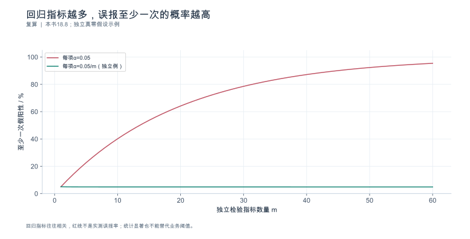
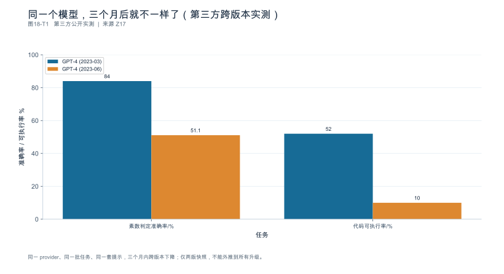
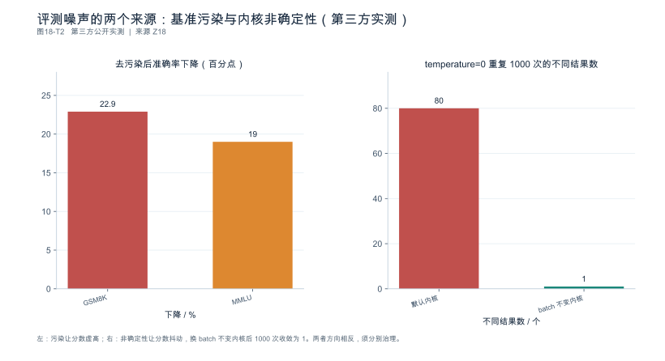

<a id="ch-18"></a>
## 第18章 端到端案例、回归测试与版本治理

**核心论点：**工程能力的终点不是得到一次最好结果，而是形成**可复核、可回退、能随版本持续更新**的证据与决策体系。

---

<a id="sec-18-01"></a>
### 18.1 贯穿案例：从业务问题到决策

**本节要回答的问题：**十八章的方法怎样连接成一次完整工程工作？

#### 18.1.1 一条链，八个环节

沿用全书同一个主案例，串成完整档案：

```text
① 任务与环境登记（第1章：SUT 边界、完成单位、制品清单）
        ↓
② 指标与服务目标（第7章：三量纲 + 起点/终点/时间域）
        ↓
③ 负载与可信基线（第8章：负载卡 W01—W08、发压器自检、重复）
        ↓
④ 观测与剖析（第9章：四层观测、三档证据、 trace 判读）
        ↓
⑤ 瓶颈假设与受控干预（第10章：四主干、事前预测、回退复测）
        ↓
⑥ 优化与消融（第11章：决策卡、组合消融、质量先于性能）
        ↓
⑦ 容量与扩容（第16章：包络、情景、控制回路滞后）
        ↓
⑧ 成本与治理（第17章 + 本章：单位有效成本、回归矩阵、版本台账）
```

**每一步引用已有运行而不重复造数据。**主案例尚未实测时保留可执行设计；实测到位后替换对应证据层。

#### 18.1.2 展示"哪条事实推动了下一步"

档案的价值在于可追溯：**最终建议能追溯到原始运行、适用负载与质量条件**。不是"我们优化了 X，提升了 Y%"，而是"由于 ⑤ 中排队主导被证实，⑥ 才选择改批预算而非换内核；若 ⑤ 的结论反转，⑥ 的选择应当改变"。

**依据与核验入口：**[R24] [R14]

---

<a id="sec-18-02"></a>
### 18.2 三类支线案例：没有唯一胜利路径

**本节要回答的问题：**如何用不同结局训练工程判断？

三类模板（**写作结构，不是预设结果**）：

| 类型 | 结构 | 训练的判断 |
|---|---|---|
| **配置改进有效** | 低复杂度调整获得改善 | 先做便宜的对照，别急着上架构 |
| **架构调整不值得** | 收益小于新增成本与风险 | 能说"不采用"也是成果 |
| **迁移部分适用** | 某类负载适合、某类保留 | 结论按负载分列，不给综合分 |

三条纪律：

1. **结果栏保持待验证**，实验后按事实选用；
2. **至少保留一个无收益或不采用的真实案例**，不能伪造反例以显得全面；
3. **作者应服从证据，而不是为了故事完整而修改结论。**

**依据与核验入口：**[R09] [R19] [R25]

---

<a id="sec-18-03"></a>
### 18.3 回归矩阵与发布门槛

**本节要回答的问题：**哪些变化值得重新跑哪些测试？

#### 18.3.1 三层回归

| 层 | 内容 | 成本 | 触发频率 |
|---|---|---|---|
| **低成本冒烟** | 功能、输出格式、指标口径单元测试 | 分钟级 | 每次变更 |
| **代表负载基线** | W01—W08 中的代表档 + 质量集 | 小时级 | 每日/每版本 |
| **条件触发扩展** | 长运行、故障恢复、容量扫描 | 天级 | 按变更类型 |

#### 18.3.2 变更 → 范围矩阵

| 变更 | 必须触发 |
|---|---|
| 模型 revision | 全套（质量、性能、容量）+ 制品清单更新 |
| **模板 / 分词器** | 质量集、输出格式与停止条件、长度分布与 TTFT/TPOT 基线、**前缀复用命中率** |
| 驱动 / 固件 | 全套 + **执行路径取证**（trace 内核名） |
| 引擎版本 / runner 默认切换 | 全套 + 图模式与回退取证 [SOURCE_REGISTERED] [S01] |
| **指标映射 / 工具升级** | **指标口径单元测试必须重跑** [SOURCE_REGISTERED] [S17] |
| 上游弃用 / 移除 | 受影响配置与实验清单 |
| 并行布局 / 配比 | 容量扫描与阶段能力 |

#### 18.3.3 阈值要考虑波动

**避免把噪声当回归，也避免因为总体平均不变而忽略关键场景退步。**推荐做法：

| 指标 | 建议触发线（示例，按业务定） |
|---|---|
| P50 延迟 | 变化 > 5% |
| **P99 / P99.9** | 变化 > 12%（尾部方差更大，第7章 7.4.3） |
| **质量达标率** | 下降 > 1 个百分点即触发 |
| 单位有效成本 | 上升 > 5% |

关键补充：**分层看，不只看总平均**——总平均不变而某一档退步是常见形态（第10章 10.1.2）。

**需要设备证据的执行回归，不得被"配置解析通过"替代。**

**依据与核验入口：**[R14] [R24] [R29] [S01] [S17] [S20]

---

<a id="sec-18-04"></a>
### 18.4 版本、来源命题、实验与结论的关联

**本节要回答的问题：**怎样知道某个判断对哪些版本仍然成立？

#### 18.4.1 六类身份分别保留

模型 revision、制品链、软件栈、负载画像、指标映射与图表脚本——**各自保留身份**，结论绑定完整实验组合。

#### 18.4.2 source_record：把"命题"登记下来

在 `run_manifest` 之外建立 `source_record`，每条来源命题记录：

| 字段 | 说明 |
|---|---|
| 具体命题 | 这句话在说什么（不是"某文档支持 X"这种笼统说法） |
| 产品 / 版本 / commit | 身份 |
| 模型 revision、硬件范围 | 适用边界 |
| **事件日 / 发布日期 / 查阅日** | **三个日期分开** |
| 正文定位 | 章节、段落或原文摘录 |
| 发布成熟度 | GA / RC / 预览 / 主干 |
| **两个独立布尔** | **`body_verified`（是否取到正文）与 `runtime_verified`（是否本地运行）** |
| 复核触发条件 | 什么情况下需要重新核验 |

**找到入口不等于核验了正文** [SOURCE_REGISTERED] [S06] [S23] [S24] [S25]。原稿的三条特定入口保留历史正文状态。本次另增加 CANN 8.5.0 离线剖析正文（N08）与 Ascend RC 测试报告（N09），它们可以支持各自范围内的新内容，不覆盖旧入口记录；HCCL/MindIE 尚缺所选部署版本的完整证据。

#### 18.4.3 升级不覆盖旧数据

后续版本升级**新增运行与比较**，不覆盖旧数据。旧结论可标为"待复核"或"不再适用"；修订记录解释变化来自**版本变化、负载变化，还是纠正错误**——这三者必须分开。

#### 18.4.4 合并稿不产生新的验证

**本合并稿的来源日期与正文状态承接原稿及复核报告，不因编辑合并而自动产生一次新的技术验证。**来源仍浮动且未固定 commit 的地方已明确标注；后续网页更新**新增记录**而不覆盖旧结论。

**禁止用浮动 `latest` 作为唯一身份。**

**依据与核验入口：**[R01] [R13] [R19] [R31] [S06] [S23] [S24] [S25]

---

<a id="sec-18-05"></a>
### 18.5 失败案例、弃用清单与技术时效性更新

**本节要回答的问题：**一次故障怎样变成以后少走弯路的资产？

#### 18.5.1 失败案例卡

字段：症状、环境、证据、处理、反例、复现状态。

**不把一次成功修复升级为所有系统的经验定律**——案例必须带适用条件。**复现失败同样记录**，并指出环境差异或信息缺失。

#### 18.5.2 生命周期三态

| 状态 | 含义 | 能否写成事实 |
|---|---|---|
| 已弃用 | 仍可用，不建议新用 | 是（已发生） |
| **计划移除** | 移除动作尚未发生 | 可写“官方计划”，不可写“已移除” |
| 已移除 | 路径不存在 | 是（已发生） |

两个真实案例 [SOURCE_REGISTERED] [S06] [S20]：

- **Dynamo 1.5.0 把 KVBM 标为弃用，并计划在 1.6 移除**——"计划移除"不是已发生，本稿不预判后续发布状态；
- **Ascend 0.26.0rc1 已移除 FlashComm2**——这是已发生的移除，旧教程的相关开关在该版本上直接失效。

#### 18.5.3 更新记录链接到受影响部位

每条生命周期变化要链接到：**受影响的章节、配置、实验与回滚路径**。状态语义不可混用：**已移除的功能不能继续作为默认推荐。**

**依据与核验入口：**[R16] [R24] [R25] [S06] [S20]

---

<a id="sec-18-06"></a>
### 18.6 公开技术书、公众号与工程资产

**本节要回答的问题：**如何共享研究而不把书变成营销材料？

#### 18.6.1 分层

| 载体 | 内容 |
|---|---|
| **技术书** | 完整论证、实验与反例 |
| 单篇笔记 | 选一个问题形成独立文章 |
| 工具与商业交付 | 可从实践中生长，但**不决定书中结论** |

二者引用同一研究资产，**不必逐字相同**。

#### 18.6.2 公开前检查

客户信息脱敏、授权、引用、实测状态四项都要检查。**读者无需购买服务也能理解并有条件复现公开内容**，商业材料不混入技术结论。

**依据与核验入口：**[R18]

---

<a id="sec-18-07"></a>
### 18.7 毕业项目：提交可审计的工程决策包

**本节要回答的问题：**怎样证明读者已经能独立接手一套推理系统？

#### 18.7.1 交付清单

系统档案、可信基线、诊断假设、受控优化、质量验收、容量成本、回滚建议——**七项齐全**。

#### 18.7.2 审查重点

三条：

1. **数据是否支持结论**（而不是结论挑选数据）；
2. **未知项是否明确**（缺口表是否诚实）；
3. **决策是否可执行**（有采用条件、风险、回滚与后续验证范围）。

#### 18.7.3 两种合格成果

- 证明了某项优化有效并给出边界；
- **证明了某项复杂优化不值得采用**。

**无需追求最大模型或最高提升。**

#### 18.7.4 不能做的事

**不存在把设计当实测、把引用当自测、把局部结果当通则的情况。**可交付完整设计而诚实保留缺口。

**依据与核验入口：**[R14] [R24] [R25] [S06] [S17] [S20]

---

### 18.8 深化：让书中的结论变成可持续审查的工程资产

#### 18.8.1 结论、来源、运行和图表不再是孤立文件

一条可维护的结论至少关联四种对象：声明它说了什么的claim、支持它的source或run、重算它的test、展示它的figure。它们的身份不必相同。例如“Qwen2.5-7B的逻辑KV为56 KiB/Token”依赖模型配置、BF16状态假设和计算程序；它不依赖一条GPU吞吐日志，也不能被标成GPU测量。

本版配套目录将原稿来源登记、新核验来源、公开案例数值、输入、E0测试结果与图表分开放置。原始章节的修改记录保留旧文和新文，便于追踪某个结论为什么改变。来源页面升级，只新增适用记录，不覆盖旧运行的事实。

#### 18.8.2 回归门槛必须区分噪声与业务风险

固定“P99变化超过12%就失败”可以是某个项目的规则，但不是全书通用统计标准。应先定义最小重要效应、可接受风险和重复单位，再估计运行波动。关键功能错误可以直接否决；性能则应结合差值区间、重复方向和实际业务影响。

同时检查很多指标会产生多重比较问题。作为纯统计例子，若20个相互独立、实际无变化的检验都使用5%误报率，则至少一个误报的概率为 $1-0.95^{20}\approx64.15\%$。真实指标相关，不能把这个值照搬，但它说明“指标越多就越可靠”不成立。可以预注册少量主指标，把其它指标作为诊断信息，再用独立运行确认报警。

对于模板升级，权重哈希不变只说明权重制品未变。输入分布和激活范围可能改变，量化、长上下文和关键任务仍需按影响范围回归。本版因此删除了原稿中无条件豁免权重量化验收的表述。

#### 18.8.3 本版真正执行的端到端链条是E0，不是假装GPU已测

本次可在普通计算机上完成的链条为：读取输入和公开数值→执行定义明确的计算→运行断言→生成数据表→重绘图表→检查文件关联。它验证了指标、公式和出版资产之间的一致性。读取官方报告、复算其数字，不等于重新运行报告中的模型。

读者可从配套程序的测试入口重跑：首Token与终端时间差、单Token请求的TPOT空值、分位算法差异、KV分片容量、关键路径和区间并集、推测推进量、扩容等待、净收益与整数副本数。报告中记录实际执行的测试数量和结果，不再靠正文反复写“已复算”作为证明。

硬件LAB另需服务授权、运行manifest、逐请求输出、质量标签和观测证据。其状态不因E0通过而自动升级。一个没有这些证据的“18章端到端实验全部完成”结论，在本版仍然不允许出现。

#### 18.8.4 发布应有三个独立门槛

第一是内容门槛：公式、单位、术语和跨章引用一致，重要论断有来源或明确推导。第二是资产门槛：图表可重建、链接有效、运行输入和脚本身份可追溯。第三是证据门槛：每个论断都能追溯到来源或明确推导，构造数据与公开数据分别标记。

公开资料、推导与第三方实测可以长期共存，不要求把所有例子替换掉。真正需要避免的是混淆它们，从而让读者误以为所有精确数字都来自同一套设备、同一模型和同一次实验。

---

<!-- V06-START -->
<a id="sec-18-09"></a>
### 18.9 实验图表补充：把多指标回归变成可验证的发布门槛

当每项指标都用5%的显著性门槛，且20项检验的零假设都为真、检验相互独立时，至少一项误报的概率是 $1-0.95^{20}\approx64.15\%$。这不是指标越多质量越差，而是未经调整的多重检验会改变整体误报风险。

图的第二条线给每项分配 $0.05/m$ 的Bonferroni门槛。独立示例可画精确曲线；“整体误报率不超过5%”的并集界本身不要求独立。代价是统计功效下降，因此不能据此机械制定所有发布规则。关键业务门槛、重大质量失败和统计比较应分层，而非把所有量塞入同一个p值体系。

本轮新增图表均对应JSON数据、公式或来源定位，并给出E0算术/资产检查。本次69项算术与资产检查全部通过（具体清单见随包JSON）；它们不测试GPU/NPU运行正确性，更不能继承原v0.5的98项计数当作这次全部重跑。

**发布纪律：**新实验新增run_id和source_record，不覆盖旧记录；数据与预期故事冲突时修改结论。将图、数值表、原始样本、环境身份、阈值与决策绑定。公开案例缺少逐请求样本时，就保留证据缺口，而不是为了完整章节补出一份不存在的结果。

#### 图18-V1 回归指标越多，误报至少一次的概率越高



**数据身份：**`TEACHING_CALCULATION`。**条件：**所有零假设为真；独立检验时画精确族错误率；Bonferroni的≤5%保证不要求独立。

| 指标数 | 未校正至少一次/% | Bonferroni独立例/% |
|---|---|---|
| 1 | 5.0 | 5.0 |
| 5 | 22.622 | 4.901 |
| 10 | 40.126 | 4.889 |
| 20 | 64.151 | 4.883 |
| 50 | 92.306 | 4.879 |

复算公式：`FWER=1-(1-alpha)^m`。

**出处与边界：**本书18.8；概率复算；回归指标往往相关，红线不是实测误报率；统计显著也不能替代业务阈值。

[数据与绘图点](book_support_v06/data/ch18_multiple_tests.json) · [PNG](book_support_v06/figures/ch18_multiple_tests.png) · [重绘代码](book_support_v06/code/replot.py)

<!-- V06-END -->
<!-- V08-START -->
<a id="sec-18-10"></a>
### 18.10 第三方数据补充（v0.8）：漂移与噪声：回归治理的两个前提

本章 v0.6 讲回归测试与版本治理。本轮补两组第三方实测，为"必须先固定制品与运行条件"这条纪律提供依据。

**前提一：确实会漂移（Chen、Zaharia、Zou《How Is ChatGPT\'s Behavior Changing over Time?》，arXiv:2307.09009；HDSR 2024）。**同一 provider、同一批任务、同一套提示（仅 user prompt、默认 system prompt、temperature=0.1），三个月内：GPT-4 的素数判定准确率从 84.0% 掉到 51.1%（−32.9 个百分点），代码可执行率从 52.0% 掉到 10.0%（−42.0 个百分点）。**这不是"模型变笨了"的段子，而是回归治理的现实：升级可能是静默的，且方向不保证。**

**前提二：不固定条件，连自己和自己都比不了。**两个方向相反的噪声同时存在。**污染让分数虚高**：对泄漏样本做难度保持改写后，GSM8K 准确率下降 22.9%、MMLU 下降 19.0%（Inference-Time Decontamination，arXiv:2406.13990）。**非确定性让分数抖动**：同一提示、temperature=0、重复 1000 次贪心采样，竟得到 80 个不同结果；换成 batch 不变内核后才收敛为 1 个（Thinking Machines Lab）。**前者要求评测集去污染，后者要求固定内核与批处理。**

**边界：**漂移实验仅两版快照、单一 provider、时间窗 3 个月，部分任务样本小（代码 n=50），不能外推到所有升级。ITD 去污染依赖检测器精度（报告检测到 62.7%/79.4% 泄漏），残留污染仍会高估；其证明性实验为人工注入污染，下降幅度不等于真实污染程度。非确定性实验来自单一团队、集中于 vLLM 与少数内核。

#### 图18-T1 同一个模型，三个月后就不一样了（第三方跨版本实测）



**数据身份：**`THIRD_PARTY_MEASURED`（第三方公开数据）。**条件：**Chen、Zaharia、Zou《How Is ChatGPT's Behavior Changing over Time?》（arXiv:2307.09009；HDSR 2024）；两版均为当时在售 API 版本，仅用 user prompt、默认 system prompt、temperature=0.1。

| 任务 | GPT-4 (2023-03) | GPT-4 (2023-06) | 变化 |
|---|---|---|---|
| 素数判定准确率/% | 84.0 | 51.1 | −32.9 个百分点 |
| 代码可执行率/% | 52.0 | 10.0 | −42.0 个百分点 |

**出处与边界：**[Z17](book_support_v08/来源与核验_v08.md#z17)；仅两版快照、单一 provider、时间窗 3 个月，不能外推到所有版本升级；部分任务样本较小（代码 n=50）；未公开确切内部版本号。

[数据与绘图点](book_support_v08/data/ch18_tp_drift.json) · [PNG](book_support_v08/figures/ch18_tp_drift.png) · [重绘代码](book_support_v08/code/replot_v08.py)

#### 图18-T2 评测噪声的两个来源：基准污染与内核非确定性（第三方实测）



**数据身份：**`THIRD_PARTY_MEASURED`（第三方公开数据）。**条件：**ITD（arXiv:2406.13990）：对泄漏样本做难度保持改写，GSM8K 8-shot CoT、MMLU 官方 5-shot、greedy；Thinking Machines Lab：vLLM + FlexAttention，temperature=0，重复 1000 次贪心采样。

| 现象 | 数值 | 口径 |
|---|---|---|
| GSM8K 去污染后准确率下降 | 22.9 | %（Inference-Time Decontamination） |
| MMLU 去污染后准确率下降 | 19.0 | %（Inference-Time Decontamination） |
| temperature=0 重复 1000 次得到的不同结果数 | 80 | 个（batch 不变性缺失） |
| 替换为 batch 不变内核后的不同结果数 | 1 | 个（1000 次完全一致） |

**出处与边界：**[Z18](book_support_v08/来源与核验_v08.md#z18)；ITD 去污染依赖检测器精度（报告检测到 62.7%/79.4% 泄漏），残留污染仍会高估；其证明性实验为人工注入污染，下降幅度不能等同真实污染程度。非确定性实验来自单一团队、集中于 vLLM 与少数内核；batch 不变内核的端到端开销随实现而变。

[数据与绘图点](book_support_v08/data/ch18_tp_nondet.json) · [PNG](book_support_v08/figures/ch18_tp_nondet.png) · [重绘代码](book_support_v08/code/replot_v08.py)

<!-- V08-END -->
### 章末检查问题

**1. 实测结果与预期故事冲突时，应该修改什么？**

答案方向：**修改结论，不修改数据。**具体三步：① 先检查是不是测量问题（口径、时间域、分母、工具映射）——第10章假设树的第 ④ 支就是为此而设；② 若测量无误，则按证据改写结论，包括允许"尚无法区分两种解释"这种结论，并写明下一项证据；③ 记录这次冲突本身进案例库（18.5），症状、环境、证据、处理、反例齐全。**严禁的是**：为了故事完整而删掉不利样本、放宽质量门槛，或把推测写成已验证。第18.2 节的三类支线模板明确要求结果栏标注证据状态。

**2. 模型模板变化但权重没变，哪些回归必须触发？**

答案方向：模板变化至少触发质量、格式与停止、长度分布、性能与前缀命中回归。**权重文件未改变，只能复用制品身份校验，不能无条件豁免量化质量与数值风险验收。**模板会改变输入分布、激活范围、推理长度和校准覆盖；若它触及量化敏感场景、长上下文或关键任务，必须重跑相应独立子集。回归范围按影响分析决定，而不是仅检查权重哈希。

**3. 如何防止官网更新覆盖历史实验适用的版本事实？**

答案方向：三条机制。① **固定身份**：来源必须固定 commit 或存档快照，禁止用浮动 `latest` 作为唯一身份；② **三个日期分开存**：事件日、发布日期、查阅日分别记录（18.4.2），后续更新**新增一条记录**而不是修改旧记录；③ **两个独立布尔**：`body_verified`（是否取到正文）与 `runtime_verified`（是否本地运行）分开，找到入口不等于核验了正文。这样旧实验结论仍绑定它当时的版本事实，新版网页只产生一条待复核的新记录。原稿三条入口的历史状态不变；本次已补的 N08/N09 使用新记录，不能倒填为旧入口当时已核验 [SOURCE_REGISTERED] [S24] [S25] [S26]。

---

### 本章验收清单

| 节 | 验收标准 |
|---|---|
| 18.1 | 主案例八环节齐全且不重复造数据；最终建议可追溯到原始运行、负载与质量条件 |
| 18.2 | 三类支线模板齐全；结果栏待验证；至少保留一个无收益/不采用的真实案例 |
| 18.3 | 三层回归与变更→范围矩阵完整；阈值考虑波动与分层；设备证据不被配置解析替代 |
| 18.4 | 六类身份分别保留；source_record 含三日期与两布尔；升级不覆盖旧数据；不用 latest 作唯一身份 |
| 18.5 | 失败案例卡带适用条件；生命周期三态不混用；更新记录链接到受影响部位 |
| 18.6 | 技术书与单篇笔记分层；公开前四项检查完成；商业材料不混入技术结论 |
| 18.7 | 七项交付齐全；审查三重点通过；存在"不采用"类合格成果；不把设计当实测 |

---

### 本版配套资料

[新增图表与数据](book_support_v05/figures.md) · [来源登记](book_support_v05/references.md) · [E0测试清单](book_support_v05/data/e0_test_results.md) · [修订记录](book_support_v05/review/changes.md)

[R01]: book_support_v05/references.md#r01
[R09]: book_support_v05/references.md#r09
[R13]: book_support_v05/references.md#r13
[R14]: book_support_v05/references.md#r14
[R16]: book_support_v05/references.md#r16
[R18]: book_support_v05/references.md#r18
[R19]: book_support_v05/references.md#r19
[R20]: book_support_v05/references.md#r20
[R24]: book_support_v05/references.md#r24
[R25]: book_support_v05/references.md#r25
[R29]: book_support_v05/references.md#r29
[R31]: book_support_v05/references.md#r31
[R33]: book_support_v05/references.md#r33
[S01]: book_support_v05/references.md#s01
[S06]: book_support_v05/references.md#s06
[S17]: book_support_v05/references.md#s17
[S20]: book_support_v05/references.md#s20
[S23]: book_support_v05/references.md#s23
[S24]: book_support_v05/references.md#s24
[S25]: book_support_v05/references.md#s25
[S26]: book_support_v05/references.md#s26

<!-- V10-START -->
<a id="sec-18-90"></a>

### 本章口径核对（公开来源）

#### 三条昇腾入口的公开正文对照

本节把全书引用的三条昇腾入口的公开文档口径集中列出，便于在回归测试与版本治理中逐条核对。

**入口一：msprof（性能数据采集）**

命令为 `msprof [options] <app>`。与本环境最相关的参数：`--output`（落盘目录）、`--type=text|db`、`--task-time=l0|l1|l2|l3|on|off`（CANN 社区版 9.2.0-beta.1 文档：默认 `on`，等价 `l1`；`l1`/`l2` 支持集合通信算子数据；`l3` 采 PyPTO，官方标注为试用特性）、`--ai-core`、`--aic-mode=task-based|sample-based`（默认 task-based）、`--aic-freq`（1~100 Hz，默认 100）、`--aic-metrics`（9 种指标 + `Custom:` 自定义寄存器，最多 8 个）、`--aicpu`、`--sys-hardware-mem`、`--sys-hardware-mem-freq`（默认 50）、`--l2`、`--ge-api`、`--task-memory`、`--task-block`（仅 Ascend 950PR/950DT）。`--aicore-shape` 的官方出处尚未取得，已从第 9 章与本节的参数清单中移除（见下方订正）。

落盘为 `--output` 下的 `PROF_XXX` 目录；EP 场景直接可读，RC 场景须回开发环境解析。`--model-execution` 与 `--hccl` 已标注后续版本废弃，改用 `--task-time`。完整清单见第 9 章。

**入口二：HCCL Test（通信能力与健康测试）**

工具以固定初值初始化算子输入并校验输出，输出字段为 `data_size`（Bytes）、`aveg_time`（μs）、`alg_bandwidth`（GB/s，算法带宽口径）、`check_result`（`success` / `failed` / `NULL`）。`-c` 控制是否开启校验（默认 1 开启）；`check_result` 为 `NULL` 表示未校验或超出可精确表示范围。归约类算子的校验卡数存在明确上界，AllGather/AlltoAll 等算子在 int8/uint8 下最大 127 卡。`-p` 的可用范围随产品不同。完整表格见第 15 章。

**入口三：MindIE（推理服务）**

社区版 3.1.0（公告日 **2026-08-19**；同日另有"架构升级与模块更名"公告），组件划分为 MindIE Motor（服务化）、MindIE SD（多模态生成）、MindIE LLM（文本生成）与可选的 MindIE Turbo，支持对接 vLLM / SGLang。服务化能力包括 K8S 云原生部署与弹性伸缩、PD 实例级故障隔离与恢复（自愈型 60 秒内、系统级 7 分钟内——**属产品页厂商宣称，未标版本与条件**）、负载感知的 PD 分离调度与 AutoPD 自动配比寻优、核心组件主备倒换。完整口径见第 15 章。

**三条入口的边界共性**

- 三者都以**版本**为口径单位：msprof 的默认值与产品支持范围随 CANN 版本变化，HCCL Test 的校验上界与 `-p` 范围随产品型号变化，MindIE 的模块划分在 3.1.0 发生过更名。
- 三者的公开文档都未给出完整的跨版本兼容矩阵表，因此回归测试中必须显式记录实际使用的版本与型号，而不是引用"最新文档"。
- msprof 的文档明确要求以运行环境的 `msprof --help` 输出为准；这一原则同样适用于另两条入口。

> **核对说明（2026-10-09）**：
> ① **`--aicore-shape` 已从参数清单移除**——CANN 社区版 9.2.0-beta.1 官方页全篇未收录该参数，原"仅 `--task-time=l0` 生效"的说法只见于第三方博客与源码枚举，登记为待核验，不作官方事实引用。
> ② **`--task-time` 默认值跨版本冲突**——本版 CANN 文档写默认 `on`(=l1)，MindStudio 侧文档写默认 `l0`；这正是"三者都以版本为口径单位"的实例，回归测试必须记录实际文档版本。
> ③ **MindIE 的 60 秒 / 7 分钟降级为厂商宣称**（同第 12、15、17 章订正）：出处为产品页"关键特性"，无版本号、无测试规模与 SLO 条件。
> ④ 公告日为 **2026-08-19**。差一天就可能把“计划移除”读成“既成事实”，这正是版本治理要防的错误——**公告日期决定"计划移除"与"已移除"的时间语义**，写错一天就可能把"计划"读成"既成事实"。
<!-- V10-END -->
